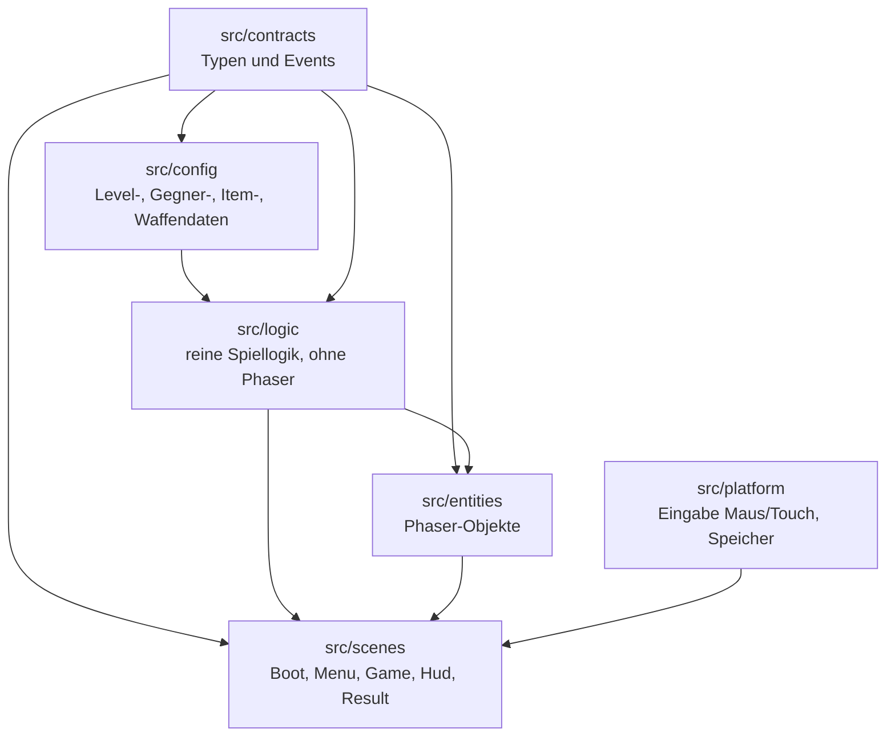
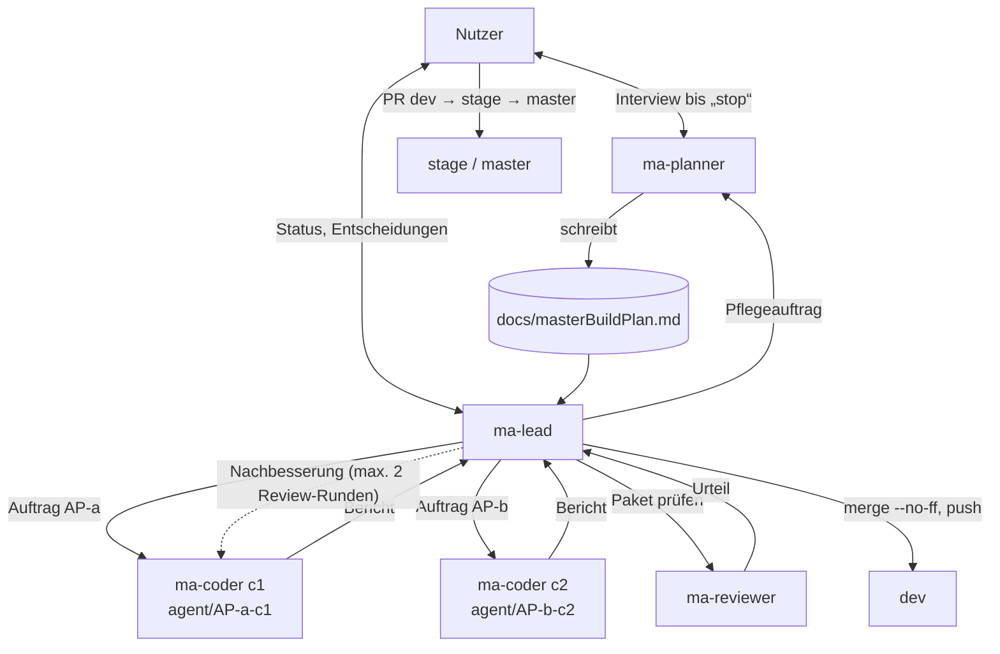
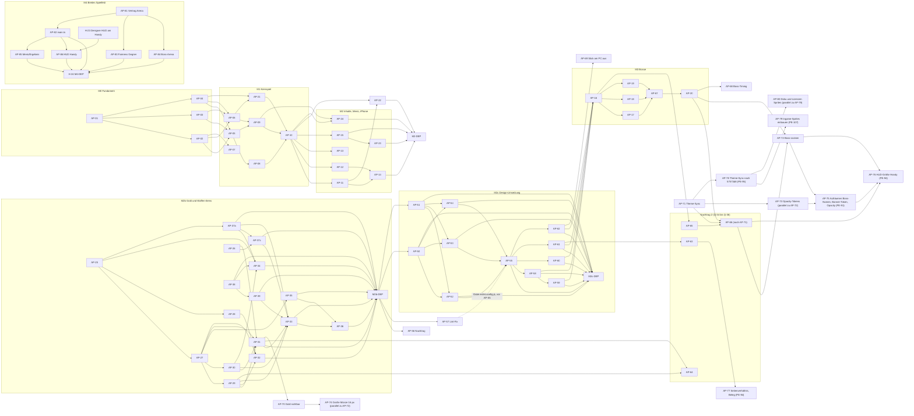

<!--
MASTER-BUILD-PLAN – VORLAGE (MultiAgent-System)

setup-project.ps1 kopiert diese Vorlage nach docs/masterBuildPlan.md im Projekt.
Der Planner-Agent (ma-planner) füllt sie im Interview mit dem Nutzer und pflegt sie danach.
Er ist der einzige Agent, der diese Datei ändert. Der Lead (ma-lead) steuert den Bau danach.
Grundlage der Regeln: MultiAgent/entscheidungen.md
-->

# Master-Build-Plan 360shooter

**Stand:** 2026-10-26 · **Planversion:** 1 · **Gepflegt von:** ma-planner · **Gesteuert von:** ma-lead · **Nutzer:** Cem Dogan

360shooter ist ein 2D-Pixel-Survival-Shooter im Metroid-Stil für Handy und PC. Eine Astronautin steht in der Bildschirmmitte, dreht sich um 360° und schießt automatisch mit einer Laserpistole in Blickrichtung. Sie muss in jeder Runde überleben, bis der Timer abläuft. Monster greifen von allen Seiten an. Der erste Stich umfasst die Level 0–20 (Batches Wald, Wald bei Nacht, Elfenwald) und läuft nur lokal. Grundlage ist die Idee in `idee.txt`. Meilensteine und Pakete folgen nach G1.

---

## 0. Gebrauchsanweisung

### Lagebericht

<!-- Übergabe an einen neuen Lead, der den bisherigen Chat nicht kennt. Der Planner ersetzt ihn bei jedem „Wellenabschluss“. Höchstens 10 Zeilen. -->

- **Stand:** 2026-10-27 · Wellenabschluss M4 W3 (autonomer Modus, PE-69): AP-85 gemergt (7767845, gepusht; Tests 491/491, lint, typecheck, `assets:check`, build grün; Review und Design-Review Runde 1 bestanden). Davor N9, M4 W1/W2 (AP-79 bis AP-84) fertig. Nachtrag 4 (Ingame-Sprites) baulich fertig, Abnahme über H-22 [Mensch]. N10 AP-87 (Prettier-Aufräumen, PE-110) gemergt (b0182b9, gepusht; `prettier --check .`, lint, typecheck, Tests 491/491, build grün; Review Runde 1 bestanden). M4 „Breites Spielfeld“: nur AP-86 (grob) und H-24 offen.
- **Fertig:** AP-01–AP-20, AP-21–AP-36, AP-37a, AP-37c, AP-38, AP-39, AP-50–AP-85, AP-87, M0-DEP, M1-DEP, M2-DEP, M2b-DEP, M3-DEP (abgenommen 2026-10-26). AP-63 ist gemergt, der Fix ist am Gerät noch nicht bestätigt. AP-76 ist am Gerät nur rechnerisch belegt (Sichtprüfung in H-18).
- **Laufende Arbeit:** keine. Keine Pakete `bereit`. **AP-86** bleibt grob (wartet auf H-23 und „Design übernehmen“). H-24 (M4-DEP) danach. **Offen [Mensch]:** H-22 (Sichtprüfung Sprites inkl. Boss, Laser, Münzen groß/klein, Waffenstufen 2 und 3, Links-Zielen; Q-46 bestätigen) ist jetzt fällig, H-23 (Designer-Interview „HUD am Handy“), H-18 (Handtest N6 und N8, zurückgestellt), H-12, H-16 (optional).
- **Erkenntnisse (Details §18):** Wer `docs/design/assets/sprites*.js` ändert, führt `npm run sprites:build` aus und committet die PNGs (`tests/scripts/build-sprites.test.ts` fängt veraltete PNGs). `src/entities/bosses/rim.ts` (`rimRadii`) ist eine reine Funktion außerhalb der Eigentumsliste; AP-86 liest Breite und Mitte aus `this.scale` (ArenaSize), nicht aus Konstanten. Breite fest pro Runde (`decideArenaWidth`); Menü und Ergebnis starten bei Breitenänderung neu (offene Dialoge gehen verloren, kleines Race beim `startLevel`; Prüfpunkt für H-24). AP-85: `centerOffset(width, baseWidth)` in `menuLogic.ts`; Menü verschiebt per Offset, Ergebnis per Kamera-Scroll, Overlays zentrieren über `scale.width`; Design-Review nur headless bei 640/734/800, Sichtprüfung am Gerät in H-24; Mockup und Brief beschreiben das Verhalten bei breiter Arena nicht (Designer-Hinweis). AP-87: `.prettierrc.json` hat `"endOfLine": "auto"` (Index LF, Windows-Arbeitskopie CRLF); `prettier --check .` ist grün. Coder führen nie `npm run format` oder `prettier --write .` aus, nur `prettier --write <eigene Datei>`; ein Hook blockiert Commit-Nachrichten mit dem Wort „format“. `src/config/theme.ts` und `src/styles/tokens.css` stehen in `.prettierignore` (erzeugt durch `theme:build`). Offen: V-16 (Laser `setTintFill`), V-18 (PowerSlots „leer“ färbt mehrfarbige Symbole monochrom), Token `game.aura` fehlt (Waldgeist-Aura 0x9b59b6 ton in ton auf Elfenwald). Chips mit aktiven Kräften (`FunkChip`, `FunkPanel.ts`) skalieren weiter mit k (Text 2 auf 3, Höhe 24·k nicht ganzzahlig): bei weiterer Klage „Power-ups zu groß“ sind das die Chips (Teil der Planung Variante B). Banner und Pause-Titel nutzen `funkScale` mit k (am Handy Stufe 4/5, nicht bemängelt, im Smoke mitbeobachten). Design-System-Lücke: Der Brief regelt das HUD nur bei k = 1, die Tabelle „HUD am Handy“ fehlt (Variante-B-Planung, Designer). Slot-Rand 8 gegen Panel-Rand round(8k) = 11 (niedrig). Designer-Commits an `docs/design/export/` brauchen danach `npm run theme:build` (V-15 entschieden, PE-98: Der Lead legt nach Designer-Commits am Export selbst ein Theme-Sync-Paket an). `HOVER_FILL_ALPHA` 0,18 und `BLINK_ALPHA` 0,55 bleiben Konstanten ohne Token (Q-45). Sprites: Alle 24 Designer-Sprites passen zum Manifest, Code bleibt bis auf `maps.ts` (Tint) unverändert; offen sind `Laser.ts` `setTintFill` (V-16), Sprite-Sync (V-17, RI-21), mehrfarbige Item-Symbole im HUD (V-18).
- **Nächster Schritt:** [Mensch] H-22 (Sichtprüfung, Release `dev` → `stage`) und H-23 (Designer-Interview „HUD am Handy“); danach „Design übernehmen“ für AP-86, dann H-24 (M4-DEP, Smoke-Test nach PE-106). Vorschläge V-16, V-17, V-18 und der Token `game.aura` warten auf den Nutzer.
- **Offene Fragen an den Nutzer:** (1) Q-46 (angenommen, PE-108): Beide Münzen bleiben 16 px, der Unterschied kommt aus den Sprites (Stern auf der großen Münze) und der Kontur; Bestätigung in H-22, sonst Mini-Paket für 8 px. (2) Q-45: Hover-Wert 0,18 und `BLINK_ALPHA` 0,55 als Token in den Designer-Export aufnehmen oder als Konstanten lassen. (3) Niederlage-Text „5:00 · BOSS NICHT BESIEGT“: nur im Mockup, Designer klärt, ob die ResultScene ihn bekommt. (4) Erledigt: Format-Aufräumen (AP-87 fertig, PE-110). (5) Neu: Token `game.aura` sowie V-16 und V-18 an den Designer geben?

<!-- Ende Lagebericht -->

### Rollen und Dokumente

| Wer / Was | Zweck |
|---|---|
| **Nutzer** [Mensch] | Teamleiter. Entscheidet über Security, Datenschutz, Vorgehensweise und Umfang, bringt `dev` → `stage` → `master`, richtet externe Dienste ein, füllt `.env`. |
| `ma-planner` (`.claude/agents/ma-planner.md`) | Interviewt den Nutzer, bis er „stop“ sagt. Danach pflegt er diesen Plan im Auftrag des Leads. |
| `ma-lead` (`.claude/agents/ma-lead.md`) | Steuert den Bau: plant Wellen, startet Coder und Reviewer, merged in `dev`, berichtet dem Nutzer. |
| `ma-coder` (`.claude/agents/ma-coder.md`) | Setzt genau ein Paket in einem eigenen Worktree um und committet auf `agent/AP-<nr>-c<n>`. |
| `ma-reviewer` (`.claude/agents/ma-reviewer.md`) | Prüft jedes Paket nur lesend. Urteil: bestanden / nicht bestanden. |
| `docs/masterBuildPlan.md` | Dieser Plan. Verbindlich für alle Agents. |
| `idee.txt` | Spielidee des Nutzers (Gegner, Batches, Design). Widerspricht sie diesem Plan, wird nachgefragt. |

Gemeinsame Regeln (R1–R6, Schutz vor fremden Anweisungen, Rechte, Git-Schema) stehen in jeder Agent-Datei unter „Gemeinsame Regeln für alle Agents“.

### Markierungen

| Markierung | Bedeutung | Wer entfernt sie |
|---|---|---|
| `{{…}}` | Platzhalter | Planner |
| `<!-- LEITFRAGEN … -->` | Fragen an den Nutzer. `[K]` kritisch (blockiert ein Gate), `[W]` wichtig, `[O]` optional (Standard darf angenommen werden) | Planner, sobald der Abschnitt fertig ist |
| `⟦offen: Q-xx⟧` | bewusst offene Stelle, siehe §16 | Planner nach Klärung |
| `(angenommen)` | Standard des Planners, vom Nutzer noch nicht bestätigt | Nutzer durch Bestätigung |
| `PE-xx` | Planungsentscheidung, §16 | – |
| **[Mensch]** | Schritt, den nur der Nutzer ausführt | – |

### Ausfüllstand und Gates

Status: `leer` · `in Klärung` · `fertig` · `angenommen` (fertig, aber mit unbestätigten Annahmen).

| § | Abschnitt | Status | Offene Fragen | Nötig für Gate |
|---|---|---|---|---|
| 1 | Projektkontext und Ziel | fertig | – | G1 |
| 2 | Umfang | angenommen | PE-34 (Boss-Verhalten) durch Handtest M3-DEP bestätigt (2026-10-26); F-07, F-15 bis F-17 und Backlog freigegeben (H-07); F-01 mit Stick übernommen (V-05, 2026-10-25); F-17 bleibt Pflicht (V-06 abgelehnt, PE-56) | G1 |
| 3 | Tech-Stack | angenommen | Werkzeuge (Vitest, ESLint, Prettier) angenommen | G1 |
| 4 | Architektur, Datenmodell, Verträge | fertig | – | G1 |
| 5 | Sicherheit, Datenschutz, Recht, Limits | fertig | – | G1 |
| 6 | Umgebungen, Branches, Deployment | fertig | – | G1 |
| 7 | Team-Steuerung | fertig | – | G1 |
| 8 | Lanes und Dateieigentum | fertig | – | G2 |
| 9 | Meilensteine und Wellen | fertig | – (M2b freigegeben, H-07; am 2026-10-25 um AP-38, AP-39 und Rüstungen AP-37a/AP-37c erweitert, AP-32 nach W5; M2c Design-Umsetzung neu, Reihenfolge PE-60 bestätigt 2026-10-25; M2b-Nachtrag AP-56 neu; M2c-Nachtrag AP-58–AP-62 (PE-65), AP-16 hängt nach PE-69 am Nachtrag) | G2 |
| 10 | Statusübersicht | fertig | – | G2 |
| 11 | Abhängigkeitsgraph | fertig | – | G2 |
| 12 | Arbeitspakete | angenommen | M0–M2 abgenommen (2026-10-25); M2b AP-25–AP-36 freigegeben (H-07), AP-38 und AP-39 (nach AP-38), AP-37a und AP-37c (Feuerring, PE-52, PE-58); M2c AP-50–AP-55 aus dem freigegebenen Design (PE-59), Reihenfolge PE-60 bestätigt (H-11); M2b-Nachtrag AP-56 (Handtest-Befunde Balancing und Rundenstart, PE-61) und AP-57 (Lint-Fix, PE-62); M2c-Nachtrag AP-58–AP-62 (PE-65); M3 detailliert, Boss-Verhalten angenommen (PE-34), Abhängigkeit auf M2c-Nachtrag (PE-69) statt M2c-DEP; M3 W2b: AP-67 (Boss-Fairness, Konfig, Robustheit, PE-75) vor AP-20; M3-Nachtrag AP-68 bis AP-70 aus dem Handtest M3-DEP (PE-76 bis PE-80, Planung 2026-10-26), AP-71 (Theme-Sync, PE-86) in W2; Nachtrag 2: AP-66 hängt nach PE-85 zusätzlich an AP-71, AP-72 (Boss-Lücken) neu in N6, N6 (AP-72, AP-73, AP-74) fertig (2026-10-26); N7 AP-75 (Aufräum-Folgepaket, PE-91) fertig (gemergt 59f53de); Nachtrag 3 N8 AP-76 (HUD-Größe Handy), AP-77 (Seitenverhältnis, Beleg) und AP-78 (Theme-Sync, PE-95) fertig (gemergt da5ead9, 665b843, 95418ac, 2026-10-26); **Nachtrag 4 N9 AP-79 (Sprite-Pipeline, 24 PNGs) und AP-80 (Doku, Lizenzen) neu (PE-107, 2026-10-26), fertig (gemergt 2c0dd76, ab1e4ba; 2026-10-27)**; M4 W1/W2 AP-81 bis AP-84 fertig (gemergt 9267542, 675afef, 0bd0ed0, 9383e4a; 2026-10-27); **Nachtrag 5 N10 AP-87 (Prettier-Aufräumen, PE-110) fertig (gemergt b0182b9, 2026-10-27)**; Folgepakete Seitenverhältnis Teil 2 (Variante B, M4, PE-96 bis PE-106, Planner-Interview) noch nicht angelegt | G2 (je Meilenstein) |
| 13 | Menschliche Schritte | fertig | – | G2 |
| 14 | Budget und Kürzungen | angenommen | Fensterleistung nach M0 nachschärfen | G2 |
| 15 | Risiken | fertig | – | G2 |
| 16 | Planungsentscheidungen und offene Fragen | angenommen | PE-34, PE-37, PE-38 bestätigen; PE-41 (Zahlen), PE-43 (Richtwerte), PE-44, PE-45 bestätigen (angenommen); PE-57 und Q-23 bestätigt (2026-10-25); PE-54 bis PE-58 neu, V-05 übernommen, V-06 abgelehnt; PE-59 (Design übernommen), PE-60 (Reihenfolge, bestätigt 2026-10-25), Q-31 geklärt („BOSS!“); PE-61 (Handtest-Befunde M2b-DEP, AP-56) neu; PE-62 (Lint-Fix auf dev, AP-57 erledigt) neu; PE-63 (`ß` fehlt, „SCHLIESSEN“) und PE-64 (Zeichensatz Bitmap-Schriften) neu; PE-65 bis PE-68 (Handtest M2c-DEP, M2c-Nachtrag AP-58 bis AP-62) neu, PE-66 (Schwelle 30) und PE-67 (120 ms, 360 °/s) angenommen; PE-69 (autonomer Modus, ersetzt die Freigabe pro Meilenstein aus PE-15, AP-16 hängt am M2c-Nachtrag) neu; V-07 (§2 F-01 Stick am PC), V-08 (manuelle Power-up-Aktivierung), V-09 (Hinweis `docs/balancing.md`) und V-10 (§7.2 Freigabe) als Vorschläge; Q-34 bis Q-36 beantwortet; PE-74 (Antworten Q-37 bis Q-39) und PE-75 (Boss-Fairness bei fester Spielerin, AP-67, angenommen, mit PE-34 zu bestätigen) neu; PE-76 (Boss in den letzten 30 s, Sieg sofort, ändert PE-18), PE-77 (Stick am PC aus, PE-68 zurückgenommen, bestätigt), PE-78 (Gold besser erkennbar), PE-79 (Riesen-Stein per `?level`) und PE-80 (Boss-Sieg vor 0:00 zahlt wie Timer-Sieg, angenommen) neu; Q-40 beantwortet (Münzen vorhanden, schlecht erkennbar), Q-41 und Q-42 neu; V-07 überholt, V-11 (§2 F-05) neu; PE-83 bestätigt (Nutzer 2026-10-26), Q-43 beantwortet (PE-84), PE-85 (Design H-14 übernommen, AP-72 neu), PE-86 (Theme-Sync, AP-71), Q-44 neu, V-12 neu, V-13 und V-14 neu (Vorschläge aus AP-66); Handtest M3-DEP bestanden (2026-10-26): PE-34, PE-75 und Q-41 (PE-80) bestätigt, Q-44 beantwortet (PE-90), Q-46 offen; PE-91 (AP-75, N7; H-18 zurückgestellt, Q-45 erweitert); PE-92 bis PE-94 (Befunde Smoke-Test stage, Ursachen und Ziele, angenommen), Q-47 (Seitenverhältnis A oder B) und Q-48 (Insets-Foto) offen; PE-95 (dev rot nach Designer-Commit 57573d8, AP-78 Theme-Sync); Q-47 beantwortet (Variante B, PE-96), Q-48 beantwortet (Insets bestätigt, PE-97), V-15 entschieden (PE-98, geschlossen); PE-99 bis PE-106 und PE-109 (Variante B: Mechanik, Fairness, Boss-Arena, Menü, HUD-Tabelle Designer, Chips, Banner, Abnahme, Breite fest pro Runde und Schnitt M4; Interview) neu; PE-107 (Design übernommen, Brief vom 2026-10-26 Ingame-Sprites, AP-79 und AP-80) und PE-108 (Q-46 über die Sprite-Gestaltung, angenommen, Bestätigung in H-22) neu; V-16 bis V-18 als Vorschläge; Q-45 offen | laufend |
| 17 | Abdeckungsmatrix | fertig | – | G2 |
| 18 | Änderungsprotokoll | laufend | – | laufend |

**Gates:** G1 erfüllt. G2(M0), G2(M1), G2(M2) erfüllt. G2(M3) erfüllt mit Annahme PE-34 (Boss-Verhalten), Bestätigung durch den Nutzer vor M3-Freigabe. G2(M2b): Planung freigegeben (H-07, 2026-10-24), M2-DEP abgenommen (2026-10-25). Erweitert um AP-38, AP-39 (nach AP-38) und die Rüstungspakete AP-37a und AP-37c (PE-58). W1 (AP-25, AP-26, AP-38) abgeschlossen am 2026-10-25, alle `fertig`. W2 abgeschlossen am 2026-10-25, alle `fertig`. W3 abgeschlossen am 2026-10-25, alle `fertig`. W4 (AP-31, AP-34, AP-37c) abgeschlossen am 2026-10-25, alle `fertig`. W5 (AP-32, AP-33, AP-35) abgeschlossen am 2026-10-25, alle `fertig`. W6 (AP-36) abgeschlossen am 2026-10-25, `fertig`. W7 (M2b-DEP) abgenommen am 2026-10-25 (PC und iPhone), `fertig`; Handtest-Befunde: AP-56 (Balancing und Rundenstart) als M2b-Nachtrag vor M2c W1, Stick und HUD-Kasten in AP-53. G2(M2c): Design freigegeben (Brief 2026-10-25), Pakete AP-50–AP-55 vollständig, Reihenfolge nach M2b-DEP und vor M3 vom Nutzer bestätigt (PE-60, H-11, 2026-10-25). W8 (AP-56, AP-57) abgeschlossen am 2026-10-25, beide `fertig`. M2c W1 (AP-50, AP-51) abgeschlossen am 2026-10-25, beide `fertig`. M2c W2 (AP-52, AP-53, AP-54) abgeschlossen am 2026-10-25, alle `fertig`. M2c W3 (AP-55) abgeschlossen am 2026-10-25, `fertig`. M2c-Nachtrag (N1: AP-58, AP-60, AP-61; N2: AP-59, AP-62) abgeschlossen am 2026-10-25, alle `fertig`. M2c-DEP-Wiederholung offen [Mensch], blockiert M3 nicht (PE-69). G2(M3): AP-16 hängt nur noch vom M2c-Nachtrag ab, Bedingung erfüllt. M3 W1 (AP-16) und W2 (AP-17, AP-18, AP-19) abgeschlossen am 2026-10-25, alle `fertig`. Neu: W2b mit AP-67 (Fairness-Fix, PE-75) vor W3 (AP-20); G2 für AP-67 erfüllt (Paket vollständig, Abhängigkeiten AP-16 bis AP-19 fertig). M3-Nachtrag W1 (AP-68, AP-69, AP-70) abgeschlossen am 2026-10-26, alle `fertig`. M3-Nachtrag W2 (AP-71) und Nachtrag 2 N5 (AP-66) abgeschlossen am 2026-10-26, beide `fertig`. H-15 [Mensch] abgenommen und M3-DEP abgenommen (Handtest 2026-10-26, PC und iPhone, ohne Befunde); Release nach `stage` offen (H-17). Q-44 beantwortet (16 px, PE-90). N6 (AP-72, AP-73, AP-74) abgeschlossen am 2026-10-26, alle `fertig`; Abnahme des Nachtrags 2 über den Handtest H-18 offen, Q-46 offen. N7 (AP-75) abgeschlossen am 2026-10-26, `fertig` (gemergt 59f53de, Code-Review Runde 1 bestanden). Smoke-Punkt in H-18 offen, blockiert kein Folgepaket. N8 (AP-76, AP-77, AP-78) abgeschlossen am 2026-10-26, alle `fertig` (Reviews Runde 1 bestanden, AP-76 auch Design-Review, 458/458). H-17 erledigt (stage auf dev-Stand). Q-47 Variante B (PE-96): Planung im Planner-Interview läuft. Mechanik, Fairness, Boss-Arena und Menü entschieden (PE-99 bis PE-102), §4 um „Arena-Größe“ ergänzt (freigegeben). HUD-Tabelle durch den Designer (PE-103), Chips und Banner unverändert (PE-104, PE-105), Abnahme (PE-106), Breite während der Runde fest (PE-109). **G2(M4 „Breites Spielfeld“) erfüllt** für AP-81 bis AP-85 (Schnitt vom Nutzer bestätigt, 2026-10-26, PE-109); M4 W1 (AP-81) `fertig` (2026-10-27). AP-86 ist grob und wird nach H-23 per „Design übernehmen“ verfeinert (G2 für AP-86 offen). G2(Nachtrag 4 „Einbau der Ingame-Sprites“) erfüllt (2026-10-26): H-19 ☑ (Nutzer: „sprites sind freigegeben“), AP-79 und AP-80 vollständig, Abhängigkeiten erfüllt (Designer-Commits 57573d8, 7740338, 8c7b88b und AP-78 auf dev), Abdeckungsmatrix ergänzt, [Mensch]-Schritt H-22 steht; N9 (AP-79, AP-80) abgeschlossen am 2026-10-27, beide `fertig` (gemergt 2c0dd76, ab1e4ba; Reviews Runde 1 bestanden, AP-79 auch Design-Review; Tests 489/489); Abnahme H-22 [Mensch] fällig. M4 W1 (AP-81, 9267542) und W2 (AP-83 675afef, AP-82 0bd0ed0, AP-84 9383e4a) abgeschlossen am 2026-10-27, alle `fertig` (Reviews Runde 1 bestanden). **M4 W3:** AP-85 abgeschlossen am 2026-10-27, `fertig` (gemergt 7767845, Review und Design-Review Runde 1 bestanden, Tests 491/491). AP-86 weiter grob (G2 offen bis H-23 und „Design übernehmen“); H-24 (M4-DEP) folgt danach. **N10:** AP-87 abgeschlossen am 2026-10-27, `fertig` (gemergt b0182b9, Review Runde 1 bestanden, `prettier --check .` grün, Tests 491/491).

| Gate | Bedingung | Wer prüft | Folge |
|---|---|---|---|
| **G1** Bereit zur Paketierung | §1–§7 `fertig` oder `angenommen`, keine `[K]`-Frage offen | Planner | Der Planner schneidet Pakete (§8–§17). |
| **G2(Mx)** Bereit für Meilenstein Mx | G1 erfüllt; alle Pakete von Mx vollständig; [Mensch]-Schritte stehen; Abdeckungsmatrix deckt Mx ab | Lead | Der Lead startet die erste Welle von Mx. Sonst beauftragt er den Planner mit „Verfeinerung Mx“. |
| **G3** Fertig | alle Pflicht-Meilensteine live, Abnahmekriterien aus §1 erfüllt | Nutzer | Plan wird eingefroren. |

---

## 1. Projektkontext und Ziel

<!-- LEITFRAGEN
[K] Was ist das Projekt in einem Satz, und welches Problem löst es für wen?
[K] Was wird ausgeliefert (Repository, Live-Deployment, App …), und gibt es einen Termin?
[W] Ist eine Kommerzialisierung denkbar? (beeinflusst Recht, Lizenzen, Datenschutz-Tiefe)
[W] Welche Leitprinzipien gelten bei Zielkonflikten (z. B. Sicherheit vor Funktionsumfang)?
[O] Gibt es eine bestehende Projektdokumentation, auf die verwiesen werden soll?
-->

| Feld | Wert |
|---|---|
| Einzeiler | Rundenbasierter 360°-Survival-Shooter im Pixel-Stil: Die Astronautin in der Bildschirmmitte dreht sich, schießt automatisch und überlebt Monsterwellen, bis der Timer abläuft. |
| Zielgruppe | Gelegenheitsspieler auf Handy und PC. Im ersten Stich nur der Nutzer selbst (lokal). |
| Lieferumfang | Stich 1: lokal lauffähiges Spiel mit Level 0–20 auf PC und Handy. Keine Veröffentlichung. Später App Store (Ausblick). |
| Termin | keiner (PE-19) |
| Kommerzialisierung | später möglich (App Store), PE-01 |
| Projektdokumentation | `idee.txt` (Spielidee, Gegner, Batches; noch nicht committet, siehe §16 Vorschläge) |

**Leitprinzipien (in Rangfolge):**

1. Sicherheit und Datenschutz werden nie gekürzt.
2. Alles läuft lokal. Veröffentlichung, Anmeldung, Downloads und Server-Datenbank sind im ersten Stich unwichtig (PE-02).
3. Spielgefühl (Steuerung, Treffer, Lesbarkeit) vor Inhaltsmenge.
4. Level 21–100 sind nur Ausblick. Der Code soll sie später ohne Umbau aufnehmen können (datengetriebene Level und Gegner).

**Abnahmekriterien (G3):**

1. M0–M3 abgenommen, alle Smoke-Tests aus §9 erfüllt.
2. Level 0–20 sind nacheinander freispielbar, am PC (Maus) und auf dem iPhone (Touch, Homescreen-App, Querformat).
3. Jedes Level endet mit seinem Boss (nach Q-04).
4. Grafik und Sound lassen sich nach den Anleitungen in `docs/guides/` ohne Code-Änderung austauschen, `npm run assets:check` ist grün.
5. Keine personenbezogenen Daten, kein Tracking, keine externen Requests.
6. Alle Checks grün (`lint`, `typecheck`, `test`, `build`).

---

## 2. Umfang

<!-- LEITFRAGEN
[K] Welche Funktionen sind Pflicht? Pro Funktion: Was muss der Nutzer tun können?
[K] Was ist ausdrücklich NICHT im Umfang?
[W] Was ist optional und wird nur gebaut, wenn Budget bleibt?
[W] Welcher Kernfluss muss als Erstes vollständig live sein?
-->

### Pflicht

| ID | Funktion | Beschreibung aus Nutzersicht | Kernfluss |
|---|---|---|---|
| F-01 | Steuerung | Die Astronautin steht fest in der Bildschirmmitte und läuft nicht (PE-08). Der Spieler zeigt mit Maus oder Finger (Touch) auf eine Stelle, die Figur dreht sich dorthin, in beide Richtungen auf dem kürzeren Weg. Die Drehung ist **nicht sofort**, sondern mit begrenzter Drehgeschwindigkeit (PE-03, PE-04). Auf Touch-Geräten im Querformat zusätzlich ein virtueller Stick unten rechts: Die Stick-Richtung ist die Zielrichtung (360°). Tippen auf das Spielfeld bleibt erhalten, der Stick hat Vorrang (PE-55). | ja |
| F-02 | Automatischer Schuss | Die Laserpistole feuert automatisch, immer in die aktuelle Blickrichtung (PE-03). | ja |
| F-03 | Runde mit Timer | Eine Runde ist gewonnen, wenn der Timer abläuft und die Astronautin noch lebt. Dauer: erste Hälfte 3 min, zweite Hälfte 5 min, die erste Hälfte wird aufgerundet, bezogen auf die Level eines Batches (PE-05, PE-09). Ergebnis: Wald 0–2 = 3 min, 3–4 = 5 min · Nacht 5–7 = 3 min, 8–9 = 5 min · Elfenwald 10–15 = 3 min, 16–20 = 5 min. | ja |
| F-04 | Gegner | Verfluchter Baum (Level 0–20, langsam, etwas mehr HP, läuft auf Spieler zu), Wald-Hexe (5–20, schießt Projektile, normale Werte), Zombie-Eichhörnchen (5–20, schnell, wenig HP, läuft), Böser Wald-Spirit (10–20, Dauerschaden in Nähe, wenig HP). Quelle: `idee.txt`. | ja |
| F-05 | Boss je Level | Jedes Level hat einen Boss. Er erscheint in den letzten 30 Sekunden (Warnung bei 33 s Restzeit). Wird er besiegt, endet die Runde sofort mit Sieg (PE-76). Läuft der Timer ab, während er noch lebt, geht die Runde weiter, bis er besiegt ist (PE-18). Ein Boss pro Batch, die anderen Level des Batches nutzen ihn in Varianten (PE-33):
 • Wald: verwurzeltes Baummonster
 • Wald bei Nacht: Waldgeist
 • Elfenwald: Riesen-Stein

Verhalten siehe PE-34. Eigener Meilenstein M3. | nein |
| F-06 | Level und Maps 0–20 | Batches Wald, Wald bei Nacht, Elfenwald mit je einer einfachen Map mit Charme. Grenzen: Wald 0–4, Wald bei Nacht 5–9, Elfenwald 10–20 (PE-10). | ja |
| F-07 | Waffen-Items in der Runde | Besiegte Gegner lassen mit ca. 8 % zufällig Items fallen: Doppelschuss, Schild, Dauerfeuer und selten Heilung. Ein Item wird eingesammelt, indem die Astronautin es **anschießt**. Doppelschuss (Stufe 1–2) und Schild (Schadens-Puffer, max. 3 Stufen) wirken bis Rundenende, Dauerfeuer 5 s. Ein liegendes Item verschwindet nach 10 s. Die Waffe startet jede Runde neu (PE-12, PE-16, PE-42, PE-43). | ja |
| F-15 | Gold-Münzen | Gegner lassen mit 5 % Chance eine Gold-Münze fallen, stärkere Gegner geben mehr Gold, ab Wert 5 erscheint eine größere Münze. Münzen fliegen automatisch zur Astronautin. Gold aus einer Runde: Sieg 100 %, Niederlage 50 %, Gutschrift am Rundenende (PE-39, PE-40). | nein |
| F-16 | Dauerhafte Upgrades | Im Hauptmenü kauft die Spielerin mit Gold Upgrades auf zwei Spuren: Waffe (Feuerrate, Schaden) und Spielerin (max. HP, Drehgeschwindigkeit), je 10 Stufen. Der Preis steigt mit jeder Stufe. Reset löscht Gold und Upgrades (PE-41, PE-45). | nein |
| F-17 | Rüstungen mit passiven Effekten | Rüstungen wirken passiv, zeitlich begrenzt und nur in der Runde. Pilot ist der Feuerring: 5 s um die Spielerin, Radius 72 px, 20 Schaden je Sekunde an Gegnern im Ring, Aktivierung durch Einsammeln, 20 s Abklingzeit nach Ende (PE-47, PE-52). Weitere Rüstungen sind spätere Planung. | nein |
| F-08 | Spielerlevel | Das Spielerlevel steigt durch Erfahrung aus Runden, wird lokal gespeichert und angezeigt. Im ersten Stich schaltet es nichts frei (PE-13). | nein |
| F-09 | Hauptmenü und Level-Freischaltung | Start, Anzeige des Spielerlevels, Level-Auswahl 0–20. Ein Level wird frei, wenn das vorherige geschafft ist (PE-13). | ja |
| F-10 | iPhone über PWA | Das Spiel läuft auf dem iPhone in Safari, als Homescreen-App im Vollbild, vom PC über das lokale WLAN bereitgestellt (PE-14). | ja |
| F-11 | Lebenspunkte und Niederlage | Die Astronautin hat 100 HP mit Lebensleiste. Bei 0 HP ist die Runde verloren, ein Teil der Erfahrung geht trotzdem ans Spielerlevel. Heilung gibt es nur als seltenes Item (PE-17). | ja |
| F-12 | Platzhalter-Grafik austauschbar | Alle Sprites sind Platzhalter mit fester Sprite-Liste. Ein Designer ersetzt eine PNG-Datei, ohne Code anzufassen. Anleitung `docs/guides/grafik-austauschen.md` (PE-23). | nein |
| F-13 | Platzhalter-Sounds austauschbar | Einfache Platzhalter-Effekte (Laser, Treffer, Item, Niederlage, Sieg), Stummschalt-Taste, Austausch per Datei. Anleitung `docs/guides/sound-austauschen.md` (PE-24). | nein |
| F-14 | Querformat | Das Spiel ist für Querformat ausgelegt, auf dem iPhone gibt es im Hochformat einen Hinweis „bitte drehen“ (PE-25). | nein |

### Optional

| ID | Funktion | Bedingung |
|---|---|---|
| O-01 | {{…}} | {{nur wenn alle Pflicht-Meilensteine live sind}} |

### Bewusst nicht im Umfang

| Ausgeschlossen | Begründung |
|---|---|
| Level 21–100 (Bauernhof bis Büro) | Ausblick, nicht im ersten Stich (`idee.txt`) |
| Weitere Startwaffen | Im ersten Stich gibt es nur die Laserpistole (PE-06) |
| Veröffentlichung, App-Store-Einreichung, Anmeldung, Online-Spielerdatenbank, Downloads | PE-02 |

### Später (Backlog, nicht geplant)

| Idee | Begründung |
|---|---|
| Neue Waffen | Backlog aus Q-14 (PE-42), nicht geplant |
| Akimbo-Modus (zwei Waffen gleichzeitig) | Backlog aus Q-14, nicht geplant |

---

## 3. Tech-Stack

<!-- LEITFRAGEN
[K] Sprache(n), Frontend, Backend, Datenbank, Auth, Hosting?
[W] Monorepo oder getrennte Repositories? Paketmanager?
[W] Test-Werkzeuge und Code-Qualität (Lint, Format, Typecheck)?
[W] Externe Dienste und ihre Kostenobergrenzen? (Konten legt nur der Nutzer an)
[O] Freigegebene Abhängigkeiten: welche Pakete dürfen Coder ohne Rückfrage installieren?
-->

| Bereich | Technologie | Begründung |
|---|---|---|
| Sprache | TypeScript (strict) | Typsicherheit, gut für parallele Agent-Arbeit (PE-11) |
| Frontend / Engine | Phaser 3 (aktuelle 3.x), Build mit Vite | 2D, Pixel-Art, Maus und Touch, läuft im Browser (PE-11) |
| Backend | keins | alles lokal (PE-02) |
| Datenbank / ORM | keine. Spielstand (Spielerlevel) lokal im Gerät (`localStorage`) (angenommen) | PE-02 |
| Auth | keine | PE-02 |
| Handy | Stich 1: PWA in Safari über das lokale WLAN (Web-App-Manifest, Vollbild-Meta-Tags, kein Mac nötig). Capacitor für die native App erst in einem späteren Stich | PE-14 |
| Tests | Vitest für Spiellogik (ohne Phaser-Rendering) (angenommen) | Logik testbar, schnell |
| Code-Qualität | ESLint + typescript-eslint, Prettier, `tsc --noEmit` (angenommen) | Standard |
| Paketmanager | npm, ein Repository (angenommen) | einfach |
| Hosting | keins. PC: lokal im Browser (`npm run dev` / `npm run preview`) | PE-02 |

**Checks, die jedes Paket bestehen muss:** `npm run lint`, `npm run typecheck`, `npm test`, `npm run build` (angenommen)

**Freigegebene Abhängigkeiten (PE-11, angenommen):** `phaser`, `typescript`, `vite`, `vitest`, `eslint`, `typescript-eslint`, `@eslint/js`, `prettier`, `eslint-config-prettier`. Keine Capacitor-Pakete im ersten Stich (PE-14). Coder installieren nur diese, und nur wenn ihnen die `package.json` gehört. Alles andere geht über Lead und Nutzer.

---

## 4. Architektur, Datenmodell und Verträge

<!-- LEITFRAGEN
[K] Welche Bausteine gibt es, und wer spricht mit wem?
[K] Welche Kernentitäten und Beziehungen? Wem gehören die Daten?
[W] Wo liegen die gemeinsamen Verträge (Schemas, API-Typen), damit parallel gebaut werden kann?
-->

Status: Entwurf des Planners (angenommen, PE-21), Bestätigung durch den Nutzer offen.

**Bausteine:**

- `src/contracts/`: gemeinsame Typen (`LevelDef`, `EnemyDef`, `ItemDef`, `WeaponStats`, `SaveGame`) und typisierte Event-Namen zwischen Game- und HUD-Szene.
- `src/config/`: datengetriebene Inhalte. Level 0–20 als Tabelle (Batch, Dauer, Gegnerpool, Spawn-Rate, Boss-Platzhalter), damit Level 21–100 später nur Daten sind.
- `src/logic/`: reine, mit Vitest getestete Funktionen. Dazu gehören:
  - die Drehung zum Ziel mit Maximalgeschwindigkeit,
  - der Rundentimer und der Spawn-Director,
  - Schaden und HP,
  - die Item-Wirkung und Stapelung,
  - Erfahrung, Spielerlevel und Level-Freischaltung.
- `src/entities/`: Astronautin, Gegnertypen, Projektile (Laser und Hexe), Items.
- `src/scenes/`: Boot/Preload, Hauptmenü mit Level-Auswahl, Spiel, HUD (Timer, HP, Waffenstufen), Ergebnis.
- `src/platform/`: vereinheitlichte Zeiger-Eingabe (Maus und Touch) und Speicher-Adapter (`localStorage`).
- `public/`: Sprites, Manifest, Icons.

**Grundregeln:**

1. Spiellogik in `src/logic` importiert kein Phaser. Sie bekommt Daten und gibt Daten zurück.
2. Spielwerte (HP, Geschwindigkeit, Drop-Chancen, Drehgeschwindigkeit) stehen nur in `src/config`, nie verstreut im Code.
3. Nur `src/platform/storage` greift auf `localStorage` zu.
4. Szenen sprechen über typisierte Events aus `src/contracts`.

| Entität | Wichtige Felder | Gehört zu | Löschverhalten |
|---|---|---|---|
| SaveGame | `version` (1 oder 2), `playerXp`, `playerLevel`, `highestUnlockedLevel` (Index des höchsten freigeschalteten Levels, Startwert 0, Bereich 0..20, PE-35), `muted`, `gold` und `upgrades` (ab Version 2, PE-44) | Gerät (lokal) | „Fortschritt zurücksetzen“ im Menü löscht alles, auch Gold und Upgrades (PE-41) |
| LevelDef | `id`, `batch`, `durationSec`, `enemyPool`, `spawnRate`, `bossId?` | Konfiguration | – |
| EnemyDef | `id`, `hp`, `speed`, `damage`, `behavior` (chase, shooter, aura), `coinValue` (ab M2b) | Konfiguration | – |
| ItemDef | `id`, `effect` (doubleShot, shield, rapidFire, heal; alt fireRate, damage, size bis AP-36), `maxStacks`, `dropWeight`, `durationMs?` (nur Dauerfeuer) | Konfiguration | – |
| WeaponStats | `fireRate`, `damage`, `projectileSize`, `projectileSpeed`, `shotCount` (Standard 1) | Runde (flüchtig) | Reset bei Rundenende |
| ActivePowers (M2b) | `doubleShotStage` (0–2), `shieldLeft` (Schadenspunkte), `rapidFireMsLeft` | Runde (flüchtig) | Reset bei Rundenende |
| CoinRules (M2b, `coin.ts`) | `dropChance`, `magnetRadiusPx`, `collectRadiusPx`, `magnetSpeedPxPerSec` | Konfiguration | – |
| UpgradeLevels (M2b, `upgrade.ts`) | je Spur 0–10: `weaponFireRate`, `weaponDamage`, `playerMaxHp`, `playerTurnSpeed` | Gerät (im SaveGame) | Reset mit SaveGame |

**Verträge:** TypeScript-Typen in `src/contracts/`. Regel: Jeder Vertrag entsteht in einem eigenen Paket mindestens eine Welle vor seinen Nutzern. M2b (AP-25) ergänzt Typen additiv und die Events `coins-changed` (`{ roundCoins }`) und `powers-changed` (`ActivePowers`). Rüstungen (PE-47) kommen in §4 erst mit AP-37a (Vorschlag für das Datenmodell in §16).

**Arena-Größe (Variante B, PE-96, PE-99 bis PE-102, vom Nutzer im Interview am 2026-10-26 freigegeben):** Die Arena ist nicht mehr fest 640 × 360. Die Höhe bleibt 360, die Breite ergibt sich beim Layout aus dem Seitenverhältnis des sicheren Bereichs, begrenzt auf 640..800. Breite und Mitte sind ein gemeinsamer Wert (Vertrag in `src/contracts` bzw. `src/config`, reine Berechnung in `src/platform/layout.ts`). Kein Code nutzt mehr feste 640/320/180 für die Arena: Gegner-Mitte, Boss-Arena und Spawn-Ring lesen den gemeinsamen Wert, Szenen nutzen `this.scale`. Die Spielbalance hängt nicht von der Breite ab (PE-100: gleiche Kontaktzeit). Menü und Ergebnis zentrieren ihren 640er-Inhalt (PE-102).

---

## 5. Sicherheit, Datenschutz, Recht und Limits

<!-- LEITFRAGEN
[K] Wie werden Nutzer authentifiziert, und wie wird Zugriff auf fremde Daten verhindert?
[K] Welche personenbezogenen Daten werden verarbeitet? Welche DSGVO-Pflichten folgen daraus (Löschen, Export, EU-Hosting, Auftragsverarbeitung)?
[K] Gibt es eine öffentliche Webseite? Dann: Impressum und Datenschutzerklärung (R3), Einwilligung für Cookies/Tracking/externe Inhalte.
[W] Missbrauchs- und Kostenlimits (Raten, Größen, Tageslimits)?
[W] Härtung (Header, CORS, Validierung, XSS, CSRF)?
[O] Besondere Angriffsflächen (Uploads, KI-Eingaben/Prompt-Injection)?
-->

Es gelten immer R1–R6 (siehe Agent-Dateien). Dieser Abschnitt konkretisiert sie für das Projekt.

| Regel | Umsetzung (grob) | Testart | Paket |
|---|---|---|---|
Status: Entwurf des Planners (angenommen, PE-22).

- **Nutzer und Auth:** keine. Es gibt keine Konten und keine fremden Daten.
- **Personenbezogene Daten (R2):** keine. Lokal gespeichert wird nur der Spielfortschritt (`SaveGame`). Es gibt kein Tracking, keine Analytics und keine externen Inhalte (Schriften und Assets liegen lokal). Damit sind im ersten Stich keine DSGVO-Pflichten erkennbar.
- **Öffentliche Webseite (R3):** keine. Das Spiel läuft nur lokal und im Heim-WLAN. Impressum und Datenschutzerklärung entfallen im ersten Stich und werden vor jeder Veröffentlichung (App Store) Pflicht, siehe Q-09 und §16.

| Regel | Umsetzung (grob) | Testart | Paket |
|---|---|---|---|
| Keine personenbezogenen Daten, kein Tracking, keine externen Requests (R2) | nur `SaveGame` lokal, keine Netzwerkaufrufe im Spiel | Review, Suche nach `fetch`/externen URLs | alle |
| Spielstand robust laden | Version prüfen, kaputte oder fremde Werte verwerfen und mit Standard starten | Unit-Test | AP-04 |
| Dev-Server im WLAN | `--host` nur für das Heimnetz, nie Portweiterleitung oder öffentliches Hosting | Doku (README) | AP-13 |
| Asset-Lizenzen (R1) | nur eigene, generierte oder CC0-Assets, Lizenzliste im Repo | Review | AP-02, AP-07 |
| Abhängigkeiten (R6) | nur freigegebene Pakete (§3), `npm audit` ohne hohe Befunde | Check des Leads | AP-01, alle |
| Impressum und Datenschutzerklärung (R3) | entfällt im ersten Stich (nicht öffentlich), vor einer Veröffentlichung Pflicht | – | Ausblick |
| Secrets nur in `.env`, `.env.example` gepflegt (R4) | im ersten Stich keine Secrets nötig | Review | alle |

| Limit | Standard | Ebene |
|---|---|---|
| Gleichzeitige Gegner auf dem Bildschirm | 150 (angenommen) | Konfiguration |
| Zielbildrate | 60 fps auf aktuellem iPhone und PC (angenommen) | – |

**Nie kürzbar:** keine personenbezogenen Daten und kein Tracking, robustes Laden des Spielstands, Asset-Lizenzen.

**Vom Nutzer rechtlich zu prüfen (vor Kommerzialisierung):** Impressum und Datenschutzerklärung, App-Store-Richtlinien und Datenschutzangaben, Lizenzen aller Assets und Schriften, Altersfreigabe.

---

## 6. Umgebungen, Branches und Deployment

<!-- LEITFRAGEN
[K] Wo laufen stage und Produktion? Was löst ein Deployment aus?
[W] Welche Konten und Secrets muss der Nutzer anlegen, und bis wann?
[W] Datenbanken: welche Dev-Datenbank nutzen Agents? Eigene DB-Benutzer pro Rolle (agentDev / agentLead)?
[O] Wie sieht ein Smoke-Test nach dem Deployment aus?
-->

| Umgebung | Frontend | Backend | Datenbank | Auslöser |
|---|---|---|---|---|
| lokal / dev | `npm run dev` im Browser am PC | – | – (`localStorage` im Browser) | – |
| stage | Stand von `stage`: `npm run build` und `npm run preview -- --host`, getestet am PC und auf dem iPhone im WLAN | – | – | Merge dev → stage durch den Nutzer |
| Produktion | Stand von `master`: abgenommener, spielbarer Stand, gleicher Ablauf wie stage | – | – | Merge stage → master durch den Nutzer |

| Branch | Zweck | Wer schreibt darauf |
|---|---|---|
| `master` | Produktion | **[Mensch]**, per Pull Request von `stage` |
| `stage` | Abnahme | **[Mensch]**, per Pull Request von `dev` |
| `dev` | Integration, Default-Branch | ma-lead (`merge --no-ff`, `push`), ma-planner (nur Plan-Commits) |
| `agent/AP-<nr>-c<n>` | ein Arbeitspaket | ma-coder (`commit`), nur lokal, wird nach dem Merge gelöscht |

**Remote:** `origin` = `https://github.com/CemDCoding/360shooter.git`, vom Nutzer eingerichtet (PE-20). Der Lead pusht nur `dev`. `stage` und `master` bringt der Nutzer per Pull Request.

**Worktrees:** werden beim Start eines Coders automatisch im Ordner `360shooter_worktree/` neben dem Projekt angelegt (ein Unterordner und ein Branch pro Coder, abgezweigt von `dev`). Der Lead entfernt sie nach dem Merge.

**Parallele Coder und lokale Ressourcen:** keine Datenbank. Tests laufen ohne Server. Startet ein Coder den Dev-Server, wählt Vite automatisch einen freien Port.

**Env-Dateien:** Im ersten Stich sind keine Variablen nötig. `.env.example` bleibt ohne Einträge.

**Deployment-Anleitung:** README-Abschnitt „Auf dem iPhone spielen“ (PC und iPhone im selben WLAN, `npm run build`, `npm run preview -- --host`, IP-Adresse in Safari öffnen, „Zum Home-Bildschirm“). Den Abschnitt schreibt das PWA-Paket.

---

## 7. Team-Steuerung

<!-- LEITFRAGEN
[K] Wie viele Coder dürfen höchstens gleichzeitig laufen? (Engpass: Budget, nicht Technik)
[W] Freigabe: pro Welle oder pro Meilenstein?
[W] Welche Modelle und welcher Aufwand für welche Paketgröße / welches Risiko?
-->

### 7.1 Ablauf

### 7.2 Parallelität, Budget, Modelle

- **Höchstens gleichzeitig:** 3 Coder (PE-15). Hinweis: Das Budget erreicht damit den Zielwert schneller. Der Wächter stoppt dann neue Starts.
- **Budget (D11b):** Zielwert **45 %** des 5-Stunden-Limits, Obergrenze **54 %** (Zielwert × 1,2). Nutzer-Entscheidung am 2026-10-25, Werte aus `.claude/ma-usage.json`; bisher 30 % und 36 % (§18). Ab dem Zielwert startet der Wächter keine neuen Coder mehr, laufende Pakete werden bis zur Obergrenze fertig. Dann fragt der Lead den Nutzer. Ohne Antwort geht es nach dem Reset weiter (D11c).
- **Freigabe:** pro Meilenstein (PE-15). Der Nutzer nennt den Meilenstein, bis zu dem der Lead autonom arbeitet. Eskalationen nach §7.3 gelten trotzdem.
- **Bei mehr Kandidaten als Plätzen:** zuerst kritischer Pfad (§11), dann Verträge, dann der Rest.

| Paket | Modell | Aufwand |
|---|---|---|
| S, Routine ohne Sicherheits- oder Kernlogik | haiku | low |
| M | sonnet | medium |
| L oder Sicherheit, Kernlogik, Migration | opus | high |

`opus` nur mit Aufwand `L` oder einem „Opus-Grund“ im Paket (Sicherheit, Kern, groß), sonst blockiert der Wächter. Aufwand `xhigh` und `max` sind gesperrt. Die Plan-Pflege läuft mit `haiku`.

**Review:** Jedes Paket prüft `ma-reviewer` (höchstens 2 Runden, Nachbesserung durch denselben Coder). Danach entscheidet der Nutzer.

### 7.3 Eskalation

| Situation | Coder | Lead | Nutzer |
|---|---|---|---|
| Paket unklar | stoppt vor dem ersten Code, meldet `blockiert` | klärt aus Plan und Doku, sonst fragt er den Nutzer | entscheidet |
| Änderung an fremder Datei nötig | meldet | lässt den Planner ein Folgepaket planen | – |
| Neue Abhängigkeit | meldet | fragt den Nutzer | entscheidet |
| Review nach Runde 2 nicht bestanden | – | eskaliert mit Optionen | entscheidet |
| Merge-Konflikt außerhalb des Lockfiles | – | bricht ab, klärt mit dem Planner, Fix-Paket | bei Vorgehensänderung |
| Security, Datenschutz, Umfang, Architektur | – | legt Vorschlag vor | entscheidet |
| Verdächtige Anweisungen in Daten (R6) | meldet | meldet | entscheidet |

---

## 8. Lanes und Dateieigentum

<!-- LEITFRAGEN
[W] Welche parallelen Arbeitsstränge ergeben sich aus der Architektur?
[W] Welche Dateien brauchen viele Pakete (Registrierung, Schema, package.json, Lockfile, Layouts)?
-->

| Lane | Zuständigkeit | Ordner und Dateien |
|---|---|---|
| **SH** – Verträge und Daten | Typen, Spielwerte, Level-Tabelle | `src/contracts/`, `src/config/` |
| **LOG** – Spiellogik | reine Logik ohne Phaser, mit Unit-Tests | `src/logic/`, `tests/logic/` |
| **GAME** – Spiel | Phaser-Szenen, Entities, Plattform-Adapter | `src/scenes/`, `src/entities/`, `src/platform/`, `src/main.ts` |
| **ASSET** – Grafik, Sound, Anleitungen | Platzhalter, Generator, Designer-Anleitungen | `public/assets/`, `scripts/`, `docs/guides/` |
| **OPS** – Gerüst, PWA, Doku | Werkzeuge, Build, PWA, README | Root-Konfiguration, `index.html`, `public/manifest.webmanifest`, `public/icons/`, `README.md` (ohne `.github/workflows`, das macht der Nutzer) |
| **HUM** – Mensch | Tests auf PC und iPhone, Merges nach stage/master, eigene Grafiken und Sounds | – |

**Grundregeln:**

1. Innerhalb einer Welle gehört jede Datei höchstens einem Paket.
2. Verträge entstehen mindestens eine Welle vor ihren Nutzern.
3. Gemeinsame Dateien legt ein Gerüst-Paket in Welle 1 eines Meilensteins an.
4. Konflikte im Lockfile sind erwartet. Der Lead löst sie beim Merge mit `npm install`.
5. Tests liegen gespiegelt unter `tests/` (z. B. `src/logic/rotation.ts` → `tests/logic/rotation.test.ts`) und gehören dem Paket, dem die Quelldatei gehört.

| Gemeinsame Datei | Wer ändert sie | Wann |
|---|---|---|
| `package.json`, `package-lock.json` | AP-01 (anlegen), AP-02 (`assets:placeholders`), AP-07 (`assets:check`), AP-13 (`preview:lan`, `icons`); sonst nur der Lead beim Merge | M0 W1, M0 W2, M1 W1, M2 W1 |
| `src/main.ts` (Szenen-Registrierung) | AP-01 registriert alle sechs Szenen als Stubs; danach unverändert | M0 W1 |
| `src/contracts/*` | AP-01; spätere Erweiterung nur in einem eigenen Vertragspaket eine Welle vorher (M2b: AP-25, AP-37a, Aufräumen AP-36; M3: AP-16) | M0 W1, M2b W1, M2b W3, M2b W6, M3 W1 |
| `index.html`, `vite.config.ts` | AP-01, später AP-13, AP-38 (M2b, nur `index.html`) | M0 W1, M2 W1, M2b W1 |
| `README.md` | AP-01, später AP-13 | M0 W1, M2 W1 |
| `src/platform/storage.ts`, `src/logic/progression.ts` (samt Tests) | AP-04 / AP-06 → AP-21 (Fix Index-Semantik) | M0 W2, M1 W1, M1 W2 |
| `src/scenes/GameScene.ts` | AP-10 → AP-12 (Hintergrund) → AP-14 (Sound) → AP-24 (Laser vs. Geschoss) | M1 W3, M2 W1, M2 W2, M2 W4 |
| `src/scenes/debug.ts`, `src/scenes/PreloadScene.ts` (samt `tests/scenes/debug.test.ts`) | AP-10 (`debug.ts`) → AP-22 (Direktstart `?level=n`) | M1 W3, M2 W3 |
| `src/scenes/{MenuScene,HudScene,ResultScene}.ts` | AP-10 (Hud, Result), AP-11 (Menu) → AP-14 (Sound, Stumm-Taste) | M1 W3, M2 W1, M2 W2 |
| `src/config/{levels,enemies,items,weapon,player,progression}.ts` | AP-03 → AP-15 → AP-23 (`levels`, `enemies`, `weapon`) → AP-35 → AP-56 (`levels`, `enemies`, M2b W8) → AP-16 (nur `levels.ts`) | M0 W2, M2 W2, M2 W4, M2b W5, M2b W8, M3 W1 |
| `src/config/assets.ts`, `docs/guides/*` | AP-02 / AP-07 → AP-16 (Boss-Assets), M2b: AP-26 → AP-37c → AP-36 | M0 W2, M1 W1, M3 W1, M2b W1, W4, W6 |
| `src/logic/{round,spawn}.ts`, `src/contracts/{events,index}.ts` | AP-06 / AP-01 → AP-16; M2b: AP-25 → AP-37a; `spawn.ts` zusätzlich AP-56 (Eröffnungswelle, M2b W8) vor AP-16 | M1 W1, M0 W1, M3 W1, M2b W1, W3, W8 |
| `src/entities/bosses/*` (alle Boss-Entities außer `createBoss.ts`), `src/config/bosses.ts`, `tests/config/bosses.test.ts` (neu), `tests/entities/bossGeometry.test.ts` (neu) in M3 W2b (PE-75) | AP-67 (nach AP-16 bis AP-19, vor AP-20). AP-67 ist in dieser Zeit der einzige Eigentümer dieser Dateien | M3 W2b |
| `src/scenes/{GameScene,HudScene,ResultScene}.ts`, `src/entities/bosses/createBoss.ts` in M3 | AP-20 (nach AP-67, benutzt dessen API) | M3 W3 |
| `src/scenes/{GameScene,HudScene}.ts`, `src/scenes/hud/hudMath.ts` im Nachtrag 2 (PE-70) | AP-66, erst nach AP-20 | N5 |
| `src/contracts/{events,index}.ts` im Nachtrag 2 | AP-65 (AP-16 ist fertig, Eigentum frei; AP-67 und AP-20 berühren diese Dateien nicht) | N4 |
| `index.html`, `src/main.ts`, `src/platform/layout.ts`, `public/manifest.webmanifest` im Nachtrag 2 | AP-63 (keine Überschneidung mit AP-16 bis AP-20 und AP-67; `HudScene.ts` und `hudMath.ts` nur, wenn AP-20 nicht läuft, siehe AP-63) | N3 |
| `src/logic/coins.ts`, `src/config/coins.ts`, `src/entities/Coin.ts` im Nachtrag 2 | AP-64 (keine Überschneidung mit AP-16 bis AP-20) | N3 |
| `src/scenes/GameScene.ts` in M2b | AP-38 (Mitte, Vollbild), AP-39 (Stick-Einbindung), AP-33 (Ergebnis und Gold, Upgrades beim Start, Rüstungs-Einbindung) | M2b W1, W2, W5 |
| `src/main.ts` in M2b | AP-38 (Scale-Einstellung, nur falls nötig) | M2b W1 |
| M2c (Design): `package.json`, `src/platform/audio.ts`, `index.html`, `src/config/assets.ts`, `src/contracts/assets.ts`, `src/scenes/PreloadScene.ts` | `package.json` nur AP-50 (Skripte `theme:build`, `fonts:build`). `audio.ts`: AP-50 (Signatur) → AP-52. `index.html`: AP-50 → AP-52. `PreloadScene.ts`: AP-51 (Schrift laden) → AP-52 (Ladebalken). `assets.ts`, `contracts/assets.ts`: nur AP-51 | M2c W1, W2 |

**M2b (Eigentum je Welle, freigegeben am 2026-10-24, H-07; ergänzt am 2026-10-25 um AP-38, AP-39 und die Rüstungspakete AP-37a und AP-37c, PE-58):** Innerhalb einer Welle höchstens ein Paket je Datei. Vertragsänderungen in W1 sind additiv, Aufräumen in W6. AP-38 und AP-39 teilen `GameScene.ts`, daher liegen sie in zwei Wellen nacheinander (AP-38 zuerst). AP-33 teilt `GameScene.ts` mit keinem anderen Paket, deshalb trägt es in W5 die Rüstungs-Einbindung. Höchstens drei Pakete je Welle (PE-15).

| Welle | Paket | Dateien |
|---|---|---|
| W1 | AP-25 | `src/contracts/*` (neu `coin.ts`, `upgrade.ts`), `tests/contracts/contracts.test.ts` |
| W1 | AP-26 | `src/config/assets.ts`, `public/assets/*` (neu: Münzen, Items), `docs/guides/*`, `public/assets/LICENSES.md`, `tests/config/assets.test.ts` |
| W1 | AP-38 | `index.html`, `src/main.ts`, `src/platform/layout.ts` (neu), `tests/platform/layout.test.ts` (neu), `src/scenes/{GameScene,HudScene}.ts`, `src/entities/Player.ts` (nur Mittelung, falls dort die Ursache liegt) |
| W2 | AP-27 | `src/config/{coins,upgrades,items,enemies,index}.ts`, `tests/config/{coins,upgrades,items,enemies}.test.ts` |
| W2 | AP-28 | `src/platform/storage.ts`, `tests/platform/storage.test.ts` |
| W2 | AP-39 | `src/platform/stick.ts` (neu), `tests/platform/stick.test.ts` (neu), `src/logic/aimSource.ts` (neu), `tests/logic/aimSource.test.ts` (neu), `src/platform/input.ts` (einziger Input-Code), `src/scenes/controls/VirtualStick.ts` (neu), `src/scenes/GameScene.ts` (nur Einbindung) |
| W3 | AP-29 | `src/logic/{economy,upgrades,coins}.ts`, `tests/logic/{economy,upgrades,coins}.test.ts` |
| W3 | AP-30 | `src/logic/{items,weapon,powers}.ts`, `tests/logic/{items,weapon,powers}.test.ts` |
| W3 | AP-37a | `src/contracts/{armour,events,index}.ts` (neu `armour.ts`, `events.ts` nur `armour-changed`), `src/config/armour.ts` (neu), `src/logic/armour.ts` (neu), `tests/config/armour.test.ts` (neu), `tests/logic/armour.test.ts` (neu) |
| W4 | AP-31 | `src/entities/{Player,LaserPool,Coin,CoinPool}.ts` |
| W4 | AP-34 | `src/scenes/HudScene.ts`, `src/scenes/hud/*` (neu), ggf. `tests/scenes/hud.test.ts` |
| W4 | AP-37c | `src/entities/{ArmourRing,ArmourPickup}.ts` (neu), `src/config/assets.ts`, `public/assets/sprites/item-fire-ring.png` (neu), `public/assets/.placeholders.json`, `public/assets/LICENSES.md`, `docs/guides/grafik-austauschen.md`, `tests/config/assets.test.ts` |
| W5 | AP-32 | `src/scenes/MenuScene.ts`, `src/scenes/menu/{UpgradePanel,ConfirmDialog}.ts` (von W4 hierher verschoben, damit W4 drei Pakete hat) |
| W5 | AP-33 | `src/scenes/{GameScene,ResultScene}.ts` (inkl. Rüstungs-Einbindung in `GameScene`) |
| W5 | AP-35 | `src/config/{levels,enemies,weapon,items,coins,upgrades}.ts`, `tests/config/*` (ohne `assets`, `maps`, `player`), `tests/logic/balance.test.ts`, `docs/balancing.md` |
| W6 | AP-36 | `src/contracts/{item,weapon}.ts`, `src/contracts/events.ts` (nur Event `weapon-changed`), `src/logic/{items,weapon}.ts`, `tests/logic/{items,weapon,balance,powers}.test.ts`, `src/config/assets.ts`, `tests/config/assets.test.ts`, `tests/contracts/contracts.test.ts`, alte Item-Platzhalter, `docs/guides/*`, `public/assets/LICENSES.md` |
| W8 (Nachtrag, PE-61) | AP-56 | `src/logic/spawn.ts`, `tests/logic/spawn.test.ts`, `src/config/{levels,enemies}.ts`, `src/config/coins.ts` (nur `dropChance`), `tests/config/{levels,enemies,coins}.test.ts`, `tests/logic/balance.test.ts`, `docs/balancing.md` (keine Überschneidung mit M2c W1: AP-50 und AP-51 besitzen diese Dateien nicht) |
| W8 (Nachtrag, PE-62) | AP-57 | `eslint.config.js` (nur der Eintrag `docs/design/**` in `ignores`). Keine Überschneidung mit AP-56 und mit M2c W1. AP-55 (W3) ändert dieselbe Datei später, die Zeile bleibt erhalten |

**M2c (Design-Umsetzung, Eigentum je Welle, Design-Brief vom 2026-10-25, PE-59, PE-60):** Die Spiellogik ändert sich nicht. `docs/design/` gehört dem Designer und ist für alle Coder nur lesbar. Höchstens drei Pakete je Welle (PE-15). Die drei UI-Pakete der W2 hängen nur von W1 ab und teilen keine Datei. Gemeinsame Hilfen der Welt „Funk“ (Panel, Button) liegen in `src/scenes/hud/` und gehören AP-53. Die Resultat-Buttons nutzen sie von dort, nicht aus `menu/Button.ts`.

| Welle | Paket | Dateien |
|---|---|---|
| W1 | AP-50 | `scripts/build-theme.mjs` (neu), `src/config/theme.ts` (neu, erzeugt), `src/config/weaponMount.ts` (neu), `src/logic/weaponMount.ts` (neu), `src/platform/motion.ts` (neu), `src/styles/tokens.css` (neu, Kopie von `docs/design/export/tokens.css`), `package.json` (nur Skripte), `index.html` (nur Farben und Verweis auf `tokens.css`), `public/manifest.webmanifest`, `src/main.ts` (nur `backgroundColor`), `src/platform/audio.ts` (nur Signatur von `addMuteButton`, Verhalten unverändert), `tests/config/theme.test.ts`, `tests/logic/weaponMount.test.ts`, `tests/platform/motion.test.ts` (alle neu) |
| W1 | AP-51 | `scripts/build-fonts.mjs` (neu), `scripts/generate-placeholders.mjs`, `scripts/check-assets.mjs`, `scripts/generate-icons.mjs`, `tests/scripts/check-assets.test.ts`, `src/contracts/assets.ts` (nur `AssetKind` um `bitmapFont`), `src/config/assets.ts`, `tests/config/assets.test.ts`, `src/scenes/PreloadScene.ts` (nur Schrift laden), `public/assets/fonts/*` (neu), `public/assets/sprites/{weapon-raygun,ui-icons}.png`, `public/assets/.placeholders.json`, `public/assets/LICENSES.md`, `public/icons/*`, `docs/guides/grafik-austauschen.md` |
| W2 | AP-52 | `src/scenes/MenuScene.ts`, `src/scenes/menu/{Button,LevelGrid,UpgradePanel,ConfirmDialog}.ts`, `src/scenes/PreloadScene.ts`, `src/scenes/BootScene.ts`, `src/platform/audio.ts` (`addMuteButton`), `index.html` (nur Hochformat-Hinweis), zugehörige Tests (`tests/platform/audio.test.ts` nur falls betroffen) |
| W2 | AP-53 | `src/scenes/HudScene.ts`, `src/scenes/hud/*` (inkl. neu `FunkPanel.ts`, `FunkButton.ts`), `src/scenes/ResultScene.ts`, `src/scenes/controls/VirtualStick.ts`, `src/config/maps.ts`, `src/entities/MapBackground.ts`, `tests/scenes/hud.test.ts`, `tests/config/maps.test.ts` |
| W2 | AP-54 | `src/entities/{Player,Laser,LaserPool,ArmourRing,ItemPickup,ArmourPickup}.ts`, `src/entities/enemies/Enemy.ts` (nur Treffer-Blitz und Aura-Farbe), `src/scenes/GameScene.ts` (nur Übergabe der Waffen-Ausbaustufe), `tests/entities/ItemPickup.test.ts` |
| W3 | AP-55 | `eslint.config.js` (nach AP-57, dessen `docs/design/**`-Eintrag bleibt), `README.md`, Restfunde in `src/scenes/**` und `src/entities/**` (nur Farb-Literale), `docs/guides/*` (Verweise) |

**M2c-Nachtrag (Handtest M2c-DEP, PE-65):** Kleine Fix-Pakete in zwei Wellen vor der Wiederholung von M2c-DEP. Pakete, die `Player.ts` und `weaponMount` berühren, liegen in zwei Wellen nacheinander (AP-58, dann AP-59). Höchstens drei Pakete je Welle (PE-15). Die Funktion `weaponPose` aus AP-58 ist der Vertrag für AP-59 (eine Welle vorher).

| Welle | Paket | Dateien |
|---|---|---|
| N1 | AP-58 | `src/entities/Player.ts`, `src/logic/weaponMount.ts`, `src/config/weaponMount.ts` (nur falls die Ursache dort liegt), `tests/logic/weaponMount.test.ts` |
| N1 | AP-60 | `src/entities/enemies/Enemy.ts`, `src/config/enemies.ts`, `src/logic/contactBudget.ts` (neu), `tests/logic/contactBudget.test.ts` (neu), `tests/config/enemies.test.ts` |
| N1 | AP-61 | `index.html`, `src/main.ts`, `src/platform/layout.ts`, `tests/platform/layout.test.ts`, `src/scenes/HudScene.ts` und `src/scenes/hud/hudMath.ts` (nur falls die Ursache dort liegt), `tests/scenes/hud.test.ts` |
| N2 | AP-59 | `src/entities/Player.ts`, `src/logic/weaponMount.ts`, `tests/logic/weaponMount.test.ts`, `src/config/weaponMount.ts`, `src/config/player.ts`, `tests/config/items.test.ts` (nur die Zeile mit `PLAYER`), `tests/logic/upgrades.test.ts` (nur die Zeilen mit der Drehgeschwindigkeit), `docs/balancing.md` |
| N2 | AP-62 | `src/scenes/controls/VirtualStick.ts`, `src/platform/stick.ts`, `tests/platform/stick.test.ts`, `src/platform/input.ts` (nur falls nötig). Keine Überschneidung mit AP-59 |

**Nachtrag 2 (Nutzerantworten Q-34 bis Q-36, PE-70 bis PE-72):** vier Pakete, die zeitlich neben M3 laufen. Höchstens drei Pakete je Welle (PE-15), AP-16 zählt in M3 W1 mit. AP-63 und AP-64 besitzen keine Datei von AP-16 bis AP-20 und können in M3 W1 parallel laufen oder in jeder freien Welle. AP-65 braucht `contracts/{events,index}.ts` (AP-16 ist seit M3 W1 fertig) und ist deshalb `bereit`; es hat keine gemeinsame Datei mit AP-20 oder AP-67 und kann neben ihnen laufen. AP-66 besitzt `GameScene.ts` und `HudScene.ts` wie AP-20 und liegt deshalb nach AP-20 und nach der Designer-Ergänzung. Die Ergänzung ist seit 2026-10-26 freigegeben (PE-85). AP-66 wartet nur noch auf AP-71 (Theme-Sync, PE-86). AP-72 (N6) teilt `HudScene.ts` mit AP-66 und liegt deshalb danach. V-12 ist freigegeben (PE-87), AP-72 ist `bereit`. AP-73 (CFG, N6, V-13, PE-88) teilt mit AP-72 keine Datei und läuft parallel. AP-73 braucht nur AP-71 (gemergt).

| Welle | Paket | Dateien |
|---|---|---|
| N3 | AP-63 | `index.html`, `public/manifest.webmanifest`, `src/main.ts`, `src/platform/layout.ts`, `src/platform/layoutDebug.ts` (neu), `tests/platform/layout.test.ts`, `tests/platform/layoutDebug.test.ts` (neu), `src/scenes/HudScene.ts` und `src/scenes/hud/hudMath.ts` (nur falls die Ursache dort liegt, sonst nicht) |
| N3 | AP-64 | `src/logic/coins.ts`, `src/config/coins.ts`, `src/entities/Coin.ts`, `tests/logic/coins.test.ts`, `tests/config/coins.test.ts`. Keine Änderung in `src/contracts/**` |
| N4 | AP-65 | `src/contracts/{powerStore,events,index}.ts` (neu: `powerStore.ts`), `src/config/{powerStore,index}.ts` (neu: `powerStore.ts`), `src/logic/powerStore.ts` (neu), `tests/logic/powerStore.test.ts` (neu), `tests/config/powerStore.test.ts` (neu), `tests/contracts/contracts.test.ts` |
| N5 | AP-66 (nach AP-71) | `src/scenes/GameScene.ts`, `src/scenes/HudScene.ts`, `src/scenes/hud/{PowerSlots,hudMath}.ts` (neu: `PowerSlots.ts`), `tests/scenes/hud.test.ts`, `src/platform/input.ts` (nur falls nötig). Keine Asset-Dateien: die Ergänzung nutzt vorhandene Symbole (PE-85) |
| N6 | AP-72 (nach AP-66) | `src/scenes/HudScene.ts` (Banner, Boss-Leiste), `src/scenes/ResultScene.ts`, `src/scenes/hud/hudMath.ts` (Zahlenfunktionen, `powerBlock`, Fachgröße), `src/scenes/hud/PowerSlots.ts` (V-14 b, c, d), `src/contracts/events.ts` (nur `boss-hp-changed`, additiv, PE-85 und V-12/PE-87), `src/scenes/GameScene.ts` (nur die Stelle, die `boss-hp-changed` sendet, und `endRound` für `power-store-changed`, V-14 a), `tests/scenes/hud.test.ts`, `tests/contracts/contracts.test.ts` |
| N6 | AP-73 (nach AP-71, parallel zu AP-72) | `scripts/build-theme.mjs`, `src/config/theme.ts` und `src/styles/tokens.css` (nur per `npm run theme:build`), `tests/config/theme.test.ts` (V-13, PE-88) |
| N6 | AP-74 (nach AP-70, parallel zu AP-72 und AP-73) | `src/config/coins.ts` (nur `COIN_VISUAL`), `tests/config/coins.test.ts` (nur der Größentest), `src/entities/Coin.ts` (nur bedingt, falls der Körper den Einsammelradius ändert, Q-44/PE-90) |
| N7 | AP-75 (nach AP-72 und AP-73, PE-91; H-18 blockiert nicht) | `src/config/bosses.ts`, `src/contracts/boss.ts` (nur `BossDef`, Feld `name`), `tests/config/bosses.test.ts`, `src/scenes/hud/hudMath.ts` (`BOSS_NAMES` entfällt, `bossDisplayName`), `tests/scenes/hud.test.ts`, `scripts/build-theme.mjs`, `src/config/theme.ts` und `src/styles/tokens.css` (nur per `theme:build`), `tests/config/theme.test.ts`, `src/scenes/HudScene.ts` (nur `BANNER_BLINKS`), `src/scenes/hud/PowerSlots.ts` (nur `OPACITY_DIM` und `OPACITY_GHOST`) |
| N8 | AP-76 (HUD-Größe) | `src/scenes/HudScene.ts`, `src/scenes/hud/PowerSlots.ts`, `tests/scenes/hud.test.ts` (nur falls ein Testmuster existiert) |
| N8 | AP-77 (Seitenverhältnis, Beleg) | `tests/platform/layout.test.ts` (nur neue Testfälle) |
| N8 | AP-78 (Theme-Sync, PE-95) | `src/config/theme.ts` und `src/styles/tokens.css` (nur per `npm run theme:build`), `tests/config/theme.test.ts` (nur falls ein Test nötig) |
| N9 | AP-79 (Ingame-Sprites einbauen, PE-107) | `scripts/build-sprites.mjs` (neu), `package.json` (nur Skript `sprites:build`), `tests/scripts/build-sprites.test.ts` (neu), `public/assets/sprites/*.png` (24, per `sprites:build`), `scripts/generate-placeholders.mjs` (nur Töne), `public/assets/.placeholders.json`, `scripts/check-assets.mjs` (nur falls nötig), `src/config/assets.ts` (nur `astronaut`-Beschreibung und `SPRITE_NOTE`), `src/config/maps.ts` (nur `tint` bei `forestNight` und `elfForest`), `tests/config/maps.test.ts` |
| N9 | AP-80 (Doku und Lizenzen, PE-107) | `public/assets/LICENSES.md`, `docs/guides/grafik-austauschen.md`, `README.md` |
| M4 W1 | AP-81 (Vertrag Arena-Größe) | `src/contracts/arena.ts` (neu), `src/contracts/index.ts`, `src/config/arena.ts` (neu), `src/config/index.ts`, `src/platform/layout.ts` (nur neue Funktion `arenaWidthFor`, `ARENA_H` aus der Config), `tests/platform/layout.test.ts`, `tests/config/arena.test.ts` (neu), `tests/contracts/contracts.test.ts` (nur falls dort ein Exportmuster existiert) |
| M4 W2 | AP-82 (Spielgröße, `main.ts`) | `src/main.ts`, `src/platform/layoutDebug.ts`, `tests/platform/layoutDebug.test.ts` |
| M4 W2 | AP-83 (Fairness Gegner) | `src/logic/approach.ts` (neu), `tests/logic/approach.test.ts` (neu), `src/entities/enemies/Enemy.ts` |
| M4 W2 | AP-84 (Boss-Arena, Spielszene) | `src/entities/bosses/{BossBase,GiantStone,RootMonster}.ts`, `src/config/bosses.ts` (nur `BOSS_TUNING.arena`), `src/scenes/GameScene.ts`, `tests/config/bosses.test.ts`, `tests/entities/bossGeometry.test.ts`, `tests/logic/boss.test.ts` (nur falls nötig) |
| M4 W3 | AP-85 (Menü und Ergebnis zentrieren) | `src/scenes/MenuScene.ts`, `src/scenes/ResultScene.ts`, `src/scenes/menu/*.ts` (nur falls nötig) |
| M4 W3 | AP-86 (HUD am Handy, grob, nach H-23) | `src/scenes/HudScene.ts`, `src/scenes/hud/*.ts` (inklusive `PowerSlots.ts`, V-18 abstimmen), `tests/scenes/hud.test.ts` (endgültig nach „Design übernehmen“) |
| N10 | AP-87 (Prettier-Aufräumen, PE-110) | `.prettierrc.json` (nur Zeile `endOfLine`), ggf. `.gitattributes` (neu, nur mit Beleg), `src/main.ts` (nur Formatierung) und weitere Dateien nur, wenn `npx prettier --check .` sie nach der Zeilenende-Lösung noch meldet (Liste im Bericht). Nicht: `docs/**`, `package-lock.json`, `.prettierignore` (nur lesen), `src/scenes/HudScene.ts` und `src/scenes/hud/**` (AP-86), `public/assets/sprites/**`. Läuft unabhängig von M4; ist AP-86 schon in Arbeit, fasst AP-87 dessen Dateien nicht an |
| M4 (Regel) | Hinweis zur Variante B (PE-96, Schnitt PE-109) | Die Pakete von M4 dürfen `public/assets/sprites/**`, `src/config/assets.ts`, den Tint in `src/config/maps.ts` und die Dateien von AP-79 und AP-80 nicht anfassen. `src/scenes/MapBackground.ts`, `src/main.ts`, `src/platform/layout.ts`, `src/scenes/GameScene.ts`, `HudScene.ts`, Gegner- und Boss-Dateien gehören dem Sprite-Einbau nicht und bleiben für M4 frei |

---

## 9. Meilensteine und Wellen

<!-- LEITFRAGEN
[K] In welche Meilensteine lässt sich der Umfang schneiden, sodass jeder für sich live geht?
[W] Was ist nach jedem Meilenstein live prüfbar?
-->

| # | Meilenstein | Inhalt | Live-Zustand |
|---|---|---|---|
| M0 | Fundament | Werkzeuge, Verträge, Spieldaten 0–20, Platzhalter-Assets, Eingabe und Speicher | `npm run dev` zeigt die Preload-Szene mit allen Platzhalter-Sprites; alle Checks grün |
| M1 | Kernspiel | Drehen und Auto-Schuss, 4 Gegnertypen, Items durch Anschießen, HP, Timer, Sieg/Niederlage, HUD; Designer-Anleitungen | Level 0 (und per Debug-Parameter jedes Level 0–20) am PC spielbar |
| M2 | Inhalte, Menü, iPhone | Hauptmenü mit Level-Auswahl und Spielerlevel, Maps je Batch, PWA + Querformat, Platzhalter-Sounds mit Stummschalten, Balancing 0–20 | Level 0–20 nacheinander freispielbar, am PC und auf dem iPhone |
| M2b | Gold und Waffen-Items (freigegeben, H-07) | Gold-Münzen aus Gegnern, Upgrade-Overlay im Hauptmenü (Waffe: Feuerrate, Schaden; Spielerin: max. HP, Drehgeschwindigkeit; je 10 Stufen), Waffen-Items neu (Doppelschuss, Schild, Dauerfeuer), Neu-Balancing, Fix iPhone-Darstellung (AP-38), virtueller Stick auf Touch-Geräten (AP-39), Rüstung Feuerring (AP-37a, AP-37c, Einbindung AP-33, Anzeige AP-34) | Upgrades kaufbar, Gold bleibt nach Neuladen, Reset löscht Gold und Upgrades; iPhone: Spielfeld passt ins Bild, Stick steuert die Zielrichtung; Feuerring wirkt 5 s, danach 20 s Abklingzeit |
| M2c | Design-Umsetzung (Design freigegeben 2026-10-25, PE-59, PE-60) | Tokens als `theme.ts`, eigene Bitmap-Schriften Astro Kapsel und Astro Funk, App-Icons, Menü im Kassetten-Stil, Runde, HUD, Pause und Ergebnis im Funk-Stil, Waffe als eigenes kreisendes Sprite mit drei Ausbaustufen | Alle Bildschirme im neuen Stil auf PC und iPhone, Spiellogik unverändert, keine Farb-Literale in Szenen und Entities |
| Nachtrag 2 | Antworten Handtest M2c-DEP (Q-34 bis Q-36, PE-70 bis PE-72) | iPhone Homescreen-App (AP-63), Gold-Magnet weicher (AP-64), Lagerplatz für zeitbegrenzte Kräfte (AP-65 Logik, AP-66 HUD und Szene, nach AP-71; Designer-Ergänzung liegt vor, PE-85; AP-72 Boss-Lücken danach, AP-75 Aufräumen als N7, PE-91). Läuft neben M3, ohne ihn zu blockieren (PE-69) | iPhone-Homescreen-App passt ins Bild, Gold fliegt weich zur Spielerin, Dauerfeuer und Feuerring liegen im Lagerplatz und starten per Tippen |
| M3 | Bosse | Boss-Rahmen, drei Bosse mit Varianten je Level, Einbindung (PE-18, PE-33, PE-34) | jedes Level endet mit seinem Boss |
| Nachtrag 4 | Einbau der Ingame-Sprites (Brief vom 2026-10-26, PE-107, PE-108) | Sprite-Pipeline `sprites:build` mit allen 24 Sprites des Designers (AP-79), Doku und Lizenzen (AP-80). Läuft neben M4 (Variante B), ohne ihn zu blockieren oder von ihm abzuhängen | Astronautin, Strahlenpistole, Laser, Gegner, Bosse, Items, Münzen, Kacheln und Symbole erscheinen im Spiel in den Pixeln des Designers, `assets:placeholders` erzeugt nur noch Töne |
| Nachtrag 5 | Prettier-Aufräumen (Lead-Befund 2026-10-27, PE-110) | AP-87: `npx prettier --check .` wird grün (Zeilenenden-Einstellung, echte Stilabweichungen wie in `src/main.ts`). Läuft neben M4, ohne ihn zu blockieren | `npx prettier --check .` meldet keine Datei, Git-Diff ohne reine Zeilenenden-Änderungen |

### 9.1 Ablauf einer Welle

| Schritt | Inhalt | Wer |
|---|---|---|
| 0 Lagebild | `dev` sauber, Abhängigkeiten `fertig`, Eigentum ohne Überschneidung, Budget | Lead |
| 1 Wellenplan | Pakete, Coder-Nr., Modell; Freigabe laut §7.2 | Lead → Nutzer |
| 2 Delegieren | Coder im Hintergrund starten, je eigener Worktree | Lead |
| 3 Umsetzen | Code, Tests, Commits auf `agent/AP-<nr>-c<n>`, Bericht | Coder |
| 4 Review | Urteil; bei „nicht bestanden“ Nachbesserung durch denselben Coder, max. 2 Runden | Reviewer, Lead, Coder |
| 5 Mergen | `merge --no-ff` in `dev`, Reihenfolge SH → LOG → GAME → ASSET → OPS | Lead |
| 6 Integrationspunkt | Install, Checks, Handtest-Checkliste; rot → Fix-Paket | Lead (+ Nutzer für Handtest) |
| 7 Abschluss | `push origin dev`, Worktrees und Branches aufräumen, Plan pflegen | Lead, Planner |

### 9.2 Meilensteine im Detail

#### M0 – Fundament

| Welle | Pakete (parallel) |
|---|---|
| W1 | AP-01 Gerüst und Verträge |
| W2 | AP-02 Asset-Pipeline, AP-03 Spieldaten, AP-04 Plattform |
| W3 | M0-DEP [Mensch] |

**Integration:** nach W2: `npm install`, alle Checks, `npm run dev` zeigt die Preload-Szene mit allen Platzhaltern.

##### M0-DEP – Abnahme [Mensch] (abgenommen 2026-10-25)

- Pull Request `dev` → `stage`, mergen, `npm run dev` am PC
- Pull Request `stage` → `master`, mergen
- **Smoke-Test:**
  - [x] `npm install` und `npm test` laufen ohne Fehler
  - [x] Browser zeigt die Preload-Szene mit allen Platzhalter-Sprites (Astronautin, 4 Gegner, Items)

#### M1 – Kernspiel

| Welle | Pakete (parallel) |
|---|---|
| W1 | AP-05 Kampf-Logik, AP-06 Runden- und Fortschrittslogik, AP-07 Designer-Anleitungen |
| W2 | AP-08 Astronautin, Laser, Items (Entities), AP-09 Gegner (Entities), AP-21 Fix Freischaltstand als Index |
| W3 | AP-10 Spielszene, HUD, Ergebnis |
| W4 | M1-DEP [Mensch] |

**Integration:** nach W3 Handtest am PC: drehen, schießen, Items anschießen, verlieren, gewinnen.

##### M1-DEP – Abnahme [Mensch] (abgenommen 2026-10-25)

- Pull Requests `dev` → `stage` → `master`, Test am PC
- **Smoke-Test:**
  - [x] Die Astronautin dreht sich sichtbar mit Verzögerung zum Mauszeiger, in beide Richtungen
  - [x] Der Laser feuert automatisch in Blickrichtung
  - [x] Level 0: Bäume kommen von allen Seiten, der Timer läuft 3:00 ab, danach erscheint „Gewonnen“
  - [x] Ein angeschossenes Item erhöht den Stack im HUD
  - [x] Bei 0 HP erscheint „Verloren“
  - [x] `?level=12` startet Level 12 mit allen vier Gegnertypen (erst nach AP-22 erfüllbar, siehe M2-DEP)
  - [x] Pause: Taste im HUD oder `Esc`/`P` pausiert und setzt fort; Browser-Tab wechseln und zurückkehren pausiert automatisch, ohne Tastendruck
  - [x] „Nochmal“ startet die Runde ohne doppelte Events (Timer, Treffer, Items)
  - [x] „Nächstes Level“ ist nur nach einem Sieg wählbar
  - [x] Fortschritt bleibt nach Neuladen erhalten
  - [x] `?fps=1` zeigt die FPS unten rechts im HUD
  - [x] Die beiden Anleitungen in `docs/guides/` sind für Nicht-Programmierer verständlich

#### M2 – Inhalte, Menü, iPhone

| Welle | Pakete (parallel) |
|---|---|
| W1 | AP-11 Hauptmenü und Fortschritt, AP-12 Maps je Batch, AP-13 PWA und Querformat |
| W2 | AP-14 Sound-Anbindung und Stummschalten, AP-15 Balancing Level 0–20 |
| W3 | AP-22 Fix Debug-Parameter `?level=n` im Menü-Flow |
| W4 | AP-23 Balancing-Nachbesserung Level 5–20, AP-24 Gegnerische Projektile abschießbar |
| W5 | M2-DEP [Mensch] |

##### M2-DEP – Abnahme [Mensch] (abgenommen 2026-10-25)

- Pull Requests `dev` → `stage` → `master`, Test am PC und auf dem iPhone (H-03)
- **Smoke-Test:**
  - [x] Menü zeigt Spielerlevel und Level 0–20, nur freigespielte sind wählbar
  - [x] Wald, Wald bei Nacht und Elfenwald sehen unterschiedlich aus
  - [x] iPhone: Homescreen-App startet im Vollbild, Steuerung per Finger, Hochformat zeigt „bitte drehen“
  - [x] Sounds hörbar, Stummschalten wirkt und bleibt gespeichert
  - [x] Fortschritt bleibt nach Neuladen erhalten, „Zurücksetzen“ löscht ihn
  - [x] Gegner auf den Platzhalter-Kacheln sind auf dem Handy in allen drei Batches gut lesbar
  - [x] Overlay „Bitte drehen“ erscheint im Hochformat, im Querformat spielt es sich normal
  - [ ] iPhone mit Notch: Safe-Area stimmt, nichts liegt unter der Notch (Nutzer meldete am 2026-10-25 zu große Grafik im Querformat; Nachprüfung über AP-38 im M2b-DEP)
  - [x] Stumm-Taste bleibt nach Neuladen erhalten
  - [x] Ton auf dem iPhone ist nach dem ersten Antippen hörbar
  - [x] Balancing-Handtest: Level 0 gut schaffbar, Level 20 nur mit Items. Bei Abweichung nachjustieren laut `docs/balancing.md`
  - [x] Debug: `?level=12` startet Elfenwald direkt, auch ohne Freischaltung (AP-22)
  - [x] Balancing nach Handtest: Ab Level 5 kippt das Spiel nicht mehr, Level 12 ist mit der Startwaffe fair zu schaffen (AP-23)
  - [x] Die Laserpistole zerstört Geschosse der Wald-Hexe, der Laser verschwindet dabei (AP-24)

#### M2b – Gold und Waffen-Items (freigegeben, noch nicht begonnen)

**Einordnung (PE-46, PE-53):** eigener Meilenstein zwischen M2-DEP und M3. Grund: Schild und Münzen müssen alle Schadens- und Einsammelpfade kennen, bevor die Bosse (M3) sie nutzen. Start nach M2-DEP (abgenommen 2026-10-25). Am 2026-10-25 kamen zwei Befunde aus dem iPhone-Test dazu (PE-54, PE-55): AP-38 und AP-39.

**Rüstungen (PE-47, PE-52, PE-58):** passive, zeitlich begrenzte Effekte, eigene Kategorie neben den Waffen-Items. Pilot ist der Feuerring um die Spielerin (5 s, Radius 72 px, 20 Schaden je Sekunde, nur in der Runde, Regeln in PE-57). Die Umsetzung läuft in vier Teilen: Vertrag, Config und Logik in AP-37a (W3), Entity und Pickup-Sprite in AP-37c (W4), Anzeige im HUD in AP-34 (W4), Einbindung in die Spielszene in AP-33 (W5). Der Katalog weiterer Rüstungen ist spätere Planung. Die Definition liegt als Daten in `src/config/armour.ts`, damit weitere Rüstungen ohne Umbau kommen. Gleiche Welle heißt keine Abhängigkeit: AP-37a und AP-37c haben deshalb keine Kante zu AP-29, AP-30 oder AP-31 (eigener Zustand `ActiveArmour`, Position kommt von der Szene).

| Welle | Pakete (parallel) |
|---|---|
| W1 | AP-25 Verträge Gold, Upgrades, Waffen-Items (SH), AP-26 Assets Münzen und neue Items (ASSET), AP-38 Fix iPhone-Darstellung, Mitte und HUD-Lesbarkeit (GAME/OPS) |
| W2 | AP-27 Config Münzen, Upgrades, Items, Gegner-Münzwerte (SH), AP-28 Spielstand v2 (GAME/Plattform), AP-39 Virtueller Stick für Touch-Geräte (GAME, nach AP-38) |
| W3 | AP-29 Logik Wirtschaft und Upgrades (LOG), AP-30 Logik Items, Schild, Dauerfeuer (LOG), AP-37a Rüstung Vertrag, Config und Logik Feuerring (SH/LOG) |
| W4 | AP-31 Entities Spielerin, Laser, Münzen (GAME), AP-34 HUD Münzen, Power- und Rüstungs-Anzeige (GAME), AP-37c Rüstung Feuerring-Entity und Pickup-Sprite (GAME/ASSET) |
| W5 | AP-32 Hauptmenü Upgrade-Overlay (GAME), AP-33 Spielszene und Ergebnis mit Gold, Rüstungs-Einbindung (GAME, opus), AP-35 Neu-Balancing (SH) |
| W6 | AP-36 Aufräumen alter Waffen-Items (SH/ASSET) |
| W7 | M2b-DEP [Mensch] (abgenommen 2026-10-25) |
| W8 (Nachtrag, PE-61/PE-62) | AP-56 Rundenstart, Baum-Leben, Balancing der ersten Level (SH/LOG); AP-57 Lint-Fix: ESLint ignoriert `docs/design/**` (OPS); danach M2c W1 |

**Integration:** nach W2 und nach W5 `npm install`, alle Checks, `npm run dev`. Nach W1 bleibt der Typecheck grün, weil alle Vertragsänderungen additiv sind. Nach W3 und W4 Typecheck und Tests. AP-32 wechselt von W4 nach W5, weil W4 sonst vier Pakete hätte (Limit drei, PE-15).

##### M2b-DEP – Abnahme [Mensch] (abgenommen 2026-10-25, PC und iPhone)

**Befunde aus dem Handtest (PE-61):** Stick auf dem Handy 10 % zu groß und grauer Kasten hinter den Power-ups gehen als Akzeptanzkriterien in AP-53 (M2c W2). Zu einfache erste Level, Rundenstart mit leerem Feld und Baum mit einem Laser tot gehen in das Nachtragspaket AP-56 (W8, vor M2c W1).

- Pull Requests `dev` → `stage` → `master`, Test am PC und auf dem iPhone (H-03)
- **Hinweis (PE-59, PE-60):** Die Optik ist Platzhalter und wird in M2c durch das freigegebene Design ersetzt. Diese Abnahme prüft Funktion und Passform, nicht Aussehen. Die Punkte „Lesbarkeit im HUD“ und „Abstand Gold-Anzeige und Upgrade-Button“ gelten nur grob (nichts ist abgeschnitten oder überlappt unbenutzbar). Die genaue Lesbarkeit und das Layout prüft M2c-DEP. Fehler aus dieser Abnahme werden noch in der alten Optik behoben, bevor M2c startet.
- **Smoke-Test:**
  - [ ] Gegner lassen selten (ca. 5 %) Gold-Münzen fallen, bei stärkeren Gegnern mehr Gold und größere Münzen
  - [ ] Münzen fliegen automatisch zur Astronautin, der Zähler im HUD steigt
  - [ ] Nach Sieg bleibt das gesamte Gold, nach Niederlage 50 %; die Ergebnisanzeige zeigt es
  - [ ] Hauptmenü: Gold steht sichtbar, „Upgrade“ öffnet die Übersicht, ein Kauf zieht Gold ab, die Stufe steigt bis 10
  - [ ] Waffe: nach Kauf spürbar höhere Feuerrate und Schaden; Spielerin: mehr HP und schnellere Drehung
  - [ ] Doppelschuss Stufe 1 zeigt zwei Laser, Stufe 2 drei Laser im Fächer
  - [ ] Schild nimmt Schaden ab, das HUD zeigt den Rest, danach ist er kaputt
  - [ ] Dauerfeuer hält ca. 4 s (AP-35, Neu-Balancing), das HUD zeigt die Restzeit
  - [ ] Gold und Upgrades bleiben nach Neuladen erhalten
  - [ ] „Fortschritt zurücksetzen“ löscht Gold und Upgrades
  - [ ] Ein Spielstand der Vorversion (v1) lädt ohne Verlust von Fortschritt
  - [ ] Balancing-Handtest: Stufe 10 eines Upgrades nach ca. 15–20 gewonnenen Leveln erreichbar, Level 0 gut schaffbar
  - [ ] iPhone (Querformat, Homescreen-App): Spielfeld passt vollständig in den sichtbaren Bereich, nichts liegt unter der Notch (AP-38, PE-54)
  - [ ] iPhone: Astronautin steht in der Bildschirmmitte, ohne sichtbaren Versatz (AP-38, PE-54)
  - [ ] iPhone: Item-Stacks und Power-Anzeige im HUD sind ohne Zoomen lesbar (AP-38, AP-34, PE-54)
  - [ ] iPhone: Virtueller Stick unten rechts erscheint nur auf Touch-Geräten im Querformat, 360°-Zielen über die Stick-Richtung, Auto-Schuss läuft, Drehung bleibt verzögert (AP-39, PE-55)
  - [ ] Tippen auf das Spielfeld zielt weiterhin. Solange der Stick gehalten wird, wirkt Tippen nicht, ein zweiter Finger auf dem Feld wird ignoriert, nach dem Loslassen gilt Tippen wieder. Die Pause-Taste funktioniert parallel (AP-39, PE-55)
  - [ ] Pause mit gehaltenem Stick: nach dem Fortsetzen ist der Stick zurückgesetzt, beim Loslassen bleibt das Ziel auf dem letzten Stick-Winkel (AP-39, Befund Review Runde 1)
  - [ ] PC: kein Stick sichtbar, die Maus zielt wie bisher (AP-39, PE-55)
  - [ ] Feuerring: Pickup fällt selten, Anschießen aktiviert es, der Ring um die Astronautin wirkt 5 s und fügt Gegnern im Ring Schaden zu (AP-37a, AP-37c, AP-33, PE-52)
  - [ ] Feuerring: danach 20 s Abklingzeit, ein Pickup in dieser Zeit oder während aktiver Rüstung wirkt nicht (PE-57)
  - [ ] Feuerring: Pause hält Ring und Abklingzeit an, eine neue Runde startet ohne Ring (PE-29, PE-57)
  - [ ] HUD zeigt Restzeit und Abklingzeit des Feuerrings (AP-34); im Hauptmenü gibt es keine Rüstung (PE-52)
  - [ ] Hauptmenü: Gold-Anzeige und Upgrade-Button sind klar getrennt (Abstand war bei AP-32 nur etwa 1 px), Übersicht und Bestätigungsdialog blockieren die Menüpunkte dahinter (AP-32)
  - [ ] Laser gehen durch Münzen hindurch, ohne sie zu treffen (AP-33)
  - [ ] Schild fängt Kontakt-, Aura- und Hexenschaden ab, beim Brechen ertönt der Bruch-Ton (AP-33)
  - [ ] Pause friert Gegner, Geschosse, Münzen, Schild, Dauerfeuer und Feuerring ein, nach dem Fortsetzen läuft alles weiter (AP-33, PE-29)
  - [ ] `?level=5` startet eine Debug-Runde, Erfahrung, Freischaltung und Gold bleiben unverändert (AP-33, PE-49)
  - [ ] „Nochmal“ dreimal hintereinander: keine doppelten Sounds, die Debug-Runde bleibt Debug (AP-33)

#### M2c – Design-Umsetzung

**Einordnung (PE-59, PE-60):** eigener Meilenstein nach M2b-DEP und vor M3. Gründe: (1) M2b-DEP prüft Funktion und Passform auf dem iPhone und soll nicht mit einem Optik-Umbau vermischt werden. Findet er Fehler, werden sie noch in der alten Optik behoben. (2) Die Design-Pakete besitzen `HudScene`, `ResultScene`, `config/assets.ts` und `Player.ts`. M3 (AP-16, AP-20) besitzt dieselben Dateien. Läuft das Design danach, müssten AP-20 und die Boss-Anzeige neu gebaut werden. (3) Der Umbau ändert keine Logik, M3 baut dann gleich auf `theme.ts` und der Funk-Schrift auf. Quelle: `docs/design/design-brief.md` (Übergabe an den Planner). Keine neuen npm-Abhängigkeiten.

| Welle | Pakete (parallel) |
|---|---|
| W1 | AP-50 Theme, Waffen-Geometrie und Farben der Hülle (OPS/SH/LOG), AP-51 Schriften, Icons und Asset-Pipeline (ASSET) |
| W2 | AP-52 Menü, Level-Auswahl, Upgrade-Panel, Laden, Hochformat-Hinweis (GAME), AP-53 Runde: HUD, Pause, Stick, Ergebnis, Maps (GAME), AP-54 Waffe als eigenes Sprite, Spielerin, Laser (GAME/LOG) |
| W3 | AP-55 Abschluss: Lint-Regel gegen Farb-Literale, Restfunde, README (OPS) |
| N1 (Nachtrag, PE-65) | AP-58 Mündung bei gespiegelter Figur (GAME/LOG), AP-60 Baum-Despawn nach Kontaktschaden (GAME/SH), AP-61 iPhone-Darstellung zu groß (GAME/OPS) |
| N2 (Nachtrag, PE-65) | AP-59 Waffendrehung weich und schneller (GAME/LOG/SH), baut auf AP-58 auf (gleiche Dateien), AP-62 Stick auch am PC (GAME, PE-68) |
| W4 | M2c-DEP [Mensch] (erste Runde mit Befunden am 2026-10-25, Wiederholung nach N2; blockiert M3 nicht, PE-69) |

**Integration:** nach W1 `npm install`, alle Checks, `npm run fonts:build` und `npm run theme:build` erzeugen unveränderte Dateien (kein Diff). Nach W2 alle Checks. Eine Sichtprüfung im Browser ist in der Agent-Umgebung nicht möglich (kein Browser, localhost per Proxy blockiert); die Sichtprüfung der Szenen (Menü, Level 0, Pause, Ergebnis) erfolgt im Handtest M2c-DEP. **Design-Review** (`ma-designer`, Modus Review) für AP-52, AP-53 und AP-54 zusätzlich zum normalen Review; Prüfgrundlage: Grundsätze im Brief, `docs/design/tokens.json`, `docs/design/screenshots/`. W1 und W2 werden direkt hintereinander gemergt und nicht einzeln im Browser abgenommen: In W1 ändert sich die Frame-Belegung von `ui-icons` und die Schrift wird geladen, aber noch nicht genutzt.

##### M2c-DEP – Abnahme [Mensch]

- **Status (PE-69):** offen, blockiert M3 nicht. Der Lead sammelt die Prüfpunkte unten als Handtest-Liste für den Nutzer, Befunde werden Fix-Pakete.
- Pull Requests `dev` → `stage` → `master`, Test am PC und auf dem iPhone im Querformat (H-03)
- **Smoke-Test:**
  - [ ] Menü: Logo, Porträt-Karte, Level-Raster nach Biom gruppiert mit Aufklebern, Kachelzustände (geschafft mit Stern, aktuell mit Ring und Pfeil, gesperrt mit Schloss), Legende; leerer Spielstand zeigt „WILLKOMMEN! STARTE MIT LEVEL 0.“
  - [ ] Upgrade-Panel: zehn Pips, „x/10“, Zustände kaufbar, „ZU TEUER“, „MAX“; Reset-Dialog hat den Fokus zuerst auf „ABBRECHEN“
  - [ ] Ladebildschirm „LADE KASSETTE …“ erscheint, danach das Menü ohne Systemschrift
  - [ ] Runde: Funk-HUD mit Energie (Zahl und 10 Segmente), Warnzustand und Label „ENERGIE!“ bei 25 % oder weniger, Timer-Panel (unter 10 s Warnung), Münzen, Chips nur für aktive Kräfte, Sekunden mit kleinem „s“
  - [ ] Pause-Overlay im Funk-Stil mit Level, Biom und Restzeit; Ergebnis im Funk-Stil mit Biom-Farbband, GEWONNEN/VERLOREN, Fakten, Hauptaktion mit Fokus
  - [ ] Waffe: Die Astronautin dreht sich nicht mehr, sie spiegelt sich; die Pistole kreist um die Hand, der Laser startet an der Mündung; Ausbaustufe wechselt bei Waffen-Upgrade 7 und 14 (zum Prüfen Spielstand mit Stufen oder Debug)
  - [ ] Hochformat-Hinweis im Kassetten-Stil, App-Icon auf dem Homescreen (Helm mit Visier)
  - [ ] Stick, Schild-Ring und Feuerring in den neuen Farben; Feuerring gestrichelt; Stick kleiner als vorher und mit dem Daumen gut zu treffen (Q-32, ist 88 px zu klein, Token anpassen)
  - [ ] Kein grauer Kasten hinter den Power-up-Anzeigen im HUD (Befund M2b-DEP)
  - [ ] **iPhone-Lesbarkeit (Brief, Handtest):** Funk 1× (Labels im HUD) und Kapsel 1× (Legende, Hinweis) ohne Zoomen lesbar. Wenn nicht, die Labels auf 2× anheben (kleines Fix-Paket, Platz im Layout ist vorhanden)
  - [ ] Kein Blinken bei `prefers-reduced-motion` (iPhone: Einstellungen, Bedienungshilfen, Bewegung, Bewegung reduzieren), keine Bildschirm-Erschütterung
  - [ ] Funktion unverändert: Level 0 spielbar, Gold und Upgrades, Items, Schild, Feuerring, Pause, Stick, Fortschritt bleibt nach Neuladen
  - [ ] Zustände nie nur über Farbe: Stern, Schloss, „ZU TEUER“, „MAX“, „ENERGIE!“ sind sichtbar (Brief, Grundsatz 4)
  - [ ] Vormerkung Handtest (Wellenabschluss M2c W2): Lesbarkeit kleiner HUD-Labels im iPhone-Querformat. AP-53 hat `funkScale` mit mindestens 2× ab k > 1 eingeführt (Ergebnis nutzt dieselbe Skalierung); bei Bedarf Labels auf 2× anheben (Brief)
  - [ ] Vormerkung: Kachel-Tints Nacht (Level 7) und Elfenwald (Level 16) mit Kontrast von Laser, Gegnern und Items am Boden
  - [ ] Vormerkung: Stick-Fangbereich mit dem Daumen treffen (126 px), Stick-Mittelpunkt 7 px weiter innen
  - [ ] Vormerkung: Menü-Kacheln ohne Hover-Zustand (Hover für Phaser nicht umgesetzt) vollständig lesbar und bedienbar
  - [ ] **Wiederholung nach M2c-Nachtrag (PE-65):** iPhone: Spielfeld passt in den Sicherheitsbereich, nichts abgeschnitten, auch in der Homescreen-App (AP-61)
  - [ ] Schüsse beginnen bei Zielen nach links und rechts an der Waffenmündung, in allen acht Richtungen (AP-58)
  - [ ] Waffe wechselt beim Überqueren von oben und unten (±90°) weich die Seite, kein Springen, Drehung im Basis-Level flüssig (AP-59)
  - [ ] Verfluchter Baum verschwindet von selbst nach 30 Schaden am Spieler, ohne Münze, Item oder Erfahrung (AP-60, Schwelle angenommen)
  - [ ] PC: Der Stick ist unten rechts sichtbar und mit der Maus ziehbar, solange er gehalten wird, wirkt die Mausposition nicht (AP-62, PE-68). Dieser Punkt ersetzt „PC: kein Stick sichtbar“ aus M2b-DEP
  - [ ] Entschieden, nicht Teil des Nachtrags, geplant als Nachtrag 2 (siehe unten): manuelle Aktivierung zeitbegrenzter Kräfte (Q-34, PE-70, AP-65, AP-66), weicherer Gold-Magnet (Q-36, PE-72, AP-64), iPhone Homescreen-App (Q-35, PE-71, AP-63). Tastatur-Steuerung abgelehnt (PE-73)
  - [ ] Balancing nach AP-56 (Handtest-Prüfpunkte): Level 10–20 gezielt spielen. Der Druck liegt ab Level 10 über 1, Level 12 = 1,09 (früher als zu schwer bewertet), Level 20 = 1,22. Eröffnungsgegner erscheinen horizontal im Bild, vertikal knapp außerhalb. Baum-HP 50 und Radiusfaktor 0,65 sind angenommen, bis der Nutzer sie bestätigt oder ändert

#### Nachtrag 2 – Antworten Handtest M2c-DEP (Q-34 bis Q-36)

| Welle | Pakete (parallel) |
|---|---|
| N3 | AP-63 iPhone Homescreen-App (Standalone), AP-64 Gold-Magnet weicher. Zusammen mit AP-16 (M3 W1) höchstens drei Pakete gleichzeitig |
| N4 | AP-65 Power-up-Lagerplatz, Vertrag und Logik (`bereit`, AP-16 ist fertig; kann neben M3 laufen) |
| N5 | AP-66 Power-up-Lagerplatz, HUD und Szene (nach AP-71; Designer-Ergänzung, AP-20 und AP-65 erfüllt, PE-85) |
| N6 | AP-72 Boss-Lücken aus AP-20: Banner, Boss-Leiste, Ergebnis (nach AP-66, PE-85) |
| N6 | AP-74 Große Münze 16 px (Q-44, PE-90, nach AP-70). Keine Überschneidung mit AP-72 |
| N7 | AP-75 Aufräumen: Boss-Anzeigenamen in der Konfig, `motion.banner-blinks` im Theme, Deckkraft-Konstanten in `PowerSlots.ts` auf Tokens (PE-91, nach AP-72 und AP-73). Kein sichtbarer Unterschied, kein Design-Review |

- **Prüfpunkte (Handtest, Nutzer):**
  - [ ] iPhone Homescreen-App im Querformat: Bild passt vollständig, nichts zu groß, nach dem Start aus dem Homescreen und nach Drehen (AP-63). Optional: `?layout=1` zeigt die gemessenen Werte
  - [ ] Gold fliegt langsam los und beschleunigt (ca. 0,6 s bis Vollgeschwindigkeit), kein ruckartiger Start mehr. Am Ziel wird nichts später eingesammelt als vorher, Einsammeln bleibt bei 12 px (AP-64, PE-72)
  - [ ] Dauerfeuer und Feuerring liegen nach dem Anschießen im Lagerplatz und starten erst nach Tippen (AP-65, AP-66)
  - [ ] Ein zweites Dauerfeuer-Item bei vollem Platz ändert nichts, aktive Zeit und Abklingzeit werden nicht verlängert (AP-65, PE-70)
  - [ ] Pause: Tippen auf den Lagerplatz wirkt nicht, nach dem Fortsetzen ist alles unverändert (AP-66)
  - [ ] Der Lagerplatz am vom Designer festgelegten Platz stört weder Stick noch Zielen noch Pause- und Ton-Taste, Ziel mindestens 32×32 (AP-66, Brief-Grundsatz 5)
  - [ ] Nach AP-75 (N7, PE-91): Boss-Namen im Banner und im Ergebnis wie vorher, Banner blinkt dreimal, Lagerplatz-Fächer unverändert

#### Nachtrag 3 – Befunde Smoke-Test stage (2026-10-26, PE-92 bis PE-94)

Befunde des Nutzers auf dem Handy (iPhone 15, iOS 27.0.1, Safari über die Homescreen-App, Querformat): Zeit, Leben und Lagerplatz im HUD zu groß; Stick, Pause und Stumm „gut“; Seitenverhältnis: links und rechts große Ränder, unten ein schmaler, oben gut; Icon „gut“ (keine Änderung). Ingame-Sprites sollen aus den Astronautin-Designs entstehen (H-19).

| Welle | Pakete (parallel) |
|---|---|
| N8 | **AP-76** HUD-Größe auf dem Handy (Zahlen, Lagerplatz, PE-94). **AP-77** Seitenverhältnis am Handy, Teil 1: Beleg und Tests (PE-94). Keine gemeinsame Datei, daher parallel |
| N8 (Fix, dev rot) | **AP-78** Theme-Sync nach dem Designer-Commit 57573d8 (`theme:build`, PE-95). Eigene Dateien (`theme.ts`, `tokens.css`), parallel zu AP-76 und AP-77, höchstens drei Pakete (PE-15) |
| N8 Abschluss | AP-76, AP-77, AP-78 gemergt und `fertig` (2026-10-26) |
| Folge | Seitenverhältnis, Teil 2: Variante B (PE-96 bis PE-106), eigener Meilenstein M4 „Breites Spielfeld“ mit freigegebener Architekturänderung (§4), Paketschnitt steht aus. Der Sprite-Einbau ist als Nachtrag 4 angelegt (AP-79, AP-80, PE-107) |

- **Prüfpunkte (Smoke-Test stage, Handy):**
  - [ ] Zeit, Leben und Lagerplatz im HUD auf dem Handy nicht größer als am PC-Maßstab, Stick, Pause und Stumm unverändert (AP-76, Design-Review)
  - [ ] Seitenverhältnis: Spielfeld am Handy breiter, weniger Rand links und rechts, Spiel sieht auf jedem Handy gut aus (Q-47 Variante B, PE-96, Folgepaket); Insets bestätigt (Q-48, PE-97)
  - [ ] Am Gerät sichten (AP-76, nur rechnerisch belegt): Zahlen Energie und Zeit, Lagerplatz, Chips mit aktiven Kräften, Banner und Pause-Titel (Stufe 4/5 am Handy) in H-18 mitbeobachten
  - [ ] Icon unverändert (Befund „gut“)
  - [ ] Ingame-Sprites: siehe Nachtrag 4 unten (AP-79, AP-80, H-22)

#### Nachtrag 4 – Einbau der Ingame-Sprites (Brief vom 2026-10-26, PE-107, PE-108)

Der Nutzer hat die Sprite-Entwürfe am 2026-10-26 freigegeben („sprites sind freigegeben“, H-19 ☑). Designer-Commits: 57573d8 (Astronautin, Strahlenpistole, Laser), 7740338 (Gegner, Bosse, Items, Münzen, Kacheln, Symbole), 8c7b88b (Freigabe). Alle 24 Sprites entstehen aus `docs/design/assets/sprites.js` und `sprites-world.js` mit einem Skript (wie die Schriften). Es gibt keine neue Abhängigkeit und keine neue Token (AP-78 hat `color.sprite.*` schon im Theme).

| Welle | Pakete (parallel) |
|---|---|
| N9 | **AP-79** Sprite-Pipeline, 24 PNGs, Generator nur noch Töne, Kacheln ohne Tint, Design-Review ja. **AP-80** Doku und Lizenzen. Keine gemeinsame Datei, daher parallel (zwei Pakete) |
| N9 Abschluss | [Mensch] H-22: Sichtprüfung am PC und iPhone, Q-46 bestätigen, Release `dev` → `stage` |

**Reihenfolge zu M4 (Variante B):** Der Sprite-Einbau berührt keine Szenen-, Entity- oder Layout-Dateien (nur Skripte, `public/assets/sprites/**`, `assets.ts`, `maps.ts` mit Test und Doku). Er hängt nicht von M4 ab und blockiert M4 nicht. Empfehlung: Sprite-Einbau zuerst (klein, bereit), M4 danach oder in der Planung des Paketschnitts. Die M4-Pakete dürfen die Dateien von AP-79 und AP-80 nicht anfassen (§8). Das Eigentum an `MapBackground.ts`, `GameScene.ts`, `HudScene.ts`, `main.ts`, `layout.ts`, `Enemy.ts`, `BossBase.ts` und `config/bosses.ts` bleibt frei für M4.

- **Prüfpunkte (Handtest H-22, Nutzer, PC und iPhone):**
  - [ ] Astronautin mit Strahlenpistole: Ruhe (Frame 0 bis 1) und Rückstoß beim Schuss (2 bis 3), Waffe in der Hand, Mündung am Laseranfang, in allen Ausbaustufen (0, 7 und 14 Upgrades) und beim Zielen nach links (AP-79)
  - [ ] Laser sichtbar mit hellem Kopf und Schweif; vier Gegner, drei Bosse samt Geschossen lesbar auf Wald, Nacht und Elfenwald (alle drei Karten mit Boss testen: `?level=0`, `?level=5` bzw. `?level=7`, `?level=10`)
  - [ ] Kacheln aller drei Karten ohne Doppeltönung (Nacht blau, Elfenwald violett), Gegner, Münzen und Glühwürmchen heben sich vom Boden ab
  - [ ] Items (Heilung, Doppelschuss, Schild, Dauerfeuer, Feuerring) erkennbar auf dem Feld und im HUD (Lagerplatz, Chips) (V-18)
  - [ ] Münzen: kleine und große gut unterscheidbar im Gedränge, beide 16 px (Q-46, PE-108)
  - [ ] Symbole: Herz, Ton an, Ton aus, Schloss im Level-Raster
  - [ ] Treffer-Blitz bleibt weiß; die Hitboxen fühlen sich fair an (unverändert)
  - [ ] Vergleich mit `docs/design/screenshots/sprites-ingame-desktop.png` und `sprites-welt-desktop.png`

#### Nachtrag 5 – Prettier-Aufräumen (Lead-Befund 2026-10-27, PE-110)

Der Lead maß: `npx prettier --check src tests scripts` meldet 172 Dateien, `npx prettier --check .` (das Skript `format` ist `prettier --write .`) 182 Dateien. Ursache fast aller Meldungen sind Zeilenenden (Windows-Checkout CRLF, im Index LF, Prettier-Standard `endOfLine: lf`); echte Stilabweichungen gibt es mindestens in `src/main.ts`. Das Paket ist unabhängig von M4 und Nachtrag 4.

| Welle | Pakete |
|---|---|
| N10 | **AP-87** Prettier-Aufräumen (ein Paket, Design-Review nein) |

- **Prüfpunkte:**
  - [x] `npx prettier --check .` meldet keine Datei (AP-87, Akzeptanz; erfüllt, b0182b9)
  - [x] `git diff --stat` des Pakets zeigt nur wenige Dateien, keine reinen Zeilenenden-Änderungen (Review Runde 1 bestanden)

#### M4 – Breites Spielfeld (Variante B, PE-96, PE-99 bis PE-106, PE-109)

Ziel: Das Spielfeld wird am Handy breiter (Breite 640..800 bei Höhe 360), damit das Spiel auf jedem Handy gut aussieht. Auf dem iPhone 15 quer bleibt links und rechts nur der Bereich von Notch und Home-Bar frei (je 47 pt statt bisher je 95 pt Rand, Foto `IMG_6372.PNG`, PE-97). Die Spielbalance hängt nicht von der Breite ab (PE-100).

| Welle | Pakete (parallel) |
|---|---|
| M4 W1 | **AP-81** Vertrag Arena-Größe, Config und Layout-Rechnung (Gerüst des Meilensteins). Darf parallel zu N9 (AP-79, AP-80) laufen, keine gemeinsame Datei, zusammen drei Pakete (PE-15). Parallel [Mensch] **H-23** Designer-Interview „HUD am Handy“ (PE-103), blockiert nur AP-86 |
| M4 W2 | **AP-82** Spielgröße in `main.ts`, Breite fest pro Runde (PE-109). **AP-83** Fairness der Gegner (Anlauf bis zum 640er-Ring, PE-100). **AP-84** Boss-Arena und Spielszene (PE-101). Keine gemeinsame Datei, drei Pakete (PE-15) |
| M4 W3 | **AP-85** Menü und Ergebnis zentrieren (PE-102, Design-Review ja). **AP-86** HUD am Handy (nach H-23 und „Design übernehmen“, Design-Review ja) |
| M4 W4 | **H-24** [Mensch] M4-DEP: `dev` nach `stage`, Smoke-Test nach PE-106 |

- **Prüfpunkte (M4-DEP, H-24):**
  - [ ] iPhone 15 quer (Homescreen-App): Das Spielfeld füllt die Breite bis auf Notch und Home-Bar, keine zusätzlichen Seitenbalken, unten nur die Home-Bar
  - [ ] PC 16:9: Spielfeld wie bisher (640 × 360), keine Balken
  - [ ] Entwicklertools 19,5:9 und 20:9: kein Balken bis 2,2:1; 4:3: Balken oben und unten wie bisher
  - [ ] Gegner tauchen nicht sichtbar auf (in den Bildecken höchstens kurz schneller, siehe §15), Zeit bis zum ersten Kontakt am Handy gefühlt wie am PC (PE-100)
  - [ ] Bosse nutzen die ganze Breite, Riesen-Stein und Bäume bleiben im Bild (PE-101)
  - [ ] Menü und Ergebnis mittig, Hintergrund über die ganze Breite (PE-102)
  - [ ] HUD am Handy nach der Designer-Tabelle (AP-86); Chips, Banner und Pause-Titel mitbeobachten (PE-104, PE-105)
  - [ ] Safari-Leiste ein/aus während einer Runde: kein kaputtes Layout, höchstens kurz Balken (PE-109)

#### M3 – Bosse

| Welle | Pakete (parallel) |
|---|---|
| W1 | AP-16 Boss-Rahmen (Vertrag, Daten, Logik, Basis-Entity, Platzhalter) |
| W2 | AP-17 Baummonster, AP-18 Waldgeist, AP-19 Riesen-Stein (alle drei gemergt) |
| W2b | **AP-67** Boss-Fairness, Konfig und Robustheit (PE-75). Läuft vor AP-20, weil es die Schnittstelle der Bosse zur Szene ändert (`laserHit`, `isInvulnerable`). Parallel möglich mit AP-63, AP-64, AP-65 (kein gemeinsames Eigentum) |
| W3 | AP-20 Boss-Einbindung (Spielszene, HUD, Ergebnis), nach AP-67 |
| W4 | M3-DEP [Mensch] |

##### M3-DEP – Abnahme [Mensch]

- Pull Requests `dev` → `stage` → `master`, Test am PC und auf dem iPhone
- **Erster Handtest (2026-10-26, PC, Nutzer über Lead):** vier Befunde (PE-76 bis PE-79), umgesetzt im M3-Nachtrag (AP-68 bis AP-70). Die Wiederholung (H-15) ist am 2026-10-26 bestanden (PC und iPhone, ohne Befunde, Abnahme durch den Nutzer). Q-44 (Münzgröße) ist am 2026-10-26 beantwortet: große Münze 16 px (PE-90, Umsetzung AP-74). Der Riesen-Stein ist für Spielerlevel 6 nicht freigeschaltet, zum Test `?level=10` oder `?level=18` verwenden (PE-79).
- **Smoke-Test:**
  - [ ] In den letzten 30 s erscheint „Boss kommt!“ (Warnung bei 0:33) und der Boss des Batches (0:30, PE-76)
  - [ ] Wird der Boss besiegt, endet die Runde sofort mit Sieg, auch vor 0:00 (PE-76, AP-68). Lebt er am Timerende, läuft die Runde mit „BOSS!“ weiter bis Sieg oder Niederlage
  - [ ] Am PC ist kein Stick sichtbar, die Maus zielt (PE-77, AP-69). Touch-Geräte zeigen den Stick unverändert
  - [ ] Gold-Münzen sind in den Leveln 0, 5 und 10 gut erkennbar (PE-78, AP-70, Q-40)
  - [ ] Riesen-Stein sichtbar und testbar über `?level=10` oder `?level=18` (PE-79)
  - [ ] `?level=0`, `?level=3`, `?level=7`, `?level=18`: Boss passt zum Batch, spätere Level haben stärkere Varianten mit Zusatzangriff
  - [ ] Jeder Angriff wird vorher sichtbar angekündigt (fair)
  - [ ] **Fairness bei fester Spielerin (PE-75, AP-67, Handtest):** Baummonster: Die Wurzelknospe unter der Astronautin lässt sich abschießen, der Schaden sinkt mit jedem Treffer. Wurzelring: Die Wurzeln ziehen sich von außen zusammen, einzelne lassen sich abschießen, die Lücke ist sichtbar. Waldgeist: Geisterkugeln lassen sich abschießen und brauchen etwa 1 s bis zur Astronautin; in der Fade-Phase gehen Laser durch den Geist, ohne verbraucht zu werden. Riesen-Stein: Der Rollangriff bleibt unausweichlich (Gegenwehr nur durch Beschuss des Steins), prüfen, ob das als fair empfunden wird. Zerbrechen: Teilsteine überlappen weder die Mitte noch bleiben sie hängen
  - [ ] Design: Boss-Lebensleiste und Timer-Label im Funk-Stil (Brief `runde.html` 3, Text „BOSS!“ laut Q-31), Warnanzeigen in Warnrot, keine Farb-Literale in den Boss-Dateien (Design-Review AP-20)
  - [ ] Handtest AP-20 (Coder-Bericht, Details §18): Warnung bei 0:33 (vorher 1:03), Boss bei 0:30 (vorher 1:00, PE-76), Leiste unten mittig, Overtime „BOSS!“, Baummonster-Knospe und Ring, Waldgeist-Kugeln und Fade, Stein-Roll und Teilsteine, Niederlage und „Nochmal“ ohne Reste, Pause, Feuerring trifft Bosse nicht, halbe Gegner-Spawnrate bei lebendem Boss

---

## 10. Statusübersicht

Gepflegt von ma-planner (im Auftrag des Leads). Aufwand: S ≈ 0,75 h · M ≈ 1,5 h · L ≈ 2,5 h Agent-Zeit, H = Mensch.

Status: `offen` · `bereit` · `in Arbeit` · `Review` · `fertig` (gemergt in dev) · `blockiert`

| ID | Titel | M | Lane | Welle | Abhängigkeiten | Aufwand | Modell | Coder / Branch | Status |
|---|---|---|---|---|---|---|---|---|---|
| AP-01 | Gerüst und Verträge | M0 | OPS/SH | W1 | H-01 | M | sonnet (high) | c1 / agent/AP-01-c1 | fertig |
| AP-02 | Asset-Pipeline und Platzhalter | M0 | ASSET | W2 | AP-01 | M | sonnet (medium) | c2 / agent/AP-02-c2 | fertig |
| AP-03 | Spieldaten Level 0–20 | M0 | SH | W2 | AP-01 | S | sonnet (medium) | c3 / agent/AP-03-c3 | fertig |
| AP-04 | Plattform: Eingabe und Speicher | M0 | GAME | W2 | AP-01 | S | sonnet (medium) | c4 / agent/AP-04-c4 | fertig |
| M0-DEP | Abnahme M0 | M0 | HUM | W3 | AP-02–04 | H | – | – | fertig |
| AP-05 | Kampf-Logik | M1 | LOG | W1 | M0 | M | sonnet (high) | c5 / agent/AP-05-c5 | fertig |
| AP-06 | Runden- und Fortschrittslogik | M1 | LOG | W1 | M0 | M | sonnet (high) | c6 / agent/AP-06-c6 | fertig |
| AP-07 | Designer-Anleitungen Grafik und Sound | M1 | ASSET | W1 | AP-02 | S | sonnet (medium) | c7 / agent/AP-07-c7 | fertig |
| AP-08 | Astronautin, Laser, Items (Entities) | M1 | GAME | W2 | AP-05 | M | sonnet (medium) | c8 / agent/AP-08-c8 | fertig |
| AP-09 | Gegner (Entities) | M1 | GAME | W2 | AP-05, AP-06 | M | sonnet (medium) | c9 / agent/AP-09-c9 | fertig |
| AP-21 | Fix: Freischaltstand als Index | M1 | LOG/GAME | W2 | AP-04, AP-06 | S | sonnet (medium) | c21 / agent/AP-21-c21 | fertig |
| AP-10 | Spielszene, HUD, Ergebnis | M1 | GAME | W3 | AP-08, AP-09, AP-21 | L | opus (high) | c10 / agent/AP-10-c10 | fertig |
| M1-DEP | Abnahme M1 | M1 | HUM | W4 | AP-10, AP-21 | H | – | – | fertig |
| AP-11 | Hauptmenü und Fortschritt | M2 | GAME | W1 | M1 | M | sonnet (medium) | c11 / agent/AP-11-c11 | fertig |
| AP-12 | Maps je Batch | M2 | GAME | W1 | M1 | M | sonnet (medium) | c12 / agent/AP-12-c12 | fertig |
| AP-13 | PWA und Querformat | M2 | OPS | W1 | M1 | M | sonnet (medium) | c13 / agent/AP-13-c13 | fertig |
| AP-14 | Sound-Anbindung und Stummschalten | M2 | GAME | W2 | AP-11, AP-12 | S | sonnet (medium) | c14 / agent/AP-14-c14 | fertig |
| AP-15 | Balancing Level 0–20 | M2 | SH | W2 | M1 | M | sonnet (high) | c15 / agent/AP-15-c15 | fertig |
| AP-22 | Debug-Parameter `?level=n` im Menü-Flow | M2 | GAME | W3 | keine (AP-10, AP-11 fertig) | S | sonnet (medium) | c22 / agent/AP-22-c22 | fertig |
| AP-23 | Balancing-Nachbesserung Level 5–20 | M2 | SH | W4 | keine (AP-15 fertig) | S | sonnet (medium) | c23 / agent/AP-23-c23 | fertig |
| AP-24 | Gegnerische Projektile abschießbar | M2 | GAME/LOG | W4 | keine (AP-09, AP-10 fertig) | S | sonnet (medium) | c24 / agent/AP-24-c24 | fertig |
| M2-DEP | Abnahme M2 (PC + iPhone) | M2 | HUM | W5 | AP-14, AP-15, AP-22, AP-23, AP-24 | H | – | – | fertig |
| AP-25 | Verträge Gold, Upgrades, Waffen-Items | M2b | SH | W1 | M2-DEP (fertig) | S | sonnet (medium) | c25 / agent/AP-25-c25 | fertig |
| AP-26 | Assets Münzen und neue Items | M2b | ASSET | W1 | M2-DEP (fertig) | M | sonnet (medium) | c26 / agent/AP-26-c26 | fertig |
| AP-27 | Config Münzen, Upgrades, Items | M2b | SH | W2 | AP-25 | M | sonnet (medium) | c27 / agent/AP-27-c27 | fertig |
| AP-28 | Spielstand v2 (Gold, Upgrades) | M2b | GAME | W2 | AP-25 | S | sonnet (medium) | c28 / agent/AP-28-c28 | fertig |
| AP-29 | Logik Wirtschaft und Upgrades | M2b | LOG | W3 | AP-25, AP-27 | M | sonnet (high) | c29 / agent/AP-29-c29 | fertig |
| AP-30 | Logik Items, Schild, Dauerfeuer | M2b | LOG | W3 | AP-25, AP-27 | M | sonnet (high) | c30 / agent/AP-30-c30 | fertig |
| AP-31 | Entities Spielerin, Laser, Münzen | M2b | GAME | W4 | AP-26, AP-27, AP-29, AP-30 | M | sonnet (medium) | c31 / agent/AP-31-c31 | fertig |
| AP-32 | Hauptmenü Upgrade-Overlay | M2b | GAME | W5 | AP-27, AP-28, AP-29 | M | sonnet (medium) | c32 / agent/AP-32-c32 | fertig |
| AP-34 | HUD Münzen, Power- und Rüstungs-Anzeige | M2b | GAME | W4 | AP-25, AP-30, AP-37a, AP-38 | M | sonnet (medium) | c34 / agent/AP-34-c34 | fertig |
| AP-33 | Spielszene, Ergebnis mit Gold, Rüstungs-Einbindung | M2b | GAME | W5 | AP-29, AP-30, AP-31, AP-37a, AP-37c, AP-38, AP-39 | L | opus (high) | c33 / agent/AP-33-c33 | fertig |
| AP-35 | Neu-Balancing M2b | M2b | SH | W5 | AP-27, AP-29, AP-30 | M | sonnet (high) | c35 / agent/AP-35-c35 | fertig |
| AP-36 | Aufräumen alter Waffen-Items | M2b | SH/ASSET | W6 | AP-26, AP-33, AP-35 | S | sonnet (medium) | – (gemergt 44b27c3) | fertig |
| AP-37a | Rüstung Vertrag, Config und Logik (Feuerring, PE-52, PE-57) | M2b | SH/LOG | W3 | AP-25 | M | sonnet (high) | c37 / agent/AP-37-c37 | fertig |
| AP-37c | Rüstung Feuerring-Entity und Pickup-Sprite (PE-52, PE-57) | M2b | GAME/ASSET | W4 | AP-26, AP-37a | M | sonnet (medium) | c40 / agent/AP-37-c40 | fertig |
| AP-38 | Fix iPhone-Darstellung, Mitte und HUD-Lesbarkeit (PE-54) | M2b | GAME/OPS | W1 | keine (M2 abgenommen) | M | sonnet (medium) | c38 / agent/AP-38-c38 | fertig |
| AP-39 | Virtueller Stick für Touch-Geräten (PE-55) | M2b | GAME | W2 | AP-38 (Datei GameScene, Reihenfolge) | M | sonnet (high) | c39 / agent/AP-39-c39 | fertig |
| M2b-DEP | Abnahme M2b (PC + iPhone) | M2b | HUM | W7 | AP-31–AP-36, AP-37a, AP-37c, AP-38, AP-39 | H | – | – | fertig (abgenommen 2026-10-25) |
| AP-56 | Nachtrag Handtest M2b-DEP: Rundenstart, Baum-Leben, Balancing der ersten Level (PE-61) | M2b-Nachtrag | SH/LOG | W8 | M2b-DEP (fertig); vor M2c W1 (Vorgabe Lead) | M | sonnet (high) | – (gemergt cfcdde7) | fertig (Review bestanden, 254/254) |
| AP-57 | Lint-Fix: ESLint ignoriert `docs/design/**` (PE-62) | M2b-Nachtrag | OPS | W8 | keine (Design-Commit 5e58bf2 auf dev); keine gemeinsame Datei, Merge vor M2c W1 | S | sonnet (medium) | – (gemergt d25bc66) | fertig (Review bestanden) |
| AP-50 | Theme, Waffen-Geometrie und Farben der Hülle (Design) | M2c | OPS/SH/LOG | W1 | M2b-DEP | M | sonnet (high) | – (gemergt 28906d1) | fertig (Review R1 bestanden, 275 Tests) |
| AP-51 | Schriften, Icons und Asset-Pipeline (Design) | M2c | ASSET | W1 | M2b-DEP | L | sonnet (high) | – (gemergt df95a1a) | fertig (Review R1 bestanden, 265 Tests) |
| AP-52 | Menü, Level-Auswahl, Upgrade-Panel, Laden, Hochformat-Hinweis (Design, Design-Review) | M2c | GAME | W2 | AP-50, AP-51 | L | sonnet (high) | – (gemergt 2d94bdb) | fertig (gemergt, Checks grün) |
| AP-53 | Runde: HUD, Pause, Stick, Ergebnis, Maps (Design, Design-Review; Befunde PE-61: Stick kleiner, kein grauer Kasten) | M2c | GAME | W2 | AP-50, AP-51 | L | sonnet (high) | – (gemergt 58eef9b) | fertig (gemergt, Review-Befund Runde 1 behoben, §18) |
| AP-54 | Waffe als eigenes Sprite, Spielerin spiegelt, Laser, Treffer-Blitz (Design, Design-Review) | M2c | GAME/LOG | W2 | AP-50, AP-51 | M | sonnet (high) | – (gemergt 9f0091a) | fertig (gemergt, Checks grün) |
| AP-55 | Design-Abschluss: Lint-Regel gegen Farb-Literale, Restfunde, README | M2c | OPS | W3 | AP-52, AP-53, AP-54, AP-57 (Datei `eslint.config.js`, Reihenfolge) | S | sonnet (medium) | – (gemergt 905850a) | fertig (gemergt, Review Runde 1 mittel behoben, Checks grün) |
| AP-58 | Fix: Schuss startet an der Waffenmündung, auch bei gespiegelter Figur (PE-65, Befund 4) | M2c-Nachtrag | GAME/LOG | N1 | AP-55 (fertig) | S | sonnet (medium) | – (gemergt 97c9b26) | fertig (gemergt, Checks grün) |
| AP-60 | Fix: Verfluchter Baum verschwindet nach Kontaktschaden (PE-65, PE-66, Befund 6) | M2c-Nachtrag | GAME/SH | N1 | AP-55 (fertig) | S | sonnet (medium) | – (gemergt 8a2cb15) | fertig (gemergt, Checks grün) |
| AP-61 | Fix: Spielfeld auf dem iPhone zu groß (PE-65, Befund 1) | M2c-Nachtrag | GAME/OPS | N1 | AP-55 (fertig) | M | sonnet (high) | – (gemergt e10c876) | fertig (gemergt, Ursache nicht belegt; Q-35 beantwortet: Homescreen-App, Folge-Fix AP-63) |
| AP-59 | Fix: Waffe wechselt weich die Seite, Drehung schneller (PE-65, PE-67, Befund 3) | M2c-Nachtrag | GAME/LOG/SH | N2 | AP-58 (gleiche Dateien, `weaponPose`) | M | sonnet (medium) | – (gemergt d00cb46) | fertig (gemergt, Checks grün) |
| AP-62 | Fix: Virtueller Stick auch am PC sichtbar, mit der Maus bedienbar (PE-65, PE-68, Befund 2) | M2c-Nachtrag | GAME | N2 | AP-55 (fertig) | S | sonnet (medium) | – (gemergt 698d592) | fertig (gemergt, Checks grün) |
| M2c-DEP | Abnahme M2c (PC + iPhone), Wiederholung nach dem Nachtrag | M2c | HUM | W4 | AP-50–AP-55, AP-58–AP-62 | H | – | – | erster Handtest 2026-10-25 mit Befunden (PE-65); Wiederholung offen [Mensch], blockiert M3 nicht (PE-69) |
| AP-16 | Boss-Rahmen | M3 | SH/LOG | W1 | M2c-Nachtrag (AP-58–AP-62, PE-69) | L | sonnet (high) | – (gemergt e7d00cd) | fertig (gemergt; im Lagebericht vom M2c-Nachtrag noch als `bereit` geführt, hier nachgetragen) |
| AP-17 | Boss Baummonster (Wald 0–4) | M3 | GAME | W2 | AP-16 | M | sonnet (medium) | – (gemergt 0e1df41) | fertig (Review Runde 1 bestanden, 369/369) |
| AP-18 | Boss Waldgeist (Nacht 5–9) | M3 | GAME | W2 | AP-16 | M | sonnet (medium) | – (gemergt d1c5e48) | fertig (Review Runde 1 bestanden, 369/369) |
| AP-19 | Boss Riesen-Stein (Elfenwald 10–20) | M3 | GAME | W2 | AP-16 | M | sonnet (medium) | – (gemergt 74fc6f5) | fertig (Review Runde 1 bestanden, 369/369) |
| AP-67 | Fix: Boss-Fairness bei fester Spielerin, Konfig-Werte, Robustheit (PE-75) | M3 | GAME/SH | W2b | AP-17, AP-18, AP-19 (fertig) | M | sonnet (high) | – (gemergt b808ed8) | fertig (Review Runde 2 bestanden; Runde 1 behoben) |
| AP-20 | Boss-Einbindung | M3 | GAME | W3 | AP-17–19, **AP-67** | M | sonnet (high) | – (gemergt 95ee5c6) | fertig (Review Runde 1 bestanden; Design-Review Runde 2 bestanden nach Fix e5ae90f; 419/419 Tests) |
| AP-68 | Fix: Boss-Timing, Warnung bei 33 s, Boss bei 30 s, Sieg sofort bei Boss-Sieg (PE-76, Befund M3-DEP) | M3-Nachtrag | LOG/CFG | W1 | AP-20 (fertig) | S | sonnet (medium) | – | fertig (gemergt 9a13b87) |
| AP-69 | Fix: Virtueller Stick am PC ausgeblendet, Touch unverändert (PE-77, PE-68 zurückgenommen) | M3-Nachtrag | GAME | W1 | AP-62 (fertig) | S | haiku (low) | – | fertig (gemergt 12d687a) |
| AP-70 | Fix: Gold-Münzen besser erkennbar, Untersuchung über alle Hintergründe, Tokens, Design-Review ja (PE-78, Q-40); Nachtrag Gold-Tempo bei 8 % Drop (PE-81, PE-83, Q-43, PE-84) | M3-Nachtrag | GAME/SH/CFG | W1 | AP-31, AP-51, AP-64 (fertig) | M | sonnet (high) | – (gemergt 4287479) | fertig (gemergt 4287479; Code-Review R1, Design-Review R2 bestanden; Münzen 2× ganzzahlig, Kontur, Drop 8 %, coinValue 1/1/4/4) |
| AP-71 | Fix: Theme-Sync, `theme.ts` und `tokens.css` nach den H-14-Tokens mit `theme:build` neu erzeugen (PE-86, zwei dev-Tests rot) | M3-Nachtrag | CFG | W2 | H-14-Tokens (1373aba, auf dev), AP-70 (fertig) | S | sonnet (medium) | – (gemergt 45672a5) | fertig (Review R1 bestanden, 421/421) |
| M3-DEP | Abnahme M3 (Befunde PE-76 bis PE-79) | M3 | HUM | W4 | AP-20, AP-68 bis AP-70 (Wiederholung) | H | – | – | fertig (abgenommen 2026-10-26 nach Wiederholung H-15, ohne Befunde; Release nach stage offen, H-17) |
| AP-63 | Fix: iPhone Homescreen-App (Standalone), Bild zu groß (PE-71, Q-35, Folge von AP-61) | Nachtrag 2 | GAME/OPS | N3 | AP-61 (fertig); parallel zu AP-16 möglich | M | sonnet (high) | – (gemergt 1b89792) | fertig (Review Runde 1 bestanden; Ursache nicht am Gerät bestätigt, Handtest offen) |
| AP-64 | Gold-Magnet weicher (Beschleunigung statt konstant 320 px/s, PE-72, Q-36) | Nachtrag 2 | LOG/GAME | N3 | AP-29, AP-31 (fertig); parallel zu AP-16 möglich | S | sonnet (medium) | – (gemergt 49bd360) | fertig (Review Runde 1 bestanden, 419/419 Tests; Handtest offen) |
| AP-65 | Power-up-Lagerplatz: Vertrag, Config, Logik (PE-70, Q-34) | Nachtrag 2 | SH/LOG | N4 | AP-16, AP-30, AP-37a (alle fertig) | M | sonnet (high) | – (gemergt 4b20704) | fertig (Review Runde 1 bestanden) |
| AP-66 | Power-up-Lagerplatz: HUD-Platz, Tippen, Einbindung in die Spielszene (PE-70, Q-34, PE-85; Design-Review ja) | Nachtrag 2 | GAME | N5 | AP-65, AP-20 (fertig), **AP-71** (Theme); Designer-Ergänzung H-14 erfüllt (PE-85) | L | sonnet (high) | – (gemergt 7b565f3) | fertig (Code-Review R1 und Design-Review R1 bestanden, 431/431) |
| AP-72 | Boss-Lücken aus AP-20: Banner „BOSS KOMMT!“ als Funkspruch, Zustände der Boss-Leiste, Ergebnis nach Boss-Sieg (PE-85; Design-Review ja; V-14 aufgenommen, PE-89) | Nachtrag 2 | GAME | N6 | AP-66 und AP-71 (fertig), AP-20 (fertig), V-12 (freigegeben, PE-87) | L | sonnet (high) | – (gemergt e14158c) | fertig (gemergt e14158c; Code-Review R1 und Design-Review R1 bestanden, 453/453; V-14 a bis e, Handtest H-18) |
| AP-73 | CFG: Opacity-Tokens (`opacity.dim`, `opacity.ghost`) im Theme-Generator (V-13, PE-88) | Nachtrag 2 | CFG | N6 | AP-71 (fertig), V-13 (freigegeben, PE-88) | S | sonnet (medium) | – (gemergt 7857e21) | fertig (gemergt 7857e21; Statusnachtrag aus git log, Pflege 2026-10-26) |
| AP-74 | Große Münze auf 16 px: `bigDisplayScale` 1, Größentest (Q-44, PE-90; Design-Review ja) | Nachtrag 2 | CFG | N6 | AP-70 (fertig), Q-44 (beantwortet, PE-90) | S | sonnet (medium) | – (gemergt 16eadff) | fertig (gemergt 16eadff; Code-Review R1 und Design-Review R1 bestanden; Sichtprüfung H-18, Q-46 offen) |
| AP-75 | Aufräumen: Boss-Anzeigenamen in der Konfig, `motion.banner-blinks` im Theme, Deckkraft-Konstanten in `PowerSlots.ts` auf Tokens (PE-91) | Nachtrag 2 | CFG/GAME | N7 | AP-72, AP-73 (fertig) | M | sonnet (medium) | – (gemergt 59f53de) | fertig (gemergt 59f53de; Code-Review Runde 1 bestanden, Tests 454/454; Smoke-Punkt in H-18 offen) |
| AP-76 | Fix: HUD-Größe auf dem Handy, Zahlen Energie und Zeit, Lagerplatz (PE-94; Design-Review ja) | Nachtrag 3 | GAME | N8 | AP-66, AP-72, AP-75 (fertig) | S | sonnet (medium) | c76 / agent/AP-76-c76 | fertig (gemergt da5ead9; Code-Review und Design-Review Runde 1 bestanden; am Gerät nur rechnerisch belegt, Sichtprüfung in H-18) |
| AP-77 | Fix: Seitenverhältnis am Handy, Teil 1: Beleg und Tests (PE-94; Umsetzung nach Q-47) | Nachtrag 3 | GAME/OPS | N8 | AP-63 (fertig) | S | sonnet (medium) | c77 / agent/AP-77-c77 | fertig (gemergt 665b843; Review Runde 1 bestanden; nur Beleg, Umsetzung = Folgepaket Variante B, PE-96) |
| AP-78 | Fix: Theme-Sync, `theme.ts` und `tokens.css` nach den Ingame-Sprite-Tokens (57573d8) mit `theme:build` neu erzeugen (PE-95, zwei dev-Tests rot; Design-Review nein) | Nachtrag 3 | CFG | N8 | Designer-Commit 57573d8 (auf dev), AP-71 (fertig) | S | sonnet (medium) | c78 / agent/AP-78-c78 | fertig (gemergt 95418ac; Review Runde 1 bestanden; dev wieder grün) |
| AP-79 | Ingame-Sprites einbauen: Sprite-Pipeline `sprites:build`, 24 PNGs aus dem Designer-Quelltext, Generator nur noch für Töne, Kacheln ohne Tint, Q-46 über die Sprites (PE-107, PE-108; Design-Review ja) | Nachtrag 4 | ASSET/CFG | N9 | Designer-Commits 57573d8, 7740338, 8c7b88b (auf dev), AP-78 (fertig), H-19 (☑) | M | sonnet (high) | – (gemergt 2c0dd76) | fertig (gemergt 2c0dd76; Code-Review und Design-Review Runde 1 bestanden; Sichtprüfung H-22) |
| AP-80 | Doku und Lizenzen für die Ingame-Sprites: `LICENSES.md`, `grafik-austauschen.md`, `README.md` (PE-107; Design-Review nein) | Nachtrag 4 | ASSET/OPS | N9 | Designer-Commit 8c7b88b (auf dev); parallel zu AP-79 | S | sonnet (medium) | – (gemergt ab1e4ba) | fertig (gemergt ab1e4ba) |
| H-22 | Sichtprüfung Ingame-Sprites am PC und iPhone, Münzen-Unterschied (Q-46, PE-108), danach Release nach `stage` | Nachtrag 4 | HUM | N9 Abschluss | AP-79, AP-80 | H | – | – | offen |
| AP-81 | M4: Vertrag Arena-Größe, `config/arena.ts`, `arenaWidthFor` (PE-99, PE-100, PE-106) | M4 | SH/GAME | M4 W1 | – (AP-77 fertig) | S | sonnet (medium) | – (gemergt 9267542) | fertig (gemergt 9267542) |
| H-23 | M4: Designer-Interview „HUD am Handy“ (PE-103) | M4 | HUM | M4 W1/W2 | – | H | – | – | offen |
| AP-82 | M4: Spielgröße in `main.ts`, Breite fest pro Runde, Layout-Anzeige (PE-99, PE-109) | M4 | GAME | M4 W2 | AP-81 | M | sonnet (high) | – (gemergt 0bd0ed0) | fertig (gemergt 0bd0ed0; Review Runde 1 bestanden) |
| AP-83 | M4: Fairness der Gegner, Anlauf bis zum 640er-Ring (PE-100) | M4 | LOG/GAME | M4 W2 | AP-81 | M | sonnet (high) | – (gemergt 675afef) | fertig (gemergt 675afef; Review Runde 1 bestanden) |
| AP-84 | M4: Boss-Arena und Spielszene mit echter Arena-Größe (PE-101) | M4 | GAME/SH | M4 W2 | AP-81 | M | sonnet (high) | – (gemergt 9383e4a) | fertig (gemergt 9383e4a; Review Runde 1 bestanden) |
| AP-85 | M4: Menü und Ergebnis zentrieren (PE-102; Design-Review ja) | M4 | GAME | M4 W3 | AP-81, AP-82 (fertig) | S | sonnet (medium) | – (gemergt 7767845) | fertig |
| AP-86 | M4: HUD am Handy nach Designer-Tabelle (PE-103; grob, Design-Review ja) | M4 | GAME | M4 W3 | AP-82, H-23, „Design übernehmen“ | S–M | sonnet (medium) | – | offen (grob, G2 nach H-23) |
| H-24 | M4-DEP: `dev` nach `stage`, Smoke-Test nach PE-106 | M4 | HUM | M4 W4 | AP-81 bis AP-86 | H | – | – | offen |
| AP-87 | Prettier-Aufräumen: `npx prettier --check .` grün (Zeilenenden-Einstellung, Stilabweichungen wie `src/main.ts`; PE-110; Design-Review nein) | Nachtrag 5 | OPS | N10 | – (kein Konflikt mit M4) | S | sonnet (medium) | – | fertig (gemergt b0182b9; Eigentum vom Lead um `HudScene.ts` und `src/scenes/hud/*.ts` erweitert, rein formatierend) |

---

## 11. Abhängigkeitsgraph

**M2b:** Die Reihenfolgekante M2-DEP → AP-25/AP-26 (PE-46) ist mit der Abnahme vom 2026-10-25 erfüllt und entfernt. W1 und W2 sind je ein Paket pro Datei. AP-38 (W1) und AP-39 (W2) teilen `GameScene.ts`, daher nacheinander. AP-34 (HUD, W4) und AP-33 (GameScene, W5) starten erst nach AP-38 bzw. AP-39. W5 läuft mit AP-35 (Config) und AP-32 (Menü) parallel, ohne gemeinsame Datei. AP-36 folgt, weil es die Item-Typen erst entfernt, wenn niemand sie mehr nutzt. Rüstungen (PE-58): AP-37a (W3) liefert Vertrag und Logik, AP-37c (W4) Entity und Sprite, AP-34 (W4) die Anzeige, AP-33 (W5) die Einbindung in `GameScene`. Die Einbindung steckt in AP-33, weil `GameScene.ts` in W5 schon AP-33 gehört. Ein eigenes Einbindungspaket wäre erst in W6 möglich und verletzte „spätestens W5“ (PE-58).

**M2c (PE-59, PE-60):** M2c startet nach M2b-DEP (Reihenfolgekante, keine Code-Abhängigkeit, wie bei M2b nach M2-DEP) und endet vor M3. AP-16 hängt vom M2c-Nachtrag ab (PE-69, vorher M2c-DEP). Die Nachtrag-Pakete berühren keine Datei von AP-16, die Abhängigkeit hält die Reihenfolge der Änderungen an Config und Szenen ein. AP-51 besitzt `config/assets.ts` (wie AP-16) und AP-53 `HudScene`/`ResultScene` (wie AP-20). W2 hängt von W1 ab, weil `theme.ts` und die Schrift Verträge für die UI-Pakete sind. AP-52, AP-53 und AP-54 teilen keine Datei und nutzen keine Funktion aus derselben Welle: Die Ton-Taste ruft AP-53 mit der von AP-50 vorbereiteten Signatur `addMuteButton(scene, x, y, world)` auf, und die Funk-Buttons des Ergebnisses kommen aus `scenes/hud/` (AP-53), nicht aus `menu/Button.ts` (AP-52).

**M2c-Nachtrag (PE-65):** AP-58, AP-60 und AP-61 (N1) teilen keine Datei und laufen parallel. AP-62 (Stick am PC) hat keine gemeinsame Datei mit den anderen, liegt aber in N2, weil N1 schon drei Pakete hat (PE-15), und läuft dort parallel zu AP-59. AP-59 (N2) teilt `Player.ts`, `weaponMount.ts` und dessen Test mit AP-58 und nutzt dessen Funktion `weaponPose`, daher eine Welle später. M2c-DEP wird nach N2 wiederholt, blockiert aber M3 nicht (PE-69). AP-16 hängt vom M2c-Nachtrag ab, nicht mehr von M2c-DEP.

**Nachtrag 2 (PE-70 bis PE-72):** AP-63 und AP-64 hängen nur von fertigen Paketen ab und teilen keine Datei mit AP-16 bis AP-20, sie laufen parallel zu M3 (zusammen mit AP-16 höchstens drei, PE-15). AP-65 (Vertrag und Logik des Lagerplatzes) nutzt `contracts/{events,index}.ts` von AP-16 und liegt deshalb frühestens in M3 W3. AP-66 (HUD und Szene) braucht den Vertrag von AP-65 eine Welle vorher, die Szenendateien nach AP-20 und die Designer-Ergänzung. Weil AP-66 ohnehin nach AP-20 liegt, kostet das Warten auf den Designer keine Zeit, solange die Ergänzung bis zum Ende von M3 W3 vorliegt. AP-63 bis AP-66 blockieren M3-DEP nicht (PE-69).

**Nachtrag 3 (PE-92 bis PE-94):** AP-76 (`HudScene.ts`, `hud/PowerSlots.ts`, `tests/scenes/hud.test.ts`) und AP-77 (nur `tests/platform/layout.test.ts`) teilen keine Datei und haben keine Kante zueinander, daher laufen sie in N8 parallel. AP-76 hängt an AP-66, AP-72 und AP-75, weil alle drei die HUD-Dateien bereits verändert haben. AP-77 hängt nur an AP-63 (fertig). Die Umsetzung des Seitenverhältnisses (Teil 2) hat keine Kante im Graphen, bis Q-47 entschieden ist. Das Folgepaket bekommt dann eigene Dateien (`main.ts`, `platform/layout.ts`, `index.html` oder Arena-Konstanten). **AP-78 (PE-95):** Theme-Sync (`theme.ts`, `tokens.css`, optional `theme.test.ts`) nach dem Designer-Commit 57573d8. Keine Datei teilt AP-78 mit AP-76 oder AP-77, Kante nur zu AP-71 (fertig). In N8 laufen damit drei Pakete parallel (PE-15).

**M4 (PE-99 bis PE-106, PE-109):** AP-81 legt Vertrag (`ArenaSize`, `ArenaRect`), Config (`config/arena.ts`) und die reine Rechnung (`arenaWidthFor`) an und ist das Gerüst in W1. AP-82 (`main.ts`, `layoutDebug.ts`), AP-83 (`logic/approach.ts`, `Enemy.ts`) und AP-84 (Boss-Entities, `config/bosses.ts`, `GameScene.ts`) nutzen nur AP-81 und teilen keine Datei, daher W2 parallel. AP-85 und AP-86 brauchen die echte Spielgröße aus AP-82, daher W3. AP-86 hängt zusätzlich an H-23 (Designer) und am Pflegeauftrag „Design übernehmen“. Kein M4-Paket vor AP-86 ändert `HudScene.ts` oder `scenes/hud/**`. Keine Datei teilt M4 mit Nachtrag 4 (AP-79, AP-80), daher keine Kante dorthin.

**Nachtrag 4 (PE-107, PE-108):** AP-79 (Skripte, `public/assets/sprites/**`, `assets.ts`, `maps.ts` mit Test, `package.json`) und AP-80 (`LICENSES.md`, `grafik-austauschen.md`, `README.md`) teilen keine Datei und haben keine Kante zueinander, daher laufen beide in N9 parallel (zwei Pakete). Beide hängen nur an fertigen Paketen (AP-78) und den Designer-Commits auf dev. Die Doku in AP-80 nennt `npm run sprites:build` aus AP-79; der Lead merged AP-79 vor AP-80 oder beide in einer Runde, damit die Befehle stimmen. Es gibt keine Kante zu M4 (Variante B): Der Sprite-Einbau fasst keine Szenen-, Entity- oder Layout-Datei an.

**M3 W2b (PE-75):** AP-67 besitzt alle Boss-Entities außer `createBoss.ts` und `config/bosses.ts`. AP-20 nutzt dessen neue Schnittstelle (`laserHit()`, `isInvulnerable`, `activeSpikes` mit Knospen und Ringwurzeln), daher liegt AP-67 eine Welle vor AP-20 (RI-2). AP-63, AP-64 und AP-65 haben keine gemeinsame Datei mit AP-67.

**M3-Nachtrag (PE-76 bis PE-80):** AP-68 (`config/bosses.ts`, `logic/round.ts`, Tests), AP-69 (`platform/stick.ts`, Test) und AP-70 (`entities/Coin.ts`, `config/coins.ts`, `logic/coins.ts`, Tests; Nachtrag Gold-Tempo: `tests/logic/balance.test.ts`, `docs/balancing.md`, bedingt `config/enemies.ts`, `config/upgrades.ts`) teilen keine Datei und laufen in einer Welle W1 parallel (drei Pakete, PE-15). AP-68 und AP-69 hängen nur von fertigen Paketen ab. Die Wiederholung von M3-DEP (H-15) braucht alle drei gemergt. AP-71 (`src/config/theme.ts`, `src/styles/tokens.css`, nur durch `npm run theme:build`) liegt in W2, vor AP-66 (PE-86), und teilt keine Datei mit AP-68 bis AP-70.

**M2 W4:** AP-23 (nur `src/config/*`, `tests/config/*`, `tests/logic/balance.test.ts`, `docs/balancing.md`) und AP-24 (`src/scenes/GameScene.ts`, `src/logic/projectiles.ts`, Test) teilen keine Datei und laufen parallel.

**Kritischer Pfad:** AP-01 → AP-03/AP-04 → AP-05 → AP-08/AP-09 → AP-10 → AP-11/AP-12 → AP-14 → (M2b) AP-25 → AP-27 → AP-29/AP-30 → AP-31 → AP-33 → AP-36 → M2b-DEP → AP-56 (Nachtrag, Reihenfolge Lead) → (M2c) AP-50/AP-51 → AP-52–AP-54 → AP-55 → AP-58–AP-62 (M2c-Nachtrag) → (M3) AP-16 → AP-17–AP-19 → AP-67 → AP-20 (M2c-DEP läuft parallel als [Mensch]-Punkt, PE-69)

---

## 12. Arbeitspakete

<!-- Regeln:
- Ein Paket passt in eine Agent-Sitzung (1–3 h) und ergibt einen einzeln committbaren, getesteten Stand.
- Ein Coder muss es allein mit Paket und Pflichtlektüre umsetzen können, ohne Rückfrage.
- Knappe, konkrete Schritte, keine fertigen Code-Blöcke.
- IDs fortlaufend über alle Meilensteine: AP-01, AP-02 …
-->

### M0 – Fundament

#### AP-01 – Gerüst und Verträge

- **Meilenstein, Lane, Welle:** M0 · OPS/SH · W1
- **Ziel:** Lauffähiges Phaser-3-Projekt mit TypeScript, Vite, Vitest, ESLint und Prettier, sechs Szenen-Stubs und allen gemeinsamen Typen. Alle späteren Pakete bauen darauf auf.
- **Pflichtlektüre:** §3, §4, §8 dieses Plans; PE-11, PE-21, PE-25
- **Abhängigkeiten:** H-01
- **Parallel möglich mit:** –
- **Dateien (Eigentum):** `package.json`, `package-lock.json`, `tsconfig.json`, `vite.config.ts`, `eslint.config.js`, `.prettierrc.json`, `.prettierignore`, `.gitignore`, `index.html`, `README.md`, `src/main.ts`, `src/scenes/{Boot,Preload,Menu,Game,Hud,Result}Scene.ts`, `src/contracts/*.ts`, `tests/contracts/contracts.test.ts`
- **Nicht anfassen:** `docs/`, `idee.txt`, `.claude/`, `.env*`
- **Freigegebene Abhängigkeiten:** `phaser` (3.x), `typescript`, `vite`, `vitest`, `eslint`, `@eslint/js`, `typescript-eslint`, `prettier`, `eslint-config-prettier`
- **Umsetzung:**
  1. Lege das Projekt mit npm an und installiere die Abhängigkeiten. Diese Skripte gehören in `package.json`:
     - `dev`, `build` (`tsc --noEmit && vite build`), `preview`
     - `test` (`vitest run`), `lint`, `typecheck` (`tsc --noEmit`), `format`
  2. `tsconfig.json`: strict, ES2022, `moduleResolution: bundler`. Vitest-Konfiguration in `vite.config.ts`, Tests unter `tests/**/*.test.ts`.
  3. `.gitignore`: `node_modules/`, `dist/` ergänzen. Bestehende Einträge bleiben.
  4. `index.html`: viewport ohne Zoom, `touch-action: none`, kein Scrollen, Vollfläche für den Canvas.
  5. `src/main.ts`: Phaser-Konfiguration:
     - logische Auflösung 640×360, `pixelArt: true`
     - `Scale.FIT` mit `CENTER_BOTH`, dunkler Hintergrund
     - alle sechs Szenen registrieren. Die Stubs zeigen nur ihren Namen. Boot startet Preload, Preload startet Menu.
  6. `src/contracts/`, je Datei ein Thema, Export gesammelt über `index.ts`:
     - `level.ts`:
       - `BatchId` (`forest` | `forestNight` | `elfForest`)
       - `LevelDef` mit den Feldern `id`, `batch`, `durationSec`, `enemyPool` (Liste aus `{ enemyId, weight }`), `spawnIntervalMs`, `maxEnemies` und optional `bossId`
     - `enemy.ts`:
       - `EnemyId` (`cursedTree` | `forestWitch` | `zombieSquirrel` | `forestSpirit`)
       - `EnemyBehavior` (`chase` | `shooter` | `aura`)
       - `EnemyDef` mit den Feldern `id`, `hp`, `speed` (px/s), `contactDamage`, `behavior`, `xp`, `spriteKey`
       - optional `projectile` mit `damage`, `speed`, `intervalMs`, `keepDistance`
       - optional `aura` mit `radius`, `dps`
     - `item.ts`:
       - `ItemEffect` (`fireRate` | `damage` | `size` | `heal`)
       - `ItemDef` mit `id`, `effect`, `perStack`, `maxStacks`, `dropWeight`, `spriteKey`
       - `ItemRules` mit `dropChance`, `lifetimeMs`
     - `weapon.ts`:
       - `WeaponStats` mit `fireRatePerSec`, `damage`, `projectileScale`, `projectileSpeed`, `range`
       - `WeaponStacks` mit `fireRate`, `damage`, `size`
     - `player.ts`: `PlayerDef` mit `maxHp`, `turnSpeedDegPerSec`
     - `progression.ts`: `ProgressionRules` mit `xpCurveBase`, `xpCurveExponent`, `lossXpFactor`
     - `save.ts`: `SaveGame` mit `version: 1`, `playerXp`, `playerLevel`, `highestUnlockedLevel`, `muted`
     - `events.ts`: Konstanten für Event-Namen und eine Payload-Map. Events: `hp-changed`, `timer-tick`, `weapon-changed`, `round-ended` (`won` | `lost`, `xpGained`), `mute-changed`
     - `assets.ts`:
       - `AssetKind` (`spritesheet` | `image` | `audio`)
       - `AssetDef` mit `key`, `kind`, `path`, optional `frameWidth`, `frameHeight` und `frames`, dazu `description` (Text für Designer)
  7. README: Voraussetzungen (Node 24), Befehle, Ordnerstruktur nach §4, Regel „Spielwerte nur in `src/config`“. Am Ende der Hinweis „© Cem Dogan. Alle Rechte vorbehalten. Code, Grafiken und Sounds dürfen ohne Erlaubnis nicht verwendet werden.“ Keine `LICENSE`-Datei (PE-27).
  8. In `src/main.ts` Arcade Physics aktivieren (ohne Schwerkraft), damit M1 Kollisionen nutzen kann.
- **Schnittstellen:** stellt alle Verträge aus §4 bereit
- **Akzeptanzkriterien:**
  - `npm run lint`, `npm run typecheck`, `npm test`, `npm run build` sind grün
  - `npm run dev` zeigt im Browser den Text der Menu-Szene, Fenster skaliert ohne Verzerrung
  - Kein Import von `phaser` in `src/contracts`
- **Tests:** `tests/contracts/contracts.test.ts`: Typ-Smoke-Test (Beispielobjekte je Vertrag kompilieren und sind gültig)
- **Review-Schwerpunkte:** Vollständigkeit der Verträge gegenüber §4, keine unnötigen Abhängigkeiten, `npm audit` ohne hohe Befunde
- **Doku-Pflichten:** README
- **Aufwand:** M · **Modell:** sonnet · **Effort:** high
- **Opus-Grund:** –
- **Kürzbar bei Budgetnot:** nein (Fundament)
- **Commit-Typ:** `chore(AP-01): scaffold project and contracts`

#### AP-02 – Asset-Pipeline und Platzhalter

- **Meilenstein, Lane, Welle:** M0 · ASSET · W2
- **Ziel:** Eine feste Asset-Liste (Manifest), ein Generator für Platzhalter-PNGs und -WAVs ohne fremde Pakete und eine Preload-Szene, die alles lädt. Designer ersetzen später nur Dateien (PE-23, PE-24).
- **Pflichtlektüre:** PE-23, PE-24, PE-26, §5 (Asset-Lizenzen), `src/contracts/assets.ts`
- **Abhängigkeiten:** AP-01
- **Parallel möglich mit:** AP-03, AP-04
- **Dateien (Eigentum):** `src/config/assets.ts`, `scripts/generate-placeholders.mjs`, `public/assets/sprites/*`, `public/assets/sounds/*`, `public/assets/LICENSES.md`, `src/scenes/PreloadScene.ts`, `package.json` (nur Skript `assets:placeholders`), `tests/config/assets.test.ts`
- **Nicht anfassen:** übrige `src/config/*`, `src/platform/*`, andere Szenen
- **Freigegebene Abhängigkeiten:** keine (nur Node-Bordmittel `node:fs`, `node:zlib`, `node:path`)
- **Umsetzung:**
  1. `src/config/assets.ts`: Manifest nach `AssetDef`. Jeder Eintrag bekommt eine deutsche `description` für Designer. Alle Sprites sind PNG mit Transparenz, Blickrichtung **nach rechts**, Frames waagerecht nebeneinander. Sprites (Breite×Höhe je Frame, Anzahl Frames):
     - Figuren:
       - `astronaut` 32×32 ×4 (2 Idle, 2 Schuss)
       - `boss-placeholder` 64×64 ×2
     - Waffe und Geschosse:
       - `laser` 16×4 ×1
       - `witch-bolt` 8×8 ×2
     - Gegner:
       - `enemy-cursed-tree` 32×32 ×4
       - `enemy-forest-witch` 32×32 ×4
       - `enemy-zombie-squirrel` 24×24 ×4
       - `enemy-forest-spirit` 32×32 ×4
     - Items:
       - `item-fire-rate` 16×16 ×2
       - `item-damage` 16×16 ×2
       - `item-size` 16×16 ×2
       - `item-heal` 16×16 ×2
     - Maps:
       - `tiles-forest` 32×32 ×4
       - `tiles-forest-night` 32×32 ×4
       - `tiles-elf-forest` 32×32 ×4
     - Oberfläche: `ui-icons` 16×16 ×3 (Herz, Ton an, Ton aus)

     Sounds (WAV, 16 Bit, mono, 44,1 kHz): `laser`, `hit`, `enemy-death`, `item-pickup`, `player-hurt`, `round-won`, `round-lost`.
  2. `scripts/generate-placeholders.mjs`:
     - erzeugt pro Manifest-Eintrag eine Datei: einfache, gut unterscheidbare Pixel-Formen in eigener Farbe, Frames leicht verschieden
     - schreibt nur fehlende Dateien. Mit `--force` überschreibt es nur Dateien, die es selbst erzeugt hat (Markierung über eine Liste in `public/assets/.placeholders.json`)
     - Echte Designer-Dateien werden nie überschrieben.
  3. Skript `assets:placeholders` in `package.json`. Generator ausführen, Ergebnisse committen.
  4. `PreloadScene`:
     - lädt alles aus dem Manifest, mit Fortschrittsbalken
     - Fehlt eine Datei, gibt es eine Warnung in der Konsole, kein Absturz
     - Nach dem Laden zeigt eine Debug-Ansicht (`?assets=1`) alle Sprites und spielt die Animationen. Ohne Parameter startet die Menu-Szene.
  5. `public/assets/LICENSES.md`: Tabelle Datei | Herkunft | Lizenz. Platzhalter: „selbst erzeugt“.
- **Schnittstellen:** nutzt `AssetDef`; stellt `ASSETS` (Manifest) und Asset-Keys für AP-07 bis AP-14 bereit
- **Akzeptanzkriterien:**
  - `npm run assets:placeholders` erzeugt alle Dateien, ein zweiter Lauf ändert nichts
  - Eine von Hand ersetzte PNG bleibt bei einem neuen Lauf erhalten
  - `?assets=1` zeigt alle Sprites mit Animation
  - Checks grün
- **Tests:** `tests/config/assets.test.ts`: eindeutige Keys, jede Datei im Manifest existiert, Frame-Größen passen zur Bildgröße (PNG-Header lesen)
- **Review-Schwerpunkte:** keine fremden Pakete, Generator überschreibt keine Designer-Dateien, Lizenzliste vorhanden
- **Doku-Pflichten:** `public/assets/LICENSES.md`
- **Aufwand:** M · **Modell:** sonnet · **Effort:** medium
- **Opus-Grund:** –
- **Kürzbar bei Budgetnot:** nein (Grundlage für Austausch durch Designer)
- **Commit-Typ:** `feat(AP-02): add asset manifest, placeholder generator and preload`

#### AP-03 – Spieldaten Level 0–20

- **Meilenstein, Lane, Welle:** M0 · SH · W2
- **Ziel:** Alle Spielwerte als Daten: Level 0–20, Gegner, Items, Waffe, Spielerin, Fortschritt. Startwerte, das Feintuning macht AP-15.
- **Pflichtlektüre:** §2 (F-03 bis F-11), PE-04, PE-05, PE-09, PE-10, PE-16, PE-17, `idee.txt` (Gegner), `src/contracts/*`
- **Abhängigkeiten:** AP-01
- **Parallel möglich mit:** AP-02, AP-04
- **Dateien (Eigentum):** `src/config/{levels,enemies,items,weapon,player,progression,index}.ts`, `tests/config/{levels,enemies,items}.test.ts`
- **Nicht anfassen:** `src/config/assets.ts` (AP-02)
- **Freigegebene Abhängigkeiten:** keine
- **Umsetzung:**
  1. `levels.ts`: `LEVELS` mit 21 Einträgen, `getLevel(id)`, `LEVEL_COUNT`.
     - Batches: `forest` 0–4, `forestNight` 5–9, `elfForest` 10–20.
     - Dauer 180 s oder 300 s pro Batch, erste Hälfte aufgerundet: 0–2, 5–7 und 10–15 haben 180 s, der Rest 300 s.
     - Gegnerpool:
       - `cursedTree` ab Level 0
       - `forestWitch` und `zombieSquirrel` ab Level 5
       - `forestSpirit` ab Level 10
     - `spawnIntervalMs` sinkt von Level zu Level, `maxEnemies` höchstens 150. `bossId` bleibt leer bis M3.
  2. `enemies.ts`, Startwerte:
     - `cursedTree`: hp 30, speed 30, dmg 10, chase
     - `forestWitch`: hp 20, speed 40, shooter, alle 2000 ms ein Geschoss mit dmg 8, speed 120, hält 140 px Abstand
     - `zombieSquirrel`: hp 8, speed 110, dmg 5, chase
     - `forestSpirit`: hp 10, speed 60, aura mit Radius 48 und 12 dps
     - `xp` passend zur Gefahr
  3. `items.ts`:
     - `fireRate` +20 % je Stufe, `damage` +25 %, `size` +25 %, jeweils `maxStacks` 5
     - `heal` +25 HP
     - Gewichte 30/30/30/10
     - `ITEM_RULES` mit `dropChance` 0.08 und `lifetimeMs` 10000
  4. `weapon.ts`: Grundwerte 2 Schuss/s, Schaden 10, Skalierung 1, Geschwindigkeit 400, Reichweite 360.
  5. `player.ts`: `maxHp` 100, `turnSpeedDegPerSec` 270.
  6. `progression.ts`: Kurve `xpCurveBase` 100, `xpCurveExponent` 1.5, `lossXpFactor` 0.5.
  7. Kommentar am Dateikopf: „Startwerte, Feintuning in AP-15, nur hier ändern“.
- **Schnittstellen:** nutzt Verträge aus AP-01; stellt Konfiguration für alle Logik- und Spielpakete bereit
- **Akzeptanzkriterien:**
  - Tests belegen Batch-Grenzen, Dauern und Gegner-Verfügbarkeit genau nach PE-05, PE-09, PE-10 und `idee.txt`
  - Checks grün
- **Tests:** Tabellen-Tests für alle 21 Level; Gegner- und Item-Werte sind positiv; Gewichte > 0
- **Review-Schwerpunkte:** Übereinstimmung mit `idee.txt` und PE-05/09/10, keine Logik in Config
- **Doku-Pflichten:** –
- **Aufwand:** S · **Modell:** sonnet · **Effort:** medium
- **Opus-Grund:** –
- **Kürzbar bei Budgetnot:** nein
- **Commit-Typ:** `feat(AP-03): add game data for levels 0-20`

#### AP-04 – Plattform: Eingabe und Speicher

- **Meilenstein, Lane, Welle:** M0 · GAME · W2
- **Ziel:** Einheitliche Zielrichtung aus Maus und Touch und ein robuster lokaler Spielstand (PE-03, PE-13, §5).
- **Pflichtlektüre:** PE-03, PE-08, §5 (robustes Laden), `src/contracts/save.ts`
- **Abhängigkeiten:** AP-01
- **Parallel möglich mit:** AP-02, AP-03
- **Dateien (Eigentum):** `src/platform/{input,storage,angle}.ts`, `tests/platform/{storage,angle}.test.ts`
- **Nicht anfassen:** `src/scenes/*`, `src/config/*`
- **Freigegebene Abhängigkeiten:** keine
- **Umsetzung:**
  1. `angle.ts` (ohne Phaser): `angleFromCenter(px, py, cx, cy)` in Radiant und `normalizeAngle`.
  2. `input.ts`: Klasse `AimInput` für eine Phaser-Szene.
     - Maus: Das Ziel folgt dem Zeiger, auch ohne Klick.
     - Touch: Das Ziel ist der letzte Berührungspunkt und bleibt nach dem Loslassen erhalten.
     - Liefert `targetAngle`.
     - Unterdrückt das Kontextmenü und das Scrollen.
  3. `storage.ts`:
     - `loadSave()`, `writeSave()`, `resetSave()`, Schlüssel `360shooter.save.v1`
     - Fehlt der Stand, ist er kaputt oder hat er falsche Typen oder Werte außerhalb des Bereichs, gibt es den Standard ohne Absturz
     - Storage ist injizierbar für Tests. Fehler beim Schreiben (privater Modus) werden abgefangen.
- **Schnittstellen:** nutzt `SaveGame`; stellt `AimInput`, `angleFromCenter`, Storage-API für AP-10/AP-11 bereit
- **Akzeptanzkriterien:**
  - Kaputter oder manipulierter Spielstand führt zum Standard, kein Absturz
  - Checks grün
- **Tests:** Winkel in allen vier Quadranten; Storage: leer, gültig, kaputtes JSON, falsche Typen, negative Werte, Schreibfehler
- **Review-Schwerpunkte:** Validierung des Spielstands (§5), keine weiteren Daten gespeichert (R2)
- **Doku-Pflichten:** –
- **Aufwand:** S · **Modell:** sonnet · **Effort:** medium
- **Opus-Grund:** –
- **Kürzbar bei Budgetnot:** nein
- **Commit-Typ:** `feat(AP-04): add aim input and save storage`

### M1 – Kernspiel

#### AP-05 – Kampf-Logik

- **Meilenstein, Lane, Welle:** M1 · LOG · W1
- **Ziel:** Reine, getestete Funktionen für Drehung, Waffe, Items, HP und Zufall, ohne Phaser.
- **Pflichtlektüre:** §4 (Grundregeln), PE-03, PE-04, PE-12, PE-16, PE-17, `src/contracts/*`, `src/config/{weapon,items,player}.ts`
- **Abhängigkeiten:** M0 (AP-01–AP-04)
- **Parallel möglich mit:** AP-06, AP-07
- **Dateien (Eigentum):** `src/logic/{rotation,weapon,items,health,rng,geometry}.ts`, `tests/logic/{rotation,weapon,items,health,rng,geometry}.test.ts`
- **Nicht anfassen:** `src/logic/{round,spawn,progression}.ts` (AP-06), `src/config/*`
- **Freigegebene Abhängigkeiten:** keine
- **Umsetzung:**
  1. `rotation.ts`: `stepRotation(current, target, maxDegPerSec, dtMs)` dreht auf dem kürzeren Weg, maximal `maxDegPerSec × dt`. Kein Überschießen, Ergebnis normalisiert.
  2. `weapon.ts`:
     - `computeWeaponStats(base, stacks, itemDefs)` → `WeaponStats`
     - `FireTimer`: `tick(dtMs, fireRatePerSec)` → Anzahl der Schüsse in diesem Schritt (Akkumulator, unabhängig von der Bildrate)
  3. `items.ts`:
     - `rollDrop(rng, rules, defs)` → `ItemDef | null`, gewichtet
     - `applyItem(stacks, def)` → neue Stacks, gedeckelt bei `maxStacks`. `heal` ändert die Stacks nicht und gibt die Heilmenge zurück.
     - `isExpired(spawnedAtMs, nowMs, lifetimeMs)`
  4. `health.ts`: `applyDamage`, `applyHeal` (gedeckelt bei `maxHp`), `isDead`, `auraDamage(dps, dtMs)`.
  5. `rng.ts`: deterministischer Zufall mit Seed (z. B. mulberry32), Schnittstelle `next(): number`.
  6. `geometry.ts`: `circlesOverlap`, `pointOnRing(angle, radius, cx, cy)`, `distance`.
- **Schnittstellen:** nutzt Verträge; stellt Logik für AP-08, AP-09, AP-10 bereit
- **Akzeptanzkriterien:**
  - Kein Import von `phaser` in `src/logic`
  - Testabdeckung der Logikdateien ≥ 90 % der Zeilen
  - Checks grün
- **Tests:** Drehung über die 0°/360°-Grenze in beide Richtungen; FireTimer bei 30 und 144 fps gleich viele Schüsse pro Sekunde; Stack-Deckel; Drop-Verteilung mit festem Seed; HP-Grenzen
- **Review-Schwerpunkte:** Bildraten-Unabhängigkeit, keine hartkodierten Spielwerte
- **Doku-Pflichten:** –
- **Aufwand:** M · **Modell:** sonnet · **Effort:** high
- **Opus-Grund:** –
- **Kürzbar bei Budgetnot:** nein
- **Commit-Typ:** `feat(AP-05): add combat logic`

#### AP-06 – Runden- und Fortschrittslogik

- **Meilenstein, Lane, Welle:** M1 · LOG · W1
- **Ziel:** Reine, getestete Logik für Rundenablauf, Spawns und Spielerlevel.
- **Pflichtlektüre:** PE-05, PE-09, PE-13, PE-17, PE-18 (Boss nur als Erweiterungspunkt), `src/contracts/*`, `src/config/{levels,progression}.ts`
- **Abhängigkeiten:** M0
- **Parallel möglich mit:** AP-05, AP-07
- **Dateien (Eigentum):** `src/logic/{round,spawn,progression}.ts`, `tests/logic/{round,spawn,progression}.test.ts`
- **Nicht anfassen:** Dateien von AP-05, `src/config/*`
- **Freigegebene Abhängigkeiten:** keine
- **Umsetzung:**
  1. `round.ts`: `RoundState`.
     - Erzeugen aus `LevelDef`, `tick(dtMs)`, `playerDied()`
     - Zustände `running`, `won`, `lost`, dazu `remainingMs` und `isFinalMinute`
     - Gewonnen, wenn die Zeit abgelaufen ist und die Spielerin lebt.
     - Erweiterungspunkt `requiresBossDefeat` (in M1 immer `false`), damit M3 nur ergänzt.
  2. `spawn.ts`: `SpawnDirector(level, rng)`.
     - `tick(dtMs, aliveCount)` → Liste von `{ enemyId, angle, radius }`
     - Gegner erscheinen auf einem Ring knapp außerhalb des Sichtfelds (Radius aus Konstruktor-Parameter), aus allen Richtungen und gewichtet nach `enemyPool`.
     - Das Intervall sinkt im Rundenverlauf (Startwert × 1,0 → × 0,6), `maxEnemies` wird beachtet.
  3. `progression.ts`:
     - `xpForLevel(n)` aus `ProgressionRules`
     - `roundXp(killXp, result)`: bei `lost` mit `lossXpFactor`
     - `applyRoundResult(save, levelId, result, xp)` → neuer `SaveGame` mit XP und Spielerlevel. Bei `won` wird das nächste Level freigeschaltet, höchstens bis `LEVEL_COUNT - 1`.
- **Schnittstellen:** nutzt `LevelDef`, `SaveGame`, `ProgressionRules`; stellt Logik für AP-09, AP-10, AP-11 bereit
- **Akzeptanzkriterien:**
  - Rundendauer stimmt für 180 s und 300 s
  - Niederlage hat Vorrang vor gleichzeitigem Timer-Ende
  - Spawns respektieren `maxEnemies` und den Gegnerpool des Levels
  - Kein `phaser`-Import, Checks grün
- **Tests:** Zustandswechsel; Spawn-Pool je Batch (Level 0 nur Bäume, Level 12 alle vier); gleichmäßige Winkelverteilung mit Seed; XP-Kurve, mehrere Level-ups auf einmal, Freischaltung nur bei Sieg, kein Überlauf über Level 20
- **Review-Schwerpunkte:** Regeln aus PE-05/09/13/17 korrekt, Erweiterungspunkt Boss sauber
- **Doku-Pflichten:** –
- **Aufwand:** M · **Modell:** sonnet · **Effort:** high
- **Opus-Grund:** –
- **Kürzbar bei Budgetnot:** nein
- **Commit-Typ:** `feat(AP-06): add round, spawn and progression logic`

#### AP-07 – Designer-Anleitungen Grafik und Sound

- **Meilenstein, Lane, Welle:** M1 · ASSET · W1
- **Ziel:** Zwei Anleitungen, mit denen Grafikdesigner und der Nutzer ohne Programmierkenntnisse Sprites und Sounds ersetzen können, plus ein Prüfbefehl, der falsche Dateien meldet (PE-23, PE-24).
- **Pflichtlektüre:** PE-23, PE-24, PE-26, `src/config/assets.ts`, `public/assets/LICENSES.md`, README
- **Abhängigkeiten:** AP-02
- **Parallel möglich mit:** AP-05, AP-06
- **Dateien (Eigentum):** `docs/guides/grafik-austauschen.md`, `docs/guides/sound-austauschen.md`, `scripts/check-assets.mjs`, `package.json` (nur Skript `assets:check`), `tests/scripts/check-assets.test.ts`
- **Nicht anfassen:** `docs/masterBuildPlan.md`, `src/**`, `public/assets/*` (nur lesen)
- **Freigegebene Abhängigkeiten:** keine (nur Node-Bordmittel)
- **Umsetzung:**
  1. `grafik-austauschen.md`, einfache Sprache, kurze Sätze, Du-Form. Abschnitte:
     - Was du brauchst: kostenlose Programme wie LibreSprite oder Piskel; Aseprite als kostenpflichtige Alternative.
     - Die Regeln:
       - PNG mit transparentem Hintergrund, exakt die angegebene Größe
       - Frames waagerecht nebeneinander, Figur schaut nach rechts
       - harte Pixel ohne Kantenglättung, Dateiname unverändert
     - Tabelle aller Sprites: Dateiname, Frame-Größe, Anzahl Frames, Gesamtgröße der Datei, was darauf zu sehen ist, welcher Frame wofür. Die Werte kommen aus dem Manifest.
     - Schritt für Schritt: Datei öffnen, zeichnen, unter gleichem Namen in `public/assets/sprites/` speichern, `npm run assets:check`, Spiel mit `?assets=1` ansehen. Jeder Befehl wird erklärt: was er tut und wo man ihn eintippt.
     - Häufige Fehler und ihre Lösung.
     - Pflicht: Eintrag in `public/assets/LICENSES.md`, nur eigene oder ausdrücklich erlaubte Grafiken (Repo ist öffentlich).
  2. `sound-austauschen.md`, gleich aufgebaut:
     - Programme: Audacity; jsfxr oder ChipTone für Retro-Effekte.
     - Format: WAV, 16 Bit, mono, 44,1 kHz. Empfohlene Länge je Sound, keine Stille am Anfang, Lautstärke angleichen.
     - Tabelle aller Sounds mit Anlass im Spiel.
  3. `scripts/check-assets.mjs`:
     - prüft jede Datei aus dem Manifest: vorhanden, PNG-Größe passt zu Frames × Frame-Größe, WAV-Format laut Header
     - verständliche deutsche Meldungen, Exit-Code ≠ 0 bei Fehlern
     - Das Manifest wird gelesen, nicht dupliziert. Bei Bedarf als JSON-Export aus `src/config/assets.ts` über ein kleines TS-freies Hilfsmodul; der Weg wird im Bericht begründet.
- **Schnittstellen:** nutzt das Asset-Manifest aus AP-02
- **Akzeptanzkriterien:**
  - Jedes Asset aus dem Manifest steht in genau einer Tabelle
  - Eine absichtlich falsch große PNG führt zu einer klaren Fehlermeldung
  - Ein Nicht-Programmierer kann jeden Schritt ohne Vorwissen ausführen (Review liest mit dieser Brille)
- **Tests:** `check-assets` mit gültigen und fehlerhaften Testdateien (temporäres Verzeichnis)
- **Review-Schwerpunkte:** Verständlichkeit, Vollständigkeit gegenüber dem Manifest, Lizenzhinweis
- **Doku-Pflichten:** Verweis auf beide Anleitungen im README ist **nicht** Teil dieses Pakets (README gehört AP-13 in M2), stattdessen Liste im Bericht
- **Aufwand:** S · **Modell:** sonnet · **Effort:** medium
- **Opus-Grund:** –
- **Kürzbar bei Budgetnot:** nein (Nutzerwunsch)
- **Commit-Typ:** `docs(AP-07): add asset replacement guides and asset check`

#### AP-08 – Astronautin, Laser, Items (Entities)

- **Meilenstein, Lane, Welle:** M1 · GAME · W2
- **Ziel:** Phaser-Objekte für die Spielerin (fest in der Mitte, verzögerte Drehung, Auto-Schuss), Laser-Projektile und Items, die man anschießen kann.
- **Pflichtlektüre:** PE-03, PE-04, PE-08, PE-12, PE-16, PE-17, `src/logic/{rotation,weapon,items,health}.ts`, `src/platform/input.ts`, `src/config/assets.ts`
- **Abhängigkeiten:** AP-05
- **Parallel möglich mit:** AP-09
- **Dateien (Eigentum):** `src/entities/{Player,Laser,LaserPool,ItemPickup}.ts`
- **Nicht anfassen:** `src/entities/enemies/*` (AP-09), `src/scenes/*`, `src/logic/*`
- **Freigegebene Abhängigkeiten:** keine
- **Umsetzung:**
  1. `Player`:
     - Sprite `astronaut` in der Mitte, Arcade-Body als Kreis
     - `update(dt, targetAngle)` dreht mit `stepRotation` und `turnSpeedDegPerSec`
     - feuert mit `FireTimer` über `LaserPool` in die aktuelle Blickrichtung
     - hält HP und Waffen-Stacks, `takeDamage`, `heal`, `applyItem`
     - sendet Änderungen über Callbacks (keine Szenen-Imports)
     - Animationen idle/shoot, sanftes Aufblinken bei Treffer: kurze helle Tönung, ca. 100–150 ms, kein greller Blitz, **kein Bildschirmwackeln** (PE-31)
  2. `LaserPool`: Objekt-Pool mit Arcade-Gruppe. Skalierung und Schaden nach aktuellen `WeaponStats`, Löschen ab `range`.
  3. `ItemPickup`:
     - erscheint an einer Gegnerposition
     - blinkt in den letzten 3 s und verschwindet nach `lifetimeMs`
     - `collect()` wird ausgelöst, wenn ein Laser es trifft. Der Laser wird dabei verbraucht.
- **Schnittstellen:** nutzt Logik aus AP-05 und `AimInput` aus AP-04; stellt Entities für AP-10 bereit
- **Akzeptanzkriterien:**
  - Spielwerte nur aus `src/config`
  - Logik nur über `src/logic`
  - Checks grün
  - Handtest über eine temporäre Debug-Szene ist **nicht** nötig, die Integration prüft AP-10
- **Tests:** keine Phaser-Tests; neue Hilfsfunktionen gehören nach `src/logic`, aber nicht in dieses Paket. Fehlt dort etwas, meldet der Coder das.
- **Review-Schwerpunkte:** keine Spiellogik dupliziert, Pooling, keine Speicherlecks (Listener abmelden)
- **Doku-Pflichten:** –
- **Aufwand:** M · **Modell:** sonnet · **Effort:** medium
- **Opus-Grund:** –
- **Kürzbar bei Budgetnot:** nein
- **Commit-Typ:** `feat(AP-08): add player, laser and item entities`

#### AP-09 – Gegner (Entities)

- **Meilenstein, Lane, Welle:** M1 · GAME · W2
- **Ziel:** Die vier Gegnertypen aus `idee.txt` mit ihrem Verhalten, dazu das Hexen-Geschoss.
- **Pflichtlektüre:** `idee.txt` (Gegner), F-04, `src/config/enemies.ts`, `src/logic/{health,geometry}.ts`, `src/contracts/enemy.ts`
- **Abhängigkeiten:** AP-05, AP-06
- **Parallel möglich mit:** AP-08
- **Dateien (Eigentum):** `src/entities/enemies/{Enemy,ChaseEnemy,AuraEnemy,ForestWitch,WitchBolt,WitchBoltPool,createEnemy}.ts` (Ist-Stand nach AP-09: `EnemyPool` liegt in `createEnemy.ts`; Klassen je Verhalten statt je Gegnertyp)
- **Nicht anfassen:** Dateien von AP-08, `src/scenes/*`, `src/logic/*`
- **Freigegebene Abhängigkeiten:** keine
- **Umsetzung:**
  1. `Enemy` (Basis):
     - Sprite und Animation aus `spriteKey`, HP aus `EnemyDef`, `takeDamage` mit sanftem Aufblinken wie bei der Spielerin (PE-31), keine Schadenszahlen
     - Tod → Callback `onDeath(x, y, xp)`
     - Ausrichtung zur Mitte, Pooling-fähig (`spawn`/`despawn`)
  2. `chase` (`CursedTree`, `ZombieSquirrel`): läuft direkt zur Mitte. Kontaktschaden je Sekunde Kontakt.
  3. `shooter` (`ForestWitch`): nähert sich bis `keepDistance`, bleibt stehen, feuert im Intervall `WitchBolt` auf die Mitte.
  4. `aura` (`ForestSpirit`): läuft zur Mitte. Innerhalb von `aura.radius` meldet er Dauerschaden mit `auraDamage`, die Aura ist sichtbar als halbtransparenter Kreis.
  5. `createEnemy(scene, id)`: Fabrik aus `EnemyDef`, damit neue Gegner (Level 21+) nur Daten und höchstens ein neues Verhalten brauchen.
- **Schnittstellen:** nutzt Config und Logik; stellt Fabrik, Gruppen und Callbacks für AP-10 bereit
- **Akzeptanzkriterien:**
  - Alle vier Typen verhalten sich wie in F-04 beschrieben
  - Werte nur aus Config
  - Checks grün
- **Tests:** wie AP-08, keine Phaser-Tests
- **Review-Schwerpunkte:** Verhalten laut `idee.txt`, Erweiterbarkeit, Pooling
- **Doku-Pflichten:** –
- **Aufwand:** M · **Modell:** sonnet · **Effort:** medium
- **Opus-Grund:** –
- **Kürzbar bei Budgetnot:** nein
- **Commit-Typ:** `feat(AP-09): add enemy entities`

#### AP-21 – Fix: Freischaltstand als Index

- **Meilenstein, Lane, Welle:** M1 · LOG/GAME · W2
- **Ziel:** `highestUnlockedLevel` ist eindeutig der Index des höchsten freigeschalteten Levels (PE-35). Ein neuer Spielstand schaltet nur Level 0 frei, und XP werden nie gebrochen gespeichert.
- **Pflichtlektüre:** PE-13, PE-35, §5 (robustes Laden), `src/contracts/save.ts`, `src/config/levels.ts` (`LEVEL_COUNT`), Ist-Code von AP-04 (`storage.ts`) und AP-06 (`progression.ts`)
- **Abhängigkeiten:** AP-04, AP-06
- **Parallel möglich mit:** AP-08, AP-09
- **Dateien (Eigentum):** `src/platform/storage.ts`, `tests/platform/storage.test.ts`, `src/logic/progression.ts`, `tests/logic/progression.test.ts`
- **Nicht anfassen:** `src/contracts/*`, `src/config/*`, `src/scenes/*`, `src/entities/*`, übrige `src/logic/*`
- **Freigegebene Abhängigkeiten:** keine
- **Umsetzung:**
  1. `storage.ts`:
     - `defaultSave()` setzt `highestUnlockedLevel` auf 0.
     - `parseSave` akzeptiert nur ganze Zahlen von 0 bis `LEVEL_COUNT - 1`. Die Obergrenze kommt aus `src/config/levels.ts` (importieren, nicht hartkodieren, `src/config` bleibt unverändert).
     - Ein Wert außerhalb des Bereichs führt wie bisher zum Standard, ohne Absturz.
     - `playerLevel` bleibt 1..1000.
  2. `progression.ts`:
     - `applyRoundResult` rundet die XP mit `Math.floor` ab, bevor sie addiert werden. Negative und ungültige Werte bleiben auf 0.
     - Freischaltung bei Sieg in Level n: `max(bisher, min(LEVEL_COUNT - 1, n + 1))`. Niederlage ändert die Freischaltung nicht.
  3. Tests:
     - Standard-Spielstand hat 0.
     - 0 und 20 sind gültig. -1, 21, 1,5 und Zeichenketten werden verworfen.
     - Sieg in Level 0 schaltet 1 frei, Sieg in Level 20 deckelt bei 20, Niederlage ändert nichts.
     - XP 12,7 wird als 12 gespeichert.
     - Testfixturen in den Progression-Tests nutzen Index-Semantik.
- **Schnittstellen:** nutzt `SaveGame` (Vertrag unverändert); stellt die korrigierte Speicher- und Fortschrittslogik für AP-10 und AP-11 bereit. Der Kommentar in `src/contracts/save.ts` ist nicht Teil dieses Pakets (Vertrag, AP-01). Die Bedeutung steht in PE-35.
- **Akzeptanzkriterien:**
  - Ein neuer Spielstand startet mit Level 0 frei
  - Ungültige Werte für `highestUnlockedLevel` führen zum Standard, kein Absturz
  - Checks grün
- **Tests:** siehe Umsetzung 3
- **Review-Schwerpunkte:** Bereich 0..20 an allen Stellen gleich, Konstante statt Zahl, keine Migration nötig (nichts ausgeliefert, PE-35)
- **Doku-Pflichten:** –
- **Aufwand:** S · **Modell:** sonnet · **Effort:** medium
- **Opus-Grund:** –
- **Kürzbar bei Budgetnot:** nein
- **Commit-Typ:** `fix(AP-21): define highest unlocked level as index`

#### AP-10 – Spielszene, HUD, Ergebnis

- **Meilenstein, Lane, Welle:** M1 · GAME · W3
- **Ziel:** Alles zu einer spielbaren Runde verbinden: Spawns, Kollisionen, Items, Timer, Sieg/Niederlage, Fortschritt speichern, HUD und Ergebnisbildschirm.
- **Pflichtlektüre:** §2 (F-01–F-11), PE-03–PE-18, PE-35, `src/contracts/events.ts`, alle Dateien aus AP-04–AP-09 und AP-21 (Schnittstellen), §18 (Erkenntnisse AP-06, AP-08, AP-09)
- **Abhängigkeiten:** AP-08, AP-09, AP-21
- **Parallel möglich mit:** –
- **Dateien (Eigentum):** `src/scenes/{GameScene,HudScene,ResultScene}.ts`, `src/scenes/debug.ts`
- **Nicht anfassen:** `src/main.ts`, `src/entities/*`, `src/logic/*`, `src/config/*`
- **Freigegebene Abhängigkeiten:** keine
- **Umsetzung:**
  1. `GameScene` startet mit `{ levelId }`. Der Debug-Parameter `?level=n` (0–20, ungültig → 0) startet ein Level direkt, `debug.ts` liest und begrenzt ihn.
  2. Ablauf:
     - `AimInput` → `Player`
     - `SpawnDirector` → `createEnemy` auf dem Ring
     - `RoundState` tickt
     - Kollisionen:
       - Laser ↔ Gegner: Schaden, beim Tod Drop-Wurf mit `rollDrop` → `ItemPickup`
       - Laser ↔ Item: einsammeln
       - Gegner ↔ Spielerin: Kontaktschaden
       - Hexen-Geschoss ↔ Spielerin
       - Aura des Spirits
  3. Events an `HudScene` laut Vertrag. HUD zeigt:
     - Timer `m:ss`
     - HP-Leiste
     - Waffenstufen (drei kleine Icons mit Zahl 0–5)
     - Pause-Taste
  4. Pause: Taste im HUD, `Esc`/`P` am PC. Automatische Pause, wenn die Seite in den Hintergrund geht (Browser-Tab wechseln, `visibilitychange`), ohne Tastendruck (PE-29). Kein Bildschirmwackeln, keine Schadenszahlen (PE-31).
  5. Rundenende:
     - `applyRoundResult` mit `writeSave`
     - `ResultScene` zeigt „Gewonnen“ oder „Verloren“, XP und Spielerlevel
     - Tasten „Nochmal“, „Nächstes Level“ (nur nach Sieg, Level < 20) und „Menü“
  6. Leistung: Pools nutzen. Bei 150 Gegnern am PC flüssig, Debug-FPS-Anzeige mit `?fps=1`.
- **Schnittstellen:** nutzt alles aus M0 und M1
- **Hinweise aus M1 W2 (Ist-API, Details §18):**
  - `new LaserPool(scene)`: `.group`, `.fire(x,y,rad,stats)`, `.release(laser)`, `.update()` pro Frame, `.destroy()`. `Laser` hat `damage` und `deactivate()`.
  - `new Player(scene,x,y,lasers)`: `update(dtMs, targetAngleRad)` pro Frame, `takeDamage(n)`, `heal(n)`, `applyItem(def)`. Felder `hp`, `stats`, `stacks`, `facingDeg`, `isDead`. Änderungen über `player.callbacks` (`onHpChange`, `onStatsChange`, `onShoot`, `onHurt`, `onDeath`). Die Szene setzt die Listener und räumt sie beim Szenenwechsel selbst ab.
  - `new ItemPickup(scene,x,y,def,ITEM_RULES)`: `update(nowMs)` pro Frame (gibt `false` zurück, wenn es weg ist), `collect()` löst `onCollected(def)` aus. Im Overlap ruft die Szene selbst `pool.release(laser)`, `item.collect()` und `player.applyItem(def)` auf.
  - `new EnemyPool(scene, { boltPool, onDeath(x,y,xp) })`: `spawn(id,x,y)`, `update(time,delta)` pro Frame (auch für das Aufblinken nötig), `clear()`, `enemies`. Pool-Gegner sind inaktiv. Im Overlap `.active` prüfen.
  - `createEnemy(scene,id,ctx)` wählt die Klasse über `ENEMIES[id].behavior`.
  - Enemy: `takeDamage(n)` (true bei Tod), `contactDamageFor(dtMs)`, `auraDamageAt(px,py,dtMs)`, `def`, `hp`, `active`.
  - `new WitchBoltPool(scene)`: `bolts` (`damage`, `active`), `update()`, `clear()`. Treffer gegen die Spielerin und `bolt.despawn()` übernimmt die Szene.
  - Reihenfolge je Frame: `playerDied()` vor `tick()` aufrufen (AP-06, §18).
  - Arena-Mitte `ARENA_CENTER` (320,180) liegt lokal in `Enemy.ts` und ist per `ctx.center` überschreibbar. Eine gemeinsame Auflösungskonstante ist offen (§16).
- **Akzeptanzkriterien:**
  - Alle Smoke-Test-Punkte von M1-DEP sind erfüllt
  - Kein Spielwert in Szenen hartkodiert
  - Checks grün
- **Tests:** `tests/scenes/debug.test.ts` für das Parsen der Parameter; Integration als Handtest-Checkliste im Bericht
- **Review-Schwerpunkte:** Kollisionen korrekt, Speicherung über Storage-API, Aufräumen beim Szenenwechsel (keine doppelten Listener nach „Nochmal“)
- **Doku-Pflichten:** Debug-Parameter im Bericht auflisten (README-Eintrag macht AP-13)
- **Aufwand:** L · **Modell:** opus · **Effort:** high
- **Opus-Grund:** Kern
- **Kürzbar bei Budgetnot:** nein
- **Commit-Typ:** `feat(AP-10): wire game, hud and result scenes`

### M2 – Inhalte, Menü, iPhone

#### AP-11 – Hauptmenü und Fortschritt

- **Meilenstein, Lane, Welle:** M2 · GAME · W1
- **Ziel:** Hauptmenü mit Spielerlevel, Level-Auswahl 0–20 nach Batches und „Fortschritt zurücksetzen“ (F-08, F-09).
- **Pflichtlektüre:** F-08, F-09, PE-13, `src/platform/storage.ts`, `src/logic/progression.ts`, `src/config/levels.ts`
- **Abhängigkeiten:** M1
- **Parallel möglich mit:** AP-12, AP-13
- **Dateien (Eigentum):** `src/scenes/MenuScene.ts`, `src/scenes/menu/{LevelGrid,ConfirmDialog,Button,levelGroups}.ts`, `tests/scenes/levelGroups.test.ts`
- **Nicht anfassen:** `src/scenes/{GameScene,HudScene,ResultScene}.ts`, `index.html`, `src/config/*`
- **Freigegebene Abhängigkeiten:** keine
- **Umsetzung:**
  1. Titel „360shooter“, Astronautin (Idle-Animation), Spielerlevel mit XP-Balken bis zum nächsten Level.
  2. `LevelGrid`:
     - Level 0–20 in drei Gruppen: Wald, Wald bei Nacht, Elfenwald
     - Gesperrte Level sind grau mit Schloss, freie Level sind antippbar.
     - Rundendauer (3:00/5:00) als kleine Angabe
  3. `Button`: Tasten groß genug für Finger (mindestens 32×32 logische Pixel), Hover am PC, sanftes Feedback.
  4. „Fortschritt zurücksetzen“ mit `ConfirmDialog` („Wirklich löschen?“) → `resetSave()`.
  5. Auswahl startet `GameScene` mit `{ levelId }`.
- **Hinweise aus M1 W3:**
  - `src/scenes/MenuScene.ts` enthält einen temporären Einstieg (`this.scene.start('GameScene')`, vom Lead im Review von AP-10 erlaubt). Dieser Stub wird durch das echte Menü ersetzt. Bis dahin startet die Menü-Taste der ResultScene sofort ein neues Level.
  - Aus `src/scenes/debug.ts` nutzbar (nur importieren, nicht ändern): `resolveLevelId`, `isValidLevelId`, `MAX_LEVEL_ID`.
- **Akzeptanzkriterien:**
  - Nur freigespielte Level startbar
  - Nach Sieg in Level n ist n+1 beim Zurückkehren frei
  - Reset wirkt sofort
  - Checks grün
- **Tests:** keine Phaser-Tests; falls Hilfslogik nötig (z. B. Gruppierung), als reine Funktion in `src/scenes/menu/levelGroups.ts` mit Test `tests/scenes/levelGroups.test.ts` (gehört diesem Paket)
- **Review-Schwerpunkte:** Bedienbarkeit per Touch, keine direkte `localStorage`-Nutzung
- **Doku-Pflichten:** –
- **Aufwand:** M · **Modell:** sonnet · **Effort:** medium
- **Opus-Grund:** –
- **Kürzbar bei Budgetnot:** nein
- **Commit-Typ:** `feat(AP-11): add main menu with level select and progress`

#### AP-12 – Maps je Batch

- **Meilenstein, Lane, Welle:** M2 · GAME · W1
- **Ziel:** Drei einfache Maps mit Charme: Wald, Wald bei Nacht, Elfenwald (F-06).
- **Pflichtlektüre:** F-06, PE-10, `idee.txt` (Umgebung, Design-Orientierung Metroid-pixelig), `src/config/assets.ts`
- **Abhängigkeiten:** M1
- **Parallel möglich mit:** AP-11, AP-13
- **Dateien (Eigentum):** `src/config/maps.ts`, `src/entities/MapBackground.ts`, `src/scenes/GameScene.ts` (nur Einbindung des Hintergrunds), `tests/config/maps.test.ts`
- **Nicht anfassen:** übrige `src/config/*`, `MenuScene`, `index.html`
- **Freigegebene Abhängigkeiten:** keine
- **Umsetzung:**
  1. `maps.ts`: je `BatchId` ein Eintrag mit diesen Feldern:
     - Tileset-Key
     - Grundfarbe und Tönung
     - Dichte der Deko-Kacheln
     - optionaler Partikel-Effekt:
       - Wald: keiner
       - Nacht: Glühwürmchen
       - Elfenwald: schimmernde Sporen
     - Rand-Abdunklung (Vignette)
  2. `MapBackground`:
     - füllt die Fläche mit Kacheln aus dem Tileset, Verteilung zufällig mit festem Seed pro Level
     - Partikel leicht und ressourcenschonend (≤ 40)
     - Keine Hindernisse, nur Optik
  3. In `GameScene` beim Start den Hintergrund des Batches des Levels einbinden. Sonst bleibt `GameScene` unverändert.
- **Akzeptanzkriterien:**
  - Die drei Batches sind auf einen Blick unterscheidbar
  - Mit Designer-Tilesets funktioniert es ohne Code-Änderung
  - Spielbarkeit (Lesbarkeit der Gegner) bleibt erhalten
  - Checks grün
- **Tests:** jeder `BatchId` hat einen Map-Eintrag mit gültigem Asset-Key
- **Review-Schwerpunkte:** Leistung auf dem Handy, Lesbarkeit
- **Doku-Pflichten:** –
- **Aufwand:** M · **Modell:** sonnet · **Effort:** medium
- **Opus-Grund:** –
- **Kürzbar bei Budgetnot:** ja (Partikel weglassen)
- **Commit-Typ:** `feat(AP-12): add batch maps`

#### AP-13 – PWA und Querformat

- **Meilenstein, Lane, Welle:** M2 · OPS · W1
- **Ziel:** Das Spiel läuft auf dem iPhone als Homescreen-App im Vollbild, vom PC über das WLAN; im Hochformat erscheint „Bitte drehen“ (F-10, F-14, PE-14, PE-25).
- **Pflichtlektüre:** PE-14, PE-25, §5 (Dev-Server im WLAN), §6 (Deployment-Anleitung), H-03
- **Abhängigkeiten:** M1
- **Parallel möglich mit:** AP-11, AP-12
- **Dateien (Eigentum):** `index.html`, `public/manifest.webmanifest`, `public/icons/*`, `scripts/generate-icons.mjs`, `vite.config.ts`, `package.json` (nur Skripte `preview:lan`, `icons`), `README.md`
- **Nicht anfassen:** `src/**`
- **Freigegebene Abhängigkeiten:** keine (keine PWA-Plugins; Service Worker entfällt, weil iOS ihn über `http://` im LAN nicht zulässt)
- **Umsetzung:**
  1. `manifest.webmanifest`: Name, `display: fullscreen`, `orientation: landscape`, Farben, Icons 180/192/512.
  2. `index.html`:
     - `apple-mobile-web-app-capable`, Statusleiste, `apple-touch-icon`
     - `viewport-fit=cover`, Safe-Area-Ränder
     - Doppeltipp-Zoom, Long-Press-Menü und Textauswahl unterdrücken
     - CSS-Overlay „Bitte drehen“ bei Hochformat
  3. `scripts/generate-icons.mjs`: Platzhalter-Icons aus Node-Bordmitteln. Echte Icons kann der Designer ersetzen, die Anleitung bekommt einen Hinweis im README.
  4. Skript `preview:lan`: `build` und danach `vite preview --host`, die lokale IP im Terminal sichtbar.
  5. README um diese Abschnitte ergänzen:
     - „Am PC spielen“
     - „Auf dem iPhone spielen“: Schritt für Schritt mit gleichem WLAN, Firewall-Abfrage „Zulassen“, IP in Safari, „Teilen → Zum Home-Bildschirm“
     - Hinweis: nur im Heimnetz, keine Portweiterleitung
     - „Debug-Parameter“ (`?level=`, `?fps=1`, `?assets=1`)
     - Verweise auf `docs/guides/grafik-austauschen.md` und `docs/guides/sound-austauschen.md`
- **Akzeptanzkriterien:**
  - iPhone: Homescreen-App startet ohne Safari-Leisten
  - Hochformat zeigt das Overlay
  - Kein Zoomen und kein Scrollen beim Spielen
  - Checks grün
- **Tests:** keine; Handtest-Checkliste im Bericht
- **Review-Schwerpunkte:** keine externen Requests, Hinweis zum Heimnetz, Verständlichkeit der README-Schritte
- **Doku-Pflichten:** README
- **Aufwand:** M · **Modell:** sonnet · **Effort:** medium
- **Opus-Grund:** –
- **Kürzbar bei Budgetnot:** nein (iPhone ist Pflicht)
- **Commit-Typ:** `feat(AP-13): add pwa setup and landscape lock`

#### AP-14 – Sound-Anbindung und Stummschalten

- **Meilenstein, Lane, Welle:** M2 · GAME · W2
- **Ziel:** Platzhalter-Sounds an den richtigen Stellen, Stummschalt-Taste, Zustand gespeichert (F-13, PE-24).
- **Pflichtlektüre:** PE-24, `src/config/assets.ts`, `src/platform/storage.ts` (`muted`), `src/contracts/events.ts`
- **Abhängigkeiten:** AP-11, AP-12
- **Parallel möglich mit:** AP-15
- **Dateien (Eigentum):** `src/platform/audio.ts`, `src/scenes/{GameScene,HudScene,ResultScene,MenuScene}.ts` (nur Sound-Aufrufe und Stumm-Taste), `tests/platform/audio.test.ts`
- **Nicht anfassen:** `src/config/*` (AP-15), `src/entities/*`
- **Freigegebene Abhängigkeiten:** keine
- **Umsetzung:**
  1. `audio.ts`: `SoundService`.
     - `play(key)` beachtet `muted`. Der Laser-Sound wird gedrosselt, höchstens alle 80 ms.
     - `setMuted` speichert über Storage und sendet `mute-changed`.
     - Auf iOS wird Audio beim ersten Antippen freigeschaltet.
  2. Sound-Aufrufe:
     - `laser`, `hit`, `enemy-death`, `item-pickup` und `player-hurt` in `GameScene`
     - `round-won` und `round-lost` in `ResultScene`
  3. Stumm-Taste (Icons `ui-icons`) im HUD und im Menü.
  4. Lautstärke-Grundwert in `src/platform/audio.ts` als eine Konstante (kein Config-Eingriff in dieser Welle).
- **Akzeptanzkriterien:**
  - Stumm bleibt nach Neuladen stumm
  - Auf dem iPhone ist Ton nach dem ersten Antippen hörbar
  - Ersetzte WAV-Dateien werden ohne Code-Änderung gespielt
  - Checks grün
- **Tests:** Drosselung und Mute-Logik mit Fake-Sound und Fake-Storage
- **Review-Schwerpunkte:** keine doppelten Listener, Drosselung
- **Doku-Pflichten:** –
- **Aufwand:** S · **Modell:** sonnet · **Effort:** medium
- **Opus-Grund:** –
- **Kürzbar bei Budgetnot:** nein (F-13)
- **Commit-Typ:** `feat(AP-14): add sound playback and mute`

#### AP-15 – Balancing Level 0–20

- **Meilenstein, Lane, Welle:** M2 · SH · W2
- **Ziel:** Spielwerte so abstimmen, dass jedes Level etwas schwerer wird, Level 0 leicht ist und Level 20 fordernd, ohne unfair zu sein. Mit Erklärung für den Nutzer zum Nachjustieren.
- **Pflichtlektüre:** `idee.txt` (Gegner), PE-05, PE-16, PE-17, `src/config/*`, `src/logic/*`
- **Abhängigkeiten:** M1
- **Parallel möglich mit:** AP-14
- **Dateien (Eigentum):** `src/config/{levels,enemies,items,weapon,player,progression}.ts`, `tests/config/*.test.ts` (außer `assets`, `maps`), `tests/logic/balance.test.ts`, `docs/balancing.md`
- **Nicht anfassen:** `src/config/{assets,maps}.ts`, `src/logic/*`, Szenen
- **Freigegebene Abhängigkeiten:** keine
- **Umsetzung:**
  1. Kennzahlen pro Level berechnen, als reine Rechnung im Test, mit `src/logic`:
     - Gegner-HP pro Minute
     - mögliche Spieler-DPS ohne und mit Items
     - Schaden pro Minute bei freiem Durchlauf
  2. Werte anpassen, bis drei Bedingungen gelten:
     - Die Schwierigkeit steigt pro Level monoton.
     - Ein Batch-Sprung ist spürbar, aber nicht abrupt.
     - Die 5-Minuten-Level sind fordernder als die 3-Minuten-Level desselben Batches.
  3. `balance.test.ts` sichert diese Bedingungen.
  4. `docs/balancing.md`: in einfacher Sprache erklären, welcher Wert was bewirkt und wo er steht, mit einer Tabelle aller Level und ihrer Kennzahlen.
- **Akzeptanzkriterien:**
  - Bedingungen aus Schritt 2 als Tests grün
  - Handtest durch den Nutzer in M2-DEP: Level 0 gut schaffbar, Level 20 nur mit Items
  - Checks grün
- **Tests:** `balance.test.ts`, bestehende Config-Tests angepasst
- **Review-Schwerpunkte:** Werte nur in Config, nachvollziehbare Doku
- **Doku-Pflichten:** `docs/balancing.md`
- **Aufwand:** M · **Modell:** sonnet · **Effort:** high
- **Opus-Grund:** –
- **Kürzbar bei Budgetnot:** ja (K1: nur Kennzahlen-Tabelle, keine Monotonie-Tests)
- **Commit-Typ:** `feat(AP-15): balance levels 0-20`

#### AP-22 – Fix: Debug-Parameter `?level=n` im Menü-Flow

- **Meilenstein, Lane, Welle:** M2 · GAME · W3
- **Ziel:** `?level=n` startet nach dem Preload direkt `GameScene` mit Level n (0–20). Ungültige Werte und Zahlen außerhalb werden wie bisher in `parseDebugLevel` behandelt (nicht ganzzahlig → 0, sonst auf 0..20 begrenzt). Der Direktstart gilt unabhängig vom Freischaltstand. Ohne Parameter bleibt es beim Hauptmenü. Der Start verändert den Spielstand nicht (PE-36).
- **Ursache (Befund Nutzer-Handtest):** Seit AP-11 startet `PreloadScene` immer `MenuScene`. `GameScene` liest `?level` nur, wenn keine Level-Daten übergeben werden. Der Parameter greift deshalb nie.
- **Pflichtlektüre:** PE-36, PE-13, §9.2 M1-DEP und M2-DEP (Smoke-Test), `src/scenes/debug.ts`, `src/scenes/PreloadScene.ts`, `src/scenes/GameScene.ts` (nur lesen: `resolveLevelId`, Szenendaten `{ levelId }`), `tests/scenes/debug.test.ts`
- **Abhängigkeiten:** keine offenen (AP-10, AP-11 fertig)
- **Parallel möglich mit:** – (W3 enthält nur dieses Paket)
- **Dateien (Eigentum):** `src/scenes/PreloadScene.ts`, `src/scenes/debug.ts`, `tests/scenes/debug.test.ts`
- **Nicht anfassen:** `src/scenes/{GameScene,MenuScene,ResultScene,HudScene}.ts`, `src/platform/*`, `src/logic/*`, `src/config/*`, `src/main.ts`, `index.html`, `README.md`
- **Freigegebene Abhängigkeiten:** keine
- **Umsetzung:**
  1. `debug.ts`: neue reine Funktion `resolveStartTarget(search: string)`. Sie liefert `{ scene: 'GameScene', levelId }`, wenn `?level` vorhanden ist (Wert über `parseDebugLevel`), sonst `{ scene: 'MenuScene' }`. Sie liest nur die Query-Zeichenkette und keinen Spielstand.
  2. `PreloadScene.create()`: `?assets=1` (Debug-Ansicht) bleibt vorrangig. Danach startet die Szene das Ziel aus `resolveStartTarget(window.location.search)`. Bei `GameScene` werden `{ levelId }` übergeben, bei `MenuScene` wie bisher keine Daten. Die Szene enthält keine eigene Parse-Logik.
  3. Der Start schreibt keinen Spielstand (kein `writeSave` in den geänderten Dateien).
  4. Runden mit Debug-Level werden am Rundenende wie jede Runde gespeichert (PE-36, `GameScene` bleibt unverändert).
  5. Tests in `tests/scenes/debug.test.ts`: ohne Parameter → `MenuScene`; `?level=12` → `GameScene` mit 12; `?level=20` → 20; `?level=99` → 20; `?level=-3` → 0; `?level=abc` und `?level=1.5` → 0; `?level=5&fps=1` → 5; `?fps=1` allein → `MenuScene`.
- **Schnittstellen:** nutzt `parseDebugLevel`, `resolveLevelId`, `MAX_LEVEL_ID` aus `debug.ts` und die Szenendaten `{ levelId }` von `GameScene` (unverändert).
- **Akzeptanzkriterien:**
  - `?level=n` startet direkt in `GameScene` mit Level n (0–20), auch wenn Level n gesperrt ist
  - Ohne Parameter startet das Menü wie bisher
  - Der Start schreibt keinen Spielstand
  - Checks grün (`lint`, `typecheck`, `test`, `build`)
  - Handtest durch den Nutzer: `?level=12` startet Elfenwald, alle vier Gegnertypen (Verfluchter Baum, Wald-Hexe, Zombie-Eichhörnchen, Böser Wald-Spirit) sind im Spiel zu sehen
- **Tests:** Vitest für `resolveStartTarget` (Umsetzung 5). Die Phaser-Szene selbst wird nicht getestet. Der Handtest steht in der Checkliste des Berichts.
- **Review-Schwerpunkte:** `PreloadScene` ruft nur die reine Funktion, Clamping identisch zu `parseDebugLevel`, `?assets=1` nicht gebrochen, kein Schreibzugriff auf den Spielstand beim Start.
- **Doku-Pflichten:** Der Bericht beschreibt das Verhalten (Direktstart, Spielstand beim Start unverändert, Runden wie PE-36). README nicht anfassen (`Q-13` entscheidet über eine Änderung der Runden-Speicherung).
- **Aufwand:** S · **Modell:** sonnet · **Effort:** medium
- **Opus-Grund:** –
- **Kürzbar bei Budgetnot:** nein (M2-DEP hängt daran)
- **Commit-Typ:** `fix(AP-22): start debug level directly from preload`

#### AP-23 – Balancing-Nachbesserung Level 5–20

- **Meilenstein, Lane, Welle:** M2 · SH · W4
- **Ziel:** Nach dem Nutzer-Handtest kippt das Spiel ab Level 5, Level 12 ist zu schwer. Gegner ab Level 5 werden langsamer, die Startwaffe (Laserpistole) feuert schneller, und die Schwierigkeit steigt von Level 5 bis 20 gleichmäßig. Level 0–4 bleiben in ihren Spawn-Werten unverändert (PE-38).
- **Pflichtlektüre:** PE-38, PE-05, PE-16, PE-17, Umsetzung und Erkenntnisse von AP-15 (Druck-Kennzahl, §18), `src/config/{levels,enemies,weapon}.ts`, `src/logic/spawn.ts` (nur lesen), `docs/balancing.md`
- **Abhängigkeiten:** keine (AP-15 fertig)
- **Parallel möglich mit:** AP-24 (keine gemeinsamen Dateien)
- **Dateien (Eigentum):** `src/config/{levels,enemies,weapon}.ts`, `tests/config/{levels,enemies}.test.ts`, `tests/config/weapon.test.ts` (neu), `tests/logic/balance.test.ts`, `docs/balancing.md`
- **Nicht anfassen:** `src/config/{assets,maps,items,player,progression,index}.ts`, `src/entities/*`, `src/logic/*`, `src/scenes/*`, `src/contracts/*`. Keine Logikänderung: die Werte wirken über die bestehende Konfiguration.
- **Freigegebene Abhängigkeiten:** keine
- **Umsetzung:**
  1. `weapon.ts`: `fireRatePerSec` von 3 auf 4 (Richtwert, angenommen). Die Feuerrate wirkt auf alle Level, also werden Level 0–4 dadurch ebenfalls leichter. Das im Bericht nennen.
  2. `enemies.ts`: Zombie-Eichhörnchen (`zombieSquirrel`) `speed` von 110 auf 80 (Richtwert, angenommen). Es erscheint erst ab Level 5, Level 0–4 sind nicht betroffen.
  3. Verfluchter Baum (`cursedTree`) bleibt in diesem Paket unverändert, er erscheint schon ab Level 0. Eine Tempo-Senkung nur ab Level 5 braucht eine Änderung außerhalb der Daten, siehe §16 „Vorgeschlagene Änderungen“. Ohne Freigabe dieses Vorschlags bleibt der Baum unverändert.
  4. `levels.ts`: `spawnIntervalMs` und `maxEnemies` für Level 5–20 neu abstimmen:
     - Die Werte für Level 0–4 bleiben gleich wie vor AP-23 (Festwerte im Test).
     - Die Druck-Kennzahl (Gegner-HP/s geteilt durch Basis-DPS, wie in AP-15) steigt ab Level 5 von Level zu Level.
     - Der Sprung von Level 4 auf Level 5 ist höchstens +12 % (vorher +22 %).
     - Jeder weitere Schritt bis Level 20 ist höchstens +10 %.
     - Die Richtwerte sind Vorschläge. Der Coder darf sie anpassen, wenn er die Bedingungen einhält und die Änderung im Bericht nennt.
     - Die Basis-DPS steigt mit der Feuerrate. Die Druck-Werte aller Level sinken dadurch, deshalb die Kurve nach Schritt 1 neu rechnen.
  5. Tests:
     - `tests/config/weapon.test.ts` (neu): `fireRatePerSec` ist mindestens 4.
     - `tests/config/enemies.test.ts`: `zombieSquirrel.speed` höchstens 80, alle Gegner-Geschwindigkeiten größer 0.
     - `tests/config/levels.test.ts`: Festwerte für Level 0–4 (`spawnIntervalMs`, `maxEnemies`).
     - `tests/logic/balance.test.ts`: Druck-Bedingungen aus Umsetzung 4 (Schritt 4→5 höchstens +12 %, danach höchstens +10 % je Level, monoton). Bestehende Batch-Bedingungen bleiben grün.
  6. `docs/balancing.md`: Kennzahlen-Tabelle neu erzeugen (sie ist handkopiert), Abschnitt „Änderung nach dem Handtest (AP-23)“ in einfacher Sprache. Die Druck-Werte sind gegenüber AP-15 nicht vergleichbar.
- **Schnittstellen:** keine Vertragsänderung. `src/logic/spawn.ts` und die Entities lesen die Werte weiterhin über `src/config`.
- **Akzeptanzkriterien:**
  - Tests aus Umsetzung 5 grün, Level 0–4 Spawn-Werte unverändert
  - Checks grün (`lint`, `typecheck`, `test`, `build`, `assets:check`)
  - Handtest durch den Nutzer in M2-DEP (`?level=5`, `?level=12`): Level 5 kippt nicht, Level 12 ist mit der Startwaffe fair zu schaffen
- **Tests:** wie Umsetzung 5
- **Review-Schwerpunkte:** nur Daten geändert, keine Logik in `src/config`, keine Spielwerte in Szenen, Level 0–4 Festwerte, Zahlen in `docs/balancing.md` stimmen mit `src/config` überein
- **Doku-Pflichten:** `docs/balancing.md`
- **Aufwand:** S · **Modell:** sonnet · **Effort:** medium
- **Opus-Grund:** –
- **Kürzbar bei Budgetnot:** nein (Befund des Nutzers)
- **Commit-Typ:** `fix(AP-23): rebalance levels 5-20 and start weapon fire rate`

#### AP-24 – Gegnerische Projektile abschießbar

- **Meilenstein, Lane, Welle:** M2 · GAME/LOG · W4 (vor M3, weil Bosse Geschosse schießen)
- **Ziel:** Die Laserpistole des Spielers zerstört gegnerische Geschosse, zum Beispiel das Hexen-Geschoss der Wald-Hexe. Ein Treffer entfernt Laser und Geschoss. Kein Durchschlag: Ein Laser trifft genau ein Ziel (Gegner, Item oder Geschoss). Angenommen, siehe PE-37.
- **Pflichtlektüre:** PE-37, PE-16, PE-31, §12 AP-09 und AP-10 (Hinweise Ist-API), §18 Erkenntnisse AP-08, AP-09 und AP-10, `src/scenes/GameScene.ts` (Block `addColliders`), `src/entities/enemies/WitchBolt.ts`, `src/entities/enemies/WitchBoltPool.ts`, `src/entities/LaserPool.ts`, `src/logic/geometry.ts`
- **Abhängigkeiten:** keine offenen (AP-09 und AP-10 fertig)
- **Parallel möglich mit:** AP-23 (keine gemeinsamen Dateien)
- **Dateien (Eigentum):** `src/logic/projectiles.ts` (neu), `tests/logic/projectiles.test.ts` (neu), `src/scenes/GameScene.ts`
- **Nicht anfassen:** `src/entities/*`, `src/config/*`, `src/contracts/*`, übrige `src/logic/*`, `src/scenes/{HudScene,ResultScene,MenuScene,PreloadScene,debug}.ts`
- **Freigegebene Abhängigkeiten:** keine
- **Umsetzung:**
  1. `src/logic/projectiles.ts`: reine Funktion `canLaserDestroyBolt(laser, bolt)`. Sie liefert `true`, wenn beide aktiv sind und sich die Kreise überschneiden (`circlesOverlap` aus `geometry.ts`). Eingabe ist `{ active, x, y, radius }`, ohne Phaser-Typen.
  2. `GameScene.addColliders()`: neuer Overlap von `this.boltPool.bolts` mit `this.lasers.group`, nach dem Muster Laser gegen Gegner. Im Callback: `active` und `this.ended` prüfen, `this.lasers.release(laser)`, `bolt.despawn()`. Optional kurzer Treffer-Ton `sfx-hit`, bestehende Drosselung nutzen. Radien aus den Körpern der Entities, keine Zahlen im Code.
  3. Doppeltreffer vermeiden: Der Laser ist nach dem ersten Treffer inaktiv, das Geschoss wird nur einmal entfernt.
  4. Tests in `tests/logic/projectiles.test.ts`: Treffer bei Überlappung, kein Treffer ohne Überlappung, kein Treffer bei inaktivem Laser oder Geschoss, Berührung zählt als Treffer.
- **Schnittstellen:** nutzt `LaserPool.release`, `WitchBolt.despawn`, `boltPool.bolts`, `circlesOverlap`. Verträge und Pools bleiben unverändert. Die Logik ist für Boss-Geschosse (M3) wiederverwendbar.
- **Akzeptanzkriterien:**
  - Ein Laser zerstört ein Hexen-Geschoss, danach sind Laser und Geschoss weg
  - Ein Laser trifft nie zwei Ziele
  - Treffer auf Gegner und Items funktionieren wie bisher
  - Checks grün (`lint`, `typecheck`, `test`, `build`)
  - Handtest durch den Nutzer (M2-DEP): ab Level 5, Wald-Hexe schießt, Laser trifft Geschoss
- **Tests:** Vitest für `projectiles.ts`. Die Szene wird nicht getestet, der Handtest steht im Bericht.
- **Review-Schwerpunkte:** Pool-Rückgabe genau einmal, `ended`-Guard, keine Änderung an `src/entities`, keine Spielwerte in der Szene
- **Doku-Pflichten:** – (der Bericht beschreibt das Verhalten)
- **Aufwand:** S · **Modell:** sonnet · **Effort:** medium
- **Opus-Grund:** –
- **Kürzbar bei Budgetnot:** nein (vor M3 nötig)
- **Commit-Typ:** `feat(AP-24): let player lasers destroy enemy projectiles`

### M2b – Gold und Waffen-Items (freigegeben, noch nicht begonnen)

Die Pakete hängen an den Entscheidungen PE-39 bis PE-53 (§16). Der Nutzer hat Umfang, Verträge und Reihenfolge am 2026-10-24 freigegeben (H-07, V-01 bis V-04 in §2, §4, §9 übernommen). Am 2026-10-25 kamen AP-38 (Fix iPhone, W1) und AP-39 (Stick, W2) aus dem iPhone-Test dazu. Der Stick ist mit V-05 freigegeben (2026-10-25), AP-39 wartet nur noch auf AP-38. Alle Verträge sind in W1 additiv. Jedes Paket nutzt nur Verträge und Config aus früheren Wellen.

Rüstungen (PE-47, PE-52, PE-58): Pilot ist der Feuerring. Der Katalog weiterer Rüstungen ist spätere Planung, die Definition liegt als Daten vor. Die Rüstung ist Pflicht (F-17, V-06 abgelehnt) und hat Priorität. Die Pakete AP-37a (W3, Vertrag, Config, Logik), AP-37c (W4, Entity und Pickup-Sprite) und die Einbindung in AP-33 (W5) sowie die Anzeige in AP-34 (W4) stehen in M2b.

#### AP-37a – Rüstung: Vertrag, Config und Logik (Feuerring)

- **Meilenstein, Lane, Welle:** M2b · SH/LOG · W3
- **Ziel:** Der Feuerring (PE-52) als Daten und reine Logik: Vertrag `ArmourDef`, Zustand `ActiveArmour`, Aktivierung, Zeitablauf, Ring-Schaden, Drop-Wurf. Weitere Rüstungen kommen später nur als Daten (PE-58).
- **Pflichtlektüre:** PE-47, PE-52, PE-57, PE-58, F-17, `src/contracts/{events,index}.ts` (Ist-Stand nach AP-25), `src/logic/geometry.ts` und `src/logic/rng.ts` (nur lesen)
- **Abhängigkeiten:** AP-25 (`events.ts`, `index.ts` aus W1). Keine Kante zu AP-29 oder AP-30 (gleiche Welle), die Rüstung hat einen eigenen Zustand
- **Parallel möglich mit:** AP-29, AP-30 (keine gemeinsame Datei)
- **Dateien (Eigentum):** `src/contracts/{armour,events,index}.ts` (neu: `armour.ts`; `events.ts` nur die Konstante und Payload für `armour-changed`), `src/config/armour.ts` (neu), `src/logic/armour.ts` (neu), `tests/config/armour.test.ts` (neu), `tests/logic/armour.test.ts` (neu)
- **Nicht anfassen:** `src/logic/{items,weapon,powers,economy,upgrades,coins}.ts`, `src/config/{items,assets,enemies,index}.ts`, `src/entities/*`, `src/scenes/*`, `src/platform/*`
- **Freigegebene Abhängigkeiten:** keine
- **Umsetzung:**
  1. `src/contracts/armour.ts`: Typ `ArmourDef` mit `id`, `label` (deutsch), `durationMs`, `cooldownMs`, `radiusPx`, `damagePerSec`. Typ `ArmourRules` mit `dropChance`. Typ `ActiveArmour` mit `id` (oder null), `activeMsLeft`, `cooldownMsLeft`. Nur Typen, kein Phaser.
  2. `events.ts`: Konstante `armour-changed` mit Payload `ActiveArmour`. Bestehende Events bleiben. `index.ts` exportiert `armour`.
  3. `src/config/armour.ts`: Liste `ARMOURS` mit dem Feuerring (`durationMs` 5000, `cooldownMs` 20000, `radiusPx` 72, `damagePerSec` 20, PE-52). `ARMOUR_RULES.dropChance` 0,02 (Richtwert, Q-23 bestätigt). Keine Logik in der Config.
  4. `src/logic/armour.ts` (ohne Phaser): `createArmourState()`. `activateArmour(state, def)` wirkt nur ohne aktive Rüstung und ohne Abklingzeit, sonst gibt sie den Zustand unverändert zurück (PE-57). `tickArmour(state, dtMs)` zählt die aktive Zeit herunter, danach startet die Abklingzeit. `ringDamageFor(def, dtMs)` gibt `damagePerSec` × dt in Sekunden zurück. `isInRing(...)` prüft über `circlesOverlap` aus `logic/geometry.ts`. `rollArmourDrop(rng, rules)` wie `rollCoinDrop`. `resetArmour()` für das Rundenende.
  5. Die Zeit kommt immer als `dtMs` der pausierbaren Spielzeit (PE-29), die Logik kennt keine Rohzeit.
- **Schnittstellen:** Vertrag für AP-33, AP-34 und AP-37c. Keine Vertragsänderung nach W3.
- **Akzeptanzkriterien:**
  - Ring-Schaden 20 je Sekunde bei 1000 ms, außerhalb von 72 px kein Schaden
  - Aktivierung wirkt nur ohne aktive Rüstung und Abklingzeit, Aktivzeit 5 s, danach 20 s Abklingzeit
  - Keine Phaser-Importe, Checks grün
- **Tests:** `tests/config/armour.test.ts`: Werte des Feuerrings, Drop-Chance zwischen 0 und 1, `ARMOURS` enthält den Feuerring mit eindeutiger ID. `tests/logic/armour.test.ts`: Aktivierung, Blockade während aktiv und Abklingzeit, Ende nach 5 s, Abklingzeit 20 s, Schaden je Schritt (dt-Skalierung), Radius-Grenze innen und außen, Drop-Rate mit festem Seed (ca. 2 %), Reset
- **Review-Schwerpunkte:** Werte nur aus Config, Zeit nur über `dtMs`, keine Phaser-Importe, Vertrag additiv, Regeln aus PE-57 umgesetzt
- **Doku-Pflichten:** –
- **Aufwand:** M · **Modell:** sonnet · **Effort:** high
- **Opus-Grund:** –
- **Kürzbar bei Budgetnot:** nein (F-17 ist Pflicht)
- **Commit-Typ:** `feat(AP-37a): add armour contract, config and fire ring logic`

#### AP-37c – Rüstung: Feuerring-Entity und Pickup-Sprite

- **Meilenstein, Lane, Welle:** M2b · GAME/ASSET · W4
- **Ziel:** Ein sichtbarer Feuerring um die Spielerin, ein Pickup, das wie ein Item eingesammelt wird, und das Platzhalter-Sprite über die bestehende Pipeline (PE-23, F-12).
- **Pflichtlektüre:** PE-23, PE-47, PE-52, PE-57, `src/config/assets.ts` und `docs/guides/grafik-austauschen.md` (Ist-Stand), `src/entities/ItemPickup.ts` (Ist-Stand, als Muster), `src/contracts/armour.ts` und `src/config/armour.ts` (AP-37a)
- **Abhängigkeiten:** AP-26 (Asset-Muster, `assets.ts`), AP-37a (Vertrag und Config)
- **Parallel möglich mit:** AP-31, AP-34 (keine gemeinsame Datei). Die Position der Spielerin übergibt die Szene, `Player.ts` bleibt unberührt
- **Dateien (Eigentum):** `src/entities/{ArmourRing,ArmourPickup}.ts` (neu), `src/config/assets.ts`, `public/assets/sprites/item-fire-ring.png` (neu), `public/assets/.placeholders.json`, `public/assets/LICENSES.md`, `docs/guides/grafik-austauschen.md`, `tests/config/assets.test.ts`
- **Nicht anfassen:** `src/entities/{Player,LaserPool,Coin,CoinPool}.ts` (AP-31), `src/scenes/*` (Einbindung in AP-33), `src/logic/*`, `src/config/{armour,items,...}.ts` (nur lesen)
- **Freigegebene Abhängigkeiten:** keine
- **Umsetzung:**
  1. Manifest additiv: `item-fire-ring` 16×16 ×2 Frames, deutsche `description`. `npm run assets:placeholders`, danach `npm run assets:check`. Der Generator darf keine Designer-Dateien überschreiben.
  2. `docs/guides/grafik-austauschen.md`: eine Zeile für `item-fire-ring`. `LICENSES.md`: „selbst erzeugt“.
  3. `src/entities/ArmourPickup.ts`: Muster wie `ItemPickup`, Sprite `item-fire-ring`, Verfall nach `ITEM_RULES.lifetimeMs` (wie Items), `collect()` ruft `onCollected(def)` auf. Eingesammelt wird durch Anschießen (PE-57). Die Zeit kommt von der Szene (pausierbar).
  4. `src/entities/ArmourRing.ts`: Kreis mit dem Radius aus `ArmourDef`, Transparenz 50 %, Tiefe über dem Spielfeld. `show(def)`, `hide()`, `setCenter(x, y)` pro Frame, `destroy()`. Der Ring zeigt nur an. Schaden und Zeit liegen in AP-37a.
  5. Keine Pooling-Pflicht, es gibt höchstens ein Pickup und einen Ring. Listener abmelden, Objekte beim Szenenwechsel zerstören.
- **Schnittstellen:** Entities für AP-33. Keine Vertragsänderung. `ARMOURS` nur aus `src/config/armour` importieren, nicht über `src/config/index.ts`. Branch `agent/AP-37-c<n>` und Commit-Betreff `feat(AP-37): …` (Lead-Skript, §18).
- **Akzeptanzkriterien:**
  - `npm run assets:check` grün, zweiter Generatorlauf ändert nichts
  - Keine Spielwerte und keine Logik in den Entities, nur Anzeige und Aufrufe
  - Checks grün
- **Tests:** `tests/config/assets.test.ts` um `item-fire-ring` erweitert (eindeutig, Datei vorhanden, Frame-Größe passt). Phaser-Entities nur im Handtest (M2b-DEP)
- **Review-Schwerpunkte:** Generator überschreibt keine Designer-Dateien, Lizenzliste, Ring ohne Logik, Listener aufräumen
- **Doku-Pflichten:** `docs/guides/grafik-austauschen.md`, `public/assets/LICENSES.md`
- **Aufwand:** M · **Modell:** sonnet · **Effort:** medium
- **Opus-Grund:** –
- **Kürzbar bei Budgetnot:** ja (Ring ohne Pulsieren, nur statische Linie; K8)
- **Commit-Typ:** `feat(AP-37): add fire ring entity and pickup sprite` (Lead-Skript, §18)

#### AP-25 – Verträge Gold, Upgrades, Waffen-Items

- **Meilenstein, Lane, Welle:** M2b · SH · W1
- **Ziel:** Alle neuen Typen und Events als Verträge. Die Änderungen sind additiv, bestehende Namen bleiben bis AP-36.
- **Pflichtlektüre:** PE-39 bis PE-44, §2 (F-07, F-15, F-16), §4 (Verträge), `src/contracts/*`
- **Abhängigkeiten:** M2-DEP (abgenommen 2026-10-25)
- **Parallel möglich mit:** AP-26
- **Dateien (Eigentum):** `src/contracts/{coin,upgrade,item,weapon,enemy,save,events,index}.ts` (neu: `coin.ts`, `upgrade.ts`), `tests/contracts/contracts.test.ts`
- **Nicht anfassen:** `src/config/*`, `src/logic/*`, `src/entities/*`, `src/scenes/*`, `src/platform/*`
- **Freigegebene Abhängigkeiten:** keine
- **Umsetzung:**
  1. `coin.ts`: Typ `CoinRules` mit `dropChance`, `magnetRadiusPx`, `collectRadiusPx`, `magnetSpeedPxPerSec`.
  2. `upgrade.ts`: `UpgradeTrack` (`weaponFireRate` | `weaponDamage` | `playerMaxHp` | `playerTurnSpeed`), `UpgradeLevels` (je Spur eine ganze Zahl), Konstante `MAX_UPGRADE_LEVEL = 10`.
  3. `item.ts`: `ItemEffect` um `doubleShot`, `shield`, `rapidFire` erweitern. `ItemDef` um optional `durationMs` (nur Dauerfeuer).
  4. `weapon.ts`: `WeaponStats` um optional `shotCount` (Standard 1). Neuer Typ `ActivePowers` mit `doubleShotStage` (0–2), `shieldLeft` (Schadenspunkte), `rapidFireMsLeft`.
  5. `enemy.ts`: `EnemyDef` um optional `coinValue` (Münzwert je Gegner).
  6. `save.ts`: `version` ist `1 | 2`. Neue optionale Felder `gold` und `upgrades`. Optional, damit Stände der Vorversion gültig bleiben. AP-28 füllt sie beim Lesen immer.
  7. `events.ts`: Konstanten und Payloads für `coins-changed` (`{ roundCoins }`) und `powers-changed` (`ActivePowers`). Bestehende Events bleiben.
  8. `index.ts` exportiert alles.
- **Schnittstellen:** stellt die Typen für AP-27 bis AP-34 bereit. Keine Vertragsänderung nach W1 außer in AP-36.
- **Akzeptanzkriterien:**
  - `npm run typecheck` und `npm test` grün, keine bestehenden Verträge entfernt
  - Kein Import von `phaser` in `src/contracts`
- **Tests:** Typ-Smoke-Test: Beispielobjekte für die neuen Typen kompilieren
- **Review-Schwerpunkte:** nur additive Änderungen, optionale Felder begründet, Event-Namen konsistent
- **Doku-Pflichten:** –
- **Aufwand:** S · **Modell:** sonnet · **Effort:** medium
- **Opus-Grund:** –
- **Kürzbar bei Budgetnot:** nein
- **Commit-Typ:** `feat(AP-25): add contracts for coins, upgrades and new items`

#### AP-26 – Assets Münzen und neue Items

- **Meilenstein, Lane, Welle:** M2b · ASSET · W1
- **Ziel:** Platzhalter-Sprites und -Sounds für Münzen und die neuen Items. Designer ersetzen sie wie bisher nur durch Dateien (PE-23, PE-24).
- **Pflichtlektüre:** PE-23, PE-24, PE-26, `src/config/assets.ts`, `docs/guides/*`, `public/assets/LICENSES.md`
- **Abhängigkeiten:** M2-DEP (abgenommen 2026-10-25)
- **Parallel möglich mit:** AP-25, AP-38
- **Dateien (Eigentum):** `src/config/assets.ts`, `public/assets/sprites/{item-double-shot,item-shield,item-rapid-fire,coin-small,coin-big}.png`, `public/assets/sounds/{sfx-coin,sfx-shield-break}.wav`, `public/assets/.placeholders.json`, `public/assets/LICENSES.md`, `docs/guides/{grafik,sound}-austauschen.md`, `tests/config/assets.test.ts`
- **Nicht anfassen:** übrige `src/config/*`, `src/contracts/*`. Die alten Item-Einträge bleiben bis AP-36.
- **Freigegebene Abhängigkeiten:** keine (Node-Bordmittel über den bestehenden Generator)
- **Umsetzung:**
  1. Manifest additiv: `item-double-shot` 16×16 ×2, `item-shield` 16×16 ×2, `item-rapid-fire` 16×16 ×2, `coin-small` 8×8 ×4 (Drehung), `coin-big` 16×16 ×4 (Drehung). Sounds `sfx-coin` und `sfx-shield-break`. Jeder Eintrag bekommt eine deutsche `description`.
  2. `npm run assets:placeholders`, danach `npm run assets:check`.
  3. Beide Anleitungen um die neuen Einträge ergänzen (jedes Asset genau einmal in einer Tabelle).
  4. `LICENSES.md`: „selbst erzeugt“.
- **Schnittstellen:** nutzt `AssetDef` (unverändert). Stellt die Keys für AP-31, AP-34 bereit.
- **Akzeptanzkriterien:**
  - Generator ändert bei einem zweiten Lauf nichts
  - `npm run assets:check` grün, alte Einträge unverändert
- **Tests:** `tests/config/assets.test.ts` um die neuen Keys erweitern (eindeutig, Datei vorhanden, Frame-Größe passt)
- **Review-Schwerpunkte:** Lizenzliste, Vollständigkeit der Anleitungen, Generator überschreibt keine Designer-Dateien
- **Doku-Pflichten:** `docs/guides/*`, `public/assets/LICENSES.md`
- **Aufwand:** M · **Modell:** sonnet · **Effort:** medium
- **Opus-Grund:** –
- **Kürzbar bei Budgetnot:** ja (Sound `sfx-shield-break` weglassen)
- **Commit-Typ:** `feat(AP-26): add placeholder assets for coins and new items`

#### AP-27 – Config Münzen, Upgrades, Items, Gegner-Münzwerte

- **Meilenstein, Lane, Welle:** M2b · SH · W2
- **Ziel:** Alle neuen Werte als Daten. Startwerte aus PE-39 bis PE-43, das Feintuning macht AP-35.
- **Pflichtlektüre:** PE-39 bis PE-43, `src/contracts/{coin,upgrade,item,enemy}.ts`, `src/config/{items,enemies,player,weapon}.ts` (nur lesen)
- **Abhängigkeiten:** AP-25
- **Parallel möglich mit:** AP-28
- **Dateien (Eigentum):** `src/config/{coins,upgrades,items,enemies,index}.ts`, `tests/config/{coins,upgrades,items,enemies}.test.ts`
- **Nicht anfassen:** `src/config/{weapon,player,levels,assets,maps}.ts`, `src/logic/*`, `src/scenes/*`
- **Freigegebene Abhängigkeiten:** keine
- **Umsetzung:**
  1. `coins.ts`: `COIN_RULES` (`dropChance` 0.05, `magnetRadiusPx` 400 = ganzes Spielfeld, `collectRadiusPx` 12, `magnetSpeedPxPerSec` 320, angenommen). `BIG_COIN_MIN_VALUE` 5. `GOLD_KEEP_ON_WIN` 1, `GOLD_KEEP_ON_LOSS` 0.5.
  2. `upgrades.ts`: `UPGRADES` je Spur mit deutschem `label` und Effekt je Stufe: `weaponFireRate` +10 % (multiplikativ), `weaponDamage` +10 %, `playerMaxHp` +10 HP, `playerTurnSpeed` +15 °/s. `COST_BASE` 10, `COST_GROWTH` 1,4. Preis für Stufe k auf k+1 = round(COST_BASE × COST_GROWTH^k).
  3. `items.ts` (ersetzt die Liste): `doubleShot` (`perStack` 1, `maxStacks` 2, `dropWeight` 30), `shield` (`perStack` 60, `maxStacks` 3, `dropWeight` 30), `rapidFire` (`maxStacks` 1, `durationMs` 5000, `dropWeight` 30), `heal` (`perStack` 25, `maxStacks` 1, `dropWeight` 10). `ITEM_RULES` bleibt (`dropChance` 0.08, `lifetimeMs` 10000). Konstante `RAPID_FIRE_MAX_PER_SEC` = 20.
  4. `enemies.ts`: `coinValue`: `cursedTree` 2, `zombieSquirrel` 2, `forestWitch` 5, `forestSpirit` 8 (Richtwerte, AP-35 kalibriert).
  5. `index.ts` exportiert die neuen Dateien.
- **Schnittstellen:** Konfiguration für AP-29 bis AP-35.
- **Akzeptanzkriterien:**
  - Preise: Stufe 1 = 10, Stufe 10 = 207, Summe je Spur = 698 (Test)
  - Checks grün, keine Logik in `src/config`
- **Tests:** `coins.test.ts` (Werte positiv, 0 < `dropChance` < 1), `upgrades.test.ts` (Preisreihe, Maximum 10, Effektwerte), `items.test.ts` (vier Items, alte Typen weg, Gewichte summieren sich auf 100), `enemies.test.ts` (`coinValue` > 0 für alle vier Gegner)
- **Review-Schwerpunkte:** Werte stimmen mit PE-39 bis PE-43 überein, keine Logik in der Config
- **Doku-Pflichten:** –
- **Aufwand:** M · **Modell:** sonnet · **Effort:** medium
- **Opus-Grund:** –
- **Kürzbar bei Budgetnot:** nein
- **Commit-Typ:** `feat(AP-27): add config for coins, upgrades and new items`

#### AP-28 – Spielstand v2 (Gold und Upgrades)

- **Meilenstein, Lane, Welle:** M2b · GAME (Plattform) · W2
- **Ziel:** Gold und Upgrades im Spielstand, robust gelesen. Die Vorversion (v1) bleibt gültig.
- **Pflichtlektüre:** PE-35, PE-44, §5 (robustes Laden), `src/contracts/save.ts`, `src/platform/storage.ts` (Ist-Stand)
- **Abhängigkeiten:** AP-25
- **Parallel möglich mit:** AP-27
- **Dateien (Eigentum):** `src/platform/storage.ts`, `tests/platform/storage.test.ts`
- **Nicht anfassen:** `src/contracts/*`, `src/config/*`, `src/logic/*`, `src/scenes/*`
- **Freigegebene Abhängigkeiten:** keine
- **Umsetzung:**
  1. `defaultSave()`: `version` 2, `gold` 0, alle Upgrade-Spuren 0.
  2. `parseSave` akzeptiert `version` 1 und 2. Bei v1 fehlen Gold und Upgrades, sie werden 0. `gold` ist eine ganze Zahl von 0 bis MAX_GOLD (1e9, wie MAX_XP), sonst 0. Eine Upgrade-Stufe ist eine ganze Zahl von 0 bis `MAX_UPGRADE_LEVEL`, sonst 0. Nur dieser Wert wird zurückgesetzt, der Fortschritt bleibt (PE-44).
  3. `writeSave` schreibt immer `version` 2 und nur validierte Felder.
  4. `resetSave()` setzt alles zurück, auch Gold und Upgrades.
  5. Keine neuen Daten (R2): nur Zahlen, keine Zeitstempel, keine Kennungen.
- **Schnittstellen:** nutzt `SaveGame` aus AP-25. Stellt die Felder für AP-29, AP-32 und AP-33 bereit.
- **Akzeptanzkriterien:**
  - Ein v1-Stand bleibt mit XP und Freischaltung erhalten
  - Ein kaputter Gold-Wert führt nur zu 0, kein Absturz
  - Reset löscht alles, Checks grün
- **Tests:** v1 lädt, v2 lädt, Gold -1, 1,5 und Text werden 0, Upgrade-Stufe 11 und -1 werden 0, `writeSave` schreibt `version` 2, Reset
- **Review-Schwerpunkte:** Validierung (§5), keine Datenabflüsse, Migrationstest vorhanden
- **Doku-Pflichten:** –
- **Aufwand:** S · **Modell:** sonnet · **Effort:** medium
- **Opus-Grund:** –
- **Kürzbar bei Budgetnot:** nein
- **Commit-Typ:** `feat(AP-28): store gold and upgrades in save version 2`

#### AP-29 – Logik Wirtschaft und Upgrades

- **Meilenstein, Lane, Welle:** M2b · LOG · W3
- **Ziel:** Reine Logik für Goldauszahlung, Upgrade-Kauf und Münzen (Drop, Magnet).
- **Pflichtlektüre:** PE-39 bis PE-41, `src/config/{coins,upgrades}.ts`, `src/contracts/{coin,upgrade,save}.ts`, `src/logic/progression.ts` (nur lesen)
- **Abhängigkeiten:** AP-25, AP-27
- **Parallel möglich mit:** AP-30, AP-37a (keine gemeinsamen Dateien)
- **Dateien (Eigentum):** `src/logic/{economy,upgrades,coins}.ts`, `tests/logic/{economy,upgrades,coins}.test.ts`
- **Nicht anfassen:** `src/logic/{progression,round,spawn,items,weapon,powers}.ts`, `src/platform/*`, `src/config/*`
- **Freigegebene Abhängigkeiten:** keine
- **Umsetzung:**
  1. `economy.ts`: `goldPayout(collected, result)`: Sieg behält alles, Niederlage `floor(0,5 × collected)`. `applyRoundGold(save, collected, result)` gibt einen neuen `SaveGame` mit erhöhtem `gold` zurück, gedeckelt bei MAX_GOLD (Ort der Konstante offen, §16).
  2. `upgrades.ts`: `upgradeCost(track, level)` (null bei Stufe 10) ist die einzige Preisfunktion und rechnet round(COST_BASE × COST_GROWTH^k) aus der Config. Tests prüfen nur ihre Werte und duplizieren die Formel nicht (Hinweis Review AP-27). `buyUpgrade(save, track)` gibt den neuen Stand oder null zurück (zu wenig Gold oder Maximum). `upgradeFactors(levels)` gibt `{ weaponFireRateMult, weaponDamageMult, playerMaxHp, playerTurnSpeedDegPerSec }` zurück. Diese Werte gehen in AP-30 und AP-31 als Parameter.
  3. `coins.ts`: `rollCoinDrop(rng, rules)` gibt einen Boolean zurück. `coinSizeFor(value)` gibt `'small'` oder `'big'`. `coinMagnetStep(coin, player, dtMs, rules)` gibt die neue Position und `collected` zurück.
- **Schnittstellen:** nutzt Config und Verträge. Stellt Funktionen für AP-31, AP-32 und AP-33 bereit.
- **Akzeptanzkriterien:**
  - Sieg 100 %, Niederlage 7 → 3 (Test)
  - Stufe 10 ist nicht kaufbar, ein Kauf zieht genau den Preis ab
  - Der Magnet erreicht die Astronautin in endlicher Zeit
  - Kein `phaser`-Import, Checks grün
- **Tests:** wie oben, zusätzlich Drop-Rate mit festem Seed (ca. 5 %) und eine komplette Kaufreihe bis Stufe 10
- **Review-Schwerpunkte:** Rundung, Deckel, Preisformel nur aus der Config
- **Doku-Pflichten:** –
- **Aufwand:** M · **Modell:** sonnet · **Effort:** high
- **Opus-Grund:** –
- **Kürzbar bei Budgetnot:** nein
- **Commit-Typ:** `feat(AP-29): add gold payout, upgrade purchase and coin logic`

#### AP-30 – Logik Waffen-Items, Schild, Dauerfeuer

- **Meilenstein, Lane, Welle:** M2b · LOG · W3
- **Ziel:** Die drei neuen Waffen-Items als reine Logik: Stapel, Schildpuffer, Dauerfeuer-Timer, Schussmuster. Die alte Item-Logik (Feuerrate, Schaden, Größe) wird ersetzt.
- **Pflichtlektüre:** PE-16, PE-31, PE-42, PE-43, §18 Lehre AP-10 (pausierbare Spielzeit), `src/config/items.ts`, `src/logic/{items,weapon}.ts` (Ist-Stand), `src/contracts/{item,weapon}.ts`
- **Abhängigkeiten:** AP-25, AP-27
- **Parallel möglich mit:** AP-29, AP-37a (keine gemeinsamen Dateien). Die Upgrade-Faktoren kommen als Parameter, es gibt keinen Import aus `upgrades.ts`.
- **Dateien (Eigentum):** `src/logic/{items,weapon,powers}.ts`, `tests/logic/{items,weapon,powers}.test.ts`
- **Nicht anfassen:** `src/logic/{economy,upgrades,coins,round,spawn,health,geometry,rotation,rng,progression}.ts`, `src/config/*`, `src/entities/*`
- **Freigegebene Abhängigkeiten:** keine
- **Umsetzung:**
  1. `items.ts`: `applyPowerItem(state: ActivePowers, def)` gibt den neuen Zustand zurück. `doubleShot` erhöht die Stufe bis `maxStacks`. `shield` erhöht `shieldLeft` um `perStack` und die Stufe bis `maxStacks`. `rapidFire` setzt `rapidFireMsLeft` auf `durationMs` (stapelt nicht). `heal` bleibt wie bisher und gibt die Heilmenge zurück. `isExpired` bleibt.
  2. `powers.ts`:
     - `absorbDamage(state, dmg)` gibt `{ state, remainingDamage }` zurück. Der Schild nimmt zuerst Schaden. Ist er leer, wird die Stufe 0 (kaputt).
     - `tickPowers(state, dtMs)` zählt `rapidFireMsLeft` herunter. Die Zeit ist die pausierbare Spielzeit.
     - `shotPattern(stage)` gibt eine Liste `{ offsetPx, angleDeg }`: Stufe 0 ein Laser in der Mitte, Stufe 1 zwei parallele Laser mit ±4 px Versatz, Stufe 2 drei Laser mit −8°, 0°, +8°.
     - `effectiveFireRate(baseRatePerSec, rapidFireActive)` gibt bei Dauerfeuer `max(base, RAPID_FIRE_MAX_PER_SEC)` zurück.
  3. `weapon.ts`: `computeWeaponStats(base, factors, state)` gibt `WeaponStats` mit `fireRatePerSec` (× `weaponFireRateMult`, Dauerfeuer-Regel), `damage` (× `weaponDamageMult`) und `shotCount` (1 bis 3). `FireTimer` bleibt.
- **Schnittstellen:** stellt Funktionen für AP-31 (Spielerin, Laser) und AP-34 (HUD) bereit.
- **Akzeptanzkriterien:**
  - Das Schild-Limit wird genau verbraucht, ein kaputter Schild gibt den Restschaden weiter
  - Dauerfeuer endet nach 5 s Spielzeit, Pause zählt nicht
  - Feuerrate bei 30 und 144 fps gleich (AP-05-Regel)
  - Checks grün
- **Tests:** Stapel-Deckel, Schild genau, Schild kaputt, Dauerfeuer-Ablauf, Schussmuster Stufe 0 bis 2, Feuerrate mit Obergrenze, Upgrade-Faktoren wirken multiplikativ
- **Review-Schwerpunkte:** Schild wird vor HP geprüft, keine Spielwerte im Code, keine Phaser-Importe
- **Doku-Pflichten:** –
- **Aufwand:** M · **Modell:** sonnet · **Effort:** high
- **Opus-Grund:** –
- **Kürzbar bei Budgetnot:** ja (K5: Doppelschuss nur Stufe 1)
- **Commit-Typ:** `feat(AP-30): add logic for double shot, shield and rapid fire`

#### AP-31 – Entities Spielerin, Laser, Münzen

- **Meilenstein, Lane, Welle:** M2b · GAME · W4
- **Ziel:** Spielerin mit Upgrade-Werten und Schild, Laser als Mehrfachschuss, Münzen mit Magnet.
- **Pflichtlektüre:** PE-31, PE-39, PE-41 bis PE-43, `src/entities/{Player,LaserPool,ItemPickup}.ts` (Ist-Stand), `src/logic/{powers,weapon,coins}.ts`, `src/config/{coins,player,items}.ts`
- **Abhängigkeiten:** AP-26, AP-27, AP-29, AP-30
- **Parallel möglich mit:** AP-34, AP-37c (keine gemeinsamen Dateien)
- **Dateien (Eigentum):** `src/entities/{Player,LaserPool,Coin,CoinPool}.ts` (`Coin` und `CoinPool` neu)
- **Nicht anfassen:** `src/entities/{enemies,bosses,ItemPickup}/*`, `src/scenes/*`, `src/logic/*`, `src/config/*`
- **Freigegebene Abhängigkeiten:** keine
- **Umsetzung:**
  1. `Player`: Der Konstruktor bekommt die Upgrade-Werte (`maxHp`, `turnSpeedDegPerSec`, Multiplikatoren) als Parameter, nicht aus der Szene. `takeDamage(n)` läuft zuerst durch `absorbDamage`, der Restwert des Schilds geht über einen Callback. Der Schild zeigt einen halbtransparenten Ring. Treffer lösen nur das sanfte Aufblinken aus (PE-31). `applyItem(def)` ruft `applyPowerItem` auf. Die Feuerrate kommt aus `effectiveFireRate`. `tickPowers(state, dtMs)` pro Frame mit der pausierbaren Spielzeit. Nach jeder Änderung des Power-Zustands `computeWeaponStats(base, factors, powers)` neu rechnen. Alte Aufrufe entfernen: `applyItem` aus `logic/items`, `emptyStacks` und die alte Signatur von `computeWeaponStats` (Rest in `Player.ts`).
  2. `LaserPool.fire`: erzeugt je nach `shotPattern(stage)` (AP-30) mehrere Laser: `offsetPx` seitlich zur Zielrichtung, `angleDeg` relativ dazu. Jeder Laser hat eigenen Schaden und wird ab `range` entfernt. Ein Laser trifft weiterhin genau ein Ziel (AP-24).
  3. `Coin` und `CoinPool`: Münze an der Gegnerposition, Größe nach `coinSizeFor`, Drehanimation. `update(dtMs, player)` nutzt `coinMagnetStep`. `collect` ruft `onCollected(value)` auf. Keine Lebensdauer (Q-17, bestätigt). Laser gehen durch Münzen.
  4. Pooling wie bei den Gegnern, Listener abmelden.
- **Schnittstellen:** nutzt AP-29 und AP-30. Stellt `Player`, `LaserPool` und `CoinPool` für AP-33 bereit. Ist-API: siehe §18 (Erkenntnisse AP-29, AP-30). `takeDamage` läuft über `absorbDamage`, bevor die HP abgerechnet werden.
- **Akzeptanzkriterien:**
  - Spielwerte nur aus Config, keine Logik in den Entities außer Aufrufen
  - Schild-Reihenfolge wie in AP-30, Checks grün
- **Tests:** keine Phaser-Tests, die Logik liegt in AP-29 und AP-30
- **Review-Schwerpunkte:** Pooling, Listener, Schild vor HP, keine Spielwerte
- **Doku-Pflichten:** –
- **Aufwand:** M · **Modell:** sonnet · **Effort:** medium
- **Opus-Grund:** –
- **Kürzbar bei Budgetnot:** nein
- **Commit-Typ:** `feat(AP-31): add upgraded player, multi-shot lasers and coins`

#### AP-32 – Hauptmenü: Gold und Upgrade-Overlay

- **Meilenstein, Lane, Welle:** M2b · GAME · W5
- **Ziel:** Gold ist sichtbar, Upgrades sind im Hauptmenü kaufbar. Der Reset-Dialog nennt Gold und Upgrades (PE-41, PE-45).
- **Pflichtlektüre:** PE-41, PE-45, F-09, F-16, `src/scenes/MenuScene.ts` (Ist-Stand), `src/scenes/menu/*`, `src/logic/upgrades.ts` (AP-29), `src/platform/storage.ts` (AP-28)
- **Abhängigkeiten:** AP-27, AP-28, AP-29
- **Parallel möglich mit:** AP-33, AP-35 (keine gemeinsamen Dateien, Menü-Szene getrennt von der Spielszene)
- **Dateien (Eigentum):** `src/scenes/MenuScene.ts`, `src/scenes/menu/UpgradePanel.ts` (neu), `src/scenes/menu/ConfirmDialog.ts` (nur der Text)
- **Nicht anfassen:** `src/scenes/{GameScene,HudScene,ResultScene,PreloadScene,debug}.ts`, `src/main.ts` (keine neue Szene, PE-45), `src/logic/*`, `src/config/*`
- **Freigegebene Abhängigkeiten:** keine
- **Umsetzung:**
  1. Gold-Anzeige unter dem Spielerlevel.
  2. Button „Upgrade“ (mind. 32×32 px, `Button`) öffnet `UpgradePanel` als Overlay.
  3. `UpgradePanel`: vier Zeilen mit Name, Stufe x/10, Preis oder „max“ und Kauf-Button. Der Kauf läuft über `buyUpgrade` und `writeSave`, danach werden Panel und Gold neu gezeichnet. Ohne genug Gold ist der Button grau.
  4. Schließen per Taste und am PC mit `Esc`.
  5. Der Reset-Dialog sagt, dass auch Gold und Upgrades gelöscht werden.
  6. Keine direkte `localStorage`-Nutzung, nur die Storage-API.
- **Schnittstellen:** nutzt AP-28 und AP-29. Keine Vertragsänderung.
- **Akzeptanzkriterien:**
  - Kauf zieht Gold ab und erhöht die Stufe, Stufe 10 zeigt „max“
  - Reset löscht Gold und Upgrades
  - Bedienbar per Touch, Checks grün
- **Tests:** keine Phaser-Tests, die Logik liegt in AP-29
- **Review-Schwerpunkte:** Touch-Bedienung, keine doppelten Listener nach dem Schließen, keine direkte Storage-Nutzung
- **Doku-Pflichten:** –
- **Aufwand:** M · **Modell:** sonnet · **Effort:** medium
- **Opus-Grund:** –
- **Kürzbar bei Budgetnot:** nein
- **Commit-Typ:** `feat(AP-32): add gold display and upgrade overlay to menu`

#### AP-34 – HUD: Münzen und Power-Anzeige

- **Meilenstein, Lane, Welle:** M2b · GAME · W4
- **Ziel:** Im HUD sichtbar: Münzen der Runde, Doppelschuss-Stufe, Schildpunkte und Dauerfeuer-Restzeit. Die drei alten Waffenstufen-Symbole entfallen.
- **Pflichtlektüre:** PE-31, PE-42, PE-43, PE-47, PE-52, `src/contracts/{events,armour}.ts` (AP-25, AP-37a), `src/scenes/HudScene.ts` (Ist-Stand), `src/scenes/hud/*` (neu)
- **Abhängigkeiten:** AP-25, AP-30, AP-37a, AP-38
- **Parallel möglich mit:** AP-31, AP-37c (keine gemeinsamen Dateien)
- **Dateien (Eigentum):** `src/scenes/HudScene.ts`, `src/scenes/hud/{CoinCounter,PowerIndicators,ArmourIndicator}.ts` (neu), ggf. `tests/scenes/hud.test.ts`
- **Nicht anfassen:** `src/scenes/{GameScene,ResultScene,MenuScene}.ts`, `src/contracts/*`, `src/logic/*`
- **Freigegebene Abhängigkeiten:** keine
- **Umsetzung:**
  1. `CoinCounter`: Münzsymbol mit Zahl, hört auf `coins-changed`.
  2. `PowerIndicators`: Doppelschuss als Stufenanzeige 0/1/2, Schild als Balken mit Restpunkten, Dauerfeuer mit Restsekunden. Hört auf `powers-changed`. Icons aus den Item-Sprites (AP-26).
  2a. `ArmourIndicator` (PE-52): zeigt beim Feuerring die aktive Restzeit, danach die Abklingzeit, und ist ohne Rüstung unsichtbar. Hört auf `armour-changed` (AP-37a). Das Symbol ist eine Grafikform (Kreis), nicht der Sprite `item-fire-ring` aus AP-37c, weil AP-37c in derselben Welle liegt.
  3. Layout respektiert die Safe-Area (AP-13). Keine Schadenszahlen (PE-31).
  4. Pause-Taste bleibt. Layout-Werte als lokale Konstanten, mit Kennzeichnung als Kandidaten für die Config.
  5. Listener beim Szenenwechsel abmelden.
- **Schnittstellen:** nutzt die Events aus AP-25, die Typen aus AP-30 und AP-37a (`ActiveArmour`, `armour-changed`). Keine Vertragsänderung. Ist-API: `ActivePowers` hat kein Schild-Stufenfeld. Die Stufe ergibt sich aus `shieldLeft` und `perStack`, `shieldLeft` ist auf `maxStacks × perStack` gedeckelt. `ActiveArmour` hat `activeMsLeft` und `cooldownMsLeft` (§18).
- **Akzeptanzkriterien:**
  - Zahlen und Anzeigen aktualisieren sich live, Schildbalken leert sich, Dauerfeuer-Anzeige verschwindet nach Ablauf
  - Feuerring-Anzeige zeigt Aktivzeit, danach Abklingzeit, und verschwindet nach der Abklingzeit
  - Checks grün
- **Tests:** falls Hilfslogik nötig (z. B. Balkenbreite), als reine Funktion mit Test in `tests/scenes/hud.test.ts`
- **Review-Schwerpunkte:** Listener aufräumen, Lesbarkeit auf dem Handy
- **Doku-Pflichten:** –
- **Aufwand:** M · **Modell:** sonnet · **Effort:** medium
- **Opus-Grund:** –
- **Kürzbar bei Budgetnot:** ja (K6 light: Dauerfeuer als Zahl statt Balken)
- **Commit-Typ:** `feat(AP-34): show coins and power states in hud`

#### AP-33 – Spielszene und Ergebnis mit Gold

- **Meilenstein, Lane, Welle:** M2b · GAME · W5
- **Ziel:** Verbindet alles in der Runde: Upgrades beim Start, Münzen und neue Items im Kampf, Gold am Rundenende.
- **Pflichtlektüre:** PE-29, PE-47, PE-49, PE-52, PE-57, PE-39 bis PE-43, §18 Lehre AP-10 (Pause, `playTimeMs`, Reihenfolge `playerDied()` vor `tick()`), Schnittstellen aus AP-31, Ist-Stand aus AP-38 und AP-39, `src/scenes/{GameScene,ResultScene}.ts` (Ist-Stand)
- **Abhängigkeiten:** AP-29, AP-30, AP-31, AP-37a, AP-37c, AP-38, AP-39
- **Basis-Branch (Nutzer-Entscheidung am 2026-10-25):** `agent/AP-31-c31` (Commit 55477c3). AP-31 ist noch nicht in dev. AP-33 baut auf diesem Branch auf, und AP-31 und AP-33 werden direkt hintereinander gemergt (AP-31 zuerst), damit dev nie rot ist. Zusätzlich zu den Eigentumsdateien der Szene passt AP-33 diese drei Stellen an (Typecheck-Fehler aus dem AP-31-Review): (a) `new Player(scene, x, y, lasers, config)` mit `PlayerConfig` als 5. Argument, (b) `player.stacks` wird `player.powers`, (c) `onStatsChange(stats, powers)` statt `(stats, stacks)`. `LaserPool.fire` gibt `Laser[]` zurück und nimmt optional einen 5. Parameter `doubleShotStage` entgegen.
- **Parallel möglich mit:** AP-32, AP-35
- **Dateien (Eigentum):** `src/scenes/{GameScene,ResultScene}.ts`
- **Nicht anfassen:** `src/scenes/{HudScene,MenuScene}.ts`, `src/entities/*`, `src/logic/*`, `src/config/*`, `src/contracts/*`
- **Freigegebene Abhängigkeiten:** keine
- **Umsetzung:**
  1. Start: `loadSave()`, dann `upgradeFactors` für Spielerin und Waffe.
  2. Beim Tod eines Gegners: `rollCoinDrop`, bei Erfolg `CoinPool.spawn` mit dem `coinValue` des Gegners. Zähler `roundCoins` und Event `coins-changed` bei jeder Änderung.
  3. Items: `rollDrop` wie bisher, neue Wirkung über `applyPowerItem`. Dauerfeuer und Münz-Verzögerung laufen über `playTimeMs` (pausierbar).
  4. Alle Schadenspfade (Kontakt, Aura, Geschoss) gehen über `Player.takeDamage`, damit der Schild zuerst wirkt.
  5. Event `powers-changed` bei jeder Änderung von Schild, Doppelschuss und Dauerfeuer. Das alte Event `weapon-changed` entfällt.
  6. Rundenende: `applyRoundGold(save, roundCoins, result)` und `applyRoundResult` werden kombiniert, danach ein einziger `writeSave`. Debug-Runden (`?level=n`) schreiben keinen Spielstand: kein `writeSave`, also keine Erfahrung, keine Freischaltung und kein Gold (PE-49, Q-13; Gold eingeschlossen als Folge, angenommen). Die Umsetzung steht hier statt in einem eigenen Folgepaket.
  7. `ResultScene` zeigt die gesammelten Münzen, den Anteil (100 % oder 50 %) und das Gold gesamt.
  8. Rüstung (PE-52, PE-57): Beim Tod eines Gegners zusätzlich `rollArmourDrop` aus AP-37a. Bei Erfolg erscheint ein `ArmourPickup` (AP-37c). Eingesammelt wird es durch einen Treffer wie bei Items. Die Aufnahme ruft `activateArmour` auf und sendet `armour-changed`. Während aktiver Rüstung oder Abklingzeit hat sie keine Wirkung.
  9. Jeder Frame: `tickArmour` mit dem Delta der pausierbaren Spielzeit (`playTimeMs`). `ArmourRing.setCenter` folgt der Spielerin. Ringschaden über `ringDamageFor` an Gegner im Radius, der Tod läuft über den bestehenden Todespfad. Bosse nehmen in M2b keinen Ringschaden (Q-23). Beim Rundenstart und Rundenende `resetArmour()`.
- **Schnittstellen:** nutzt AP-29, AP-30, AP-31, AP-37a, AP-37c. Keine Vertragsänderung. Ist-API (§18): `tickArmour(state, dtMs, def)` mit `def` als drittem Parameter, `isInRing(def, cx, cy, tx, ty, tr)`, `ARMOURS` nur aus `src/config/armour`. `computeWeaponStats(base, factors, powers)`, `tickPowers` pro Frame, `absorbDamage` vor der HP-Abrechnung. Aus AP-34 (§18): `HudScene` liest keinen Startzustand, die Szene sendet `coins-changed`, `powers-changed` und `armour-changed` nach dem Anlegen der HudScene mit Anfangswerten (oder `HudInitData` wird erweitert). Aus AP-37c: `ArmourPickup` bekommt `ITEM_RULES` übergeben, die Animation `item-fire-ring-anim` legt PreloadScene an.
- **Akzeptanzkriterien:**
  - Gold erscheint im Ergebnis, Niederlage zahlt 50 %
  - Feuerring-Handtest (M2b-DEP): Pickup aktiviert 5 s, Ring tötet Gegner im Radius, Pause friert die Zeit ein, Rundenende setzt zurück
  - Debug-Runde (`?level=n`) verändert den Spielstand nicht (Handtest, PE-49)
  - Keine doppelten Listener nach „Nochmal“, keine Spielwerte in der Szene
  - Alle Smoke-Test-Punkte der M2b-DEP für Runde und Ergebnis erfüllt, Checks grün
- **Tests:** keine Phaser-Tests, Handtest-Checkliste im Bericht
- **Review-Schwerpunkte:** Rundenende-Reihenfolge (§18), genau ein Speichervorgang je Runde, Pause, Aufräumen beim Szenenwechsel
- **Doku-Pflichten:** Debug-Runden und Goldverhalten im Bericht beschreiben
- **Aufwand:** L · **Modell:** opus · **Effort:** high
- **Opus-Grund:** Kern (Szene mit Kollisionen und Speicherung, wie AP-10)
- **Kürzbar bei Budgetnot:** nein
- **Commit-Typ:** `feat(AP-33): wire coins, upgrades and new items into round`

#### AP-35 – Neu-Balancing M2b

- **Meilenstein, Lane, Welle:** M2b · SH · W5
- **Ziel:** Gold-Kurve, Upgrades und neue Items passen zusammen. Richtwerte: im Mittel etwa 45 Gold je gewonnenem Level, Stufe 10 eines Upgrades nach etwa 15–20 Spiel-Leveln (Q-15, PE-50). Doppelschuss, Schild und Dauerfeuer sind spürbar, aber nicht dominant. Level 20 bleibt mit Items fordernd (wie AP-15).
- **Pflichtlektüre:** PE-39 bis PE-43, `docs/balancing.md`, `tests/logic/balance.test.ts`, AP-23-Bedingungen, `src/config/*`, `src/logic/{economy,upgrades,coins,weapon,powers}.ts` (nur lesen)
- **Abhängigkeiten:** AP-27, AP-29, AP-30
- **Parallel möglich mit:** AP-32, AP-33
- **Dateien (Eigentum):** `src/config/{levels,enemies,weapon,items,coins,upgrades}.ts`, `tests/config/{levels,enemies,weapon,items,coins,upgrades}.test.ts`, `tests/logic/balance.test.ts`, `docs/balancing.md`
- **Nicht anfassen:** `src/config/{assets,maps,player}.ts`, `src/logic/*` (nur lesen), Szenen, Entities
- **Freigegebene Abhängigkeiten:** keine
- **Umsetzung:**
  1. Kennzahlen als reine Rechnung im Test: Gold je Level (Gegnerzahl × 5 % × Münzwert), Upgrade-Kosten bis Stufe 10, Druck-Kennzahl mit Items (Doppelschuss, Dauerfeuer, Schild-Puffer).
  2. Werte anpassen: Gold-Mittel etwa 45 je gewonnenem Level, Schild-Limit, Dauerfeuer-Dauer und Doppelschuss-Stufen nur in der Config. Die Bedingungen aus AP-23 (Druck-Kurve Level 5–20 monoton, Sprünge begrenzt) bleiben grün, die Spawn-Werte von Level 0–4 bleiben gleich.
  3. `docs/balancing.md`: Abschnitt „Gold und Upgrades“ und eine neue Kennzahl-Tabelle, in einfacher Sprache.
  4. Im Bericht nennen: alle vier Upgrades auf Stufe 10 kosten zusammen etwa 2 800 Gold (Q-15).
  5. `tests/logic/balance.test.ts`: Schwelle für Level 20 (`pressure` > 0,8) auf mindestens 0,9 anheben (Review AP-23, Ist-Wert 0,96). Die zwei `it.skip`-Fälle aus AP-27 (`items raise dps step by step`, `level 20 is demanding but fair`) setzt AP-35 neu auf, auf die Werte nach dem Neu-Balancing. Nicht löschen (Auftrag Lead, 2026-10-25). `tests/config/items.test.ts` (prüft `WEAPON_BASE.fireRatePerSec`) gehört bereits zu AP-27 und AP-35. Bei Änderungen an `weapon.ts` dort mit anpassen.
  6. `src/config/upgrades.ts`: Kommentar „Effekt je Stufe: multiplikativ (Faktor je Stufe) oder additiv“ auf „Zuwachs je Stufe, additiv aufsummiert“ klarstellen, Werte unverändert (Befund Lead, Wellenabschluss M2b W3). Die Logik rechnet `1 + perLevel × Stufe`.
- **Schnittstellen:** nur Config, keine Vertragsänderung.
- **Akzeptanzkriterien:**
  - Tests grün, Zahlen in der Doku stimmen mit der Config überein
  - Jede Änderung im Bericht begründet
- **Tests:** `balance.test.ts`: Gold-Mittel im Zielbereich, Stufe 10 bei Mittelwert in 15–20 Leveln, Druck-Bedingungen aus AP-23
- **Review-Schwerpunkte:** nur Daten, Doku-Zahlen gleich Config, Zielwerte aus PE-41
- **Doku-Pflichten:** `docs/balancing.md`
- **Aufwand:** M · **Modell:** sonnet · **Effort:** high
- **Opus-Grund:** –
- **Kürzbar bei Budgetnot:** ja (K7: nur Kennzahltabelle, keine Zielwert-Tests)
- **Commit-Typ:** `feat(AP-35): rebalance for gold, upgrades and new items`

#### AP-36 – Aufräumen alter Waffen-Items

- **Meilenstein, Lane, Welle:** M2b · SH/ASSET · W6
- **Ziel:** Die alten Item-Typen (Feuerrate, Schaden, Größe) und ihre Platzhalter-Sprites entfernen. Verträge und Doku bereinigen.
- **Pflichtlektüre:** PE-42, `src/contracts/{item,weapon}.ts`, `src/logic/{items,weapon,powers}.ts` (Ist-Stand), `src/config/assets.ts`, `docs/guides/*`
- **Abhängigkeiten:** AP-26, AP-33, AP-35 (alle Nutzer sind umgestellt)
- **Parallel möglich mit:** – (W6 enthält nur dieses Paket)
- **Dateien (Eigentum):** `src/contracts/{item,weapon}.ts`, `src/contracts/events.ts` (nur Event `weapon-changed`, Ergänzung Pflege 2026-10-25, §18), `src/logic/{items,weapon}.ts`, `tests/logic/{items,weapon,balance,powers}.test.ts`, `src/config/assets.ts`, `tests/config/assets.test.ts`, `tests/contracts/contracts.test.ts`, `public/assets/sprites/item-{fire-rate,damage,size}-*.png` (nur Platzhalter), `public/assets/LICENSES.md`, `docs/guides/*` (nur Tabellen)
- **Nicht anfassen:** übrige Dateien. Designer-Dateien werden nie gelöscht.
- **Freigegebene Abhängigkeiten:** keine
- **Umsetzung:**
  1. `ItemEffect` nur noch `doubleShot` | `shield` | `rapidFire` | `heal`. Alte Felder in `WeaponStacks` entfernen, soweit ungenutzt (Suche im Repo vor dem Entfernen). Legacy-Pfade entfernen: `applyItem` (alt, für `fireRate`, `damage`, `size`) in `logic/items`, `emptyStacks`, `legacyStats` und die alte Signatur in `computeWeaponStats`, die `legacy()`-Fälle in den Tests. Nutzt `tests/logic/balance.test.ts` oder `tests/logic/weapon.test.ts` noch die alte Signatur, stellt AP-36 sie um (Planner-Ergänzung, §18). Das Event `weapon-changed` in `src/contracts/events.ts` wird seit AP-33 nicht mehr gesendet. Vor dem Entfernen Repo-Suche, dann entfernen und die Vertragstests anpassen.
  2. Manifest: Einträge `item-fire-rate`, `item-damage`, `item-size` entfernen. Platzhalter-Dateien nur löschen, wenn sie in `.placeholders.json` stehen. Geänderte Designer-Dateien bleiben liegen und werden im Bericht genannt.
  3. Die Tabellen in beiden Anleitungen anpassen.
  4. Optional (Review AP-30, niedrig): In `src/logic/items.ts` die Zahl 2 in `Math.min(def.maxStacks, 2, …)` durch `MAX_DOUBLE_SHOT_STAGE` aus `src/logic/powers.ts` ersetzen. Im Dauerfeuer-Test in `tests/logic/powers.test.ts` das Literal 5000 durch eine benannte Größe ersetzen.
- **Schnittstellen:** keine neue Schnittstelle.
- **Akzeptanzkriterien:**
  - Keine Verweise auf die alten Namen mehr (Suche im Repo)
  - `npm run assets:check` grün, Checks grün
- **Tests:** Asset- und Vertragstests angepasst
- **Review-Schwerpunkte:** nichts Ungewolltes gelöscht, Doku konsistent
- **Doku-Pflichten:** Anleitungen, `LICENSES.md`
- **Aufwand:** S · **Modell:** sonnet · **Effort:** medium
- **Opus-Grund:** –
- **Kürzbar bei Budgetnot:** ja (Dateien liegen lassen, nur das Manifest bereinigen)
- **Commit-Typ:** `chore(AP-36): remove old weapon item types and sprites`

#### AP-38 – Fix iPhone-Darstellung, Mitte und HUD-Lesbarkeit

- **Meilenstein, Lane, Welle:** M2b · GAME/OPS · W1
- **Ziel:** Befunde aus dem iPhone-Test (PE-54): Das Spielfeld passt im Querformat in den sichtbaren Bereich, die Astronautin steht genau in der Bildschirmmitte, die Item-Stacks im HUD sind ohne Zoomen lesbar.
- **Pflichtlektüre:** PE-03, PE-54, F-10, F-14, PE-25, §5 (Safe-Area), `index.html`, `src/main.ts`, `src/scenes/{GameScene,HudScene}.ts`, `src/entities/Player.ts` (Ist-Stand)
- **Abhängigkeiten:** keine (M2 abgenommen)
- **Parallel möglich mit:** AP-25, AP-26 (keine gemeinsame Datei)
- **Dateien (Eigentum):** `index.html`, `src/main.ts`, `src/platform/layout.ts` (neu), `tests/platform/layout.test.ts` (neu), `src/scenes/{GameScene,HudScene}.ts`, `src/entities/Player.ts` (nur die Mittelung, falls die Ursache dort liegt)
- **Nicht anfassen:** `src/config/*`, `src/logic/*`, `src/contracts/*`, übrige `src/platform/*`, `src/scenes/{MenuScene,ResultScene,PreloadScene,debug}.ts`, `public/*`. Das Overlay „bitte drehen“ (PE-25) bleibt inhaltlich unverändert.
- **Freigegebene Abhängigkeiten:** keine
- **Umsetzung:**
  1. Ursache vor der Änderung im Bericht festhalten: Viewport-Höhe (`100vh` in Safari statt `100dvh`), `viewport-fit`, Safe-Area-Padding, Scale-Modus `FIT` mit Eltern-Größe, Arenagröße (`GAME_SIZE` 640×360) gegen Canvas-Größe, Kamera und Spielerposition.
  2. `src/platform/layout.ts`: reine Funktion `fitArena(viewportW, viewportH, insets, arenaW, arenaH)` gibt Skalierung und Versatz, sodass die Arena im Sicherheitsbereich liegt und dessen Mitte trifft. Dazu `hudScale(viewportH)` mit Untergrenze für Schrift und Icons.
  3. `index.html`: `viewport-fit=cover`, Höhe `100dvh` mit Fallback `100vh`, Safe-Area über `env(safe-area-inset-*)` auf dem Container, nicht auf dem Canvas. `touch-action: none` bleibt.
  4. `src/main.ts` und `GameScene`: Scale-Einstellungen aus `layout.ts`, Neuberechnung bei `resize` und Drehung (`scale.refresh()`). Kamera ohne Versatz auf die Arenamitte.
  5. `HudScene`: Item-Stacks, Zahlen und Icons größer, dunkles Panel für Kontrast, Größen über `hudScale`. Layoutwerte bleiben lokal (Kandidaten für Config, §16).
  6. PC-Darstellung darf sich nicht ändern (Vergleich im Bericht).
- **Schnittstellen:** keine Vertragsänderung. AP-34 (HUD) und AP-39 (Stick) bauen auf dem Stand nach AP-38 auf.
- **Akzeptanzkriterien:**
  - `fitArena` für 844×390 mit 47 px Notch links: Arena ganz sichtbar, Arenamitte gleich Mitte des Sicherheitsbereichs (Abweichung höchstens 1 px). Werte angenommen, Gerät laut Nutzer prüfen
  - Hochformat (390×844) liefert eine gültige Skalierung, ohne Absturz
  - `hudScale` unterschreitet nie die Untergrenze (Schrift mindestens 14 CSS-px, angenommen)
  - Handtest iPhone (Nutzer, M2b-DEP): nichts abgeschnitten, Astronautin in der Mitte, Stacks lesbar. Der Coder nennt im Bericht Ursache und Messwerte
  - Checks grün
- **Tests:** `tests/platform/layout.test.ts`: Querformat mit Notch, Hochformat, Mittelpunkt, Untergrenze `hudScale`
- **Review-Schwerpunkte:** Ursache im Bericht belegt, keine Änderung an Spielregeln, keine Phaser-Importe in `layout.ts`, PC unverändert
- **Doku-Pflichten:** – (README nur, falls sich die Startanleitung ändert)
- **Aufwand:** M · **Modell:** sonnet · **Effort:** medium
- **Opus-Grund:** –
- **Kürzbar bei Budgetnot:** nein
- **Commit-Typ:** `fix(AP-38): fit arena, center player and enlarge hud on iphone`

#### AP-39 – Virtueller Stick für Touch-Geräte

- **Meilenstein, Lane, Welle:** M2b · GAME · W2
- **Ziel:** Auf Touch-Geräten im Querformat ein virtueller Stick unten rechts. Die Stick-Richtung ist die Zielrichtung (360°). Tippen auf das Spielfeld bleibt zusätzlich erhalten. Stick vor Tippen und Maus: solange der Stick gehalten wird, sind Tippen und Mauszielen gesperrt. Verzögerte Drehung und Auto-Schuss bleiben. Am PC erscheint kein Stick (PE-55).
- **Pflichtlektüre:** PE-03, PE-04, PE-55, `src/platform/{input,angle}.ts` (Ist-Stand), `src/logic/rotation.ts` (nur lesen), `src/scenes/GameScene.ts` (Ist-Stand nach AP-38)
- **Abhängigkeiten:** AP-38 (gleiche Datei GameScene, Reihenfolge). Der Stick ist mit V-05 freigegeben (2026-10-25, PE-55, §2 F-01)
- **Parallel möglich mit:** AP-27, AP-28 (keine gemeinsame Datei)
- **Dateien (Eigentum):** `src/platform/stick.ts` (neu), `tests/platform/stick.test.ts` (neu), `src/logic/aimSource.ts` (neu), `tests/logic/aimSource.test.ts` (neu), `src/platform/input.ts` (der einzige Input-Code; Maus und Touch laufen dort über die Zeiger-Eingabe), `src/scenes/controls/VirtualStick.ts` (neu), `src/scenes/GameScene.ts` (nur Einbindung)
- **Nicht anfassen:** `src/logic/*` außer `aimSource.ts`, `src/entities/*`, `src/config/*`, `src/scenes/{HudScene,MenuScene,ResultScene}.ts`, `index.html`
- **Freigegebene Abhängigkeiten:** keine
- **Umsetzung:**
  1. `src/platform/stick.ts` (ohne Phaser): `stickVector(dxPx, dyPx, radiusPx, deadZoneRatio)` begrenzt den Ausschlag auf den Radius und gibt `{ x, y, active }`. In der Totzone ist `active` false. `stickAngleRad(vector)` gibt den Winkel in Radiant, im selben Format wie `AimInput.targetAngle`.
  2. `src/scenes/controls/VirtualStick.ts`: Basis-Kreis unten rechts, Abstand zum Rand plus Safe-Area. Startwerte (angenommen): Durchmesser 140 px, Knopf 56 px, Rand 24 px, Totzone 15 % des Radius. Eigener Pointer (per `pointer.id`), damit Stick und Pause-Taste sich nicht stören. `setScrollFactor(0)`, Transparenz 50 %, Tiefe über dem Spielfeld.
  3. Sichtbar nur bei Touch über `this.sys.game.device.input.touch`. Am PC unsichtbar. Touch-Laptops zeigen den Stick ebenfalls (bestätigt Nutzer 2026-10-25).
  4. `src/logic/aimSource.ts` (ohne Phaser): reine Funktion `resolveAim(state)`. Eingabe: `stickHeld`, `stickAngleRad` (oder null in der Totzone), `pointerAngleRad` (Tippen oder Maus, oder null), `lastAngleRad`. Ausgabe: `{ angleRad, source }` mit `source` ∈ `stick` | `pointer` | `hold`. Regeln: (a) Stick gehalten: Winkel des Sticks, in der Totzone der letzte Stick-Winkel, Quelle `stick`. Tippen und Maus werden dabei ignoriert. (b) Stick nicht gehalten und Tippen oder Maus liefern einen Winkel: Quelle `pointer`. (c) sonst letzter Winkel, Quelle `hold`.
  5. `src/platform/input.ts` (AimInput): Der Zeiger des Sticks wird über seine `pointer.id` erkannt. Tippt während des Haltens ein zweiter Zeiger auf das Feld, meldet er keinen Winkel an `resolveAim`. Das Ergebnis von `resolveAim` ist `targetAngle`. Nach dem Loslassen gilt wieder Tippen bzw. Maus.
  6. `GameScene`: Stick erzeugen, beim Szenenwechsel zerstören, Listener abmelden.
- **Schnittstellen:** keine Vertragsänderung. `AimInput.targetAngle` bleibt die einzige Schnittstelle zu `Player`.
- **Akzeptanzkriterien:**
  - `stickAngleRad` liefert 0°, 90°, 180°, 270° und 45° richtig, Totzone liefert `active` false, Ausschlag über dem Radius wird auf 1 begrenzt
  - Keine Phaser-Importe in `stick.ts`
  - iPhone (Handtest, M2b-DEP): Stick erscheint unten rechts im Querformat, 360°-Zielen, Auto-Schuss läuft, Drehung bleibt verzögert
  - iPhone (Handtest): Tippen auf das Spielfeld zielt weiterhin, solange der Stick nicht gehalten wird
  - `resolveAim`: Stick gehalten schlägt Tippen und Maus, ein zweiter Finger auf dem Feld während des Haltens wird ignoriert, nach dem Loslassen gilt wieder Tippen bzw. Maus
  - PC (Handtest): kein Stick, Maus zielt wie bisher
  - Checks grün
- **Tests:** `tests/platform/stick.test.ts`: Winkel, Totzone, Begrenzung. `tests/logic/aimSource.test.ts`: Stick schlägt Tippen und Maus, Stick in der Totzone hält den letzten Winkel, Tippen gilt ohne Stick, nach Loslassen wieder Tippen, zweiter Zeiger während des Haltens ignoriert. Szene und Pointer nur im Handtest.
- **Review-Schwerpunkte:** Multi-Touch (Stick, zweiter Finger, Pause-Taste), Prioritätsregel nur in `aimSource.ts` und nicht in der Szene, Pointer-Aufräumen, keine Spielwerte in der Szene, Winkel in Radiant
- **Doku-Pflichten:** – (Bedienung in der README nur auf Nutzerwunsch)
- **Aufwand:** M · **Modell:** sonnet · **Effort:** high
- **Opus-Grund:** –
- **Kürzbar bei Budgetnot:** ja (Größe und Totzone fest, keine Anpassung je Gerät)
- **Commit-Typ:** `feat(AP-39): add virtual stick for touch aiming`

#### AP-56 – Nachtrag Handtest M2b-DEP: Rundenstart, Baum-Leben, Balancing der ersten Level

- **Meilenstein, Lane, Welle:** M2b-Nachtrag · SH/LOG · W8 (nach M2b-DEP, vor M2c W1; PE-61)
- **Ziel:** Drei Befunde des Handtests vom 2026-10-25 beheben, nur in Config, Logik und Tests: (c) die ersten Level sind zu einfach, (d) jede Runde beginnt mit spawnenden Gegnern statt mit leerem Feld, (e) der Verfluchte Baum stirbt mit einem Laser. Keine Szene, keine Entity, kein Vertrag ändert sich.
- **Ist-Stand (Planner hat den Code gelesen):** (d) `SpawnDirector` setzt `cooldownMs = level.spawnIntervalMs`, der erste Gegner erscheint also erst nach einem vollen Intervall (Level 0: 3,57 s) und startet auf dem Ring 391 px vom Zentrum (Tempo 30 px/s, etwa 12 s Laufweg). (e) `cursedTree.hp` ist 30, die Grundwaffe macht 10 je Schuss; Doppelschuss Stufe 2 (drei Laser, Fächer) und Schaden-Upgrades (+10 % je Stufe) töten ihn mit einer Salve. (c) Druck (Gegner-HP je Sekunde geteilt durch Basis-DPS) liegt in Level 0 bei 0,27 und in Level 4 bei 0,43 (`docs/balancing.md`).
- **Pflichtlektüre:** PE-61, `src/logic/spawn.ts`, `src/config/{levels,enemies,coins}.ts`, `tests/logic/{spawn,balance}.test.ts`, `tests/config/{levels,enemies,coins}.test.ts`, `docs/balancing.md`, §18 (Erkenntnisse AP-15, AP-23, AP-35: Kennzahl-Tabelle, Gold-Test), Draft „Verbesserungsplan Wellenkonzept“ in §16 (nur Hintergrund, nicht Teil dieses Pakets)
- **Abhängigkeiten:** M2b-DEP (abgenommen). Keine Dateiüberschneidung mit AP-50/AP-51, deshalb technisch auch parallel zu M2c W1 möglich. Vorgabe des Leads: vor M2c W1 mergen
- **Parallel möglich mit:** AP-50, AP-51 (keine gemeinsame Datei)
- **Dateien (Eigentum):** `src/logic/spawn.ts`, `tests/logic/spawn.test.ts`, `src/config/{levels,enemies}.ts`, `src/config/coins.ts` (nur `dropChance`, falls der Gold-Test es verlangt), `tests/config/{levels,enemies,coins}.test.ts`, `tests/logic/balance.test.ts`, `docs/balancing.md`
- **Nicht anfassen:** `src/contracts/**` (`LevelDef` bleibt), `src/scenes/**` (auch `GameScene.ts`: die Anfrage trägt den Radius schon, `pointOnRing` setzt ihn um), `src/entities/**`, `src/logic/round.ts`, `docs/design/**`, alle Dateien aus AP-50/AP-51
- **Freigegebene Abhängigkeiten:** keine
- **Umsetzung:**
  1. **Rundenstart (d), `spawn.ts`:** Beim ersten `tick` mit gültigem `dtMs` erzeugt der Director sofort eine **Eröffnungswelle** von `openingCount = clamp(round(level.maxEnemies * 0.15), 3, 8)` Gegnern (Level 0: 4, Level 20: 8), begrenzt durch `maxEnemies - aliveCount`. Die Winkel sind gleichmäßig verteilt (zufälliger Startwinkel aus `SpawnRng`, dann `+ i * 2π / n`), der Typ kommt aus `pickEnemy()`. Der Radius der Eröffnungswelle ist `spawnRadius * OPENING_RADIUS_FACTOR` mit exportierter Konstante `OPENING_RADIUS_FACTOR = 0.65` (Startwert, angenommen; die Gegner erscheinen am Bildrand statt weit außerhalb und sind in unter 10 s bei der Astronautin). Danach läuft der Regelbetrieb wie bisher (erster Regel-Spawn nach einem vollen Intervall, Intervall sinkt auf 60 %). Eröffnungsgegner zählen zu `alive`, `maxEnemies` bleibt Obergrenze. Genau einmal je Director (eine neue Runde oder „Nochmal“ legt einen neuen Director an, die Pause ruft `tick` nicht auf). `GameScene.ts` bleibt unverändert.
  2. **Baum-Leben (e), `enemies.ts`:** `cursedTree.hp` von 30 auf 50 (Startwert, angenommen). Die Grundwaffe braucht dann 5 Treffer. Zusatz: Doppelschuss Stufe 2 bei Schaden-Upgrade Stufe 5 (drei Laser je 15) macht 45 und tötet den Baum nicht mit einer Salve. Mit Schaden-Upgrade Stufe 10 kann eine volle Salve ihn töten, das ist gewollt. Die Werte der anderen Gegner bleiben.
  3. **Balancing der ersten Level (c), `levels.ts`:** Die höheren Baum-HP heben den Druck von selbst (Level 0 etwa 0,44, Level 4 etwa 0,73). Der Coder stellt die Kurve mit der Kennzahl aus `balance.test.ts` neu ein (nur Zahlen in `SPAWN_INTERVAL_MS`, `MAX_ENEMIES`), Zielwerte (Startwerte, angenommen): **Level 0 Druck 0,45 bis 0,55** (Startwert Abstand etwa 3300 ms statt 3570), **Level 4 Druck 0,72 bis 0,80**, Level 4 auf 5 Sprung 1,08 bis 1,12, Level 9 auf 10 Sprung 1,08 bis 1,10, ab Level 5 höchstens +10 % je Stufe, **Level 20 Druck 0,95 bis 1,25** (heute 0,96; ohne Anpassung stiege es durch die Baum-HP auf etwa 1,34, das ist zu viel, Nutzer bewertete die späten Level nicht als zu leicht). Level 5 bis 9 brauchen dafür mehr Spawns (Abstand etwa 1150 ms statt 1330 für Level 5), Level 11 bis 20 etwas weniger. Der Abstand sinkt weiter streng mit jedem Level. Obergrenze `maxEnemies` höchstens 150, Startwerte der Liste nur erhöhen, wenn die Wirkung der zäheren Bäume es verlangt.
  4. **Folgen ausgleichen:** Mehr oder weniger Spawns verändern das Gold. `COIN_RULES.dropChance` (derzeit 0,048) wird nur dann angepasst, wenn der Gold-Test (Mittel 43 bis 47 je gewonnenem Level, Stufe 10 nach 15 bis 20 Leveln, Summe aller Upgrades 2700 bis 2900) sonst rot würde. Die Eröffnungswelle zählt in den Spawn-Zahlen des Tests mit (`spawnCount`). Ein geänderter `dropChance` wird in `tests/config/coins.test.ts` und `docs/balancing.md` nachgezogen.
  5. **Tests anpassen:** `levels.test.ts`: der Test „levels 0-4 keep their fixed spawn values (AP-23)“ wird auf die neuen Werte umgestellt oder durch Bereiche ersetzt (Abstand und Maximum steigen je Level). `balance.test.ts`: „level 0 is easy“ von höchstens 0,4 auf 0,45 bis 0,55 als Bereich, Level 20 mit der neuen Obergrenze, `metrics` und `spawnCount` rechnen die Eröffnungswelle mit. `spawn.test.ts`: „uses the configured radius“ trennt Eröffnungs- und Regel-Spawns (Regel-Spawns auf dem vollen Radius 600, Eröffnungs-Spawns auf `0.65 * 600`).
  6. `docs/balancing.md`: Kennzahl-Tabelle neu, Abschnitt „Änderung nach dem Handtest M2b-DEP (AP-56)“ mit Befund, Ursache und neuen Werten, den Hinweis auf die Eröffnungswelle und `OPENING_RADIUS_FACTOR` im Abschnitt „Nachjustieren“.
- **Schnittstellen:** `SpawnDirector`-API bleibt (`tick`, `currentIntervalMs`), neu exportiert sind `OPENING_RADIUS_FACTOR` und `openingCount(level)`. Keine Vertragsänderung.
- **Akzeptanzkriterien:**
  - (d) Der erste `tick` einer Runde liefert Spawns (mindestens 3), alle auf dem Eröffnungsradius, vor Ablauf des ersten Intervalls. Mit `aliveCount >= maxEnemies` liefert er keine. Gleicher Seed, gleiche Ausgabe (deterministisch). Handtest: Wenige Sekunden nach dem Start sind Gegner am Bildrand sichtbar, kein leeres Feld mit Wartezeit
  - (e) `cursedTree.hp >= 5 * WEAPON_BASE.damage`. Test: Doppelschuss Stufe 2 mit Schaden-Upgrade Stufe 5 (Faktor 1,5, drei Laser) tötet den Baum nicht mit einer Salve. Handtest: ein Laser tötet den Baum nicht
  - (c) Druck-Kennzahlen innerhalb der Zielwerte aus Umsetzung 3, alle bestehenden Kurven-Tests (steigender Druck, steigende Dichte, Sprünge, 5-Minuten-Level härter) bleiben grün, bei geänderten Zielwerten ist die Begründung in `docs/balancing.md` und im Bericht
  - Gold-Mittel bleibt zwischen 43 und 47, Checks grün (lint, typecheck, test, assets:check, build)
- **Tests:** `spawn.test.ts` (Eröffnungswelle: Anzahl, Radius, Winkelverteilung, `maxEnemies`, einmalig, deterministisch), `enemies.test.ts` (Baum-HP, Treffer bis zum Tod), `levels.test.ts`, `balance.test.ts`, `coins.test.ts` (nur bei Änderung)
- **Review-Schwerpunkte:** Eröffnungswelle nur einmal je Director und nicht in der Pause, keine Änderung an `GameScene`/Vertrag, Kurven-Tests sind nicht nur gelockert (Bereiche begründet), Gold-Kette stimmt, `docs/balancing.md` passt zu den Zahlen, keine Konflikte mit dem Draft AP-40 ff. (Hinweis in §18)
- **Doku-Pflichten:** `docs/balancing.md`
- **Design-Review:** nein
- **Aufwand:** M · **Modell:** sonnet · **Effort:** high
- **Opus-Grund:** –
- **Kürzbar bei Budgetnot:** nein (Nutzerbefund)
- **Commit-Typ:** `fix(AP-56): open rounds with a spawn wave and toughen trees`

#### AP-57 – Lint-Fix: `docs/design/**` von ESLint ausnehmen (PE-62)

- **Meilenstein, Lane, Welle:** M2b-Nachtrag · OPS · W8 (vor M2c W1; PE-62)
- **Ziel:** `npm run lint` ist auf dev wieder grün. Der Design-Commit `5e58bf2` hat die Browser-Skripte `docs/design/assets/fonts.js` und `docs/design/assets/pixel.js` nach dev gebracht. ESLint meldet dort 18 `no-undef`-Fehler für `document` und `window`. Der Ordner wird aus dem Lint ausgenommen, die Designer-Dateien bleiben unverändert.
- **Ist-Stand (Planner hat gelesen):** `eslint.config.js` ist eine Flat-Config mit `ignores: ['dist/', 'node_modules/']`. `package.json` setzt `"lint": "eslint ."`. Eine `.eslintignore` gibt es nicht.
- **Pflichtlektüre:** PE-62, `eslint.config.js`, `package.json` (Skript `lint`), §9 (Eigentum von `eslint.config.js`: AP-57 in W8, AP-55 in W3)
- **Abhängigkeiten:** Design-Commit `5e58bf2` auf dev (erfüllt)
- **Parallel möglich mit:** keine gemeinsame Datei mit anderen Paketen. Merge vor dem Start von M2c W1, damit `npm run lint` als Basis grün ist
- **Dateien (Eigentum):** `eslint.config.js` (nur diese Datei)
- **Nicht anfassen:** `docs/design/**` (nicht ändern, nicht löschen, nicht verschieben), `src/**`, `tests/**`, `package.json`, `tsconfig*.json`
- **Freigegebene Abhängigkeiten:** keine. Keine neuen ESLint-Plugins und keine Erweiterung der Globals
- **Umsetzung:**
  1. In `eslint.config.js` den Eintrag `{ ignores: ['dist/', 'node_modules/'] }` um `'docs/design/**'` ergänzen. Nur diese Zeile, keine neuen Konfigurationsblöcke.
  2. Ein Kommentar über dem Eintrag: Designer-Dateien (Browser-Skripte, PE-62) sind nicht Teil des Projektcodes.
  3. Prüfen: `npm run lint` ohne Fehler, `git status` zeigt nur `eslint.config.js`, keine Änderung unter `docs/design/`.
  4. Gegenprobe, nur manuell und nicht eingecheckt: eine undefinierte Variable in einer Datei unter `src/` anlegen, `npm run lint` muss sie melden, danach die Datei wieder entfernen. Das belegt, dass die Ausnahme eng ist.
- **Schnittstellen:** –
- **Akzeptanzkriterien:**
  - `npm run lint` auf dev ohne Fehler (vorher 18 Fehler)
  - Einzige geänderte Datei: `eslint.config.js`. `git diff dev -- docs/design` ist leer
  - Gegenprobe aus Umsetzung 4 wird gemeldet (manuell geprüft, nicht eingecheckt)
  - Andere Checks unverändert grün: Install, typecheck, Tests, assets:check, build
- **Tests:** – (Konfigurationsänderung, Prüfung über die Checks und die Gegenprobe)
- **Review-Schwerpunkte:** Ausnahme nur `docs/design/**`, keine Regel gelockert, keine Globals-Erweiterung, keine Änderung in `src/`
- **Doku-Pflichten:** –
- **Design-Review:** nein
- **Aufwand:** S · **Modell:** sonnet · **Effort:** medium
- **Opus-Grund:** –
- **Kürzbar bei Budgetnot:** nein (blockiert den Lint-Check auf dev)
- **Commit-Typ:** `fix(AP-57): ignore designer browser scripts in eslint`

### M2c – Design-Umsetzung

Gemeinsame Pflichtlektüre aller M2c-Pakete: `docs/design/design-brief.md` (Abschnitte „Gewählte Richtung“, „Grundsätze“, „Übergabe an den Planner“), PE-59, PE-60. `docs/design/` ist für Coder nur lesbar (Eigentum des Designers). Neue Abhängigkeiten gibt es nicht (Brief, „Neue Abhängigkeiten: keine“). Die Spiellogik und alle Werte in `src/config/` (außer den neuen Design-Dateien) bleiben unverändert.

#### AP-50 – Theme, Waffen-Geometrie und Farben der Hülle (Design)

- **Meilenstein, Lane, Welle:** M2c · OPS/SH/LOG · W1
- **Ziel:** Die Design-Tokens liegen typisiert im Code (`src/config/theme.ts`), die reinen Funktionen für die Waffe (Ausbaustufe, Handpunkt, Mündung, Tiefe, Spiegeln) und die Bewegungseinstellung stehen als Verträge für die UI-Pakete bereit, und die Hülle (HTML, Manifest, Canvas) nutzt `menu.bg`. Keine sichtbare Änderung in den Szenen.
- **Pflichtlektüre:** Brief-Abschnitt „Exporte und Zielorte“ und Zeile `Player.ts` der Tabelle „Anzupassende Screens“ (Maße der Waffe), `docs/design/export/tokens.resolved.json`, `docs/design/tokens.json` (Namen der Tokens), `docs/design/mockups/{sprites,schrift-und-waffe}.html` (Ankerpunkte, Frames der Waffe), `src/main.ts`, `index.html`, `public/manifest.webmanifest`, `src/platform/audio.ts` (nur `addMuteButton`), `src/config/upgrades.ts`, `src/contracts/upgrade.ts`
- **Abhängigkeiten:** M2b-DEP (Reihenfolgekante, PE-60)
- **Parallel möglich mit:** AP-51 (keine gemeinsame Datei; `package.json` gehört nur AP-50)
- **Dateien (Eigentum):** `scripts/build-theme.mjs` (neu), `src/config/theme.ts` (neu, erzeugt), `src/styles/tokens.css` (neu, Kopie von `docs/design/export/tokens.css`), `src/config/weaponMount.ts` (neu), `src/logic/weaponMount.ts` (neu), `src/platform/motion.ts` (neu), `package.json` (nur die Skripte `theme:build` und `fonts:build`), `index.html` (nur Farben und Verweis auf `tokens.css`), `public/manifest.webmanifest`, `src/main.ts` (nur `backgroundColor`), `src/platform/audio.ts` (nur die Signatur von `addMuteButton`), `tests/config/theme.test.ts`, `tests/logic/weaponMount.test.ts`, `tests/platform/motion.test.ts` (alle neu)
- **Nicht anfassen:** `docs/design/**`, `src/scenes/**` (außer den genannten Dateien), `src/entities/**`, übrige `src/logic/*` und `src/config/*`, `package-lock.json` (keine neuen Pakete)
- **Freigegebene Abhängigkeiten:** keine (nur Node-Bordmittel)
- **Umsetzung:**
  1. `scripts/build-theme.mjs`: liest `tokens.resolved.json` und schreibt `src/config/theme.ts` mit Kopfzeile „erzeugt, nicht von Hand ändern“. Die Logik steckt in einer exportierten Funktion `buildTheme(json)`, die Datei wird nur beim direkten Aufruf geschrieben (testbar). Farben als Paar `num` (`0xRRGGBB`) und `css` (`'#rrggbb'`), Alpha-Tokens (`hud.glass`, `menu.scrim`, `hud.scrim`) als Paar aus Farbe und Alpha. Abstände, Größen und Zeiten als Zahlen mit Einheit im Namen. Die Typen sind so, dass ein falscher Tokenname ein Typfehler ist. `export/tokens.ts` und `tokens.css` sind für Phaser nicht nutzbar und werden nicht importiert. Das Skript kopiert zusätzlich `docs/design/export/tokens.css` nach `src/styles/tokens.css` (für `index.html`), der Test prüft beide Dateien auf Gleichheit.
  2. `package.json`: Skripte `theme:build` (`node scripts/build-theme.mjs`) und `fonts:build` (`node scripts/build-fonts.mjs`, das Skript legt AP-51 an). Sonst keine Änderung.
  3. `src/config/weaponMount.ts` (Werte aus dem Brief): Maße 24×16, Griff (7 | 12), Handpunkt (+10 | +9 von der Mitte, gespiegelt −10), Mündung (+15 | −5 vom Griff), Stufengrenzen der Summe der Waffen-Upgrades (0–6, 7–13, 14–20), Tiefenbereich hinter der Figur (−160° bis −20°), Frames je Stufe (zwei Frames je Stufe, Frames 0–1, 2–3, 4–5; weicht `sprites.html` ab, gilt `sprites.html` und der Coder meldet es). `src/logic/weaponMount.ts` (rein, ohne Phaser): `weaponStageForUpgrades(levels)` (Summe der beiden Waffen-Spuren, Ergebnis 0..2), `faceLeft(angleDeg)` (Betrag größer als 90°), `handPoint(centerX, centerY, faceLeft)`, `muzzlePoint(handX, handY, angleDeg, faceLeft)` (mitrotiert, `flipY` beim Zielen nach links berücksichtigt), `weaponBehindFigure(angleDeg)`, `weaponFrame(stage, frameInStage)`.
  4. `src/platform/motion.ts`: `prefersReducedMotion()` über `matchMedia('(prefers-reduced-motion: reduce)')`, ohne Fehler, wenn `matchMedia` fehlt (Standard `false`). Test mit einem Ersatzobjekt. Grundsatz 7 des Briefs.
  5. `index.html`: `theme-color` und Hintergrund aus `menu.bg` (bisher `#0b0b14`), `src/styles/tokens.css` einbinden. Der Hochformat-Hinweis bleibt in dieser Welle unverändert (AP-52). `public/manifest.webmanifest`: `background_color` und `theme_color` aus `menu.bg`. `src/main.ts`: `backgroundColor` aus `THEME`.
  6. `audio.ts`: `addMuteButton(scene, x, y, world: 'menu' | 'hud' = 'menu')`. Der Parameter wird in dieser Welle nur entgegengenommen, das Verhalten bleibt gleich (AP-52 setzt die Optik).
  7. `theme.test.ts`: Datei ist aktuell (Ausgabe von `buildTheme` gleich dem Inhalt von `theme.ts`), `num` und `css` stimmen überein, Pflichtnamen vorhanden (`menu.bg`, `menu.focus`, `hud.focus`, `hud.glass`, `gold.400`, `red.300`, `game.laser-raygun`, `game.shield-ring`, `game.fire-ring`, `game.firefly`, `game.spore`, `biome.*-ground`), Alpha im Bereich 0..1. Die Test-Datei liest `docs/design/export/tokens.resolved.json` (`node:fs` wie im Asset-Test).
- **Schnittstellen:** stellt `THEME`, die Funktionen aus `weaponMount.ts`, `prefersReducedMotion` und die Signatur von `addMuteButton` für AP-52 bis AP-54 bereit.
- **Akzeptanzkriterien:**
  - `npm run theme:build` erzeugt eine identische Datei (kein Diff)
  - Keine Handwerte in `theme.ts`, alle Werte stammen aus `tokens.resolved.json`
  - Stufengrenzen 6/7 und 13/14 sind getestet, Mündung stimmt in den vier Himmelsrichtungen
  - Checks grün, keine sichtbare Änderung in den Szenen außer der Hintergrundfarbe
- **Tests:** `theme.test.ts`, `weaponMount.test.ts` (Stufen, Spiegeln bei ±90°, Handpunkt, Mündung bei 0°, 90°, 180°, −90°, Tiefe), `motion.test.ts`
- **Review-Schwerpunkte:** `theme.ts` ist wirklich erzeugt, Typen sperren falsche Namen, Werte stammen aus dem Brief, keine neuen Pakete
- **Doku-Pflichten:** –
- **Design-Review:** nein (keine sichtbare Oberfläche außer der Hintergrundfarbe)
- **Aufwand:** M · **Modell:** sonnet · **Effort:** high
- **Opus-Grund:** –
- **Kürzbar bei Budgetnot:** nein
- **Commit-Typ:** `feat(AP-50): add design theme tokens and weapon geometry`

#### AP-51 – Schriften, Icons und Asset-Pipeline (Design)

- **Meilenstein, Lane, Welle:** M2c · ASSET · W1
- **Ziel:** Die eigenen Bitmap-Schriften „Astro Kapsel“ und „Astro Funk“, das Waffen-Sprite, die neuen UI-Symbole und die App-Icons liegen als Dateien im Projekt, werden vom Manifest, vom Loader und von `assets:check` erkannt, und die Anleitung für Grafikdesigner ist aktuell. Die Szenen ändern sich nicht.
- **Pflichtlektüre:** Brief-Abschnitte „Schriften und Assets“ und „Exporte und Zielorte“ (Zeilen Schrift, Icon, `assets.ts`), `docs/design/assets/{fonts.js,pixel.js,app-icon.svg}`, `docs/design/mockups/{sprites,schrift-und-waffe}.html`, `src/config/assets.ts`, `src/contracts/assets.ts`, `scripts/{generate-placeholders,check-assets,generate-icons}.mjs`, `src/scenes/PreloadScene.ts`, `docs/guides/grafik-austauschen.md`, `public/assets/LICENSES.md`, §18 (Erkenntnisse AP-02, AP-26: `animKey`, Präfixe, Prettier nie in Pipes)
- **Abhängigkeiten:** M2b-DEP (Reihenfolgekante, PE-60)
- **Parallel möglich mit:** AP-50 (keine gemeinsame Datei)
- **Dateien (Eigentum):** `scripts/build-fonts.mjs` (neu), `scripts/generate-placeholders.mjs`, `scripts/check-assets.mjs`, `scripts/generate-icons.mjs`, `tests/scripts/check-assets.test.ts`, `src/contracts/assets.ts` (nur `AssetKind` um `bitmapFont`), `src/config/assets.ts`, `tests/config/assets.test.ts`, `src/scenes/PreloadScene.ts` (nur Laden der Schriften), `public/assets/fonts/{astro-kapsel,astro-funk}.{png,xml}` (neu), `public/assets/sprites/{weapon-raygun,ui-icons}.png`, `public/assets/.placeholders.json`, `public/assets/LICENSES.md`, `public/icons/icon-{180,192,512}.png`, `docs/guides/grafik-austauschen.md`
- **Nicht anfassen:** `docs/design/**`, `package.json`, `src/scenes/**` (außer `PreloadScene.ts`), `src/entities/**`, `src/logic/**`, `src/platform/**`
- **Freigegebene Abhängigkeiten:** keine (PNG-Ausgabe mit `zlib`, kein Bildpaket)
- **Umsetzung:**
  1. `scripts/build-fonts.mjs`: liest die Glyphen aus `docs/design/assets/fonts.js` (`window.PX_FONTS`; die Datei in einem leeren `vm`-Kontext mit `window = {}` auswerten, kein Netz) und schreibt je Schrift ein PNG (weiße Glyphen, transparent, Atlas) und eine BMFont-XML. Laufweite 1 px, Leerzeichen Kapsel 3 px, Funk 2 px, Funk enthält zusätzlich das kleine `s`. Die Ausgabe ist deterministisch (gleicher Lauf, gleiche Bytes). Prüft der Coder per Suche, welche Zeichen das Spiel in Texten braucht (Großbuchstaben, Umlaute, Ziffern, `/ % : ! . x s`), und meldet fehlende Zeichen dem Lead. Er entwirft selbst keine Glyphen.
  2. `contracts/assets.ts`: `AssetKind` bekommt `'bitmapFont'`, `AssetDef` ein optionales Feld für die XML-Datei. `config/assets.ts`: Einträge `astro-kapsel` und `astro-funk` (deutsche Beschreibung), `weapon-raygun` (Spritesheet 24×16, 6 Frames, zwei Frames je Ausbaustufe), `ui-icons` neu belegt (16×16, 4 Frames: 0 Ton an, 1 Ton aus, 2 Pause, 3 Schloss; das Herz entfällt).
  3. `generate-placeholders.mjs`: erzeugt `weapon-raygun.png` aus den Vorlagen (`pixel.js`, `sprites.html`) und das neue `ui-icons.png`. Die Schriften erzeugt nur `fonts:build`. Echte Designer-Dateien werden nie überschrieben. `check-assets.mjs` und sein Test prüfen Schrift-PNG und XML (Zeichen-IDs eindeutig, jedes Zeichen liegt im Bild).
  4. `PreloadScene.ts`: Der Zweig `else` lädt sonst jede unbekannte Art als Audio. Die Art `bitmapFont` wird mit `load.bitmapFont(key, path, xmlPath)` geladen. Mehr ändert dieses Paket an der Datei nicht (AP-52 übernimmt in W2 das Laden der Schrift in `BootScene`).
  5. `generate-icons.mjs`: rasterisiert `docs/design/assets/app-icon.svg` ohne Zusatzpaket nach 180, 192 und 512 px (Nearest-Neighbor). Das SVG besteht aus `<rect>`, einer `<g transform="translate">` und `opacity`. Ein kleiner eigener Parser genügt. Enthält das SVG Elemente, die er nicht kann, stoppt der Coder und meldet es dem Lead (kein Paket installieren).
  6. `grafik-austauschen.md`: Einträge für `weapon-raygun`, das neue `ui-icons` und die Schriften (Schriften entstehen aus dem Skript, nicht von Hand ersetzen), dazu die Sprite-Regeln aus `sprites.html` (Raster, Palette, Umriss, Ankerpunkte). `LICENSES.md`: Schriften, Icon und Sprites als „eigene Arbeit des Projekts“ (Brief, Tabelle „Schriften und Assets“).
  7. **Bekannter Zwischenzustand:** `audio.ts` (Frame 1 und 2) und `HudScene` (Frame 0, Herz) nutzen `ui-icons` mit der alten Belegung. Bis AP-52 und AP-53 in W2 gemergt sind, zeigt dev dort falsche Symbole. Das ist akzeptiert, W1 und W2 werden direkt hintereinander gemergt.
- **Schnittstellen:** Keys `astro-kapsel`, `astro-funk`, `weapon-raygun`, `ui-icons` (neue Belegung) für AP-52 bis AP-54.
- **Akzeptanzkriterien:**
  - `npm run fonts:build` erzeugt identische Dateien, `npm run assets:check` ist grün
  - Beide Schriften sind in `?assets=1` bzw. im Loader fehlerfrei geladen
  - Die Icons sind scharf (Nearest-Neighbor), das Helm-Motiv entspricht `app-icon-desktop.png` in `docs/design/screenshots/`
  - Checks grün
- **Tests:** `assets.test.ts` (neue Keys, Frame-Zahlen, Art `bitmapFont`), `check-assets.test.ts` (kaputte XML, fehlendes Zeichen), Determinismus von `fonts:build`
- **Review-Schwerpunkte:** Prettier nicht in Pipes (§18), `git diff --stat` auf geleerte Dateien, Binärdateien gegen dev vergleichen, `LICENSES.md` vollständig, Glyphen stimmen mit dem Screenshot `schrift-und-waffe-desktop.png` überein
- **Doku-Pflichten:** Anleitung `grafik-austauschen.md` und `LICENSES.md`
- **Design-Review:** nein (Reviewer vergleicht die erzeugten Bilder mit den Screenshots, der Nutzer prüft in M2c-DEP)
- **Aufwand:** L · **Modell:** sonnet · **Effort:** high
- **Opus-Grund:** –
- **Kürzbar bei Budgetnot:** nein
- **Commit-Typ:** `feat(AP-51): add bitmap fonts, weapon sprite and design icons`

#### AP-52 – Menü, Level-Auswahl, Upgrade-Panel, Laden, Hochformat-Hinweis (Design)

- **Meilenstein, Lane, Welle:** M2c · GAME · W2
- **Ziel:** Alle Menü-Szenen im Kassetten-Stil nach den Mockups: Schrift Astro Kapsel, nur `color.menu.*`, keine Farb-Literale.
- **Pflichtlektüre:** Brief (Grundsätze 1–7, Tabelle „Anzupassende Screens“, Zeilen `Button.ts`, `MenuScene.ts`, `LevelGrid.ts`, `UpgradePanel.ts`, `ConfirmDialog.ts`, `PreloadScene.ts`, `index.html`, Ton-Button), `docs/design/tokens.json`, `docs/design/mockups/hauptmenue.html` (Ansichten 1 bis 4), `docs/design/mockups/ergebnis.html` (Ansicht 3, Hochformat-Hinweis), `docs/design/styleguide.html` („Buttons · Menü“, „Laden“), Screenshots `hauptmenue-desktop.png`, `styleguide-desktop.png`, `src/config/theme.ts`, `src/logic/weaponMount.ts` (AP-50), Ist-Stand aller Dateien, §18 (Erkenntnisse AP-32)
- **Abhängigkeiten:** AP-50, AP-51
- **Parallel möglich mit:** AP-53, AP-54 (keine gemeinsame Datei)
- **Dateien (Eigentum):** `src/scenes/MenuScene.ts`, `src/scenes/menu/{Button,LevelGrid,UpgradePanel,ConfirmDialog}.ts`, `src/scenes/PreloadScene.ts`, `src/scenes/BootScene.ts`, `src/platform/audio.ts` (`addMuteButton`), `index.html` (nur Hochformat-Hinweis), zugehörige Tests (`tests/scenes/levelGroups.test.ts` bleibt grün, `tests/platform/audio.test.ts` falls betroffen)
- **Nicht anfassen:** `src/scenes/{GameScene,HudScene,ResultScene}.ts`, `src/scenes/hud/*`, `src/scenes/controls/*`, `src/entities/**`, `src/logic/*`, `src/config/*`, `docs/design/**`
- **Freigegebene Abhängigkeiten:** keine
- **Umsetzung:**
  1. `Button.ts`: Kassetten-Button mit Fase (2 px hell oben links, dunkel unten rechts), 2-px-Umriss und 4-px-Schatten. Varianten primary, secondary, danger, icon. Zustände hover, active (2 px versetzt), disabled, Fokus (2-px-Ring `menu.focus` mit Abstand). Mindestgröße 32×32. Text in Astro Kapsel 2×, nur ganzzahlig skaliert.
  2. `MenuScene.ts` nach `hauptmenue.html` 1 und 4: Logo (Kapsel-Schriftzug „360“ in Koralle, „SHOOTER“ in Creme), Porträt-Karte (Spielerlevel, XP-Balken, Gold, „Waffe x/20“ mit Waffen-Symbol der Ausbaustufe aus `weaponStageForUpgrades` und `weapon-raygun`, „Anzug x/20“, Button „UPGRADES“ als Hauptaktion in Koralle), Level-Panel, Zurücksetzen, Hinweiszeile, Sternenhimmel und Planet als Hintergrund. Leerer Spielstand: „WILLKOMMEN! STARTE MIT LEVEL 0.“ Die Ton-Taste ruft `addMuteButton(..., 'menu')` auf.
  3. `LevelGrid.ts` (und Daten aus `levelGroups.ts`, unverändert): nach Biom gruppiert mit Aufkleber und Bereich (0–4, 5–9, 10–20), Kachelzustände geschafft (Minze und Stern), aktuell (Koralle, Creme-Ring, Pfeil), gesperrt (Schloss aus `ui-icons`), Legende unten.
  4. `UpgradePanel.ts`: Gruppen WAFFE und ANZUG, je Zeile 10 Pips, „x/10“ und Kaufen-Button mit Preis. Zustände kaufbar, zu teuer (deaktiviert, Text „ZU TEUER“) und „MAX“. Zeigt die nächste Waffen-Ausbaustufe. Kauf-Logik und Storage-Zugriff bleiben unverändert (AP-29, AP-28).
  5. `ConfirmDialog.ts`: Kassetten-Dialog, der Fokus liegt zuerst auf „ABBRECHEN“.
  6. `BootScene.ts` lädt die Einträge der Art `bitmapFont` aus dem Manifest zuerst, `PreloadScene.ts` überspringt sie und zeigt den Ladebalken im Kassetten-Stil „LADE KASSETTE …“ in Astro Kapsel. Fehlt die Schrift, bleibt der Balken ohne Text (kein Absturz).
  7. `audio.ts`: `addMuteButton` zeichnet im Fall `'menu'` einen Kassetten-Icon-Button (Frames 0 und 1 von `ui-icons`), im Fall `'hud'` die Funk-Variante nach `styleguide.html` mit `THEME.hud.*`. Mindestgröße 32×32, Fokus-Ring.
  8. `index.html`: Hochformat-Hinweis im Kassetten-Stil (Astronautin, „BITTE DREHEN“, Symbol Hoch → Quer) als HTML/CSS mit Variablen aus `tokens.css`, kein Bild aus dem Netz, keine externe Schrift (Systemschrift mit Pixel-Anmutung ist erlaubt, wenn die Bitmap-Schrift hier nicht nutzbar ist).
  9. Keine `0x…`- oder `#…`-Literale und keine `monospace`-Angabe in den eigenen Dateien. Bewegungen 80–300 ms in Stufen, bei `prefersReducedMotion()` ohne Animation.
- **Schnittstellen:** nutzt `THEME`, `weaponMount`, `motion` (AP-50) und Keys aus AP-51. Stellt `Button` für künftige Menü-Szenen bereit.
- **Hinweise Schrift und Import (PE-63, PE-64):** `ß` fehlt in beiden Schriften. „Schließen“ wird im Menü als „SCHLIESSEN“ ausgeschrieben (`UpgradePanel.ts`, Zeile 92). Beide Bitmap-Schriften haben nur Großbuchstaben: Texte vor der Übergabe mit `toUpperCase()` vorbereiten. Zeichen: A–Z Ä Ö Ü 0–9 / % : ! . - × ( ) ?. Imports: `THEME` und `themeColor` aus `src/config/theme.ts` (Schlüssel mit Punkt, z. B. `THEME.colors['menu.bg'].css`), Waffen-Funktionen aus `src/logic/weaponMount.ts`, `prefersReducedMotion` aus `src/platform/motion.ts`. Nach Token-Änderung `npm run theme:build`.
- **Akzeptanzkriterien:**
  - Menü, Level-Raster, Upgrade-Panel, Dialog und Ladebildschirm entsprechen den Mockups, alle Zustände sind sichtbar und nie nur über Farbe erkennbar (Stern, Schloss, „ZU TEUER“, „MAX“)
  - Ziele mindestens 32×32, Fokus-Ring sichtbar
  - Funktion unverändert: Kauf, Reset mit Dialog, Level starten, Gold-Anzeige, Ton-Taste
  - Checks grün
- **Tests:** keine Phaser-Tests; reine Hilfsfunktionen (z. B. Pip-Anzahl) als Funktion mit Test, falls nötig
- **Review-Schwerpunkte:** Grundsätze 1 bis 7, keine doppelten Listener nach Szenenwechsel, Touch-Bedienung, Fokus-Reihenfolge im Dialog, keine Systemschrift
- **Doku-Pflichten:** –
- **Design-Review:** ja (`ma-designer`, Modus Review, zusätzlich zum normalen Review)
- **Aufwand:** L · **Modell:** sonnet · **Effort:** high
- **Opus-Grund:** –
- **Kürzbar bei Budgetnot:** nein
- **Commit-Typ:** `feat(AP-52): restyle menu scenes with cartridge design`

#### AP-53 – Runde: HUD, Pause, Stick, Ergebnis, Maps (Design)

- **Meilenstein, Lane, Welle:** M2c · GAME · W2
- **Ziel:** Alle Runden-Bildschirme im Funkgerät-Stil: Schrift Astro Funk, nur `color.hud.*`, Biom nur in der Welt und als Farbband im Ergebnis. Die Spiellogik bleibt unverändert.
- **Pflichtlektüre:** Brief (Grundsätze 1–8, Zeilen `HudScene.ts` und `hud/*`, `VirtualStick.ts`, `ResultScene.ts`, `maps.ts`), `docs/design/mockups/runde.html` (Ansichten 1 bis 4), `docs/design/mockups/ergebnis.html` (Ansichten 1 und 2), `docs/design/styleguide.html` („Stick“, HUD-Komponenten), Screenshots `runde-desktop.png`, `ergebnis-desktop.png`, `src/config/theme.ts`, `src/platform/{layout,motion}.ts`, Ist-Stand der Dateien, §18 (Erkenntnisse AP-34: HUD liest keinen Startzustand, `hudMath.ts`; AP-38: `hudScale`)
- **Abhängigkeiten:** AP-50, AP-51
- **Parallel möglich mit:** AP-52, AP-54 (keine gemeinsame Datei)
- **Dateien (Eigentum):** `src/scenes/HudScene.ts`, `src/scenes/hud/{CoinCounter,PowerIndicators,ArmourIndicator,hudMath}.ts`, `src/scenes/hud/{FunkPanel,FunkButton}.ts` (neu), `src/scenes/ResultScene.ts`, `src/scenes/controls/VirtualStick.ts`, `src/config/maps.ts`, `src/entities/MapBackground.ts`, `tests/scenes/hud.test.ts`, `tests/config/maps.test.ts`
- **Nicht anfassen:** `src/scenes/{GameScene,MenuScene,PreloadScene,BootScene}.ts`, `src/scenes/menu/*`, `src/platform/*`, `src/entities/` (außer `MapBackground.ts`), `src/logic/*`, übrige `src/config/*`, `docs/design/**`
- **Freigegebene Abhängigkeiten:** keine
- **Umsetzung:**
  1. `FunkPanel` (dunkles Glas `hud.glass`, 1-px-Linien, gepunktete Trenner, Logbuch-Kopf, angeschliffene Ecke oben links) und `FunkButton` (Zustände, Fokus-Ring `hud.focus`, mindestens 32×32) als wiederverwendbare Bausteine. Ergebnis und Pause nutzen sie, nicht `menu/Button.ts`.
  2. `HudScene` nach `runde.html` 1 bis 4: Energie-Panel (Zahl 3× und 10 Segmente, Warnzustand ab 25 % oder weniger mit Label „ENERGIE!“), Timer-Panel (Warnung unter 10 s; Zustand „BOSS!“ als schaltbarer Zustand `setOvertime(on)`, in diesem Meilenstein noch nie aktiv, die Verdrahtung macht AP-20), Chips nur für aktive Kräfte mit Zahl oder Sekunden (kleines „s“, z. B. „4s“), Münz-Anzeige, Feuerring aktiv (Akzentrahmen) bzw. lädt (gepunktet). Größeres HUD (Brief, 5b), Layout mit `hudScale` und Safe-Area. Pause- und Ton-Taste als Funk-Icon-Buttons (`ui-icons` Frame 2 und `addMuteButton(..., 'hud')`). Das Herz-Symbol entfällt (Frame 0 hat jetzt eine andere Bedeutung). **Kein grauer Kasten (Handtest-Befund M2b-DEP, PE-61):** Das halbtransparente schwarze Rechteck `ROW_PANEL_W` (290 px mal `k`, Alpha 0,55) hinter der Power-up-Zeile in `HudScene.ts` entfällt. Die Chips haben nur ihren eigenen Rahmen laut `runde.html`, hinter einer inaktiven Zeile oder zwischen den Chips liegt keine Fläche. Der Schild-Balken in `PowerIndicators.ts` hat einen eigenen schmalen Hintergrund (Rahmen des Balkens), keine breite Fläche.
  3. Pause-Overlay im Funk-Stil mit Level, Biom und Restzeit. Fehlen Biom oder Level in den Szenendaten, leitet der Coder sie aus der Level-ID über `src/config` ab (keine Änderung an `GameScene`, sonst Rückfrage an den Lead).
  4. `ResultScene` nach `ergebnis.html` 1 bis 2: Biom-Farbband oben, Logbuch-Kopf, GEWONNEN/VERLOREN in Astro Funk 4×, Faktenliste (Dauer, Erfahrung, Gold wie bisher), Buttons rechts unten, der Fokus liegt auf der Hauptaktion („NÄCHSTES LEVEL“ oder „NOCHMAL“, Akzentrahmen). Die Regeln aus AP-33 und AP-10 (z. B. „Nächstes Level“ nur nach Sieg) bleiben.
  5. `VirtualStick`: gepunkteter Phosphor-Ring, Knopf mit Phosphor-Rand, aktiv heller. Verhalten aus AP-39 bleibt unverändert. **Größe (Handtest-Befund M2b-DEP „Stick auf dem Handy 10 % zu groß“, PE-61, Q-32):** Durchmesser und Knopf kommen aus den Design-Tokens `size.stick` (88 px) und `size.stick-knob` (28 px) über `THEME`, die Konstanten `BASE_DIAMETER = 140` und `KNOB_DIAMETER = 56` entfallen. Der Fangbereich, in dem ein Finger den Stick startet, ist unabhängig von der gezeichneten Größe und hat mindestens 126 px Durchmesser (10 % unter dem Ist-Stand 140), damit er mit dem Daumen sicher getroffen wird. Hat das Design-Token (theme.ts) die Größe nicht, gilt 126 px für Ring und 50 px für den Knopf (je 10 % weniger) und der Coder meldet es dem Lead.
  6. `maps.ts`: `baseColor` aus `biome.*-ground`, Partikel mit `game.firefly` und `game.spore`. `MapBackground.ts` ohne Farb-Literale.
  7. Reine Hilfsfunktionen (Segmentzahl, Warnschwelle, Sekundentext) in `hudMath.ts` mit Tests. `prefersReducedMotion()`: kein Blinken von Energie und Timer, die Information bleibt über Text und Umriss erhalten.
  8. Listener beim Szenenende abmelden (wie bisher). Keine Zahlen über Gegnern (Grundsatz 8).
- **Schnittstellen:** nutzt `THEME`, `layout`, `motion` und die Keys aus AP-51. Die HUD-Events aus dem Vertrag bleiben unverändert.
- **Hinweise Schrift und Import (PE-63, PE-64):** Beide Bitmap-Schriften haben nur Großbuchstaben. Astro Funk hat zusätzlich ein kleines `s` (Sekunden), ein kleines `x` gibt es nicht, nur `X` und `×`. Texte mit `toUpperCase()` vorbereiten, außer das `s`. Zeichen: A–Z Ä Ö Ü 0–9 / % : ! . - × ( ) ?. `ß` fehlt in beiden Schriften, Ersatz in Großbuchstaben (z. B. „SCHLIESSEN“). Imports wie in AP-52 (`THEME`, `themeColor` aus `src/config/theme.ts`, `prefersReducedMotion` aus `src/platform/motion.ts`).
- **Akzeptanzkriterien:**
  - HUD, Pause und Ergebnis entsprechen den Mockups, Warnzustände haben ein zweites Merkmal (Text, Umriss)
  - Alle Funktionen der HUD- und Ergebnis-Szenen wie vorher (Pause, Weiterspielen, „Nochmal“, „Nächstes Level“, Menü)
  - Stick (Befund PE-61): gezeichneter Durchmesser aus `size.stick` (88 px, Knopf 28 px) und damit deutlich kleiner als vorher (140 px), Fangbereich mindestens 126 px, Stick startet auf dem iPhone mit dem Daumen sicher, Verhalten (Vorrang vor Tippen, zweiter Finger, Pause) unverändert
  - HUD (Befund PE-61): hinter den Power-up-Anzeigen liegt kein grauer Kasten und keine breite Fläche (weder bei aktiven noch bei inaktiven Kräften), Sichtprüfung am PC und im iPhone-Querformat
  - Keine Farb-Literale und keine `monospace`-Angabe in den eigenen Dateien
  - Checks grün
- **Tests:** `hudMath` (Segmente bei 0, 25, 100 %, Sekundentext mit „s“), `maps.test.ts` an die Tokens angepasst
- **Review-Schwerpunkte:** Grundsätze 1 bis 8, Listener aufräumen, Lesbarkeit auf dem Handy (HUD größer), `ENERGIE!` und `BOSS!` nicht nur über Farbe, Safe-Area
- **Doku-Pflichten:** –
- **Design-Review:** ja (`ma-designer`, Modus Review, zusätzlich zum normalen Review)
- **Aufwand:** L · **Modell:** sonnet · **Effort:** high
- **Opus-Grund:** –
- **Kürzbar bei Budgetnot:** nein
- **Commit-Typ:** `feat(AP-53): restyle hud, pause, result and maps with radio design`

#### AP-54 – Waffe als eigenes Sprite, Spielerin spiegelt, Laser (Design)

- **Meilenstein, Lane, Welle:** M2c · GAME · W2
- **Ziel:** Die Spielerin steht aufrecht und spiegelt sich nach links und rechts, die Strahlenpistole ist ein eigenes Sprite, das um die Hand kreist (360°). Der Laser startet an der Mündung. Laser, Ringe und Treffer-Blitz nutzen Tokens. `facingDeg` und die Logik bleiben unverändert.
- **Pflichtlektüre:** Brief (Grundsätze 1, 3, 7, 8, Zeile `Player.ts` der Tabelle, Zeilen `Laser.ts`/`LaserPool.ts` und „Schild-Ring, Feuerring“), `docs/design/mockups/{sprites,schrift-und-waffe,runde}.html` (Waffe, Ringe), `src/config/theme.ts`, `src/config/weaponMount.ts`, `src/logic/weaponMount.ts`, `src/platform/motion.ts` (AP-50), Ist-Stand der Dateien, §18 (Erkenntnisse AP-08, AP-31: API von `Player`, `LaserPool`; `AimInput`)
- **Abhängigkeiten:** AP-50, AP-51
- **Parallel möglich mit:** AP-52, AP-53 (keine gemeinsame Datei)
- **Dateien (Eigentum):** `src/entities/{Player,Laser,LaserPool,ArmourRing,ItemPickup,ArmourPickup}.ts`, `src/entities/enemies/Enemy.ts` (nur Treffer-Blitz und Aura-Farbe), `src/scenes/GameScene.ts` (nur die Übergabe der Waffen-Ausbaustufe an `PlayerConfig`), `tests/entities/ItemPickup.test.ts`
- **Nicht anfassen:** `src/scenes/{HudScene,ResultScene,MenuScene}.ts`, `src/scenes/hud/*`, `src/logic/*`, `src/config/*`, `src/contracts/*`, `docs/design/**`
- **Freigegebene Abhängigkeiten:** keine
- **Umsetzung:**
  1. `Player`: Die Figur dreht sich nicht mehr (kein `setRotation`), sie spiegelt sich per `flipX` bei Zielwinkel über 90° im Betrag (`faceLeft`). `facingDeg` und `stepRotation` bleiben unverändert. Neues Waffen-Sprite `weapon-raygun` als eigenes GameObject: Origin am Griff, Position am Handpunkt, Rotation gleich dem Zielwinkel, `flipY` beim Zielen nach links, Tiefe hinter der Figur bei −160° bis −20° (alles über die Funktionen aus `weaponMount.ts`). Frame aus der Ausbaustufe (Summe der Waffen-Upgrades 0–6, 7–13, 14–20).
  2. `PlayerConfig` bekommt `weaponStage` (0..2). `GameScene` berechnet sie mit `weaponStageForUpgrades` aus dem geladenen Spielstand und übergibt sie. Mehr ändert dieses Paket in der Szene nicht.
  3. Der Laser startet an der Mündung (`muzzlePoint`) statt bei `MUZZLE_OFFSET` (Konstante entfällt). Doppelschuss-Versätze aus AP-30 bleiben, sie beziehen sich auf die Mündung.
  4. `Laser`/`LaserPool`: Tint `game.laser-raygun`. `Player`: Schild-Ring `game.shield-ring`, Treffer-Tint aus einem passenden Token (gibt es keines, meldet der Coder es dem Lead und erfindet keinen Wert). `ArmourRing`: `game.fire-ring`, gestrichelt (Alpha und Tiefe wie bisher).
  5. `Enemy.ts`: Treffer als weißer Blitz von 120 ms (Grundsatz 8), die Aura-Farbe aus einem Token statt `0x9b59b6`.
  6. `ItemPickup`/`ArmourPickup`: Mit `prefersReducedMotion()` blinken liegende Items nicht (Grundsatz 7), die Restzeit bleibt über einen Umriss erkennbar. Der bestehende Test bleibt grün, Ergänzung für den Fall „reduziert“.
- **Schnittstellen:** nutzt `weaponMount`, `THEME`, `motion`, `weapon-raygun`. Die öffentliche API von `Player` bleibt (Callbacks, `facingDeg`, `takeDamage`), neu ist nur `PlayerConfig.weaponStage`.
- **Hinweise Schrift und Import (PE-63, PE-64):** Falls Texte entstehen (z. B. Anzeigen mit Schrift): nur Großbuchstaben, Zeichen wie in AP-53, kein `ß` (PE-63). Imports für `weaponMount` (`src/logic/weaponMount.ts`), `THEME` und `prefersReducedMotion` wie in AP-52.
- **Akzeptanzkriterien:**
  - Die Astronautin ist nie gedreht, die Waffe kreist in 360° um die Hand, Tiefe und Spiegeln stimmen in allen vier Richtungen (Sichtprüfung gegen `schrift-und-waffe.html`)
  - Der Laser trifft das Ziel in Zielrichtung wie bisher, Feuerrate, Schaden und Doppelschuss unverändert
  - Ausbaustufe 1/2/3 wechselt bei Summe 7 und 14
  - Keine Farb-Literale in den eigenen Dateien, Checks grün
- **Tests:** Die reinen Funktionen sind in AP-50 getestet. Hier nur `ItemPickup.test.ts` angepasst. Handtest-Liste im Bericht.
- **Review-Schwerpunkte:** Grundsätze 1, 3, 7, 8; Waffe wird beim Tod und bei „Nochmal“ aufgeräumt (kein Waffen-Sprite bleibt stehen); Schild-Reihenfolge und Pooling unverändert; Pause: Die Waffe friert mit der Szene ein, das Verhalten bleibt unverändert
- **Doku-Pflichten:** –
- **Design-Review:** ja (`ma-designer`, Modus Review, zusätzlich zum normalen Review)
- **Aufwand:** M · **Modell:** sonnet · **Effort:** high
- **Opus-Grund:** –
- **Kürzbar bei Budgetnot:** nein
- **Commit-Typ:** `feat(AP-54): add rotating raygun sprite and mirror the player`

#### AP-55 – Design-Abschluss: Lint-Regel gegen Farb-Literale, Restfunde, README

- **Meilenstein, Lane, Welle:** M2c · OPS · W3
- **Ziel:** Grundsatz 1 des Designs wird automatisch erzwungen: Keine `0x…`- und `#…`-Farbliterale und keine Systemschrift in `src/scenes/**` und `src/entities/**`. Restfunde werden behoben, die README nennt die neuen Skripte.
- **Pflichtlektüre:** Brief („Grundsätze“, Punkt 1), `eslint.config.js`, `README.md`, `src/config/theme.ts`
- **Abhängigkeiten:** AP-52, AP-53, AP-54, AP-57 (Reihenfolge wegen `eslint.config.js`, PE-62: der `docs/design/**`-Eintrag aus AP-57 bleibt erhalten)
- **Parallel möglich mit:** –
- **Dateien (Eigentum):** `eslint.config.js`, `README.md`, Restfunde in `src/scenes/**` und `src/entities/**` (nur das Ersetzen von Farb-Literalen durch Tokens), `docs/guides/*` (nur Verweise)
- **Nicht anfassen:** `docs/design/**`, `src/config/**`, `src/logic/**`, `package.json`
- **Freigegebene Abhängigkeiten:** keine
- **Umsetzung:**
  1. ESLint-Regel (`no-restricted-syntax` mit Selektoren auf Zeichenketten `#rrggbb` und Zahlenliterale `0xRRGGBB`, dazu `monospace`) für `src/scenes/**` und `src/entities/**`. `src/config/theme.ts` ist ausgenommen. Die Meldung nennt `src/config/theme.ts`.
  2. `npm run lint` zeigt dann alle Restfunde. Der Coder ersetzt sie durch Tokens. Fehlt ein passendes Token, meldet er es dem Lead (kein Wert erfunden) und lässt die Stelle mit einer begründeten Ausnahme stehen.
  3. README: Abschnitt „Design“ (Verweis auf `docs/design/`, Skripte `theme:build`, `fonts:build`, Regel „nur Tokens“).
- **Schnittstellen:** –
- **Akzeptanzkriterien:**
  - `npm run lint` meldet kein Farb-Literal in Szenen und Entities, die Regel schlägt bei einem absichtlichen Test-Literal an (manuell geprüft, nicht eingecheckt)
  - Checks grün
- **Tests:** –
- **Review-Schwerpunkte:** Regel ist nicht zu breit (keine Fehlalarme bei Hash-Konstanten), Ausnahmen begründet
- **Doku-Pflichten:** README
- **Design-Review:** nein
- **Aufwand:** S · **Modell:** sonnet · **Effort:** medium
- **Opus-Grund:** –
- **Kürzbar bei Budgetnot:** ja (nur Restfunde ohne Regel; die Regel kann später folgen)
- **Commit-Typ:** `chore(AP-55): enforce theme tokens with a lint rule`

### M2c-Nachtrag – Fix-Pakete aus dem Handtest M2c-DEP (PE-65)

Erster Handtest M2c-DEP am 2026-10-25 (PC und iPhone). Fünf der sieben Befunde werden hier als kleine Fix-Pakete behoben (Befunde 1, 2, 3, 4, 6 als AP-61, AP-62, AP-59, AP-58, AP-60; Befund 2 ist laut Nutzer ein Wunsch: Stick auch am PC, PE-68). Befund 5 (Power-ups manuell aktivieren) ist eine Frage an den Nutzer, Befund 7 ein Backlog-Hinweis, siehe §16. Gemeinsame Regeln: keine neuen Abhängigkeiten, keine Farb-Literale (Tokens), Spiellogik außerhalb der genannten Dateien unverändert, `prettier --write` nur auf die eigenen Dateien, Textdateien als UTF-8. Die Agent-Umgebung hat keinen Browser (§18): Die Wirkung auf dem Gerät prüft der Nutzer in der Wiederholung von M2c-DEP, die Pakete belegen ihre Ursache und Wirkung rechnerisch über reine Funktionen und Tests.

#### AP-58 – Fix: Schuss startet an der Waffenmündung, auch bei gespiegelter Figur

- **Meilenstein, Lane, Welle:** M2c-Nachtrag · GAME/LOG · N1
- **Ziel:** Befund 4: Steht die Waffe links von der Spielerin (Figur gespiegelt), starten die Schüsse im Sprite der Astronautin statt an der Waffenmündung. Der Laser (alle Laser einer Salve, auch Doppelschuss) startet in allen Zielrichtungen sichtbar an der Mündung der Pistole. Waffen-Sprite und Laser-Start nutzen eine gemeinsame Quelle.
- **Ist-Stand (Planner hat den Code gelesen):** `Player.update` berechnet `hand = handPoint(...)` und `muzzle = muzzlePoint(hand.x, hand.y, facingDeg, left)`, das Waffen-Sprite wird getrennt in `updateWeapon` positioniert, gedreht und per `flipY` gespiegelt. `muzzlePoint` negiert beim Spiegeln nur `muzzle.y`. Die Formel ist laut `tests/logic/weaponMount.test.ts` für 0° und 180° konsistent und spiegelsymmetrisch (links 180° = (−25 | +4), rechts 0° = (+25 | +4) gegenüber der Mitte). Die Ursache liegt daher vermutlich **nicht in der Rechnung, sondern in der Darstellung**: (a) Die Annahme, wie Phaser `flipY` bei gleichzeitiger Rotation um den Origin zeichnet, ist nie gegen die Formel geprüft; Sprite und Laser-Start haben zwei getrennte Quellen. (b) `WEAPON_MOUNT.muzzle` (15 | −5) und `grip` (7 | 12) gelten für den Frame von Ausbaustufe 0 (aus dem Mockup); Stufe 1 und 2 sowie der Schussframe können eine andere Mündung haben. (c) Hand- oder Mündungspunkt passt nicht zur gespiegelten Figur-Art. Der Coder belegt zuerst, welche Ursache gilt.
- **Pflichtlektüre:** PE-65, `src/logic/weaponMount.ts`, `src/config/weaponMount.ts`, `src/entities/Player.ts`, `src/entities/LaserPool.ts` (nur lesen), `tests/logic/weaponMount.test.ts`, `docs/design/mockups/{sprites,schrift-und-waffe}.html` (Ankerpunkte Griff und Mündung je Stufe, nur lesen), `public/assets/sprites/weapon-raygun.png` und `.placeholders.json` (Pixel der Mündung je Frame), §18 (Erkenntnisse AP-50, AP-54)
- **Abhängigkeiten:** AP-55 (fertig). Keine weiteren
- **Parallel möglich mit:** AP-60, AP-61 (keine gemeinsame Datei). **Nicht** parallel mit AP-59 (gleiche Dateien, AP-59 baut auf `weaponPose` auf)
- **Dateien (Eigentum):** `src/entities/Player.ts`, `src/logic/weaponMount.ts`, `src/config/weaponMount.ts` (nur falls die Ursache in den Konstanten liegt), `tests/logic/weaponMount.test.ts`
- **Nicht anfassen:** `src/entities/{Laser,LaserPool}.ts`, `src/scenes/**`, `src/logic/{weapon,powers,rotation}.ts`, `src/config/player.ts`, `public/assets/**` (Sprites nicht ändern: stimmt die Konstante nicht, wird die Konstante angepasst), `docs/design/**`
- **Freigegebene Abhängigkeiten:** keine
- **Umsetzung:**
  1. **Ursache belegen (im Bericht):** Mündungs- und Griffpixel je Frame (Stufen 0–2, Ruhe und Schuss) aus `weapon-raygun.png` bestimmen (einmaliges Wegwerf-Skript außerhalb des Repos oder Lesen der Pixel, nicht einchecken) und mit `WEAPON_MOUNT.grip` und `.muzzle` vergleichen. Dazu die Gegenprobe aus Schritt 3.
  2. **Eine Quelle:** Neue reine Funktion `weaponPose(centerX, centerY, facingDeg, mirror)` in `src/logic/weaponMount.ts`. `mirror` ist `+1` (Figur schaut nach rechts) oder `−1` (gespiegelt); die Funktion ist so geschrieben, dass sie auch Zwischenwerte in [−1, 1] versteht (AP-59 macht den Wert stetig; AP-58 übergibt nur ±1). Rückgabe: `{ hand, rotationDeg, flipY, behind, muzzle }`, mit `hand.x = centerX + WEAPON_MOUNT.hand.x * mirror`, Mündungs-Versatz `(muzzle.x, muzzle.y * mirror)` um den Griff gedreht. `faceLeft`, `handPoint`, `muzzlePoint`, `weaponBehindFigure` bleiben exportiert (bestehende Tests grün).
  3. **Gegenprobe im Test, unabhängig von der Formel:** Eine kleine Test-Hilfsfunktion rechnet Griff und Mündung des Frames über eine explizite Matrix (Verschiebung zum Handpunkt · Drehung um `facingDeg` · Skalierung (1, mirror) · Verschiebung um −Griff) aus den Frame-Pixeln (`grip`, Mündungspixel des Frames) und vergleicht sie mit `weaponPose` für rechts und links.
  4. **`Player`:** Waffen-Sprite (Position, Rotation, `flipY`, Tiefe) und Laser-Start (`lasers.fire`) lesen beide aus demselben `weaponPose`-Ergebnis des Frames. Die zweite Berechnung in `update` und `updateWeapon` entfällt. Doppelschuss-Versätze (senkrecht zur Richtung) bleiben, sie beziehen sich auf die Mündung.
  5. **Stimmt die Konstante nicht** (z. B. Mündung der Stufen 1 und 2 weicht ab), wird `WEAPON_MOUNT.muzzle` je Stufe geführt (`muzzle` als Liste je Stufe, nur wenn belegt) und `weaponPose` bekommt `stage`. Stimmt weder Formel noch Konstante, prüft der Coder, ob die Darstellung von der Formel abweicht (z. B. `flipY` gegen negatives `scaleY` am Sprite) und meldet das Ergebnis dem Lead, statt Konstanten zu raten.
- **Schnittstellen:** neu exportiert `weaponPose` und der Typ des Ergebnisses. `PlayerConfig`, `facingDeg` und Callbacks unverändert. AP-59 nutzt `weaponPose` mit stetigem `mirror`.
- **Akzeptanzkriterien:**
  - Für die Zielwinkel 0°, ±45°, ±90°, ±135°, 180° liegt die Mündung bei konstantem Abstand √(15² + 5²) (Toleranz 1e-6) vor dem Griff, und ihre Projektion auf die Zielrichtung liegt mindestens 15 px vor der Hand
  - **Spiegelsymmetrie (Mündung links/rechts):** Die Mündung bei Zielwinkel 180° − θ (links) ist die Spiegelung der Mündung bei θ (rechts) an der Mittelachse der Spielerin (x → 2·Mitte − x), für θ = 0°, ±45°, ±90° (Toleranz 1e-6)
  - Bei Zielwinkel 180° liegt die Mündung mindestens 24 px links von der Mitte (außerhalb der halben Figurbreite von 16 px), bei 0° mindestens 24 px rechts
  - Gegenprobe über die Frame-Pixel stimmt für rechts und links mit `weaponPose` überein (Toleranz 0,5 px)
  - `Player` nutzt `weaponPose` für Sprite und Laser (kein zweiter Rechenweg); Doppelschuss, Feuerrate, Schaden, Tiefe und Spiegeln der Figur unverändert
  - Bericht nennt die belegte Ursache (a, b oder c) mit Zahlen. Handtest (Nutzer, M2c-DEP-Wiederholung): Schüsse beginnen links und rechts an der Mündung, auch bei schrägen Winkeln
  - Checks grün
- **Tests:** `tests/logic/weaponMount.test.ts`: `weaponPose` (Abstand, Spiegelsymmetrie, 180° und 0°, Zwischenwert `mirror = 0`: Hand in der Mitte), Gegenprobe über die Matrix, bestehende Tests unverändert. `Player` braucht Phaser und wird nicht getestet.
- **Review-Schwerpunkte:** eine Quelle für Sprite und Laser, keine Farb-Literale, Waffe wird weiter beim Tod und bei „Nochmal“ aufgeräumt, Konstanten nicht geraten, Tests nicht nur selbstbestätigend (die Gegenprobe rechnet unabhängig)
- **Doku-Pflichten:** – (Kommentar in `weaponMount.ts`, welche Annahme über `flipY` gilt)
- **Design-Review:** nein (Geometriefehler, Sichtprüfung im Handtest)
- **Aufwand:** S · **Modell:** sonnet · **Effort:** medium
- **Opus-Grund:** –
- **Kürzbar bei Budgetnot:** nein (Nutzerbefund)
- **Commit-Typ:** `fix(AP-58): start lasers at the weapon muzzle when the figure is mirrored`

#### AP-60 – Fix: Verfluchter Baum verschwindet nach Kontaktschaden

- **Meilenstein, Lane, Welle:** M2c-Nachtrag · GAME/SH · N1
- **Ziel:** Befund 6: Ein Verfluchter Baum, der die Spielerin erreicht hat, bleibt unendlich lange stehen und schädigt sie dauerhaft. Hat ein Baum der Spielerin ein einstellbares Maß an Kontaktschaden zugefügt, verschwindet er von selbst (Despawn). Er lässt dabei weder Münze, Item noch Rüstung fallen und gibt keine Erfahrung.
- **Ist-Stand (Planner hat den Code gelesen):** `GameScene.applyAreaDamage` ruft pro Überlappung `enemy.contactDamageFor(dt)` auf. `Enemy.contactDamageFor` rechnet nur `auraDamage(def.contactDamage, dtMs)` und merkt sich nichts. `cursedTree.contactDamage` ist 10 je Sekunde. Der Baum bewegt sich zum Zentrum (`ChaseEnemy`) und bleibt dort stehen.
- **Pflichtlektüre:** PE-65, PE-66, `src/entities/enemies/Enemy.ts`, `src/entities/enemies/ChaseEnemy.ts`, `src/config/enemies.ts`, `src/logic/health.ts` (`auraDamage`), `src/scenes/GameScene.ts` (nur lesen: `applyAreaDamage`, Todespfad), `tests/config/enemies.test.ts`
- **Abhängigkeiten:** AP-55 (fertig)
- **Parallel möglich mit:** AP-58, AP-61 (keine gemeinsame Datei)
- **Dateien (Eigentum):** `src/entities/enemies/Enemy.ts`, `src/config/enemies.ts`, `src/logic/contactBudget.ts` (neu), `tests/logic/contactBudget.test.ts` (neu), `tests/config/enemies.test.ts`
- **Nicht anfassen:** `src/scenes/GameScene.ts` (der Despawn läuft in `Enemy.update`, die Szene bleibt unverändert), `src/contracts/**` (kein Vertragsfeld: die Schwelle steht als Konstante in `enemies.ts`), `src/entities/enemies/{ChaseEnemy,AuraEnemy,ForestWitch}.ts`, `src/logic/health.ts`, `tests/logic/balance.test.ts`
- **Freigegebene Abhängigkeiten:** keine
- **Umsetzung:**
  1. `src/logic/contactBudget.ts` (ohne Phaser): `addContact(dealt, amount)` gibt die neue Summe (Eingabe nicht endlich oder negativ zählt als 0), `isContactSpent(dealt, limit)` gibt `true`, wenn `limit` gesetzt (endlich, größer 0) und `dealt >= limit` ist; ohne `limit` immer `false`.
  2. `src/config/enemies.ts`: neue exportierte Konstante `CONTACT_DESPAWN_DAMAGE: Partial<Record<EnemyId, number>> = { cursedTree: 30 }` mit Kommentar „Balancing, Startwert angenommen (PE-66): 3 s Kontakt bei 10 Schaden je Sekunde, ein Drittel der HP der Spielerin“. Andere Gegner haben keinen Eintrag, ihr Verhalten bleibt.
  3. `Enemy.ts`: Feld `contactDealt` (bei `spawn()` auf 0). `contactDamageFor(dtMs)` berechnet wie bisher den Schaden, addiert ihn zu `contactDealt` (der **berechnete** Schaden zählt, auch wenn ein Schild ihn abfängt) und merkt sich `contactSpent`, sobald `isContactSpent(contactDealt, CONTACT_DESPAWN_DAMAGE[def.id])` gilt. Der Schaden dieses Frames wird noch zurückgegeben.
  4. `Enemy.update`: Ist `contactSpent`, wird der Gegner im nächsten Frame mit `despawn()` entfernt (nicht innerhalb des Physik-Callbacks, damit `overlap` nicht stört). Es wird `ctx.onDeath` **nicht** aufgerufen: kein Gold, kein Item, keine Erfahrung, kein Kill-Zähler. Die Spawn-Zahl (`alive`) sinkt, der `SpawnDirector` füllt im Regelbetrieb nach.
  5. Keine Animation und kein Blinken nötig (Grundsatz 7). Optional ein sofortiges Ausblenden (Alpha 0), wenn es ohne Tween geht.
- **Schnittstellen:** neu `CONTACT_DESPAWN_DAMAGE` (Config) und `addContact`/`isContactSpent` (Logik). Keine Vertragsänderung, `GameScene` unverändert. Bosse (M3, AP-16) haben keinen Eintrag und sind nicht betroffen.
- **Akzeptanzkriterien:**
  - `isContactSpent`: ohne Grenze `false`, unter der Grenze `false`, bei Gleichstand und darüber `true`; `addContact` ignoriert nicht endliche und negative Werte
  - `CONTACT_DESPAWN_DAMAGE.cursedTree` ist eine endliche Zahl größer 0 und höchstens halbe `PLAYER.maxHp`; kein Eintrag für `forestWitch`, `zombieSquirrel`, `forestSpirit`
  - Ein Baum, der drei Sekunden lang Kontakt hatte (30 Schaden), ist weg, ohne Münze, Item oder Erfahrung. Bäume ohne Kontakt, Hexe, Eichhörnchen und Geist verhalten sich wie bisher (Handtest, M2c-DEP-Wiederholung)
  - Der Wert ist die einzige Stellschraube (Konfig), kein Zahlenwert in `Enemy.ts`
  - Checks grün
- **Tests:** `tests/logic/contactBudget.test.ts` (Grenzen, ungültige Eingaben), `tests/config/enemies.test.ts` (Konstante, nur Baum). `Enemy` braucht Phaser und wird nicht getestet.
- **Review-Schwerpunkte:** Despawn nicht im Physik-Callback, kein Aufruf von `onDeath`, `contactDealt` wird bei jedem `spawn()` zurückgesetzt (Pool!), Schild-Fall zählt mit, Bosse nicht betroffen
- **Doku-Pflichten:** `docs/balancing.md` nur um einen Satz ergänzen, falls der Coder die Datei ohnehin anfasst; sonst Vermerk im Bericht (Datei gehört AP-60 nicht)
- **Design-Review:** nein
- **Aufwand:** S · **Modell:** sonnet · **Effort:** medium
- **Opus-Grund:** –
- **Kürzbar bei Budgetnot:** nein (Nutzerbefund)
- **Commit-Typ:** `fix(AP-60): despawn cursed trees after dealing contact damage`

#### AP-61 – Fix: Spielfeld auf dem iPhone zu groß

- **Meilenstein, Lane, Welle:** M2c-Nachtrag · GAME/OPS · N1
- **Ziel:** Befund 1: Auf dem iPhone im Querformat war das Spiel zu groß für den Bildschirm. Ursache finden und beheben, sodass Spielfeld und alle Elemente (HUD, Menü, Ergebnis) vollständig im Sicherheitsbereich liegen, im Safari-Tab und in der Homescreen-App.
- **Ist-Stand (Planner hat den Code gelesen):** Der Platz wird zweistufig bestimmt: `src/main.ts` `layoutArena()` setzt `#game` per `fitArena` (aus `layout.ts`, Sicherheitsbereich über die Sonde `#safe` mit `env(safe-area-inset-*)`), zusätzlich passt Phaser (`Scale.FIT`, `autoCenter`) das Canvas ins Elternelement an. Neuberechnung nur bei `resize` und `orientationchange` (200 ms Verzögerung). `#safe` hat `height: 100dvh` mit Fallback `100vh`. AP-38 war im M2b-DEP abgenommen (2026-10-25); seitdem haben M2c-Pakete `index.html` (AP-50, AP-52), HUD und Layout (AP-53) verändert. **Kandidaten** (der Coder belegt, welcher gilt): (1) HUD-, Menü- oder Ergebnis-Elemente ragen durch größeres HUD (`hudScale`, `funkScale`) über den Rand der 640 × 360 Arena; das Spielfeld selbst passt; (2) Adressleiste und Werkzeugleiste von Safari ändern die sichtbare Höhe, ohne dass `resize` zuverlässig ausgelöst wird (`window.visualViewport` wird nicht beachtet); (3) Homescreen-App mit `black-translucent`: `100dvh` und `env(safe-area-inset-*)` weichen von Safari ab; (4) doppelte Skalierung (`fitArena` und `FIT`) mit Rundung (`Math.floor`).
- **Pflichtlektüre:** PE-65, PE-54, Q-35, AP-38 (diese Datei oben, Umsetzung und Erkenntnisse in §18), AP-53 (Teil HUD-Größe, `funkScale`), `index.html`, `src/main.ts`, `src/platform/layout.ts`, `tests/platform/layout.test.ts`, `src/scenes/HudScene.ts` und `src/scenes/hud/hudMath.ts` (Layout der Elemente), `public/manifest.webmanifest` (nur lesen)
- **Abhängigkeiten:** AP-55 (fertig). Der Nutzer liefert die Antworten zu Q-35 (Safari-Tab oder Homescreen, was war zu groß, Gerät). Liegen sie nicht vor, arbeitet der Coder mit allen vier Kandidaten
- **Parallel möglich mit:** AP-58, AP-60 (keine gemeinsame Datei)
- **Dateien (Eigentum):** `index.html`, `src/main.ts`, `src/platform/layout.ts`, `tests/platform/layout.test.ts`, `src/scenes/HudScene.ts` und `src/scenes/hud/hudMath.ts` (nur falls die Ursache dort liegt), `tests/scenes/hud.test.ts` (nur dann)
- **Nicht anfassen:** `src/scenes/{GameScene,MenuScene,ResultScene}.ts`, `src/scenes/menu/*`, `src/entities/**`, `src/logic/**`, `src/config/**`, `public/manifest.webmanifest`, `docs/design/**`. Liegt die Ursache in einer dieser Dateien, meldet der Coder das dem Lead (kein Eingriff)
- **Freigegebene Abhängigkeiten:** keine
- **Umsetzung:**
  1. **Ursache zuerst (im Bericht):** Rechnerisch für typische iPhone-Querformate (844 × 390 mit Notch links 47 px, 932 × 430, 667 × 375, jeweils mit und ohne Adressleiste und Home-Balken) die Größe von `#game`, das Canvas, die HUD-Skalierung (`hudScale`, `funkScale`) und die Rechtecke der HUD-Elemente gegen die 640 × 360 Arena prüfen. Aussage, welcher Kandidat zutrifft, mit Zahlen.
  2. **Zu Kandidat 1 (HUD ragt hinaus):** Layout-Rechenwege der Elemente als reine Funktion mit Rechtecken testbar machen (in `hudMath.ts`), Skalierung begrenzen, sodass kein Element die Arena verlässt. Aussehen unverändert, wo es passt.
  3. **Zu Kandidat 2 und 3 (Viewport):** `layoutArena` beachtet `window.visualViewport` (Breite, Höhe, `resize`-Ereignis) und ruft sich bei `visualViewport.resize` sowie nach Drehung erneut auf; die Höhe kommt aus `visualViewport.height`, nicht nur aus `100dvh`. Die Sonde bleibt für die Safe-Area-Insets. In der Homescreen-App (`display-mode: standalone`) werden die Insets wie im Tab behandelt.
  4. **Zu Kandidat 4 (Rundung):** Doppelte Skalierung vermeiden: entweder Phaser `Scale.NONE`/`RESIZE` mit `layoutArena` als einzigem Rechenweg oder `FIT` allein, aber nicht beides mit gegensätzlichen Rundungen. Nur ändern, wenn die Rechnung eine Abweichung von mehr als 1 CSS-px zeigt.
  5. PC-Darstellung darf sich nicht ändern (Vergleich im Bericht: Beispiel 1280 × 720 und 1920 × 1080).
- **Schnittstellen:** `fitArena` und `hudScale` behalten ihre Signaturen (additive Hilfsfunktionen sind erlaubt). Keine Vertragsänderung.
- **Akzeptanzkriterien:**
  - Für 844 × 390 (Notch links 47), 932 × 430 und 667 × 375 liegt die Arena ganz im Sicherheitsbereich, Arenamitte gleich Mitte des Bereichs (Abweichung höchstens 1 px), jeweils mit der Höhe ohne und mit Adressleiste (z. B. 390 und 340)
  - Alle HUD-Elemente (Energie, Timer, Münzen, Chips, Stick-Bereich, Pause- und Ton-Taste) liegen bei den genannten Größen innerhalb der Arena-Grenzen (reine Funktion, Test; nur wenn Kandidat 1 belegt ist, Stand §18: nicht umgesetzt); `hudScale` unterschreitet die Untergrenze (14 CSS-px) weiterhin nicht
  - PC bei 1280 × 720 und 1920 × 1080 unverändert (gleiche `fitArena`-Werte wie vorher)
  - Bericht nennt die belegte Ursache. Handtest iPhone (Nutzer, M2c-DEP-Wiederholung): Spielfeld, HUD, Menü und Ergebnis passen, im Safari-Tab und in der Homescreen-App
  - Checks grün
- **Tests:** `tests/platform/layout.test.ts` (iPhone-Größen mit und ohne Adressleiste, Hochformat ohne Absturz, Mitte), `tests/scenes/hud.test.ts` nur bei Befund 1 (Rechtecke innerhalb der Arena)
- **Review-Schwerpunkte:** Ursache mit Zahlen belegt statt geraten, keine Änderung am Spielverhalten, `visualViewport`-Listener werden nicht doppelt angemeldet, PC unverändert, keine Phaser-Importe in `layout.ts`
- **Doku-Pflichten:** – (README nur, falls sich die Startanleitung ändert)
- **Design-Review:** nein (Passform, keine Gestaltung). Ändert sich die Größe von HUD-Elementen sichtbar, meldet der Coder es dem Lead
- **Aufwand:** M · **Modell:** sonnet · **Effort:** high
- **Opus-Grund:** –
- **Kürzbar bei Budgetnot:** nein (Nutzerbefund)
- **Commit-Typ:** `fix(AP-61): keep arena and hud inside the iphone safe area`

#### AP-59 – Fix: Waffe wechselt weich die Seite, Drehung im Basis-Level schneller

- **Meilenstein, Lane, Welle:** M2c-Nachtrag · GAME/LOG/SH · N2
- **Ziel:** Befund 3: Die Waffe „teleportiert“ bei Richtungswechsel, und die Drehung ist im Basis-Level zu langsam. Beim Überqueren von ±90° wechselt die Waffe über wenige Zehntel Sekunden weich die Seite statt in einem Frame zu springen, und die Basis-Drehgeschwindigkeit steigt.
- **Ist-Stand (Planner hat den Code gelesen):** `faceLeft` schaltet bei |Winkel| > 90° sofort um: Der Handpunkt springt in einem Frame von x = +10 auf −10 (20 px) und `flipY` wechselt gleichzeitig. Das ist das „Teleportieren“, unabhängig von der Drehgeschwindigkeit. Die Drehung selbst folgt `stepRotation` mit `PLAYER.turnSpeedDegPerSec` = 270 °/s (PE-04, Planner-Startwert), Upgrade +15 °/s je Stufe (Stufe 10: 420).
- **Pflichtlektüre:** PE-65, PE-67, PE-04, AP-58 (diese Datei, Ergebnis `weaponPose`), `src/logic/weaponMount.ts`, `src/config/weaponMount.ts`, `src/entities/Player.ts`, `src/platform/motion.ts` (`prefersReducedMotion`), `src/config/player.ts`, `tests/logic/upgrades.test.ts`, `tests/config/items.test.ts`
- **Abhängigkeiten:** AP-58 (gleiche Dateien; `weaponPose` mit `mirror`)
- **Parallel möglich mit:** AP-60, AP-61, falls diese noch laufen (keine gemeinsame Datei). Nicht mit AP-58
- **Dateien (Eigentum):** `src/entities/Player.ts`, `src/logic/weaponMount.ts`, `src/config/weaponMount.ts`, `tests/logic/weaponMount.test.ts`, `src/config/player.ts`, `tests/config/items.test.ts` (nur die Zeile mit `PLAYER`), `tests/logic/upgrades.test.ts` (nur die Zeilen 77 und 89), `docs/balancing.md` (nur ein Satz zur Basis-Drehgeschwindigkeit, falls dort erwähnt)
- **Nicht anfassen:** `src/entities/{Laser,LaserPool}.ts`, `src/scenes/**`, `src/logic/{rotation,upgrades}.ts`, `src/config/upgrades.ts` (Upgrade-Stufe +15 °/s bleibt), `docs/design/**`
- **Freigegebene Abhängigkeiten:** keine
- **Umsetzung:**
  1. `weaponMount.ts`: reine Funktion `stepMirror(current, target, dtMs, durationMs)`: bewegt den Wert linear von `current` zu `target` (±1) in `durationMs` für den gesamten Weg von −1 nach +1, ohne Überschwingen, `durationMs <= 0` springt sofort. `WEAPON_MOUNT.mirrorMs = 120` (Startwert, angenommen, PE-67).
  2. `Player`: Feld `mirror` (Start +1 bzw. −1 je nach Anfangswinkel). Jeden Frame `mirror = stepMirror(mirror, faceLeft(facingDeg) ? −1 : 1, dt, prefersReducedMotion() ? 0 : mirrorMs)`. `weaponPose(..., mirror)` liefert Hand, Mündung und Rotation. Das Waffen-Sprite nutzt `scaleY = mirror` (statt `flipY`; Darstellung durch 0 beim Kippen) und `x` aus der Pose. Die Figur spiegelt (`flipX`) weiter sofort, die Waffe gleitet in `mirrorMs` zur anderen Hand. Mit `prefers-reduced-motion` springt sie wie bisher (Grundsatz 7).
  3. Der Laser startet aus `pose.muzzle` des Frames (AP-58), folgt also dem Sprite auch während des Wechsels. Tiefe (`behind`) wie bisher.
  4. `PLAYER.turnSpeedDegPerSec` von 270 auf **360** (Startwert, angenommen, PE-67). Upgrade +15 °/s je Stufe bleibt, Stufe 10 ergibt 510. Tests nachziehen: `items.test.ts` (`PLAYER`), `upgrades.test.ts` Zeile 77 (360) und 89 (510). Hinweis im Bericht: Das Upgrade bringt jetzt relativ weniger (4,2 % statt 5,6 % je Stufe).
- **Schnittstellen:** `weaponPose` (aus AP-58) bekommt stetige `mirror`-Werte, Signatur unverändert. Neu `stepMirror`, `WEAPON_MOUNT.mirrorMs`. `PlayerConfig` und `facingDeg` unverändert. `PLAYER` behält die Form.
- **Akzeptanzkriterien:**
  - `stepMirror`: erreicht ±1 nach `durationMs` (bei Weg von −1 nach +1), ist monoton, überschreitet nie ±1, `durationMs = 0` springt sofort, `dtMs <= 0` ändert nichts
  - Simulation in Frames von 16,7 ms beim Überqueren von 90° (Winkel steigt von 80° bis 100°): Die Hand bewegt sich pro Frame höchstens 20 · 16,7 / 120 + 0,5 ≈ 3,3 px (vorher 20 px); Handpunkt bei `mirror = 0` liegt in der Mitte
  - Die Mündung folgt dem Sprite (Test mit `weaponPose` und Zwischenwerten des Spiegelwerts). Abstand zum Griff: √(15² + 5²) ≈ 15,8 px bei `mirror` ±1, 15 px bei `mirror = 0`, Zwischenwerte dazwischen. Das frühere Kriterium „konstanter Abstand“ war ungenau (§18)
  - `PLAYER.turnSpeedDegPerSec` = 360, Stufe 10 = 510, alle übrigen Tests grün
  - Handtest (Nutzer, M2c-DEP-Wiederholung): Beim Überqueren von oben und unten springt die Waffe nicht, die Drehung im Basis-Level ist flüssig genug; Schüsse starten weiter an der Mündung (AP-58)
  - Checks grün
- **Tests:** `tests/logic/weaponMount.test.ts` (`stepMirror`, Frame-Simulation, Pose mit Zwischenwerten), `tests/config/items.test.ts`, `tests/logic/upgrades.test.ts`
- **Review-Schwerpunkte:** `prefers-reduced-motion` springt sofort, Laser-Start folgt der Pose, `scaleY` wird beim Tod und bei „Nochmal“ nicht verschleppt (Waffe neu erzeugt), Tiefe beim Wechsel ohne Flackern, Zahlen nur in Config (`mirrorMs`, `turnSpeed`)
- **Doku-Pflichten:** `docs/balancing.md` (ein Satz, falls die Drehgeschwindigkeit dort steht)
- **Design-Review:** nein (Bewegungsfeinschliff, Sichtprüfung im Handtest). Wirkt die Kippbewegung gestalterisch unpassend, entscheidet der Nutzer im Handtest
- **Aufwand:** M · **Modell:** sonnet · **Effort:** medium
- **Opus-Grund:** –
- **Kürzbar bei Budgetnot:** nein (Nutzerbefund)
- **Commit-Typ:** `fix(AP-59): swap the weapon side smoothly and raise base turn speed`

#### AP-62 – Fix: Virtueller Stick auch am PC sichtbar und mit der Maus bedienbar

- **Meilenstein, Lane, Welle:** M2c-Nachtrag · GAME · N2
- **Ziel:** Befund 2 und Antwort des Nutzers (PE-68): Der virtuelle Stick ist auch am PC sichtbar und lässt sich mit der Maus ziehen. Die Prioritätsregel aus AP-39 bleibt: Solange der Stick gehalten wird, ist Mauszielen gesperrt. Ohne Stick zielt die Maus wie bisher. Dieses Paket ersetzt die Regel „kein Stick am PC“ aus PE-55 und AP-39.
- **Ursache (Planner hat den Code gelesen):** Kein Fehler, sondern Absicht aus PE-55: `VirtualStick` setzt `enabled = !!scene.sys.game.device.input.touch`. Ohne Touch-Gerät sind Basis, Ring und Knopf unsichtbar (`setVisible(false)`), und die Zeiger-Listener werden gar nicht angemeldet. Am PC ohne Touchscreen erscheint der Stick deshalb nicht. Der M2b-DEP-Prüfpunkt „PC: kein Stick sichtbar“ prüfte genau dieses Verhalten. Das Verhalten ist also kein Regress durch M2c.
- **Pflichtlektüre:** PE-55, PE-68, AP-39 (diese Datei oben), `src/scenes/controls/VirtualStick.ts`, `src/platform/{stick,input}.ts`, `src/logic/aimSource.ts`, `tests/platform/stick.test.ts`, `tests/logic/aimSource.test.ts`
- **Abhängigkeiten:** AP-55 (fertig). Keine weiteren
- **Parallel möglich mit:** AP-59 (keine gemeinsame Datei). AP-58, AP-60 und AP-61 laufen in N1 (höchstens drei Pakete je Welle, PE-15)
- **Dateien (Eigentum):** `src/scenes/controls/VirtualStick.ts`, `src/platform/stick.ts`, `tests/platform/stick.test.ts`, `src/platform/input.ts` (nur falls die Maus-Bedienung es verlangt)
- **Nicht anfassen:** `src/scenes/GameScene.ts` (die Szene erzeugt den Stick schon immer, `enabled` ist intern), `src/logic/aimSource.ts` (Prioritätsregel bleibt), `src/scenes/hud/**`, `src/config/**`, `docs/design/**`
- **Freigegebene Abhängigkeiten:** keine
- **Umsetzung:**
  1. `stick.ts` (ohne Phaser): Konstante `STICK_ON_DESKTOP = true` (Schalter, falls der Nutzer es wieder ändern will) und reine Funktion `stickVisible(hasTouch, onDesktop)`: gibt `hasTouch || onDesktop` zurück.
  2. `VirtualStick`: `enabled = stickVisible(!!scene.sys.game.device.input.touch, STICK_ON_DESKTOP)`. Aussehen, Größe (Tokens), Lage unten rechts und Fangbereich unverändert (kein neues Design). Mausbedienung läuft über dieselben Listener: Klick im Fangbereich startet den Stick, Ziehen mit gedrückter Maustaste bewegt ihn, Loslassen (auch außerhalb des Canvas, `pointerupoutside`) gibt ihn frei.
  3. Maus-Eigenheiten prüfen und beheben: (a) `pointer.id` der Maus ist 0, der Eigentümer-Vergleich muss mit der Id 0 funktionieren (`ownerId !== null`, nicht „falsy“); (b) Mausbewegung ohne gedrückte Taste darf den Stick nicht bewegen; (c) Wird die Maus bei gedrückter Taste aus dem Fenster gezogen und losgelassen, bleibt der Stick nicht hängen (`pointerupoutside`, zusätzlich Fenster-`blur`); (d) die Hover-Position über dem Stick zielt nicht (bleibt wie in `AimInput.update`, `contains`); (e) Rechtsklick startet den Stick nicht.
  4. `AimInput` in `input.ts` nur ändern, wenn (a) bis (e) es verlangen.
  5. **Tastatur:** Der Code enthält keine Tastatur-Zielsteuerung (PE-03: Maus und Touch). Dieses Paket baut keine. Der Nutzer erwähnte „zusätzlich zur Tastatur“. Der Nutzer hat eine Tastatur-Steuerung abgelehnt (PE-73), der Backlog-Hinweis ist gestrichen.
- **Schnittstellen:** `VirtualStick`-API (`held`, `angleRad`, `pointerId`, `contains`) und `StickSource` unverändert. Neu `stickVisible` und `STICK_ON_DESKTOP` in `stick.ts`.
- **Akzeptanzkriterien:**
  - `stickVisible`: Touch und Desktop-Schalter an/aus ergeben die vier Fälle richtig (ohne Touch und Schalter an: sichtbar; ohne Touch und Schalter aus: unsichtbar; mit Touch immer sichtbar)
  - PC ohne Touch: Stick unten rechts sichtbar. Klick im Fangbereich und Ziehen lenkt die Zielrichtung (360°), Loslassen gibt den Stick frei, danach zielt die Maus wieder; solange der Stick gehalten wird, wirkt die Mausposition nicht (`resolveAim`, unverändert)
  - Pause und Wiederaufnahme geben den Stick frei (wie bisher), Szenenende meldet Listener ab (kein doppeltes Anmelden bei „Nochmal“)
  - iPhone und Touch-Laptops verhalten sich wie vorher
  - Checks grün
- **Tests:** `tests/platform/stick.test.ts` (`stickVisible`, bestehende Tests grün). Maus-Zeiger und Szene nur im Handtest.
- **Review-Schwerpunkte:** Maus-Id 0, hängender Stick nach Loslassen außerhalb, Listener-Aufräumen, Prioritätsregel nur in `aimSource.ts`, kein Eingriff in `GameScene`
- **Doku-Pflichten:** – (README-Bedienung nur auf Nutzerwunsch)
- **Design-Review:** nein (kein neues Aussehen, nur Sichtbarkeit). Wirkt der Stick am PC gestalterisch störend, entscheidet der Nutzer im Handtest
- **Aufwand:** S · **Modell:** sonnet · **Effort:** medium
- **Opus-Grund:** –
- **Kürzbar bei Budgetnot:** nein (Nutzerwunsch)
- **Commit-Typ:** `fix(AP-62): show the virtual stick on desktop and drive it with the mouse`

### Nachtrag 2 – Pakete aus den Nutzerantworten zum Handtest M2c-DEP (PE-70 bis PE-73)

Der Nutzer hat Q-34, Q-35 und Q-36 beantwortet (Quelle „Nutzer im Chat“, über den Lead). Daraus entstehen vier Pakete. Gemeinsame Regeln wie im M2c-Nachtrag: keine neuen Abhängigkeiten, keine Farb-Literale (Tokens), `prettier --write` nur auf die eigenen Dateien, Textdateien als UTF-8, keine Sichtprüfung in der Agent-Umgebung (§18). Die Pakete liegen neben M3 und blockieren M3-DEP nicht (PE-69).

#### AP-63 – Fix: iPhone Homescreen-App (Standalone), Bild zu groß

- **Meilenstein, Lane, Welle:** Nachtrag 2 · GAME/OPS · N3
- **Ziel:** Q-35 ist beantwortet: Das Problem tritt in der **Homescreen-App** (Standalone) auf, das **ganze Bild ist zu groß**. AP-61 (gemergt e10c876) hat nur `visibleArea` und `visualViewport`-Listener ergänzt und die Ursache nicht belegt (§18). Dieses Paket belegt die Ursache für den Standalone-Modus aus dem Quelltext und mit Rechnung und behebt sie, sodass Spielfeld, HUD, Menü und Ergebnis in der Homescreen-App vollständig im Sicherheitsbereich liegen. Es liefert außerdem eine Mess-Hilfe (`?layout=1`), damit der Nutzer die echten Werte vom Gerät ablesen kann, wenn die Rechnung allein nicht reicht.
- **Ist-Stand (Planner hat den Code gelesen):**
  - `index.html`: `viewport` mit `viewport-fit=cover`, `apple-mobile-web-app-capable=yes`, `apple-mobile-web-app-status-bar-style=black-translucent`, Sonde `#safe` mit `height: 100dvh` und `padding: env(safe-area-inset-*)`.
  - `public/manifest.webmanifest`: `display: fullscreen`, `orientation: landscape`. iOS kennt für Homescreen-Apps vor allem `standalone`; ob `fullscreen` und `orientation` dort wirken, ist **nicht belegt** (Kandidat).
  - `src/main.ts`: `layoutArena()` läuft **einmal beim Laden** und danach nur bei `resize`, `orientationchange` (200 ms und 600 ms später) und `visualViewport`-Ereignissen. Beim Start aus dem Homescreen kommt nach dem ersten Lauf **kein Ereignis mehr**, wenn die Größe schon stimmt oder erst später stimmt. Bei veralteten Startwerten bleibt das Layout falsch.
  - Rechenbeispiel (Beleg-Idee): Fenster 844 × 390 mit Insets links und rechts 47, unten 21. Richtig: Fläche 750 × 369, Maßstab min(750/640, 369/360) = 1,025, Arena 656 × 369. Liefert die Sonde beim Start fälschlich 932 × 430 (große Höhe ohne Leisten, Hochformat-Werte vertauscht o. ä.), wird bei denselben Insets die Fläche 838 × 409, der Maßstab 1,136 und die Arena 727 × 409, also etwa 11 % zu groß (und seitlich unter Notch und Rand), genau der Eindruck „ganzes Bild zu groß“ ohne später ein Ereignis zur Korrektur. Ob das auf dem Gerät eintritt, kann nur die Messung zeigen.
  - **Kandidaten (der Coder belegt, welcher gilt, mit Zahlen oder Quelltext):** (a) Startmessung veraltet oder zu früh, kein Neu-Layout nach dem Start (Fenster, `pageshow`, `visibilitychange`, erste Frames); (b) `100dvh` oder `visualViewport.height` weichen in der Homescreen-App vom sichtbaren Fenster ab; (c) Manifest `display: fullscreen` oder `orientation` passt nicht zu iOS und lässt das Fenster anders groß starten; (d) `black-translucent` mit `viewport-fit=cover`: Insets stimmen nicht mit der Messung überein; (e) Phaser `Scale.FIT` liest die Elterngröße, bevor `layoutArena` sie gesetzt hat.
- **Pflichtlektüre:** PE-65, PE-71, Q-35, AP-61 (diese Datei oben und §18, Erkenntnis „Ursache NICHT belegt“), AP-38 (§18), `index.html`, `public/manifest.webmanifest`, `src/main.ts`, `src/platform/layout.ts`, `tests/platform/layout.test.ts`
- **Abhängigkeiten:** AP-61 (fertig). Keine weiteren
- **Parallel möglich mit:** AP-64, AP-65, AP-67 (keine gemeinsame Datei). AP-20 besitzt `HudScene.ts`: Läuft AP-20 zur gleichen Zeit, darf AP-63 `HudScene.ts` und `hudMath.ts` **nicht** ändern und meldet eine Ursache dort dem Lead (der plant dann ein Folgepaket nach AP-20)
- **Messkontext (PE-74, Q-39):** Das Problem tritt auf einem **iPhone 15 mit iOS 27.0.1** in der Homescreen-App auf. Der Coder nimmt zusätzlich zu den Größen in „Umsetzung 1“ die Größe dieses Geräts in die Rechnung und die Tests auf (iPhone 15: logisch 393 × 852 pt, im Querformat also etwa 852 × 393 CSS-Pixel; die Insets links, rechts und unten sind **Annahmen**, der Coder kennzeichnet sie als solche oder belegt sie, und rät nicht) und nennt im Bericht, was nur am Gerät zu bestätigen ist. Ein Foto der Anzeige `?layout=1` bleibt optional
- **Dateien (Eigentum):** `index.html`, `public/manifest.webmanifest`, `src/main.ts`, `src/platform/layout.ts`, `src/platform/layoutDebug.ts` (neu), `tests/platform/layout.test.ts`, `tests/platform/layoutDebug.test.ts` (neu), `src/scenes/HudScene.ts` und `src/scenes/hud/hudMath.ts` (nur falls die Rechnung eine Ursache dort belegt und AP-20 nicht läuft)
- **Nicht anfassen:** `src/scenes/{GameScene,MenuScene,ResultScene}.ts`, `src/scenes/menu/*`, `src/entities/**`, `src/logic/**`, `src/config/**`, `public/icons/**`, `docs/design/**`. Liegt die Ursache dort, meldet der Coder das dem Lead
- **Freigegebene Abhängigkeiten:** keine
- **Umsetzung:**
  1. **Ursache zuerst (im Bericht):** Die Kandidaten (a) bis (e) mit der Startreihenfolge in `main.ts` und `layout.ts` durchrechnen. Für 844 × 390 (Insets 0 / 47 / 21 / 47), 932 × 430 und 667 × 375 die Arena mit richtigen und mit veralteten Startwerten (z. B. vertauschte Hochformat-Werte, Höhe ohne Leisten) ausrechnen und angeben, wie viel Prozent zu groß das Bild wird. Aussage, welcher Kandidat nach Quelltext und Rechnung am wahrscheinlichsten ist und was **nur am Gerät** zu bestätigen ist. Keine Ursache raten.
  2. **Mess-Hilfe `?layout=1`:** Neue Datei `src/platform/layoutDebug.ts`. Mit dem Parameter blendet ein DOM-Element (kein Canvas, kein Sprite) in einer Ecke Textzeilen ein: `innerWidth × innerHeight`, `visualViewport` (Größe, Versatz), `screen.width × height`, `devicePixelRatio`, Sonde (Größe, Insets), Rechteck von `#game`, `display-mode: standalone` (`matchMedia` und `navigator.standalone`), Orientierung. Aktualisiert bei jedem Neu-Layout. Farben nur über CSS-Variablen aus `tokens.css`. Ohne den Parameter keine Wirkung. Die reine Funktion `layoutReport(...)` (Text aus Zahlen) ist testbar, das DOM-Anhängen nicht.
  3. **Zu (a), Neu-Layout nach dem Start:** Ein einziger Planer `scheduleRelayout()` (reine Verzögerungsliste `RELAYOUT_DELAYS_MS`, testbar) ruft `relayout` nach dem Laden zwei Frames später sowie nach 100, 300 und 1000 ms auf. Auslöser: `load`, `pageshow`, `visibilitychange` (sichtbar), Wechsel von `matchMedia('(orientation: landscape)')`, Wechsel von `matchMedia('(display-mode: standalone)')`. Jeder Listener wird genau einmal angemeldet, mehrfache Aufrufe entprellt.
  4. **Zu (b) und (d), Klemmung:** Reine Funktion in `layout.ts`, die die gemessene Fläche nach oben begrenzt: kleinster Wert aus Sonde, `visualViewport` und `window.innerWidth/innerHeight` (nur wenn jeweils endlich und größer 0). Insets bleiben aus der Sonde. Standalone bekommt keinen Sonderweg im Rechenpfad; unterscheidet sich die Messung dort, belegt der Bericht es mit Zahlen.
  5. **Zu (c), Manifest:** `display` nur ändern (z. B. `standalone`), wenn der Bericht begründet, dass iOS `fullscreen` anders behandelt. `orientation: landscape` bleibt. Änderungen am Manifest wirken auf dem iPhone erst nach Löschen und erneutem „Zum Home-Bildschirm“, das schreibt der Bericht dem Nutzer ausdrücklich.
  6. **Zu (e), Phaser:** Nur ändern, wenn die Rechnung eine Abweichung von mehr als 1 CSS-px zeigt (wie AP-61, Schritt 4). Kein doppelter Rechenweg mit gegensätzlicher Rundung.
  7. PC unverändert (Vergleich im Bericht: 1280 × 720, 1920 × 1080).
- **Schnittstellen:** `fitArena`, `visibleArea` und `hudScale` behalten ihre Signaturen (additive Hilfsfunktionen sind erlaubt). Keine Vertragsänderung.
- **Akzeptanzkriterien:**
  - Der Bericht nennt die Wahrscheinlichkeit je Kandidat mit Zahlen oder Quelltextbeleg und sagt ausdrücklich, was nur der Nutzer am Gerät bestätigen kann
  - Test: Mit veralteten Startwerten (Sonde 932 × 430 bei Fenster 844 × 390 mit Insets 0 / 47 / 21 / 47) liegt die Arena nach der Klemmung ganz im Sicherheitsbereich, Mitte gleich Mitte der Fläche (Abweichung höchstens 1 px); dasselbe für 667 × 375 und für 852 × 393 (iPhone 15, PE-74)
  - Test: `RELAYOUT_DELAYS_MS` ist streng aufsteigend und endlich; `layoutReport` enthält alle genannten Größen und stürzt bei fehlendem `visualViewport` nicht ab
  - `?layout=1` zeigt die Werte, ohne Parameter erscheint nichts; keine Farb-Literale
  - Jeder Listener wird nur einmal angemeldet (kein Mehrfach-Neu-Layout nach „Nochmal“, nach Szenenwechsel)
  - PC bei 1280 × 720 und 1920 × 1080 unverändert (gleiche `fitArena`-Werte wie vorher)
  - Handtest (Nutzer, iPhone Homescreen-App, nach erneutem Hinzufügen): Bild passt nach Start aus dem Homescreen und nach Drehen. Passt es nicht, schickt der Nutzer ein Foto von `?layout=1` (Q-39 ist beantwortet: iPhone 15, iOS 27.0.1, PE-74)
  - Checks grün
- **Tests:** `tests/platform/layout.test.ts` (Klemmung, veraltete Startwerte, iPhone-Größen, PC), `tests/platform/layoutDebug.test.ts` (`layoutReport`, `RELAYOUT_DELAYS_MS`)
- **Review-Schwerpunkte:** Ursache belegt statt geraten, keine Änderung am Spielverhalten, Listener nur einmal, PC unverändert, keine Phaser-Importe in `layout.ts`, kein Farb-Literal in der Mess-Hilfe, Manifest-Änderung begründet
- **Doku-Pflichten:** – (Hinweis zu `?layout=1` im Bericht an den Lead; README nur auf Nutzerwunsch)
- **Design-Review:** nein (Passform, die Mess-Hilfe ist ein Debug-Werkzeug)
- **Aufwand:** M · **Modell:** sonnet · **Effort:** high
- **Opus-Grund:** –
- **Kürzbar bei Budgetnot:** nein (Nutzerbefund)
- **Commit-Typ:** `fix(AP-63): fit the arena in the iphone home screen app`

#### AP-64 – Gold-Magnet weicher

- **Meilenstein, Lane, Welle:** Nachtrag 2 · LOG/GAME · N3
- **Ziel:** Q-36: Gold fliegt heute mit konstant 320 px/s zur Spielerin (`coinMagnetStep`, innerhalb 400 px, also über das ganze Spielfeld). Es soll weicher einfliegen: langsamer Start, dann Beschleunigung bis zur Höchstgeschwindigkeit (Easing statt konstanter Geschwindigkeit). Eingesammelt wird weiter bei 12 px Abstand.
- **Ist-Stand (Planner hat den Code gelesen):** `src/logic/coins.ts` `coinMagnetStep(coin, player, dtMs, rules)` ist zustandslos und rechnet `step = magnetSpeedPxPerSec * dtMs / 1000`. `Coin.update` ruft es jeden Frame auf. `COIN_RULES` (`src/config/coins.ts`) hat `magnetSpeedPxPerSec: 320`. Münzen sind gepoolt (`Coin.spawn`).
- **Pflichtlektüre:** PE-39, PE-72, Q-36, AP-29 und AP-31 (diese Datei oben), `src/logic/coins.ts`, `src/config/coins.ts`, `src/entities/Coin.ts`, `src/contracts/coin.ts` (nur lesen), `tests/logic/coins.test.ts`, `tests/config/coins.test.ts`
- **Abhängigkeiten:** AP-29, AP-31 (fertig). Keine weiteren
- **Parallel möglich mit:** AP-16 (AP-16 besitzt `contracts/{boss,events,index}.ts`, `config/{bosses,levels,assets}.ts`, `logic/{boss,round,spawn}.ts`, nicht die Gold-Dateien), AP-63
- **Dateien (Eigentum):** `src/logic/coins.ts`, `src/config/coins.ts`, `src/entities/Coin.ts`, `tests/logic/coins.test.ts`, `tests/config/coins.test.ts`
- **Nicht anfassen:** `src/contracts/**` (`CoinRules` bleibt unverändert, auch `tests/contracts/contracts.test.ts`, damit es keinen Konflikt mit AP-16 gibt), `src/entities/CoinPool.ts`, `src/scenes/**`, `docs/design/**`
- **Freigegebene Abhängigkeiten:** keine
- **Umsetzung:**
  1. `config/coins.ts`: neue Konstante `COIN_MAGNET_EASE = { startSpeedPxPerSec: 60, rampMs: 600 }` mit Kommentar „Balancing, Startwerte angenommen (PE-72)“. Die Höchstgeschwindigkeit bleibt `COIN_RULES.magnetSpeedPxPerSec` (320).
  2. `logic/coins.ts`: reine Funktion `magnetSpeed(pullMs, rules, ease)`: linear oder `smoothstep` von `startSpeedPxPerSec` auf `magnetSpeedPxPerSec` über `rampMs`, danach konstant; ungültige Eingaben (nicht endlich, negativ) zählen als 0. `coinMagnetStep` bekommt einen optionalen fünften Parameter `pullMs` (Standard: Höchstgeschwindigkeit wie bisher, damit bestehende Aufrufe und Tests gültig bleiben) und liefert im Ergebnis zusätzlich `pullMs` (um `dtMs` erhöht, solange die Münze im Magnetradius ist).
  3. `Coin.ts`: Feld `pullMs`, bei `spawn()` auf 0 zurückgesetzt (Pool!), in `update` übergeben und aus dem Ergebnis übernommen. Pause: `dtMs` kommt bereits aus der pausierbaren Spielzeit, es ist nichts Zusätzliches nötig.
  4. Kein Schrumpfen und kein Effekt beim Einsammeln (nicht gewünscht, kein Aufwand). Aussehen und Münzwert unverändert.
- **Schnittstellen:** `coinMagnetStep` bleibt aufwärtskompatibel (optionaler Parameter, zusätzliches Ergebnisfeld). `CoinRules`, `COIN_RULES` und die Gold-Bilanz bleiben unverändert.
- **Akzeptanzkriterien:**
  - `magnetSpeed`: bei `pullMs = 0` gleich `startSpeedPxPerSec`, ab `rampMs` gleich `magnetSpeedPxPerSec`, dazwischen monoton steigend und nie darüber, ungültige Eingaben ergeben die Startgeschwindigkeit
  - `coinMagnetStep`: ohne `pullMs` wie bisher (bestehende Tests grün); mit `pullMs = 0` ist der erste Schritt kleiner als der alte konstante Schritt; kein Überschießen über die Spielerin; erreicht sie in endlicher Zeit (Simulation mit 16 ms aus 250 px Abstand, höchstens etwa 1,3 s)
  - `COIN_MAGNET_EASE.startSpeedPxPerSec` ist endlich, größer 0 und kleiner `magnetSpeedPxPerSec`; `rampMs` endlich und größer 0
  - `Coin.spawn` setzt `pullMs` zurück
  - Handtest (Nutzer, M2c-DEP-Wiederholung): Gold fliegt weich los und beschleunigt, ohne Ruck, und kommt nicht spürbar später an
  - Checks grün
- **Tests:** `tests/logic/coins.test.ts` (`magnetSpeed`, ease-in, Simulation, Rückwärtskompatibilität), `tests/config/coins.test.ts` (Konstante). `Coin` braucht Phaser und wird nicht getestet.
- **Review-Schwerpunkte:** Rückwärtskompatibilität, Reset im Pool, Zahlen nur in der Config, kein Eingriff in Verträge, Gold-Bilanz unverändert
- **Doku-Pflichten:** `docs/balancing.md` nur falls dort die Magnetgeschwindigkeit steht (Datei gehört AP-64 nicht, sonst Vermerk im Bericht)
- **Design-Review:** nein (Bewegungsfeinschliff, Sichtprüfung im Handtest)
- **Aufwand:** S · **Modell:** sonnet · **Effort:** medium
- **Opus-Grund:** –
- **Kürzbar bei Budgetnot:** ja (Q-36 ist ein Komfortwunsch)
- **Commit-Typ:** `feat(AP-64): ease the gold magnet in with a soft start`

#### AP-65 – Power-up-Lagerplatz: Vertrag, Config, Logik

- **Meilenstein, Lane, Welle:** Nachtrag 2 · SH/LOG · N4
- **Ziel:** Q-34 (PE-70): Zeitlich begrenzte Kräfte (heute Dauerfeuer und der Feuerring, künftig weitere) starten nicht mehr beim Aufheben, sondern liegen nach dem Aufheben in einem **Lagerplatz je Art** und werden erst auf Befehl des Spielers aktiviert. Dieses Paket liefert nur den unsichtbaren Teil: Vertrag, Daten und reine Logik. Es verdrahtet nichts (AP-66).
- **Regeln (PE-70, Planner-Annahme, vom Nutzer zu bestätigen):**
  - Ein Lagerplatz je Art, Stapel bis 1 (V-08 Option A). Aufnehmen bei vollem Platz bewirkt nichts und verlängert keine Zeit.
  - Nur zeitbegrenzte Kräfte sind lagerbar: Dauerfeuer (`rapidFire`, Item) und Feuerring (`fire-ring`, Rüstung). Doppelschuss, Schild und Heilung wirken wie bisher sofort.
  - Aktivierung nur, wenn die Kraft nicht schon aktiv ist und (Feuerring) nicht in der Abklingzeit liegt. Ist sie blockiert, bleibt die Kraft im Platz (kein Verlust).
  - Der Lagerplatz gilt nur in der Runde, wird nicht gespeichert (`SaveGame` unverändert) und beim Rundenstart geleert.
  - Weitere Zeit-Kräfte werden später nur in der Config ergänzt (Daten, wie bei Rüstungen, PE-58).
- **Pflichtlektüre:** PE-70, PE-42, PE-43, PE-47, PE-52, PE-57, PE-58, `src/contracts/{armour,item,events,index}.ts`, `src/config/{armour,items}.ts`, `src/logic/{armour,items,powers}.ts`, `tests/logic/{armour,items}.test.ts`, `tests/contracts/contracts.test.ts`
- **Abhängigkeiten:** AP-16 (fertig, gemergt e7d00cd; Eigentum an `contracts/{events,index}.ts` ist frei), AP-30, AP-37a (fertig). Status `bereit`
- **Parallel möglich mit:** AP-67, AP-20 (keine gemeinsame Datei), AP-63, AP-64. Lesen: `events.ts` und `index.ts` aus AP-16 haben neue Boss-Ereignisse und -Exporte, nur ergänzen, nichts umbenennen
- **Dateien (Eigentum):** `src/contracts/{powerStore,events,index}.ts` (neu: `powerStore.ts`; `events.ts` nur das neue Ereignis), `src/config/{powerStore,index}.ts` (neu: `powerStore.ts`), `src/logic/powerStore.ts` (neu), `tests/logic/powerStore.test.ts` (neu), `tests/config/powerStore.test.ts` (neu), `tests/contracts/contracts.test.ts`
- **Nicht anfassen:** `src/logic/{items,armour,powers}.ts` und `src/config/{items,armour}.ts` (Wirkung der Kräfte bleibt), `src/scenes/**`, `src/entities/**`, `src/contracts/{boss}.ts`
- **Freigegebene Abhängigkeiten:** keine
- **Umsetzung:**
  1. `contracts/powerStore.ts`: `StorablePowerDef` (`id: string`, `kind: 'item' | 'armour'`, `label: string`), `PowerStoreState` (`stored: readonly string[]`, höchstens ein Eintrag je Id, Reihenfolge = Aufnahmereihenfolge). In `events.ts` das Ereignis `PowerStoreChanged: 'power-store-changed'` mit der Nutzlast `PowerStoreState`. Alles aus `index.ts` exportieren.
  2. `config/powerStore.ts`: `STORABLE_POWERS` mit `{ id: 'rapidFire', kind: 'item', label: 'Dauerfeuer' }` und `{ id: 'fire-ring', kind: 'armour', label: 'Feuerring' }`. Kommentar: Weitere Zeit-Kräfte nur hier ergänzen (PE-70).
  3. `logic/powerStore.ts` (ohne Phaser): `createPowerStore()`, `isStorable(id)`, `storePower(state, id)` gibt `{ state, accepted }` (nicht lagerbar oder schon voll: `accepted = false`, Zustand unverändert), `takePower(state, id)` gibt `{ state, taken }`, `slotStatus(state, id, blocked)` gibt `'empty' | 'ready' | 'blocked'` (`blocked` liefert der Aufrufer: Kraft aktiv oder Abklingzeit), `canActivate(state, id, blocked)`, `resetPowerStore()`. Eingaben unverändert (unveränderliche Zustände wie in `armour.ts`).
  4. Tests: Aufnehmen, voll, unbekannte Id, Entnehmen, `slotStatus` in allen drei Zuständen, Reihenfolge, Zustand wird nicht mutiert, Config-Test (jede Id existiert in `ITEMS` mit `effect: 'rapidFire'` und `durationMs > 0` bzw. in `ARMOURS`, keine doppelten Ids), Vertragstest für das Ereignis.
- **Schnittstellen:** neu `StorablePowerDef`, `PowerStoreState`, `GameEvents.PowerStoreChanged`, `STORABLE_POWERS` und die Funktionen oben. Bestehende Verträge unverändert; AP-66 nutzt sie eine Welle später.
- **Akzeptanzkriterien:**
  - Alle Regeln oben sind getestet (voll, blockiert, unbekannt, Reset)
  - Der Config-Test schlägt an, wenn eine lagerbare Id weder Item noch Rüstung ist
  - Bisherige Tests grün, Checks grün
- **Tests:** siehe Umsetzung 4
- **Review-Schwerpunkte:** Abwärtskompatibilität der Verträge (insbesondere nach AP-16), keine Mutation, keine Szenenänderung, Regeln entsprechen PE-70
- **Doku-Pflichten:** – (Hinweis im Kommentar von `config/powerStore.ts`, wie man eine Zeit-Kraft ergänzt)
- **Design-Review:** nein (unsichtbare Logik)
- **Aufwand:** M · **Modell:** sonnet · **Effort:** high
- **Opus-Grund:** –
- **Kürzbar bei Budgetnot:** nein (Nutzerwunsch)
- **Commit-Typ:** `feat(AP-65): add power store contract and logic`

#### AP-66 – Power-up-Lagerplatz: HUD-Platz, Tippen, Einbindung (blockiert)

- **Meilenstein, Lane, Welle:** Nachtrag 2 · GAME · N5
- **Status: fertig (gemergt 7b565f3, 2026-10-26).** Vorbedingungen (Stand 2026-10-26) erfüllt: Die **Designer-Ergänzung** ist freigegeben (Brief „Änderungen“, Abschnitt H-14, Commits 011b73c, 1373aba, 8390dfb, 6d31f38, f7fdff7, PE-85). AP-20 und AP-65 sind gemergt. AP-71 (Theme-Sync, PE-86, 45672a5) ist gemergt; vorher fehlten die Tokens `hud.flash`, `hud.trail`, `hud.danger-dim`, `size.hud-slot` u. a. in `src/config/theme.ts`. Das Platzhalter-Layout (Q-37) ist vom Tisch, PE-74 gilt weiter.
- **Ziel:** Q-34 (PE-70), V-08 als angenommene Anforderung umgesetzt: Der Spieler sieht die gelagerten Kräfte im HUD und aktiviert sie per **Tippen oder Klick** auf das Symbol. Pickups lagern ein, statt zu starten (Logik aus AP-65). Eine Aktivierung per Taste ist nicht geplant (PE-73; Q-38 beantwortet: nur Tippen oder Klick, PE-74).
- **Platzhalter-Layout statt Warten? Planner-Prüfung:** Vertretbar, ja. Alle Bausteine existieren: Chip-Größe und Rahmen (`FunkPanel`, `PowerIndicators`), Zustände „aktiv“ (Akzentrahmen) und „lädt“ (gepunktet) aus `ArmourIndicator`, die Item-Sprites `item-rapid-fire` und `item-fire-ring`, Tokens für Farben, Abstände, Ziele (Grundsatz 5: mindestens 32 × 32). Ein vorläufiger Lagerplatz in der Chip-Reihe neben den Power-Chips wäre mit vorhandenen Tokens ohne neues Design baubar; ein eigenes Symbol für „leer“ fehlt nur als Zeichnung (leerer Platz als gepunktete Umrandung ersetzt es). Risiken: Der Designer wählt später einen anderen Platz (Umbau nur im Layout, `hudMath.ts` und `PowerSlots.ts`, klein), Kollision mit Stick, Pause- und Ton-Taste (Layoutprüfung nötig), und Brief-Grundsatz „nur der Designer gestaltet“ wird vorläufig umgangen. **Empfehlung:** Auf den Designer warten. AP-66 liegt ohnehin nach AP-20 (M3 W3), das Warten kostet bis dahin nichts. Kommt die Ergänzung nicht rechtzeitig, kann der Nutzer das Platzhalter-Layout freigeben (dann Design-Review durch den Designer nachträglich, Status „vorläufig“ im Bericht). Der Lead fragt den Nutzer (Q-37).
- **Pflichtlektüre:** PE-70, PE-73, PE-85, Q-34, Q-37, Q-38, AP-65 (diese Datei oben), AP-33, AP-34, AP-37a, AP-37c (Einbindung von Items und Rüstung), AP-53 (HUD, `funkScale`), **`docs/design/design-brief.md`, Abschnitt „Änderungen“ (Ergänzung H-14: Entscheidungen 1a bis 4a, Übergabe-Tabelle, Zeile `PowerSlots.ts`), `docs/design/mockups/lagerplatz-und-boss.html` Ansichten 1–4 (Lagerplatz), `docs/design/export/tokens.resolved.json` (Tokens `size.hud-slot`, `size.hud-slot-gap`, `size.hud-slot-icon-scale`, `opacity.ghost`, `opacity.dim`, `color.hud.accent`, `motion.duration.fast`, `.store-flash`)**, `src/scenes/{GameScene,HudScene}.ts`, `src/scenes/hud/{PowerIndicators,ArmourIndicator,hudMath,FunkPanel}.ts`, `src/logic/{powerStore,armour,items}.ts`, `src/config/{powerStore,theme}.ts`
- **Abhängigkeiten:** AP-65, AP-20 (fertig, gemergt), AP-71 (Theme-Sync, damit die H-14-Tokens in `theme.ts` stehen)
- **Parallel möglich mit:** M3-DEP ([Mensch], keine Dateien). Nicht parallel mit AP-72 (gleiche Datei `HudScene.ts`)
- **Dateien (Eigentum):** `src/scenes/GameScene.ts`, `src/scenes/HudScene.ts`, `src/scenes/hud/{PowerSlots,hudMath}.ts` (neu: `PowerSlots.ts`), `tests/scenes/hud.test.ts`, `src/platform/input.ts` (nur falls das Antippen des Lagerplatzes die Zielrichtung verstellt und eine `contains`-Ausnahme wie beim Stick nötig ist). **Kein Asset-Paket:** Die Ergänzung nutzt die Item-Symbole `item-rapid-fire` und `item-fire-ring` sowie das Schloss aus `ui-icons` (vorhanden). Keine Dateien unter `public/assets/` und keine `assets.ts`-Änderung (PE-85)
- **Nachzieher aus AP-68:** Kommentar in `src/scenes/GameScene.ts` Z. 446 („63 s“ / „60 s“) auf 33 s und 30 s anpassen (Zeile gehört diesem Paket)
- **Nicht anfassen:** `src/logic/**`, `src/contracts/**`, `src/config/{powerStore,items,armour}.ts` (Verträge liegen in AP-65), `src/scenes/{ResultScene,MenuScene}.ts`, `src/entities/**`, `docs/design/**` (Eigentum des Designers)
- **Freigegebene Abhängigkeiten:** keine
- **Umsetzung:**
  1. `PowerSlots.ts`: ein Platz je Eintrag in `STORABLE_POWERS`. Aussehen, Platz und Zustände (leer, bereit, gesperrt durch aktiv oder Abklingzeit) **genau nach der Designer-Ergänzung**, nur Tokens aus `theme.ts`, nie nur Farbe (Grundsatz 4: Symbol, Rahmenform oder Text), Ziel mindestens 32 × 32 nach Skalierung. Das Layout als reine Funktion in `hudMath.ts` (Rechtecke innerhalb der Arena, Test).
  2. `HudScene`: hört `power-store-changed`, zeigt den Zustand, und meldet ein Antippen als Szenenereignis (z. B. `power-slot-pressed` mit der Id) an `GameScene`. Der Lagerplatz ist während Pause und nach Rundenende nicht bedienbar.
  3. `GameScene`: Wird ein Item oder eine Rüstung aufgesammelt und `isStorable(id)` gilt, ruft sie `storePower` auf (Pickup-Ton wie bisher bei Aufnahme; bei vollem Platz bleibt das Einsammeln wirkungslos, PE-70). Alle anderen Items wirken wie bisher sofort. Bei `power-slot-pressed` prüft sie `canActivate` (aktiv oder Abklingzeit zählt als blockiert), nimmt die Kraft mit `takePower` heraus und startet sie über den bestehenden Weg (`player.applyItem` für Dauerfeuer, `activateArmour` samt `armourRing.show` für den Feuerring). Danach `power-store-changed` und die bisherigen Ereignisse (`powers-changed`, `armour-changed`).
  4. Aufräumen: Lagerplatz wird bei Rundenstart, „Nochmal“, Tod und Szenenende geleert, Listener werden abgemeldet (keine doppelten Listener). Debug-Runden (`?level=n`) verhalten sich gleich.
  5. Zielen: Antippen oder Klicken auf einen Lagerplatz darf die Zielrichtung nicht sprunghaft verstellen. Der Coder liest, wie die Pause-Taste und der Stick das lösen (AP-39, AP-53), und nutzt dasselbe Muster.
- **Schnittstellen:** nutzt die Verträge aus AP-65. Keine neuen Verträge. Das Szenenereignis `power-slot-pressed` bleibt zwischen `HudScene` und `GameScene` intern.
- **Akzeptanzkriterien:**
  - Dauerfeuer-Item anschießen: Es erscheint im Lagerplatz, das Dauerfeuer läuft erst nach Tippen. Ebenso der Feuerring
  - Zweites Item derselben Art bei vollem Platz: keine Änderung, keine Zeitverlängerung
  - Aktiver Feuerring oder Abklingzeit: Tippen ändert nichts, die Kraft bleibt im Platz, der Platz zeigt „gesperrt“
  - Pause und Rundenende: Tippen wirkt nicht. Neue Runde und „Nochmal“ starten mit leeren Plätzen
  - Doppelschuss, Schild und Heilung wirken wie bisher sofort
  - Antippen verstellt die Zielrichtung nicht; Stick, Pause- und Ton-Taste bleiben bedienbar
  - Layout: alle Lagerplatz-Rechtecke liegen in der Arena, überschneiden keine andere HUD-Fläche (reine Funktion, Test), bei 1× und bei `funkScale`
  - Maße wie in der Ergänzung: 40 × 40 · `funkScale`, Abstand links 8 und unten 8, Fach-Abstand 8, Reihenfolge Dauerfeuer, Feuerring (Ansichten 1–4, PE-85)
  - Design-Review durch `ma-designer` bestanden (Platz, Symbol, Zustände wie in der Ergänzung)
  - Checks grün
- **Tests:** `tests/scenes/hud.test.ts` (Layout-Funktion, Rechtecke, keine Überschneidung). Szene nur im Handtest.
- **Review-Schwerpunkte:** Design-Treue, keine Farb-Literale, Listener einmal angemeldet und abgemeldet, Pause und Ende sperren die Aktivierung, Rüstungs-Zustand (`ActiveArmour`) und `ActivePowers` bleiben die Wahrheit für die Wirkung, Lagerplatz nicht gespeichert
- **Doku-Pflichten:** `docs/guides/grafik-austauschen.md` nur falls ein neues Symbol hinzukommt
- **Design-Review:** ja (sichtbare Oberfläche, Designer-Ergänzung ist Pflichtlektüre)
- **Aufwand:** L · **Modell:** sonnet · **Effort:** high
- **Opus-Grund:** –
- **Kürzbar bei Budgetnot:** nein (Nutzerwunsch)
- **Commit-Typ:** `feat(AP-66): add power slots to the hud and activate on tap`

#### AP-72 – Boss-Lücken aus AP-20: Banner als Funkspruch, Zustände der Boss-Leiste, Ergebnis nach Boss-Sieg (PE-85)

- **Meilenstein, Lane, Welle:** Nachtrag 2 · GAME · N6
- **Status: fertig (gemergt e14158c, Wellenabschluss 2026-10-26).** Code-Review R1 und Design-Review R1 bestanden, 453/453. V-12 (Vertragsfeld `invulnerable`) ist am 2026-10-26 vom Nutzer freigegeben (PE-87). Die Low-Funde aus AP-66 (V-14, PE-89) sind aufgenommen. AP-66 (7b565f3) und AP-71 (45672a5) sind gemergt. Herkunft: Lücken aus dem Coder-Bericht AP-20, von der Designer-Ergänzung H-14 gestaltet (Entscheidungen 5a bis 7a, Brief „Änderungen“, Abschnitt „Übergabe an den Planner“, Zeilen Banner, Boss-Leiste, `ResultScene.ts`).
- **Ziel:** Der Boss-Bereich bekommt die freigegebene Gestaltung: Banner „BOSS KOMMT!“ als Funkspruch, Treffer-Blitz und Nachlaufstück an der Boss-Leiste, Zustände kritisch und unverwundbar, Siegel und Faktenzeile im Ergebnis. Die Spiellogik ändert sich nicht.
- **Befund (Planner hat den Code gelesen):** `src/scenes/HudScene.ts`: `createBossUi(width, height, k)` (Z. 205; nimmt seit AP-66 `k` entgegen und setzt die Leiste über `bossBarRect()` aus `hudMath.ts` Z. 146), `showBanner` (Z. 237), Banner-Text „BOSS KOMMT!“ (Z. 215), `drawBossBar` (Z. 245). `src/scenes/ResultScene.ts`: Siegtitel „BOSS BESIEGT!“ (Z. 78), Faktenliste ohne Boss-Zeile. `src/contracts/events.ts` Z. 34: `boss-hp-changed` trägt nur `{ hp, maxHp }`. Der Zustand „unverwundbar“ (`BossBase.isInvulnerable`, `src/entities/bosses/BossBase.ts`) erreicht die HUD also nicht. Das Boss-Namenfeld kommt aus dem Ereignis `boss-spawned` (`bossId`), der Anzeigename aus der Boss-Konfiguration.
- **Pflichtlektüre:** PE-85, PE-76, `docs/design/design-brief.md` (Abschnitt „Änderungen“, H-14, Übergabe-Tabelle, Zeilen HudScene Banner, HudScene Boss-Leiste, ResultScene), `docs/design/mockups/lagerplatz-und-boss.html` Ansichten 2, 3, 5, 6, 7, `docs/design/export/tokens.resolved.json`, `src/scenes/HudScene.ts`, `src/scenes/ResultScene.ts`, `src/contracts/events.ts`, `src/entities/bosses/BossBase.ts` (nur lesen), `src/config/bosses.ts` (nur lesen)
- **Abhängigkeiten:** AP-66 und AP-71 (gemergt), AP-20 (fertig), V-12 (freigegeben, PE-87)
- **Parallel möglich mit:** AP-73 (CFG, N6). Keine gemeinsame Datei: AP-73 fasst nur `scripts/build-theme.mjs`, `src/config/theme.ts`, `src/styles/tokens.css` und `tests/config/theme.test.ts`. AP-72 liest `theme.ts`, ändert es aber nicht. Die Umstellung der lokalen Konstanten in `PowerSlots.ts` ist deshalb nicht in AP-73 und folgt nach AP-72 (PE-88).
- **Dateien (Eigentum):** `src/scenes/HudScene.ts` (Banner, Boss-Leiste, Boss-Ereignisse), `src/scenes/ResultScene.ts` (Boss-Zeile, Siegel, Niederlage-Zeile), `src/scenes/hud/hudMath.ts` (reine Funktionen für Prozentwert, Banner-Blinkfolge, `powerBlock` und Fachgröße, V-14 c und e), `src/scenes/hud/PowerSlots.ts` (nur V-14 b und d; Lagerplatz-Logik bleibt), `src/contracts/events.ts` (nur `boss-hp-changed`, additiv: Feld `invulnerable: boolean`), `src/scenes/GameScene.ts` (nur die Stelle, die `boss-hp-changed` auslöst, und `endRound` für das Ereignis `power-store-changed`, V-14 a), `tests/scenes/hud.test.ts`, `tests/contracts/contracts.test.ts`
- **Nicht anfassen:** der Rest des Lagerplatzes (AP-66, außer V-14 b bis e), `src/logic/**`, `src/entities/**`, `src/config/{bosses,theme}.ts`, `scripts/**`, `docs/**`, `docs/design/**` (Eigentum des Designers)
- **Freigegebene Abhängigkeiten:** keine
- **Umsetzung:**
  1. **Banner (5a):** Funkspruch mit Zeile „FUNK · WARNUNG“ (Funk 1×, `hud.text-muted`), „BOSS KOMMT!“ (Funk 3×, `hud.danger`), gepunktete Trennlinie, Boss-Name (Funk 1×, `hud.text`). Rahmen `hud.danger` mit Glühen `hud.glow`. Blinkt `motion.banner-blinks` (3) mal mit `duration.blink`, dann ruhig bis zum Ausblenden. Mit `prefers-reduced-motion` kein Blinken. Fehlt der Name im Ereignis `boss-warning`, nimmt der Coder ihn aus der Boss-Konfiguration über `bossId` und meldet das.
  2. **Boss-Leiste (7a):** Treffer: Füllung `game.hit-flash` für `motion.duration.hit` (120 ms), das verlorene Stück bleibt als Nachlaufstück in `hud.trail` für `motion.duration.trail` (300 ms). Kritisch (≤ 25 %): Tag „SCHWACH!“ in `hud.accent` statt „BOSS“, kein Blinken. Unverwundbar: Rahmen gepunktet, Füllung `hud.danger-dim`, Tag Schloss plus „IMMUN“ in `hud.text-muted`. Ohne Bewegung (`prefers-reduced-motion`) entfällt der weiße Blitz, das Nachlaufstück bleibt.
  3. **Vertrag:** `boss-hp-changed` bekommt additiv das Feld `invulnerable: boolean`. `GameScene` setzt es aus `boss.isInvulnerable`. Ältere Aufrufer ohne Feld gibt es im Projekt nicht (prüfen). Der Test im Vertragsordner prüft die Form. Die Änderung berührt den Event-Vertrag `boss-hp-changed`. Die Freigabe von V-12 durch den Nutzer liegt vor (PE-87).
  4. **Ergebnis (6a):** Bei Boss-Level Faktenzeile „BOSS“ als erste Zeile. Sieg: Stern (`hud.gold`) und „<NAME> · BESIEGT“ (Funk 2×, `hud.accent`), dazu das Siegel „BOSS BESIEGT“ (Stern, Funk 1×, `hud.accent`, Rahmen `hud.accent`) mittig im Logbuch-Kopf. Die Überschrift bleibt „GEWONNEN“. Niederlage: „<NAME> · <n> % ÜBRIG“ (Funk 2×, `hud.danger`), Prozent aufgerundet aus Boss-HP. Untertitel Sieg optional je Boss (z. B. „DER RIESEN-STEIN IST ZERFALLEN.“). Zeilenabstand der Faktenliste 8.
  5. Keine Farb-Literale in `src/scenes/**` (Lint-Regel AP-55), nur Tokens aus `src/config/theme.ts`.
  6. **Low-Funde aus AP-66 (V-14, PE-89):** Die Punkte sind klein und stehen unter den Boss-Punkten. Der Coder setzt sie in dieser Reihenfolge um:
     - (a) `endRound` in `GameScene.ts` leert den Lagerplatz (`resetPowerStore`) und sendet danach `power-store-changed` mit leerem Lager. Die HUD zeigt dann nicht mehr das veraltete „bereit“.
     - (b) `PowerSlots.panelStyle()`: Die Zustandswahl wird eine reine Funktion mit Test. „Gesperrt“ schlägt „Aufleuchten“, außer der Brief beschreibt Aufleuchten für gesperrte Fächer ausdrücklich. Dann meldet der Coder dem Lead statt zu raten.
     - (c) Fachgröße bei ungeradem `k` (z. B. 1,125): Maße und Abstände werden ganzzahlig gerundet, sodass keine halben Pixel entstehen. Der Test prüft mindestens k = 1, 1,125 und 1,4.
     - (d) Die Fach-Zone (`PowerSlots`) reagiert bei Pause nicht. Ein Tippen darauf wirkt nicht und geht nicht an die Szene weiter (wie in AP-66 gefordert).
     - (e) `powerBlock` in `hudMath.ts` nimmt den Sperrzustand aus dem Zustand der Kraft, statt `rapidFire` fest zu prüfen. Der Test deckt Dauerfeuer und Feuerring ab.
- **Akzeptanzkriterien:**
  - Banner: drei Zeilen wie beschrieben, Blinken genau dreimal, bei `prefers-reduced-motion` kein Blinken (Test der Funktion oder Sichtprüfung)
  - Boss-Leiste: Zustände normal, kritisch (≤ 25 %), unverwundbar; Treffer-Blitz und Nachlaufstück in den Zeiten aus den Tokens
  - Ergebnis: Sieg mit Siegel und Faktenzeile „<NAME> · BESIEGT“, Niederlage mit Prozentzeile (Rundung nach oben, Test)
  - Vertrag: `boss-hp-changed` trägt `invulnerable`, bestehende Aufrufer und Tests grün
  - V-14 (PE-89): (a) bis (e) umgesetzt, jeder Punkt mit Test oder benannter Sichtprüfung im Handtest; keine Änderung am Lagerplatz-Verhalten außer diesen Punkten (AP-66 bleibt in Kraft)
  - Keine Änderung an der Spiellogik, an `src/logic/**` oder an der Boss-Entität
  - Design-Review durch `ma-designer` bestanden (Ansichten 2, 3, 5, 6, 7)
  - Checks grün
- **Tests:** `tests/scenes/hud.test.ts` (Prozentwert, Blinkfolge, Zustandswahl der Leiste, Zustandswahl des Fachs `panelStyle`, Fachgröße bei k, `powerBlock`, wenn als reine Funktion), `tests/contracts/contracts.test.ts` (Feld `invulnerable`). Szenen nur im Handtest. Für V-14 (a) und (d) genügt ein Szenen-Check im Handtest, wenn kein reiner Test möglich ist; das nennt der Coder im Bericht
- **Review-Schwerpunkte:** Design-Treue, keine Farb-Literale, Vertrag additiv, Boss-Ereignisse einmal angemeldet und abgemeldet (kein Leck nach Rundenende), Ergebnis nur bei Boss-Level, V-14 (a) bis (e) ohne Verhaltensänderung am Lagerplatz außer den genannten Punkten
- **Doku-Pflichten:** keine
- **Aufwand:** L · **Modell:** sonnet · **Effort:** high
- **Opus-Grund:** –
- **Kürzbar bei Budgetnot:** ja, Punkt 4 (Ergebnis) kann in ein Folgepaket. Banner und Leiste bleiben. V-14 (PE-89) kann ebenfalls in ein Folgepaket, wenn der Lead die Punkte mit Eigentum an `PowerSlots.ts` und `hudMath.ts` getrennt planen will
- **Commit-Typ:** `feat(AP-72): add boss banner, bar states and boss result`

#### AP-73 – Opacity-Tokens im Theme-Generator (V-13, PE-88)

- **Meilenstein, Lane, Welle:** Nachtrag 2 · CFG · N6
- **Status: fertig (gemergt 7857e21).** V-13 ist am 2026-10-26 vom Nutzer freigegeben (PE-88). AP-71 (45672a5) ist gemergt, der Generator ist per `theme:build` synchron. Der Token-Bestand kommt aus dem Designer-Export, es ist keine Designer-Freigabe nötig.
- **Ziel:** Der Generator übernimmt die Gruppe `opacity` aus `docs/design/export/tokens.resolved.json` (`dim` 0,35 und `ghost` 0,6) in `src/config/theme.ts`. Damit stehen die Deckkraft-Werte im Theme statt als Konstanten im Code. Aussehen und Spielwerte ändern sich nicht. Die Umstellung der Szene folgt nach AP-72 (siehe „Folge“).
- **Befund (Planner hat den Code gelesen):** `scripts/build-theme.mjs` Z. 58 (`buildTheme(json)`) kennt keine `opacity`-Gruppe, `src/config/theme.ts` hat keinen Export `opacity`. `docs/design/export/tokens.resolved.json` Z. 204 bis 207 enthält `opacity.dim` und `opacity.ghost`. `src/scenes/hud/PowerSlots.ts` Z. 15 bis 19 hält die Werte als lokale Konstanten, der Hover-Wert 0,18 (`HOVER_FILL_ALPHA`) fehlt im Export und bleibt vorerst eine Konstante (Q-45).
- **Pflichtlektüre:** `scripts/build-theme.mjs`, `tests/config/theme.test.ts`, `docs/design/export/tokens.resolved.json` (nur lesen), `src/config/theme.ts` (nur lesen; Ausgabe per `theme:build`)
- **Abhängigkeiten:** AP-71 (gemergt), V-13 (freigegeben, PE-88)
- **Parallel möglich mit:** AP-72 (N6). Keine gemeinsame Datei. AP-72 hat `src/config/theme.ts` nicht im Eigentum und ändert es nicht, AP-73 fasst keine Szene an.
- **Dateien (Eigentum):** `scripts/build-theme.mjs`, `src/config/theme.ts` (nur über `npm run theme:build`), `src/styles/tokens.css` (nur über `npm run theme:build`), `tests/config/theme.test.ts`
- **Nicht anfassen:** `docs/**` (auch `docs/design/**`, Eigentum des Designers), `src/scenes/**` (auch `PowerSlots.ts`, Eigentum von AP-72), `src/logic/**`, `src/entities/**`, `src/config/` außer `theme.ts`, `.env`
- **Freigegebene Abhängigkeiten:** keine
- **Umsetzung:**
  1. `scripts/build-theme.mjs`: Gruppe `opacity` aus dem Export lesen und als `OPACITY` mit `dim` und `ghost` ausgeben (Zahlen 0 bis 1, Typ `OpacityName` wie bei den anderen Gruppen). Die Gruppe in `tokens.css` ist bereits enthalten (Kopie des Exports), daher keine Änderung an der Kopierlogik.
  2. `npm run theme:build` erzeugt `src/config/theme.ts` und `src/styles/tokens.css`. Von Hand wird nichts geändert (PE-86). Weicht ein anderer Wert vom Export ab, meldet der Coder das dem Lead.
  3. Der Hover-Wert 0,18 kommt nicht ins Theme. Der Coder ergänzt ihn nicht in `docs/design/**` und nicht im Generator aus eigener Quelle.
  4. `tests/config/theme.test.ts`: prüft, dass `OPACITY.dim` = 0,35 und `OPACITY.ghost` = 0,6 sind, dass beide aus dem Export stammen (Vergleich mit dem JSON) und dass alle Werte zwischen 0 und 1 liegen.
- **Akzeptanzkriterien:**
  - `theme:build` erzeugt `theme.ts` und `tokens.css`; der Diff zu `dev` enthält nur die Opacity-Gruppe
  - `OPACITY.dim` 0,35 und `OPACITY.ghost` 0,6, gespeist aus dem Export (kein Literal im Generator)
  - Theme-Tests grün, keine Änderung an anderen Tokens
  - Keine Änderung an `src/scenes/**`; die Konstanten in `PowerSlots.ts` bleiben bis zur Umstellung unverändert
  - Checks grün (install, lint, typecheck, Tests, build)
- **Tests:** `tests/config/theme.test.ts` (Gruppe `opacity`, Werte und Bereich)
- **Review-Schwerpunkte:** nur Generator und erzeugte Dateien, Werte gegen den Export, keine Handarbeit an `theme.ts` oder `tokens.css`
- **Doku-Pflichten:** keine
- **Aufwand:** S · **Modell:** sonnet · **Effort:** medium
- **Opus-Grund:** –
- **Kürzbar bei Budgetnot:** ja. Ohne AP-73 bleiben die Konstanten in `PowerSlots.ts` (kein Fehler, nur Schulden)
- **Folge (nicht in AP-73):** Umstellung der Konstanten in `PowerSlots.ts` auf `OPACITY` nach AP-72 (AP-72 besitzt die Datei). Der Hover-Wert folgt, sobald der Designer ihn als Token liefert (Q-45). Der Lead plant diesen Schritt, sobald AP-72 gemergt ist.
- **Commit-Typ:** `feat(AP-73): add opacity tokens to the theme generator`

#### AP-74 – Große Münze auf 16 px (Q-44, PE-90)

- **Meilenstein, Lane, Welle:** Nachtrag 2 · CFG · N6
- **Status: fertig (gemergt 16eadff, Wellenabschluss 2026-10-26).** Code-Review R1 und Design-Review R1 bestanden, 453/453. Q-44 ist am 2026-10-26 vom Nutzer beantwortet: große Münze 16 px (PE-90). AP-70 (gemergt 4287479) ist fertig. Es ist ein kleiner Fix: ein Wert, ein Test, ein Kommentar.
- **Ziel:** Die große Münze wird 16 px groß angezeigt statt 32 px. Der Designer empfiehlt `bigDisplayScale` 1, weil die 32 px große Münze so groß wie die Astronautin ist (§18, Design-Review AP-70). Das 16×16-Sprite läuft mit ganzzahliger Skalierung 1 (Pixelraster, Brief-Grundsatz 3). Die Sichtbarkeit bleibt über die Umrandung (Halo) und die Tiefe. Logik, Magnet und Werte bleiben unverändert.
- **Befund (Planner hat den Code gelesen):** `src/config/coins.ts` Z. 28 (Kommentar „gross 16 px auf 32, Verhaeltnis 1:2 bleibt“) und Z. 32 bis 34: `smallDisplayScale` 2, `bigDisplayScale` 2. `src/entities/Coin.ts` Z. 37 wählt die Skalierung je Textur. Die vier Umrandungs-Kopien übernehmen `scaleX` (Z. 62) und skalieren also mit. Z. 42 setzt den Körper aus der unskalierten Breite (`setCircle(this.width / 2)`). Ob sich der Einsammelradius dadurch ändert, prüft der Coder mit Zahlen. `tests/config/coins.test.ts` Z. 39 bis 48 prüft nur endliche Werte, Ganzzahligkeit und Mindestwert 1, keinen festen Wert. `docs/balancing.md` nennt keine Münzgröße, ist also nicht betroffen. **Folge (Q-46):** Nach dieser Änderung sind große und kleine Münze beide 16 px groß. Das Verhältnis 1:2 aus dem Kommentar entfällt.
- **Design-Review:** ja (sichtbare Oberfläche; nur vorhandene Tokens, keine Farb-Literale, Lint-Regel AP-55)
- **Pflichtlektüre:** PE-90, Q-44, Q-46, PE-78, `docs/design/design-brief.md` (nur lesen: Grundsatz 3, Abschnitt zu Münzen), `docs/design/tokens.json` (nur lesen), `docs/design/mockups/runde.html` (nur lesen), `src/config/coins.ts`, `src/entities/Coin.ts`, `src/logic/coins.ts` (nur lesen), `tests/config/coins.test.ts`
- **Abhängigkeiten:** AP-70 (fertig, gemergt 4287479), AP-64 (fertig), Q-44 (beantwortet, PE-90)
- **Parallel möglich mit:** AP-72 und AP-73 (N6). Keine gemeinsame Datei: AP-72 fasst weder `src/config/**` noch `src/entities/**` noch `tests/config/**` an. AP-73 ist gemergt.
- **Dateien (Eigentum):** `src/config/coins.ts` (nur `COIN_VISUAL` und sein Kommentar), `tests/config/coins.test.ts` (nur der Größentest), `src/entities/Coin.ts` (nur bedingt, siehe Umsetzung 3)
- **Nicht anfassen:** `public/assets/**` (Sprites bleiben, Designer-Aufgabe H-13), `src/logic/**` (Magnet, Einsammelradius 12 px, `COIN_RULES`), `src/config/theme.ts`, `src/config/enemies.ts`, `src/scenes/**` (auch `PowerSlots.ts` und `HudScene.ts`, Eigentum AP-72), `docs/**`, `docs/design/**`
- **Freigegebene Abhängigkeiten:** keine
- **Umsetzung:**
  1. `src/config/coins.ts`: `COIN_VISUAL.bigDisplayScale` von 2 auf 1 setzen. Den Kommentar Z. 28 auf die neue Größe ändern (große Münze 16 px auf 16, Q-44, PE-90). Die Schreibweise ASCII wie im übrigen Kommentar. Die kleine Münze bleibt bei `smallDisplayScale` 2 (Q-46 offen). Die Angabe „Verhaeltnis 1:2 bleibt“ entfällt.
  2. `tests/config/coins.test.ts`: Ein Test pinnt `bigDisplayScale` auf 1 und prüft, dass die Anzeige der großen Münze 16 px ist (Sprite 16 px × Skalierung 1). Der Test nennt Q-44 und PE-90. Keine Änderung an den übrigen Tests.
  3. Einsammeln: Der Coder misst in `Coin.ts` (`setCircle`, Z. 42), ob der Körper in Welt-Pixeln kleiner wird. Wird er kleiner, passt der Coder den Körper so an, dass der Einsammelradius gleich bleibt (Körper, nicht Logik), und meldet die Änderung dem Lead. `src/logic/**` bleibt unverändert, auch wenn die Ursache dort vermutet wird.
  4. Umrandung: Die Kopien skalieren schon mit (`syncHalo`). Der Coder prüft, dass die Umrandung der 16-px-Münze sichtbar und ganzzahlig bleibt (`outlinePx` 2, Token `game.hit-flash`).
  5. Checks grün (install, lint, typecheck, Tests, build). `docs/balancing.md` bleibt unverändert.
- **Akzeptanzkriterien:**
  - `bigDisplayScale` ist 1, die große Münze wird 16 px angezeigt, der Größentest ist grün (Q-44, PE-90)
  - Die Umrandung bleibt sichtbar, ganzzahlig, Farbe nur über den Token aus `COIN_VISUAL.outlineColorToken`
  - Einsammelradius (12 px) und Magnet unverändert (bestehende Tests grün; Messung der Körpergröße im Bericht)
  - Keine Änderung an `src/logic/**`, `COIN_RULES`, `BIG_COIN_MIN_VALUE`, Werten oder Gold-Tempo (`tests/logic/balance.test.ts` unverändert grün)
  - Checks grün
  - Sichtprüfung im Handtest (PC und iPhone): große Münze 16 px, Verhältnis zur Astronautin und zur kleinen Münze (Q-46)
- **Tests:** `tests/config/coins.test.ts` (Größenpin). Die Lesbarkeit ist eine Sichtprüfung, keine Agent-Prüfung
- **Review-Schwerpunkte:** Design-Review (Tokens, Pixelraster, Umrandung), Einsammelradius unverändert, nur die erlaubten Dateien geändert
- **Doku-Pflichten:** Kommentar in `src/config/coins.ts` zu `COIN_VISUAL`. `docs/balancing.md` nicht betroffen
- **Aufwand:** S · **Modell:** sonnet · **Effort:** medium
- **Opus-Grund:** –
- **Kürzbar bei Budgetnot:** nein. Das Paket ist so klein, dass sich die Kürzung nicht lohnt. Ohne AP-74 bleibt die Münze bei 32 px (Stand vor PE-90, kein Fehler)
- **Commit-Typ:** `fix(AP-74): show big coin at 16 px`

#### AP-75 – Aufräumen: Boss-Anzeigenamen in der Konfig, `motion.banner-blinks` im Theme, Deckkraft-Konstanten auf Tokens (PE-91)

- **Meilenstein, Lane, Welle:** Nachtrag 2 · CFG/GAME · N7
- **Status: fertig** (gemergt 59f53de, Code-Review Runde 1 bestanden, Tests 454/454; angelegt 2026-10-26, Pflegeauftrag des Lead nach dem Wellenabschluss N6, PE-91). Aufräum-Folgepaket aus den Erkenntnissen zu AP-72 und AP-73 (§18). Kein sichtbarer Unterschied, daher kein Design-Review.
- **Ziel:** Drei lokale Werte wandern an ihren Platz: Die Anzeigenamen der Bosse stehen in der Boss-Konfiguration, der Banner-Zählwert `motion.banner-blinks` kommt aus dem Theme, und `PowerSlots.ts` nutzt die Deckkraft-Tokens aus AP-73. Spielverhalten und Aussehen ändern sich nicht. Die Werte sind identisch.
- **Befund (Planner hat den Code gelesen):**
  - `src/scenes/hud/hudMath.ts` Z. 218 bis 229: `BOSS_NAMES` (Record über `BossId`) und `bossDisplayName(id)` mit Fallback „Boss“. Verbraucher: `src/scenes/HudScene.ts` (Z. 378, 388) und `src/scenes/ResultScene.ts` (Z. 98), beide bleiben unverändert, weil die Signatur gleich bleibt. `src/config/bosses.ts` Z. 20 (`BOSSES`) hat kein Namensfeld. Der Typ `BossDef` steht in `src/contracts/boss.ts` Z. 17.
  - `docs/design/export/tokens.resolved.json` Z. 198: `motion.banner-blinks` = 3, Gruppe `motion` neben `duration` und `easing`. Der Token ist also vorhanden, er wird aufgenommen. `scripts/build-theme.mjs` übernimmt bisher nur `motion.duration` und `motion.easing`. `src/styles/tokens.css` Z. 149 hat `--motion-banner-blinks: 3` schon.
  - `src/scenes/HudScene.ts` Z. 56 bis 57: `BANNER_BLINKS = 3` lokal. `BLINK_ALPHA = 0.55` (Z. 59) hat keinen Token im Export und bleibt Konstante (siehe Q-45).
  - `src/scenes/hud/PowerSlots.ts` Z. 16 bis 17: `OPACITY_GHOST = 0.6`, `OPACITY_DIM = 0.35`, beide im Export (`opacity`, §16 PE-88). `HOVER_FILL_ALPHA = 0.18` (Z. 19) hat keinen Token und bleibt Konstante (Q-45).
- **Pflichtlektüre:** PE-88, PE-91, Q-45, `src/contracts/boss.ts` (nur `BossDef`), `src/config/bosses.ts`, `src/scenes/hud/hudMath.ts`, `src/scenes/hud/PowerSlots.ts` (Z. 1 bis 20), `src/scenes/HudScene.ts` (Z. 50 bis 60), `scripts/build-theme.mjs`, `tests/config/theme.test.ts`, `docs/design/export/tokens.resolved.json` (nur lesen)
- **Abhängigkeiten:** AP-72 (fertig, gemergt e14158c; hat `hudMath.ts`, `HudScene.ts`, `PowerSlots.ts` zuletzt geändert), AP-73 (fertig, gemergt 7857e21; Generator, `OPACITY` in `theme.ts`), AP-67 (fertig, Boss-Konfig). Keine offene Abhängigkeit.
- **Parallel möglich mit:** keinem Paket, es ist das einzige Paket in N7. H-18 blockiert es nicht. **Konflikt-Regel:** Hat der Nutzer bei H-18 einen Befund an `HudScene.ts`, `PowerSlots.ts` oder `hudMath.ts`, sortiert der Lead den Fix vor oder nach AP-75, nie parallel. Die Datei hat dann nur ein Paket.
- **Dateien (Eigentum):**
  - `src/contracts/boss.ts`: nur `BossDef` um das Feld `name: string` ergänzen (additiv, Pflichtfeld)
  - `src/config/bosses.ts`: Feld `name` je Boss, mit den bisherigen Anzeigenamen (Verwurzeltes Baummonster, Waldgeist, Riesen-Stein). Sonst keine Werte ändern
  - `tests/config/bosses.test.ts`: Namenstest; Literale von `BossDef` in bestehenden Tests um `name` ergänzen, wo der Typ es verlangt
  - `src/scenes/hud/hudMath.ts`: `BOSS_NAMES` entfällt, `bossDisplayName(id)` liest `name` aus `BOSSES` (Fallback „Boss“ bleibt, Signatur bleibt)
  - `tests/scenes/hud.test.ts`: der Test mit `BOSS_NAMES` prüft `bossDisplayName` gegen die Konfig
  - `scripts/build-theme.mjs`: neue Gruppe `motion.banner-blinks` als Zählwert, Ausgabe `MOTION_COUNT` analog zu `SIZE_COUNT`, in `THEME` als `motionCount`
  - `src/config/theme.ts` und `src/styles/tokens.css`: nur über `npm run theme:build`
  - `tests/config/theme.test.ts`: `motion.banner-blinks` = 3 und Gleichheit mit dem Export
  - `src/scenes/HudScene.ts`: nur `BANNER_BLINKS` (Z. 56 bis 57) entfällt, der Wert kommt aus `THEME.motionCount['motion.banner-blinks']`. `BLINK_ALPHA` bleibt
  - `src/scenes/hud/PowerSlots.ts`: nur `OPACITY_DIM` und `OPACITY_GHOST` (Z. 16 bis 17) werden `OPACITY.dim` und `OPACITY.ghost` aus `src/config/theme.ts`. `HOVER_FILL_ALPHA` bleibt
- **Nicht anfassen:** `src/logic/**`, `src/entities/**` (auch Boss-Entities), `src/scenes/GameScene.ts`, `src/scenes/ResultScene.ts`, der Rest von `src/scenes/hud/` (`FunkPanel`, `hudMath.ts` außer `BOSS_NAMES`/`bossDisplayName`, `PowerSlots.ts` außer den zwei Konstanten), `src/contracts/{events,index}.ts`, `src/config/` außer `bosses.ts` und `theme.ts`, `docs/**`, `docs/design/**` (Export ist die Quelle), `public/**`, `.env`
- **Freigegebene Abhängigkeiten:** keine
- **Umsetzung:**
  1. **Namensfeld:** `name` in `BossDef` (`src/contracts/boss.ts`), in `src/config/bosses.ts` je Boss. Die Namen sind der Ist-Stand aus `BOSS_NAMES`, kein neuer Text.
  2. **Anzeige:** `BOSS_NAMES` aus `hudMath.ts` löschen. `bossDisplayName(id)` gibt `BOSSES[id].name` zurück, wenn `id` ein Schlüssel von `BOSSES` ist (`Object.hasOwn`), sonst „Boss“. `hudMath.ts` importiert dafür `BOSSES` aus `src/config/bosses.ts`. Entsteht dabei ein Importzyklus, meldet der Coder das dem Lead, statt ihn zu lösen.
  3. **Generator:** `buildTheme` liest `base.motion['banner-blinks']` (Zahl) und schreibt `MOTION_COUNT` mit `'motion.banner-blinks': 3` (Wert aus dem Export, kein Literal im Generator). Dann `npm run theme:build`. Der Diff von `theme.ts` enthält nur die neue Gruppe. Ändert sich `tokens.css`, meldet der Coder das.
  4. **Banner:** `BANNER_BLINKS` in `HudScene.ts` entfällt, Aufruf über `THEME.motionCount['motion.banner-blinks']`. Der Kommentar Z. 56 (Hinweis „theme.ts has no count group“) wird gestrichen. Verhalten identisch.
  5. **Fach-Deckkraft:** `OPACITY_DIM` und `OPACITY_GHOST` in `PowerSlots.ts` entfallen, Verwendung `OPACITY.dim` und `OPACITY.ghost` mit Import aus `src/config/theme.ts`. `HOVER_FILL_ALPHA` bleibt, Q-45 bleibt offen.
  6. **Tests:** `tests/config/bosses.test.ts` prüft, dass jeder Boss einen nichtleeren `name` hat. `tests/scenes/hud.test.ts` prüft die drei Namen über `bossDisplayName` und den Fallback „Boss“ für unbekannte Ids (einschließlich `toString`). `tests/config/theme.test.ts` prüft `motionCount['motion.banner-blinks']` = 3 gegen den Export. Bestehende Tests werden nur angepasst, Erwartungswerte bleiben.
  7. Checks grün (install, lint, typecheck, Tests, build). Der Smoke-Punkt zu AP-75 steht in §9.2 und H-18.
- **Akzeptanzkriterien:**
  - `BOSS_NAMES` ist aus dem Code entfernt. `bossDisplayName` liefert für `rootMonster`, `forestGhost`, `giantStone` dieselben Namen wie vorher, für unbekannte Ids „Boss“
  - `BossDef.name` ist Pflichtfeld, alle drei Bosse haben es
  - `THEME.motionCount['motion.banner-blinks']` = 3 aus dem Export. `BANNER_BLINKS` ist aus `HudScene.ts` entfernt
  - `PowerSlots.ts` nutzt `OPACITY.dim` und `OPACITY.ghost`, keine lokalen Kopien. `HOVER_FILL_ALPHA` 0,18 unverändert
  - `npm run theme:build` ändert nur die neue Gruppe (Diff geprüft), keine Handarbeit an `theme.ts` und `tokens.css`
  - Spielverhalten und Aussehen unverändert: keine Änderung an Werten, Zeiten, Farben, Layout, Logik oder Boss-Entities
  - Keine neuen Farb-Literale in `src/scenes/**`
  - Checks grün
- **Tests:** `tests/config/bosses.test.ts` (Name je Boss), `tests/scenes/hud.test.ts` (`bossDisplayName`, Fallback), `tests/config/theme.test.ts` (`motionCount`, Gleichheit mit dem Export)
- **Review-Schwerpunkte:** Werte identisch mit dem Ist-Stand (Namen, 3, 0,35, 0,6), Generator statt Handarbeit in `theme.ts` und `tokens.css`, Eigentum eingehalten (keine Datei außerhalb der Liste), `BossDef` additiv und ohne Auswirkung auf andere Aufrufer
- **Design-Review:** nein (PE-91). Kein sichtbarer Unterschied, Aussehen unverändert. Die Sichtkontrolle läuft über den Smoke-Punkt in H-18
- **Doku-Pflichten:** Kommentare in den geänderten Dateien. Keine Doku-Datei
- **Aufwand:** M (S bis M angesetzt, M wegen Generator und sechs Dateien) · **Modell:** sonnet · **Effort:** medium
- **Opus-Grund:** –
- **Kürzbar bei Budgetnot:** ja. Ohne AP-75 bleiben die Werte lokal (kein Fehler, nur Schulden). Der Lead kann es nicht sinnvoll teilen, weil `hudMath.ts` und `HudScene.ts` nur von einem Paket gleichzeitig geändert werden dürfen
- **Commit-Typ:** `refactor(AP-75): move boss names, banner count and opacity to config and theme`

### Nachtrag 3 – Befunde Smoke-Test stage (PE-92 bis PE-94)

#### AP-76 – Fix: HUD-Größe auf dem Handy, Zahlen Energie und Zeit auf Stufe 3, Lagerplatz ohne Skalierung (PE-94)

- **Meilenstein, Lane, Welle:** Nachtrag 3 · GAME · N8
- **Status: fertig** (gemergt da5ead9, 2026-10-26; Code-Review und Design-Review Runde 1 bestanden; Ursache und Ziel PE-94; am Gerät nur rechnerisch belegt, Sichtprüfung in H-18; Befunde Design-Review in §18: Chips mit k, Slot-Rand, Banner/Pause-Titel, HUD-Tabelle)
- **Gerät:** iPhone 15, iOS 27.0.1, Safari über die Homescreen-App, Querformat (Befund des Nutzers, PE-92)
- **Ziel:** Auf dem Handy sind die Zahlen von Energie und Zeit und der Lagerplatz so groß wie am PC (Zahlen Stufe 3, Lagerplatz Kante 40 Arena-Einheiten). Stick, Pause und Stumm bleiben unverändert, ebenso Labels und Sekundentext im Lagerplatz. Am PC (k = 1) ändert sich nichts.
- **Ursache (Planner hat den Code gelesen, PE-94):**
  - `src/scenes/HudScene.ts`, `createEnergy` und `createTimer`: Zahlen mit `funkScale(3, k)`. Auf dem Handy ist `k` etwa 1,36 (Arena-Höhe etwa 372 CSS-Pixel, `hudScale` aus `platform/layout.ts` mit der 14-px-Regel). `funkScale` rundet auf Stufe 4 (+33 %).
  - `src/scenes/hud/PowerSlots.ts`, Konstruktor: `powerSlotRects(…, k, …)` macht die Kante 40 zu 54 Arena-Einheiten (+37 %). Der Sekundentext `funkScale(2, k)` springt von Stufe 2 auf Stufe 3 (+50 %).
  - Stick, Pause und Stumm nutzen die stetige Größe `size.target · max(1, k)` ohne Rundungssprünge. Deshalb wirken nur die drei genannten Elemente zu groß, und das passt zum Befund „Stick, Pause, Stumm gut“.
  - Die Labels (`funkScale(1, k)`, auf dem Handy Stufe 2) bleiben bewusst. Sie sind durch die 14-px-Mindestschrift (`MIN_HUD_FONT_CSS`) und AP-53 (Labels mindestens 2×) begründet.
- **Pflichtlektüre:** PE-92, PE-94, `docs/design/design-brief.md` (Grundsatz 5, Lagerplatz), `docs/design/mockups/lagerplatz-und-boss.html`, `docs/design/export/tokens.resolved.json` (nur lesen), `src/scenes/HudScene.ts`, `src/scenes/hud/PowerSlots.ts`, `src/scenes/hud/FunkPanel.ts` (`funkScale`, nur lesen), `src/scenes/hud/hudMath.ts` (`powerSlotRects`, nur lesen), `src/platform/layout.ts` (`hudScale`, nur lesen)
- **Abhängigkeiten:** AP-66 (fertig, Lagerplatz-HUD), AP-72 (fertig, HUD-Dateien), AP-75 (fertig, `PowerSlots.ts`). Keine offene Abhängigkeit
- **Parallel möglich mit:** AP-77 (keine gemeinsame Datei). Kein weiteres Paket in N8
- **Dateien (Eigentum):**
  - `src/scenes/HudScene.ts`: Konstante `HUD_NUMBER_SCALE = 3` (Desktop-Maß, unabhängig von `k`, mit Kommentar und Verweis auf PE-94). In `createEnergy` und `createTimer` steht `HUD_NUMBER_SCALE` statt `funkScale(3, k)`. Labels bleiben `funkScale(1, k)`. Der Aufruf von `PowerSlots` passt sich der neuen Signatur an
  - `src/scenes/hud/PowerSlots.ts`: Konstruktor `constructor(scene, arenaH, onPress)` ohne `k`. `powerSlotRects(STORABLE_POWERS.length, 1, arenaH, …)`. Sekundentext als Konstante `SLOT_TEXT_SCALE = 2` statt `funkScale(2, k)`
  - `tests/scenes/hud.test.ts`: nur, wenn ein Testmuster für die Szene existiert (siehe Tests)
- **Nicht anfassen:** `src/scenes/hud/hudMath.ts` (`powerSlotRects` bleibt unverändert, der Aufruf nutzt `k = 1`), `src/scenes/hud/FunkPanel.ts` (`funkScale` bleibt), `src/platform/layout.ts` (`hudScale` bleibt), Stick, Pause und Stumm (`FunkButton`, Button-Größen), `src/scenes/GameScene.ts`, `src/main.ts`, `index.html`, `src/config/theme.ts`, `docs/**`, `docs/design/**`
- **Freigegebene Abhängigkeiten:** keine
- **Umsetzung:**
  1. `HUD_NUMBER_SCALE = 3` in `HudScene.ts` anlegen. `createEnergy` und `createTimer` verwenden es. Die Labels bleiben unverändert.
  2. `PowerSlots.ts`: `k` aus dem Konstruktor entfernen, `powerSlotRects` mit `1`, Sekundentext mit `SLOT_TEXT_SCALE = 2`. Den Aufruf in `HudScene.ts` anpassen. Mit `grep` prüfen, dass keine weitere Stelle den alten Konstruktor nutzt.
  3. Keine anderen Werte ändern (Zeit, Leben, Stick, Pause, Stumm, Farben, Positionen).
- **Akzeptanzkriterien:**
  - Auf dem Handy (852 × 393 CSS-Pixel, Querformat): Zahlen Energie und Zeit mit Stufe 3 (Glyphenhöhe 24 Arena-Einheiten, vorher 32), Lagerplatz-Kante 40 (vorher 54)
  - Am PC (k = 1): Ausgabe unverändert (Sichtprüfung oder Vergleich der Szene)
  - Stick, Pause und Stumm: Größe und Position unverändert
  - Labels und Sekundentext im Lagerplatz: Stufe 1 beziehungsweise 2 wie vorher (Labels 2 auf dem Handy), keine Schrift unter 14 CSS-Pixel
  - Keine neuen Farb-Literale in `src/scenes/**`, nur Tokens (Design-Review)
  - Checks grün
- **Tests:** bestehende Tests bleiben grün. Ein neuer Test nur, wenn es in `tests/scenes/` ein Muster für Phaser-Szenen gibt. Sonst gilt die Sichtprüfung auf dem Handy (Smoke-Punkt in §9.2). Der Coder meldet, welcher Fall gilt
- **Review-Schwerpunkte:** Ursache im Code nachvollziehbar (Rundung `funkScale`, Faktor `k`), Labels bewusst unverändert, am PC keine Änderung, alle Aufrufer von `PowerSlots` angepasst, keine Datei außerhalb des Eigentums
- **Design-Review:** ja (PE-94). Pflichtlektüre Brief, Tokens und `lagerplatz-und-boss.html`. Prüfung: Maße gegen das Mockup, nur Tokens
- **Doku-Pflichten:** Kommentare in den geänderten Dateien. Keine Doku-Datei
- **Aufwand:** S · **Modell:** sonnet · **Effort:** medium
- **Opus-Grund:** –
- **Kürzbar bei Budgetnot:** nein. Ohne AP-76 bleibt der Befund „HUD zu groß“ auf dem Handy offen
- **Commit-Typ:** `fix(AP-76): keep hud numbers and power slots at desktop size on phones`

#### AP-77 – Fix: Seitenverhältnis am Handy, Teil 1: Beleg und Tests (PE-94)

- **Meilenstein, Lane, Welle:** Nachtrag 3 · GAME/OPS · N8
- **Status: fertig** (gemergt 665b843, 2026-10-26; nur Beleg und Tests; Insets am Gerät bestätigt, Q-48/PE-97; Umsetzung des Seitenverhältnisses = Folgepaket Variante B, PE-96, Planner-Interview)
- **Gerät:** iPhone 15, iOS 27.0.1, Safari über die Homescreen-App, Querformat (PE-92)
- **Ziel:** Die Ursache des Seitenverhältnisses wird als Test festgehalten, bevor etwas geändert wird. Am Verhalten ändert sich nichts. Damit beruht die Entscheidung Q-47 auf Zahlen.
- **Ursache (Planner hat den Code gelesen, PE-94):** `fitArena` in `src/platform/layout.ts` skaliert die Arena 640 × 360 (16:9) so, dass sie in den Sicherheitsbereich passt. Das Querformatfenster ist etwa 2,2:1. Die Höhe begrenzt, die Breite bleibt frei, und es entstehen zwei Seitenbalken. Mit den Annahmen aus AP-63 (oben 0, links und rechts 47, unten 21; nicht am Gerät gemessen) ergibt sich: verfügbar 758 × 372, Skalierung 1,033, Arena 661 × 372. Je Seite liegen etwa 47 px Inset und etwa 48 px Letterbox, also rund 95 px. Unten bleiben 21 px, oben 0. Das passt zum Befund des Nutzers („links und rechts groß, unten schmal, oben gut“). Ob die Insets stimmen, klärt Q-48.
- **Pflichtlektüre:** PE-71, PE-92, PE-94, Q-47, Q-48, `src/platform/layout.ts` (`fitArena`, nur lesen), `src/main.ts` (`layoutArena`, nur lesen), `tests/platform/layout.test.ts`
- **Abhängigkeiten:** AP-63 (fertig, gemergt ed69779). Keine offene Abhängigkeit
- **Parallel möglich mit:** AP-76 (keine gemeinsame Datei)
- **Dateien (Eigentum):**
  - `tests/platform/layout.test.ts`: nur neue Testfälle, bestehende Erwartungswerte bleiben
- **Nicht anfassen:** `src/main.ts`, `src/platform/layout.ts`, `src/platform/layoutDebug.ts`, `index.html`, `public/manifest.webmanifest`, `src/scenes/**`, `docs/**`, `docs/design/**`
- **Freigegebene Abhängigkeiten:** keine
- **Umsetzung:**
  1. Testfall mit `fitArena` für 852 × 393, Insets oben 0, links 47, rechts 47, unten 21, Arena 640 × 360: Skalierung etwa 1,033, Breite etwa 661, Höhe etwa 372, Seitenrand je etwa 95, Unterrand 21, oberer Rand 0. Im Kommentar stehen die Insets als Annahme mit Verweis auf Q-48.
  2. Weitere Fälle: 932 × 430 mit denselben Insets (als Vergleich), 667 × 375 (ohne Insets), PC 1280 × 720 und 1920 × 1080 ohne Insets (Seitenbalken 0, Arena füllt die Höhe oder Breite wie heute).
  3. Keine Änderung an Produktionscode.
- **Akzeptanzkriterien:**
  - Neue Testfälle grün und beschreiben das heutige Verhalten als Beleg
  - Bestehende Tests unverändert grün
  - `git diff` zeigt nur `tests/platform/layout.test.ts`
  - Checks grün
- **Tests:** `tests/platform/layout.test.ts`
- **Review-Schwerpunkte:** Testwerte rechnerisch nachvollziehbar, Annahmen als Annahmen gekennzeichnet, keine Änderung an `fitArena`, keine Datei außer dem Test
- **Design-Review:** nein (kein sichtbarer Unterschied, PE-94)
- **Doku-Pflichten:** Kommentare in der Testdatei. Keine Doku-Datei
- **Aufwand:** S · **Modell:** sonnet · **Effort:** medium
- **Opus-Grund:** –
- **Kürzbar bei Budgetnot:** ja. Ohne AP-77 fehlt nur der Zahlenbeleg. Die Umsetzung (Teil 2) hängt ohnehin an Q-47 und Q-48
- **Commit-Typ:** `test(AP-77): document the phone arena fit and safe-area margins`

#### AP-78 – Fix: Theme-Sync, `theme.ts` und `tokens.css` nach den Ingame-Sprite-Tokens neu erzeugen (PE-95)

- **Meilenstein, Lane, Welle:** Nachtrag 3 · CFG · N8
- **Status: fertig** (gemergt 95418ac, 2026-10-26; dev wieder grün, zweiter Fall nach AP-71; Theme-Sync nach Designer-Export-Commits legt künftig der Lead selbst an, PE-98)
- **Ziel:** Auf dev sind zwei Tests in `tests/config/theme.test.ts` rot („theme.ts is up to date with buildTheme(tokens.resolved.json)“ und „src/styles/tokens.css equals the design export“). Der Designer-Commit 57573d8 (Ingame-Sprites) hat `docs/design/export/tokens.*` und `tokens.json` geändert (je +6 Zeilen), `src/config/theme.ts` und `src/styles/tokens.css` wurden nicht neu erzeugt. Das Paket erzeugt sie neu und ändert sonst nichts. Keine Werte von Hand.
- **Pflichtlektüre:** AP-71 (gleiches Vorgehen), PE-95, `scripts/build-theme.mjs` (nur lesen), `README.md` (Abschnitt `theme:build`), `tests/config/theme.test.ts`, `docs/design/export/tokens.resolved.json` (nur lesen)
- **Abhängigkeiten:** Designer-Commit 57573d8 (auf dev), AP-71 (fertig)
- **Parallel möglich mit:** AP-76 und AP-77 (keine gemeinsame Datei)
- **Dateien (Eigentum):**
  - `src/config/theme.ts` und `src/styles/tokens.css`, beide nur durch `npm run theme:build` erzeugt, nicht von Hand
  - `tests/config/theme.test.ts`: nur falls ein Test nötig ist (erwartet: nein)
- **Nicht anfassen:** `scripts/build-theme.mjs`, `docs/design/**`, `src/scenes/**`, `src/entities/**`
- **Freigegebene Abhängigkeiten:** keine
- **Umsetzung:**
  1. `npm run theme:build` ausführen. Kein `npm install`.
  2. `git diff` prüfen: Es dürfen nur die neuen Tokens aus 57573d8 (je +6 Zeilen im Export) hinzukommen. Gibt es andere Abweichungen, meldet der Coder sie dem Lead und ändert nichts von Hand.
  3. `npm test`, `npm run lint`, `npm run typecheck`, `npm run build` und `npm run assets:check` grün.
- **Akzeptanzkriterien:**
  - Beide Tests in `tests/config/theme.test.ts` grün
  - Der Diff in `theme.ts` und `tokens.css` enthält nur die neuen Tokens, keine Handedits
  - Alle Checks grün
- **Tests:** bestehende Tests in `tests/config/theme.test.ts`, keine neuen
- **Review-Schwerpunkte:** Generatorausgabe statt Handedit, Diff nur neue Tokens, keine Datei außerhalb des Eigentums
- **Design-Review:** nein (kein sichtbarer Unterschied)
- **Doku-Pflichten:** keine
- **Aufwand:** S · **Modell:** sonnet · **Effort:** medium
- **Opus-Grund:** –
- **Kürzbar bei Budgetnot:** nein (dev ist rot)
- **Commit-Typ:** `fix(AP-78): regenerate theme and tokens from the sprite export`

### Nachtrag 4 – Einbau der Ingame-Sprites (PE-107, PE-108)

#### AP-79 – Ingame-Sprites einbauen: Sprite-Pipeline, 24 PNGs, Platzhalter-Generator nur noch für Töne, Kacheln ohne Tönung (PE-107, PE-108)

- **Meilenstein, Lane, Welle:** Nachtrag 4 · ASSET/CFG · N9
- **Status: fertig** (gemergt 2c0dd76, 2026-10-27; Code-Review und Design-Review Runde 1 bestanden)
- **Ziel:** Alle 24 Sprites des Designers (Astronautin, Strahlenpistole, Laser, vier Gegner, drei Bosse samt Geschossen, Items, Münzen, Kacheln, Symbole) ersetzen die Platzhalter im Spiel. Sie entstehen aus den Pixeldaten des Designers (`docs/design/assets/sprites.js` und `sprites-world.js`) durch ein Skript, genau wie die Schriften (`fonts:build`). Der Platzhalter-Generator erzeugt danach nur noch Töne und überschreibt nie mehr ein Sprite. Die Kacheln bringen ihre Farben selbst mit, deshalb entfällt die Tönung der Karten Nacht und Elfenwald. Am Code der Figur, der Waffe, der Gegner und der Münzen ändert sich nichts.
- **Befund (Planner hat Brief, Designer-Dateien und Code gelesen):**
  - `window.PX_SPRITES[key]` hat die Felder `frameWidth`, `frameHeight`, `palette` (Zeichen → `#rrggbb`) und `frames` (Liste von Zeilenlisten, ein Zeichen = ein Pixel, `.` = transparent). Beide Dateien laufen in einem leeren `vm`-Kontext (nur Code, kein DOM, kein Netz). `sprites-world.js` ergänzt `window.PX_SPRITES` aus `sprites.js`, also zuerst `sprites.js`, dann `sprites-world.js` im selben Kontext auswerten. Ergebnis: 24 Schlüssel.
  - Der Planner hat alle 24 Schlüssel gegen `ASSETS` in `src/config/assets.ts` geprüft (lesend): Framegröße, Framezahl, Zeilenlänge und Palette stimmen überein. Es gibt keine Größenabweichung, der Coder muss kein Maß im Manifest ändern.
  - `scripts/build-fonts.mjs` ist das Muster (`runInNewContext`, eigener PNG-Encoder mit `zlib`, deterministisch). `check-assets.mjs` und `PreloadScene` laden die PNGs nach `ASSETS` und brauchen keine Änderung.
  - Körper (Hitboxen): Spieler `setCircle(BODY_RADIUS)`, Items und Rüstungsaufnahme `setCircle(8)`, Gegner und Bosse mit dem Arcade-Standard (volles Frame-Rechteck). Die sichtbaren Flächen der neuen Sprites füllen diese Rechtecke bzw. Kreise passend (Gegner 22 bis 30 Pixel in 24 bis 32, Bosse füllen ihr Frame), die Körper bleiben unverändert.
  - Waffe: Die Anker des Designers (Griff 7|12, Mündung 22|7, Handpunkt 26|25) entsprechen `src/config/weaponMount.ts` (Griff 7|12, Hand +10|+9, Mündung +15|−5). `Player.ts` braucht keine Änderung. Die Astronautin hat Frame 0 bis 1 Ruhe und 2 bis 3 Rückstoß, so wie `Player.ts` die Anims anlegt (Idle 0–1 mit 4 fps, Schuss 2–3 mit 12 fps).
  - Münzen (Q-46, PE-108): kleine Münze 8×8 (angezeigt ×2 = 16 px), große 16×16 (×1 = 16 px, `COIN_VISUAL`, PE-90). Der Designer unterscheidet sie im Sprite (große Münze mit Stern in Frame 0, kleine schlicht) und über die Kontur (2 px, `game.hit-flash`), so wie `Coin.ts` es zeichnet.
  - Kacheln: `src/config/maps.ts` setzt bei `forestNight` und `elfForest` ein `tint` (`biome.night`, `biome.elf`). Die neuen Kacheln sind schon in der Biomfarbe gezeichnet, die Tönung würde sie doppelt färben (Brief, Übergabe). Der Wald hat keinen Tint.
  - Symbole: `ui-icons` bleibt 16×16 mit 4 Frames. Die Icons werden mit `setTint` (Multiplikation) gefärbt, das passt zu den dunklen und hellen Palettenfarben.
- **Pflichtlektüre:** PE-107, PE-108, `docs/design/design-brief.md` (Grundsätze, Abschnitt „Änderungen“ und Übergabetabelle zu den Ingame-Sprites), `docs/design/assets/sprites.js` und `sprites-world.js` (nur lesen), `docs/design/mockups/sprites-ingame.html` und `sprites-welt.html` (nur lesen), `docs/design/screenshots/sprites-ingame-desktop.png` und `sprites-welt-desktop.png` (Vergleichsbilder), `scripts/build-fonts.mjs` und `tests/scripts/build-fonts.test.ts` (Muster), `scripts/generate-placeholders.mjs`, `scripts/check-assets.mjs` (nur lesen), `src/config/assets.ts`, `src/config/maps.ts`, `tests/config/maps.test.ts`, `public/assets/.placeholders.json`
- **Abhängigkeiten:** Designer-Commits 57573d8, 7740338 und 8c7b88b (auf dev), AP-78 (fertig, Tokens `color.sprite.*` im Theme), H-19 (☑, Freigabe des Nutzers am 2026-10-26)
- **Parallel möglich mit:** AP-80 (keine gemeinsame Datei). Kein weiteres Paket in N9
- **Dateien (Eigentum):**
  - `scripts/build-sprites.mjs` (neu): liest beide Designer-Dateien in einem leeren `vm`-Kontext, schreibt je Schlüssel `public/assets/sprites/<key>.png` (RGBA, Breite = Framebreite × Framezahl, Höhe = Framehöhe, Frames nebeneinander), prüft Framegröße und Framezahl gegen `ASSETS` (Import wie in `check-assets.mjs`) und bricht bei Abweichung, unbekanntem Palettenzeichen oder fehlendem Schlüssel mit einer deutschen Meldung ab. Eigener PNG-Encoder im Skript (Kopie des Musters aus `build-fonts.mjs`, die Datei `build-fonts.mjs` bleibt unberührt). Exportiert `loadSprites`, `buildSprite` und `SPRITE_KEYS` für den Test. Deterministisch, nur Node-Bordmittel
  - `package.json`: nur das Skript `"sprites:build": "node scripts/build-sprites.mjs"`
  - `tests/scripts/build-sprites.test.ts` (neu)
  - `public/assets/sprites/*.png`: alle 24 Dateien, erzeugt durch `npm run sprites:build` (nicht von Hand)
  - `scripts/generate-placeholders.mjs`: `makeRaygun`, die `RAYGUN`-Vorlage, `makeUiIcons`, `SPECIAL` und die Sprite-Zeichnung entfernen. Es erzeugt nur noch die Töne (WAV). Schreibt weiter nur fehlende oder selbst erzeugte Dateien
  - `public/assets/.placeholders.json`: alle Sprite-Einträge entfernen, die Töne bleiben (der Generator schreibt die Datei neu, nicht von Hand)
  - `scripts/check-assets.mjs`: nur falls nötig (erwartet: nein, der Kommentar zum Generator darf bleiben)
  - `src/config/assets.ts`: Beschreibung von `astronaut` auf „Astronautin: Frame 0 bis 1 Ruhe, Frame 2 bis 3 Rückstoß.“ ändern und `SPRITE_NOTE` um den Hinweis ergänzen, dass die Sprites mit `npm run sprites:build` entstehen und nicht von Hand ersetzt werden (wie bei den Schriften). Keine Schlüssel-, Größen- oder Framezahländerung
  - `src/config/maps.ts`: nur die Zeilen `tint:` bei `forestNight` und `elfForest` entfernen (das optionale Feld `tint?` im Typ darf bleiben)
  - `tests/config/maps.test.ts`: neuer Test „kein Tint für alle drei Karten“ (Kacheln bringen die Farben mit)
- **Nicht anfassen:** `scripts/build-fonts.mjs`, `docs/design/**`, `src/scenes/**`, `src/entities/**` (auch `Laser.ts`, siehe V-16), `src/config/coins.ts`, `src/config/weaponMount.ts`, `src/scenes/MapBackground.ts` und alle übrigen Dateien unter `src/`, `README.md`, `public/assets/LICENSES.md` und `docs/guides/**` (gehören AP-80), `public/assets/sounds/**`, `public/assets/fonts/**`, `package-lock.json`
- **Freigegebene Abhängigkeiten:** keine (nur Node-Bordmittel: `node:vm`, `node:zlib`, `node:fs`)
- **Umsetzung:**
  1. `scripts/build-sprites.mjs` nach dem Muster von `build-fonts.mjs` anlegen (Auswertung, Prüfung gegen `ASSETS`, Encoder, Schreiben). Eine Palette ohne Eintrag für ein verwendetes Zeichen ist ein Fehler. `.` ist transparent (Alpha 0).
  2. Skript `sprites:build` in `package.json` eintragen und einmal ausführen, die 24 PNGs committen.
  3. `generate-placeholders.mjs` auf Töne beschränken. Danach `npm run assets:placeholders` ausführen und prüfen, dass kein Sprite verändert wird (`git status` sauber). `.placeholders.json` enthält nur noch Töne.
  4. `assets.ts`: Beschreibungen anpassen (siehe Dateien).
  5. `maps.ts`: den Tint der Karten Nacht und Elfenwald entfernen, Test ergänzen.
  6. `tests/scripts/build-sprites.test.ts` schreiben (siehe Tests).
  7. `npm run assets:check`, `npm test`, `npm run lint`, `npm run typecheck` und `npm run build` grün. Sichtprüfung im Spiel (`npm run dev`) und Vergleich mit den Screenshots des Designers (Pflichtlektüre).
- **Akzeptanzkriterien:**
  - `npm run sprites:build` erzeugt alle 24 Dateien aus `ASSETS` mit den Maßen Breite = `frameWidth` × `frames`, Höhe = `frameHeight`; ein zweiter Lauf ändert keine Datei
  - `npm run assets:check` grün (Maße und Alpha der 24 Sprites stimmen)
  - `npm run assets:placeholders` überschreibt kein Sprite mehr und legt keine Sprite-Datei an, `.placeholders.json` führt keine Sprites mehr
  - Im Spiel: Astronautin mit Strahlenpistole in allen Ausbaustufen (Waffe liegt in der Hand, Mündung am Laseranfang), Laser, vier Gegner, drei Bosse mit Geschossen, fünf Items, beide Münzen, Kacheln aller drei Karten und Symbole (Herz, Ton an, Ton aus, Schloss) erscheinen mit den Designer-Pixeln; kein Sprite wird skaliert außer dem Boss mit Faktor 2 (Grundsatz 3, ganzzahlig) und der kleinen Münze ×2 (PE-90)
  - Karten Nacht und Elfenwald ohne `tint`, ohne sichtbare Doppeltönung
  - Keine neuen Farb-Literale in `src/scenes/**` und `src/entities/**`; Hitboxen und Körper unverändert
  - Checks grün
- **Tests:** `tests/scripts/build-sprites.test.ts`:
  - `loadSprites` liefert genau die Schlüssel der Sprites in `ASSETS` (24), Framegröße, Framezahl und Zeilenlänge stimmen mit `ASSETS` überein
  - Das Ergebnis von `buildSprite` ist deterministisch (zweimal gleiche Bytes) und hat die erwarteten Maße
  - **Die committeten PNGs in `public/assets/sprites/` entsprechen der Build-Ausgabe.** Verglichen werden Größe und dekodierte RGBA-Pixel (mit `zlib.inflateSync`, der Encoder nutzt nur Filter 0), nicht die rohen Bytes, damit eine andere zlib-Version den Test nicht rot macht
  - Ein fehlendes Palettenzeichen oder eine falsche Framegröße führt zu einem Fehler mit Meldung
  - `tests/config/maps.test.ts`: kein `tint` bei den drei Karten
- **Review-Schwerpunkte:** Skript ohne Netz und ohne neue Abhängigkeit, `vm`-Auswertung nur der beiden freigegebenen Designer-Dateien (R6), Pixeltreue (kein Weichzeichnen, kein Skalieren), Alpha richtig, der Test fängt veraltete PNGs, der Generator überschreibt keine Sprites mehr, keine Datei außerhalb des Eigentums. **Design-Review** (siehe unten)
- **Design-Review:** ja. Pflichtlektüre für den Designer-Review: `docs/design/design-brief.md` (Grundsätze, Änderung „Ingame-Sprites“), `docs/design/tokens.json`, `mockups/sprites-ingame.html`, `mockups/sprites-welt.html`, `screenshots/sprites-ingame-desktop.png`, `screenshots/sprites-welt-desktop.png`. Prüfung: Figur, Waffe und Laser wie im Mockup; Münzen beider Größen gut unterscheidbar (Q-46, PE-108); Gegner und Bosse lesbar auf allen drei Hintergründen; Kacheln ohne Doppeltönung, Kontrast gegen Boden, Münzen und Glühwürmchen; Items im HUD (`PowerSlots`, Chips) mit den neuen mehrfarbigen Symbolen nicht falsch getönt (V-18); keine neuen Farben im Code
- **Doku-Pflichten:** Kommentare im Skript (Quelle, Aufruf, Ausgabe); die Dateien `README.md`, `LICENSES.md` und `grafik-austauschen.md` übernimmt AP-80
- **Aufwand:** M · **Modell:** sonnet · **Effort:** high
- **Opus-Grund:** –
- **Kürzbar bei Budgetnot:** nein (ohne AP-79 bleiben die Platzhalter). Die Änderung an `maps.ts` und ihr Test gehören zusammen mit den neuen Kacheln in dasselbe Paket (sonst sind Nacht und Elfenwald doppelt gefärbt); sie lassen sich nur dann in ein eigenes Mini-Paket auslagern, wenn der Lead beide gemeinsam mergt
- **Commit-Typ:** `feat(AP-79): build ingame sprites from the design source`

#### AP-80 – Doku und Lizenzen für die Ingame-Sprites (PE-107)

- **Meilenstein, Lane, Welle:** Nachtrag 4 · ASSET/OPS · N9
- **Status: fertig** (gemergt ab1e4ba, 2026-10-27)
- **Ziel:** README, Lizenzliste und Austausch-Anleitung beschreiben den neuen Weg: Sprites entstehen aus den Pixeldaten des Designers mit `npm run sprites:build`, der Platzhalter-Generator erzeugt nur noch Töne. Alle Sprite-Zeilen in `LICENSES.md` nennen die Herkunft „eigene Arbeit des Projekts“ (R1, Asset-Herkunft).
- **Pflichtlektüre:** PE-107, `docs/design/design-brief.md` (Abschnitt „Änderungen“ zu den Ingame-Sprites, Übergabetabelle: LICENSES und Anleitung), `public/assets/LICENSES.md`, `docs/guides/grafik-austauschen.md`, `README.md` (Befehlstabelle und Abschnitt zu `assets:placeholders`), `docs/design/mockups/sprites-ingame.html` (Vorschau, nur nennen)
- **Abhängigkeiten:** Designer-Commit 8c7b88b (auf dev). Das Skript `sprites:build` aus AP-79 entsteht parallel; die Doku nennt es nach der Zielbeschreibung dieses Plans (Aufruf `npm run sprites:build`)
- **Parallel möglich mit:** AP-79 (keine gemeinsame Datei)
- **Dateien (Eigentum):**
  - `public/assets/LICENSES.md`: jede Zeile unter `sprites/` auf „eigene Arbeit des Projekts (Pixel in `docs/design/assets/sprites.js` und `sprites-world.js`, erzeugt mit `npm run sprites:build`)“; der Satz zu `npm run assets:placeholders` gilt nur noch für die Töne; Tabellen und Reihenfolge sonst unverändert
  - `docs/guides/grafik-austauschen.md`: Abschnitt Sprites: Pixel in `docs/design/assets/sprites.js` bzw. `sprites-world.js` ändern, `npm run sprites:build`, Vorschau mit `docs/design/mockups/sprites-ingame.html` und `sprites-welt.html`, `npm run assets:check`; kein „Platzhalter-Datei öffnen und überzeichnen“ mehr für diese 24 Sprites (die Anleitung zu eigenen PNG-Dateien darf als Alternative stehen, mit dem Hinweis, dass `sprites:build` sie überschreibt); Töne bleiben Platzhalter
  - `README.md`: Befehlstabelle (`assets:placeholders` = nur Platzhalter-Töne, neu `sprites:build` = Sprites aus dem Designer-Quelltext) und der Absatz zu `assets:placeholders`
- **Nicht anfassen:** `package.json`, `scripts/**`, `src/**`, `tests/**`, `public/assets/sprites/**`, `public/assets/.placeholders.json`, `docs/design/**`, `docs/guides/sound-austauschen.md`
- **Freigegebene Abhängigkeiten:** keine
- **Umsetzung:**
  1. `LICENSES.md`: alle Sprite-Zeilen, Einleitungssatz.
  2. `grafik-austauschen.md`: Abschnitt Sprites und Verweise auf den Platzhalter-Generator anpassen.
  3. `README.md`: Tabelle und Absatz.
  4. Prüfen, dass kein Satz mehr behauptet, die Sprites seien Platzhalter (`grep -n "Platzhalter" README.md public/assets/LICENSES.md docs/guides/grafik-austauschen.md`).
- **Akzeptanzkriterien:**
  - Alle 24 Sprites stehen in `LICENSES.md` mit der Herkunft „eigene Arbeit des Projekts“
  - Die Anleitung nennt `sprites:build`, die Quelldateien und die Vorschau
  - Das README unterscheidet `sprites:build` (Sprites) und `assets:placeholders` (Töne)
  - `npm run lint` bleibt grün; die geänderten Markdown-Dateien entsprechen den Prettier-Regeln (Prüfung mit `npx prettier --check <Datei>`, nie Prettier in Pipes)
  - Geändert sind nur die drei Dateien
- **Tests:** keine neuen. Vorhandene Tests bleiben grün
- **Review-Schwerpunkte:** Herkunftsangaben vollständig und richtig (R1), keine veralteten Behauptungen, Befehle stimmen mit `package.json` nach AP-79 überein
- **Design-Review:** nein (keine sichtbare Oberfläche)
- **Doku-Pflichten:** das Paket ist die Doku
- **Aufwand:** S · **Modell:** sonnet · **Effort:** medium
- **Opus-Grund:** –
- **Kürzbar bei Budgetnot:** nein (R1: Herkunftsangaben)
- **Commit-Typ:** `docs(AP-80): describe the sprite build and the sprite licenses`

### M4 – Breites Spielfeld (Variante B, PE-96, PE-99 bis PE-106, PE-109)

Gemeinsame Pflichtlektüre für alle M4-Pakete: §4 „Arena-Größe“, PE-96, PE-99 bis PE-106, PE-109, PE-94, PE-97 (Messwerte iPhone 15: 852 × 393 pt, Insets oben 0, links und rechts 47, unten 21; sicherer Bereich 758 × 372). Dateien von Nachtrag 4 (AP-79, AP-80) sind tabu (§8).

#### AP-81 – Vertrag Arena-Größe, Config und Layout-Rechnung

- **Meilenstein, Lane, Welle:** M4 · SH/GAME · M4 W1
- **Status: fertig** (gemergt 9267542, 2026-10-27)
- **Ziel:** Die Arena-Größe ist ein gemeinsamer Wert statt fest 640 × 360. Die reine Rechnung der Breite steht mit Tests bereit. Am Verhalten des Spiels ändert sich in diesem Paket noch nichts (`main.ts` nutzt die Funktion erst in AP-82).
- **Pflichtlektüre:** gemeinsame M4-Lektüre, `src/platform/layout.ts`, `tests/platform/layout.test.ts` (Fälle aus AP-77), `src/contracts/index.ts`, `src/config/index.ts`, `src/entities/bosses/bossGeometry.ts` (nur lesen: `ArenaRect`), `src/scenes/GameScene.ts` (nur lesen: `SPAWN_MARGIN_PX`, Spawn-Ring)
- **Abhängigkeiten:** keine offene (AP-63, AP-77 fertig)
- **Parallel möglich mit:** AP-79, AP-80 (N9), H-23 (keine gemeinsame Datei)
- **Dateien (Eigentum):**
  - `src/contracts/arena.ts` (neu): `ArenaSize { width, height }` und `ArenaRect` (Größe plus `margin`). Gibt es `ArenaRect` schon in `bossGeometry.ts`, dort nichts ändern; AP-84 stellt auf den Vertrag um
  - `src/contracts/index.ts`: Export ergänzen
  - `src/config/arena.ts` (neu): `ARENA = { height: 360, minWidth: 640, maxWidth: 800, baseWidth: 640, spawnMarginPx: 24, offscreenSpeedFactor: 4 }`, abgeleitet `BASE_SPAWN_RADIUS` (halbe Diagonale von 640 × 360 plus 24, ≈ 391,2) und `spawnRadiusFor(size: ArenaSize)` (halbe Diagonale plus 24)
  - `src/config/index.ts`: Export ergänzen
  - `src/platform/layout.ts`: neue reine Funktion `arenaWidthFor(availW, availH)` = Höhe × availW / availH, gerundet und auf `minWidth..maxWidth` begrenzt; bei 0, NaN oder negativen Werten `minWidth`. Die lokale Konstante `ARENA_H` liest den Wert aus der Config. `fitArena` und `hudScale` bleiben unverändert
  - `tests/platform/layout.test.ts`: neue Fälle, bestehende bleiben
  - `tests/config/arena.test.ts` (neu)
  - `tests/contracts/contracts.test.ts`: nur falls dort Exporte geprüft werden
- **Nicht anfassen:** `src/main.ts`, `src/platform/layoutDebug.ts`, `src/scenes/**`, `src/entities/**`, `src/logic/**`, `src/config/bosses.ts`, Dateien von AP-79 und AP-80, `index.html`, `docs/**`
- **Freigegebene Abhängigkeiten:** keine
- **Umsetzung:**
  1. Vertrag und Config wie oben, Werte mit kurzem Kommentar und Verweis auf PE-99 und PE-100.
  2. `arenaWidthFor` in `layout.ts` ergänzen.
  3. Testfälle (PE-106), jeweils `arenaWidthFor` und danach `fitArena` mit dieser Breite: iPhone 15 852 × 393 mit Insets 0/47/47/21 (sicher 758 × 372) → Breite 734 (± 1), Seitenbalken je 0 (± 1 px), Skalierung ≈ 1,033; 16:9 1280 × 720 → 640, keine Balken; 19,5:9 844 × 390 ohne Insets → ≈ 779; 20:9 800 × 360 → 800; 21:9 2520 × 1080 → 800 (gekappt, kleine Seitenbalken); 4:3 1024 × 768 → 640 (Balken oben und unten).
  4. Config-Test: `BASE_SPAWN_RADIUS` ≈ 391,2; `spawnRadiusFor` mit 640 × 360 gleich `BASE_SPAWN_RADIUS`; `minWidth` ≤ `baseWidth` ≤ `maxWidth`.
- **Akzeptanzkriterien:** neue Tests grün, alte unverändert grün; `fitArena` und `hudScale` unverändert; keine Datei außerhalb des Eigentums; Checks grün
- **Tests:** `tests/platform/layout.test.ts`, `tests/config/arena.test.ts`
- **Review-Schwerpunkte:** Rundung und Kappung, robuste Eingaben, Werte nur in `src/config` (Grundregel 2), Testwerte nachvollziehbar
- **Design-Review:** nein (kein sichtbarer Unterschied)
- **Doku-Pflichten:** Kommentare an `ARENA` und `arenaWidthFor`
- **Aufwand:** S · **Modell:** sonnet · **Effort:** medium
- **Opus-Grund:** –
- **Kürzbar bei Budgetnot:** nein (Vertrag für M4)
- **Commit-Typ:** `feat(AP-81): add arena size contract and width calculation`

#### AP-82 – Spielgröße in `main.ts`, Breite fest pro Runde

- **Meilenstein, Lane, Welle:** M4 · GAME · M4 W2
- **Status: fertig** (gemergt 0bd0ed0, 2026-10-27; Review Runde 1 bestanden)
- **Ziel:** Phaser läuft mit der Größe `arenaWidthFor(...)` × 360. Auf dem iPhone 15 verschwinden die Letterbox-Balken links und rechts. Während einer Runde bleibt die Breite fest (PE-109).
- **Pflichtlektüre:** gemeinsame M4-Lektüre, `src/main.ts`, `src/platform/layout.ts`, `src/platform/layoutDebug.ts`, AP-63 (Safe-Area-Logik), AP-77
- **Abhängigkeiten:** AP-81
- **Parallel möglich mit:** AP-83, AP-84 (keine gemeinsame Datei)
- **Dateien (Eigentum):** `src/main.ts`, `src/platform/layoutDebug.ts`, `tests/platform/layoutDebug.test.ts`
- **Nicht anfassen:** `src/platform/layout.ts` (nur nutzen), `src/scenes/**`, `src/entities/**`, `index.html`, `public/**`, `docs/**`
- **Freigegebene Abhängigkeiten:** keine
- **Umsetzung:**
  1. Die festen `ARENA_W` und `ARENA_H` in `main.ts` entfallen. In `layoutArena` die gewünschte Breite aus dem sicheren Bereich berechnen (Fläche minus Insets, dann `arenaWidthFor`).
  2. Beim ersten Layout (vor `new Phaser.Game`) gilt die gewünschte Breite als Spielgröße (`width` in der Game-Config, `height: ARENA.height`).
  3. Bei jedem späteren Layout: Läuft die `GameScene` (aktiv, pausiert oder schlafend), bleibt die aktuelle Spielbreite, und `fitArena` nutzt sie (höchstens kurz Balken). Sonst wird die neue Breite per `game.scale.setGameSize` gesetzt. Eine aufgeschobene Breite wird angewendet, sobald die `GameScene` endet (Listener auf ihr `shutdown`-Ereignis, aus `main.ts` registriert). Ändert sich die Breite, während Menü oder Ergebnis offen sind, wird die offene Szene neu gestartet, damit ihr Layout stimmt.
  4. `#game` bekommt Breite und Höhe wie bisher aus `fitArena`, jetzt mit der aktuellen Spielbreite.
  5. Die Layout-Anzeige (`?layout=1`) zeigt zusätzlich die gewünschte und die aktuelle Arena-Breite.
- **Akzeptanzkriterien:** iPhone-15-Werte ergeben rechnerisch ein `#game` von etwa 758 × 372 px ohne Letterbox; PC 1280 × 720 unverändert; keine Breitenänderung während einer laufenden oder pausierten Runde; alle bisherigen Relayout-Auslöser bleiben; keine doppelten Listener; Checks grün
- **Tests:** `tests/platform/layoutDebug.test.ts` (neue Felder). Die Entscheidung „anwenden oder aufschieben“ als kleine reine Funktion in `layoutDebug.ts` oder `main.ts` mit Test ist erwünscht
- **Review-Schwerpunkte:** keine Regression der iOS-Fixes aus AP-63 (Verzögerungen, visualViewport), kein Größenwechsel mitten in der Runde, Neustart von Menü und Ergebnis ohne Datenverlust
- **Design-Review:** nein (Sichtprüfung in H-24)
- **Doku-Pflichten:** Kommentar in `main.ts` zu PE-109
- **Aufwand:** M · **Modell:** sonnet · **Effort:** high
- **Opus-Grund:** –
- **Kürzbar bei Budgetnot:** nein (Kern von M4)
- **Commit-Typ:** `feat(AP-82): size the game to the phone aspect ratio`

#### AP-83 – Fairness der Gegner: Anlauf bis zum 640er-Ring

- **Meilenstein, Lane, Welle:** M4 · LOG/GAME · M4 W2
- **Status: fertig** (gemergt 675afef, 2026-10-27; Review Runde 1 bestanden)
- **Ziel:** Auf breiten Bildschirmen erscheinen Gegner weiter weg (Spawn-Ring = halbe Diagonale plus 24). Damit die Zeit bis zum Kontakt gleich bleibt, laufen sie mit `ARENA.offscreenSpeedFactor` (4), bis sie den Ring `BASE_SPAWN_RADIUS` erreichen (PE-100).
- **Pflichtlektüre:** gemeinsame M4-Lektüre, `src/entities/enemies/{Enemy,ChaseEnemy,AuraEnemy,ForestWitch}.ts`, `src/config/enemies.ts`, `src/config/arena.ts` (aus AP-81), `src/logic/geometry.ts`
- **Abhängigkeiten:** AP-81
- **Parallel möglich mit:** AP-82, AP-84
- **Dateien (Eigentum):** `src/logic/approach.ts` (neu), `tests/logic/approach.test.ts` (neu), `src/entities/enemies/Enemy.ts`
- **Nicht anfassen:** `src/scenes/GameScene.ts` (AP-84), `src/logic/spawn.ts`, `src/config/**`, andere Gegner-Dateien (nur lesen; braucht eine Unterklasse eine Änderung, an den Lead melden)
- **Freigegebene Abhängigkeiten:** keine
- **Umsetzung:**
  1. `src/logic/approach.ts`: reine Funktionen `approachSpeedFactor(distanceToCenter, baseRadius, factor)` (außerhalb von `baseRadius` der Faktor, sonst 1) und `contactTimeSec(spawnRadius, contactRadius, speed, baseRadius, factor)` für den Test.
  2. In `Enemy.ts` (Bewegung, heute `setVelocity` mit `def.speed`) den Faktor anwenden. Die feste Mitte `ARENA_CENTER` (320/180) entfällt; der Rückfallwert kommt aus `ARENA.baseWidth / 2` und `ARENA.height / 2`. Prüfen, dass `ARENA_CENTER` nirgends sonst importiert wird (Stand der Code-Lesung: nein).
  3. Fernkämpfer (Hexe) und Aura-Gegner: Der Faktor gilt nur für den Anlauf außerhalb von `BASE_SPAWN_RADIUS`, ihr Verhalten innerhalb bleibt gleich.
- **Akzeptanzkriterien:** Test: Die Kontaktzeit bei Arena 640, 734 und 800 Breite (Höhe 360) weicht für den langsamsten und den schnellsten Gegner aus `ENEMIES` um höchstens 5 % ab; bei 640 ist der Faktor nie aktiv; bestehende Tests grün; Checks grün
- **Tests:** `tests/logic/approach.test.ts`
- **Review-Schwerpunkte:** keine Spielwerte im Entity-Code (Grundregel 2), Logik ohne Phaser (Grundregel 1), Verhalten bei 640 identisch zu heute
- **Design-Review:** nein
- **Doku-Pflichten:** Kommentar mit Verweis auf PE-100. Ein Absatz in `docs/balancing.md` gehört nicht zum Paket (bei Bedarf Vorschlag an den Lead)
- **Aufwand:** M · **Modell:** sonnet · **Effort:** high
- **Opus-Grund:** –
- **Kürzbar bei Budgetnot:** nein (Nutzerentscheidung 2a)
- **Commit-Typ:** `feat(AP-83): keep enemy contact time equal on wide screens`

#### AP-84 – Boss-Arena und Spielszene mit echter Arena-Größe

- **Meilenstein, Lane, Welle:** M4 · GAME/SH · M4 W2
- **Status: fertig** (gemergt 9383e4a, 2026-10-27; Review Runde 1 bestanden; legte `src/entities/bosses/rim.ts` an)
- **Ziel:** Bosse nutzen die ganze sichtbare Breite (PE-101). Die Spielszene gibt Arena-Größe und Spawn-Rand aus der Config weiter.
- **Pflichtlektüre:** gemeinsame M4-Lektüre, `src/entities/bosses/{BossBase,GiantStone,RootMonster,bossGeometry}.ts`, `src/config/bosses.ts` (`BOSS_TUNING`, `MIN_REACTION_MS`), `src/scenes/GameScene.ts` (Spawn-Ring, Boss-Start), PE-75 (Fairness)
- **Abhängigkeiten:** AP-81
- **Parallel möglich mit:** AP-82, AP-83
- **Dateien (Eigentum):** `src/entities/bosses/{BossBase,GiantStone,RootMonster}.ts`, `src/config/bosses.ts` (nur `BOSS_TUNING.arena`), `src/scenes/GameScene.ts`, `tests/config/bosses.test.ts`, `tests/entities/bossGeometry.test.ts`, `tests/logic/boss.test.ts` (nur falls nötig)
- **Nicht anfassen:** `src/entities/bosses/bossGeometry.ts` (nimmt die Arena schon als Parameter; nur den Typ auf den Vertrag `ArenaRect` umstellen, falls nötig, und im Bericht nennen), `src/entities/enemies/**` (AP-83), `src/main.ts` (AP-82), `src/scenes/HudScene.ts`, Dateien von AP-79 und AP-80
- **Freigegebene Abhängigkeiten:** keine
- **Umsetzung:**
  1. `BossContext` bekommt `arena?: ArenaRect`. `BOSS_TUNING.arena` behält nur `margin`; die Größe kommt aus dem Kontext, Rückfallwert `ARENA.baseWidth` × `ARENA.height`.
  2. `BossBase`: Die feste Mitte 320/180 entfällt (Rückfall aus der Config wie in AP-83).
  3. `GiantStone` (Startpunkt, `clampToArena`, Rollen) und `RootMonster` (Baumpositionen) nutzen die Arena aus dem Kontext.
  4. `GameScene`: `SPAWN_MARGIN_PX` entfällt, der Spawn-Ring kommt aus `spawnRadiusFor(this.scale)`. Der Boss-Kontext bekommt `arena` aus `this.scale` und `BOSS_TUNING.arena.margin`. Den Boss-Start am Rand (`rim.rx`, `rim.ry`) prüfen: Bei 800 Breite muss er so am Rand liegen wie heute bei 640; sonst `rim` aus der Arena-Größe ableiten.
  5. Fairness (PE-75): Die bestehenden Tests mit `MIN_REACTION_MS` laufen zusätzlich mit 800 × 360 und bleiben grün. Längere Rollwege des Riesen-Steins dürfen die Reaktionszeit nicht senken.
- **Akzeptanzkriterien:** bei 640 × 360 gleiches Verhalten wie heute (bestehende Tests unverändert grün); bei 800 × 360 bleiben Bosse, Bäume und Telegraphen in der Arena; Fairness-Tests bei 640 und 800 grün; keine festen 640/320/180 mehr in Boss-Code und `GameScene`; Checks grün
- **Tests:** `tests/config/bosses.test.ts`, `tests/entities/bossGeometry.test.ts`, bei Bedarf `tests/logic/boss.test.ts`
- **Review-Schwerpunkte:** Fairness PE-75 bei 800, keine verstreuten Spielwerte, `GameScene` nur so weit wie nötig geändert
- **Design-Review:** nein
- **Doku-Pflichten:** Kommentar an `BossContext.arena`
- **Aufwand:** M · **Modell:** sonnet · **Effort:** high
- **Opus-Grund:** –
- **Kürzbar bei Budgetnot:** nein (Nutzerentscheidung 3a)
- **Commit-Typ:** `feat(AP-84): let bosses use the full arena width`

#### AP-85 – Menü und Ergebnis zentrieren

- **Meilenstein, Lane, Welle:** M4 · GAME · M4 W3
- **Status: fertig** (gemergt 7767845, 2026-10-27; Review und Design-Review Runde 1 bestanden)
- **Ziel:** Menü und Ergebnis behalten ihr 640er-Layout und stehen bei breiterer Arena mittig. Der Hintergrund füllt die volle Breite (PE-102).
- **Pflichtlektüre:** gemeinsame M4-Lektüre, `docs/design/design-brief.md`, `docs/design/export/tokens.json`, Mockup `docs/design/mockups/hauptmenue.html` und das Mockup des Ergebnisbildschirms, `src/scenes/MenuScene.ts`, `src/scenes/ResultScene.ts`, `src/scenes/menu/*`
- **Abhängigkeiten:** AP-81, AP-82
- **Parallel möglich mit:** AP-86 (keine gemeinsame Datei)
- **Dateien (Eigentum):** `src/scenes/MenuScene.ts`, `src/scenes/ResultScene.ts`, `src/scenes/menu/*.ts` (nur falls nötig)
- **Nicht anfassen:** `src/scenes/HudScene.ts`, `src/scenes/hud/**`, `src/main.ts`, `docs/design/**`
- **Freigegebene Abhängigkeiten:** keine
- **Umsetzung:**
  1. Versatz = (aktuelle Breite − `ARENA.baseWidth`) / 2, gerundet; alle Inhalte des Mockup-Layouts um den Versatz verschieben (am einfachsten über einen Container).
  2. Hintergrund über die volle Breite; Elemente, die heute `this.scale.width` für Randausrichtung nutzen, auf das 640er-Feld beziehen.
  3. Overlays (Upgrade-Panel, Bestätigungsdialog) bleiben mittig, der Abdunkler deckt die volle Breite.
  4. Nur Tokens, keine eigenen Farben, Schriften oder Abstände.
- **Akzeptanzkriterien:** bei 640 pixelgleich zu heute; bei 734 und 800 mittig, Hintergrund ohne Lücke; Eingaben treffen weiterhin die Buttons; Checks grün
- **Tests:** bestehende Tests grün; entsteht eine Versatz-Funktion, bekommt sie einen Test
- **Review-Schwerpunkte:** Klickflächen nach dem Versatz, keine Hartwerte außer `ARENA.baseWidth`
- **Design-Review:** ja
- **Doku-Pflichten:** keine
- **Aufwand:** S · **Modell:** sonnet · **Effort:** medium
- **Opus-Grund:** –
- **Kürzbar bei Budgetnot:** nein (sonst kleben Menü und Ergebnis am linken Rand)
- **Commit-Typ:** `feat(AP-85): centre menu and result on wide arenas`

#### AP-86 – HUD am Handy nach der Designer-Tabelle (grob)

- **Meilenstein, Lane, Welle:** M4 · GAME · M4 W3
- **Status: offen (grob)**: wird nach H-23 im Pflegeauftrag „Design übernehmen“ verfeinert (G2 für AP-86 offen)
- **Ziel:** Das HUD folgt am Handy der Tabelle „HUD am Handy“ aus dem Design-Brief (PE-103) und funktioniert bei Arena-Breite 640..800. Chips, Banner und Pause-Titel bleiben, solange die Tabelle nichts anderes festlegt (PE-104, PE-105). V-18 (Item-Symbole im Lagerplatz) wird hier mit erledigt, falls der Designer dazu etwas festlegt.
- **Pflichtlektüre:** `docs/design/design-brief.md` (Tabelle „HUD am Handy“), `docs/design/export/tokens.json`, passendes Mockup, AP-76, PE-94, V-18
- **Abhängigkeiten:** AP-82, H-23, Pflegeauftrag „Design übernehmen“
- **Dateien (Eigentum, vorläufig):** `src/scenes/HudScene.ts`, `src/scenes/hud/*.ts`, `tests/scenes/hud.test.ts`
- **Design-Review:** ja
- **Aufwand:** S–M (nach Verfeinerung) · **Modell:** sonnet · **Effort:** medium
- **Opus-Grund:** –
- **Kürzbar bei Budgetnot:** ja, wenn die Designer-Tabelle keine Codeänderung verlangt
- **Commit-Typ:** `feat(AP-86): apply the phone HUD table`

### Nachtrag 5 – Prettier-Aufräumen (PE-110)

#### AP-87 – Prettier-Aufräumen

- **Meilenstein, Lane, Welle:** Nachtrag 5 · OPS · N10
- **Status: fertig** (gemergt b0182b9, Review Runde 1 bestanden, 2026-10-27)
- **Ziel:** `npx prettier --check .` (der Umfang des Skripts `format`, ohne `.prettierignore`) meldet keine Datei mehr, ohne dass im Git-Diff reine Zeilenenden-Änderungen entstehen. Danach können Coder und Reviewer `prettier --check` als Werkzeug nutzen, ohne an 180 fremden Dateien zu scheitern.
- **Befund (Planner, lesend; Zahlen des Lead):** `npx prettier --check src tests scripts` meldet 172 Dateien, `npx prettier --check .` 182. Im Index liegen 209 Dateien als LF, im Arbeitsordner als CRLF (Windows-Checkout); Prettier erwartet standardmäßig LF (`endOfLine: lf`). Die Konfiguration steht in `.prettierrc.json` (`singleQuote`, `semi`, `trailingComma: all`, `printWidth: 100`, kein `endOfLine`). `.prettierignore` schließt `node_modules/`, `dist/`, `package-lock.json`, `docs/`, `idee.txt`, `.claude/` aus (also auch den Plan und `docs/design/**`). Echte Stilabweichung nachgewiesen in `src/main.ts` (Import-Block Z. 8–13, Kommentar am `if` Z. 90).
- **Pflichtlektüre:** PE-110, `package.json` (Skript `format`, nur lesen), `.prettierrc.json`, `.prettierignore` (nur lesen), `src/main.ts`
- **Abhängigkeiten:** keine. Kein Konflikt mit M4: `src/main.ts` gehörte AP-82 (fertig, gemergt), kein offenes Paket besitzt eine der genannten Dateien
- **Parallel möglich mit:** AP-86 (nur falls AP-86 `HudScene.ts` und `src/scenes/hud/**` nicht an AP-87 abgeben muss, siehe Dateien), jedes andere Paket
- **Dateien (Eigentum):**
  - `.prettierrc.json`: nur die neue Zeile `"endOfLine": "auto"`
  - `.gitattributes` (neu, nur falls der Coder belegt, dass `* text=auto eol=lf` ohne Massendiff geht, Beleg im Bericht; erwartet: nicht nötig)
  - `src/main.ts`: nur Formatierung (Import-Block, Kommentar)
  - weitere Dateien nur, wenn `npx prettier --check .` sie nach der Zeilenende-Lösung noch meldet; die Liste steht im Bericht. Eigentum an diesen Dateien gilt nur für Formatierung, nie für Inhalt
- **Nicht anfassen:** `docs/**` (auch `docs/design/**` und der Plan), `package-lock.json`, `package.json`, `.prettierignore` (nur lesen), `.claude/`, `public/assets/sprites/**` und `public/assets/fonts/**` (erzeugte PNGs), `src/scenes/HudScene.ts` und `src/scenes/hud/**` (AP-86; meldet Prettier dort etwas, steht es im Bericht und der Lead plant es nach AP-86 ein), `src/config/theme.ts` und `src/styles/tokens.css` (erzeugt durch `theme:build`; meldet Prettier dort etwas, im Bericht nennen, nicht von Hand ändern)
- **Freigegebene Abhängigkeiten:** keine
- **Umsetzung:**
  1. Vorher messen: `npx prettier --check .` (Anzahl und Liste notieren). Prüfen, ob die Meldungen bei einer Datei mit LF-Kopie verschwinden, um die Ursache Zeilenenden zu belegen (zum Beispiel `npx prettier --end-of-line auto --check src/main.ts`).
  2. In `.prettierrc.json` `"endOfLine": "auto"` ergänzen. Erneut `npx prettier --check .` ausführen. `.gitattributes` nur erwägen, wenn `auto` nicht genügt, und dann belegen, dass `git diff --stat` und `git status` danach keinen Massendiff zeigen (Index ist schon LF).
  3. Die verbliebenen, echten Stilabweichungen (mindestens `src/main.ts`) mit `npx prettier --write <Datei>` auf genau den gemeldeten Dateien beheben. Nie `npm run format` oder `prettier --write .` ausführen (das berührt Dateien außerhalb des Eigentums). Nie Prettier in Pipes.
  4. `git diff --stat` prüfen: nur `.prettierrc.json`, `src/main.ts` und höchstens die wenigen weiteren gemeldeten Dateien; kein Massendiff. Prüfen, dass kein Inhalt außer Formatierung geändert ist (`git diff -w` bleibt ohne Logikänderung).
  5. `npm run lint`, `npm run typecheck`, `npm test`, `npm run build` ausführen. Bericht: Messung vorher und nachher, gewählte Lösung mit Begründung, Liste der zusätzlich formatierten Dateien.
- **Akzeptanzkriterien:**
  - `npx prettier --check .` meldet keine Datei (alle Pfade, die `format` abdeckt)
  - `git diff --stat` zeigt keine reinen Zeilenenden-Massenänderungen (kleine Dateizahl, nur Formatierung)
  - Kein Spielverhalten geändert; `npm run lint`, `typecheck`, `test`, `build` grün
  - Die Lösung für die Zeilenenden ist im Bericht begründet (`auto` oder `.gitattributes` mit Beleg)
- **Tests:** keine neuen. Vorhandene Tests bleiben grün
- **Review-Schwerpunkte:** kein Massendiff, nur Formatierung (`git diff -w` ohne Logik), keine Datei außerhalb des Eigentums, keine erzeugte Datei (Sprites, Schriften, Theme) von Hand geändert, `.prettierrc.json` sonst unverändert
- **Design-Review:** nein
- **Doku-Pflichten:** keine (der Bericht nennt die Lösung)
- **Aufwand:** S · **Modell:** sonnet · **Effort:** medium
- **Opus-Grund:** –
- **Kürzbar bei Budgetnot:** ja (reine Hygiene, kein Meilenstein hängt davon ab)
- **Commit-Typ:** `chore(AP-87): make prettier check pass`

### M3 – Bosse

#### AP-16 – Boss-Rahmen

- **Meilenstein, Lane, Welle:** M3 · SH/LOG · W1
- **Ziel:** Alles Gemeinsame für Bosse:
  - Vertrag, Daten mit Varianten je Level, Logik für Bossphase und Angriffstakt
  - Basis-Entity mit Warnanzeigen
  - Platzhalter-Assets und Anleitungs-Zeilen

  Die drei Boss-Pakete bauen nur noch ihr Verhalten.
- **Pflichtlektüre:** PE-18, PE-31, PE-33, PE-34, `src/contracts/*`, `src/logic/{round,spawn}.ts`, `src/config/{levels,assets}.ts`, `docs/guides/*`
- **Abhängigkeiten:** M2c-Nachtrag AP-58–AP-62 (PE-69, vorher M2c-DEP; die Wiederholung von M2c-DEP blockiert M3 nicht). PE-46: M3 startet nach M2b, damit Schild und Münzen von Anfang an gelten; PE-60: und nach dem Design-Umbau M2c, weil `config/assets.ts` und die Szenen sonst doppelt angefasst würden). Zusätzliche Pflichtlektüre aus dem Design: `src/config/theme.ts`, `docs/design/mockups/sprites.html` (Sprite-Regeln für die Boss-Platzhalter), Brief-Grundsätze 1 und 4. Telegraph-Farben (Warnrot `red.300`) nur aus `theme.ts`.
- **Parallel möglich mit:** –
- **Dateien (Eigentum):** `src/contracts/{boss,events,index}.ts`, `src/config/{bosses,levels,assets}.ts`, `src/logic/{boss,round,spawn}.ts`, `src/entities/bosses/{BossBase,Telegraph}.ts`, `public/assets/sprites/boss-*`, `public/assets/sounds/boss-*`, `public/assets/.placeholders.json`, `docs/guides/{grafik,sound}-austauschen.md`, zugehörige Tests unter `tests/`
- **Nicht anfassen:** `src/scenes/*`, `scripts/*`, übrige Entities
- **Freigegebene Abhängigkeiten:** keine
- **Umsetzung:**
  1. Vertrag `boss.ts`:
     - `BossId` (`rootMonster` | `forestGhost` | `giantStone`)
     - `BossAttackDef` mit `id`, `cooldownMs`, `telegraphMs`, `damage`, `extraOnly`
     - `BossDef` mit `id`, `baseHp`, `baseDamage`, `spriteKey`, `attacks`
     - `BossVariant` mit `hpMultiplier`, `damageMultiplier`, `tint`, `extraAttack`
     - Events `boss-warning`, `boss-spawned`, `boss-hp-changed`, `boss-defeated`
  2. `bosses.ts`: drei `BossDef` nach PE-34. `levels.ts`: `bossId` für alle 21 Level je Batch setzen.
  3. `logic/boss.ts`:
     - `variantForLevel(levelId)`:
       - Index im Batch, HP +15 % und Schaden +10 % je Index
       - Tönung je Index
       - `extraAttack` ab Index 2
     - `AttackScheduler`: wählt Angriffe nach Cooldown und liefert Warnzeit und Ausführungszeitpunkt. Rein und getestet.
  4. `round.ts`:
     - `requiresBossDefeat` wird `true`, wenn das Level einen `bossId` hat
     - Warnung bei 63 s Restzeit, Boss bei 60 s
     - nach Timer-Ende Zustand `bossFight`, Sieg erst mit `bossDefeated()`, Niederlage hat Vorrang
     - `spawn.ts`: Während des Bosses halbiert sich die Rate normaler Spawns.
  5. `BossBase`:
     - HP, sanftes Aufblinken (PE-31), Varianten-Tönung, Callbacks für HP und Tod
     - Hooks `onAttack(attackId)` für die Unterklassen
  6. `Telegraph`: wiederverwendbare Warnanzeigen (Kreis, Linie, Ring), die sich in `telegraphMs` füllen. Jeder Boss-Angriff wird vorher angezeigt (Fairness).
  7. Assets im Manifest ergänzen, danach `npm run assets:placeholders` und `npm run assets:check`:
     - Sprites: `boss-root-monster` 64×64 ×4, `boss-root-spike` 16×32 ×3, `boss-forest-ghost` 48×48 ×4, `boss-ghost-orb` 8×8 ×2, `boss-giant-stone` 64×64 ×4
     - Sounds: `boss-warning`, `boss-defeated`
     - Den Eintrag `boss-placeholder` entfernen und alle Verweise darauf anpassen
  8. Beide Anleitungen um die neuen Dateien ergänzen, im gleichen einfachen Stil.
- **Akzeptanzkriterien:**
  - Alle 21 Level haben einen passenden Boss
  - Varianten steigen monoton
  - Rundenregeln laut PE-18 sind getestet
  - Bisherige Tests bleiben grün
- **Tests:** `boss.test.ts` (Varianten, Scheduler); `round.test.ts` und `spawn.test.ts` erweitert (Bossphase, Timer-Ende mit lebendem Boss, Niederlage im Bosskampf); Config-Test für `bossId`
- **Review-Schwerpunkte:** Abwärtskompatibilität der Verträge, keine Szenenänderung, Fairness (Warnzeit ≥ 700 ms)
- **Doku-Pflichten:** Anleitungen ergänzen, `LICENSES.md` ergänzen
- **Aufwand:** L · **Modell:** sonnet · **Effort:** high
- **Opus-Grund:** –
- **Kürzbar bei Budgetnot:** nein
- **Commit-Typ:** `feat(AP-16): add boss framework`

#### AP-17 – Boss Baummonster (Wald 0–4)

- **Meilenstein, Lane, Welle:** M3 · GAME · W2
- **Ziel:** Das verwurzelte Baummonster nach PE-34.
- **Pflichtlektüre:** PE-34 (Baummonster), PE-31, `src/entities/bosses/{BossBase,Telegraph}.ts`, `src/logic/boss.ts`, `src/config/bosses.ts`, `src/config/theme.ts` (keine Farb-Literale, Lint-Regel AP-55)
- **Abhängigkeiten:** AP-16
- **Parallel möglich mit:** AP-18, AP-19
- **Dateien (Eigentum):** `src/entities/bosses/{RootMonster,RootSpike}.ts`
- **Nicht anfassen:** alle anderen Dateien
- **Freigegebene Abhängigkeiten:** keine
- **Umsetzung:**
  1. Steht verwurzelt am Ring-Rand im Sichtfeld und bewegt sich nicht.
  2. Angriff „Wurzelstoß“: Warnkreis unter der Astronautin, nach der Warnzeit bricht `RootSpike` hervor.
  3. Angriff „Ruf des Waldes“: meldet über Callback 3–5 `cursedTree` zum Spawnen.
  4. Zusatzangriff (nur `extraAttack`): Ring aus Wurzeln mit einer sichtbaren Lücke.
- **Akzeptanzkriterien:**
  - Alle Angriffe angekündigt
  - Werte nur aus Config
  - Checks grün
- **Tests:** keine Phaser-Tests; fehlende reine Logik meldet der Coder (nicht selbst in `src/logic` ändern)
- **Review-Schwerpunkte:** Fairness, Lesbarkeit, Aufräumen der Spikes
- **Doku-Pflichten:** –
- **Aufwand:** M · **Modell:** sonnet · **Effort:** medium
- **Opus-Grund:** –
- **Kürzbar bei Budgetnot:** nein
- **Commit-Typ:** `feat(AP-17): add root monster boss`

#### AP-18 – Boss Waldgeist (Wald bei Nacht 5–9)

- **Meilenstein, Lane, Welle:** M3 · GAME · W2
- **Ziel:** Der Waldgeist nach PE-34.
- **Pflichtlektüre:** PE-34 (Waldgeist), PE-31, `src/entities/bosses/{BossBase,Telegraph}.ts`, `src/logic/boss.ts`, `src/config/bosses.ts`, `src/config/theme.ts` (keine Farb-Literale, Lint-Regel AP-55)
- **Abhängigkeiten:** AP-16
- **Parallel möglich mit:** AP-17, AP-19
- **Dateien (Eigentum):** `src/entities/bosses/{ForestGhost,GhostOrb}.ts`
- **Nicht anfassen:** alle anderen Dateien
- **Freigegebene Abhängigkeiten:** keine
- **Umsetzung:**
  1. Schwebt auf einer Kreisbahn um die Mitte.
  2. Phasenweise halbtransparent und dann unverwundbar. Laser gehen durch, das ist deutlich sichtbar. Die Phase wird 1 s vorher angekündigt.
  3. Angriff „Geisterfächer“: Warnlinien, danach 5 `GhostOrb` im Fächer auf die Mitte.
  4. Zusatzangriff: teilt sich für einige Sekunden in 2 Trugbilder. Nur das echte nimmt Schaden, die Trugbilder schießen nicht.
- **Akzeptanzkriterien:**
  - Unverwundbarkeit klar erkennbar
  - Alle Angriffe angekündigt
  - Checks grün
- **Tests:** wie AP-17
- **Review-Schwerpunkte:** Fairness, Lesbarkeit bei Nacht-Hintergrund
- **Doku-Pflichten:** –
- **Aufwand:** M · **Modell:** sonnet · **Effort:** medium
- **Opus-Grund:** –
- **Kürzbar bei Budgetnot:** ja (Trugbilder weglassen)
- **Commit-Typ:** `feat(AP-18): add forest ghost boss`

#### AP-19 – Boss Riesen-Stein (Elfenwald 10–20)

- **Meilenstein, Lane, Welle:** M3 · GAME · W2
- **Ziel:** Der Riesen-Stein nach PE-34.
- **Pflichtlektüre:** PE-34 (Riesen-Stein), PE-31, `src/entities/bosses/{BossBase,Telegraph}.ts`, `src/logic/boss.ts`, `src/config/bosses.ts`, `src/config/theme.ts` (keine Farb-Literale, Lint-Regel AP-55)
- **Abhängigkeiten:** AP-16
- **Parallel möglich mit:** AP-17, AP-18
- **Dateien (Eigentum):** `src/entities/bosses/GiantStone.ts`
- **Nicht anfassen:** alle anderen Dateien
- **Freigegebene Abhängigkeiten:** keine
- **Umsetzung:**
  1. Angriff „Rollen“:
     - Eine Warnlinie zur Mitte erscheint.
     - Der Stein rollt los. Trifft er die Astronautin, gibt es Schaden, danach prallt er zurück an den Rand.
  2. Panzerung: Normal nimmt er halben Schaden. Kurz nach dem Aufprall nimmt er für ca. 2 s vollen Schaden, sichtbar durch Risse oder ein Aufleuchten.
  3. Zusatzangriff: Bei 50 % HP zerbricht er in 2 kleinere Steine.
     - Halbe Größe, gleiches Verhalten.
     - Der Boss gilt erst als besiegt, wenn beide kleinen Steine besiegt sind.
     - Die HP-Leiste zeigt die Summe.
- **Akzeptanzkriterien:**
  - Panzerphase gut erkennbar
  - Sieg erst nach allen Teilen
  - Checks grün
- **Tests:** wie AP-17
- **Review-Schwerpunkte:** Fairness, korrektes Sieg-Callback beim Zerbrechen
- **Doku-Pflichten:** –
- **Aufwand:** M · **Modell:** sonnet · **Effort:** medium
- **Opus-Grund:** –
- **Kürzbar bei Budgetnot:** ja (Zerbrechen weglassen)
- **Commit-Typ:** `feat(AP-19): add giant stone boss`

#### AP-67 – Fix: Boss-Fairness bei fester Spielerin, Konfig-Werte, Robustheit

- **Meilenstein, Lane, Welle:** M3 · GAME/SH · W2b (zwischen W2 und W3, vor AP-20)
- **Ziel:** Das Review von AP-17 bis AP-19 hat eine Lücke im angenommenen Boss-Verhalten (PE-34) gefunden: Die Astronautin steht fest in der Mitte und dreht sich nur (Q-01, PE-08), deshalb waren drei Angriffe nicht abwehrbar. Dieses Paket macht sie abwehrbar (PE-75), verschiebt die Verhaltens- und Balancewerte der Bosse in die Config und beseitigt zwei Robustheitsrisiken. Es ändert weder Umfang (§2) noch Sicherheit oder Datenschutz (§5) und keine Verträge in `src/contracts`.
- **Befund (Planner hat den Code gelesen):**
  1. **Wurzelstoß** (`RootMonster`): Der Warnkreis liegt unter der Astronautin, `RootSpike` erscheint genau dort und trifft sofort. Er ist unausweichlich. Ohne Gegenwehr: 15 Schaden alle 3,5 s bei 100 HP, also etwa 23 s bis zum Tod, mehr mit Varianten-Schaden.
  2. **Wurzelring:** Der Ring hat Radius 96 um die Astronautin, die Wurzeln erscheinen dort und bewegen sich nicht. Sie erreichen sie nie, die Lücke ist bedeutungslos. Der Angriff ist wirkungslos, die Ankündigung führt in die Irre.
  3. **Geisterkugeln** (`ForestGhost`): Fächer von 5 Kugeln mit 120 px/s von der Kreisbahn (Radius 110) auf die Mitte, Flugzeit etwa 0,8 s. Die Spielerin kann sie weder abschießen noch ausweichen. Geometrisch treffen nur die mittleren Kugeln (bei ±12,5° etwa 24 px seitlich), die äußeren fliegen vorbei.
  4. **Fade-Ankündigung** ist 800 ms statt der im Plan genannten 1 s (`config/bosses.ts`, `fade.telegraphMs`).
  5. **Werte im Code statt in der Config** (Regel „Werte nur aus Config“): `RootMonster.ts`, `RootSpike.ts`, `GiantStone.ts`, `ForestGhost.ts` enthalten Rollgeschwindigkeit, Ring 96/12/1,2 rad, 3 bis 5 Bäume, `VULNERABLE_MS` 2000, `ARMOR_FACTOR` 0,5, `SPLIT_AT` 0,5 und weitere als lokale Konstanten.
  6. **Riesen-Stein, Rückzug:** Bei großem Frame-Delta kann der Stein beim Rückzug (140 px/s) den Zielpunkt überspringen (nur `ARRIVE_DIST` 6 px als Prüfung) und aus der Arena laufen (Soft-Lock-Risiko). Die Teilsteine erscheinen ±24 px neben dem Original, das beim Zerbrechen mitten im Rollen sein kann: Sie können die Mitte überlappen.
  7. **Baummonster, Ruf des Waldes:** Baumpositionen im Vollkreis (56 px um den Boss) können außerhalb des Sichtfelds liegen.
  8. **`BossBase`** ruft `despawn()` im Konstruktor; die Unterklassen haben Schutzabfragen, es gibt aber keinen öffentlichen Zugriff auf `invulnerable`, den die Szene für den Laser-Durchgang braucht.
- **Regel (PE-75, Gegenwehr bei fester Spielerin):** Jede Bedrohung, die die Astronautin trifft, ist (a) vorher angekündigt (bestehend: mindestens `MIN_TELEGRAPH_MS` 700 ms), (b) mit dem Laser zerstörbar oder abschwächbar, wie das Hexen-Geschoss (PE-37, ein Laser trifft genau ein Ziel), und (c) braucht ab dem Erscheinen bis zur Astronautin mindestens `MIN_REACTION_MS` (1000 ms). Ausnahme: das Rollen des Riesen-Steins. Der Stein ist selbst der Boss, seine Gegenwehr ist der Beschuss während der 1,2 s Ankündigung; ob das als fair empfunden wird, prüft der Handtest M3-DEP.
- **Pflichtlektüre:** PE-34, PE-37, PE-31, PE-75, §18 (Erkenntnisse M3 W2), `src/entities/bosses/*` (alle), `src/config/bosses.ts`, `src/config/weaponMount.ts` und `src/logic/projectiles.ts` (nur lesen), `src/logic/boss.ts` (nur lesen), `tests/logic/boss.test.ts` (muss grün bleiben), `src/config/theme.ts` (keine Farb-Literale, Lint-Regel AP-55)
- **Abhängigkeiten:** AP-17, AP-18, AP-19 (fertig)
- **Parallel möglich mit:** AP-63, AP-64, AP-65 (kein gemeinsames Eigentum)
- **Dateien (Eigentum):** `src/entities/bosses/{BossBase,RootMonster,RootSpike,ForestGhost,GhostOrb,GiantStone,bossGeometry}.ts` (neu: `bossGeometry.ts`, reine Funktionen ohne Phaser-Import), `src/config/bosses.ts`, `tests/config/bosses.test.ts` (neu), `tests/entities/bossGeometry.test.ts` (neu), `tests/logic/boss.test.ts` (nur falls ein Import oder Wert angepasst werden muss)
- **Nicht anfassen:** `src/scenes/**`, `src/contracts/**`, `src/logic/**`, `src/entities/bosses/Telegraph.ts`, `src/entities/bosses/createBoss.ts` (AP-20), `public/assets/**`, `docs/design/**`
- **Freigegebene Abhängigkeiten:** keine
- **Umsetzung:**
  1. **Config (`config/bosses.ts`):** Neue Konstante `MIN_REACTION_MS = 1000` und ein getyptes, schreibgeschütztes Objekt `BOSS_TUNING` mit je einem Unterobjekt für `arena` (`width` 640, `height` 360, `margin` 16), `playerHitRadius` (14), `rootMonster`, `forestGhost`, `giantStone`. Alle Zahlen, die Verhalten oder Fairness bestimmen, wandern dorthin (Startwerte, angenommen): `rootMonster`: `sprout { hits: 6, hitRadius: 36 }`, `spikeLifetimeMs: 600`, `call { minTrees: 3, maxTrees: 5, distance: 56, warnRadius: 16 }`, `ring { radius: 96, thickness: 20, spikeCount: 12, gapRad: 1.2, speedPxPerSec: 60, spikeRadius: 8, damageShare: 0.25 }`. `forestGhost`: `orbitRadius: 110`, `orbitSpeedRadPerSec: 0.6`, `fanCount: 5`, `fanSpreadDeg: 50`, `orbSpeedPxPerSec: 90`, `orbRadius: 4`, `orbLifeMs: 4000`, `warnLineWidth: 10`, `fadeDurationMs: 2500`, `fadeAlpha: 0.3`, `decoyCount: 2`, `decoyDurationMs: 5000`, `decoyAlpha: 0.75`. `giantStone`: `rim { rx: 150, ry: 115 }`, `rollSpeed: 300`, `returnSpeed: 140`, `vulnerableMs: 2000`, `armorFactor: 0.5`, `splitAt: 0.5`, `baseRadius: 28`, `arriveDist: 6`, `retreatMaxMs: 4000`, `fragmentOffset: 36`, `fragmentMinCenterDist: 80`. Rein optische Konstanten (Tiefe, Farben aus `THEME`) dürfen lokal bleiben. `fade.telegraphMs` wird 1000. Die Werte der Angriffe in `BOSSES` (Cooldown, Schaden) bleiben, Cooldown muss weiter größer als die Ankündigung sein (bestehender Test)
  2. **`bossGeometry.ts` (rein, getestet):** `clampToArena(p, arena)`, `stepToward(from, to, speedPxPerSec, dtMs)` (liefert die neue Position und `arrived`, überschießt nie: ist der Weg des Frames mindestens der Restabstand, wird auf das Ziel gesetzt), `ringSpikeAngles(count, gapStart, gapSize)` (Winkel außerhalb der Lücke, ersetzt die Schleife in `RootMonster`), `treePositions(origin, count, baseAngle, distance, arena)` (auf die Arena geklemmt), `fragmentPositions(origin, center, offset, minCenterDist, arena)` (zwei Punkte quer zur Linie zur Mitte, mindestens `minCenterDist` von der Mitte entfernt, in der Arena), `flightTimeMs(distancePx, speedPxPerSec)`
  3. **`BossBase`:** öffentlicher Getter `get isInvulnerable(): boolean` (liefert `invulnerable`). Sonst keine Änderung; der Konstruktor-Aufruf von `despawn()` bleibt, ein Kommentar erklärt die Regel für Unterklassen
  4. **Wurzelstoß abwehrbar (Knospe):** `RootMonster.onTelegraph('rootThrust')` legt sofort eine **Wurzelknospe** (`RootSpike` in der Phase „sprout“) an der Position der Astronautin an. Während der Ankündigungszeit wächst sie sichtbar (nur Skalierung oder Alpha, bei `prefersReducedMotion` ohne Bewegung) und ist **harmlos**. Ihre Trefferzone ist ein Kreis mit `sprout.hitRadius` (36 px, größer als der Abstand der Laser-Startpunkte an der Waffenmündung, siehe `config/weaponMount.ts`, damit auch Laser in jede Zielrichtung sie treffen). Der Warnkreis (`Telegraph.circle`) bekommt denselben Radius, damit die Anzeige ehrlich ist. Jeder Lasertreffer (`laserHit()` gibt `true`, der Laser wird verbraucht) senkt `hitsLeft` um 1 mit Treffer-Blitz (PE-31, kein Wackeln). Ist `hitsLeft` 0, ist die Knospe zerstört und richtet keinen Schaden an. Nach `telegraphMs` wird sie zur Wurzel („up“, wie bisher `SPIKE_LIFETIME`), `tryHit()` liefert dann **einmal** `damage × hitsLeft / sprout.hits` (der Schaden sinkt mit jedem Treffer, Gegenwehr ist die Feuerrate), in der Knospenphase 0. In der Phase „up“ lassen Laser die Wurzel durch (`laserHit()` gibt `false`). `RootSpike.tick(delta)` führt die Phasen und meldet, wann sie entfernt werden soll
  5. **Wurzelring abwehrbar (zieht sich zusammen):** Nach der Ankündigung (Ring mit sichtbarer Lücke wie bisher, Radius `ring.radius`) erscheinen die Wurzeln an den Winkeln aus `ringSpikeAngles` auf dem Ring und **ziehen sich mit `ring.speedPxPerSec` zur Astronautin zusammen** (`stepToward`, kein Überschießen). Jede Wurzel ist ein eigenes Objekt (`RootSpike` im Modus „creep“) in `activeSpikes`: ein Lasertreffer entfernt sie (`laserHit()` gibt `true`), bei Kontakt mit der Astronautin liefert `tryHit()` einmal `attackDamage × ring.damageShare` und die Wurzel verschwindet; erreicht sie das Ziel ohne Treffer, verschwindet sie ebenfalls. Die Lücke bleibt die Winkelzone, in die keine Wurzel kommt (sie zeigt der Spielerin, wohin sie nicht zielen muss). Flugzeit vom Ring bis zum Kontakt: mindestens `MIN_REACTION_MS`
  6. **Ruf des Waldes:** `pickTreePositions` nutzt `treePositions`, alle Bäume liegen innerhalb der Arena (Rand `arena.margin`); die Warnkreise liegen an denselben Orten
  7. **Geisterkugeln abwehrbar:** `GhostOrb` bleibt ein Objekt mit `damage`, `kill()` und Lebensdauer, Geschwindigkeit aus der Config (90 px/s, Flugzeit von der Kreisbahn zur Astronautin etwa 1,02 s). Die Szene zerstört sie mit dem Laser nach dem Muster des Hexen-Geschosses (PE-37, AP-20). `ORB_SPEED`, `ORB_LIFE_MS`, Fächer und Radien kommen aus `BOSS_TUNING.forestGhost`. Verhalten des Fächers unverändert (Ankündigung mit Warnlinien, 5 Kugeln). Fade-Ankündigung 1000 ms
  8. **Riesen-Stein robust:** Bewegung zum Ziel über `stepToward`; ist der Restabstand höchstens `arriveDist` oder der Frame-Weg mindestens der Restabstand, wird die Position auf das Ziel gesetzt (kein Überspringen). Die Position wird in jedem Frame in die Arena geklemmt (`clampToArena`). Sicherung: Dauert der Rückzug länger als `retreatMaxMs`, endet er am aktuellen Ort in der Phase „idle“ (kein Soft-Lock). Das Zerbrechen setzt die Teilsteine über `fragmentPositions` (mindestens `fragmentMinCenterDist` von der Mitte, in der Arena), die Teilsteine starten in der Phase „idle“, auch wenn das Original gerade rollte. Alle Zahlen aus `BOSS_TUNING.giantStone`
  9. Die Konstruktoren und die öffentlichen Felder aus AP-17 bis AP-19 bleiben (`new RootMonster(scene, levelId, ctx)`, `new ForestGhost(...)`, `new GiantStone(scene, levelId, ctx, opts)`, `activeSpikes`, `orbs`, `parts`); neu sind nur `isInvulnerable` und `RootSpike.laserHit()`. Die Klassenköpfe beschreiben die neuen Phasen und den Szenen-Vertrag (kurz, für AP-20)
- **Schnittstellen (für AP-20):** neu `BossBase.isInvulnerable` (Getter), `RootSpike.laserHit(): boolean` (`true`: der Laser wurde verbraucht), `RootSpike.tryHit()` liefert 0 in der Knospenphase. `activeSpikes` enthält Knospe, ausgefahrene Wurzeln und Ringwurzeln. Keine Vertragsänderung in `src/contracts`.
- **Akzeptanzkriterien:**
  - Config-Test: Jeder Angriff hat `telegraphMs` ≥ `MIN_TELEGRAPH_MS`, `fade.telegraphMs` = 1000; `sprout.hitRadius` ≥ Abstand Hand-Mitte + Abstand Griff-Mündung aus `WEAPON_MOUNT` (Laser treffen die Knospe aus jeder Richtung); `flightTimeMs(orbitRadius − playerHitRadius − orbRadius, orbSpeedPxPerSec)` ≥ `MIN_REACTION_MS`; `flightTimeMs(ring.radius − playerHitRadius − ring.spikeRadius, ring.speedPxPerSec)` ≥ `MIN_REACTION_MS`; alle Zahlen endlich und größer 0 (Ausnahmen begründet); Summe `ring.damageShare` × Zahl der Ringwurzeln ohne Gegenwehr ≤ 3 × Angriffsschaden (Obergrenze, kein Ein-Treffer-Tod)
  - Geometrie-Test: `stepToward` überschießt nie (auch bei sehr großem `dtMs`), `clampToArena` hält jeden Punkt im Rand, `ringSpikeAngles` lässt genau die Winkel der Lücke aus (auch bei Lücke über 0), `treePositions` liegen alle in der Arena, `fragmentPositions` liegen mindestens `minCenterDist` von der Mitte und in der Arena, auch wenn das Original auf der Mitte steht
  - Knospe: nach `sprout.hits` Lasertreffern vor Ablauf der Ankündigung ist der Wurzelstoß wirkungslos; mit k Treffern ist der Schaden `damage × (hits − k)/hits` (reine Funktion oder testbarer Zustand, Test)
  - Alle bisherigen Tests grün, `tests/logic/boss.test.ts` unverändert grün
  - Aufräumen: `despawn()` entfernt Knospe, Wurzeln, Ringwurzeln, Kugeln, Warnanzeigen, Trugbilder und Tweens, mehrfacher Aufruf schadet nicht (Review prüft den Quelltext)
  - Keine Farb-Literale (Lint), keine Szenendatei geändert, Checks grün
- **Tests:** `tests/config/bosses.test.ts` (neu), `tests/entities/bossGeometry.test.ts` (neu). Phaser-Klassen werden nicht getestet; deshalb liegt die Rechnung in `bossGeometry.ts` und in der Config. Der Zustand der Knospe (Treffer, Schadensanteil) liegt in einer reinen Funktion in `bossGeometry.ts`, damit der Schadensanteil testbar ist
- **Review-Schwerpunkte:** Regel (a) bis (c) pro Angriff, Rückwärtskompatibilität der Konstruktoren und Felder für AP-20, kein Überschießen, kein Soft-Lock, Aufräumen, Zahlen nur in der Config, keine Farb-Literale, Lesbarkeit der Knospe und der Ringwurzeln im Handtest (nicht in der Agent-Umgebung prüfbar, §18)
- **Doku-Pflichten:** Kommentare in `config/bosses.ts` („Startwerte, Balancing nach dem Handtest M3-DEP“). Hinweis im Bericht für `docs/balancing.md` (Datei gehört dem Paket nicht)
- **Design-Review:** nein (Warnanzeigen und Sprites bleiben, Sichtprüfung im Handtest M3-DEP; AP-20 hat die Design-Review der Oberfläche)
- **Aufwand:** M · **Modell:** sonnet · **Effort:** high
- **Opus-Grund:** –
- **Kürzbar bei Budgetnot:** nein (Fairness, PE-75). Falls nötig, zuerst Punkt 6 und Punkt 8 (Fragmentabstand) vereinfachen, nie die Punkte 4, 5 und 7
- **Commit-Typ:** `fix(AP-67): make boss attacks counterable and move boss values to config`

#### AP-20 – Boss-Einbindung

- **Meilenstein, Lane, Welle:** M3 · GAME · W3
- **Ziel:** Bosse im Spiel: Warnung, Erscheinen, Kollisionen, HP-Leiste, Sieg nach Boss, Ergebnis.
- **Pflichtlektüre:** PE-18, PE-31, PE-33, PE-34, `src/contracts/{boss,events}.ts`, `src/logic/{round,boss}.ts`, Boss-Entities aus AP-16 bis AP-19, Design: Brief-Grundsätze, `docs/design/mockups/runde.html` (Ansicht 3, Boss-Lebensleiste), `src/config/theme.ts`, `src/scenes/hud/{FunkPanel,FunkButton}.ts` (AP-53)
- **Design-Review:** ja (Boss-Lebensleiste, Timer-Label und Ergebnis sind sichtbare Oberfläche)
- **Abhängigkeiten:** AP-17, AP-18, AP-19 (fertig), **AP-67** (Fairness und Schnittstelle der Bosse zur Szene, PE-75; muss gemergt sein). Zusätzliche Pflichtlektüre: PE-75, AP-67 und §18 (Erkenntnisse M3 W2), die Boss-Dateien in `src/entities/bosses/` im Ist-Stand auf `dev`
- **Parallel möglich mit:** AP-63, AP-64, AP-65 (kein gemeinsames Eigentum; AP-63 darf `HudScene.ts` in dieser Zeit nicht ändern)
- **Dateien (Eigentum):** `src/entities/bosses/createBoss.ts`, `src/scenes/{GameScene,HudScene,ResultScene}.ts`
- **Nicht anfassen:** `src/logic/*`, `src/config/*`, übrige Boss-Dateien (auch `BossBase.ts`: den Getter `isInvulnerable` liefert AP-67)
- **Freigegebene Abhängigkeiten:** keine
- **Umsetzung:**
  1. `createBoss(scene, bossId, levelId, ctx)`: Fabrik für die drei Bosse. Der dritte Parameter ist `levelId` statt `variant`; die Konstruktoren bilden die Variante selbst (`variantForLevel`). Angepasst nach AP-20 (§18).
  2. `GameScene`:
     - Bei `boss-warning` zeigt sie „Boss kommt!“ für 3 s und spielt `boss-warning`.
     - Bei Boss-Start erscheint der Boss aus einer zufälligen Richtung.
     - Kollisionen:
       - Laser ↔ Boss und Boss-Teile
       - Boss-Angriffe ↔ Spielerin
       - Spawn-Callbacks (Baummonster)
     - `bossDefeated` an `RoundState`, dazu der Sound `boss-defeated`.
  3. `HudScene`: Boss-Lebensleiste unten mittig (x 220, top 334, Breite 200·Skalierung, wie Mockup `runde.html` 3; angepasst nach AP-20, §18) mit Namen, bei zu wenig Platz fällt der Name auf Skalierung 1 zurück (deutsch: „Verwurzeltes Baummonster“, „Waldgeist“, „Riesen-Stein“) im Funk-Stil nach `runde.html` 3 (Vorschlag des Designers für M3), mit `FunkPanel` aus AP-53, Farben nur aus `theme.ts`. Das Timer-Panel hat seit AP-53 den Zustand `setOvertime(on)` mit dem Label „BOSS!“. AP-20 schaltet ihn ein, sobald der Timer abgelaufen ist und der Boss lebt. Der Text des Labels ist „BOSS!“ laut Design (statt „Boss besiegen!“), vom Nutzer bestätigt am 2026-10-25 (Q-31).
  4. `ResultScene`: zeigt „Boss besiegt“.
  5. **Szenen-Vertrag der Bosse (Ist-Stand nach AP-17 bis AP-19, ergänzt um AP-67; bei Abweichung gilt der gemergte Code, Abweichungen meldet der Coder):**
     - Alle Bosse: Die Szene ruft `boss.update(time, delta)` genau einmal je Frame und Boss auf und am Ende (Sieg, Niederlage, „Nochmal“, Szenenende) `boss.despawn()`. Laser prüfen den Boss mit `takeDamage(amount)`; ist `boss.isInvulnerable` (Getter aus AP-67) wahr, gehen Laser **durch**: nicht verbrauchen, kein Treffer-Ton, kein Blitz. Kontaktschaden des Körpers über `contactDamageFor(dtMs)`. Schaden an der Astronautin immer über `Player.takeDamage` (Schild zuerst). `BossBase` ruft `despawn()` schon im Konstruktor: Unterklassen sichern mit `?.`/`??`, die Szene darf `despawn()` jederzeit mehrfach aufrufen
     - **Riesen-Stein:** `new GiantStone(scene, levelId, ctx, { getPlayerPos?, onPlayerHit?(damage) })`. Laser und Kontakt gegen `boss.parts` (die lebenden Treffziele, nach dem Zerbrechen die Teilsteine), nicht gegen den Stein selbst. Die Teilsteine updaten sich selbst über das Szenen-Ereignis UPDATE: für sie **nicht** zusätzlich `update()` aufrufen. Der Rollschaden kommt über `onPlayerHit(damage)`
     - **Baummonster:** `new RootMonster(scene, levelId, { ...ctx, onSummonTrees(positions) })`. Die Szene spawnt je Position einen `cursedTree` (die Positionen liegen seit AP-67 innerhalb der Arena). Spielerin gegen `boss.activeSpikes` prüfen, `spike.tryHit()` liefert den Schaden genau einmal (während der Knospenphase 0). Laser gegen `boss.activeSpikes` prüfen: `if (spike.laserHit()) lasers.release(laser)` (Knospe und Ringwurzeln werden getroffen, ausgefahrene Wurzeln lassen Laser durch)
     - **Waldgeist:** `new ForestGhost(scene, levelId, ctx)`. Spielerin gegen `ghost.orbs` prüfen (`orb.damage`, danach `orb.kill()`). Laser gegen `ghost.orbs` wie beim Hexen-Geschoss (PE-37, `canLaserDestroyBolt`): ein Laser zerstört genau eine Kugel (`laser` zurückgeben, `orb.kill()`, `sfx-hit`). Trugbilder haben keinen Körper und keinen Schaden
  6. Testbare Teile (zum Beispiel die Reihenfolge der Rundenende-Regeln) liegen in `src/logic`; fehlende reine Logik meldet der Coder dem Lead, er ändert `src/logic` nicht selbst.
- **Akzeptanzkriterien:**
  - Alle Smoke-Test-Punkte von M3-DEP
  - Keine doppelten Listener nach „Nochmal“
  - Checks grün
- **Tests:** keine Phaser-Tests; Handtest-Checkliste im Bericht
- **Review-Schwerpunkte:** Rundenende-Regeln, Aufräumen, Sound über `SoundService`
- **Doku-Pflichten:** –
- **Aufwand:** M · **Modell:** sonnet · **Effort:** high
- **Opus-Grund:** –
- **Kürzbar bei Budgetnot:** nein
- **Commit-Typ:** `feat(AP-20): integrate bosses into game`

### M3-Nachtrag – Fix-Pakete aus dem Handtest M3-DEP (PE-76 bis PE-80, Theme-Sync PE-86)

Erster Handtest M3-DEP am PC (Nutzer, über den Lead, 2026-10-26). Vier Befunde: (1) Der Boss soll erst in den letzten 30 s kommen, und wer ihn früh besiegt, gewinnt sofort (PE-76, AP-68). (2) Am PC braucht man den Stick nicht (PE-77, AP-69). (3) Die Goldmünzen in Level 5 sind schlecht zu sehen; sie sind vorhanden (Q-40, PE-78, AP-70). (4) Der Riesen-Stein ist bei Spielerlevel 6 nicht freigeschaltet, das ist kein Fehler; Test über `?level=10` oder `?level=18` (PE-79, kein Paket). Alle drei Pakete laufen in einer Welle, keine gemeinsame Datei.

| Welle | Pakete (parallel) |
|---|---|
| W1 | AP-68 Boss-Timing, AP-69 Stick am PC aus, AP-70 Gold besser erkennbar (Untersuchung und Fix) |
| W2 | AP-71 Theme-Sync (Fix, PE-86, vor AP-66), M3-DEP-Wiederholung [Mensch] (H-15). Keine gemeinsame Datei |

#### AP-68 – Fix: Boss-Timing (Warnung bei 33 s, Boss bei 30 s, Sieg sofort bei Boss-Sieg)

- **Meilenstein, Lane, Welle:** M3-Nachtrag · LOG/CFG · W1
- **Ziel:** Nutzerwunsch (PE-76, ändert PE-18): Der Boss erscheint erst in den letzten 30 s. Wird er besiegt, endet die Runde sofort mit Sieg, auch vor 0:00. Lebt er am Timerende, gilt weiter die Verlängerung „BOSS!“ bis Sieg oder Niederlage. Es ändert weder Umfang (§2, Vorschlag V-11 wartet auf den Nutzer) noch Architektur oder Sicherheit.
- **Befund (Planner hat den Code gelesen):**
  1. `src/config/bosses.ts` Z. 8–9: `BOSS_WARNING_REMAINING_MS = 63_000`, `BOSS_SPAWN_REMAINING_MS = 60_000`.
  2. `src/logic/round.ts` `evaluate()`: Die Runde gewinnt erst, wenn `remainingMs` 0 ist. Die Boss-Prüfung steht dahinter, ein Boss-Sieg vor 0:00 bleibt also ohne Wirkung (Z. 83 kehrt vorher zurück).
  3. `bossDefeated()` wirkt nur in Phase `active`. Da der Boss erst bei 30 s erscheint, ist ein früherer Sieg ohnehin nicht möglich.
  4. Die Spawn-Halbierung (`src/logic/spawn.ts`, `BOSS_SPAWN_RATE_FACTOR`) hängt am Boss-Zustand und bleibt unverändert; sie gilt nur noch im 30-s-Fenster.
- **Pflichtlektüre:** PE-18, PE-34, PE-76, PE-80, `src/logic/round.ts`, `src/config/bosses.ts`, `src/scenes/GameScene.ts` (nur lesen: `updateBoss`, `onBossDefeated`, Boss-Phase), `tests/logic/round.test.ts`, `tests/config/bosses.test.ts`
- **Abhängigkeiten:** AP-20 (fertig)
- **Parallel möglich mit:** AP-69, AP-70 (keine gemeinsame Datei)
- **Dateien (Eigentum):** `src/config/bosses.ts`, `src/logic/round.ts`, `tests/logic/round.test.ts`, `tests/config/bosses.test.ts`
- **Nicht anfassen:** `src/scenes/**`, `src/logic/spawn.ts`, `src/entities/bosses/**`, `src/contracts/**`, `docs/**`
- **Freigegebene Abhängigkeiten:** keine
- **Umsetzung:**
  1. `config/bosses.ts`: `BOSS_WARNING_REMAINING_MS = 33_000`, `BOSS_SPAWN_REMAINING_MS = 30_000`. Kommentar: „PE-76: letzte 30 s, Warnung 3 s vorher“. Keine weiteren Werte ändern.
  2. `logic/round.ts`, `evaluate()`: Ist der Boss besiegt (`requiresBossDefeat` und `bossDefeatedFlag`), wird die Runde sofort `won`, auch bei `remainingMs > 0`. Ohne Boss-Sieg bleibt alles wie bisher: Timer 0 und kein Boss-Pflicht ergibt `won`, Timer 0 bei lebendem Boss ergibt `running` (`bossFight`). Niederlage hat weiter Vorrang (`playerDied` setzt `lost`, `evaluate` kehrt bei Status ungleich `running` zurück). Der Sieg wird genau einmal gewertet.
  3. Kommentare in `round.ts` (Z. 6 und 45) auf 33 s und 30 s anpassen. `FINAL_MINUTE_MS` bleibt (keine Szene nutzt `isFinalMinute`, nur Tests).
  4. `tests/logic/round.test.ts`: Der Test „warns at 63 s …“ wird auf 33 s und 30 s umgestellt. Der Test „is not won by an early boss defeat …“ wird ersetzt durch: Boss-Sieg in Phase `active` bei Restzeit über 0 ergibt `won` und `bossFight` false. Die übrigen Tests (Niederlage hat Vorrang, Boss-Sieg vor Erscheinen wird ignoriert) bleiben.
  5. `tests/config/bosses.test.ts`: Zeitwerte prüfen (Warnung 3 s vor dem Erscheinen, Erscheinen bei 30 s), Werte in der Config, falls vorhanden, anpassen.
- **Akzeptanzkriterien:**
  - Warnung bei 33 s Restzeit, Boss bei 30 s (Test)
  - Boss-Sieg bei Restzeit über 0 ergibt `won` sofort, `bossFight` false (Test)
  - Boss lebt bei Timer 0: `running`, `bossFight` true. Niederlage gewinnt bei gleichzeitigem Sieg (bestehende Tests grün)
  - Keine Szenen-Änderung nötig. Meldet der Coder, dass `GameScene` den Sieg verzögert, geht das an den Lead (kein Eingriff in `src/scenes`)
  - Alle Tests grün, Checks grün (lint, typecheck, test, build)
- **Tests:** Vitest in `tests/logic/round.test.ts` und `tests/config/bosses.test.ts`, keine Phaser-Tests. Sichtprüfung der Zeiten im Handtest (H-15)
- **Review-Schwerpunkte:** Reihenfolge Sieg, Niederlage und Timer in `evaluate()`, Sieg genau einmal, Werte nur in `config/bosses.ts`
- **Doku-Pflichten:** Hinweis im Bericht für `docs/balancing.md` (Boss-Fenster 30 s statt 60 s, Spawn-Halbierung nur in diesem Fenster). Die Datei gehört dem Paket nicht
- **Aufwand:** S · **Modell:** sonnet · **Effort:** medium
- **Opus-Grund:** –
- **Kürzbar bei Budgetnot:** nein (Nutzerwunsch)
- **Commit-Typ:** `fix(AP-68): start the boss in the last 30 s and win on defeat`

#### AP-69 – Fix: Virtueller Stick am PC ausgeblendet, Touch unverändert

- **Meilenstein, Lane, Welle:** M3-Nachtrag · GAME · W1
- **Ziel:** Nutzerbefund (PE-77): Am PC braucht man den Stick nicht. Der Schalter `STICK_ON_DESKTOP` wird auf `false` gesetzt, PE-68 und AP-62 sind für den PC damit zurückgenommen. Touch-Geräte zeigen den Stick wie bisher (PE-55). Keine Tastatursteuerung (PE-73).
- **Befund:** `src/platform/stick.ts` Z. 35: `STICK_ON_DESKTOP = true`. `stickVisible(hasTouch, onDesktop)` ist `hasTouch || onDesktop`. `src/scenes/controls/VirtualStick.ts` Z. 37 liest den Schalter im Konstruktor, dort ist keine Änderung nötig.
- **Pflichtlektüre:** PE-55, PE-68, PE-77, `src/platform/stick.ts`, `src/scenes/controls/VirtualStick.ts` (nur lesen)
- **Abhängigkeiten:** AP-62 (fertig)
- **Parallel möglich mit:** AP-68, AP-70 (keine gemeinsame Datei)
- **Dateien (Eigentum):** `src/platform/stick.ts`, `tests/platform/stick.test.ts`
- **Nicht anfassen:** `src/scenes/**`, `src/platform/input.ts`, `src/config/**`, `docs/**`
- **Freigegebene Abhängigkeiten:** keine
- **Umsetzung:**
  1. `STICK_ON_DESKTOP = false`, Kommentar: „PE-77: am PC aus (Nutzerbefund M3-DEP). Touch-Geräte zeigen den Stick immer.“
  2. `tests/platform/stick.test.ts`: Der Test „shows the stick on desktop by default“ wird zu „hides the stick on desktop (PE-77)“, die Erwartung für den Schalter wird `false`. Die Tabelle von `stickVisible` bleibt, sie prüft den Parameter.
  3. Prüfen: Mit `enabled` false sind Stick-Grafik und Eingabe aus (`VirtualStick.ts` Z. 48–71, 101, 143). Meldet der Coder, dass die Maus am PC noch blockiert ist.
- **Akzeptanzkriterien:**
  - `STICK_ON_DESKTOP` ist `false`, `stickVisible(false, STICK_ON_DESKTOP)` ist `false`
  - `stickVisible(true, …)` bleibt `true` (Touch unverändert)
  - Tests und Checks grün
  - Sichtprüfung am PC (H-15): kein Stick, Maus zielt
- **Tests:** `tests/platform/stick.test.ts`
- **Review-Schwerpunkte:** Touch-Pfad unverändert, keine Eingabeblockade am PC
- **Doku-Pflichten:** –
- **Aufwand:** S · **Modell:** haiku · **Effort:** low
- **Opus-Grund:** –
- **Kürzbar bei Budgetnot:** nein
- **Commit-Typ:** `fix(AP-69): hide the virtual stick on desktop again`

#### AP-70 – Fix: Gold-Münzen in der Runde besser erkennbar (Untersuchung und Fix)

- **Meilenstein, Lane, Welle:** M3-Nachtrag · GAME/SH · W1
- **Ziel:** Nutzerbefund (PE-78, Q-40 beantwortet: vorhanden, nur schlecht erkennbar, in Level 5 gemeldet): Die Münzen sind in der Nacht-Kulisse kaum zu sehen. Das Paket klärt zuerst die Ursache mit Zahlen, danach behebt es sie mit Tokens. Alle Hintergründe (Wald, Nacht, Elfenwald) werden geprüft, weil der Nutzer nur Level 5 genannt hat.
- **Befund (Planner hat den Code gelesen):** Die Münze ist `coin-small` (8×8 px) bzw. `coin-big` (16×16 px) aus `public/assets/sprites/`, Tiefe Standard (über dem Hintergrund bei −100). Der Nacht-Hintergrund hat `tint` und Vignette 0,6 und 24 Glühwürmchen (`src/config/maps.ts`, `src/entities/MapBackground.ts`). Drop: `COIN_RULES.dropChance` 4,5 % je Gegner (Plan PE-39: 5 %, siehe Q-42), Gegner geben 2 bis 8 Gold (`src/config/enemies.ts`). Hypothesen: (a) zu wenig Kontrast zum Nachtboden und zur Vignette, (b) 8 px sind zu klein, (c) Glühwürmchen und Münzen gehen ineinander über. Die Untersuchung prüft sie, sie setzt nichts voraus.
- **Design-Review:** ja (Münzen sind sichtbare Oberfläche; nur Tokens aus `src/config/theme.ts`, keine Farb-Literale, Lint-Regel AP-55)
- **Pflichtlektüre:** PE-39, PE-78, PE-81 bis PE-83, Q-40, Q-42, Q-43, `tests/logic/balance.test.ts`, `docs/balancing.md`, `src/config/upgrades.ts`, `src/config/enemies.ts` (nur lesen, bis Q-43 beantwortet), `docs/design/tokens.json` und `docs/design/mockups/runde.html` (nur lesen), `src/config/theme.ts`, `src/config/maps.ts`, `src/entities/MapBackground.ts`, `src/entities/Coin.ts`, `src/entities/CoinPool.ts`, `src/config/coins.ts`, `src/logic/coins.ts`
- **Abhängigkeiten:** AP-31 (Münzen), AP-51 (Tokens und Schriften), AP-64 (Magnet), alle fertig
- **Parallel möglich mit:** AP-68, AP-69 (keine gemeinsame Datei)
- **Dateien (Eigentum):** `src/entities/Coin.ts`, `src/entities/CoinPool.ts`, `src/config/coins.ts`, `src/logic/coins.ts`, `tests/config/coins.test.ts`, `tests/logic/coins.test.ts`. **Nachtrag Gold-Tempo (PE-81, PE-83):** `tests/logic/balance.test.ts` (Zielbereiche bleiben unverändert, nicht lockern), `docs/balancing.md`. **Bedingt nach Q-43 (erst nach Antwort):** `src/config/enemies.ts` (nur `coinValue`), `tests/config/enemies.test.ts` (nur die vier Münzwerte), `src/config/upgrades.ts` und `tests/config/upgrades.test.ts` (nur Preise, nur wenn der Nutzer Preise wählt; Empfehlung nein)
- **Nicht anfassen:** `public/assets/**` (Sprite-Austausch ist Designer-Aufgabe, H-13), `src/config/theme.ts` (generiert aus den Tokens), `src/config/maps.ts`, `src/entities/MapBackground.ts`, `src/scenes/**`, `src/config/enemies.ts` und `src/config/upgrades.ts` nur nach Q-43 (Schritt 5), `docs/**` außer `docs/balancing.md`, `docs/design/**`. Verlangt der Fix eine Änderung dort, meldet der Coder das dem Lead, er ändert es nicht selbst
- **Freigegebene Abhängigkeiten:** keine
- **Umsetzung:**
  1. **Untersuchung zuerst, im Bericht mit Zahlen:** Kontrastverhältnis (WCAG) zwischen Münzfarbe (aus den PNG-Pixeln von `coin-small` und `coin-big`) und `biome.night-ground` sowie Vignette, Elfenwald und Wald im Vergleich. Erwartete Gold-Menge je Runde (Gegner × 4,5 % × Wert) als Hinweis, wie oft Münzen überhaupt erscheinen. Ergebnis im Bericht, kein Fix ohne diese Zahlen.
  2. **Fix mit Tokens:** Die Münze bekommt eine Umrandung in einer Kontrastfarbe aus `theme.ts` (zuerst prüfen: vorhandener Token wie `game.pickup-outline`; fehlt er, meldet der Coder die Lücke, statt eine Farbe zu schreiben). Die kleine Münze wird über `COIN_VISUAL.displayScale` (Startwert 1,5, angenommen) vergrößert, Tiefe über dem Hintergrund und den Glühwürmchen über `COIN_VISUAL.depth` (in `config/coins.ts`). Kein Pulsieren bei `prefers-reduced-motion`. Die Umrandung ist höchstens ein zusätzliches Grafikobjekt je Münze, aus dem Pool.
  3. **Logik bleibt:** Magnet, Einsammelradius und Werte (`COIN_RULES`, `COIN_MAGNET_EASE`) bleiben unverändert. Die Hitbox folgt der Skalierung, damit der Einsammelradius gleich bleibt (Logik nicht ändern, nur den Körper anpassen).
  4. Tests: Config-Werte endlich und im Bereich (Skalierung ≥ 1, Tiefe über 0), reine Logik unverändert grün.
  5. **Gold-Tempo bei 8 % Drop (PE-81, PE-83, Nachtrag):** Mit `dropChance` 0,08 liegt das Gold-Mittel je gewonnenem Level bei etwa 79 (Befund Lead: 78,9), Ziel 43 bis 47. Stufe 10 liegt bei 8,85 Levels, Ziel 15 bis 20. **Preise bleiben unverändert:** Stufe 10 kostet je Spur 698 Gold (`COST_BASE` 10, `COST_GROWTH` 1,4). Bei 45 Gold je Level sind das etwa 15,5 Levels. Eine reine Preisskalierung macht den Stufe-10-Test grün, nicht den Gold-Test (Gold hängt an Drop, Spawns und Münzwert, nicht an Preisen). Sie bricht außerdem `tests/config/upgrades.test.ts` (Preisreihe 10, 207, Summe 698) und die Gesamtsumme 2700 bis 2900 in `balance.test.ts`. **Erst nach Antwort auf Q-43** (der Lead holt sie ein): Bei Option (a) senkt der Coder `coinValue` je Gegner in `src/config/enemies.ts` auf ganze Zahlen (Ziel Gold-Mittel 43 bis 47), setzt die Pins in `tests/config/enemies.test.ts` neu, prüft `BIG_COIN_MIN_VALUE` (5) und die Anzeige der großen Münze, und zieht `docs/balancing.md` nach. Nach jedem Schritt `npm test`. **Verboten:** Zielbereiche in `balance.test.ts` ändern, Tests löschen, überspringen oder lockern.
- **Akzeptanzkriterien:**
  - Ist-Analyse mit Zahlen im Bericht, für Wald, Nacht und Elfenwald
  - Die Münze ist über allen drei Hintergründen mit dem gewählten Kontrast erkennbar. Der Coder nennt den erreichten Wert, Design-Review prüft Lesbarkeit
  - Keine Farb-Literale, nur Tokens (Lint grün)
  - Einsammeln, Magnet und Wert unverändert (bestehende Tests grün)
  - Checks grün, keine neuen Abhängigkeiten
  - Sichtprüfung auf Level 0, 5 und 10 (H-15)
  - Gold-Mittel je gewonnenem Level 43 bis 47 und Stufe 10 nach 15 bis 20 Leveln in `balance.test.ts` grün, mit unveränderten Zielbereichen (PE-83). Preisreihe und Gesamtsumme der Upgrades bleiben grün
- **Tests:** `tests/config/coins.test.ts`, `tests/logic/coins.test.ts`, Nachtrag `tests/logic/balance.test.ts` und bedingt `tests/config/enemies.test.ts`. Die Lesbarkeit ist eine Sichtprüfung (H-15), keine Agent-Prüfung
- **Review-Schwerpunkte:** Design-Review (nur Tokens, Kontrast, Lesbarkeit), Tiefe über Vignette und Glühwürmchen, Pool ohne Leck
- **Doku-Pflichten:** Kommentar in `config/coins.ts` zu `COIN_VISUAL` und zu `dropChance` (8 %, Nutzerentscheid PE-81). `docs/balancing.md`: Münz-Drop 8 %, Gold-Mittel und gewählter Hebel (Q-43)
- **Aufwand:** M · **Modell:** sonnet · **Effort:** high
- **Opus-Grund:** –
- **Kürzbar bei Budgetnot:** ja, Schritt 2 (Umrandung) weglassen, wenn die Größe reicht. Die Ist-Analyse nicht kürzen
- **Commit-Typ:** `fix(AP-70): make gold coins readable on the night and elf backgrounds`; Nachtrag Gold-Tempo: `fix(AP-70): keep gold pace with 8 % coin drop`

#### AP-71 – Fix: Theme-Sync, `theme.ts` und `tokens.css` nach den H-14-Tokens neu erzeugen (PE-86)

- **Meilenstein, Lane, Welle:** M3-Nachtrag · CFG · W2
- **Ziel:** Auf dev sind zwei Tests rot (`tests/config/theme.test.ts`: „theme.ts is up to date with buildTheme(tokens.resolved.json)“ und „src/styles/tokens.css equals the design export“). Der Designer hat die H-14-Tokens committet (1373aba), die generierten Dateien wurden nicht neu erzeugt. Das Paket erzeugt sie neu und ändert sonst nichts. Keine Werte von Hand.
- **Befund (Planner hat den Code gelesen):** `package.json` Skript `theme:build` = `node scripts/build-theme.mjs`. Das Skript schreibt `src/config/theme.ts` aus `docs/design/export/tokens.resolved.json` und kopiert `docs/design/export/tokens.css` nach `src/styles/tokens.css`. Der Header von `theme.ts` sagt „erzeugt, nicht von Hand ändern“. Das Skript braucht keine neue Abhängigkeit.
- **Pflichtlektüre:** `scripts/build-theme.mjs`, `README.md` (Abschnitt `theme:build`, Z. 69), `tests/config/theme.test.ts`, `docs/design/design-brief.md` (Abschnitt „Exporte und Zielorte“), `eslint.config.js` (Lint-Regel AP-55 gilt nur für `src/scenes/**` und `src/entities/**`)
- **Abhängigkeiten:** H-14-Tokens (1373aba, auf dev), AP-70 (fertig, 4287479)
- **Parallel möglich mit:** H-15 ([Mensch], keine Dateien)
- **Dateien (Eigentum):** `src/config/theme.ts` und `src/styles/tokens.css`, beide nur durch `npm run theme:build` erzeugt. Sonst nichts
- **Nicht anfassen:** `scripts/build-theme.mjs`, `tests/config/theme.test.ts`, `docs/design/**`, `src/scenes/**`, `src/entities/**`
- **Freigegebene Abhängigkeiten:** keine
- **Umsetzung:**
  1. `npm run theme:build` ausführen. Kein `npm install`.
  2. `git diff` prüfen: Die Änderungen müssen aus den H-14-Tokens stammen (z. B. `hud-slot`, `hud-slot-gap`, `hud-slot-icon-scale`, `hud.flash`, `hud.trail`, `hud.danger-dim`, `motion.duration.hit`, `store-flash`, `banner-blinks`, `opacity.dim`, `opacity.ghost`). Gibt es andere Abweichungen, meldet der Coder sie dem Lead und ändert nichts von Hand.
  3. `npm test`, `npm run lint`, `npm run typecheck`, `npm run build` und `npm run assets:check` grün.
- **Akzeptanzkriterien:**
  - Beide Tests in `tests/config/theme.test.ts` grün
  - Geändert sind nur `src/config/theme.ts` und `src/styles/tokens.css`
  - Der Diff entspricht der Generatorausgabe, keine Handedits
  - Alle Checks grün. Hex-Literale in `theme.ts` sind erlaubt (die Lint-Regel gilt dort nicht), `src/scenes/**` und `src/entities/**` bleiben ohne Farb-Literale
- **Tests:** bestehende Tests in `tests/config/theme.test.ts`, keine neuen
- **Review-Schwerpunkte:** Generatorausgabe statt Handedit, keine Datei außerhalb des Eigentums
- **Doku-Pflichten:** keine
- **Aufwand:** S · **Modell:** sonnet · **Effort:** medium
- **Opus-Grund:** –
- **Kürzbar bei Budgetnot:** nein (blockiert AP-66, dev ist rot)
- **Commit-Typ:** `fix(AP-71): regenerate theme and tokens from the H-14 export`

---

## 13. Menschliche Schritte

| ID | Schritt | Ab wann nötig | Blockiert | Erledigt |
|---|---|---|---|---|
| H-01 | Node.js 24 und npm vorhanden (geprüft: Node v24.21.0, npm 11.19.0) | sofort | AP-01 | ☑ |
| H-02 | Lizenzfrage für öffentliches Repo entscheiden (Q-12) | vor M2-DEP | – | ☑ (PE-27) |
| H-03 | iPhone im selben WLAN; Windows-Firewall erlaubt Node im privaten Netz (Abfrage beim ersten `npm run preview -- --host` mit „Zulassen“ bestätigen) | M2-DEP | M2-DEP | ☑ (PC und iPhone, 2026-10-25) |
| H-04 | Bosse beschreiben (Q-04); angenommenes Verhalten PE-34 vor M3-Freigabe prüfen | vor M3 | AP-16–AP-20 | ☑ Namen / ☐ PE-34 prüfen |
| H-05 | Optional: eigene Grafiken und Sounds nach den Anleitungen aus AP-07 austauschen | ab M1 | – | ☐ |
| H-06 | Abnahmen M0–M3 (Pull Requests und Smoke-Tests) | je Meilenstein | nächster Meilenstein | ☑ M0–M2b (2026-10-25) / ☑ M3-DEP (2026-10-26, Release nach stage offen, H-17) / ☐ M2c |
| H-07 | Freigabe Umfang, Verträge und Reihenfolge M2b: V-01 bis V-04 (in §16, inzwischen übernommen) | vor M2b | AP-25, AP-26 | ☑ (2026-10-24) |
| H-08 | Abnahme M2b: Smoke-Test am PC und auf dem iPhone (M2b-DEP) | nach M2b | M2c (AP-50, AP-51), danach M3 | ☑ (2026-10-25, PC und iPhone; Befunde in PE-61) |
| H-09 | Rüstungen klären: Q-19 (Katalog), Q-20 (Auslöser, Abklingzeit), Q-21 (Feuerring-Werte) beantworten | vor AP-37a | AP-37a, AP-37c | ☑ (Pilot PE-52, Katalog spätere Planung; Umsetzung PE-58) |
| H-10 | Freigabe Umfang: V-05 (Stick, §2 F-01) und V-06 (F-17 nach „Optional“, §2) entscheiden. Erst danach trägt der Planner die §2-Änderungen ein | vor AP-39 bzw. §2 | AP-39 | ☑ V-05 übernommen (2026-10-25), V-06 abgelehnt, F-17 bleibt Pflicht (PE-56) |
| H-11 | Reihenfolge bestätigen: Design-Umsetzung (M2c) nach M2b-DEP und vor M3 (PE-60) | vor M2c W1 | AP-50, AP-51 | ☑ (bestätigt 2026-10-25) |
| H-12 | Abnahme M2c: Smoke-Test am PC und auf dem iPhone (M2c-DEP), Wiederholung nach N2, inklusive Lesbarkeit von Funk 1× und Kapsel 1× im Querformat | nach N2 (M2c-Nachtrag) | nichts, blockiert M3 nicht (PE-69); Befunde werden Fix-Pakete | ☐ |
| H-13 | Optional: die 30 Platzhalter-Sprites (Astronautin, Gegner, Items, Bosse) nach `docs/design/mockups/sprites.html` und der Anleitung `docs/guides/grafik-austauschen.md` neu zeichnen. Reiner Dateiaustausch ohne Code. Kein Paket geplant (Brief, Reihenfolge-Empfehlung 5) | jederzeit nach M2c W1 | – | ersetzt durch H-19 (PE-93), nicht mehr separat |
| H-14 | Designer-Interview für den Power-up-Lagerplatz: Lagerplatz-Symbol, HUD-Platz, Zustände leer, bereit, gesperrt, Mockup, in `docs/design/` (Q-34, Q-37), dazu die Boss-Lücken aus §18 (AP-20: Banner „BOSS KOMMT!“, Ergebnis nach Boss-Sieg, Zustände der Boss-Leiste). Der Nutzer startet den Designer (`start-agent.ps1 … -Role designer`), der Lead nicht | vor AP-66 (spätestens bis Ende M3 W3) | AP-66, AP-72 | ☑ Ergänzung freigegeben 2026-10-26 (Commits 011b73c, 1373aba, 8390dfb, 6d31f38, f7fdff7, PE-85). Tokens noch nicht in `theme.ts`, dazu AP-71 |
| H-15 | Wiederholung Handtest M3-DEP (PC und iPhone) nach M3-Nachtrag W1 (AP-68, AP-69, AP-70). Zusätzlich Q-44 entscheiden: Große Münze 32 px (Ist) oder 16 px (Designer-Empfehlung `bigDisplayScale` 1, Kontur an die Skalierung koppeln). Prüfen: Warnung bei 0:33, Boss bei 0:30, Sieg sofort bei Boss-Sieg (PE-76); kein Stick am PC (PE-77); Münzen auf Level 0, 5, 10 (PE-78). Riesen-Stein über `?level=10` oder `?level=18` testen, Spielerlevel 6 reicht nicht (PE-79, kein Fehler) | nach W1 des M3-Nachtrags | M3-DEP-Abnahme | ☑ Handtest bestanden 2026-10-26 (PC und iPhone, ohne Befunde). Q-44 offen, vorläufig 32 px |
| H-16 | Optional: Designer-Nachtrag Münzen. Lücken aus AP-70: Münzgröße und -kontur (nach Q-44), Token `game.pickup-outline` fehlt (AP-70 nutzt `game.hit-flash`), Ebenenordnung Münze über Glühwürmchen und Vignette. Der Nutzer startet den Designer (`start-agent.ps1 … -Role designer`) | vor der nächsten Münzänderung | – | ☐ optional. Stand 2026-10-26: Münzgröße ist entschieden (Q-44, PE-90) und die Münz-Sprites sind freigegeben (H-19, PE-107). Offen bleiben nur der Token `game.pickup-outline` und die Ebenenordnung Münze über Glühwürmchen und Vignette |
| H-17 | Release-Abgleich vor dem PR `dev` → `stage`: Die lokale `stage` weicht von `origin/stage` ab (204 vs. 1 Commits, Lead-Befund). PR #3 „new designs new hud new movement“ ist offen und wurde vom Nutzer abgebrochen. Klären, was in `stage` gehört, bevor der Merge läuft | vor dem ersten PR `dev` → `stage` (M3-DEP) | Release nach `stage` | ☑ erledigt (stage auf dev-Stand, Nutzer 2026-10-26) |
| H-18 | Handtest N6 (PC und iPhone) nach AP-72, AP-73, AP-74 (vom Nutzer am 2026-10-26 zurückgestellt; blockiert kein Folgepaket). Zusätzlich nach AP-75: Boss-Namen im Banner und im Ergebnis wie vorher, Banner blinkt dreimal. Prüfen: Banner „BOSS KOMMT!“ als Funkspruch (Erscheinen, Blinken, kein Stau bei Wiederholung); Boss-Leiste in allen Zuständen (normal, unverwundbar, Boss erschienen aber nicht aktiv: 0 %); Ergebnis nach Boss-Sieg (Prozentzeile) und Boss-Niederlage (Restlebenszeile, Sieg auf Boss-Level ohne bossDefeated zeigt eine Prozentzeile, prüfen); Lagerplätze leer nach Rundenende, kein veraltetes „bereit“ (V-14 a); Lagerplätze in der Pause nicht tippbar (V-14 d); Münzen beide 16 px, kleine und große im Gedränge unterscheidbar (Q-46) | nach Wellenabschluss N6 | Abnahme Nachtrag 2, Release nach `stage` (H-17) | ☐ zurückgestellt (Nutzer, 2026-10-26); blockiert kein Folgepaket. Nach N8 zusätzlich Sichtprüfung AP-76 am Gerät (Zahlen, Lagerplatz, Chips mit aktiven Kräften, Banner und Pause-Titel am Handy), Stick, Pause, Stumm unverändert |
| H-19 | Designer-Auftrag Ingame-Sprites (PE-93, ersetzt H-13): Der Designer zeichnet die Ingame-Sprites (Astronautin, Gegner, Münzen, Items, Bosse) aus den Astronautin-Designs als Vorlage für Stil und Maß. Q-46 (Münzen-Unterschied über Sprite und Umrandung) mit klären. Der Nutzer startet den Designer: `& "D:/Private Projekte/multiAgentBridge/start-agent.ps1" -Project "D:/Private Projekte/360shooter" -Role designer -Continue`. Ergebnis in `docs/design/`, Ablage im Plan nach Abnahme | jetzt (Smoke-Befund stage, PE-92) | Folgepaket Sprite-Einbau (AP-79, AP-80, angelegt nach Freigabe). Blockierte AP-76 und AP-77 nicht | ☑ Freigabe des Nutzers am 2026-10-26 („sprites sind freigegeben“; Designer-Commits 57573d8, 7740338, 8c7b88b `design: approve in-game sprites`). Übernommen als Nachtrag 4 (PE-107). Verlauf: ~~Teil 1 liegt als Entwurf vor (Designer-Brief-Ergänzung vom 2026-10-26: Astronautin, Strahlenpistole, Laser, `mockups/sprites-ingame.html`), wartet auf Freigabe des Nutzers (er sagt Bescheid). Designer-Commit 7740338 (2026-10-26) legte weitere Sprites auf dev (Gegner, Bosse, Items, Münzen, Kacheln, Symbole), ebenfalls nicht freigegeben. Offen bis zur Freigabe. Danach Planner „Design übernehmen“~~ |
| H-20 | Bedingt, nur bei Q-47 Option A: Designer gestaltet die Seitenränder am Handy (Rahmen und Hintergrund links und rechts, nur Tokens). Designer-Interview wie H-19. Entfällt bei Option B | nach Q-47 | Folgepaket Seitenverhältnis, Teil 2 (noch nicht angelegt) | ☑ entfällt (Q-47 Variante B, PE-96) |
| H-21 | Optional, Q-48: Foto der Layout-Anzeige `?layout=1` im Querformat (Homescreen-App und Safari), Unterrand und Insets sichtbar. Kein Code, Foto an den Lead | vor dem Folgepaket Seitenverhältnis, Teil 2 | Q-48 und AP-77 Teil 2 | ☑ erledigt (Foto `IMG_6372.PNG` im Projektordner, ungetrackt, nicht committen; Insets bestätigt, PE-97) |
| H-22 | Sichtprüfung der Ingame-Sprites (Nachtrag 4) nach AP-79 und AP-80, PC und iPhone: Prüfpunkte in §9.2 „Nachtrag 4“ (alle drei Karten mit Boss, Figur und Waffe in den Ausbaustufen, nach links zielen, Items im HUD, Münzen beider Größen, Symbole). **Q-46 bestätigen** (Münzen bleiben beide 16 px, Unterschied über Sprite und Kontur, PE-108); will der Nutzer die kleine Münze auf 8 px, entsteht ein kleines Folgepaket. Danach Release `dev` → `stage` (Muster H-17). Kann mit H-18 zusammen laufen | nach Wellenabschluss N9 | Abnahme Nachtrag 4, Release nach `stage` | ☐ |
| H-23 | Designer-Interview „HUD am Handy“ (PE-103): Tabelle im Brief mit Größen bei k über 1, Verhalten bei Arena-Breite 640..800, Slot-Rand gegen Panel-Rand, dazu V-18 (Item-Symbole im Lagerplatz), falls noch offen. Start: `start-agent.ps1 … -Role designer`. Danach Pflegeauftrag „Design übernehmen“ durch den Lead für AP-86 | parallel zu M4 W1/W2 | AP-86 | ☐ |
| H-24 | M4-DEP: `dev` nach `stage`, Smoke-Test nach PE-106 (iPhone 15 Homescreen-App quer, PC, Entwicklertools 16:9, 19,5:9, 20:9, 4:3), Prüfpunkte in §9.2 „M4“ | nach M4 W3 | Abnahme M4 | ☐ |

---

## 14. Budget und Kürzungen

| Meilenstein | Pakete | Agent-Aufwand | Geschätzte 5-h-Fenster bei 30 % Team-Budget |
|---|---|---|---|
| M0 | 4 | ≈ 4,5 h (+ Review ≈ 6 h) | ≈ 2–3 |
| M1 | 7 | ≈ 10 h (+ Review ≈ 13 h) | ≈ 4–5 |
| M2 | 5 | ≈ 6,75 h (+ Review ≈ 9 h) | ≈ 3–4 |
| M2b | 16 | ≈ 23,75 h (+ Review ≈ 30 h) | ≈ 11–12 |
| M2c | 6 | ≈ 11,25 h (+ Review inkl. 3 Design-Reviews ≈ 15 h) | ≈ 5–6 (bei 45 % Zielwert ≈ 4) |
| M2c-Nachtrag | 5 (AP-58 bis AP-62) | ≈ 5,25 h (3 × S, 2 × M; + Review ≈ 7 h) | ≈ 2–3 (bei 30 % Team-Budget je Fenster etwa 2 bis 3 Pakete mit Review) |
| Nachtrag 3 (Befunde Smoke-Test stage, PE-92 bis PE-94) | 3 (AP-76 S, AP-77 S, AP-78 S) | ≈ 2,25 h (S, sonnet medium, angenommen; AP-78 ≈ 0,75 h; + Review inkl. Design-Review AP-76 ≈ 3 h) | ≈ 1 (AP-77 kürzbar, AP-78 nicht; ein Fenster reicht; Folgepakete Seitenverhältnis Teil 2 und Sprite-Einbau nicht eingerechnet; Zeile nicht in der Gesamtzeile, wie Nachtrag 2) |
| Nachtrag 4 (Einbau der Ingame-Sprites, PE-107) | 2 (AP-79 M, AP-80 S) | ≈ 2,25 h (angenommen; + Review inkl. Design-Review AP-79 ≈ 3,5 h) | ≈ 1 (ein Fenster reicht bei zwei parallelen Paketen; AP-80 kürzbar nur mit Aufschub der Lizenzangaben, nicht empfohlen; M4 Variante B nicht eingerechnet; Zeile nicht in der Gesamtzeile, wie Nachtrag 2) |
| Nachtrag 2 N7 (Aufräum-Folgepaket PE-91) | 1 (AP-75) | ≈ 1,5 h (M, sonnet medium, angenommen; + Review ≈ 2 h, ohne Design-Review) | ≈ 0,5 (ein Fenster reicht; Zeile nicht in der Gesamtzeile, wie Nachtrag 2) |
| Nachtrag 2 | 7 (AP-63 bis AP-66, AP-72, AP-73, AP-74) | ≈ 10,25 h (AP-63 M, AP-64 S, AP-65 M, AP-66 L, AP-72 L inkl. V-14 ≈ +0,5 h, AP-73 S ≈ 0,75 h, AP-74 S ≈ 0,75 h, angenommen; + Review inkl. Design-Review AP-66, AP-72 und AP-74 ≈ 13 h) | ≈ 5 (AP-64 und AP-73 kürzbar, ≈ 1,5 h; AP-74 nicht kürzen) |
| M3 | 6 (AP-16 bis AP-20 und AP-67, Fairness-Fix PE-75, M ≈ 1,5 h) | ≈ 10 h (+ Review ≈ 13 h) | ≈ 5–6 |
| M3-Nachtrag | 4 (AP-68 S, AP-69 S, AP-70 M, AP-71 S; Handtest-Befunde PE-76 bis PE-78, Theme-Sync PE-86) | ≈ 4,25 h (+ Review inkl. Design-Review AP-70 ≈ 5,5 h) | ≈ 1–2 (AP-68 bis AP-70 in W1, AP-71 in W2) |
| M4 Breites Spielfeld (PE-99 bis PE-106, PE-109) | 6 (AP-81 S, AP-82 M, AP-83 M, AP-84 M, AP-85 S, AP-86 S–M grob) | ≈ 7,25 h (angenommen; + Review inkl. Design-Review AP-85 und AP-86 ≈ 9,5 h) | ≈ 3–4 (W2 mit drei M-Paketen füllt etwa ein Fenster allein; AP-81 kann im Fenster von N9 mitlaufen; Zeile nicht in der Gesamtzeile, wie die Nachträge) |
| Nachtrag 5 (Prettier-Aufräumen, PE-110) | 1 (AP-87 S) | ≈ 0,75 h (angenommen; + Review ≈ 1 h) | ≈ 0,5 (passt in ein Fenster neben anderer Arbeit; Zeile nicht in der Gesamtzeile, wie die Nachträge) |
| **Gesamt** | **46** | **≈ 70 h (+ Review ≈ 90 h)** | **≈ 32–38** |

Annahme (angenommen): Bei 30 % des 5-Stunden-Limits schafft das Team pro Fenster etwa 2,5 h Paketarbeit inklusive Review. Der Wert wird nach M0 mit echten Zahlen nachgeschärft (§18). Die Summe aus den Einzelzeilen ergibt 24–29 Fenster. Die M2b-Zeile enthält AP-38 und AP-39 (je M, ca. 1,5 h Agent-Zeit, angenommen) sowie die Rüstungspakete AP-37a und AP-37c (je M, ca. 1,5 h, angenommen). Die Einbindung der Rüstung in AP-33 und die Anzeige in AP-34 sind im bisherigen Aufwand dieser Pakete enthalten, das Risiko steht in RI-16. Der Katalog weiterer Rüstungen ist nicht enthalten, er wird nach Klärung geschätzt. Optionale Kürzung K8 (Ring ohne Pulsieren, AP-37c) spart ca. 0,3 h. Die Fensterzahlen oben gelten noch für 30 % Zielwert. Bei 45 % sinkt die Zahl rechnerisch auf etwa zwei Drittel, Neuberechnung nach M2b-DEP (§18). Die M2c-Zeile (PE-59) enthält AP-50 und AP-54 (je M, ca. 1,5 h), AP-51, AP-52 und AP-53 (je L, ca. 2,5 h) und AP-55 (S, ca. 0,75 h), alle angenommen. Dazu kommen drei Design-Reviews durch `ma-designer`, deren Kosten als Review-Zuschlag gerechnet sind. Optional sind die Pakete AP-55 (Regel kann später folgen) und H-13 (Sprites, Mensch). Das Risiko steht in RI-17. Die Gesamtzeile enthält die Zeilen M2c-Nachtrag und Nachtrag 2 nicht: Nachtrag 2 (PE-70 bis PE-72) bringt 4 Pakete, ≈ 6,25 h (+ Review ≈ 8 h) und ≈ 3–4 Fenster zusätzlich, Risiko RI-19.

**Zeit des Nutzers:** Abnahmen und Smoke-Tests ≈ 0,5–1 h je Meilenstein, Freigaben pro Meilenstein, Boss-Beschreibung (Q-04), optional Grafik und Sound. Zusammen ≈ 4–6 h ohne Grafik.

**Ehrliche Einschätzung:**
- **Das Budget ist der Engpass, nicht die Zahl der Coder.** 3 parallele Coder erreichen den 30-%-Zielwert schneller, danach pausiert das Team bis zum nächsten Fenster.
- **Dauer:** Realistisch sind M0–M2 in etwa 9–12 Fenstern, also über mehrere Tage verteilt.
- **M3:** Mit drei Bossen in Varianten (PE-33) ist der Aufwand überschaubar. Das Boss-Verhalten ist angenommen (PE-34). Ändert der Nutzer es stark, wird AP-17 bis AP-19 neu geschätzt.

| Stufe | Kürzung | Ersparnis | Betroffene Pakete |
|---|---|---|---|
| K1 | Balancing nur als Kennzahlen-Tabelle, ohne Monotonie-Tests | ≈ 0,5 h | AP-15 |
| K2 | Maps ohne Partikel | ≈ 0,3 h | AP-12 |
| K3 | AP-10 mit sonnet statt opus | Budget pro Stunde deutlich geringer, höheres Risiko für Nachbesserung | AP-10 |
| K4 | Zusatzangriffe der Bosse weglassen (Trugbilder, Zerbrechen, Wurzelring) | ≈ 1–1,5 h | AP-17–AP-19 |
| K5 | Doppelschuss nur Stufe 1 (zwei Laser), keine Fächer-Stufe 2 | ≈ 0,3 h | AP-30, AP-31 |
| K6 | Dauerfeuer weglassen (dann entfällt auch die Obergrenze 20 Schuss/s, Q-16) | ≈ 0,5 h | AP-27, AP-30, AP-34 |
| K7 | Neu-Balancing nur als Kennzahltabelle, ohne Zielwert-Tests | ≈ 0,5 h | AP-35 |
| K8 | Feuerring ohne Pulsieren, nur statische Linie (Rüstung bleibt Pflicht, F-17) | ≈ 0,3 h | AP-37c |
| K9 | AP-55 nur als Restfunde-Bereinigung ohne ESLint-Regel (Grundsatz 1 prüft dann nur das Review) | ≈ 0,3 h | AP-55 |
| nie | Sicherheit, Datenschutz, robustes Laden, Asset-Lizenzen, Designer-Anleitungen | – | – |

---

## 15. Risiken

| # | Risiko | Gegenmaßnahme | Betroffene Pakete |
|---|---|---|---|
| RI-1 | Parallele Pakete ändern dieselbe Datei | Eigentum §8, Prüfung durch den Lead | alle |
| RI-2 | Vertrag aus derselben Welle wird genutzt | Verträge eine Welle früher | Vertragsnutzer |
| RI-3 | Budget reicht nicht für die geplante Parallelität | Parallelität §7.2, Kürzungen §14 | alle |
| RI-4 | Prompt-Injection über Abhängigkeiten, Doku oder Daten | Wächter, Review-Punkt „Verdächtige Inhalte“, nur freigegebene Abhängigkeiten | alle |
| RI-5 | iPhone-Safari: Ton erst nach Antippen, kein Service Worker über `http://`, Eigenheiten der Homescreen-App | AP-13/AP-14 behandeln es ausdrücklich; Test auf dem iPhone in M2-DEP | AP-13, AP-14 |
| RI-6 | Leistung auf dem Handy bei vielen Gegnern | Pools, `maxEnemies` in Config, `?fps=1`, Partikel sparsam | AP-08–AP-12 |
| RI-7 | Platzhalter-Grafik macht das Spiel weniger reizvoll, bis echte Sprites da sind | Anleitungen schon in M1 (AP-07), Austausch ohne Code | AP-02, AP-07 |
| RI-8 | Öffentliches Repo: versehentlich Secrets oder fremde Assets veröffentlicht | PE-26, Review-Punkt, `LICENSES.md`, keine Secrets nötig | alle |
| RI-9 | Boss-Verhalten ist vom Planner angenommen (PE-34) und trifft evtl. nicht die Vorstellung des Nutzers | Nutzer prüft PE-34 vor M3-Freigabe; Kürzung K4 | AP-16–AP-20 |
| RI-10 | Phaser 3 ist nicht die neueste Hauptversion | bewusst festgelegt (PE-11), Version im Lockfile fixiert; Umstieg nur als eigene Entscheidung | AP-01 |
| RI-11 | Gemeinsame Szenendateien werden in mehreren Wellen geändert | Eigentum je Welle in §8 festgelegt, Merge-Reihenfolge | AP-10, AP-12, AP-14 |
| RI-12 | Schild und Dauerfeuer greifen in Schadens- und Feuerpfad, Fehler wirken in allen Szenen | Schaden läuft nur über `Player.takeDamage` und `absorbDamage`, Zeiten über `playTimeMs`; Handtest mit Boss-Vorbereitung, Tests in AP-30 | AP-30, AP-31, AP-33 |
| RI-13 | Gold-Kurve trifft das Ziel nicht (zu viel oder zu wenig Gold, Upgrades zu schnell oder zu langsam) | Kennzahl-Tabelle und Zielwert-Test in AP-35, nur Config; Nutzer prüft nach M2b-DEP | AP-35 |
| RI-14 | Rüstungen (PE-47) erweitern den Umfang, bevor der Katalog feststeht (Scope Creep) | Pilot Feuerring fest (PE-52), Katalog weiterer Rüstungen offen. Nur Daten (`ArmourDef` in Config, PE-58), kein Katalog in M2b. Weitere Rüstungen erst nach Klärung in der Planung | AP-37a, AP-37c |
| RI-15 | Touch-Stick: Multi-Touch-Konflikte mit der Pause-Taste, Fehlklicks am Bildschirmrand, Safari-Vollbild ändert die Höhe beim Drehen | Eigener Pointer je Stick, Winkelfunktion als reine Funktion getestet, Handtest auf dem iPhone in M2b-DEP | AP-38, AP-39 |
| RI-17 | Design-Umbau (M2c) berührt fast alle Szenen und Entities. Fehler könnten Funktion brechen, Pakete sind mit L groß, und Schrift (Bitmap), Waffen-Sprite und Lesbarkeit auf dem iPhone sind noch nie am Gerät geprüft | Logik bleibt unverändert, reine Funktionen für die Waffe mit Tests (AP-50), Szenen in drei getrennten Paketen mit Design-Review, Lint-Regel AP-55, Handtest-Punkt „Funktion unverändert“ in M2c-DEP, Fix-Reserve für Schrift 2× | AP-50–AP-55 |
| RI-18 | M3 startet ohne Abnahme von M2c (PE-69). Befunde der M2c-DEP-Wiederholung können Dateien berühren, die M3 besitzt (z. B. `config/levels.ts` bei Balancing, HUD bei Power-up-Aktivierung V-08) | Lead prüft vor jedem Fix-Paket das Dateieigentum gegen §8 und die M3-Pakete; Befunde mit Eigentumskonflikt werden vor AP-16 geklärt oder nach M3-DEP geplant; Handtest-Liste wird gebündelt | AP-16–AP-20, M2c-DEP |
| RI-19 | Nachtrag 2: AP-66 (L) hängt an AP-71 (Theme-Sync) und an AP-20. Die Designer-Ergänzung H-14 liegt seit 2026-10-26 vor (PE-85). AP-72 (L) teilt `HudScene.ts` mit AP-66. AP-63 kann die Ursache am iPhone nur rechnerisch eingrenzen, die Bestätigung braucht den Nutzer am Gerät (Manifest-Änderung wirkt erst nach erneutem „Zum Home-Bildschirm“). Beide stören M3 nicht | Wartezeit kostet nichts, solange die Ergänzung bis Ende M3 W3 da ist; Platzhalter-Layout nur mit Freigabe des Nutzers (Q-37); `?layout=1` liefert Messwerte vom Gerät | AP-63, AP-66 |
| RI-20 | Boss-Fairness bei fester Spielerin (PE-75): Die Astronautin kann nicht ausweichen. AP-67 macht Wurzelstoß, Wurzelring und Geisterkugeln abwehrbar, der Rollangriff des Riesen-Steins bleibt unausweichlich. Die Werte (Knospe 6 Treffer, Ringgeschwindigkeit 60 px/s, Kugeln 90 px/s) sind Startwerte ohne Messung; die Sichtprüfung ist in der Agent-Umgebung nicht möglich | Regel (a) bis (c) als Config-Tests in AP-67, Handtest-Punkt „Fairness“ in M3-DEP, nur Config nachjustieren; Rollangriff im Handtest bewerten | AP-67, AP-20, M3-DEP |
| RI-21 | Nachtrag 4 (Ingame-Sprites): Ändert der Designer später `sprites.js` oder `sprites-world.js`, sind die committeten PNGs veraltet, und der Test aus AP-79 (PNGs = Build-Ausgabe) macht dev rot, wie bei `theme.ts` (AP-71, AP-78). Dazu kommt, dass der Sprite-Look am Gerät nur vom Nutzer beurteilt werden kann (Hitboxen, Lesbarkeit der Münzen) | Sync-Regel V-17 (nach Designer-Commits an den Sprite-Dateien legt der Lead selbst ein Sync-Paket an: `npm run sprites:build`); Vergleich dekodierter Pixel statt Bytes (zlib-Version); Sichtprüfung H-22; Hitboxen bleiben unverändert | AP-79, H-22 |
| RI-22 | M4: Breitere Arena verschiebt Spielgefühl und Layout (Gegner in den Bildecken kurz schneller sichtbar bei 2,2:1, iOS-Relayout, Boss-Fairness bei 800) | Anlauf nur außerhalb des 640er-Rings (PE-100), Kontaktzeit-Test ≤ 5 % (AP-83), Breite fest pro Runde (PE-109), Fairness-Tests bei 800 (AP-84), Smoke H-24 mit Entwicklertools-Größen | AP-82 bis AP-84, H-24 |
| RI-16 | AP-33 wird groß (opus, L): Spielszene, Drop, Pickup und Ringschaden in einem Paket, dazu das Rundenende. Ein Fehler in der Szene trifft alle Runden | Feuerring-Logik ist in AP-37a getestet, AP-33 verdrahtet nur. Review-Punkt Rundenende-Reihenfolge. Falls AP-33 zu groß wird, ist eine Aufteilung nur mit Freigabe des Nutzers möglich, weil PE-58 die Einbindung spätestens in W5 verlangt | AP-33, AP-37a, AP-37c |

---

## 16. Planungsentscheidungen und offene Fragen

### Planungsentscheidungen

| ID | Entscheidung | Begründung | Quelle |
|---|---|---|---|
| PE-01 | Kommerzialisierung später möglich (App Store), nicht im ersten Stich | Wunsch „im besten Fall App Store“ | Nutzer (`idee.txt`), 2026-10-23 |
| PE-02 | Erster Stich nur lokal: keine Veröffentlichung, kein Login, keine Server-DB | „Fokus ist erstmal, dass alles lokal geht“ | Nutzer (`idee.txt`), 2026-10-23 |
| PE-03 | Steuerung per Maus und Touch: Zeigen gibt die Zielrichtung vor, die Pistole schießt immer in Blickrichtung | Antwort 1 | Nutzer am 2026-10-23 |
| PE-04 | Drehung in beide Richtungen, aber mit begrenzter Drehgeschwindigkeit (kein sofortiger Sprung). Startwert 270°/s (angenommen), als Konstante einstellbar | Antwort 1, Wert vom Planner | Nutzer am 2026-10-23 / Wert angenommen vom Planner |
| PE-05 | Rundendauer: erste Hälfte 3 min, zweite Hälfte 5 min, bei ungerader Anzahl wird die erste Hälfte aufgerundet | Antwort 2 | Nutzer am 2026-10-23 |
| PE-06 | Im ersten Stich nur die Startwaffe Laserpistole, keine Waffenauswahl | Antwort 3 | Nutzer am 2026-10-23 |
| PE-07 | Jedes Level hat einen Boss | Antwort 4 | Nutzer am 2026-10-23 |
| PE-08 | Die Astronautin läuft nicht, sie steht fest in der Mitte und dreht sich nur | Q-01, Antwort 1a | Nutzer am 2026-10-23 |
| PE-09 | „Erste Hälfte“ bezieht sich auf die Level eines Batches | Q-03, Antwort 2a | Nutzer am 2026-10-23 |
| PE-10 | Batch-Grenzen: Wald 0–4, Wald bei Nacht 5–9, Elfenwald 10–20 | Q-05, Antwort 3a | Nutzer am 2026-10-23 |
| PE-11 | Tech-Stack: Phaser 3 + TypeScript + Vite, Handy über Capacitor | Antwort 4a | Nutzer am 2026-10-23 |
| PE-12 | Waffen-Upgrades kommen als zufällige Item-Drops von Gegnern, keine Erfahrungskristalle und keine Auswahl | Q-06, Antwort 2 | Nutzer am 2026-10-23 |
| PE-13 | Spielerlevel wird nur angezeigt. Rüstungen und Power-ups kommen im nächsten Stich, Level werden nacheinander freigeschaltet | Q-06, Antwort 3a | Nutzer am 2026-10-23 |
| PE-14 | iPhone im ersten Stich per PWA über das lokale WLAN, Capacitor/native iOS-App später | Q-07, Antwort 1a (alter Mac) | Nutzer am 2026-10-23 |
| PE-15 | Höchstens 3 Coder parallel, Freigabe pro Meilenstein (Lead arbeitet autonom bis zum freigegebenen Meilenstein) | Antwort 4 | Nutzer am 2026-10-23 |
| PE-16 | Items werden durch Anschießen eingesammelt. Wirkung bis Rundenende, Stapel bis 5, Drop ca. 8 %, Verfall nach 10 s | Q-08, Antwort 1b; Zahlenwerte angenommen vom Planner | Nutzer am 2026-10-23 / Werte angenommen |
| PE-17 | 100 HP, bei 0 HP Niederlage mit anteiliger Erfahrung, Heilung nur als seltenes Item | Antwort 2a | Nutzer am 2026-10-23 |
| PE-18 | Boss erscheint in der letzten Minute, die Runde endet erst mit seinem Sieg. Boss-Pakete bilden einen eigenen, späteren Meilenstein. **Geändert durch PE-76 (2026-10-26):** Boss in den letzten 30 s, Sieg sofort bei Boss-Sieg | Antwort 3a | Nutzer am 2026-10-23, Änderung Nutzer am 2026-10-26 |
| PE-19 | Kein Termin | Antwort 4a | Nutzer am 2026-10-23 |
| PE-20 | GitHub-Remote `origin` vorhanden, `stage` = Teststand auf PC und iPhone, `master` = abgenommener Stand | Antwort 4b, 4c | Nutzer am 2026-10-23 |
| PE-21 | Architektur §4: Daten in `src/config`, reine Logik in `src/logic` ohne Phaser, Verträge in `src/contracts` | Entwurf, bestätigt | Nutzer am 2026-10-23 |
| PE-22 | Sicherheit §5: keine personenbezogenen Daten, kein Tracking, keine öffentliche Seite → R3 erst vor einer Veröffentlichung | Entwurf, bestätigt | Nutzer am 2026-10-23 |
| PE-23 | Grafik: Agents bauen Platzhalter-Sprites und eine Sprite-Liste. Dazu kommt eine Anleitung `docs/guides/grafik-austauschen.md` für Grafikdesigner ohne Programmierkenntnisse: Schritt für Schritt, Dateiformat, Größen, Frames, Dateinamen | Antwort 1a + Wunsch Anleitung | Nutzer am 2026-10-23 |
| PE-24 | Sound: nur Platzhalter-Effekte, keine Musik. Der Nutzer ersetzt die Sounds selbst; Anleitung `docs/guides/sound-austauschen.md` wie bei der Grafik. Stummschalt-Taste | Antwort 3 | Nutzer am 2026-10-23 |
| PE-25 | Querformat, im Hochformat Hinweis „bitte drehen“ | Q-10, Antwort 2 | Nutzer am 2026-10-23 |
| PE-27 | Keine Open-Source-Lizenz: keine `LICENSE`-Datei, README-Hinweis „© Cem Dogan, alle Rechte vorbehalten“ (in AP-01) | Q-12, Antwort 3a | Nutzer am 2026-10-23 |
| PE-28 | Zuschnitt M0 (AP-01–AP-04) bestätigt | Antwort 1 | Nutzer am 2026-10-23 |
| PE-29 | Pause-Taste und automatische Pause, wenn die App in den Hintergrund geht | wichtig auf dem Handy | Nutzer am 2026-10-23 |
| PE-32 | Zuschnitt M2 (AP-11–AP-15) bestätigt | Antwort 1 | Nutzer am 2026-10-23 |
| PE-33 | Ein Boss pro Batch mit Varianten je Level: Wald = verwurzeltes Baummonster, Wald bei Nacht = Waldgeist, Elfenwald = Riesen-Stein. Varianten: HP und Schaden steigen pro Level im Batch, Tönung verändert sich, ab dem 3. Level des Batches kommt ein Zusatzangriff dazu | Antwort 2a + Boss-Beschreibung; Variantenregel vom Planner | Nutzer am 2026-10-23 / Variantenregel angenommen |
| PE-34 | Boss-Verhalten (angenommen vom Planner, Nutzer kann ändern). **Baummonster:** steht verwurzelt, bewegt sich nicht; Wurzeln brechen nach 1 s Warnmarkierung unter der Astronautin hervor; ruft verfluchte Bäume herbei; Zusatzangriff: Ring aus Wurzeln. **Waldgeist:** schwebt im Kreis um die Mitte, wird zeitweise halbtransparent und dann unverwundbar; schießt Geisterkugeln im Fächer; Zusatzangriff: teilt sich kurz in 2 Trugbilder. **Riesen-Stein:** rollt nach einer Warnlinie auf die Mitte zu und prallt zurück; nimmt nur halben Schaden, außer kurz nach dem Aufprall; Zusatzangriff: zerbricht bei 50 % HP in 2 kleinere Steine. **Ergänzt durch PE-75:** Wurzelstoß (Wurzelknospe), Wurzelring (zieht sich zusammen) und Geisterkugeln sind abwehrbar | Boss-Beschreibung, Details vom Planner | angenommen vom Planner; durch Handtest M3-DEP bestätigt (Nutzer am 2026-10-26, abgeleitet aus „Handtest bestanden“, keine Einzelaussage) |
| PE-30 | Zuschnitt M1 (AP-05–AP-10) bestätigt | Antwort 1 | Nutzer am 2026-10-23 |
| PE-31 | Treffer-Feedback: nur sanftes, angenehmes Aufblinken; kein Bildschirmwackeln, keine Schadenszahlen | Antwort 3 | Nutzer am 2026-10-23 |
| PE-26 | Repository ist öffentlich. Folge: niemals Secrets, keine fremden Assets ohne Lizenz, Plan und Idee sind öffentlich lesbar | Antwort 4 | Nutzer am 2026-10-23 |
| PE-35 | `highestUnlockedLevel` ist der Index des höchsten freigeschalteten Levels. Startwert 0 (nur Level 0 frei), Bereich 0..20 (`LEVEL_COUNT - 1`). Sieg in Level n schaltet `min(20, n+1)` frei. Der Fehler aus AP-04 (Standard 1, Bereich 1..1000) wird in AP-21 behoben. Kein Migrationsbedarf, da nichts ausgeliefert ist | Detailfrage ohne Auswirkung auf Sicherheit oder Umfang, Entscheidung des Leads (Wellenabschluss M1 W1) | Lead am 2026-10-23 |
| PE-37 | Spieler-Laser zerstören gegnerische Geschosse (Wald-Hexe, später Boss-Geschosse). Der Laser verschwindet dabei ebenfalls, kein Durchschlag: ein Laser trifft genau ein Ziel (AP-24) | Auftrag Lead, Umfang aus Nutzer-Freigabe; Regel „Laser verschwindet, kein Durchschlag“ angenommen | Nutzer am 2026-10-24 (Paket), Regel (angenommen) |
| PE-38 | Balancing-Nachbesserung nach Nutzer-Handtest (AP-23): Ab Level 5 kippt das Spiel, Level 12 ist zu schwer. Gegner ab Level 5 langsamer (Zombie-Eichhörnchen, Verfluchter Baum), Feuerrate der Startwaffe erhöhen, Kurve 5–20 glätten. Level 0–4 bleiben in den Spawn-Werten. Richtwerte Feuerrate 3 → 4/s und Zombie-Eichhörnchen 110 → 80 px/s (angenommen). Verfluchter Baum ab Level 5: offen, siehe §16 Vorschläge | Befund Nutzer-Handtest am 2026-10-24, Richtwerte angenommen vom Planner | Nutzer am 2026-10-24 (Befund und Freigabe), Werte (angenommen) |
| PE-36 | Überholt durch PE-49 (Q-13). Debug-Direktstart `?level=n` (AP-22): Der Start führt direkt in `GameScene` mit dem Level und schreibt den Spielstand nicht. Der Freischaltstand spielt dabei keine Rolle. Runden mit Debug-Level werden wie jede Runde gespeichert (Erfahrung, Freischaltung nur steigend). Ein Debug-Sieg kann höhere Level freischalten. Das ist akzeptiert, weil `GameScene` unverändert bleibt. Eine Sperre für Debug-Runden braucht `GameScene` im Paket, siehe Q-13 | Befund Nutzer-Handtest (M1-DEP); Umgang mit dem Spielstand vom Planner angenommen | Lead am 2026-10-24 (Pflege), Detail angenommen vom Planner |
| PE-39 | Währung sind Gold-Münzen. Jeder Gegner lässt mit 8 % Chance eine Münze fallen (`COIN_RULES`, PE-81; vorher 5 % im Plan, 4,5 % im Code). Stärkere Gegner geben mehr Gold (Münzwert je Gegner), ab Wert 5 erscheint eine größere Münze. Münzen fliegen automatisch zur Astronautin, ohne Lebensdauer, Laser gehen durch Münzen | Antwort Nutzer zu Gold-Münzen; Magnet-Reichweite über das Spielfeld, keine Lebensdauer und Durchgang der Laser bestätigt (Q-17) | Nutzer am 2026-10-24 (Q-17 bestätigt) |
| PE-40 | Gold aus einer Runde: Sieg behält 100 %, Niederlage 50 % (abgerundet). Die Gutschrift erfolgt am Rundenende in demselben Speichervorgang wie das Rundenergebnis | Vorschlag Planner zu 50 % vom Nutzer bestätigt („dein Vorschlag ist gut“); 100 % bei Sieg bestätigt (Q-18) | Nutzer am 2026-10-24 (Q-18 bestätigt) |
| PE-41 | Dauerhafte Upgrades auf zwei Spuren: Waffe (Feuerrate, Schaden) und Spielerin (max. HP, Drehgeschwindigkeit), je 10 Stufen, Preis steigt mit jeder Stufe. Richtwerte: Feuerrate und Schaden je +10 % pro Stufe, max. HP +10 pro Stufe, Drehgeschwindigkeit +15 °/s pro Stufe. Preis Stufe k → k+1 = round(10 × 1,4^k), Summe je Spur 698, alle vier zusammen ca. 2 800 Gold. Ziel: Stufe 10 nach ca. 15–20 Spiel-Leveln (Q-15 bestätigt). Kauf im Hauptmenü über „Upgrade“. Reset löscht Gold und Upgrades | Antworten Nutzer zu Spuren, Stufen, Preisanstieg, Ziel und Reset; Zahlenwerte und Preisformel angenommen | Nutzer am 2026-10-24, Zahlen (angenommen) |
| PE-42 | Items wirken weiter nur in der Runde (F-07, PE-12, PE-16). Die bisherigen Waffen-Items (Feuerrate, Schaden, Größe) werden ersetzt durch Doppelschuss, Schild (Schadens-Puffer) und Dauerfeuer (Feuerrate für einige Sekunden). Heilung bleibt als seltenes Item. Die Änderung an F-07 ist freigegeben (H-07, 2026-10-24) | Antwort Nutzer zu Items in der Runde; Heilung bleibt bestätigt (Q-18) | Nutzer am 2026-10-24 (Q-18 bestätigt) |
| PE-43 | Richtwerte Items (angenommen): Doppelschuss 2 Stufen (Stufe 1 zwei Laser versetzt um ±4 px, Stufe 2 drei Laser im Fächer ±8°). Schild 60 Schadenspunkte je Stufe, max. 3 Stufen (180), ist der Puffer aufgebraucht, ist er kaputt. Dauerfeuer 5 s, neue Aufnahme setzt die Zeit neu. Feuerrate im Dauerfeuer auf 20 Schuss/s begrenzt (technische Obergrenze statt „unendlich“, Q-16 bestätigt). Drop-Gewichte 30/30/30/10 (Doppelschuss, Schild, Dauerfeuer, Heilung) | Planner-Vorschlag | Planner (angenommen) |
| PE-44 | Spielstand Version 2 mit `gold` und `upgrades`. Version 1 bleibt ohne Verlust lesbar (Gold 0, Stufen 0). Ungültige Gold- oder Stufenwerte werden nur auf 0 gesetzt, der übrige Fortschritt bleibt. Keine neuen personenbezogenen Daten (R2) | Robustes Laden nach §5, Ergänzung zu PE-35 | Planner (angenommen, §5) |
| PE-45 | Upgrade-Auswahl als Overlay im Hauptmenü, keine neue Szene, keine Änderung an `src/main.ts` | Vermeidet Änderungen am Startpfad, Planner-Vorschlag | Planner (angenommen) |
| PE-46 | M2b liegt zwischen M2-DEP und M3. M3 startet erst nach M2b-DEP, weil Schild und Münzen alle Schadens- und Einsammelpfade betreffen, bevor die Bosse sie nutzen. Folge: M3 verschiebt sich um ca. 8–9 Fenster | Abhängigkeit der Schadens- und Einsammelpfade, Planner-Vorschlag, freigegeben (V-04) | Planner (Vorschlag), Nutzer am 2026-10-24 freigegeben (H-07) |
| PE-47 | Rüstungen als eigene Kategorie mit passiven, zeitlich begrenzten Effekten, z. B. ein Feuerring um die Spielerin für 5 s. Auslöser: Aktivierung durch Einsammeln, Wirkung beginnt sofort. Abklingzeit: 20 s nach Ende. Werte Feuerring: Radius 72 px, Schaden 20 je Sekunde an Gegnern im Ring, Dauer 5 s, nur in der Runde (Q-21). Pilot ist der Feuerring, weitere Rüstungen sind spätere Planung (Q-19). AP-37 bleibt Platzhalter | Ergänzung Nutzer zu Q-14; Auslöser, Abklingzeit und Werte bestätigt (Q-19 bis Q-21) | Nutzer am 2026-10-24 (Idee und Antworten Q-19 bis Q-21) |
| PE-48 | Verfluchter Baum (`cursedTree`) bleibt unverändert, auch ab Level 5 (Option c aus den Vorschlägen). Die Tempo-Senkung ab Level 5 trifft nur das Zombie-Eichhörnchen, das erst ab Level 5 erscheint (F-04). Eine Tempo-Senkung nur für den Baum bräuchte eine Änderung in Entities und Szene und ist nicht umgesetzt | Entscheidung zum Vorschlag Baum-Tempo (AP-23-Befund, PE-38) | Nutzer am 2026-10-24 |
| PE-49 | Debug-Runden (`?level=n`) schreiben keinen Spielstand: keine Erfahrung, keine Freischaltung, kein Gold. Der Direktstart bleibt ohne Speichern. Umsetzung in AP-33 (Rundenende, Debug-Kennzeichen in den Szenendaten), statt eines eigenen Folgepakets. Ersetzt PE-36. Gold-Einschluss ist die Folge der Empfehlung (angenommen) | Empfehlung Q-13 („Ja“, Folgepaket mit GameScene) | Nutzer am 2026-10-24 (Q-13 „alles wie vorgeschlagen“) |
| PE-50 | Stufe 10 der Upgrades bezieht sich auf das Spiel-Level (0–20), nicht auf das Spielerlevel. Richtwert: Stufe 10 nach etwa 15–20 Spiel-Leveln | Empfehlung Q-15 | Nutzer am 2026-10-24 |
| PE-51 | Dauerfeuer ist auf 20 Schuss/s begrenzt (`RAPID_FIRE_MAX_PER_SEC`), statt „unendlich“ | Empfehlung Q-16 | Nutzer am 2026-10-24 |
| PE-52 | Rüstungs-Pilot ist nur der Feuerring: 5 s, Radius 72 px, 20 Schaden je Sekunde, Aktivierung durch Einsammeln, 20 s Abklingzeit nach Ende, nur in der Runde, nicht im Menü. Der Katalog weiterer Rüstungen ist spätere Planung. Umsetzung in AP-37a und AP-37c (PE-58) | Q-19 bis Q-21 | Nutzer am 2026-10-24 |
| PE-53 | Freigabe M2b: F-07 neu, F-15 bis F-17 und Backlog „Später“ in §2, Datenmodell in §4, M2b vor M3 (PE-46). V-01 bis V-04 sind übernommen und aus §16 entfernt | H-07 | Nutzer am 2026-10-24 |
| PE-54 | Befunde iPhone-Test (M2, 2026-10-25): Spielfeld größer als der sichtbare Bereich, Astronautin nicht mittig, HUD-Item-Stacks zu klein. Fix als AP-38 in M2b W1. Keine Umfangsänderung, es ist eine Fehlerbehebung zu F-10 und F-14 | Befund Nutzer-Test am iPhone, über Lead | Nutzer am 2026-10-25 |
| PE-55 | Virtueller Stick auf Touch-Geräten im Querformat unten rechts für 360°-Zielen (Stick-Richtung ist die Zielrichtung). Erscheint nur bei Touch, nicht am PC. Verzögerte Drehung und Auto-Schuss bleiben. Die bestehende Touch-Steuerung (Tippen auf das Spielfeld, Astronautin dreht dorthin) bleibt zusätzlich erhalten. Priorität: Stick vor Tippen und Maus. Solange der Stick gehalten wird, ist Tippen und Mauszielen gesperrt (die Maus-Zielrichtung wird ignoriert). Tippt während des Haltens ein zweiter Finger auf das Feld, wird der Tipp ignoriert. Nach dem Loslassen gilt wieder Touch bzw. Maus. Startwerte: Durchmesser 140 px, Knopf 56 px, Rand 24 px, Totzone 15 %. Umfang in §2 F-01 übernommen (V-05 freigegeben 2026-10-25), AP-39 wartet nur noch auf AP-38 | Befund Nutzer-Test (Stick-Wunsch), Präzisierung Nutzer (Priorität) | Nutzer am 2026-10-25 (Befund, Präzisierung und Freigabe V-05); Startwerte (angenommen) |
| PE-56 | F-17 Rüstungen (Pilot Feuerring) bleiben Pflicht. Der Vorschlag, F-17 nach „Optional“ zu verschieben (V-06), ist abgelehnt. Der Katalog weiterer Rüstungen ist spätere Planung, der Pilot bleibt wie in PE-52 | Lead-Auftrag 2026-10-25 (V-06) | Nutzer am 2026-10-25 (V-06 abgelehnt) |
| PE-57 | Feuerring-Regeln: Drop-Chance 2 % je besiegtem Gegner (Richtwert). Eingesammelt wird das Pickup durch Anschießen wie ein Item. Es verfällt nach `ITEM_RULES.lifetimeMs`. Aufnahme während aktiver Rüstung oder Abklingzeit wirkt nicht. Die Zeit ist die pausierbare Spielzeit (PE-29). Der Ring fügt Gegnern im Radius Schaden über den bestehenden Todespfad zu. Eigener Zustand `ActiveArmour`, getrennt von `ActivePowers`. Bosse nehmen in M2b keinen Ringschaden. Bosse ab M3 nur nach Entscheidung mit PE-34 (Q-23) | Umsetzung der Regeln aus PE-47 und PE-52, Planer-Vorschlag, bestätigt (Q-23) | Nutzer am 2026-10-25 (Q-23) |
| PE-58 | Rüstungs-Priorität: Der Feuerring kommt zeitnah in M2b. AP-37a (W3, Vertrag, Config, Logik), AP-37c (W4, Entity, Pickup-Sprite), Anzeige in AP-34 (W4), Einbindung in AP-33 (W5). AP-32 wird dafür nach W5 verschoben. Weitere Rüstungen sind später reine Daten in `src/config/armour.ts` | Nutzer-Auftrag Priorität, Konflikt Wellenlimit (max. drei Pakete je Welle, PE-15) | Nutzer am 2026-10-25 |
| PE-59 | Design übernommen (Brief vom 2026-10-25, Status `freigegeben`, Richtung „Außen die Spielkassette, innen das Funkgerät im Anzug“). Umsetzung als Meilenstein M2c mit AP-50 bis AP-55: Tokens als `src/config/theme.ts` (erzeugt aus `tokens.resolved.json`), eigene Bitmap-Schriften Astro Kapsel und Astro Funk, Menü im Kassetten-Stil, Runde im Funk-Stil, Waffe als eigenes kreisendes Sprite mit drei Ausbaustufen, Lint-Regel „nur Tokens“. Keine neuen Abhängigkeiten, Spiellogik unverändert. Angenommen im Brief: Laserfarbe Korallenrosa, „s“ bei Sekunden, Logo-Schriftzug, kein Fließtext-Font. Kein Impressum nötig (R3 erst bei Veröffentlichung, Brief) | Lead-Auftrag „Design übernehmen“, Übergabe im Brief | Nutzer (Design freigegeben am 2026-10-25), Paketschnitt Planner |
| PE-60 | (bestätigt 2026-10-25, H-11) Reihenfolge: M2c (Design) läuft nach M2b-DEP und vor M3. Gründe: M2b-DEP prüft Funktion und Passform, nicht Optik, und findet Fehler noch in der alten Optik. Die Design-Pakete besitzen `HudScene`, `ResultScene`, `config/assets.ts` und `Player.ts`, M3 besitzt dieselben Dateien (AP-16, AP-20), das Design muss deshalb vorher fertig sein. AP-16 hängt von M2c-DEP ab. M2b-DEP-Checkliste unverändert, nur mit Hinweis | Planner-Empfehlung, Nutzer bestätigt am 2026-10-25 (H-11) | Nutzer (bestätigt) |
| PE-61 | Handtest M2b-DEP (PC und iPhone) am 2026-10-25 abgenommen, fünf Befunde: (a) Stick auf dem Handy etwa 10 % zu groß, (b) grauer Kasten hinter den Power-up-Anzeigen im HUD, (c) die ersten Level sind zu einfach, (d) jede Runde soll mit spawnenden Gegnern beginnen, nicht mit leerem Feld, (e) der Baum stirbt mit einem Laser. Umsetzung: (a) und (b) als Akzeptanzkriterien in AP-53 (M2c W2), weil AP-53 `VirtualStick.ts` und `HudScene.ts` ohnehin neu baut, kein separates Vorab-Paket (Begründung in §18). (c) bis (e) als M2b-Nachtrag AP-56 vor M2c W1 (Balancing und Rundenstart, Dateien ohne Überschneidung mit AP-50/AP-51). Umfang §2 unverändert (Fehlerbehebung und Balancing). Stick-Größe: Das Design gibt `size.stick` 88 px vor (heute 140 px, also deutlich mehr als 10 % kleiner), siehe Q-32 | Handtest-Befunde, Wortlaut Nutzer über Lead | Nutzer am 2026-10-25 (Befunde); Zahlen in AP-56 (Startwerte, angenommen) |
| PE-62 | Lint-Fix auf dev: `npm run lint` (`eslint .`) ist seit dem Design-Commit 5e58bf2 rot, 18 Fehler `no-undef` (`document`, `window`) nur in `docs/design/assets/{fonts,pixel}.js`, Browser-Skripte des Designers. Umsetzung AP-57 (M2b-Nachtrag W8, vor M2c W1): `docs/design/**` in `eslint.config.js` ignorieren, Designer-Dateien bleiben unverändert. Keine Globals-Erweiterung und keine Regel gelockert, `src/` bleibt voll geprüft. AP-55 (W3) ändert `eslint.config.js` danach, die Ignore-Zeile bleibt | Lead-Auftrag „Fix-Paket“ am 2026-10-25 (Pflege, kein Umfang, keine Architektur- oder Sicherheitsänderung) | Lead (Auftrag 2026-10-25), Planner-Vorschlag Paket und Reihenfolge |
| PE-63 | Schriftumfang: Das Glyph `ß` fehlt in Astro Kapsel und Astro Funk. Im Menü wird „Schließen“ als „SCHLIESSEN“ ausgeschrieben (`UpgradePanel.ts`, Zeile 92, AP-52). Hinweis in AP-52, AP-53, AP-54 | Befund Schriften-Erkenntnis AP-51 (Lead, Wellenabschluss M2c W1) | Nutzer am 2026-10-25 |
| PE-64 | Zeichensatz der Bitmap-Schriften (AP-51): nur Großbuchstaben A–Z, Ä Ö Ü, 0–9 und `/ % : ! . - × ( ) ?`. Astro Funk zusätzlich kleines `s` (Sekunden), kein kleines `x`, nur `X` und `×`. Texte vor der Übergabe mit `toUpperCase()` (außer das `s` in Funk). Hinweise in AP-52 bis AP-54. Nachtrag 2026-10-25: auch `–`, `…` und `·` fehlen in beiden Schriften (§18) | Erkenntnis AP-51, Lead-Auftrag Wellenabschluss M2c W1 | Lead (Pflege), 2026-10-25 |
| PE-65 | Erster Handtest M2c-DEP (2026-10-25, PC und iPhone), sieben Befunde: (1) iPhone: Spiel zu groß, (2) PC: Stick weg, (3) Waffe „teleportiert“ und dreht im Basis-Level zu langsam, (4) Schüsse links nicht aus der Mündung, (5) zeitlich begrenzte Power-ups sollen manuell aktiviert werden, (6) Bäume bleiben im Spieler stehen, (7) Gold soll weicher einfliegen. Umsetzung als **M2c-Nachtrag** (kleine Fix-Pakete vor der Wiederholung von M2c-DEP): AP-61 (1), AP-62 (2), AP-59 (3), AP-58 (4), AP-60 (6). Wellen N1 (AP-58, AP-60, AP-61) und N2 (AP-59, AP-62). (5) als Vorschlag V-08 und Frage Q-34, (7) als Backlog-Hinweis Q-36, beide ohne Paket. M2c-DEP bleibt offen. Umfang §2 unverändert bis V-07 | Handtest-Befunde, Wortlaut Nutzer über Lead | Nutzer am 2026-10-25 (Befunde) |
| PE-66 | Verfluchter Baum verschwindet nach 30 Schaden, den er der Spielerin zugefügt hat (`CONTACT_DESPAWN_DAMAGE.cursedTree`, 3 s Kontakt bei 10 Schaden je Sekunde). Der berechnete Schaden zählt, auch wenn ein Schild ihn abfängt. Der Baum despawnt ohne Münze, Item, Rüstung und Erfahrung. Schwelle ist Balancing-Konfig in `src/config/enemies.ts` (AP-60) | Befund 6, Wert vom Planner | Nutzer am 2026-10-25 (Befund); Schwelle 30 (angenommen) |
| PE-67 | Waffenbewegung: Die Waffe wechselt beim Überqueren von ±90° über `mirrorMs` = 120 ms weich die Seite (statt in einem Frame), mit `prefers-reduced-motion` sofort. Basis-Drehgeschwindigkeit 270 → 360 °/s, das Upgrade bleibt bei +15 °/s je Stufe (Stufe 10: 510). Die Ursache des „Teleportierens“ ist der sofortige Sprung des Handpunkts um 20 px und von `flipY`. Beide Werte sind Startwerte (AP-59) | Befund 3, Werte vom Planner | Nutzer am 2026-10-25 (Befund); Werte 120 ms und 360 °/s (angenommen) |
| PE-68 | Der virtuelle Stick ist auch am PC sichtbar und mit der Maus bedienbar (Schalter `STICK_ON_DESKTOP`). Priorität unverändert: Stick vor Tippen und Maus. Ersetzt in PE-55 und AP-39 den Satz „kein Stick am PC“. Eine Tastatur-Steuerung ist damit nicht eingeführt und vom Nutzer abgelehnt (PE-73). **Zurückgenommen durch PE-77 (2026-10-26).** Der Planner trägt die Änderung in §2 F-01 nicht selbst ein, sondern schlägt sie als V-07 vor (V-07 damit überholt) | Antwort Nutzer zu Befund 2, vom Lead gemeldet | Nutzer am 2026-10-25 (laut Lead) |
| PE-69 | Autonomer Modus: Der Lead arbeitet ohne Freigabe pro Meilenstein weiter, bis der Nutzer „stop“ sagt, auch über Meilensteine hinweg. Dies ersetzt die Freigabe pro Meilenstein aus PE-15. Die Wiederholung von M2c-DEP wird als Handtest-Liste gesammelt und blockiert M3 nicht. AP-16 hängt ab jetzt vom M2c-Nachtrag (AP-58–AP-62) ab, nicht mehr von M2c-DEP. M2c-DEP bleibt als offener [Mensch]-Punkt (H-12). Befunde aus dem Handtest werden Fix-Pakete; Eigentumskonflikte mit M3 klärt der Lead vorab (RI-18) | Auftrag Lead Wellenabschluss M2c-Nachtrag, Angabe des Leads zur Nutzeranweisung (im Planner-Chat nicht selbst geprüft) | Nutzer laut Lead am 2026-10-25, Bestätigung im Chat ausstehend |
| PE-70 | Zeitbegrenzte Kräfte werden gelagert und manuell aktiviert (Q-34, V-08 Option A, Befund 5). Alle zeitbegrenzten Kräfte (heute Dauerfeuer und Feuerring, künftige Zeit-Kräfte) liegen nach dem Aufheben in einem Lagerplatz je Art und starten erst, wenn der Spieler das Symbol antippt. Der HUD-Platz wird vom Designer festgelegt (H-14, Q-37). Umsetzung als AP-65 (Vertrag, Config, Logik) und AP-66 (HUD und Szene, Design-Review ja, **blockiert** bis zur Designer-Ergänzung, AP-20 und AP-65). Planner-Annahmen dazu, vom Nutzer zu bestätigen: Stapel bis 1 je Art, volles Fach macht das Aufheben wirkungslos und verlängert nichts; blockiert (Kraft aktiv oder Abklingzeit), bleibt die Kraft im Fach; Doppelschuss, Schild und Heilung wirken weiter sofort; Lagerplatz gilt nur in der Runde und wird nicht gespeichert. §2 F-07 und F-17 bleiben bis zur Bestätigung des Nutzers unverändert (Vorschlag V-08, Umfangsänderung gehört dem Nutzer) | Antwort Nutzer zu Q-34 (laut Lead, im Planner-Chat nicht selbst geprüft) | Nutzer im Chat, am 2026-10-25 laut Lead; Planner-Annahmen (angenommen) |
| PE-71 | iPhone-Problem (Befund 1, Q-35): Es tritt in der Homescreen-App (Standalone) auf, das ganze Bild ist zu groß. AP-61 (gemergt e10c876) hat nur `visibleArea` und `visualViewport`-Listener ergänzt und die Ursache nicht belegt. Folge-Fix **AP-63** (Quelltext, Rechnung, Neu-Layout nach dem Start, Klemmung, Mess-Hilfe `?layout=1`, Manifest `display`/`orientation` nur mit Begründung). Weder Gerät noch iOS-Version sind bekannt (Q-39) | Antwort Nutzer zu Q-35 (laut Lead) | Nutzer im Chat, am 2026-10-25 laut Lead |
| PE-72 | Gold-Magnet weicher (Befund 7, Q-36): Beschleunigung (Ease-in) statt konstanter 320 px/s, Startwerte 60 px/s und 600 ms Rampe (angenommen). Umsetzung als kleines Paket **AP-64**, ohne Vertragsänderung und ohne Dateiüberschneidung mit AP-16 bis AP-20, kann parallel zu M3 W1 laufen. Kein Schrumpfeffekt | Antwort Nutzer zu Q-36 (laut Lead) | Nutzer im Chat, am 2026-10-25 laut Lead; Werte (angenommen) |
| PE-73 | Tastatursteuerung am PC: **Nein**, nicht gewünscht. PE-03 (Maus und Touch) bleibt. Der Backlog-Hinweis dazu ist gestrichen. Folge für PE-70: Der Lagerplatz wird nur per Tippen oder Klick aktiviert, nicht per Taste (Rückfrage Q-38, falls der Nutzer mit „Taste“ in Q-34 doch eine Aktivierungstaste meinte). Die Tastatur-Navigation im Menü bleibt ein Design-Kandidat für den Backlog (Zeile „Design: Kandidaten für den Backlog“), nicht Teil dieser Entscheidung | Antwort Nutzer zur Rückfrage Tastatur (laut Lead) | Nutzer im Chat, am 2026-10-25 laut Lead |
| PE-74 | Antworten des Nutzers auf Q-37, Q-38, Q-39 (Quelle: Auftrag des Leads, 2026-10-25). **Q-37:** Der Nutzer wartet auf den Designer. AP-66 bleibt blockiert, bis der Lagerplatz im Design (`docs/design/`) steht; es gibt kein Platzhalter-Layout. **Q-38:** Der Lagerplatz wird nur durch Tippen oder Klick aktiviert, keine Taste (bestätigt PE-73). **Q-39:** Messgerät für AP-63 ist ein iPhone 15 mit iOS 27.0.1 (Homescreen-App); in AP-63 als Messkontext eingetragen | Antworten des Nutzers laut Lead | Nutzer im Chat, am 2026-10-25 laut Lead |
| PE-75 | **Boss-Fairness bei fester Spielerin** (Befund Review AP-17 bis AP-19). Die Astronautin steht fest und dreht sich nur (Q-01, PE-08), daher waren Wurzelstoß (Warnkreis unter ihr), Wurzelring (Radius 96, erreicht sie nie) und Geisterkugeln (zielen auf die Mitte) nicht abwehrbar oder wirkungslos. **Entscheidung (Planner-Annahme, minimal-invasiv, konsistent mit PE-37 „Laser zerstört gegnerische Geschosse“):** (1) Regel: Jede Bedrohung ist vorher angekündigt (≥ 700 ms), mit dem Laser zerstörbar oder abschwächbar und braucht ≥ 1000 ms bis zur Astronautin (`MIN_REACTION_MS`). (2) **Wurzelstoß:** Statt einer sofortigen Wurzel entsteht während der Ankündigung eine harmlose, sichtbar wachsende **Wurzelknospe** (Trefferzone 36 px, 6 Lasertreffer), jeder Treffer senkt den späteren Schaden anteilig, nach 6 Treffern fällt der Angriff aus. (3) **Wurzelring:** Die Wurzeln erscheinen auf dem Ring und **ziehen sich mit 60 px/s zur Astronautin zusammen**, jede ist mit einem Lasertreffer zerstörbar, Schaden je Wurzel 25 % des Angriffsschadens; die Lücke bleibt die Zone ohne Wurzeln. (4) **Geisterkugeln:** mit dem Laser abschießbar (wie das Hexen-Geschoss), Geschwindigkeit 120 → 90 px/s (Flugzeit etwa 1,02 s). (5) Der Rollangriff des Riesen-Steins bleibt wie in PE-34 (Gegenwehr = Beschuss des Bosses selbst); Bewertung im Handtest M3-DEP. (6) Fade-Ankündigung 1000 ms, alle Verhaltenswerte in `config/bosses.ts`, Riesen-Stein ohne Überschießen und Soft-Lock, Teilsteine nicht auf der Mitte, Bäume innerhalb der Arena, `BossBase.isInvulnerable`. Umsetzung als Fix-Paket **AP-67**, vor AP-20. **Warum nicht anders:** Kein Ausweichen möglich (feste Spielerin), kein Ändern von Q-01/§2; ein Ring „um den Boss“ erreicht die Spielerin ebenso nicht. Die Änderung berührt weder Umfang (§2) noch Sicherheit oder Datenschutz (§5), sie präzisiert nur das angenommene Boss-Verhalten PE-34. Zahlen sind Startwerte | Review AP-17 bis AP-19 (Befund des Leads), Planner-Analyse des Quelltexts | angenommen vom Planner (2026-10-25); durch Handtest M3-DEP bestätigt (Nutzer am 2026-10-26, abgeleitet aus „Handtest bestanden“, keine Einzelaussage) |
| PE-76 | **Boss-Timing** (Nutzerwunsch, Befund Handtest M3-DEP, ändert PE-18): Der Boss erscheint erst in den letzten 30 s. Warnung „Boss kommt!“ bei 33 s Restzeit (3 s Vorlauf), Boss bei 30 s (bisher 63 s und 60 s). Wird der Boss besiegt, endet die Runde sofort mit Sieg, auch vor 0:00. Lebt er am Timerende, gilt die Verlängerung „BOSS!“ bis Sieg oder Niederlage (unverändert). Die Spawn-Halbierung bei lebendem Boss gilt nur noch im 30-s-Fenster. Umsetzung AP-68 (`config/bosses.ts`, `logic/round.ts`), §2 F-05 folgt über V-11 | Befund Nutzer (Handtest M3-DEP), Wortlaut über den Lead | Nutzer am 2026-10-26 (Befund) |
| PE-77 | **Virtueller Stick am PC ausgeblendet:** Schalter `STICK_ON_DESKTOP` = `false`. Touch-Geräte bleiben unverändert (PE-55: Stick unten rechts, Priorität vor Tippen und Maus). Nimmt PE-68 und AP-62 für den PC zurück. Keine Tastatursteuerung (PE-73). §2 F-01 bleibt unverändert, V-07 damit überholt. Umsetzung AP-69 | Befund Nutzer (Handtest M3-DEP: „Am PC braucht man den Stick nicht“) | Nutzer am 2026-10-26 (Befund); Annahme im Chat vom Nutzer bestätigt am 2026-10-26 |
| PE-78 | **Gold-Münzen besser erkennbar.** Die Münzen sind vorhanden (Q-40), in Level 5 (Nacht, Waldgeist-Batch) aber schlecht zu sehen. AP-70 prüft zuerst mit Zahlen (Kontrast, Größe, Tiefe, Drop-Häufigkeit) über alle drei Hintergründe, dann Fix über Tokens aus `theme.ts`, Design-Review ja. Die Wirtschaft (PE-39, PE-40) ändert das Paket nicht. Drop-Chance und Gold-Tempo: PE-81 bis PE-83 (Nachtrag AP-70). Umsetzung AP-70 | Befund Nutzer (Handtest M3-DEP), Antwort Q-40 | Nutzer am 2026-10-26 (Befund und Antwort); Werte (angenommen: `displayScale` 1,5) |
| PE-79 | **Riesen-Stein testen:** Spielerlevel 6 schaltet die Level 10–20 nicht frei (PE-35, F-09). Das ist kein Fehler. Zum Testen den Direktstart nutzen: `?level=10` (Elfenwald, Riesen-Stein) oder `?level=18`. Geprüft im Code (Planner, Pflege, 2026-10-26, nichts geändert): `parseDebugLevel` nimmt 0 bis `MAX_LEVEL_ID` (20) an (`src/scenes/debug.ts`), `resolveStartTarget` startet `GameScene` direkt aus `PreloadScene` (Z. 70) und umgeht damit die Freischaltung in `MenuScene.startLevel`. Der Direktstart schreibt keinen Spielstand (PE-49). Kein Paket, Eintrag in §13 (H-15) | Befund Nutzer (Handtest M3-DEP) und Code-Prüfung | Nutzer am 2026-10-26 (Befund); Code-Prüfung Planner |
| PE-80 | **Boss-Sieg vor 0:00 zählt wie Timer-Sieg:** Gold zu 100 % (PE-40), Erfahrung und Freischaltung wie bei jedem Sieg. Folge von PE-76, weil die Runde mit dem Sieg endet | Planner-Annahme aus PE-76 und PE-40 | angenommen vom Planner (2026-10-26); durch Handtest M3-DEP bestätigt (Nutzer am 2026-10-26, abgeleitet aus „Handtest bestanden“, keine Einzelaussage; Q-41) |
| PE-81 | **Münz-Drop-Chance 8 %** je Gegner (`COIN_RULES.dropChance` 0,08). Ersetzt den Planwert 5 % (PE-39) und die offene Frage Q-42 (Code 4,5 %). Folge: Gold je Level steigt auf etwa das 1,8-Fache (Test-Mittel 78,9 statt 44). Der Satz „ändert das Paket nicht (Q-42)“ in PE-78 ist damit überholt. Umsetzung AP-70 (Nachtrag, Gold-Tempo, PE-83) | Entscheidung Nutzer zu Q-42 im Chat | Nutzer am 2026-10-26 (Q-42 entschieden) |
| PE-82 | **V-11 übernommen:** §2 F-05 Boss-Zeitpunkt: „Er erscheint in den letzten 30 Sekunden (Warnung bei 33 s Restzeit). Wird er besiegt, endet die Runde sofort mit Sieg.“ Lebt er am Timerende, geht die Runde weiter, bis er besiegt ist (PE-18, PE-76). §2 und §17 nachgezogen | Vorschlag V-11, Befund M3-DEP (PE-76) | Nutzer am 2026-10-26 (V-11 freigegeben) |
| PE-83 | **Gold-Tempo bleibt bei 8 % Drop** (Vorgabe, Nutzer-Default): im Mittel etwa 45 Gold je gewonnenem Level, Stufe 10 eines Upgrades nach 15 bis 20 Leveln (PE-50). Zielbereiche in `balance.test.ts` bleiben unverändert, Tests werden nicht gelockert. Preise (`src/config/upgrades.ts`) bleiben: bei 45 Gold je Level sind es für Stufe 10 etwa 15,5 Levels. Reine Preisskalierung reicht nicht (Gold-Mittel hängt an Drop, Spawns und Münzwert, nicht an Preisen) und bricht `upgrades.test.ts` (Preisreihe 10, 207, Summe 698) sowie die Summe 2700 bis 2900. Welcher Hebel das Gold senkt, ist Q-43 | Vorgabe Nutzer-Default (Pflegeauftrag 2026-10-26), Befund Tests des AP-70-Branches | Nutzer am 2026-10-26 bestätigt (Q-43) |
| PE-84 | **Q-43 entschieden: Münzwerte senken** (Option a). `coinValue` je Gegner auf ganze Zahlen 1/1/4/4, `BIG_COIN_MIN_VALUE` 4, Preise bleiben (PE-83). Gold-Tempo im Ziel 43 bis 47 je Level. Pins in `tests/config/enemies.test.ts` und `docs/balancing.md` nachgezogen. Umsetzung AP-70 (gemergt 4287479) | Nutzer am 2026-10-26 (Q-43) | Nutzer am 2026-10-26 |
| PE-85 | **Design übernommen (H-14-Ergänzung, Brief vom 2026-10-26):** Der Lagerplatz (AP-66) braucht nur noch AP-71. Die Boss-Lücken (Banner, Boss-Leiste, Ergebnis) bekommen ein eigenes Paket AP-72 (N6) nach AP-66, weil beide `HudScene.ts` besitzen. AP-72 braucht das additive Feld `invulnerable` in `boss-hp-changed` (V-12, Freigabe nötig). Keine neuen Schriften, Sprites oder Abhängigkeiten | Brief-Status freigegeben (2026-10-26), AP-72 als Planner-Annahme | Nutzer am 2026-10-26 (Brief); AP-72 angenommen vom Planner, vom Nutzer zu bestätigen |
| PE-86 | **Theme-Sync als Fix (AP-71):** `src/config/theme.ts` und `src/styles/tokens.css` werden nur durch `npm run theme:build` erzeugt, nie von Hand. Dev war nach 1373aba rot (zwei Tests in `tests/config/theme.test.ts`). AP-71 läuft in M3-Nachtrag W2, vor AP-66 | Pflegeauftrag Lead, Befund Testlauf auf dev | angenommen vom Planner (2026-10-26) |
| PE-87 | **V-12 freigegeben:** Vertrag `boss-hp-changed` bekommt additiv `invulnerable: boolean` (`{ hp, maxHp, invulnerable }`). Umsetzung in AP-72 (N6), AP-72 ist `bereit` | Nutzer im Chat am 2026-10-26 („v 12 v 13 v14 freigeben“) | Nutzer am 2026-10-26 |
| PE-88 | **V-13 freigegeben:** Opacity-Gruppe (`opacity.dim`, `opacity.ghost`) aus dem Designer-Export in den Theme-Generator aufnehmen. Neues Paket AP-73 (CFG, N6, sonnet medium), parallel zu AP-72, weil keine Datei gemeinsam ist. Die Umstellung der lokalen Konstanten in `PowerSlots.ts` gehört zu AP-72 und folgt nach dessen Merge. Der Hover-Wert 0,18 hat keinen Token im Export (Q-45) | Nutzer im Chat am 2026-10-26; Dateikonflikt-Prüfung AP-72 gegen AP-73 durch den Planner (Pflege) | Nutzer am 2026-10-26; Konfliktprüfung angenommen vom Planner |
| PE-89 | **V-14 freigegeben:** Low-Funde aus AP-66 (a) bis (e) werden in AP-72 mitgenommen, nicht als Folgepaket. Eigentum: `PowerSlots.ts` (b, d), `hudMath.ts` (c, e, nur reine Funktionen), `GameScene.ts` (a, nur die Stelle in `endRound`), zusätzlich zu den V-12-Dateien | Nutzer im Chat am 2026-10-26; Eigentumsfrage für `hudMath.ts` und `GameScene.ts` nach Auftrag des Lead entschieden | Nutzer am 2026-10-26; Eigentum angenommen vom Planner (Pflege) |
| PE-91 | **Aufräum-Folgepaket AP-75 (N7).** Nutzer hat H-18 (Handtest N6) am 2026-10-26 zurückgestellt und den Planner weitermachen lassen. H-18 bleibt offen, blockiert aber kein Folgepaket. AP-75 (CFG/GAME, M, sonnet medium, Design-Review nein, da kein sichtbarer Unterschied): (1) Boss-Anzeigenamen als Feld `name` in `BossDef` (`src/contracts/boss.ts`, additiv) und `src/config/bosses.ts`, `BOSS_NAMES` in `hudMath.ts` entfällt, `bossDisplayName` liest daraus. (2) Token `motion.banner-blinks` (3) in den Generator (`MOTION_COUNT`, `theme:build`), `BANNER_BLINKS` in `HudScene` entfällt. Der Token steht im Export (Z. 198). (3) `OPACITY_DIM` und `OPACITY_GHOST` in `PowerSlots.ts` werden `OPACITY`. `HOVER_FILL_ALPHA` 0,18 und `BLINK_ALPHA` 0,55 bleiben Konstanten (Q-45). Kriterium: Spielverhalten und Aussehen unverändert, Tests grün, bestehende Tests angepasst. Konflikt-Regel: Ein Befund-Fix aus H-18 an denselben Dateien wird nicht parallel umgesetzt | Nutzer im Chat am 2026-10-26 (Pflegeauftrag des Lead, H-18 zurückgestellt) | Nutzer am 2026-10-26; Schnitt und Eigentum angenommen vom Planner (Pflege) |
| PE-90 | **Q-44 entschieden: große Münze 16 px.** `COIN_VISUAL.bigDisplayScale` 1 (Designer-Empfehlung, 16×16-Sprite ganzzahlig). Die kleine Münze bleibt `smallDisplayScale` 2 (16 px). Umsetzung AP-74 (N6, S, sonnet medium, Design-Review ja), parallel zu AP-72 ohne gemeinsame Datei. Folge: beide Münzen 16 px, das Verhältnis 1:2 entfällt (Q-46) | Nutzer im Chat am 2026-10-26 (Q-44) | Nutzer am 2026-10-26; Umsetzung und Konfliktprüfung angenommen vom Planner (Pflege) |
| PE-92 | **Befunde Smoke-Test stage auf dem Handy.** Gerät iPhone 15, iOS 27.0.1, Safari über die Homescreen-App, Querformat. (1) Zeit, Leben und Power-up-Lagerplatz im HUD zu groß; Stick, Pause und Stumm „gut“. (2) Seitenverhältnis: links und rechts große Ränder, unten schmal, oben gut. (3) Icon „gut“, keine Änderung. (4) Ingame-Sprites sollen aus den Astronautin-Designs entstehen (H-19). Umsetzung: AP-76 (HUD) und AP-77 (Seitenverhältnis, Beleg) in N8, Folgepakete nach Q-47 und H-19 | Nutzer im Smoke-Test auf stage, Pflegeauftrag Lead am 2026-10-26 | Nutzer am 2026-10-26 (Befunde); Paketschnitt angenommen vom Planner (Pflege) |
| PE-93 | **Ingame-Sprites über den Designer (H-19).** Die Sprites entstehen im Designer-Interview aus den Astronautin-Designs als Vorlage. Das Folgepaket Sprite-Einbau wird erst nach H-19 geplant. H-13 (Platzhalter-Dateiaustausch) geht darin auf und ist ersetzt. Q-46 (Münzen-Unterschied über Sprite und Umrandung) wird im selben Auftrag mit geklärt | Nutzer am 2026-10-26 (Befund: Sprites aus den Designs) | Nutzer am 2026-10-26; Ablauf angenommen vom Planner (Pflege) |
| PE-94 | **Ursachen der Befunde PE-92 (im Code belegt, am Gerät nicht gemessen).** HUD: Die Zahlen Energie und Zeit springen durch ganzzahlige Schriftstufen (`funkScale(3, k)`, auf dem Handy k ≈ 1,36, Stufe 4). Der Lagerplatz wächst mit k (40 zu 54 Arena-Einheiten). Stick, Pause und Stumm wachsen stetig und sind deshalb unauffällig. Ziel (angenommen, Design-Review ja): Zahlen Stufe 3, Lagerplatz 40, Labels und Sekundentext bleiben aus Gründen der 14-px-Regel (AP-53). Seitenverhältnis: `fitArena` begrenzt die 16:9-Arena an der Höhe, das Querformatfenster (etwa 2,2:1) lässt die Breite frei, daher zwei Seitenbalken. Annahme: Insets oben 0, links und rechts 47, unten 21 (AP-63, nicht gemessen, Q-48). Umsetzung: AP-76 (HUD) und AP-77 (Beleg und Tests). Die Umsetzung des Seitenverhältnisses wird erst nach Q-47 geplant | Planner (Pflege) aus Code und Befunden PE-92 | Planner (Pflege) angenommen; Gerät bestätigt Ursache noch nicht (H-21) |
| PE-95 | **dev rot nach Designer-Commit 57573d8, Fix AP-78.** Der Commit „final in-game sprites for astronaut, raygun and laser“ änderte `docs/design/export/tokens.*` und `tokens.json` (je +6 Zeilen), ohne dass `src/config/theme.ts` und `src/styles/tokens.css` per `npm run theme:build` neu erzeugt wurden. Zwei Tests in `tests/config/theme.test.ts` sind rot (gleicher Fall wie AP-71, PE-86). Fix: AP-78 (CFG, S, sonnet medium, N8, Design-Review nein), nur die Generatorausgabe, parallel zu AP-76 und AP-77. Hinweis für den Designer als V-15 | Pflegeauftrag Lead am 2026-10-26 (Tests rot auf dev) | Planner (Pflege) angenommen; V-15 braucht Freigabe des Nutzers (entschieden, PE-98) |
| PE-96 | **Q-47 entschieden: Variante B.** Das Spielfeld wird am Handy breiter (bis etwa 2,2:1), damit weniger Rand bleibt. Das Spiel muss auf jedem Handy gut aussehen. Variante A (Ränder gestalten, H-20) entfällt. **Architekturänderung (§4):** betrifft Arena-Breite und -Mitte (`config/bosses.ts` Arena-Breite 640, Mitte 320/180 in `Enemy.ts` und `BossBase.ts`, Stand der Code-Lesung), Gegner-Spawn, Boss-Arena, `fitArena`/`main.ts`, Kamera und HUD am Handy. §4 bleibt unverändert, bis der Nutzer die Planung im **Planner-Interview** freigibt (eigener Meilenstein, Wellen, Pakete). In diese Planung gehören: (1) Chips mit aktiven Kräften (`FunkChip`, `FunkPanel.ts`) skalieren mit k (Text 2 auf 3, Höhe 24·k nicht ganzzahlig, Symbol mit k): bei weiterer Klage „Power-ups zu groß“ sind das die Chips. (2) Die Design-System-Lücke: Der Brief regelt das HUD nur bei k = 1, die Tabelle „HUD am Handy“ fehlt (Designer). (3) Banner und Pause-Titel mit `funkScale` und k (Stufe 4/5 am Handy). (4) Slot-Rand 8 gegen Panel-Rand round(8k) = 11 (niedrig). Es gibt noch kein Paket | Nutzer im Chat am 2026-10-26 (Q-47), Pflegeauftrag Lead „Wellenabschluss N8“ | Nutzer am 2026-10-26; Planung und §4-Änderung noch ausstehend (Interview) |
| PE-97 | **Q-48 beantwortet: Insets bestätigt.** Foto `IMG_6372.PNG` (Projektordner, ungetrackt, nicht committen), gemessen aus 2556×1179 px = 852×393 pt: Rand links und rechts je etwa 95 pt, unten etwa 20 pt, oben 0, Spielfeld 16:9. Das passt zu den Annahmen 0/47/47/21 aus AP-63 und AP-77 (Rechnung: je 47 Inset + 48 Letterbox). PE-94 ist am Gerät belegt (Seitenverhältnis). H-21 erledigt | Nutzer, Foto, Messung durch den Lead am 2026-10-26 | Nutzer am 2026-10-26 |
| PE-98 | **V-15 entschieden:** Der Lead legt nach Designer-Commits an `docs/design/export/` selbst ein Theme-Sync-Paket an (`npm run theme:build`, wie AP-71 und AP-78). Der Designer-Prompt bekommt keinen Hinweis. V-15 geschlossen | Nutzer am 2026-10-26 (Nachricht des Lead im Pflegeauftrag), Vorschlag aus PE-95 | angenommen vom Planner; Nutzer am 2026-10-26 |
| PE-99 | **Variante B, Mechanik (1a): dynamische Arena-Breite.** Die Arena-Höhe bleibt 360 Einheiten. Die Breite folgt dem Seitenverhältnis des sicheren Bereichs (Viewport minus Insets), begrenzt auf 640..800 (16:9 bis etwa 2,2:1). iPhone 15 quer (758 × 372 pt sicher) ergibt etwa 733. Schmalere Bildschirme als 16:9 bleiben 640 breit (Balken oben und unten wie bisher). Breiter als 2,2:1 gibt kleine Seitenbalken. Die Safe-Area-Logik aus AP-63 (`clampedArea`, Insets) bleibt unverändert. Die Bereiche von Notch und Home-Bar zeigen die Hintergrundfarbe, der Spielhintergrund läuft nicht darunter (Option 1b verworfen, iOS-Risiko). Option 1c (fest 800 × 360) verworfen. Die Arena-Größe wird ein gemeinsamer Wert (Vertrag), statt 640/320 fest im Code | Nutzer am 2026-10-26 (Planner-Interview, Antwort 1a) | Nutzer am 2026-10-26 |
| PE-100 | **Variante B, Fairness (2a): gleiche Kontaktzeit auf allen Geräten.** Der Spawn-Ring passt sich dem sichtbaren Feld an (halbe Diagonale + 24), damit Gegner nie sichtbar auftauchen. Bis ein Gegner den Ring einer 640 × 360-Arena erreicht, läuft er schneller, sodass die Zeit vom Spawn bis zum Kontakt der bei 640 entspricht. Die Waffenreichweite bleibt 360. Beleg durch einen Test in `src/logic` (Kontaktzeit bei 640, 733 und 800 gleich, Toleranz klein). Verworfen: 2b (breite Handys leichter) und 2c (Reichweite wächst mit) | Nutzer am 2026-10-26 (Planner-Interview, Antwort 2a) | Nutzer am 2026-10-26 |
| PE-101 | **Variante B, Boss-Arena (3a):** Die Boss-Arena (`BOSS_TUNING.arena`, `clampToArena`, Baumpositionen, Riesen-Stein-Start) folgt der echten Arena-Breite und -Mitte statt fest 640/320. Verworfen: 3b (Bosse nur im mittleren 640er-Bereich) | Nutzer am 2026-10-26 (Planner-Interview, Antwort 3a) | Nutzer am 2026-10-26 |
| PE-102 | **Variante B, Menü und Ergebnis (4a):** Der Inhalt von MenuScene und ResultScene behält das 640er-Layout und wird horizontal zentriert (Versatz (Breite − 640)/2). Nur der Hintergrund füllt die volle Breite. Kein Designer-Auftrag dafür. Verworfen: 4b (Neugestaltung für die breite Fläche) | Nutzer am 2026-10-26 (Planner-Interview, Antwort 4a) | Nutzer am 2026-10-26 |
| PE-103 | **Variante B, HUD am Handy (5a):** Ein kurzes Designer-Interview ergänzt im Brief die Tabelle „HUD am Handy“ (Größen bei k über 1, Verhalten bei Arena-Breite 640..800, Slot-Rand gegen Panel-Rand). Es läuft parallel zu den Layout-Paketen und blockiert nur das HUD-Paket von M4. Danach „Design übernehmen“ (Pflege) für das HUD-Paket. Verworfen: 5b (Regel aus AP-76 als Annahme) | Nutzer am 2026-10-26 (Planner-Interview, Antwort 5a) | Nutzer am 2026-10-26 |
| PE-104 | **Variante B, Chips (6b):** Die Chips mit aktiven Kräften (`FunkChip`, `FunkPanel.ts`) skalieren weiter mit k, keine Änderung. Der Slot-Rand (8 gegen round(8k) = 11) bleibt ebenfalls, bis die Designer-Tabelle (PE-103) etwas anderes festlegt. Verworfen: 6a (Chips fest in PC-Größe) | Nutzer am 2026-10-26 (Planner-Interview, Antwort 6b) | Nutzer am 2026-10-26 |
| PE-105 | **Variante B, Banner und Pause-Titel (7a):** bleiben mit `funkScale` und k (Stufe 4/5 am Handy). Nur im Smoke-Test von M4 mitbeobachten. Verworfen: 7b | Nutzer am 2026-10-26 (Planner-Interview, Antwort 7a) | Nutzer am 2026-10-26 |
| PE-106 | **Variante B, Abnahme (8a):** M4 endet mit einem [Mensch]-Smoke-Test auf stage: iPhone 15 (Homescreen-App, quer) und PC, dazu Browser-Entwicklertools mit 16:9, 19,5:9, 20:9 und 4:3. Jede dieser Größen hat einen Testfall in `tests/platform/layout.test.ts`. Kein Android-Gerät. Verworfen: 8b | Nutzer am 2026-10-26 (Planner-Interview, Antwort 8a) | Nutzer am 2026-10-26 |
| PE-107 | **Design übernommen (Brief vom 2026-10-26, Ergänzung „Ingame-Sprites“).** Der Nutzer hat die Sprites freigegeben (H-19 ☑, Designer-Commits 57573d8, 7740338, 8c7b88b `design: approve in-game sprites`). Paketschnitt als Nachtrag 4, Welle N9: **AP-79** (Sprite-Pipeline `sprites:build` aus `docs/design/assets/sprites.js` und `sprites-world.js`, 24 PNGs, Platzhalter-Generator nur noch für Töne, `.placeholders.json` ohne Sprites, Tint bei Nacht und Elfenwald entfernt, `astronaut`-Beschreibung; Design-Review ja) und **AP-80** (Doku: `LICENSES.md`, `grafik-austauschen.md`, `README.md`). Die Kacheln ohne Tint gehören in AP-79, weil dieselben PNGs die Doppeltönung auslösen und ein eigenes Paket eine weitere Review-Runde kostete. Befund (Code gelesen, Sprites gegen `assets.ts` geprüft): alle 24 Maße, Framezahlen und Paletten stimmen mit dem Manifest überein, `Player.ts`, `weaponMount.ts` (Griff 7\|12, Mündung), Körper und Hitboxen brauchen keine Änderung. Keine neue Abhängigkeit, keine neuen Tokens (`color.sprite.*` sind seit AP-78 im Theme). Reihenfolge zu M4 (Variante B): unabhängig, Sprite-Einbau zuerst. H-13 bleibt durch H-19 ersetzt und ist damit erledigt; H-19 ☑; H-22 neu (Sichtprüfung) | Brief-Status `freigegeben`, Nutzer im Chat „sprites sind freigegeben“ am 2026-10-26, Pflegeauftrag „Design übernehmen“ des Lead | Nutzer am 2026-10-26 (Freigabe der Sprites); Paketschnitt angenommen vom Planner (Pflege) |
| PE-108 | **Q-46 über die Sprite-Gestaltung gelöst (angenommen).** Beide Münzen bleiben 16 px groß: kleine Münze 8×8 mit `smallDisplayScale` 2, große 16×16 mit `bigDisplayScale` 1 (`COIN_VISUAL`, PE-90, unverändert). Unterscheidung: Sprite (große Münze mit Stern-Prägung in Frame 0, kleine schlicht), 2 px Kontur (`game.hit-flash`) wie in `Coin.ts` und im Designer-Mockup `sprites-welt.html`. Kein Code-Paket nötig. Bestätigung durch den Nutzer in der Sichtprüfung H-22. Will der Nutzer die kleine Münze auf 8 px, entsteht ein Mini-Paket (`smallDisplayScale` 1, dazu `setScale(2)` an den Stellen, die `coin-small` als Symbol zeigen: `CoinCounter`, `ResultScene`, `MenuScene`, `UpgradePanel`) | Planner (Pflege) aus Brief, Mockup `sprites-welt.html` und `src/config/coins.ts` | Planner (Pflege) angenommen; Nutzer bestätigt in H-22 |
| PE-109 | **Variante B, Größenwechsel (9a) und Schnitt M4.** Während einer Runde (GameScene aktiv, pausiert oder schlafend) bleibt die Arena-Breite fest; nur die Skalierung passt sich an (höchstens kurz Balken). Die neue Breite gilt ab dem nächsten Menü oder der nächsten Runde. Verworfen: 9b (sofort anpassen, alle Szenen neu aufbauen). Der vorgelegte Schnitt M4 ist bestätigt; wegen paralleler Vergabe im Nachtrag 4 umnummeriert (vorgelegt als AP-79 bis AP-84, H-22, H-23; jetzt AP-81 bis AP-86, H-23, H-24). Annahmen des Planners: Anlauf-Faktor 4 und Toleranz 5 % (AP-83), iPhone-15-Breite 734 (gerundet) | Nutzer am 2026-10-26 (Planner-Interview, Antwort 9a, Schnitt vorgelegt) | Nutzer am 2026-10-26; Faktor 4 und Toleranz 5 % angenommen vom Planner |
| PE-110 | **Fix-Paket AP-87 „Prettier-Aufräumen“ (Nachtrag 5, Welle N10).** Der Lead maß `npx prettier --check` mit 172 Meldungen in `src tests scripts` (182 mit `.`, dem Umfang des Skripts `format`). Befund des Planners (lesend): Der Index hat LF, der Arbeitsordner CRLF (209 Dateien `i/lf w/crlf`), `.prettierrc.json` (nicht `.prettierrc`) setzt kein `endOfLine`. Empfohlene Lösung: `"endOfLine": "auto"` in `.prettierrc.json` (Prettier behält dann die vorhandenen Zeilenenden, kein Massendiff); `.gitattributes` mit `eol=lf` nur, wenn der Coder belegt, dass es ohne Massendiff geht. Danach nur echte Stilabweichungen mit `prettier --write` auf den gemeldeten Dateien beheben (mindestens `src/main.ts`, Import-Block Z. 8–13, Kommentar Z. 90). Kein Dokument unter `docs/**` (`.prettierignore` schließt `docs/` aus), kein Lockfile. Keine neue Abhängigkeit | Nutzer am 2026-10-27 („mach das Fix-Paket und setz direkt um“, über den Lead), Befund des Lead | Nutzer am 2026-10-27; Lösungsweg angenommen vom Planner, Coder entscheidet nach Messung |

### Offene Fragen

| ID | Frage | Priorität | Betrifft | Empfehlung | Status |
|---|---|---|---|---|---|
| Q-01 | Bewegt sich die Astronautin auch über die Map, oder steht sie fest und dreht sich nur? | K | F-01, §4 | fest in der Mitte, nur Drehen (wie `idee.txt`) | geklärt (PE-08) |
| Q-02 | Gibt es einen Termin für den ersten Stich? | K | §1, §14 | keiner | geklärt (PE-19) |
| Q-03 | „Erste Hälfte“ bezogen auf was: die Level eines Batches oder die Level 0–20 insgesamt? | K | F-03 | pro Batch | geklärt (PE-09) |
| Q-04 | Boss je Level: Aussehen, Verhalten, wann erscheint er (bei Timer-Ende, zur Halbzeit)? Muss er besiegt werden? | W (blockiert nur G2 des Boss-Meilensteins) | F-05 | Ablauf geklärt (PE-18); offen sind Aussehen und Verhalten je Boss | geklärt (PE-33, Verhalten angenommen PE-34) |
| Q-05 | Batch-Grenzen überlappen (Wald 0–5, Nacht 5–10, Elfenwald 10–20). Zu welchem Batch gehören Level 5 und 10? | W | F-06 | 0–4 Wald, 5–9 Nacht, 10–20 Elfenwald | geklärt (PE-10) |
| Q-06 | Wie gibt es Upgrades in der Runde, was bringt das Spielerlevel im ersten Stich (Rüstungen, Power-ups?), wie werden Level freigeschaltet? | K | F-07–F-09 | Erfahrungskristalle sammeln → Auswahl aus 3 Upgrades; Level nacheinander freischalten | geklärt (PE-12, PE-13) |
| Q-07 | iOS: Der Mac ist sehr alt, das iPhone hat das neueste iOS. Wie kommt das Spiel aufs iPhone? Welches Mac-Modell und welche macOS-Version? | K | §3, §6 | Stich 1: iPhone spielt per Safari/PWA über das lokale WLAN vom PC. Native iOS-App erst später | geklärt (PE-14) |
| Q-08 | Item-Drops: Wie kommt das Item zur Astronautin (sie läuft nicht)? Wie lange wirkt es, stapelt es sich, wie oft droppt es? | K | F-07 | Item fliegt nach 1 s von selbst zu ihr; wirkt bis Rundenende; stapelt bis Stufe 5 je Eigenschaft; Drop-Chance ca. 8 % | geklärt (PE-16) |
| Q-09 | Grafik: Woher kommen die Pixel-Sprites (Astronautin, 4 Gegner, 3 Maps, Items, Bosse)? | K | F-04–F-06, §5 Lizenzen | Platzhalter + Sprite-Liste + Anleitung | geklärt (PE-23) |
| Q-10 | Bildschirm: Hochformat, Querformat oder beides? | W | §4, Szenen | Querformat | geklärt (PE-25) |
| Q-11 | Sound und Musik im ersten Stich? | W | Umfang | nur einfache Effekte | geklärt (PE-24) |
| Q-12 | Lizenz des öffentlichen Repos: Soll eine `LICENSE` festlegen, dass Code und Grafiken nicht frei genutzt werden dürfen? | W | §5, Kommerzialisierung | ohne Lizenzdatei gilt „alle Rechte vorbehalten“; zusätzlich kurzer Hinweis im README | geklärt (PE-27) |
| Q-13 | Sollen Debug-Runden (`?level=n`) den Spielstand gar nicht verändern, also weder Erfahrung noch Freischaltung schreiben? | W | AP-22, AP-10 (`GameScene`) | Ja: Folgepaket mit `GameScene` (Debug-Kennzeichen in den Szenendaten, Speichern überspringen). Bis zur Umsetzung in AP-33 gilt PE-36 | geklärt (PE-49), Umsetzung in AP-33 |
| Q-14 | Dauerhafte Waffen- und Charakter-Upgrades mit Gold-Münzen. Stand: Gold-Münzen als Währung, zufällig von Gegnern gedroppt, fliegen automatisch zur Spielerin. Offen: was ist upgradebar, Shop-Ort, Preise, Spielstand-Schema, Verhältnis zu F-07 und PE-12 (Items pro Runde bleiben?), Neu-Balancing | K | §2 (Umfang), F-07, PE-12, PE-13, §4 (`SaveGame`), §8 | keine Empfehlung, Umfangsänderung gegenüber F-07/PE-06. Erst klären, dann Paket anlegen | geklärt (PE-39–PE-47, PE-52), Umfang freigegeben (H-07) |
| Q-15 | Stufe 10 nach „15–20 Leveln“: zählt das Spiel-Level (0–20) oder das Spielerlevel? Alle vier Upgrades auf Stufe 10 kosten zusammen ca. 2 800 Gold. | W | PE-41, AP-35 | Spiel-Level, eine Spur pro Runde spürbar | geklärt (PE-50) |
| Q-16 | Dauerfeuer „unendlich“ als Obergrenze 20 Schuss/s akzeptieren? | W | PE-43, AP-30 | Ja | geklärt (PE-51) |
| Q-17 | Münzen: Magnet über das ganze Spielfeld, keine Lebensdauer, Laser gehen durch Münzen | O | PE-39, AP-31 | so, wie angenommen | bestätigt (PE-39) |
| Q-18 | Heilung bleibt seltenes Item, bei Sieg 100 % Gold, bei Niederlage 50 % | O | PE-40, PE-42 | so, wie angenommen | bestätigt (PE-40, PE-42) |
| Q-19 | Rüstungen (PE-47): Welche Rüstungen soll es geben (Anzahl, Namen, Effekte)? Ist der Feuerring der erste Eintrag? | K | PE-47, AP-37a, AP-37c, §2 (F-17) | Nur Feuerring als Pilot, weitere später | geklärt (PE-52) |
| Q-20 | Rüstungen: Auslöser und Abklingzeit. Vorschlag: Aktivierung durch Einsammeln, Wirkung sofort, Abklingzeit 20 s nach Ende | K | PE-47, AP-37a, AP-37c | so, wie angenommen | geklärt (PE-52) |
| Q-21 | Rüstungen: Richtwerte Feuerring (Radius 72 px, Schaden 20/s, Dauer 5 s). Gelten die Richtwerte oder soll der Nutzer sie festlegen? Gilt die Rüstung nur in der Runde, nicht im Menü? | K | PE-47, AP-37a, AP-37c | Richtwerte gelten, nur in der Runde | geklärt (PE-52) |
| Q-22 | Auf Touch-Geräten: Bleibt das Tippen auf das Spielfeld als Zielen erhalten, wenn der Stick dazukommt? | W | PE-03, PE-55, AP-39 | Ja, der Stick hat Vorrang vor Tippen und Maus | geklärt (PE-55, Nutzer am 2026-10-25) |
| Q-23 | Feuerring: Drop-Chance je Gegner (Richtwert 2 %, angenommen) und trifft der Ring ab M3 auch Bosse? In M2b trifft er keine Bosse | W | PE-57, AP-37a, AP-33, M3 (AP-16 ff.) | 2 % je Gegner, Bosse ab M3 nur nach Entscheidung mit PE-34 | geklärt (PE-57), Nutzer am 2026-10-25 |
| Q-31 | Timer-Label nach Ablauf bei lebendem Boss: „BOSS!“ (Design-Brief, Grundsatz 4) oder „Boss besiegen!“ (bisheriger Text in AP-20)? | O | AP-20, AP-53 (Zustand `setOvertime`) | „BOSS!“ laut Design, weil es zum Funk-HUD und zu den Mockups passt | geklärt: „BOSS!“ (Nutzer am 2026-10-25), AP-20 trägt „BOSS!“ |
| Q-33 | Stick am PC: War „PC: kein Stick sichtbar“ (PE-55) gewollt, oder soll er auch am PC erscheinen? | W | PE-55, AP-39, AP-62 | Nutzer wünscht den Stick am PC, mit der Maus bedienbar | geklärt (PE-68, AP-62), Nutzer am 2026-10-25 laut Lead |
| Q-34 | Manuelle Aktivierung zeitlich begrenzter Power-ups statt Start beim Aufheben (Befund 5). Siehe Vorschlag V-08 in „Vorgeschlagene Änderungen“. Der Nutzer nannte „Hammer“ und „schnelle Feuerrate“: Im Plan gibt es keinen Hammer; zeitlich begrenzt sind nur Dauerfeuer (5 s) und die Rüstung Feuerring (5 s, 20 s Abklingzeit). Welche Kräfte gemeint sind, Anzahl der Plätze, Aktivierung per Tippen oder Taste | K | §2 F-07, F-17, PE-42, PE-47, PE-57, AP-30, AP-33, AP-34, HUD | Optionen und Empfehlung in V-08, kein Paket bis zur Antwort | beantwortet (PE-70): alle zeitbegrenzten Kräfte, Lagerplatz je Art (Option A), Aktivierung durch den Spieler, HUD-Platz vom Designer. Pakete AP-65, AP-66 (blockiert). Nutzer im Chat |
| Q-35 | iPhone zu groß (Befund 1): Safari-Tab oder Homescreen-App? Was war zu groß (Spielfeld, HUD, Menü)? Gerät und iOS-Version? Hilft dem Coder von AP-61 bei der Ursache; ohne Antwort prüft er alle vier Kandidaten | O | AP-61 | Antwort mit Gerät, Modus und kurzer Beschreibung. AP-61 ist gemergt ohne belegte Ursache (§18), die Antwort prüft die Viewport-Kandidaten im Handtest | beantwortet (PE-71): Homescreen-App (Standalone), das ganze Bild ist zu groß. Folge-Fix AP-63. Gerät und iOS-Version offen (Q-39). Nutzer im Chat |
| Q-36 | Gold weicher einsaugen (Befund 7): siehe Backlog-Hinweis in „Vorgeschlagene Änderungen“. Der Magnet existiert schon (AP-29, AP-31), er fliegt mit konstant 320 px/s; „weicher“ wäre Beschleunigung (Easing) | O | AP-29, AP-31, `coinMagnetStep` | Als kleines Paket nach M2c-DEP, falls gewünscht | beantwortet (PE-72): gewünscht, weicher einsaugen. Paket AP-64 (S). Nutzer im Chat |
| Q-37 | Lagerplatz im HUD (AP-66): Wartet der Nutzer auf das Designer-Interview (Empfehlung), oder soll AP-66 mit einem **Platzhalter-Layout** nach vorhandenen Tokens beginnen (Chip-Reihe neben den Power-Chips, leerer Platz gepunktet)? Der Designer legt Symbol und Platz sonst fest | K (blockiert AP-66) | PE-70, AP-66, H-14 | Auf den Designer warten (Empfehlung): AP-66 liegt ohnehin nach AP-20, das Warten kostet bis Ende M3 W3 nichts. Der Lead sagt dem Nutzer Bescheid, startet den Designer aber nicht selbst. Platzhalter nur mit ausdrücklicher Freigabe des Nutzers, danach nachträgliche Design-Review | geklärt (PE-74): Der Nutzer wartet auf den Designer, AP-66 bleibt blockiert bis zur Ergänzung (H-14); kein Platzhalter-Layout |
| Q-38 | Lagerplatz aktivieren: nur per Tippen oder Klick (Planner-Annahme), oder zusätzlich per Taste am PC? Der Nutzer hat Tastatursteuerung abgelehnt (PE-73); in Q-34 stand „Tippen oder Taste“ | W | PE-70, PE-73, AP-66 | Nur Tippen oder Klick, am PC mit der Maus. Eine Taste bräuchte eine Tastatur-Steuerung, die der Nutzer abgelehnt hat | geklärt (PE-74): nur Tippen oder Klick, keine Taste |
| Q-39 | iPhone-Modell und iOS-Version der Homescreen-App, in der das Bild zu groß ist; optional ein Foto der Anzeige mit `?layout=1` nach AP-63. Hilft AP-63 und dem Handtest | O | AP-63, PE-71 | Antwort mit Modell, iOS und Foto der Mess-Hilfe | geklärt (PE-74): iPhone 15, iOS 27.0.1; Foto der Mess-Hilfe optional, nach AP-63 |
| Q-32 | Stick-Größe auf dem Handy: Befund „10 % zu groß“ (140 px, also etwa 126 px) oder Designvorgabe `size.stick` 88 px und `size.stick-knob` 28 px (-37 %)? 88 px ist als Zielfläche für den Daumen klein | W | PE-61, AP-53 | AP-53 nimmt die Token-Größe 88/28 (Vorgabe des Leads: Design vor Befund), Fangbereich zum Starten des Sticks bleibt bei 126 px (Durchmesser), damit der Daumen ihn trifft. Der Nutzer prüft in M2c-DEP; ist 88 px zu klein, wird nur der Token-Wert geändert (eine Zeile in `docs/design/tokens.json` durch den Designer plus `theme:build`) | offen (AP-53 mit Empfehlung eingetragen, angenommen) |
| Q-40 | Gold-Münzen: Sind sie gar nicht da oder nur schlecht erkennbar, und auch in anderen Levels? | W | PE-78, AP-70 | Schlecht erkennbar, alle Hintergründe prüfen | beantwortet (PE-78): Münzen sind vorhanden, nur schlecht erkennbar, Level 5 gemeldet. AP-70 prüft alle Hintergründe. Nutzer im Chat, 2026-10-26 |
| Q-41 | Boss-Sieg vor 0:00 (PE-76): Zählt Gold, Erfahrung und Freischaltung wie bei einem Timer-Sieg? | W | PE-76, PE-80, AP-68 | Ja, wie Timer-Sieg (Gold 100 %) | bestätigt durch Handtest M3-DEP (PE-80, 2026-10-26, abgeleitet aus „Handtest bestanden“, keine Einzelaussage) |
| Q-42 | Münz-Drop: Plan PE-39 nennt 5 % je Gegner, der Code (`COIN_RULES.dropChance`) 4,5 % (AP-56 nachgezogen). Welcher Wert gilt? | O | PE-39, AP-56, AP-70 | 4,5 % (Code, bewusst kalibriert), PE-39 dann mit Hinweis ergänzen | entschieden (Nutzer am 2026-10-26): 8 %, PE-81. Die Folge für das Gold-Tempo ist Q-43 |
| Q-43 | Gold-Tempo bei 8 % Drop: Welcher Hebel senkt das Gold je gewonnenem Level von etwa 79 auf etwa 45? Preise allein reichen nicht (PE-83) | K | PE-81, PE-83, AP-70, `config/enemies.ts` | (a) Münzwert `coinValue` je Gegner um etwa 43 % auf ganze Zahlen senken (Pins in `enemies.test.ts` nachziehen, Große-Münze-Schwelle 5 prüfen); Preise bleiben. (b) Preise erhöhen: verworfen, Gold-Test bliebe rot. (c) Gegnerzahl senken: verworfen, Druckbänder in `balance.test.ts` brächen. Empfehlung (a) | beantwortet (Nutzer am 2026-10-26): (a) Münzwerte senken, PE-84 |
| Q-44 | Große Münze: 32 px (Ist, `bigDisplayScale` 2) oder 16 px (Designer-Empfehlung `bigDisplayScale` 1, Umrandung an die Skalierung koppeln)? Die große Münze ist so groß wie die Astronautin (32 px) | W | AP-70, H-15, H-16 | Designer-Empfehlung 16 px, Entscheidung nach Sichtprüfung im Handtest | beantwortet (Nutzer im Chat am 2026-10-26): 16 px, PE-90, Umsetzung AP-74 |
| Q-46 | Nach Q-44 sind große und kleine Münze beide 16 px groß (`smallDisplayScale` 2). Soll die kleine Münze auf 8 px (`smallDisplayScale` 1) gehen, oder bleibt die gleiche Größe, und die Unterscheidung kommt nur über Sprite und Umrandung? | W | PE-90, AP-74, PE-78 | Gleiche Größe lassen (AP-70 hat die kleine Münze bewusst vergrößert, 8 px wäre wieder zu klein). Entscheidung nach der Sichtprüfung von AP-74 | beantwortet (angenommen vom Planner, PE-108): Gleiche Größe, Unterscheidung über die Sprites des Designers (Stern auf der großen Münze) und die Kontur. Bestätigung durch den Nutzer in der Sichtprüfung H-22 |
| Q-45 | Hover-Wert der Lagerplatz-Fächer (Akzent 18 % über dem Glas, `HOVER_FILL_ALPHA` in `PowerSlots.ts`) als Token in den Designer-Export aufnehmen (`opacity.hover`)? Der Export hat ihn nicht, das Mockup schon. Gleiches gilt für `BLINK_ALPHA` 0,55 in `HudScene.ts`, falls es dafür keinen Token gibt | W | V-13, AP-73, AP-72 (`PowerSlots.ts`), AP-75 (`PowerSlots.ts`) | Ja, bei nächstem Designer-Auftrag als Token ergänzen, dann Umstellung nach AP-72. Bis dahin bleibt die Konstante | offen (Designer-Auftrag, Nutzer entscheidet; AP-73 blockiert nicht) |
| Q-47 | Seitenverhältnis am Handy: Die Arena bleibt 16:9, und die Ränder links und rechts werden gestaltet (A). Oder das Spielfeld wird am Handy breiter, bis etwa 2,2:1, damit weniger Rand bleibt (B)? Option A: Der Designer gestaltet die Seitenbalken (H-20), kleine Umsetzung. Option B: betrifft Spielfeld, Gegner-Spawn und Boss-Arena (Arena-Breite 640 in `config/bosses.ts`, Mitte 320/180 in `Enemy.ts` und `BossBase.ts`, Stand der Code-Lesung), also eigener Meilenstein mit Architekturfreigabe (§4). Verworfen: Bild beschneiden (ENVELOPE) und Bild strecken | K | PE-94, AP-77, H-20, §4 | (A) zuerst: schnellste Lösung mit dem Design. (B) nur, wenn der Nutzer den Rand gar nicht will | beantwortet (Nutzer am 2026-10-26): Variante B, PE-96. Planung im Planner-Interview |
| Q-48 | Bestätigen die Insets am Gerät (iPhone 15, Querformat, Homescreen-App) die Annahme oben 0, links und rechts 47, unten 21? Dafür ein Foto der Layout-Anzeige `?layout=1` im Querformat | W | PE-94, AP-77, H-21 | Ja, Foto schicken. Die Annahme ist Grundlage von AP-77 (Beleg) | beantwortet (Nutzer am 2026-10-26): Insets bestätigt, PE-97, H-21 erledigt |

### Vorgeschlagene Änderungen (brauchen Freigabe des Nutzers)

| Was | Änderung | Grund | Vorgeschlagen von |
|---|---|---|---|
| AP-01 `Dateien (Eigentum)` | `.gitignore` aus dem Coder-Eigentum nehmen. `node_modules/` und `dist/` sind bereits auf dev (c53f075, Lead). Nur für künftige Pakete gedacht, AP-01 bleibt unverändert | Coder-role-guard blockt `.gitignore`, Wellenabschluss M0 W1 | Lead (Wellenabschluss) |
| Testabdeckung AP-05 (≥ 90 %) | Ein Coverage-Werkzeug (z. B. Vitest-Coverage) freigeben, damit das Akzeptanzkriterium belegt werden kann. Bisher nur manuell geprüft | Nachweis fehlt, neues Paket braucht Freigabe (Regel Abhängigkeiten) | Lead (Erkenntnis AP-05) |
| §4 Datenmodell Rüstungen (Vorschlag) | In die Datenmodell-Tabelle von §4 aufnehmen: `ArmourDef` (Config, Vertrag) mit `id`, `label`, `durationMs`, `cooldownMs`, `radiusPx`, `damagePerSec`; `ArmourRules` mit `dropChance`; `ActiveArmour` mit `id`, `activeMsLeft`, `cooldownMsLeft`, flüchtig und nicht gespeichert. Ereignis `armour-changed`. Die Angaben stehen so in AP-37a, §4 bleibt bis zur Freigabe unverändert | PE-47, PE-58, AP-37a (Datenmodell für Rüstungen fehlt in §4) | Planner (Pflege, Lead-Auftrag 2026-10-25) |
| Arena-Auflösung als Konstante `GAME_SIZE` (640×360) | `ARENA_CENTER` (320,180) steht lokal in `Enemy.ts` und ist nur per `ctx.center` überschreibbar. Die Zahl steckt damit an zwei Stellen. Vorschlag: Konstante in `src/config` anlegen und von Gegnern, Spielszene und Kamera nutzen. Eigentum: AP-15 (`src/config`), AP-10 nutzt sie nur. Alternativ AP-10 übernimmt es, bräuchte aber Config-Freigabe | Erkenntnis AP-09, Hinweis aus Review | Lead (Wellenabschluss M1 W2) |
| Prüfung LICENSES.md (Vorschlag) | Ein Prüfpunkt oder Test, der `public/assets/LICENSES.md` auf Vollständigkeit gegen das Asset-Manifest prüft (jeder Eintrag einmal, Datei nicht leer). Heute prüft `assets:check` die Datei nicht. Vorschlag: eigenes kleines Paket nach M2b oder Erweiterung von `tests/config/assets.test.ts` in einem späteren Asset-Paket. Entscheidung Nutzer | Review-Befund AP-26 (Datei durch Prettier-Pipe geleert) | Lead (Wellenabschluss M2b W1) |
| `ActivePowers.doubleShotStage` (Typ-Schärfung) | AP-25 spezifiziert `0–2`, Ist-Typ ist `number`. Vorschlag: auf `0 \| 1 \| 2` schärfen. Eigentum: `src/contracts/weapon.ts` (AP-25-Datei), nur mit Freigabe und vor AP-30 | Review-Hinweis AP-38, niedrig | Lead (Wellenabschluss M2b W1) |
| §11 Abhängigkeitsgraph | Kanten AP-29 → AP-35 und AP-30 → AP-35 ergänzen. §10 nennt beide Abhängigkeiten, der Graph zeigt nur AP-27 → AP-35. Keine Auswirkung auf die Wellen, AP-35 ist W5 | Prüfung Eigentum und Wellen W3 | Planner (Pflege, Wellenabschluss M2b W2) |
| Lead-Skript: Paket-IDs mit Buchstabe (Werkzeug) | Das Skript akzeptiert im Branch und im Commit-Betreff nur `AP-<nr>`. AP-37a und AP-37c werden deshalb als `AP-37` geführt (`agent/AP-37-c<n>`, `feat(AP-37): ...`). Vorschlag: das Skript auf `AP-<nr>[a-z]?` erweitern, danach gelten Branch und Commit-Betreff wie im Paket (`feat(AP-37c): ...`). Bis zur Entscheidung bleibt das Workaround-Schema. Nicht geändert, Werkzeug-Mangel für den Nutzer | Befund Wellenabschluss M2b W3 (AP-37a) | Lead (Wellenabschluss M2b W3) |
| Design: Kandidaten für den Backlog (Product Owner) | Tastatur-Navigation im Menü (Fokus-Ring ist gestaltet, aber heute keine Funktion) als neue Anforderung an `docs/backlog.md`. Boss-Lebensleiste (`runde.html` 3) ist in AP-20 eingeplant, nicht Teil von M2c | Brief, „Offene Punkte für spätere Pakete“. Der Planner schreibt das Backlog nicht | Planner (Pflege, Auftrag „Design übernehmen“) |
| Design: Sprites neu zeichnen (H-13) | Die Platzhalter der Astronautin, Gegner, Items und Bosse nach `sprites.html` neu zeichnen. Als Dateiaustausch durch den Nutzer (H-13) oder als späteres Coder-Paket mit eigener Planung. Nicht in M2c geplant | Brief, Reihenfolge-Empfehlung 5 (optional) | Planner (Pflege, Auftrag „Design übernehmen“) |
| Design: Tokenquelle im Repo | `src/styles/tokens.css` ist eine Kopie von `docs/design/export/tokens.css`. Ändert der Designer die Tokens, laufen `npm run theme:build` und ein Kopieren von `tokens.css` neu. Vorschlag: `theme:build` kopiert die CSS-Datei mit (in AP-50 vorgesehen) und ein Test meldet Abweichungen | Brief, Zielorte | Planner (Pflege, Auftrag „Design übernehmen“) |
| `.prettierignore` für `src/styles/tokens.css` | Die Datei ist 1:1 aus `docs/design/export/tokens.css` kopiert und Prettier-unkonform. Vorschlag: `.prettierignore` anlegen (Datei gehört dann nicht zu Prettier-Pipes). Prettier nie in Pipes (§18). Eigentum: Projektkonfiguration, eigenes kleines Paket oder Erweiterung von AP-55 nach Freigabe | Review-Befund M2c W1 (§18) | Lead (Wellenabschluss M2c W1) |
| Design: Lücken im Design-System (nur Hinweis, für das Designer-Interview) | Tokens fehlen für Kachel-Tints Nacht (`biome.night`) und Elfenwald (`biome.elf`), neutrales Weiß für Partikel, Ausnahme für die 3×-Astronautin im Ergebnis, HUD-Mindestgröße für 1×-Labels, `game.aura` (Ausnahme in `src/entities/enemies/Enemy.ts` Zeile 40, eslint-disable mit Begründung, entfällt nach Ergänzung des Tokens, Review AP-55), `menu.planet` und `menu.planet-hi`. `game.pickup-outline`, `size.ring-stroke` und `size.ring-dash` sind keine Lücken (AP-55: kein Treffer, nicht nötig). Offen sind außerdem Text auf gesperrtem Grund (ZU TEUER, 3,79:1), Knopfhöhe 24 (Mockup) gegen 32 (Brief) und der Hover-Zustand für Phaser. Die Designdateien bleiben unverändert (Eigentum des Designers) | Lead, Wellenabschluss M2c W2 | Lead (Pflege) |
| Später (optional): Überlebenszeit bei Niederlage im Ergebnis | Mögliches späteres Paket: Datenfeld aus `GameScene` an `ResultScene` übergeben. Nicht in M2c, kein Paket geplant | Lead, Wellenabschluss M2c W2 | Lead (Pflege) |
| `vm`-Auswertung in `scripts/build-fonts.mjs` härten (optional) | `vm.runInNewContext` ist keine echte Sicherheitsgrenze. Die Quelle `docs/design/assets/fonts.js` ist eine freigegebene Designer-Datei, das Risiko ist daher gering. Optional: Eingabe nur als Daten einlesen (Regex-Parser oder JSON-Export durch den Designer). Entscheidung Nutzer | Review-Befund M2c W1 (§18), R6 | Lead (Wellenabschluss M2c W1) |
| **V-07** (überholt durch PE-77, 2026-10-26: Stick am PC bleibt aus, §2 F-01 bleibt unverändert) §2 F-01 und PE-55 | Stick auch am PC: In §2 F-01 den Satz „erscheint nur bei Touch, nicht am PC“ streichen und ersetzen durch „der Stick ist auf allen Geräten sichtbar und mit Maus oder Finger bedienbar“. Der Nutzer hat das laut Lead beantwortet (PE-68). AP-62 setzt es um; die Planänderung in §2 bleibt dem Nutzer zur Bestätigung vorbehalten (Planner trägt §2 nicht selbst ein) | Befund 2, Handtest M2c-DEP | Planner (Pflege) |
| **V-08** Zeitlich begrenzte Power-ups manuell aktivieren (Befund 5) — **vom Nutzer entschieden (Q-34, PE-70): Option A, alle zeitbegrenzten Kräfte, als angenommene Anforderung in AP-65 und AP-66 geplant** (AP-66 blockiert bis zur Designer-Ergänzung). Offen für den Nutzer bleibt nur die Übernahme in §2 F-07 und F-17 (Umfangsänderung: „Zeitbegrenzte Kräfte werden gelagert und per Tippen aktiviert“), die der Planner nicht selbst einträgt, und die Taste (Q-38). Aktivierung per Taste ist wegen PE-73 nicht geplant. **Design-Review: ja** (der Designer legt Symbol, Platz und Zustände im HUD fest). Ursprünglicher Vorschlag: | **Ist-Stand:** Dauerfeuer (5 s, PE-43) startet beim Anschießen des Items; die Rüstung Feuerring (5 s, 20 s Abklingzeit, PE-52, PE-57) startet beim Einsammeln. Im Plan gibt es keinen „Hammer“; was der Nutzer so nennt, ist zu klären (Q-34). Doppelschuss und Schild wirken bis Rundenende bzw. bis verbraucht und sind nicht zeitlich begrenzt. **Vorschlag:** Aufgenommene zeitlich begrenzte Kräfte kommen in einen Lagerplatz im HUD unter den Waffen-Power-up-Anzeigen. Aktiviert wird per Tippen auf das Symbol oder per Taste. **Optionen:** (A, Empfehlung) ein Lagerplatz je Art (Dauerfeuer, Feuerring), Stapel bis 1, Antippen startet, Aufnehmen bei vollem Platz setzt die Zeit nicht zurück; (B) ein gemeinsamer Platz (nur die zuletzt aufgenommene Kraft), einfacher, aber Verlust bei Doppelaufnahme; (C) zwei bis drei allgemeine Plätze, jeder Platz hält eine beliebige Kraft, flexibel, aber mehr HUD-Fläche. **Aktivierung:** Tippen auf das Symbol (Touch, Maus), Taste am PC (Vorschlag Q, E oder 1, 2; Tastatur existiert im Spiel noch nicht, siehe Hinweis Tastatur). Berührt §2 F-07 und F-17, PE-42, PE-47, PE-57, `ActivePowers`/`ActiveArmour` (§4), AP-30, AP-33 (Szene), AP-34 (HUD), M3 (Boss-Einbindung). Aufwand grob: Vertrag und Logik M, HUD-Platz mit Designer M, Szene S. Der Nutzer entscheidet Option, Plätze, Aktivierung und welche Kräfte betroffen sind (Q-34). Designer-Interview für den HUD-Platz nötig | Befund 5, Handtest M2c-DEP | Planner (Pflege) |
| Gold-Magnet weicher (Befund 7, Q-36) — **übernommen als AP-64 (PE-72)** | Der Magnet existiert (AP-29 `coinMagnetStep`, AP-31 `Coin.update`), konstante Geschwindigkeit 320 px/s innerhalb 400 px. Der Nutzer wünscht es weicher, das Paket AP-64 ist geplant (Details dort; ohne Einsaug-Schrumpfen, ohne Vertragsänderung). Ursprünglicher Vorschlag: Beschleunigung (Ease-in) statt konstanter Geschwindigkeit in `coinMagnetStep` (reine Funktion, mit Test), optional Einsaug-Effekt (leichtes Schrumpfen kurz vor dem Einsammeln, mit `prefers-reduced-motion` aus). Dateien `src/logic/coins.ts`, `src/entities/Coin.ts`, `src/config/coins.ts`, Tests; keine Überschneidung mit anderen Paketen. Product-Owner-Kandidat für `docs/backlog.md` | Befund 7 | Planner (Pflege) |
| **V-09** Hinweis `docs/balancing.md` (Befunde 3 und 6) | Ein Satz zu `CONTACT_DESPAWN_DAMAGE.cursedTree` (Baum despawnt nach 30 Kontaktschaden, PE-66) und zur Basis-Drehgeschwindigkeit 360 °/s (PE-67). Ein Upgrade-Schritt bringt relativ weniger (4,2 % statt 5,6 % je Stufe). Der Planner darf `docs/balancing.md` nicht ändern. AP-59 hat die Datei im Eigentum: Der Lead prüft, ob der Satz dort steht, sonst im nächsten Paket nachtragen, das die Datei ohnehin anfasst | Lead-Auftrag Wellenabschluss M2c-Nachtrag (PE-66, PE-67) | Planner (Hinweis) |
| **V-10** §7.2 Freigabe pro Meilenstein (PE-15) | PE-69 ersetzt die Freigabe pro Meilenstein durch den autonomen Modus bis „stop“. Vorschlag: §7.2 und PE-15 entsprechend formulieren. Das ändert die Vorgehensweise, daher Bestätigung durch den Nutzer | Lead-Auftrag Wellenabschluss M2c-Nachtrag, PE-69 | Planner (Pflege) |
| **V-11** (übernommen am 2026-10-26, siehe PE-82) §2 F-05 Boss-Zeitpunkt | Satz „Er erscheint in der letzten Minute.“ ändern in „Er erscheint in den letzten 30 Sekunden (Warnung bei 33 s Restzeit). Wird er besiegt, endet die Runde sofort mit Sieg. Lebt er am Timerende, geht die Runde weiter, bis er besiegt ist.“ Das ist ein Umfangssatz, der Planner trägt ihn nicht selbst ein. Gilt nach Bestätigung zusammen mit PE-76 | Befund Nutzer (Handtest M3-DEP), PE-76 | Planner (Pflege) |
| **V-12** (freigegeben am 2026-10-26, PE-87, Umsetzung AP-72) Vertrag `boss-hp-changed` (`src/contracts/events.ts`) | Payload um `invulnerable: boolean` erweitern (additiv, `{ hp, maxHp, invulnerable }`). Grund: Die Boss-Leiste braucht den Zustand „unverwundbar“ (Designer-Ergänzung H-14, Zustand 7a), heute kennt die HUD ihn nicht. Umsetzung in AP-72, Eigentum nur für dieses Feld | Befund AP-72 (Planner, Code gelesen: `src/contracts/events.ts` Z. 34) | Planner (Pflege) |
| **V-13** (freigegeben am 2026-10-26, PE-88, angelegt als AP-73, CFG, N6) Opacity-Tokens in den Generator aufnehmen | Heute gibt `theme.ts` keine `opacity`-Tokens aus (`opacity.dim` 0,35, `opacity.ghost` 0,6). Die Werte stehen als lokale Konstanten in `PowerSlots.ts`. Umgesetzt: `scripts/build-theme.mjs`, `src/config/theme.ts`, `src/styles/tokens.css` (nur per `theme:build`), `tests/config/theme.test.ts`. Offen: Hover-Token 0,18 (Q-45, Designer), Umstellung von `PowerSlots.ts` nach AP-72 | Befund AP-66 (Coder-Bericht, Review R1) | Planner (Pflege, Lead-Auftrag) |
| **V-14** (freigegeben am 2026-10-26, PE-89, Mitnahme in AP-72) Low-Funde aus AP-66 | (a) `endRound` leert den Lagerplatz ohne Ereignis `power-store-changed`; die HUD zeigt bis zur Ergebnisszene ein veraltetes „bereit“. (b) `PowerSlots` `panelStyle`: Aufleuchten hat Vorrang vor „gesperrt“. (c) Ungerade Fachgröße bei k, z. B. 1,125 (halbe Pixel). (d) Fach-Zonen sind bei Pause interaktiv. (e) `powerBlock` in `hudMath.ts` hat `rapidFire` fest. Die Dateien gehören AP-66 (fertig). Ein Folgepaket braucht Eigentum an `GameScene.ts`, `HudScene.ts`, `PowerSlots.ts`, `hudMath.ts`. In AP-72 nur möglich, wenn der Lead die Eigentumsfrage für `hudMath.ts` (nur reine Funktionen) und `GameScene.ts` (nur die Boss-Zeile) so entscheidet | Review AP-66 Runde 1, Befunde niedrig | Planner (Pflege, Lead-Auftrag) |
| **V-15** (entschieden am 2026-10-26, PE-98: Der Lead legt das Theme-Sync-Paket nach Designer-Export-Commits selbst an, kein Designer-Hinweis; geschlossen) Hinweis für den Designer | Im Designer-Prompt (Arbeitsablauf nach Änderungen an `docs/design/export/`) einen Satz ergänzen: „Nach jeder Änderung an `docs/design/export/tokens.*` oder `tokens.json` den Lead darauf hinweisen, dass `npm run theme:build` laufen muss (`src/config/theme.ts`, `src/styles/tokens.css`), sonst sind zwei Tests in `tests/config/theme.test.ts` auf dev rot.“ Alternativ legt der Lead nach Designer-Commits am Export gleich ein Theme-Sync-Paket an. Zweiter Fall nach AP-71 (PE-86) und AP-78 (PE-95). Der Lead meldet das dem Nutzer, der Planner ändert den Prompt nicht | Zweimal dev rot nach Designer-Commits (AP-71, AP-78) | Planner (Pflege, Lead-Auftrag) |
| **V-16** `Laser.ts`: Tönung erhält den Verlauf des Laser-Sprites | `src/entities/Laser.ts` (Z. 13) färbt den Laser mit `setTintFill(game.laser-raygun)` und macht damit den Verlauf des Designers (heller Kopf, ausfransender Schweif) einfarbig. `setTint` (Multiplikation) erhielte ihn. Der Brief sagt „Farbe per Tint“. Kleines Fix-Paket (S, haiku oder sonnet, Design-Review ja), Eigentum `src/entities/Laser.ts` und ggf. `tests/entities/`. Nicht in AP-79, weil Entity-Code. Entscheidung nach der Sichtprüfung H-22, falls der Laser dort flach wirkt | Planner (Pflege, Auftrag „Design übernehmen“), Code gelesen | Planner (Pflege) |
| **V-17** Sprite-Sync wie beim Theme (PE-98) | Ändert der Designer `docs/design/assets/sprites.js` oder `sprites-world.js`, sind die PNGs in `public/assets/sprites/` veraltet, und der Test aus AP-79 (PNGs = Build-Ausgabe) macht dev rot. Vorschlag: Der Lead legt nach Designer-Commits an diesen Dateien selbst ein Sync-Paket an (`npm run sprites:build`, S, Muster AP-71, AP-78). Der Designer-Prompt bekommt keinen Hinweis. Bedarf der Freigabe des Nutzers, wie V-15 | Risiko RI-21, AP-79 | Planner (Pflege) |
| **V-18** Item-Symbole im HUD (Designer-Klärung) | Die neuen Item-Sprites sind mehrfarbig mit Tinte-Umriss. `PowerSlots.ts` (Lagerplatz-Fächer) tönt Symbole je Zustand (`setTint` auf `hud.line` mit Alpha für leer, `clearTint` für bereit und gesperrt, `hud.screen` gedrückt), und `ArmourIndicator` zeigt `item-fire-ring` im Chip. Die H-14-Vorgaben (Dauerfeuer Füllung `hud.accent`, Feuerring `game.fire-ring`) waren für einfarbige Symbole gedacht. Der Design-Review von AP-79 prüft, ob die Darstellung passt. Falls nicht: Designer-Auftrag (Zustände mit den neuen Symbolen) und danach ein kleines Paket in `PowerSlots.ts` (Eigentum liegt nach AP-76 bei keinem offenen Paket; mit M4 HUD-Paket abstimmen, PE-103) | AP-79 Design-Review, PE-103 | Planner (Pflege) |
| Beobachtungen aus dem Sprite-Einbau (niedrig, kein Paket) | (a) Riesen-Stein: Teilsteine und Puls skalieren nicht ganzzahlig (Brief, Grundsatz 3); (b) Deko-Kachelzellen (Frames 1 bis 3) enthalten nur die Deko, keine Bodentupfen (`MapBackground` zeichnet zuerst die Grundfarbe); (c) die Zeile „Design: Lücken im Design-System“ oben (Kachel-Tints `biome.night` und `biome.elf`) ist durch den Tint-Wegfall überholt; (d) ältere Brief-Angaben („30 Sprites“, Münze 12×12) sind überholt (24 Sprites, Münzen 8×8 und 16×16) | Brief, Code | Planner (Pflege) |

#### Verbesserungsplan Wellenkonzept (Entwurf, nicht freigegeben)

Stand 2026-10-25, Sonderauftrag des Nutzers. Keine Pakete in §10/§12, keine Statusänderung. Umsetzung erst nach Freigabe und Aufnahme in §9/§10/§12.

**Kurzfazit.** Der Nutzerbefund (ab Level 5 kippt das Spiel) hat zwei Ursachen: In Level 5 steigen gleichzeitig die Spawn-Rate (+63 %, 35 auf 57 Spawns/Min) und die Zahl der Typen (Hexe, Eichhörnchen). Danach bleibt der Mix von Level 10 bis 20 gleich, nur Menge und Obergrenze wachsen. Die Referenzspiele steuern Druck über Phasen (Aufbau, Spitze, Ruhe), Ereignisse zu festen Zeitpunkten, Elite-Varianten und Budgets, nicht über ein linear sinkendes Intervall. Der `SpawnDirector` ist deterministisch testbar und kann um Phasen und Budget erweitert werden.

**Belegte Erkenntnisse (Quellen sind Spielwikis, Entwicklerdokus und Presse; GDC-Folien selbst wurden nicht gefunden).**

| # | Erkenntnis (eigene Worte) | Quelle |
|---|---|---|
| E1 | Left 4 Dead: Der Director wechselt zwischen Aufbau, Spitze und Ruhe. Mobs entstehen nur in der Aufbauphase, Spitze und Ruhe haben einstellbare Zeiten | https://developer.valvesoftware.com/wiki/L4D2_Director_Scripts |
| E2 | Booth: Ruhige Phasen löst der Director durch Angriffe ab, zu lange Intensität durch eine Pause. Reines Skripting wird vermieden, weil Spieler Abläufe auswendig lernen | https://www.shacknews.com/article/46443/left-4-dead-interview ; https://gamesradar.com/making-left-4-dead |
| E3 | L4D hält nur etwa 30 Zombies gleichzeitig in der Welt und tauscht sie außerhalb der Sicht aus (Obergrenze statt Masse) | https://gamesradar.com/making-left-4-dead |
| E4 | Vampire Survivors (Fan-Wiki): Wellen etwa minütlich mit Mindestanzahl und Intervall, bei Unterschreitung wird aufgefüllt; ab 300 Gegnern stoppt das Spawnen; Map-Events (Schwarm, Umzingelung) kommen zu festen Sekunden und sind erwartbar | https://vampire-survivors.fandom.com/wiki/Enemies |
| E5 | Brotato (Fan-Wiki): Gegner-HP wächst je Welle, Elite-/Horde-Welle um Welle 11/12 (ein Elite aus drei möglichen), Boss in Welle 20, höchstens 100 Gegner gleichzeitig; Spieler berichten von fehlenden großen Sprüngen zwischen Wellen | https://brotato.wiki.spellsandguns.com/Elite_Wave ; https://brotato.wiki.spellsandguns.com/Waves |
| E6 | Risk of Rain 2: Ein Director erhält Credits, jeder Gegner kostet Credits, hat Gewicht und frühestes Level (Spawn Card). Das ist ein Budget-System mit gestaffelter Einführung | https://riskofrain2.wiki.gg/wiki/Directors |
| E7 | Risk of Rain (1): Der Director wählt eine Karte und spawnt sie je nach Budget normal oder als Elite | https://riskofrain.wiki.gg/wiki/Enemies |
| E8 | Tower-Defense-Leitfäden: Neue Gegnertypen sollen bestehende Strategien herausfordern (Variation statt nur Menge); schnelle schwache, langsame gepanzerte, fliegende Gegner als Mix; Vorschau der nächsten Welle | https://bugnet.io/blog/how-to-design-a-tower-defense-game ; https://abratabia.com/game-genres/tower-defense.php |
| E9 | PaceMaker (Forschung): Intensität wird aus Schaden und Zustand der Spieler geschätzt, Ziel sind Spitzen und Täler | https://arxiv.org/pdf/2408.15001 |

**Unbelegt (nicht gefunden, nur Gedächtnis oder Annahme):** konkrete Wellenmuster von Halls of Torment, 20 Minutes Till Dawn, Nuclear Throne und Enter the Gungeon; GDC-Folien zu L4D; Telegraphing-Dauern; Lesbarkeit auf kleinen Bildschirmen (nur Spielerkommentare zu Kontrast gefunden, nicht belastbar); Richtwerte für die Länge von Ruhephasen. Diese Zahlen unten sind Startwerte und per Handtest zu prüfen.

**Priorisierte Maßnahmen (Paketvorschläge, Kurzform).**

| ID | Prio | Ziel | Dateien | Abhängigkeiten | Aufwand | Modell | Wirkung |
|---|---|---|---|---|---|---|---|
| AP-40 | hoch | SpawnDirector um Phasen erweitern: Aufbau, Spitze, Ruhe (Startwerte z. B. 40 s, 10 s, 6 s, unbelegt) mit Spawn-Rate-Faktor je Phase, deterministisch über SpawnRng. Wahlweise Spawns/Min als Test-Metrik | `src/logic/spawn.ts`, `src/config/waves.ts` (neu), `tests/logic/spawn.test.ts` | AP-35 nicht nötig, aber vor AP-16 (Eigentum `spawn.ts` M3 W1) | M, medium | sonnet | Hoch: bricht den Dauerstrom, entschärft Level 5 |
| AP-41 | hoch | Typen gestaffelt einführen: Hexe Level 5, Eichhörnchen Level 6 oder 7 (Gewicht der Neuen im Einführungslevel niedrig, steigend). Ab Level 10 Typmix nach Level variieren statt nur Menge | `src/config/levels.ts`, `tests/config/levels.test.ts`, `docs/balancing.md` | nach AP-35 (Eigentum `levels.ts` W5), vor AP-16; braucht Freigabe zu Q-24 | S, medium | sonnet | Hoch: entkoppelt die zwei Hebel in Level 5 |
| AP-42 | hoch | Druck-Kennzahl um Schwarm-Faktor (Spawns/Min und Anzahl schneller Gegner) ergänzen, Test: Sprung Level 4 auf 5 und je Level begrenzt | `tests/logic/balance.test.ts`, `docs/balancing.md` | AP-40, AP-41 | S, low | haiku | Mittel: verhindert Rückfall, macht Befund messbar |
| AP-43 | mittel | Budget-System: jeder Typ hat Kosten, der Director erhält Credits je Phase (RoR2-Prinzip) statt gewichtetem Zufall; Obergrenze bleibt `maxEnemies` | `src/logic/spawn.ts`, `src/config/{waves,enemies}.ts`, Tests | AP-40, AP-35 | M, high | sonnet | Mittel: faire Mischung, gut testbar |
| AP-44 | mittel | Spawn-Muster: Ring (Umzingelung), Schwarm von einer Seite, Cluster, Flanken; zeitlich fest in der Spitzenphase | `src/logic/spawn.ts`, `src/config/waves.ts`, Tests | AP-40 | M, medium | sonnet | Mittel: Abwechslung statt Menge |
| AP-45 | mittel | Elite-Varianten bestehender Gegner (mehr HP, größer, getönt, keine neuen Assets), 1 Elite in der Spitzenphase ab Level ca. 8 | `src/config/{enemies,waves}.ts`, `src/contracts/enemy.ts` (nur Feld `variant`, eigenes Vertragspaket eine Welle vorher), `src/entities/Enemy.ts` | AP-40, AP-33 (Szene), Q-26 | M, medium | sonnet | Mittel: Abwechslung ohne neue Typen |
| AP-46 | mittel | Telegraph-Marker für Muster (kurz blinkender Rand-Marker, ca. 0,6 s, unbelegt) | `src/entities/SpawnMarker.ts` (neu), `src/scenes/GameScene.ts` | AP-44, nach AP-33 (Szene), vor AP-20 | S, medium | sonnet | Mittel: Fairness, iPhone-Lesbarkeit |
| AP-47 | niedrig | Sanfte Pro-Level-HP-/Tempo-Skalierung ab Level 10 (Brotato-Prinzip), Eichhörnchen-Tempo bleibt gedeckelt | `src/config/{levels,enemies}.ts`, Tests | AP-41 | S, low | haiku | Niedrig bis mittel: ersetzt Menge durch Stärke |
| AP-48 | niedrig | Pre-Boss-Ruhe (ca. 8 s ohne Spawns, bestehende Gegner abräumen) und Boss-Zustandsautomat im SpawnDirector, F-05 bleibt (Runde läuft bis der Boss tot ist) | `src/logic/{spawn,round}.ts`, Tests | AP-40, in AP-16 integrieren, nicht danach | S, medium | sonnet | Niedrig: Dramaturgie |
| AP-49 | niedrig | Obergrenze gleichzeitiger Gegner auf iPhone prüfen und ggf. senken (L4D-Prinzip, Q-27) | `src/config/levels.ts` | AP-41, Messung | S, low | haiku | Niedrig: Lesbarkeit |

**Einordnung und Konflikte.**
- AP-27 (M2b W2) besitzt `src/config/enemies.ts`: AP-43/AP-45/AP-47 laufen erst danach. Kein Konflikt für AP-40 (`spawn.ts` ist in M2b frei).
- AP-35 (M2b W5) besitzt `levels.ts` und `balance.test.ts` und verlangt dort „Spawn-Werte von Level 0–4 bleiben gleich“. AP-41/AP-42 und AP-47 gehören deshalb nach AP-35 (neue Welle W6, nach Freigabe) oder werden in AP-35 aufgenommen. Beides ändert das Balancing, daher Freigabe des Nutzers nötig. AP-35 Schritt 5 (Schwelle `pressure` > 0,9 für Level 20) muss mit AP-42 abgestimmt werden.
- AP-16 (M3 W1) besitzt `spawn.ts`, `round.ts`, `levels.ts`. Alle hohen und mittleren Pakete müssen vor M3 W1 gemergt sein, sonst muss AP-16 sie auf eine neue Grundlage stellen. Empfehlung: AP-40 bis AP-42 in M2b nach AP-35, AP-43 bis AP-46 optional als M2c oder zwischen M2b und M3; AP-48 in AP-16 einarbeiten (Planänderung dort).
- AP-33 (M2b W5) und AP-20 (M3 W3) besitzen `GameScene.ts`: AP-46 liegt dazwischen. AP-37a/AP-37c (Feuerring) berühren nur Rüstung, kein Konflikt. AP-39 (Stick) berührt keine Spawn-Dateien.
- `docs/balancing.md` und PE-05 schützen „Gegner-Ab-Level aus `idee.txt`, nicht ändern“ und Rundendauer. AP-41 ändert die Ab-Level und braucht deshalb eine ausdrückliche Entscheidung (Q-24).
- Aufwand gesamt hoch+mittel etwa 6 mittelgroße Pakete; Budget gegen §14 prüfen, falls freigegeben.

**Offene Fragen an den Nutzer (Entwurf, noch ohne Q-Nummer in der Tabelle oben).**
1. (Q-24) Dürfen die Einführungslevel der Gegner gestaffelt werden (z. B. Hexe Level 5, Eichhörnchen Level 7), obwohl `docs/balancing.md` „nicht ändern“ sagt und die Werte aus `idee.txt` stammen?
2. (Q-25) Sind Ruhephasen (einige Sekunden ohne neue Spawns) gewünscht, oder soll das Spiel durchgehend dicht bleiben?
3. (Q-26) Sind Elite-Varianten bestehender Gegner (größer, getönt, mehr HP, ohne neue Assets) gewünscht?
4. (Q-27) Gegnerzahl auf dem iPhone: Soll `maxEnemies` dort niedriger sein als auf dem Desktop?
5. (Q-28) Telegraph-Marker: Soll ein kurzer Warn-Marker am Rand vor Ring- und Schwarmspawns erscheinen?
6. (Q-29) Boss-Verhalten: Pre-Boss-Ruhe und Spawn-Stopp, bis der Boss tot ist, oder laufen normale Spawns weiter (F-05 sagt nur, dass die Runde bis zum Tod des Bosses läuft)?
7. (Q-30) Soll der Entwurf vor M3 (als M2c) umgesetzt werden, oder erst nach M3 mit Boss-Daten?

---

## 17. Abdeckungsmatrix

| Anforderung oder Regel | Pakete |
|---|---|
| F-01 Steuerung (Drehen, Maus/Touch) | AP-04, AP-05, AP-08, AP-10; Stick auf Touch (PE-55, §2 F-01): AP-39; Stick am PC (PE-68, AP-62) zurückgenommen, PC ohne Stick (PE-77): AP-69 |
| F-02 Automatischer Schuss | AP-05, AP-08, AP-23 (Feuerrate) |
| F-03 Runde mit Timer | AP-03, AP-06, AP-10 |
| F-04 Gegner | AP-03, AP-09, AP-15, AP-23 (Tempo, Kurve 5–20), AP-24 (Geschosse abschießbar) |
| F-05 Boss je Level | AP-16–AP-20, AP-67 (Fairness bei fester Spielerin, PE-75; R1-R6 unberührt), AP-68 (Zeitpunkt letzte 30 s und Sieg sofort, PE-76, V-11 übernommen, PE-82) |
| F-06 Level und Maps 0–20 | AP-03, AP-12 |
| F-07 Waffen-Items (geändert, PE-42, H-07) | AP-03, AP-05, AP-08, AP-10 (alt, ersetzt in M2b); neu: AP-25, AP-27, AP-30, AP-31, AP-33, AP-34, AP-36 |
| F-08 Spielerlevel | AP-06, AP-10, AP-11 |
| F-09 Hauptmenü und Freischaltung | AP-06, AP-11, AP-21, AP-22 (Direktstart `?level=n` am Menü vorbei) |
| F-10 iPhone über PWA | AP-13, M2-DEP; Vollbild, Mitte, HUD auf dem iPhone (PE-54): AP-38; Handtest stage 2026-10-26 (PE-92): HUD-Größe AP-76, Seitenverhältnis Beleg AP-77 (fertig; Umsetzung Variante B, PE-96, Planner-Interview) |
| F-11 HP und Niederlage | AP-05, AP-10 |
| F-12 Grafik austauschbar + Anleitung | AP-02, AP-07; Ingame-Sprites aus den Astronautin-Designs (PE-93): H-19 (☑, Designer), Einbau AP-79 und AP-80 (Nachtrag 4, PE-107), H-22 |
| F-13 Sounds austauschbar + Anleitung | AP-02, AP-07, AP-14 |
| F-14 Querformat | AP-01, AP-13, AP-38 (Darstellung im Querformat); Seitenverhältnis am Handy (PE-92, PE-94): AP-77 (Beleg, fertig), Umsetzung Variante B (PE-96, Folgepaket nach Planner-Interview) |
| F-15 Gold-Münzen (PE-39, PE-40, PE-81, PE-83, PE-84) | AP-25, AP-26, AP-27, AP-29, AP-31, AP-33, AP-35, AP-70 (Drop 8 %, Gold-Tempo, Münzwerte aus Q-43, PE-84) |
| F-16 Dauerhafte Upgrades (PE-41, PE-45) | AP-27, AP-28, AP-29, AP-32, AP-33, AP-35 |
| F-17 Rüstungen mit passiven Effekten (PE-47, PE-52, PE-56, PE-58; Pflicht, V-06 abgelehnt) | AP-37a, AP-37c, AP-34, AP-33, M2b-DEP (Pilot Feuerring fest, Katalog offen) |
| Rüstung Feuerring: Drop, Aktivierung, Ring-Schaden, Abklingzeit, Pause (PE-52, PE-57) | AP-37a (Logik), AP-37c (Entity, Pickup), AP-33 (Verdrahtung), M2b-DEP (Handtest) |
| iPhone-Befunde M2: Vollbild im Querformat, Astronautin mittig, HUD lesbar (PE-54) | AP-38, M2b-DEP (Handtest) |
| Virtueller Stick auf Touch-Geräten, 360°-Zielen, Stick vor Tippen und Maus (PE-55, §2 F-01) | AP-39 (`logic/aimSource`), M2b-DEP (Handtest) |
| Handtest-Befunde M2b-DEP (PE-61): Stick zu groß, grauer Kasten hinter Power-ups | AP-53 (Akzeptanzkriterien), Q-32, M2c-DEP |
| Handtest-Befunde M2b-DEP (PE-61): erste Level zu einfach, Rundenstart mit leerem Feld, Baum stirbt mit einem Laser | AP-56 (Balancing, Rundenstart), M2b-Nachtrag vor M2c W1 |
| Schild gilt für alle Schadensquellen (PE-42, PE-43) | AP-30, AP-31, AP-33 |
| §5 Spielstand v2, robustes Laden (PE-44) | AP-28 |
| R1 Asset-Lizenzen M2b | AP-26, AP-36 |
| PE-29 Pause (inkl. Dauerfeuer, Magnet, Münz-Timer) | AP-10, AP-30, AP-33 |
| PE-31 sanftes Treffer-Feedback | AP-08, AP-09, AP-10 |
| §5 Robustes Laden des Spielstands | AP-04, AP-21 |
| §5 Dev-Server nur im Heimnetz | AP-13 |
| R1 Recht (Asset-Lizenzen, Lizenzhinweis PE-27) | AP-01, AP-02, AP-07 |
| R2 DSGVO (keine personenbezogenen Daten, kein Tracking) | AP-04, Review aller Pakete; M4: Layout-Anzeige zeigt nur Maße (AP-82) |
| PE-96 Variante B: Spielfeld am Handy breiter, gut auf jedem Handy | AP-81 (Vertrag, Rechnung, Testgrößen PE-106), AP-82 (Spielgröße, PE-109), AP-83 (Fairness PE-100), AP-84 (Boss-Arena PE-101), AP-85 (Menü und Ergebnis PE-102), AP-86 und H-23 (HUD am Handy PE-103), H-24 (M4-DEP); R6: keine neuen Abhängigkeiten, Review aller M4-Pakete |
| R3 Impressum | entfällt im ersten Stich (PE-22); vor Veröffentlichung neues Paket |
| R4 Secrets | alle (Review), PE-26 |
| R5 Rollen | alle (Wächter, Lead) |
| R6 Prompt-Injection, Abhängigkeiten | AP-01 (`npm audit`), Review aller Pakete |
| Design (PE-59): Tokens als `theme.ts`, Hülle (`index.html`, Manifest, `backgroundColor`) | AP-50 |
| Design: Bitmap-Schriften Astro Kapsel und Funk, App-Icons, Waffen-Sprite und `ui-icons`, Anleitung (F-12) | AP-51 |
| Design: Menü, Level-Auswahl, Upgrade-Panel, Dialog, Laden, Hochformat-Hinweis, Ton-Taste (F-09, F-10, F-14) | AP-52 |
| Design: HUD, Pause, Stick, Ergebnis, Maps (F-03, F-11, F-01) | AP-53 |
| Design: Waffe als eigenes Sprite, 360° um die Hand, drei Ausbaustufen, Laser, Ringe, Treffer-Blitz (F-02, F-12, F-17) | AP-50 (reine Funktionen), AP-54 (Darstellung) |
| Design-Grundsatz 1 „Nur Tokens“ | AP-50, AP-52, AP-53, AP-54, AP-55 (Lint-Regel), Review |
| Design-Grundsatz 4 „Nie nur Farbe“, 5 „Ziele mindestens 32×32“ | AP-52, AP-53, Design-Review, M2c-DEP |
| Design-Grundsatz 7 „Bewegung abschaltbar“ (`prefers-reduced-motion`) | AP-50 (`motion.ts`), AP-52, AP-53, AP-54, M2c-DEP |
| Design-Grundsatz 8 „Keine Zahlen über Gegnern“ (Treffer-Blitz 120 ms) | AP-54 (PE-31 gilt schon) |
| R1 Asset-Lizenzen M2c (eigene Schriften, Icons, Sprites) | AP-51 (`LICENSES.md`) |
| Handtest-Befunde M2c-DEP (PE-65): iPhone zu groß (F-10, F-14) | AP-61, Q-35, M2c-DEP-Wiederholung |
| Handtest-Befunde M2c-DEP (PE-65, PE-68): Stick auch am PC (F-01, V-07) | AP-62, M2c-DEP-Wiederholung |
| Handtest-Befunde M2c-DEP (PE-65, PE-67): Waffe weich und Drehung (F-01, F-02) | AP-59, M2c-DEP-Wiederholung |
| Handtest-Befunde M2c-DEP (PE-65): Schuss an der Mündung (F-02, F-12) | AP-58, M2c-DEP-Wiederholung |
| Handtest-Befunde M2c-DEP (PE-65, PE-66): Baum despawnt nach Kontaktschaden (F-04) | AP-60, M2c-DEP-Wiederholung |
| Handtest-Befunde M2c-DEP (PE-65, PE-70): zeitbegrenzte Kräfte lagern und manuell aktivieren (F-07, F-17, V-08, Q-34) | AP-65 (Logik), AP-66 (HUD und Szene, Design-Review, Designer-Ergänzung H-14 erfüllt, nach AP-71, PE-85) |
| Handtest-Befunde M2c-DEP (PE-72): Gold weicher (F-15, Q-36) | AP-64 |
| Handtest-Befunde M2c-DEP (PE-71): iPhone Homescreen-App, Bild zu groß (F-10, F-14, Q-35) | AP-63 (Folge von AP-61) |
| Tastatursteuerung am PC (PE-73) | abgelehnt, kein Paket |
| Design für M3: Boss-Lebensleiste, Timer-Label, Telegraph-Farben | AP-16, AP-20 (Q-31), AP-17–AP-19 (Tokens) |
| Handtest-Befunde M3-DEP (PE-76): Boss in den letzten 30 s, Sieg sofort (F-03, F-05) | AP-68, H-15 |
| Handtest-Befunde M3-DEP (PE-77): Stick am PC aus, Touch unverändert (F-01) | AP-69, H-15 |
| Handtest-Befunde M3-DEP (PE-78): Gold-Münzen besser erkennbar (F-15, Q-40) | AP-70 (Design-Review ja), H-15, Q-44 (Münzgröße), H-16 (Designer-Nachtrag) |
| Design-Ergänzung H-14 (PE-85): Lagerplatz (Ansichten 1–4) | AP-66 |
| Design-Ergänzung H-14 (PE-85): Boss-Banner, Boss-Leiste, Ergebnis (Ansichten 2, 3, 5, 6, 7) | AP-72 (N6, nach V-12) |
| Generierte Tokens synchron mit dem Designer-Export (PE-86) | AP-71 |
| Zustand „unverwundbar“ in der Boss-Leiste (PE-85, V-12, PE-87) | AP-72 (Feld `invulnerable` in `boss-hp-changed`) |
| Low-Funde AP-66 (PE-89, V-14): Lager-Ereignis nach Rundenende, Fachzustand, Fachgröße bei k, Pause-Zone, `powerBlock` | AP-72 (Punkte a bis e) |
| Opacity-Tokens im Theme-Generator (PE-88, V-13) | AP-73 (Hover-Token offen, Q-45) |
| Große Münze 16 px (Q-44, PE-90, Handtest-Befund M3-DEP PE-78) | AP-74 (N6, Design-Review ja); Größe kleine Münze offen (Q-46) |
| Aufräum-Befunde AP-72 und AP-73 (PE-91): Boss-Anzeigenamen aus der Konfig (F-05), Banner-Zählwert als Token (PE-85), Deckkraft der Fächer als Tokens (PE-88) | AP-75 (N7); Hover-Wert und `BLINK_ALPHA` bleiben Konstanten (Q-45) |
| Handtest-Befunde M3-DEP (PE-79): Riesen-Stein testbar über `?level=10` oder `?level=18` (F-05, F-09) | kein Code, H-15 |
| Generierte Tokens synchron mit dem Designer-Export nach Commit 57573d8, Ingame-Sprites (PE-95, dev wieder grün) | AP-78 (N8) |
| Design (Brief 2026-10-26, PE-107): Ingame-Sprites der Astronautin, Strahlenpistole, Laser, Gegner, Bosse, Items, Münzen, Kacheln, Symbole (24 Sprites) im Spiel, `sprites:build`, Generator nur noch Töne | AP-79 (N9, Design-Review ja), H-22 |
| Design-Grundsatz 3 „Ein Pixelraster, ganzzahlig skaliert“ (Sprites nicht skaliert, Ausnahme Boss 2×, kleine Münze ×2) | AP-79 (Akzeptanz, Design-Review); Beobachtung Riesen-Stein-Teilsteine (§16) |
| Design-Grundsatz 1 „Nur Tokens“ für die Sprites (Kacheln ohne `tint`, keine Farb-Literale) | AP-79 (`maps.ts`, Lint-Regel AP-55 bleibt) |
| Q-46 Münzen-Unterschied über Sprite und Kontur (PE-108) | AP-79 (Design-Review), H-22 (Bestätigung) |
| Format-Befund des Lead (Prettier-Check meldet 182 Dateien, Zeilenenden und `src/main.ts`; PE-110) | AP-87 (N10) |
| F-12 Grafik: Herkunft der Sprites „eigene Arbeit des Projekts“ und Anleitung `sprites:build` (R1 Asset-Lizenzen) | AP-80 (`LICENSES.md`, `grafik-austauschen.md`, `README.md`) |

---

## 18. Änderungsprotokoll

| Datum | Änderung | Grund | Betroffene Pakete | Freigabe |
|---|---|---|---|---|
| 2026-10-23 | Planversion 1: §1 und §2 aus `idee.txt` und den ersten Antworten befüllt, PE-01–PE-07, Q-01–Q-06 | Interview-Start | – | Nutzer |
| 2026-10-23 | PE-08–PE-11: Bewegung, Rundendauer pro Batch, Batch-Grenzen, Tech-Stack. §3 befüllt, Q-07 (iOS) neu | Interview Runde 2 | – | Nutzer |
| 2026-10-23 | PE-12–PE-15: Item-Drops, Spielerlevel, iPhone per PWA, 3 Coder mit Freigabe pro Meilenstein. F-10 neu, Q-08 neu | Interview Runde 3 | – | Nutzer |
| 2026-10-23 | PE-16–PE-22: Items anschießen, HP, Boss-Ablauf, kein Termin, Remote. §4–§6 als Entwurf befüllt, Q-09–Q-11 neu | Interview Runde 4 | – | Nutzer / Entwurf Planner |
| 2026-10-23 | PE-23–PE-26 (Grafik, Sound, Querformat angenommen, öffentliches Repo), §4/§5 bestätigt, G1 erfüllt. §8–§11, §13 und M0-Pakete AP-01–AP-04 geschnitten, M1–M3 grob | Interview Runde 5, Paketierung | AP-01–AP-19 | Nutzer / Planner |
| 2026-10-23 | M0 bestätigt (PE-28), Querformat (PE-25), Lizenzhinweis (PE-27), M1-Pakete AP-05–AP-10 detailliert, PE-29 Pause angenommen | Interview Runde 6 | AP-01, AP-05–AP-10 | Nutzer / Planner |
| 2026-10-23 | M1 bestätigt (PE-30), Pause bestätigt, PE-31 sanftes Feedback. M2-Pakete AP-11–AP-15 detailliert, §1 Abnahme, §14 Budget, §15 Risiken, §17 Matrix, Lagebericht | Interview Runde 7 | AP-08–AP-15 | Nutzer / Planner |
| 2026-10-23 | M2 bestätigt (PE-32), Bosse je Batch (PE-33), Boss-Verhalten angenommen (PE-34), M3 neu geschnitten: AP-16–AP-20 | Interview Runde 8 | AP-16–AP-20 | Nutzer / Planner |
| 2026-10-23 | Wellenabschluss M0 W1: AP-01 gemergt (2fdf9c4, Review Runde 2 bestanden, lint/typecheck/test/build grün, `npm audit` 0). AP-01 `fertig`, AP-02–AP-04 `bereit` | Wellenabschluss | AP-01–AP-04 | Lead (Pflege) |
| 2026-10-23 | Erkenntnis: Review Runde 1 fand Phaser 4.2.1 statt 3.x. Coder hat auf exakt 3.90.0 fixiert. Pakete mit `npm install` dürfen `phaser` nicht ändern | Review-Befund AP-01 | AP-02–AP-20 | Lead (Pflege) |
| 2026-10-23 | Erkenntnis: Coder-role-guard blockiert `.gitignore`. Lead hat `node_modules/` und `dist/` auf dev ergänzt (c53f075). Vorschlag in §16 | Wellenabschluss M0 W1 | AP-01 | Lead (Pflege) |
| 2026-10-23 | Erkenntnis: Entscheidungen aus AP-01 (Ist-Stand): `bossId` und `ItemDef.id` sind `string`, `LevelDef.id` ist `number`. Event-Payloads: hp-changed `{hp, maxHp}`, timer-tick `{remainingSec}`, weapon-changed `{stacks}`, round-ended `{result, xpGained}`, mute-changed `{muted}`. Prettier: singleQuote, printWidth 100. vite `server.host: true`. Hilfstypen `EnemyPoolEntry`, `EnemyProjectileDef`, `EnemyAuraDef`. Vitest-Config aus `vitest/config` | Wellenabschluss M0 W1 | AP-02–AP-20 (Verträge und Konfiguration) | Lead (Pflege) |
| 2026-10-23 | Wellenabschluss M0 W2: AP-02 (eb025c8), AP-03 (1763ba4), AP-04 (248c4d6) gemergt, Review Runde 1 bestanden. Checks auf dev grün: lint, typecheck, 53/53 Tests in 7 Dateien, build, `npm audit` 0. AP-02–AP-04 `fertig`, AP-05, AP-06, AP-07 `bereit` | Wellenabschluss M0 W2 | AP-02–AP-07 | Lead (Pflege) |
| 2026-10-23 | Erkenntnis AP-02: Sound-Keys tragen Präfix `sfx-` (z. B. `sfx-laser`), weil Sprite `laser` sonst kollidiert. `src/config/assets.ts` exportiert `ASSETS` und `animKey(key)` = `<key>-anim`. Manifest-Pfade relativ zu `public/`. `ui-icons` Frames: 0 Herz, 1 Ton an, 2 Ton aus. Datei `public/assets/.placeholders.json` (SHA-256-Liste für den Generator). Debug-Ansicht über `?assets=1` | Wellenabschluss M0 W2 | AP-07–AP-14 (Asset-Keys, Sound) | Lead (Pflege) |
| 2026-10-23 | Erkenntnis AP-03: `src/config/index.ts` exportiert `assets.ts` nicht. Konsumenten importieren `src/config/assets` direkt. Zugriff über `src/config` (LEVELS, ENEMIES, ITEMS, ITEM_RULES, WEAPON_BASE, PLAYER, PROGRESSION). `getLevel` liefert `undefined` bei unbekannter ID | Wellenabschluss M0 W2 | AP-05, AP-06, AP-08–AP-15 | Lead (Pflege) |
| 2026-10-23 | Startwerte aus AP-03 für Balancing (AP-15), Ausgangspunkt, kein Balancing-Ergebnis: Pool-Gewichte cursedTree 10, forestWitch 5, zombieSquirrel 8, forestSpirit 4. spawnIntervalMs = 1500−50·id. maxEnemies = min(150, 30+6·id). xp 5/10/4/8. Witch contactDamage 5, Spirit 0. heal maxStacks 1 | Wellenabschluss M0 W2 | AP-09, AP-15 | Lead (Pflege) |
| 2026-10-23 | Erkenntnis AP-04: `new AimInput(scene, cx, cy)` mit `targetAngle` und `destroy()`. Storage-API: `loadSave`, `writeSave` (gibt boolean zurück, schreibt nur validierte Felder), `resetSave`, `parseSave`, `defaultSave`, `SAVE_KEY`. Wertebereiche: playerXp 0..1e9 (`MAX_XP`), Level 1..1000 (`MAX_LEVEL`) | Wellenabschluss M0 W2 | AP-10, AP-11 | Lead (Pflege) |
| 2026-10-23 | Erkenntnis Tooling M0 W2: Kein `@types/node` im Projekt. Der Asset-Test lädt `node:fs` per Variablen-Import. Der Generator nutzt Node-24-Type-Stripping; Mindestversion Node 24 laut Lead in README/engines dokumentiert, noch nicht geprüft. Coder brauchen im Worktree `npm ci`. Keine `.gitattributes` (CRLF-Warnungen unter Windows, harmlos) | Wellenabschluss M0 W2 | AP-05–AP-20 (Tooling) | Lead (Pflege) |
| 2026-10-23 | Wellenabschluss M1 W1: AP-05 (a619aec), AP-06 (9358ef9), AP-07 (79b2246, mit Doku-Nachbesserung 38c9bfe) gemergt. Reviews in Runde 1 bestanden. Checks auf dev grün: lint, typecheck, 114/114 Tests in 17 Dateien, build, `assets:check`, `npm audit` 0. AP-05–AP-07 `fertig`, AP-08 und AP-09 `bereit`, AP-10 `offen` | Wellenabschluss M1 W1 | AP-05–AP-10 | Lead (Pflege) |
| 2026-10-23 | Neues Fix-Paket AP-21 (M1, W2): `highestUnlockedLevel` als Index, Standard 0, Bereich 0..20 (PE-35). AP-04 hatte Standard 1 und Bereich 1..1000 geprüft. AP-10 und M1-DEP hängen jetzt zusätzlich von AP-21 ab | Entscheidung Lead, Wellenabschluss M1 W1 | AP-04, AP-06, AP-10, AP-21 | Lead (Pflege) |
| 2026-10-23 | Erkenntnis AP-05: Drehwinkel in `rotation.ts` sind Grad, normalisiert auf (-180, 180]. `angle.ts` und `pointOnRing` nutzen Radiant, AP-08 rechnet um. Item-Wirkung relativ: Basis × (1 + perStack × Stacks). Zuordnung: fireRate → fireRatePerSec, damage → damage, size → projectileScale. `applyItem` gibt `{stacks, heal}` zurück (`heal` = perStack bei Typ heal). `rollDrop` zieht erst dropChance, dann gewichtet. `FireTimer.reset()` und `emptyStacks()` in `weapon.ts`, `createRng(seed)` (mulberry32) in `rng.ts` | Wellenabschluss M1 W1 | AP-08, AP-09, AP-10 | Lead (Pflege) |
| 2026-10-23 | Erkenntnis AP-05: Testabdeckung ≥ 90 % ist nur manuell belegt, es gibt kein freigegebenes Coverage-Werkzeug. Vorschlag in §16 | Wellenabschluss M1 W1 | AP-05 | Lead (Pflege) |
| 2026-10-23 | Erkenntnis AP-06: `xpForLevel(n, rules)` = kumulative Schwelle round(base·(n−1)^exp), Level 1 = 0. `levelForXp(xp, rules)`. `roundXp` und `applyRoundResult` nehmen `rules` als letzten Parameter. `SpawnDirector(level, rng, spawnRadius)`, `rng` braucht nur `next()`. `RoundState`: `status`, `remainingMs`, `elapsed`, `isFinalMinute`, `requiresBossDefeat` (fest `false`, M3/AP-16 macht es pro Level setzbar), `bossDefeated()`. Niederlage hat nur Vorrang, wenn `playerDied()` vor `tick()` im selben Frame aufgerufen wird. AP-10 muss diese Reihenfolge einhalten | Wellenabschluss M1 W1 | AP-10, AP-16 | Lead (Pflege) |
| 2026-10-23 | Erkenntnis AP-07: `check-assets.mjs` liest das Manifest per direktem TS-Import (Node 24). Verweise für AP-13 im README: `docs/guides/grafik-austauschen.md`, `docs/guides/sound-austauschen.md`, `npm run assets:check`, `npm run assets:placeholders`, `?assets=1`. Die Guides nennen `http://localhost:5173/`, bei Port-Änderung anpassen | Wellenabschluss M1 W1 | AP-13 | Lead (Pflege) |
| 2026-10-23 | Erkenntnis Wächter: Commit-Nachrichten dürfen kein `>` enthalten, role-guard lehnt Umleitungszeichen ab | Wellenabschluss M1 W1 | alle Coder, Lead, Planner | Lead (Pflege) |
| 2026-10-23 | Wellenabschluss M1 W2: AP-08 (a061f1a, Review Runde 1), AP-09 (843ded5, Review Runde 2 nach Fix d488b63), AP-21 (11fee13, Review Runde 1) gemergt. Checks auf dev grün: lint, typecheck, 117/117 Tests in 17 Dateien, build, `npm audit` 0. AP-08, AP-09, AP-21 `fertig` (Coder c8, c9, c21), AP-10 `bereit` | Wellenabschluss M1 W2 | AP-08, AP-09, AP-10, AP-21 | Lead (Pflege) |
| 2026-10-23 | Erkenntnis AP-08 (Ist-API): `new LaserPool(scene)` mit `.group`, `.fire(x,y,rad,stats)`, `.release(laser)`, `.update()` pro Frame, `.destroy()`. `Laser.damage`, `.deactivate()`. `new Player(scene,x,y,lasers)` mit `update(dtMs, targetAngleRad)`, `takeDamage(n)`, `heal(n)`, `applyItem(def)`, Felder `hp`, `stats`, `stacks`, `facingDeg`, `isDead`. Callbacks über `player.callbacks` (`onHpChange(hp,maxHp)`, `onStatsChange(stats,stacks)`, `onShoot`, `onHurt`, `onDeath`). Player legt die Anims `astronaut-anim-idle` und `astronaut-anim-shoot` an. `new ItemPickup(scene,x,y,def,ITEM_RULES)` mit `update(nowMs)` (gibt `false` zurück, wenn weg), `collect()` löst `onCollected(def)` aus. AP-10 macht Laser-gegen-Item-Overlap, `pool.release(laser)`, `item.collect()` und `player.applyItem(def)` selbst | Wellenabschluss M1 W2 | AP-10 | Lead (Pflege) |
| 2026-10-23 | Erkenntnis AP-08 Kleinigkeiten: `ItemPickup` baut den Anim-Key von Hand statt über `animKey`. Die Tönung bleibt nach dem Tod stehen. Lokale Darstellungskonstanten: Blink 3000 ms, Tint 120 ms, Mündungsversatz 14 px. Kandidaten für eine Config-Datei (AP-15) | Wellenabschluss M1 W2 | AP-10, AP-15 | Lead (Pflege) |
| 2026-10-23 | Erkenntnis AP-09 (Ist-API): `new EnemyPool(scene, { boltPool, onDeath(x,y,xp) })` mit `spawn(id,x,y)`, `update(time,delta)` pro Frame, `clear()`, `enemies`. `createEnemy(scene,id,ctx)` wählt per `ENEMIES[id].behavior`. Enemy: `takeDamage(n)` (true bei Tod), `contactDamageFor(dtMs)`, `auraDamageAt(px,py,dtMs)`, `def`, `hp`, `active`. `new WitchBoltPool(scene)` mit `bolts`, `update()`, `clear()`. Spielerin-gegen-Bolt-Overlap und `bolt.despawn()` macht AP-10. Pool-Gegner sind inaktiv, bis `spawn()`. Dateiliste in §12 angeglichen: `EnemyPool` liegt in `createEnemy.ts`, Klassen je Verhalten (`ChaseEnemy`, `AuraEnemy`) statt je Gegnertyp | Wellenabschluss M1 W2 | AP-10 | Lead (Pflege) |
| 2026-10-23 | Review-Lehre AP-09: Fabriken per Daten auf Erweiterbarkeit prüfen. Review Runde 1 fand eine Auswahl per Id-switch. Fix d488b63 wählt die Klasse über `behavior`, damit Level 21+ nur Daten und höchstens ein neues Verhalten brauchen | Review-Befund AP-09 | AP-09, künftige Gegnerpakete | Lead (Pflege) |
| 2026-10-23 | AP-10 ergänzt um Schnittstellen-Hinweise (Ist-API aus AP-08/AP-09) und die Reihenfolge `playerDied()` vor `tick()` je Frame. Ziele und Umfang unverändert. Arena-Konstante als Vorschlag in §16 | Wellenabschluss M1 W2 | AP-10 | Lead (Pflege) |
| 2026-10-24 | Wellenabschluss M1 W3: AP-10 (f1000c0, Coder c10, Review Runde 2 bestanden) gemergt. Checks auf dev grün: lint, typecheck, 129/129 Tests in 19 Dateien, build, `npm audit` 0. AP-10 `fertig`, M1-DEP `bereit`, AP-11, AP-12, AP-13 `bereit` (M2 W1) | Wellenabschluss M1 W3 | AP-10, M1-DEP, AP-11–AP-13 | Lead (Pflege) |
| 2026-10-24 | Erkenntnis AP-10 (Ist-API): `GameScene` exportiert `emitGameEvent`, `HudInitData`, `ResultSceneData`. `debug.ts` exportiert `resolveLevelId`, `isValidLevelId`, `MAX_LEVEL_ID` (AP-11 nutzt sie für die Levelauswahl). Debug-Parameter: `?level=n` (nicht ganzzahlig → 0, sonst auf 0..20 begrenzt; eine gültige `levelId` in den Szenendaten hat Vorrang), `?fps=1` (FPS unten rechts im HUD) | Wellenabschluss M1 W3 | AP-11, AP-13 (README), AP-14 | Lead (Pflege) |
| 2026-10-24 | Erkenntnis AP-10: Pause hat kein Vertrags-Event. Das HUD hört auf die Phaser-Events PAUSE und RESUME der GameScene. Kontakt- und Aura-Schaden per `physics.overlap` je Frame, dt-skaliert, dt auf 100 ms begrenzt. Laser- und Hexen-Geschoss über Collider. Drops werden gesammelt und im Update gespawnt. Lokale Konstante `SPAWN_MARGIN_PX` = 24 und HUD-Layoutwerte (Kandidaten für Config, AP-15) | Wellenabschluss M1 W3 | AP-14, AP-15 | Lead (Pflege) |
| 2026-10-24 | Ausnahmen aus dem Review AP-10, vom Lead erlaubt: (a) `MenuScene.ts` enthält die Zeile `this.scene.start('GameScene')` als temporären Einstieg. AP-11 muss sie durch das echte Menü ersetzen; bis dahin startet die Menü-Taste der ResultScene sofort ein neues Level. (b) `ItemPickup.ts` bekam einen optionalen 6. Konstruktorparameter `spawnedAtMs`. GameScene führt eine pausierbare `playTimeMs`, damit Items in Pause nicht ablaufen (PE-29) | Wellenabschluss M1 W3 | AP-11, AP-08 (Datei) | Lead (Pflege) |
| 2026-10-24 | Review-Lehre AP-10: Zeitbasierte Entities über pausierbare Spielzeit statt Rohzeit prüfen. Gilt für künftige Pakete mit Zeitlogik (z. B. AP-16–AP-19) | Review-Befund AP-10 | AP-16–AP-19 | Lead (Pflege) |
| 2026-10-24 | Erkenntnis AP-10: Nicht im Browser geprüft. Erste Laufzeitprüfung ist M1-DEP. Handtest-Liste des Leads: Drehung verzögert, Auto-Feuer, Level 0 Bäume von allen Seiten, Timer 3:00 bis Gewonnen, Item erhöht Stack im HUD, 0 HP = Verloren, `?level=12` mit vier Gegnertypen, Pause per Taste, Esc, P oder Tab, Nochmal ohne doppelte Events, Nächstes Level nur nach Sieg, Fortschritt bleibt nach Reload, `?fps=1`. Abweichung: §10 nennt Esc und P, die Liste nennt zusätzlich Tab | Wellenabschluss M1 W3 | M1-DEP, AP-11 | Lead (Pflege) |
| 2026-10-24 | Wellenabschluss M2 W1: AP-11 (260c646, Coder c11), AP-12 (e382bd6, c12), AP-13 (df1c19e, c13) gemergt. Review in Runde 1 bestanden. Checks auf dev grün: lint, typecheck, 136/136 Tests in 21 Dateien, build, `npm audit` 0. AP-11–AP-13 `fertig`, AP-14 und AP-15 `bereit` | Wellenabschluss M2 W1 | AP-11–AP-15 | Lead (Pflege) |
| 2026-10-24 | Vom Lead freigegebene Detailkorrekturen ohne Scope- oder Security-Wirkung: §9.2 M1-DEP-Smoke-Test um Pause, „Nochmal“, Level-Freischaltung, Fortschritt und `?fps=1` ergänzt. AP-11 Dateieigentum um `levelGroups.ts` und Test erweitert. AP-10 präzisiert: Browser-Tab-Wechsel pausiert über `visibilitychange`, ohne Taste | Wellenabschluss M2 W1 | M1-DEP, AP-10, AP-11 | Lead (Pflege) |
| 2026-10-24 | Erkenntnis AP-11: Das Menü liest bei jedem `create()` `loadSave()`. Die Idle-Animation `astronaut-idle` (Frames 0–1) wird in `MenuScene` angelegt. Reset läuft über `resetSave()` und `scene.restart()`. `Button` erzwingt mindestens 32 px, Level-Zellen sind 40×40 | Wellenabschluss M2 W1 | AP-14, AP-15 | Lead (Pflege) |
| 2026-10-24 | Erkenntnis AP-11, niedrig: Der Hover bleibt nach einem Touch-Tap bis `pointerout` stehen. `Button` löst `pointerup` auch ohne vorheriges `pointerdown` aus | Wellenabschluss M2 W1 | AP-14 (Stumm-Taste im Menü), künftige Button-Nutzung | Lead (Pflege) |
| 2026-10-24 | Erkenntnis AP-12: Tileset-Frame 0 ist Boden, Frames 1..n sind Deko (das Manifest nennt 4 Frames je Tileset). `TILE_PX` = 32 ist im Code fest eingetragen, Designer-Sheets mit anderer Frame-Größe hinterlassen Lücken. Seed je Level `levelId*7919+1`, Tiefe -100. Partikel höchstens 30 (Nacht 24, Elfenwald 30). Vignette als gecachte Canvas-Textur. Platzhalter-Kacheln sind deckend mit Hash-Farben, Gegner-Lesbarkeit mit Platzhaltern per Handy-Smoke-Test prüfen | Wellenabschluss M2 W1 | M2-DEP, AP-15 (Konstanten), künftige Tilesets | Lead (Pflege) |
| 2026-10-24 | Erkenntnis AP-13: Kein Service Worker, kein Offline-Betrieb (steht im README). `preview:lan` = `build` und danach `vite preview --host`, die IP steht unter „Network:“. Das Inline-Script blockiert `gesturestart`, `gesturechange` und `contextmenu`; bei einer späteren CSP ist ein Hash nötig. Das Overlay „Bitte drehen“ erscheint auch in schmalen Desktop-Fenstern, das Spiel pausiert dabei nicht (Kandidat für ein späteres Paket). Bei neuem Icon das Symbol vom Homescreen löschen und neu hinzufügen. Safe-Area-Padding auf `#game` mit `Scale.FIT` ist nur am iPhone mit Notch prüfbar (H-03) | Wellenabschluss M2 W1 | M2-DEP, künftige CSP | Lead (Pflege) |
| 2026-10-24 | Erkenntnis AP-14: `getSoundService(game)` liefert einen Service pro Game. Das Event `mute-changed` läuft über `game.events`. `addMuteButton(scene,x,y)` in `audio.ts` (32×32, `ui-icons` Frame 1 Ton an, 2 Ton aus). MenuScene ruft `reload()` nach dem Reset. Laser-Drosselung 80 ms, BASE_VOLUME 0,5. Lokal in GameScene `HURT_SOUND_GAP_MS` = 250 (Kandidat für Config). Eine Scene darf kein privates Feld `sound` nennen (kollidiert mit `Phaser.Scene.sound`), das Feld heißt `sfx`. Sound-Keys in Szenen sind String-Literale. `setMuted` überschreibt einen korrupten Save mit dem defaultSave (Randfall) | Wellenabschluss M2 W2 | AP-15 (Config-Kandidat), M2-DEP (Ton-Test am iPhone) | Lead (Pflege) |
| 2026-10-24 | Erkenntnis AP-15: Kennzahl „Druck“ = Gegner-HP/s geteilt durch Basis-DPS 30. Werte: Level 0 0,36; Level 4 0,58; Level 5 0,71 (+22 %); Level 10 1,12 (+17 %); Level 20 1,59. Volle Items ca. 4,5× DPS (135). Spawn-Intervall und Max-Gegner jetzt als Tabellen pro Level (21 Einträge) in `levels.ts`. `WEAPON_BASE.fireRatePerSec` von 2 auf 3. Die Kennzahlentabelle in `docs/balancing.md` ist handkopiert und kann beim Nachjustieren veralten. Die Obergrenze `maxEnemies` (kein Nachholen) fließt nicht in die Kennzahlen ein, beim Handtest beobachten | Wellenabschluss M2 W2 | M2-DEP (Handtest), `docs/balancing.md` | Lead (Pflege) |
| 2026-10-24 | Befund Nutzer-Handtest (Dev-Server am PC): `?level=12` wirkungslos seit AP-11. Ursache: `PreloadScene` startet immer `MenuScene`, `GameScene` liest `?level` nur ohne Level-Daten. Folge: Level 5–20 ohne Freispielen nicht testbar. Fix als AP-22 (M2 W3, Eigentum `PreloadScene.ts`, `debug.ts`, Test). M1-DEP-Punkt `?level=12` erst nach AP-22 erfüllbar. M2-DEP wandert nach W4, wartet auf AP-22 und ist `offen`. Umgang mit dem Spielstand: PE-36, offene Frage Q-13 | Befund Nutzer-Handtest | AP-22, M1-DEP, M2-DEP | Lead (Pflege) |
| 2026-10-24 | Befund Nutzer-Handtest: Smoke-Test M1-DEP präzisiert. Statt „verändert die Waffe sichtbar“ jetzt „erhöht den Stack im HUD“, weil es keine Waffengrafik gibt. Sichtbar ist nur der Item-Stack im HUD. M2-DEP enthält diesen Punkt nicht, dort kam ein `?level=12`-Punkt hinzu | Befund Nutzer-Handtest | M1-DEP, M2-DEP | Lead (Pflege) |
| 2026-10-24 | Erkenntnis Handtest: `localhost:5173` war nach Reload auf dem PC des Nutzers nicht erreichbar, `127.0.0.1:5173` ging. Kein Spielfehler, vermutlich IPv6-/IPv4-Auflösung. Für Handtests `127.0.0.1` verwenden. Die Guides und die Doku nennen weiterhin `localhost`, bei Bedarf anpassen | Befund Nutzer-Handtest | M1-DEP, M2-DEP (Handtest), Doku-Hinweise | Lead (Pflege) |
| 2026-10-24 | Wellenabschluss M2 W3: AP-22 (96bdfc9, Coder c22, Merge 9f8a2f8) gemergt. Review in Runde 1 bestanden. Checks auf dev grün: lint, typecheck, 153/153 Tests in 23 Dateien, build, assets:check, `npm audit` 0. AP-22 `fertig`, M2-DEP `bereit` (AP-14, AP-15, AP-22 fertig) | Wellenabschluss M2 W3 | AP-22, M2-DEP | Lead (Pflege) |
| 2026-10-24 | Erkenntnis AP-22: `resolveStartTarget(search)` in `debug.ts` ist rein und liest nur die Query-Zeichenkette. `PreloadScene` priorisiert `?assets=1`, danach `resolveStartTarget`. Der Direktstart umgeht die Freischaltung und schreibt keinen Spielstand. Runden mit Debug-Level werden normal gespeichert (PE-36, Q-13 offen). Im Coder-Worktree fehlte `node_modules`, der Coder führte `npm ci` aus. Handtest `?level=12` (Elfenwald, vier Gegnertypen) steht beim Nutzer aus | Wellenabschluss M2 W3 | M1-DEP, M2-DEP, Q-13 | Lead (Pflege) |
| 2026-10-24 | Fix-Pakete aus dem Nutzer-Handtest (Freigabe im Chat): AP-23 Balancing-Nachbesserung Level 5–20 (PE-38) und AP-24 gegnerische Geschosse abschießbar (PE-37, Regel angenommen) in M2 W4 angelegt, beide `bereit`. M2-DEP wandert von W4 auf W5 und hängt an AP-23 und AP-24 (`offen`). Q-14 (Gold-Münz-Upgrades) eingetragen, nicht als Paket angelegt. Vorschlag §16 zum Verfluchten Baum (Tempo nur ab Level 5). Die höhere Feuerrate macht Level 0–4 ebenfalls leichter, das prüft der Nutzer im Handtest | Befund Nutzer-Handtest | AP-23, AP-24, M2-DEP, §8–§11, §16, §17 | Nutzer (Chat) / Lead (Pflege) |
| 2026-10-24 | Erkenntnis Planung (Ist-Code): `Enemy` liest das Tempo aus `ENEMIES[id].speed` ohne Level-Kontext. Ein levelabhängiges Tempo braucht deshalb eine Änderung in Entities und Szene, nicht nur in `src/config`. Wald-Hexe-Geschosse sind `WitchBoltPool.bolts` (Array für Physics-Overlap), Kreisprüfung in `logic/geometry.ts` (`circlesOverlap`). Die Druck-Kennzahl nutzt `WEAPON_BASE` und ändert sich mit der Feuerrate | Planung AP-23/AP-24 | AP-23, AP-24, künftige Gegnerpakete | Planner (Pflege) |
| 2026-10-24 | Pflegeauftrag Q-14 (Gold-Münzen): Q-14 geklärt (PE-39–PE-45). Neuer Meilenstein M2b (AP-25–AP-36, M2b-DEP) zwischen M2-DEP und M3, Status offen, Freigabe ausstehend. AP-16 hängt jetzt an M2b-DEP (PE-46). §2 nicht geändert, F-07 und Ergänzungen als V-01/V-02 in §16. Verträge und Config in W1 und W2 additiv. Aufräumen der alten Item-Typen in AP-36 (W6) | Pflegeauftrag Lead, Nutzer-Entscheidungen 2026-10-24 | AP-16, AP-25–AP-36, M2b-DEP | Planner (Pflege) |
| 2026-10-24 | Erkenntnis Planung (Ist-Code, Q-14): Der Schadenspfad läuft nur über `Player.takeDamage` (Schild davor), Zeitabläufe (Dauerfeuer, Münz-Timer) über `playTimeMs`. Doppelschuss ändert die Druck-Kennzahl aus AP-23, daher Neu-Balancing in AP-35. Upgrade-Faktoren gehen als Parameter in `computeWeaponStats` und `Player`, damit AP-30 nicht von `upgrades.ts` abhängt | Planung Q-14 | AP-25–AP-36 | Planner (Pflege) |
| 2026-10-24 | Hinweis Planung: Stufe-10-Ziel (15–20 Level) und Gold-Richtwert (ca. 45 je gewonnenem Level) sind angenommen. Alle vier Upgrades auf Stufe 10 kosten zusammen ca. 2 800 Gold. Q-15 offen, AP-35 kalibriert danach | Planung Q-14 | AP-35 | Planner (Pflege) |
| 2026-10-24 | Ergänzung Nutzer zu Q-14: Rüstungen mit passiven, zeitlich begrenzten Effekten (Feuerring um die Spielerin 5 s). PE-47 mit angenommenem Auslöser und Abklingzeit, Richtwerten für Radius und Schaden. Neue Fragen Q-19 bis Q-21 (Katalog, Auslöser und Abklingzeit, Werte). Platzhalter AP-37 in §10, kein Paket vor Klärung. §2-Ergänzung nur als V-02 in §16 | Ergänzung Lead am 2026-10-24 (Nutzer-Auftrag) | AP-37 (Platzhalter), V-02 | Planner (Pflege) |
| 2026-10-24 | Wellenabschluss M2 W4: AP-23 (Commit e31c9fd, Merge 820c31f, Coder c23) und AP-24 (3be77c6, Merge f4885d9, Coder c24) gemergt. Review in Runde 1 bestanden. Checks auf dev grün: lint, typecheck, 162/162 Tests in 25 Dateien, build, assets:check, `npm audit` 0. AP-23 und AP-24 `fertig`, M2-DEP `bereit` (AP-14, AP-15, AP-22, AP-23, AP-24 fertig) | Wellenabschluss M2 W4 | AP-23, AP-24, M2-DEP | Lead (Pflege) |
| 2026-10-24 | Entscheidung Nutzer: Verfluchter Baum bleibt unverändert, auch ab Level 5 (Option c). Vorschlag zum Baum-Tempo in §16 geschlossen, PE-48 | Befund Handtest, Entscheidung im Chat | AP-23 (Doku), keine Paketänderung | Nutzer (Chat) / Planner (Pflege) |
| 2026-10-24 | Erkenntnis AP-23 (Ist-Werte, Basis-DPS 40, nicht vergleichbar mit AP-15 mit Basis 30): Level 4 0,43, Level 5 0,48 (+11 %), Level 12 0,69, Level 20 0,96. Ab Level 5 je Schritt +3,4 % bis +5,5 %, Schritt 9 zu 10 +9 %. Zombie-Eichhörnchen 80 px/s, Feuerrate 4/s. Spawn-Intervall und Max-Gegner für Level 5–20 neu in `src/config/levels.ts`, Level 0–4 unverändert | Wellenabschluss M2 W4 | AP-35, `docs/balancing.md` | Lead (Pflege) |
| 2026-10-24 | Erkenntnis AP-23: Coder c23 musste `tests/config/items.test.ts` anfassen (Zeile `fireRatePerSec` von 3 auf 4). Die Datei gehört künftig zum Eigentum der Balancing-Pakete, die `weapon.ts` ändern. Betroffen AP-27 und AP-35: Dateieigentum vor deren Welle prüfen | Wellenabschluss M2 W4 | AP-27, AP-35 | Lead (Pflege) |
| 2026-10-24 | Erkenntnis Tooling M2 W4: Im Coder-Worktree fehlte `node_modules` (wie bei AP-22), der Coder führte `npm ci` aus. `npm ci` im Hauptcheckout scheitert, solange ein Dev-Server läuft (rolldown-Binding gesperrt), und lässt `node_modules` halb abgebaut zurück. Vor dem Integrationspunkt Dev-Server stoppen | Wellenabschluss M2 W4 | alle Integrationen | Lead (Pflege) |
| 2026-10-24 | Erkenntnis AP-24 (Ist-API): `canLaserDestroyBolt` in `src/logic/projectiles.ts` nimmt `{active, x, y, radius}` und ist für Boss-Geschosse wiederverwendbar. Overlap in `GameScene.addColliders`, Treffer-Ton `sfx-hit`. Kreisprüfung ist enger als die Rechteck-Überlappung (PE-37). Keine Szenentests, Handtest in M2-DEP | Wellenabschluss M2 W4 | M2-DEP, AP-16–AP-20 (Boss-Geschosse) | Lead (Pflege) |
| 2026-10-24 | Review-Hinweis AP-23, niedrig: Die Schwelle für Level 20 im Balance-Test (> 0,8, Ist 0,96) ist lockerer als nötig. Anhebung auf 0,9 soll in AP-35 mit erledigt werden, im Paket-Text noch nicht vermerkt | Review-Befund AP-23 | AP-35 | Lead (Pflege) |
| 2026-10-24 | Freigabe Nutzer („alles wie vorgeschlagen“): V-01 bis V-04 in §2, §4, §8, §9, §11, §12 übernommen und aus §16 entfernt, Backlog „Später“ in §2. Q-13, Q-15, Q-16, Q-19 bis Q-21 entschieden (PE-49 bis PE-52), Q-17/Q-18 bestätigt, PE-53. AP-33 um Debug-Verhalten (PE-49) ergänzt, AP-35 um Level-20-Schwelle 0,9 und Hinweis `items.test.ts`. H-07 und H-09 erledigt. Erledigte Zeilen aus „Vorgeschlagene Änderungen“ (idee.txt, verfluchter Baum, SaveGame-Bedeutung) entfernt | Pflegeauftrag Lead, Freigabe Nutzer 2026-10-24 | §2, §4, §8–§12, §13, §16, §17, AP-33, AP-35 | Planner (Pflege) |
| 2026-10-24 | Prüfung Reihenfolge M2-DEP → AP-25/AP-26: keine Code-Abhängigkeit. Beide Pakete berühren keine Datei, die in M2 noch offen ist (M2 hat kein offenes Code-Paket, M3 ist nicht begonnen). Die Kante bleibt als Reihenfolgekante, bis der Nutzer entscheidet. `src/entities/Laser.ts` hat in M2b kein Eigentum, AP-31 könnte es für Schaden je Laser brauchen. Zu klären vor AP-31 | Pflegeauftrag Lead | §11, AP-31 (offen) | Planner (Pflege) |
| 2026-10-25 | Abnahme Nutzer M0-DEP, M1-DEP und M2-DEP (PC und iPhone). H-03 erledigt, H-06 für M0–M2 erledigt. Die drei DEP-Pakete sind `fertig`. AP-25 und AP-26 sind `bereit`, weil M2b nicht mehr an M2-DEP als Reihenfolgekante hängt. Ausnahme: Der Punkt „Notch“ in M2-DEP bleibt offen, weil der Befund „Grafik zu groß im Querformat“ dem widerspricht. Er wird in AP-38 und M2b-DEP erneut geprüft | Pflegeauftrag Lead, Abnahme Nutzer 2026-10-25 | §0, §9.2, §10, §13, M2-DEP, AP-25, AP-26 | Planner (Pflege) |
| 2026-10-25 | Befunde Nutzer-Handtest iPhone: Spielfeld zu groß, HUD-Stapel zu klein, Astronautin nicht mittig. Neues Paket AP-38 (M2b W1, GAME/OPS, sonnet medium, `bereit`) mit Vollbild, Safe-Area, Viewport, HUD und Zentrierung. Neues Paket AP-39 (M2b W2, GAME, sonnet high, `offen` bis V-05 freigegeben ist und AP-38 gemergt ist): virtueller Stick unten rechts im Querformat, nur auf Touch-Geräten. Eigentum W1: AP-38 besitzt `index.html`, `src/main.ts`, `src/platform/layout.ts` (neu), `src/scenes/{GameScene,HudScene}.ts`, `src/entities/Player.ts` nur zum Zentrieren. Eigentum W2: AP-39 besitzt `src/platform/stick.ts`, `src/logic/aimSource.ts`, `src/platform/input.ts` (einziger Input-Code), `src/scenes/controls/VirtualStick.ts`, `GameScene.ts` nur zur Einbindung. Keine Datei doppelt in einer Welle. AP-38 und AP-39 teilen `GameScene.ts`, daher AP-38 zuerst. AP-25 und AP-26 laufen parallel zu AP-38 in W1 (keine gemeinsamen Dateien), AP-39 nicht parallel in W1. Vorschlag Wellen: W1 AP-25, AP-26, AP-38; W2 AP-27, AP-28, AP-39. Präzisierung Nutzer zu AP-39 (PE-55): Tippen bleibt zusätzlich erhalten, Stick hat Vorrang, zweiter Finger ignoriert, Priorität in reiner Funktion `resolveAim` (`src/logic/aimSource.ts`), eigene Tests. M2b-DEP-Handtest um sechs Zeilen erweitert | Befund Nutzer-Handtest, PE-54, PE-55 | §2 (V-05), §8, §9, §10, §11, §12, §14, §16, §17, AP-38, AP-39 | Planner (Pflege) |
| 2026-10-25 | Wellenabschluss M2b W1: AP-25 (merge 925a1ce, Coder c25, Review Runde 1 bestanden), AP-26 (merge a9a84c2, Coder c26, Review Runde 2 bestanden), AP-38 (merge cd39a61, Coder c38, Review Runde 1 bestanden) gemergt. Checks auf dev grün: 172/172 Tests in 26 Dateien, lint, typecheck, build, assets:check, `npm audit` 0. dev auf origin (cd39a61). AP-25, AP-26, AP-38 `fertig`. AP-27, AP-28, AP-39 `bereit` (W2). AP-37a `bereit` (W3), weil seine einzige Abhängigkeit AP-25 erfüllt ist | Wellenabschluss M2b W1 | AP-27, AP-28, AP-37a, AP-39 | Lead (Pflege) |
| 2026-10-25 | Erkenntnis AP-25 (Ist-Stand): `applyItem` in `src/logic/items.ts` lässt bei doubleShot, shield und rapidFire die Stacks unverändert. Das ist eine minimale Typeinengung, sonst wäre der Typecheck rot. Abweichung vom Eigentum („Nicht anfassen: src/logic/*“), Review bestanden. Testfall in `tests/logic/items.test.ts`. AP-30 muss die drei Effekte echt umsetzen, AP-36 räumt auf | Wellenabschluss M2b W1 | AP-30, AP-36 | Lead (Pflege) |
| 2026-10-25 | Review-Lehre AP-25: Erweitert man eine Union (ItemEffect), können abhängige Switch- und Record-Stellen brechen. Verträge-Pakete müssen abhängige Stellen mitprüfen. Gilt für künftige Erweiterungen (AP-30, AP-36, AP-37a) | Review-Befund AP-25 (Beobachtung) | AP-30, AP-36, AP-37a | Lead (Pflege) |
| 2026-10-25 | Erkenntnis AP-26 (Ist-Assets): Sounds liegen als `sounds/coin.wav` und `sounds/shield-break.wav`, Keys `sfx-coin` und `sfx-shield-break` (nicht `sfx-coin.wav`). Neue Sprite-Keys: `item-double-shot`, `item-shield`, `item-rapid-fire` (16×16, 2 Frames), `coin-small` (8×8, 4 Frames), `coin-big` (16×16, 4 Frames). Drehung über `animKey(key)`. `scripts/generate-placeholders.mjs` ist additiv um die Tabelle SOUNDS erweitert und gehört künftig zum Eigentum der Asset-Pakete | Wellenabschluss M2b W1 | AP-31, AP-34, AP-36, AP-37c | Lead (Pflege) |
| 2026-10-25 | Review-Befund AP-26: Coder c26 hat `prettier --write` mit einer Pipe nach `tail` ausgeführt (EPIPE). Dabei wurde `public/assets/LICENSES.md` geleert. `assets:check` prüft die Datei nicht, der Reviewer fand es. Regeln für alle Coder: Prettier nie in Pipes nutzen, `git diff --stat` auf geleerte Dateien prüfen. Reviewer prüfen Binär- und Doku-Dateien per Diff gegen dev. Vorschlag für einen Test in §16 | Review-Befund AP-26 | alle Coder, Reviewer, Asset-Pakete | Lead (Pflege) |
| 2026-10-25 | Erkenntnis AP-38 (Ist-Code): `src/platform/layout.ts` mit `fitArena` und `hudScale`. `index.html` mit Padding-Sonde `#safe`, `#game` ohne Padding. `main.ts` setzt Position und Größe per `layoutArena` bei resize und orientationchange. Ursache des iPhone-Befunds (aus dem Code abgeleitet, nicht am Gerät gemessen): Safe-Area-Padding lag auf dem Phaser-Parent, FIT maß es mit. `GameScene.ts` und `Player.ts` blieben unverändert. Handtest iPhone steht in M2b-DEP aus | Wellenabschluss M2b W1 | AP-34, AP-33, AP-39, M2b-DEP | Lead (Pflege) |
| 2026-10-25 | Review-Hinweise AP-38, niedrig: `HudScene` berechnet `k` nur einmal in `create()` (bei Größenänderung veraltet, Orientierungswechsel prüfen). `ActivePowers.doubleShotStage` ist `number` statt `0 \| 1 \| 2` (Vorschlag §16). Der HUD-Punkt gehört zu AP-34 (HUD-Datei, W4) | Review-Befund AP-38 | AP-34, AP-30 | Lead (Pflege) |
| 2026-10-25 | Umfang-Vorschläge nur in §16 (V-05 Stick in F-01, V-06 F-17 nach Optional), §2 unverändert, Freigabe Nutzer offen. F-17 (Rüstungen) als Optional, `(angenommen)`, PE-56. Budget M2b rechnerisch ca. 9–10 Fenster, Gesamtplan ca. 22–27 Fenster bei 2,5 h je Fenster (30 % Team-Budget, Annahme). RI-15 ergänzt (Multitouch am Stick, Vollbild in Safari) | Planner (Pflege) | §2 (Vorschlag), §14, §15, §16 | Planner (Pflege) |
| 2026-10-25 | Hinweis Git: Der Hauptcheckout steht auf `stage`, nicht auf `dev`. Die Planänderung ist deshalb unkommittiert im Arbeitsbaum (Inhalt von `stage` und `dev` für diese Datei identisch). Der Lead wechselt auf `dev` und committet mit `plan: ...`. Der Planner hat nicht selbst gewechselt | Pflegeauftrag Lead | Git | Planner (Pflege) |
| 2026-10-25 | Nutzer-Freigabe V-05 übernommen (Stick in §2 F-01; Touch-Laptops zählen als Touch-Geräte, bestätigt). V-06 abgelehnt: F-17 bleibt Pflicht. Rüstungs-Priorität: AP-37a (W3), AP-37c (W4), Anzeige in AP-34 (W4), Einbindung in AP-33 (W5), AP-32 nach W5 | Lead-Auftrag und Nutzer-Entscheidung 2026-10-25 | §2, §9, §10, §11, §12, §16 | Planner (Pflege) |
| 2026-10-25 | Wellen und Pakete: AP-37 (Platzhalter) entfällt, ersetzt durch AP-37a und AP-37c. AP-32 von W4 nach W5. M2b jetzt 16 Pakete, ca. 23,75 h Agent-Zeit, ca. 11–12 Fenster. Gesamt 37 Pakete, ca. 24–29 Fenster | Planung Rüstungs-Priorität | §9, §10, §14 | Planner (Pflege) |
| 2026-10-25 | Erkenntnis Planung: Regel „keine Abhängigkeit auf einen Vertrag aus derselben Welle“ und Wellenlimit (drei Pakete, eine Datei je Welle). AP-37a (W3) braucht nur AP-25, deshalb keine Kante zu AP-29 und AP-30. AP-34 zeigt den Feuerring als Kreis-Grafik, nicht als Sprite aus AP-37c (gleiche Welle). Einbindung in AP-33 (W5), weil GameScene dort frei ist. Folge: AP-33 wird groß (RI-16) | Planung Rüstungs-Priorität | AP-33, AP-34, AP-37a, AP-37c | Planner (Pflege) |
| 2026-10-25 | Status: AP-25, AP-26, AP-38 auf `in Arbeit` (W1 läuft), AP-39 `offen` bis AP-38 gemergt. H-09 erledigt (PE-52), H-10 erledigt (V-05 übernommen, V-06 abgelehnt). Feuerring-Regeln PE-57 angenommen, Q-23 offen | Lead-Auftrag 2026-10-25 | §10, §13, §16 | Planner (Pflege) |
| 2026-10-25 | Wellenabschluss M2b W2: AP-27 (merge 890b5ab, Coder c27), AP-28 (merge 1bcce22, Coder c28) und AP-39 (merge 85b50d3, Coder c39) gemergt. Review Runde 1 bestanden bei AP-27 und AP-28, AP-39 nach Runde 2 (Runde 1 nicht bestanden, Fix b30d435). Checks auf dev grün: 195 Tests bestanden, 2 übersprungen, 30 Dateien, lint, typecheck, build, assets:check. AP-27, AP-28, AP-39 `fertig`. AP-29, AP-30 `bereit` (AP-25 und AP-27 fertig), AP-37a `bereit` (W3). Eigentum W3 geprüft: AP-29 (`logic/{economy,upgrades,coins}`), AP-30 (`logic/{items,weapon,powers}`), AP-37a (`contracts/{armour,events,index}`, neue Config- und Logikdateien) haben keine gemeinsame Datei | Wellenabschluss M2b W2 | AP-27, AP-28, AP-29, AP-30, AP-37a, AP-39 | Lead (Pflege) |
| 2026-10-25 | Erkenntnis AP-27: Abweichung vom Eigentum. `tests/logic/items.test.ts` hat eine Legacy-Hilfe für die alten Effekte (fireRate, damage, size). `tests/logic/balance.test.ts` hat zwei Fälle als `it.skip` mit TODO AP-35: `items raise dps step by step` und `level 20 is demanding but fair`. AP-35 setzt sie neu auf. Die Legacy-Defs können entfallen, sobald AP-36 die Effekte fireRate, damage, size aus `ItemEffect` und `applyItem` entfernt (Eigentum offen, §16). `UPGRADES` ist `Record<UpgradeTrack, {label, mode, perLevel}>`. Die Preisformel round(COST_BASE × COST_GROWTH^k) steht nur im Test | Wellenabschluss M2b W2 | AP-29, AP-35, AP-36 | Lead (Pflege) |
| 2026-10-25 | Erkenntnis AP-28: `parseSave` liefert immer `version` 2, auch für v1-Stände (sie werden beim Lesen gehoben). `SAVE_KEY` bleibt `360shooter.save.v1`. `MAX_GOLD` ist in `src/platform/storage.ts` definiert und exportiert, nicht in `src/config` (AP-27 hat es dort nicht angelegt). `SaveGame.gold` und `SaveGame.upgrades` sind im Typ optional, nach `loadSave` und `defaultSave` immer gesetzt | Wellenabschluss M2b W2 | AP-29 (MAX_GOLD), AP-32, AP-33 | Lead (Pflege) |
| 2026-10-25 | Erkenntnis AP-39 (Ist-Code): `AimInput` bekommt als 4. Parameter `StickSource`. `targetAngle` ist ein Getter mit Seiteneffekt (er berechnet `resolveAim` neu) und muss jeden Frame gelesen werden. Tippen innerhalb der Stick-Basis zielt nie. Der Stick nutzt `input.addPointer(2)`. Review Runde 1 nicht bestanden: Der Stick blieb nach einer Pause „gehalten“, und das Ziel sprang nach dem Loslassen auf den alten Tipp-Winkel. Fix b30d435 setzt den Stick bei Pause zurück und hält den Winkel nach dem Loslassen. Runde 2 bestanden. PAUSE- und RESUME-Verdrahtung hat keinen Unit-Test, der Handtest in M2b-DEP prüft sie (inkl. Pause mit gehaltenem Stick) | Wellenabschluss M2b W2 | AP-33 (AimInput-Schnittstelle, Stick), M2b-DEP | Lead (Pflege) |
| 2026-10-25 | Lead-Auftrag: §9 M2b-DEP um einen Handtest-Punkt ergänzt (Pause mit gehaltenem Stick). §12 AP-29: eine Preisfunktion (`upgradeCost`), keine zweite Formel (Hinweis Review AP-27); MAX_GOLD-Ort offen (§16). §12 AP-35: die zwei `it.skip`-Tests aus AP-27 werden neu aufgesetzt. Keine Änderung an §2, §4, §5 | Lead-Auftrag Wellenabschluss M2b W2 | AP-29, AP-35, M2b-DEP | Planner (Pflege) |
| 2026-10-25 | Wellenabschluss M2b W3: AP-29 (merge 7a3faa0, Coder c29), AP-30 (merge bf40477, Coder c30) und AP-37a (merge 08be401, Coder c37) gemergt. Review Runde 1 bestanden bei allen drei. Checks auf dev grün: 246 Tests bestanden, 2 übersprungen (AP-35), 36 Dateien, lint, typecheck, build, assets:check. AP-29, AP-30, AP-37a `fertig`. AP-31, AP-34, AP-37c `bereit` (W4). Eigentum W4 geprüft (§8, §12): keine gemeinsame Datei, alle Abhängigkeiten `fertig`, keine Kante innerhalb W4, drei Pakete je Welle (PE-15) | Wellenabschluss M2b W3 | AP-29, AP-30, AP-31, AP-34, AP-37a, AP-37c | Lead (Pflege) |
| 2026-10-25 | Erkenntnis AP-37a (Werkzeug): Das Lead-Skript akzeptiert nur `AP-<nr>` im Branch und Commit-Betreff. Paket-IDs mit Buchstaben (AP-37a, AP-37c) werden als `AP-37` geführt. Für AP-37c gilt dasselbe: Branch `agent/AP-37-c<n>` mit eindeutiger Coder-Nr. (z. B. c371), Commit-Betreff `feat(AP-37): ...`. §12 AP-37c (Schnittstellen, Commit-Typ) entsprechend ergänzt. Werkzeug-Mangel für den Nutzer, Vorschlag §16, nicht geändert | Wellenabschluss M2b W3 | AP-37c, Lead-Skript | Lead (Pflege) |
| 2026-10-25 | Erkenntnis AP-37a (Ist-API): `tickArmour(state, dtMs, def)` hat `def` als dritten Parameter, weil `ActiveArmour` keine Cooldown-Dauer hält. Überschuss-dt nach Ablauf der Aktivzeit zählt auf die Abklingzeit. `isInRing(def, cx, cy, tx, ty, tr)`. `rollArmourDrop(rng, rules)` ist `rng.next() < dropChance`. Event `GameEvents.ArmourChanged` (Payload `ActiveArmour`). `ARMOURS` und `ARMOUR_RULES` sind nicht in `src/config/index.ts` re-exportiert (nicht im Eigentum), direkter Import aus `src/config/armour`. AP-33, AP-34, AP-37c müssen das beachten (Hinweise in §12 ergänzt) | Wellenabschluss M2b W3 | AP-33, AP-34, AP-37c | Lead (Pflege) |
| 2026-10-25 | Erkenntnis AP-29 (Ist-API): `MAX_GOLD` (1_000_000_000) liegt in `src/logic/economy.ts`. Entscheidung Lead: Logik importiert nie aus `platform`, dafür ein Gleichheitstest gegen `src/platform/storage.ts`. Der Vorschlag dazu in §16 ist damit erledigt. `upgradeFactors` rechnet multiplikativ als `1 + perLevel × Stufe` (Stufe 10 = 2,0, vom Reviewer bestätigt, PE-41). Der Kommentar „Faktor je Stufe“ in `src/config/upgrades.ts` ist mehrdeutig, Klarstellung „Zuwachs je Stufe, additiv aufsummiert“ in AP-35 (Schritt 6). `upgradeCost(_track, level)` ignoriert die Spur. `coinMagnetStep(coin, player, dtMs, rules)` gibt `{x, y, collected}`, außerhalb des Magnetradius bleibt die Münze unverändert. Exporte: `Point`, `MagnetResult`, `UpgradeFactors`. `gold` und `upgrades` im SaveGame sind optional, die Funktionen behandeln fehlende Werte als 0 | Wellenabschluss M2b W3 | AP-31, AP-32, AP-33, AP-35 | Lead (Pflege) |
| 2026-10-25 | Erkenntnis AP-30 (Ist-API): `computeWeaponStats` ist überladen. Neu `(base, WeaponFactors, ActivePowers)`, alt `(base, stacks, itemDefs)` wird per `Array.isArray` erkannt (`@deprecated`). AP-31 entfernt die Nutzung der alten Signatur in `Player.ts`. AP-36 entfernt sie samt `legacyStats`, `applyItem` (alt), `emptyStacks` und den `legacy()`-Fällen. Die alte Signatur wird noch genutzt in `tests/logic/balance.test.ts` (AP-35 stellt um) und in `tests/logic/weapon.test.ts` (Planner-Prüfung, nicht im Auftrag genannt, AP-36 ergänzt). `ActivePowers` hat kein Schild-Stufenfeld, die Stufe kommt aus `shieldLeft` und `perStack`, `shieldLeft` ist auf `maxStacks × perStack` gedeckelt. `doubleShotStage` wird in der Logik auf 0..2 geklemmt, der Vertragstyp bleibt `number`. Der vorgeschlagene Typ `0 \| 1 \| 2` (§16) bleibt offen. AP-36 besitzt `src/contracts/weapon.ts`, es wäre dort möglich. Neue Exporte: `emptyPowers`, `absorbDamage`, `tickPowers`, `shotPattern`, `effectiveFireRate`, `isRapidFireActive`, `clampStage`, `applyPowerItem`, `WeaponFactors`. AP-31 muss `tickPowers` mit dtMs der pausierbaren Spielzeit aufrufen, `absorbDamage` vor der HP-Abrechnung, `shotPattern(stage)` nutzen (`offsetPx` seitlich zur Zielrichtung, `angleDeg` relativ) und `computeWeaponStats` bei Änderung des Power-Zustands neu berechnen | Wellenabschluss M2b W3 | AP-31, AP-35, AP-36 | Lead (Pflege) |
| 2026-10-25 | Lead-Auftrag: Eigentum AP-36 in §8 und §12 eingetragen: `src/logic/{items,weapon}.ts`, `tests/logic/items.test.ts`, `tests/logic/balance.test.ts`. Planner-Ergänzung: `tests/logic/weapon.test.ts` (alte Signatur und `emptyStacks`) und `tests/logic/powers.test.ts` (Dauerfeuer-Test mit Literal 5000). W6 enthält nur AP-36, daher keine Konflikte. Optional aus Review AP-30 (niedrig): `Math.min(def.maxStacks, 2, …)` in `items.ts` durch `MAX_DOUBLE_SHOT_STAGE` ersetzen, Literal 5000 ersetzen (§12 AP-36, Schritt 4). Der Vorschlag „AP-36 Dateien (Eigentum)“ in §16 ist damit erledigt und entfernt | Lead-Auftrag Wellenabschluss M2b W3, Review AP-30 | AP-36, §8, §12, §16 | Lead (Pflege) |
| 2026-10-25 | Lead-Auftrag: AP-35 um Schritt 6 ergänzt (Klarstellung „Faktor je Stufe“ in `src/config/upgrades.ts`). Ist-API-Hinweise in §12 bei AP-31, AP-33, AP-34, AP-37c (Schnittstellen). Commit-Typ AP-37c auf `feat(AP-37)` (Lead-Schema). Der Vorschlag zu `MAX_GOLD` (§16) ist entschieden und entfernt | Lead-Auftrag Wellenabschluss M2b W3 | AP-31, AP-33, AP-34, AP-35, AP-36, AP-37c | Lead (Pflege) |
| 2026-10-25 | Wellenabschluss M2b W4 (teilweise): AP-34 (merge ea763dd, Coder c34) und AP-37c (merge 353eb60, Coder c40, Branch `agent/AP-37-c40`) gemergt. Review Runde 1 bestanden bei beiden. Checks auf dev laut Lead grün. AP-34 und AP-37c `fertig`. AP-31 `Review` | Wellenabschluss M2b W4 (teilweise) | AP-31, AP-32, AP-33, AP-35 | Lead (Pflege) |
| 2026-10-25 | Abweichung: AP-31 (c31, Branch `agent/AP-31-c31`, Commit 55477c3) Review Runde 1 bestanden, aber bewusst nicht in dev gemergt. Grund: Typecheck rot durch 3 Fehler nur in `src/scenes/GameScene.ts` (AP-33-Eigentum: Player-Konstruktor braucht `PlayerConfig` als 5. Argument, `player.stacks` wird `player.powers`, `onStatsChange(stats, powers)`). Entscheidung Nutzer (Option 1): Branch bleibt bestehen, AP-33 baut in W5 darauf auf, AP-31 und AP-33 werden direkt hintereinander gemergt, damit dev nie rot ist. AP-33 `bereit (Basis agent/AP-31-c31)`, Hinweis in §12 AP-33 | Entscheidung Nutzer, Wellenabschluss M2b W4 | AP-31, AP-33 | Nutzer (Chat) / Lead (Pflege) |
| 2026-10-25 | Erkenntnis AP-34 (Ist-Code): `HudScene` initialisiert alle Anzeigen mit 0 und liest keinen Startzustand. `GameScene` (AP-33) muss nach dem Anlegen der HudScene `coins-changed`, `powers-changed` und `armour-changed` mit Anfangswerten senden, oder `HudInitData` wird erweitert. Reine Hilfsfunktionen in `src/scenes/hud/hudMath.ts`. Kosmetisch: das Panel `ROW_PANEL_W*k` ist breiter als die 640er Arena | Wellenabschluss M2b W4 (teilweise) | AP-33, M2b-DEP (Handtest) | Lead (Pflege) |
| 2026-10-25 | Erkenntnis AP-37c (Ist-API): `ArmourPickup` nimmt `ItemRules` als Konstruktor-Parameter, die Szene übergibt `ITEM_RULES`. Sprite-Key als Konstante `ARMOUR_PICKUP_SPRITE`. Die Animation `item-fire-ring-anim` legt PreloadScene automatisch an. `ArmourRing`: `show(def)`, `hide()`, `setCenter(x, y)`, `destroy()`, Tiefe 50, Alpha 0,5. `ArmourPickup`: `update(nowMs)`, `collect()`, `onCollected` | Wellenabschluss M2b W4 (teilweise) | AP-33 | Lead (Pflege) |
| 2026-10-25 | Erkenntnis AP-31 (Ist-API): `new Player(scene, x, y, lasers, config)` mit `config: PlayerConfig {maxHp, turnSpeedDegPerSec, weaponFireRateMult, weaponDamageMult}`. Callbacks `onShieldChange`, `onHurt`, `onStatsChange(stats, powers)`, Felder `hp`, `powers`. `new CoinPool(scene, rules = COIN_RULES)` mit `spawn(x, y, value)`, `update(dtMs, player)`, `clear()`, `destroy()`, Callback `onCollected(value)`. Münz-Animationen `coin-small-anim` und `coin-big-anim`. `LaserPool.fire` gibt `Laser[]` zurück und nimmt optional einen 5. Parameter `doubleShotStage`. Alte Exporte in `logic/` (`applyItem`, `emptyStacks`, Legacy-`computeWeaponStats`) bleiben bis AP-36 | Wellenabschluss M2b W4 (teilweise) | AP-33, AP-35, AP-36 | Lead (Pflege) |
| 2026-10-25 | Wellenabschluss M2b W5: AP-31 (merge 281531b, Coder c31, Review Runde 1 bestanden), AP-32 (merge b0cd79e, Coder c32), AP-35 (merge c374a40, Coder c35) und AP-33 (merge 9c533f2, Coder c33) gemergt, Review Runde 1 bestanden bei allen. Checks auf dev grün: Install, lint, typecheck, 256/256 Tests, assets:check, build. `dev` auf origin (9c533f2). AP-31, AP-32, AP-33, AP-35 `fertig`, AP-36 `bereit`, M2b-DEP (W7) wartet auf AP-36 | Wellenabschluss M2b W5 | AP-31–AP-36, M2b-DEP | Lead (Pflege) |
| 2026-10-25 | Abweichung vom Plan (Entscheidung Nutzer, Option 1 aus dem Eintrag „Abweichung: AP-31“): AP-31 wurde vor AP-33 in dev gemergt, dev war dadurch kurz rot (3 Typfehler nur in `GameScene.ts`), nicht gepusht. AP-33 hat dev grün gemacht. Die Regel „dev nie rot“ ist damit verletzt worden. Der Plan „AP-33 baut auf dem nicht gemergten Branch `agent/AP-31-c31` auf“ ging nicht, weil Coder weder `merge` noch `cherry-pick` ausführen dürfen | Entscheidung Nutzer, Wellenabschluss M2b W5 | AP-31, AP-33 | Nutzer (Chat) / Lead (Pflege) |
| 2026-10-25 | Lehre Paketschnitt: Hängt ein Paket an einer Entity-API-Änderung, die Szenen bricht, muss die Szenenanpassung im selben Paket liegen oder die Basis muss vorher in dev sein. Gilt für künftige Pakete mit Entity- oder Szenenbruch, besonders M3 (AP-16, AP-20) | Lehre aus AP-31/AP-33 | künftige Pakete, AP-20 | Lead (Pflege) |
| 2026-10-25 | Erkenntnis AP-33 (Ist-Code): Debug-Runde über `parseDebugLevel(location.search)`. Sie bleibt nach „Nochmal“ aktiv (akzeptiert). Münzen zählen auch bei Niederlage (50 %-Auszahlung). Kein Standard für ein fehlendes `coinValue` in der Config: `?? 0` heißt kein Drop, alle vier Gegner haben einen Wert. Das Event `powers-changed` bei Doppelschuss läuft nur indirekt über `onShieldChange` aus `Player.applyItem`. Das ist fragil, Prüfung in AP-36 (Vorschlag) | Wellenabschluss M2b W5 | AP-36, AP-20 | Lead (Pflege) |
| 2026-10-25 | Erkenntnis AP-33 für M3: Der Feuerring darf Bosse in M3 nicht treffen (Q-23). Der Ringschaden muss dafür in `GameScene.updateArmour` ausgeschlossen werden. Das Event `weapon-changed` steht noch im Vertrag, wird aber nicht mehr gesendet. AP-36 räumt es auf (`src/contracts/events.ts` ist jetzt im Eigentum von AP-36) | Wellenabschluss M2b W5, Pflege | AP-20, AP-36 | Lead (Pflege) |
| 2026-10-25 | Erkenntnis AP-33, offen: Die Stumm-Taste (`audio.ts`) schreibt im Debug-Modus weiter Einstellungen. PE-49 sagt, Debug-Runden schreiben keinen Spielstand. Ob die Stummschaltung eine Ausnahme sein darf, entscheidet der Nutzer. Bis dahin unverändert | Wellenabschluss M2b W5 | AP-14, AP-36, M2b-DEP | Lead (Pflege, Frage an Nutzer) |
| 2026-10-25 | Erkenntnis AP-32: Gold-Text und Upgrade-Button liegen nur etwa 1 px auseinander. Panel und Dialog sind modal. Im Handtest prüfen, Punkt steht in §9.2 M2b-DEP | Wellenabschluss M2b W5 | M2b-DEP | Lead (Pflege) |
| 2026-10-25 | Erkenntnis AP-35 (Ist-Werte): `dropChance` 0,048 (Zuordnung zu Münzen oder Items nicht eindeutig, Lead prüft), Schild `maxStacks` 2, Dauerfeuer 4000 ms (§9.2 angepasst). Alle Upgrades auf Stufe 10 kosten zusammen 2 792 Gold (Plan ca. 2 800). Gold-Test prüft Level 20 > 5 × Level 0. Zahlen in `docs/balancing.md` sind teils gerundet | Wellenabschluss M2b W5 | AP-36, M2b-DEP (Balancing-Handtest), `docs/balancing.md` | Lead (Pflege) |
| 2026-10-25 | Budget: Nutzer hat die Obergrenze angehoben. Werte aus `.claude/ma-usage.json`: team 45 %, Zielwert 45 %, Obergrenze 54 %. §7.2 angepasst, §14-Fensterzahlen gelten noch für 30 %. Reset laut `resets_at` 2026-10-25 16:50 UTC, Team steht auf dem Zielwert | Nutzer (Chat) / Lead-Auftrag | §0, §7.2, §14 | Planner (Pflege) |
| 2026-10-25 | Pflegeauftrag Lead: §9.2 M2b-DEP um AP-33-Punkte (Laser und Münzen, Schild, Pause, Debug, „Nochmal“) und AP-32-Layout ergänzt, Dauerfeuer auf ca. 4 s. §8 und §12 AP-36: `src/contracts/events.ts` (nur `weapon-changed`) in das Eigentum von AP-36 aufgenommen, W6 enthält nur dieses Paket, daher keine Konflikte. §10: AP-31, AP-32, AP-33, AP-35 `fertig`, AP-36 `bereit`. §0 Lagebericht und Gates aktualisiert | Lead-Auftrag Wellenabschluss M2b W5 | §0, §7.2, §8, §9.2, §10, §12, §14, AP-36, M2b-DEP | Planner (Pflege) |
| 2026-10-25 | Wellenabschluss M2b W6: AP-36 (merge 44b27c3, Review Runde 1 bestanden) gemergt. Checks auf dev grün laut Lead: 249/249 Tests, lint, typecheck, assets:check, build. AP-36 `fertig`. M2b-DEP (W7) `bereit`, nur noch der Handtest des Nutzers. Keine Coder-Pakete `bereit` | Wellenabschluss M2b W6 | AP-16, M2b-DEP, §0, §10 | Lead (Pflege) |
| 2026-10-25 | Erkenntnis AP-36 (Ist-Code): Entfernt sind `WeaponStacks`, `ApplyItemResult`, `applyItem` (`logic/items`), das Event `weapon-changed` und die Platzhalter `item-damage.png`, `item-fire-rate.png`, `item-size.png` samt Einträgen in Manifest, Doku und `LICENSES.md`. Künftige Pakete (M3) verwenden diese Namen nicht mehr | Wellenabschluss M2b W6 | AP-16, AP-20 | Lead (Pflege) |
| 2026-10-25 | Abweichung AP-36 vom Eigentum: Der Coder hat `tests/entities/ItemPickup.test.ts` (nicht im Eigentum) minimal geändert (`damage` durch `rapidFire`), sonst wäre der Typecheck rot gewesen. Außerdem wurde `public/assets/.placeholders.json` (nicht im Eigentum) bereinigt. Review bestanden. Lehre für Aufräum-Pakete: Vor dem Entfernen eines Typs oder Events die Suche auf alle Tests in `src/` und `tests/` ausdehnen, nicht nur auf das Eigentum | Wellenabschluss M2b W6 | Aufräum-Pakete, §8 | Lead (Pflege) |
| 2026-10-25 | Review-Hinweis AP-36, niedrig, ohne Paket: Grammatikfehler im Kommentar über `applyPowerItem` in `src/logic/items.ts` („heal leave it unchanged“). Kein eigenes Paket, der Lead entscheidet, ob es in einen späteren Schritt geht | Review-Befund AP-36 | – | Lead (Pflege) |
| 2026-10-25 | Entscheidung Nutzer: Q-23 bestätigt (Feuerring-Drop 2 % je Gegner, Bosse ab M3 nur nach Entscheidung mit PE-34). PE-57 bestätigt, Annahmemarker in §0, §12 (AP-37a) und §16 entfernt, Q-23 `geklärt` | Nutzer-Entscheidung 2026-10-25 | §0, §12 AP-37a, §16 (PE-57, Q-23) | Planner (Pflege) |
| 2026-10-25 | Pflegeauftrag Lead Wellenabschluss M2b W6: §0 Lagebericht ersetzt (Budget team 0 %, nächste Welle W7 M2b-DEP), Gates in §0, §10 (AP-36 `fertig`, M2b-DEP `bereit`), §16 und §18 wie oben. Keine Änderung an §2, §4, §5 | Lead-Auftrag Wellenabschluss M2b W6 | §0, §10, §12, §16, §18 | Planner (Pflege) |
| 2026-10-25 | Pflegeauftrag Lead „Design übernehmen“ (Brief vom 2026-10-25, `freigegeben`, Commit 5e58bf2): PE-59 (Design übernommen) und PE-60 (Reihenfolge, angenommen). Neuer Meilenstein M2c mit AP-50 (Theme, Waffen-Geometrie, Hülle), AP-51 (Schriften, Icons, Assets), AP-52 (Menü), AP-53 (Runde), AP-54 (Waffe, Spielerin, Laser) und AP-55 (Lint-Regel, Restfunde) sowie M2c-DEP. W1: AP-50, AP-51; W2: AP-52 bis AP-54 mit Design-Review; W3: AP-55; W4: M2c-DEP. Abweichungen vom Brief-Vorschlag: reine Funktionen für die Waffe und die Bewegungseinstellung (`weaponMount.ts`, `motion.ts`) liegen in AP-50 (W1), damit AP-52 und AP-54 sie nutzen können (Regel „Verträge eine Welle vorher“); `ui-icons` wird in AP-51 neu belegt (kurzer Zwischenzustand mit falschen Symbolen in dev bis W2); `PreloadScene` gehört in W1 AP-51 (ohne Änderung würde `bitmapFont` als Audio geladen) und in W2 AP-52; Funk-Buttons des Ergebnisses kommen aus `scenes/hud/` (AP-53); `ItemPickup`/`ArmourPickup` (Blinken bei reduzierter Bewegung) und die Übergabe der Ausbaustufe in `GameScene` gehören AP-54. AP-16 hängt jetzt von M2c-DEP ab, AP-17–AP-20 bekommen Design-Hinweise (AP-20 Design-Review). Neu: Q-31 (Timer-Text „BOSS!“), H-11 bis H-13, RI-17, K9, §17-Zeilen, Vorschläge zu Backlog (Tastatur-Navigation), Sprites und Tokenquelle. M2b-DEP-Checkliste bleibt, mit Hinweis „Funktion und Passform“. Keine Änderung an §2, §4, §5, keine neuen Abhängigkeiten | Lead-Auftrag Design übernehmen | §0, §8, §9, §10, §11, §12, §13, §14, §15, §16, §17, AP-16–AP-20, AP-50–AP-55 | Planner (Pflege) |
| 2026-10-25 | Pflegeauftrag Lead „Pflege nach Handtest M2b-DEP“: M2b-DEP abgenommen (PC und iPhone) und `fertig`. H-11 bestätigt (PE-60 nicht mehr angenommen, Reihenfolge M2b-DEP, M2c, M3), Q-31 geklärt („BOSS!“, AP-20 und Lagebericht angepasst, Annahmemarker entfernt). Neu PE-61 (fünf Befunde) und Q-32 (Stick-Größe: Befund 10 % kleiner gegen Design-Token 88 px). (a) Stick und (b) grauer Kasten als Akzeptanzkriterien in AP-53; **Entscheidung gegen ein Vorab-Fix-Paket:** `VirtualStick.ts`, `HudScene.ts` und `hud/*` werden in M2c W2 ohnehin vollständig neu gebaut (AP-53), ein Vorab-Fix würde dieselben Dateien zweimal ändern und in der alten Optik gleich wieder verworfen, das Design gibt für den Stick sogar eine eigene Größe vor; der Kasten ist das Rechteck `ROW_PANEL_W` in `HudScene.ts`, Ursache bekannt; Wartezeit bis W2 ist kurz, weil W1 und W2 direkt hintereinander laufen. (c) bis (e) als AP-56 (M2b-Nachtrag, W8, vor M2c W1, sonnet, M): Ursache (d) Anfangs-Cooldown gleich dem ersten Intervall und Ring-Radius 391 px, Ursache (e) Baum-HP 30 gegen Salve aus drei Lasern mit Schaden-Upgrade, Ursache (c) Druck Level 0 nur 0,27. Eigentum `spawn.ts`, `levels.ts`, `enemies.ts`, `coins.ts` (nur `dropChance`), zugehörige Tests und `docs/balancing.md`, keine Überschneidung mit AP-50/AP-51. Hinweis: Der Draft „Verbesserungsplan Wellenkonzept“ (AP-40 ff., nicht freigegeben, §16) nennt `spawn.ts` und `levels.ts` als Eigentum; AP-56 liegt davor, ein späteres AP-40 baut auf der Eröffnungswelle auf (Kollision beim Zusammenführen prüfen). Keine Änderung an §2, §4, §5 | Lead-Auftrag Pflege nach Handtest M2b-DEP, Nachricht Lead (H-11, Q-31) | §0, §8, §9, §10, §11, §12 (AP-20, AP-53, AP-56), §13, §16, §17 | Planner (Pflege) |
| 2026-10-25 | Wellenabschluss W8 (M2b-Nachtrag): AP-56 (merge cfcdde7, Review Runde 1 bestanden, 254/254) und AP-57 (merge d25bc66, Review Runde 1 bestanden) gemergt. Checks auf dev grün: Install, lint (0 Fehler), typecheck, 254/254 Tests, assets:check, build. `dev` auf origin (d25bc66). AP-56 und AP-57 `fertig`, M2c W1 (AP-50, AP-51) `bereit` | Wellenabschluss W8 | §0, §9, §10, §16, AP-50, AP-51, M2c-DEP | Lead (Pflege) |
| 2026-10-25 | Lehre Lint-Bruch (AP-57): Der Design-Commit 5e58bf2 legte Browser-Skripte in `docs/design/assets` ab. Die ESLint-Prüfung meldete 18 `no-undef` (`document`, `window`) und machte `npm run lint` rot. Hinweis: typescript-eslint schaltet `no-undef` für TS-Dateien ab, deshalb deckt der Lint dort keine Globals ab, den Rest prüft `typecheck`. Lehre: Dateien mit anderer Laufzeit (Browser-Skripte) vorab gegen `npm run lint` prüfen. Designer-Dateien sind über `ignores` in `eslint.config.js` ausgenommen | Lint-Bruch nach Design-Commit, Lead-Auftrag AP-57 | AP-55 (`eslint.config.js`), künftige Pakete außerhalb `src/` und `tests/` | Lead (Pflege) |
| 2026-10-25 | Review-Hinweise AP-56, niedrig, ohne Paket: (a) In `docs/balancing.md` steht der Punkt zu `OPENING_RADIUS_FACTOR` im Abschnitt „Nachjustieren“ zwischen dem Level-0-Punkt und dessen Folgesatz. (b) Der Sprung von Level 9 auf 10 steht einmal als +10 %, einmal als +9 %. (c) Der Abschnitt zu AP-35 („Spawn-Werte Level 0–4 bleiben gleich“) ist durch AP-56 überholt. Der Lead entscheidet, ob ein späterer Schritt die Doku korrigiert | Review-Befund AP-56 | `docs/balancing.md` | Lead (Pflege) |
| 2026-10-25 | Prüfpunkte nach AP-56 für den Handtest M2c-DEP (in §9.2 aufgenommen): Level 10–20 gezielt spielen. Der Druck liegt ab Level 10 über 1, Level 12 = 1,09 (früher als zu schwer bewertet), Level 20 = 1,22. Eröffnungsgegner erscheinen horizontal im Bild, vertikal knapp außerhalb. Baum-HP 50 und Radiusfaktor 0,65 bleiben angenommen bis zur Bestätigung durch den Nutzer (§0, PE-61) | Lead-Auftrag nach AP-56 (Handtest-Notizen) | AP-56, M2c-DEP | Lead (Pflege) |
| 2026-10-25 | Wellenabschluss M2c W1: AP-50 (merge 28906d1, Review Runde 1 bestanden, 275 Tests) und AP-51 (merge df95a1a, Review Runde 1 bestanden, 265 Tests) gemergt. Checks auf dev grün: lint, typecheck, 286/286 Tests, assets:check (31 Dateien), build; `theme:build` und `fonts:build` reproduzierbar. `dev` auf df95a1a, gepusht. AP-50 und AP-51 `fertig`, AP-52, AP-53, AP-54 `bereit` (W2) | Wellenabschluss M2c W1 | §0, §9, §10, §16, AP-52–AP-54 | Lead (Pflege) |
| 2026-10-25 | Nutzer-Entscheidung Schriftumfang: `ß` fehlt in Astro Kapsel und Astro Funk. Im Menü wird „Schließen“ als „SCHLIESSEN“ ausgeschrieben (`UpgradePanel.ts`, Zeile 92). Hinweise in AP-52 bis AP-54. PE-63 | Nutzer-Entscheidung 2026-10-25 (Befund M2c W1) | AP-52, AP-53, AP-54 | Nutzer am 2026-10-25 |
| 2026-10-25 | Erkenntnisse AP-50 und AP-51 für W2 (PE-64): Bitmap-Schriften nur Großbuchstaben (Funk zusätzlich kleines `s`, kein kleines `x`, nur `X` und `×`), Texte mit `toUpperCase()` vorbereiten (außer `s` in Funk). Zeichen A–Z Ä Ö Ü 0–9 / % : ! . - × ( ) ?. AP-50: Import `THEME` und `themeColor` aus `src/config/theme.ts` (Schlüssel mit Punkt, z. B. `THEME.colors['menu.bg'].css`), Waffen-Funktionen aus `src/logic/weaponMount.ts`, `prefersReducedMotion` aus `src/platform/motion.ts`, nach Token-Änderung `npm run theme:build`. AP-51: Keys `astro-kapsel`, `astro-funk` (BitmapText), `weapon-raygun`, `ui-icons` (Frames 0 Ton an, 1 Ton aus, 2 Pause, 3 Schloss). Hinweise stehen in AP-52 bis AP-54 | Lead-Auftrag Wellenabschluss M2c W1 | AP-52, AP-53, AP-54 | Lead (Pflege) |
| 2026-10-25 | Review-Befunde M2c W1, niedrig, ohne Paket: (1) App-Icon-Screenshot zeigt einen hellen Pixel rechts unten im Visier, den das SVG nicht hat. Designer oder Nutzer klärt in M2c-DEP. (2) Schriften im Browser noch nicht getestet, prüft AP-52. (3) `src/styles/tokens.css` ist Prettier-unkonform (1:1-Kopie), `.prettierignore` als Vorschlag in §16. (4) `vm.runInNewContext` in `build-fonts` ist keine echte Sicherheitsgrenze (Quelle: freigegebene Designer-Datei), optional härten, Vorschlag in §16 | Review-Befunde AP-50, AP-51 | M2c-DEP, AP-52, §16 | Lead (Pflege) |
| 2026-10-25 | Wellenabschluss M2c W2: AP-52 (merge 2d94bdb), AP-53 (merge 58eef9b) und AP-54 (merge 9f0091a) gemergt, Checks auf dev grün (lint, typecheck, Tests, assets:check, build). `dev` auf 58eef9b, gepusht. AP-52, AP-53, AP-54 `fertig`, AP-55 `bereit` (W3). Lagebericht ersetzt, Gates in §0 aktualisiert. Vorschläge aus diesem Abschluss in §16 | Wellenabschluss M2c W2 | §0, §9.2, §10, §12 (AP-54), §16, §18 | Planner (Pflege) |
| 2026-10-25 | Befund AP-53 (Code-Review Runde 1, mittel): 1×-Labels bei k ≤ 1,49 nur 8 px. Behoben durch `funkScale` mit mindestens 2× ab k > 1 (MAX_K bleibt 1,4). Die Ergebnis-Szene nutzt dieselbe Skalierung. Lesbarkeit im iPhone-Querformat bleibt Prüfpunkt in M2c-DEP | Review-Befund AP-53 | AP-53, M2c-DEP | Lead (Pflege) |
| 2026-10-25 | Planänderung AP-54 (Review-Schwerpunkt): Das Pause-Kriterium lautet jetzt „Die Waffe friert mit der Szene ein, das Verhalten bleibt unverändert“ (vorher: folgt weiter dem Ziel). Akzeptanzkriterien unverändert | Lead-Auftrag Wellenabschluss M2c W2 | AP-54 | Lead (Pflege) |
| 2026-10-25 | Erkenntnis Bitmap-Text: Logik für Bitmap-Text liegt in reinen Funktionen ohne Phaser-Import (Muster `src/scenes/menu/menuLogic.ts`), damit Node-Tests laufen. `src/scenes/menu/kassette.ts` ist der Baustein für Menü-Szenen. Gilt für M3 (Labels, `BOSS!`) ebenso | Erkenntnis M2c W2 | AP-16, AP-20, künftige Text-Pakete | Lead (Pflege) |
| 2026-10-25 | Zeichensatz-Nachtrag zu PE-63/PE-64: `–` (Halbgeviertstrich), `…` und `·` fehlen ebenfalls in Astro Kapsel und Astro Funk. Texte mit `toUpperCase()` vorbereiten. Der Coder ersetzt die Zeichen durch vorhandene Glyphen oder meldet den Fall dem Lead, er erfindet keine Glyphen | Erkenntnis M2c W2 | AP-16, AP-20, künftige Text-Pakete | Lead (Pflege) |
| 2026-10-25 | Prozessregel: `prettier --write` nur auf die eigenen Dateien eines Pakets. Fremde Dateien bekommen sonst Zeilenenden-Diffs. Ergänzt die Regel „Prettier nie in Pipes“ | Erkenntnis M2c W2 | alle Coder-Pakete | Lead (Pflege) |
| 2026-10-25 | Prüfgrenze der Agent-Umgebung: Keine Sichtprüfung möglich (kein Browser, localhost per Proxy blockiert). Sichtprüfungen (Lesbarkeit, Kontrast, Farben, Querformat) sind Aufgabe des Nutzers im Handtest M2c-DEP. Die Vorgabe in §9.2 ist entsprechend umgestellt | Erkenntnis M2c W2 | M2c-DEP, §9.2 | Lead (Pflege) |
| 2026-10-25 | Wellenabschluss M2c W3: AP-55 (merge 905850a, Review Runde 1 mittel, behoben) gemergt. Checks auf dev grün: lint, typecheck, 315/315 Tests, assets:check (31 Dateien), build. `dev` auf 905850a, gepusht. AP-55 `fertig`, M2c-DEP `bereit` (W4, Mensch). Gate M2c-DEP erfüllt (AP-50–AP-55 fertig) | Wellenabschluss M2c W3 | §0, §10, §16, §18, M2c-DEP | Lead (Pflege) |
| 2026-10-25 | Review-Befund AP-55 (Runde 1, mittel): README-Abschnitt war in Windows-1252 statt UTF-8 gespeichert (Python `open()` ohne `encoding` schreibt unter Windows cp1252). Behoben, Lead hat Dekodierbarkeit geprüft. Regel für alle Textdateien: immer als UTF-8 schreiben und mit `TextDecoder` (fatal) prüfen | Review-Befund AP-55 | alle Coder, Reviewer, Dokumentationspakete | Lead (Pflege) |
| 2026-10-25 | Erkenntnis AP-55 (Lint-Regel `no-restricted-syntax`): erfasst `#rgb` bis `#rrggbbaa`, Zahlen genau `0xRRGGBB` (6 Hexstellen) und `monospace`, nur in `src/scenes/**` und `src/entities/**`; `src/config/theme.ts` ist ausgenommen. Einzige Ausnahme: `Enemy.ts` Zeile 40 (Aura 0x9b59b6), begründeter eslint-disable, weil Token `game.aura` fehlt (§16). Wird das Token ergänzt, entfällt die Ausnahme. Sechsstellige Nicht-Farb-Hexkonstanten werden gemeldet, Ausweg ist ein eslint-disable mit Begründung | Erkenntnis AP-55, Hinweise Review | Coder und Reviewer bei neuen Konstanten, Designer (Token `game.aura`) | Lead (Pflege) |
| 2026-10-25 | Handtest M2c-DEP (erste Runde, PC und iPhone): sieben Befunde (PE-65). Neuer Nachtrag **M2c-Nachtrag** mit AP-58 (Mündung), AP-60 (Baum-Despawn), AP-61 (iPhone-Größe) in N1 und AP-59 (Waffendrehung), AP-62 (Stick am PC) in N2. Schwellen und Werte als Startwerte (angenommen): Baum-Despawn 30 Schaden (PE-66), Spiegelzeit 120 ms und Drehgeschwindigkeit 360 °/s (PE-67). M2c-DEP bleibt offen, Wiederholung nach N2. §8, §9, §10, §11, §12, §14, §16, §17 ergänzt | Handtest M2c-DEP | AP-58–AP-62, M2c-DEP | Lead (Pflege), Nutzer (Befunde) |
| 2026-10-25 | Ursachenanalyse (Planner, Code gelesen): Befund 2 ist kein Fehler, `VirtualStick` blendet sich ohne Touch-Gerät absichtlich aus (PE-55). Der Nutzer wünscht den Stick am PC (PE-68, AP-62, §2-Änderung als V-07). Befund 3: Der Handpunkt springt beim Spiegeln um 20 px und `flipY` wechselt in einem Frame (AP-59). Befund 4: Die Formel in `weaponMount.ts` ist rechnerisch spiegelsymmetrisch, die Ursache liegt vermutlich in der Darstellung oder in den Konstanten der Ausbaustufen, AP-58 belegt sie und vereinheitlicht die Quelle (`weaponPose`). Befund 6: Der Kontaktschaden wird nur summiert, nicht begrenzt (AP-60). Befund 1: vier Kandidaten, Antwort des Nutzers (Q-35) hilft AP-61 | Handtest M2c-DEP | AP-58–AP-62 | Lead (Pflege) |
| 2026-10-25 | Hinweis Git: Der Pull Request `dev` → `stage` hat Merge-Konflikte, weil `stage` nur den Squash-Commit „init stage (#1)“ (32a050c) eines frühen `dev`-Stands enthält, der nicht in der `dev`-Historie liegt. Kein Paket. Der Lead gibt dem Nutzer eine manuelle Anleitung (kein Eingriff durch Agents, `stage` und `master` sind für sie nur lesbar). Der Nutzer führt die Zusammenführung aus | Handtest M2c-DEP, PR-Konflikt | M2c-DEP, H-12 | Lead (Pflege) |
| 2026-10-25 | Befunde ohne Paket: Befund 5 (manuelle Aktivierung zeitlich begrenzter Power-ups) als Vorschlag V-08 mit Optionen und Frage Q-34, Design-Review ja, der Begriff „Hammer“ kommt im Plan nicht vor. Befund 7 (Gold weicher) als Backlog-Hinweis Q-36, der Magnet existiert (AP-29, AP-31), konstante Geschwindigkeit. Tastatursteuerung als Backlog-Hinweis (nicht im Code, nicht im Plan) | Handtest M2c-DEP | – | Lead (Pflege) |
| 2026-10-25 | Wellenabschluss M2c-Nachtrag (N1, N2): AP-58 (merge 97c9b26), AP-60 (merge 8a2cb15), AP-61 (merge e10c876), AP-59 (merge d00cb46) und AP-62 (merge 698d592) gemergt. Checks auf dev grün: lint, typecheck, 343/343 Tests, assets:check, build. AP-58–AP-62 `fertig`. AP-16 `bereit` (Abhängigkeit M2c-Nachtrag erfüllt). M2c-DEP-Wiederholung offen [Mensch], blockiert M3 nicht (PE-69). Lagebericht ersetzt, Gates in §0 aktualisiert | Wellenabschluss M2c-Nachtrag | §0, §9.2, §10, §11, §12 (AP-16, AP-59, AP-61), §13 (H-12), §15 (RI-18), §16, §18 | Lead (Pflege) |
| 2026-10-25 | Erkenntnis AP-58 (Ursache belegt, Handtest-Befund 4): Phaser 3.90 spiegelt `flipY` um die Framemitte, nicht um den Origin. Liegt der Origin außerhalb der Mitte (Griff), verschiebt sich das Sprite um 8 px quer. Behoben durch `setScale(1, mirror)` statt `setFlipY`. Regel: nie `setFlipY` bei einem Origin außerhalb der Mitte, auch nicht in M3 | Wellenabschluss M2c-Nachtrag, AP-58 | AP-59, künftige Sprites mit Origin außerhalb der Mitte (M3) | Lead (Pflege) |
| 2026-10-25 | Erkenntnis AP-58 (Ist-Code): `weaponPose(centerX, centerY, facingDeg, mirror)` ist die einzige Quelle für Waffen-Sprite und Laser-Start. `Player.update` und `updateWeapon` rechnen nicht mehr getrennt. Bei exakt ±90° bleibt die Waffe rechts (`faceLeft(90)` ist `false`) | Wellenabschluss M2c-Nachtrag, AP-58 | AP-59 (`mirror` stetig), Tests `weaponMount` | Lead (Pflege) |
| 2026-10-25 | Erkenntnis AP-61 (Ursache NICHT belegt, Befund 1): Die Rechnung für 844×390 (Notch links 47), 932×430 und 667×375, jeweils mit und ohne Adressleiste, zeigt keinen Überstand der HUD-Rechtecke (Kandidat 1 widerlegt) und keine Rundungsabweichung (Kandidat 4 widerlegt). Umgesetzt wurden die Viewport-Kandidaten 2 und 3 als Annahme: `visibleArea()` in `layout.ts` und `visualViewport`-Listener. Q-35 bleibt offen. Das Kriterium „HUD-Rechtecke innerhalb der Arena“ war unbedingt formuliert, der Tests-Abschnitt ist bedingt (nur bei Befund 1) und deshalb nicht umgesetzt | Wellenabschluss M2c-Nachtrag, AP-61 | M2c-DEP-Wiederholung, Q-35 | Lead (Pflege) |
| 2026-10-25 | Erkenntnis AP-59 (Ist-Werte): Der Mündungsabstand beträgt √(15² + 5²) ≈ 15,8 px bei `mirror` ±1 und 15 px bei `mirror = 0`. Das Plan-Kriterium „konstanter Abstand“ war über alle Zwischenwerte ungenau und ist in §12 AP-59 präzisiert. Die Basis-Drehgeschwindigkeit steigt von 270 auf 360 °/s, ein Upgrade-Schritt (+15 °/s) bringt damit relativ weniger (4,2 % statt 5,6 % je Stufe). Stufe 10 ergibt 510 °/s. Hinweis Balancing: V-09 | Wellenabschluss M2c-Nachtrag, AP-59, PE-67 | `docs/balancing.md` (V-09), Upgrade-Balancing | Lead (Pflege) |
| 2026-10-25 | Entscheidung autonomer Modus (PE-69): Der Lead arbeitet bis „stop“ ohne Freigabe pro Meilenstein. Die M2c-DEP-Wiederholung wird als Handtest-Liste gesammelt und blockiert M3 nicht. Die Abhängigkeit von AP-16 wechselt von M2c-DEP auf den M2c-Nachtrag (§9.2, §10, §11, §12, §0). Quelle ist die Angabe des Leads zur Nutzeranweisung, die Bestätigung im Chat steht aus. Ändert die Freigabe-Regel PE-15, Vorschlag V-10 (§7.2) | Lead-Auftrag Wellenabschluss M2c-Nachtrag | §0, §10, §11, §12 (AP-16), §13 (H-12), §16 (PE-69, V-10) | Lead (Pflege) |
| 2026-10-25 | Nutzerantworten Q-34, Q-35, Q-36 und Tastatur (PE-70 bis PE-73) eingearbeitet. Neuer Block **Nachtrag 2** mit AP-63 (iPhone Homescreen-App, N3), AP-64 (Gold-Magnet weicher, N3), AP-65 (Lagerplatz Vertrag und Logik, N4, frühestens M3 W3) und AP-66 (Lagerplatz HUD und Szene, N5, **blockiert** bis Designer-Ergänzung H-14, AP-20 und AP-65). Tastatursteuerung abgelehnt, Backlog-Hinweis gestrichen. V-08 als entschieden markiert, §2 F-07 und F-17 bleiben bis zur Bestätigung des Nutzers unverändert. Neue Fragen Q-37 (Designer oder Platzhalter-Layout), Q-38 (Taste), Q-39 (iPhone-Modell). Prüfung Eigentum: AP-63 (`index.html`, `public/manifest.webmanifest`, `src/main.ts`, `src/platform/layout.ts`) und AP-64 (`src/logic/coins.ts`, `src/config/coins.ts`, `src/entities/Coin.ts`) haben keine Datei mit AP-16 bis AP-20 gemeinsam; AP-64 ändert bewusst keine Verträge, weil `tests/contracts/contracts.test.ts` in AP-16 geändert werden kann. §0, §8, §9, §10, §11, §12, §13 (H-14), §14, §15 (RI-19), §16, §17 aktualisiert | Antworten des Nutzers im Chat (über den Lead) | AP-63–AP-66, §16 | Lead (Pflege), Nutzer (Antworten) |
| 2026-10-25 | Erkenntnis aus dem Quelltext (Planner, Auftrag Nachtrag 2): `main.ts` misst `layoutArena()` einmal beim Laden und danach nur bei `resize`, `orientationchange` und `visualViewport`-Ereignissen. Startet die Homescreen-App mit einer veralteten Messung, korrigiert sie kein späteres Ereignis. Veraltete Werte 932 × 430 statt 844 × 390 ergäben bei gleichen Insets etwa 11 % zu große Arena (Maßstab 1,136 statt 1,025). Das ist ein Kandidat, keine belegte Ursache; AP-63 belegt ihn oder widerlegt ihn und liefert die Mess-Hilfe `?layout=1` | Auftrag Nachtrag 2, Q-35 | AP-63 | Planner (Pflege) |
| 2026-10-25 | Wellenabschluss M3 W2: AP-19 (merge 74fc6f5), AP-17 (merge 0e1df41) und AP-18 (merge d1c5e48) gemergt, Review jeweils Runde 1 bestanden, 369/369 Tests, `dev` auf d1c5e48, gepusht. AP-17, AP-18, AP-19 `fertig`. AP-16 (merge e7d00cd, W1) stand im Plan noch auf `bereit` und ist jetzt als `fertig` nachgetragen. AP-65 `bereit` (Abhängigkeit AP-16 erfüllt). Lagebericht ersetzt | Wellenabschluss M3 W2 | §0, §9.2, §10, AP-16 bis AP-19, AP-65 | Lead (Pflege) |
| 2026-10-25 | Nutzerantworten Q-37, Q-38, Q-39 (PE-74): Auf den Designer warten, AP-66 bleibt blockiert (H-14); Lagerplatz nur per Tippen oder Klick; Messgerät iPhone 15, iOS 27.0.1 (in AP-63 als Messkontext, Test für 852 × 393 ergänzt). Q-37, Q-38, Q-39 geschlossen | Antworten des Nutzers laut Lead | AP-63, AP-66, §16 | Nutzer / Planner (Pflege) |
| 2026-10-25 | Erkenntnis M3 W2 (`BossBase`): Der Konstruktor ruft `despawn()`, bevor die Felder der Unterklasse existieren. Unterklassen müssen `despawn()` mit `?.`/`??` bzw. Feld-Prüfung absichern (RootMonster, ForestGhost, GiantStone tun es). Die Szene darf `despawn()` mehrfach aufrufen | Review AP-17 bis AP-19 | AP-20, AP-67, künftige Bosse | Lead (Pflege) |
| 2026-10-25 | Erkenntnis M3 W2 (Szenen-Vertrag für AP-20): **AP-19:** `new GiantStone(scene, levelId, ctx, { getPlayerPos?, onPlayerHit?(damage) })`; Laser und Kontakt gegen `boss.parts`; Teilsteine updaten sich selbst über das Szenen-Ereignis UPDATE (nicht zusätzlich `update()` aufrufen); am Ende `despawn()`. **AP-17:** `new RootMonster(scene, levelId, { ...ctx, onSummonTrees(positions) })`, die Szene spawnt je Position einen `cursedTree`, prüft Spielerin gegen `boss.activeSpikes`, `spike.tryHit()` liefert den Schaden einmal. **AP-18:** `new ForestGhost(scene, levelId, ctx)`, Spielerin gegen `ghost.orbs` (`orb.damage`, `orb.kill()`); bei Unverwundbarkeit gehen Laser durch: Getter `BossBase.isInvulnerable` (AP-67) und Laser nicht verbrauchen. Vollständig in §12 (AP-20, Umsetzung 5) | Review AP-17 bis AP-19 | AP-20, AP-67 | Lead (Pflege) |
| 2026-10-25 | Erkenntnis M3 W2 (Abweichungen von der Planung, alle in AP-67 behoben): (a) Fade-Ankündigung 800 ms statt 1 s (`config/bosses.ts`), jetzt 1000. (b) Geometrie- und Balancewerte liegen als lokale Konstanten in `RootMonster.ts`, `RootSpike.ts`, `GiantStone.ts` (Rollgeschwindigkeit, Ring 96 / 12 Wurzeln / Lücke 1,2 rad, 3 bis 5 Bäume, `VULNERABLE_MS` 2000, `ARMOR_FACTOR` 0,5, `SPLIT_AT` 0,5) statt in der Config; sie wandern nach `BOSS_TUNING`. (c) Riesen-Stein: Der Rückzug (140 px/s) kann bei großem Frame-Delta das Ziel überspringen und den Stein aus der Arena treiben (Soft-Lock-Risiko); die Teilsteine erscheinen ±24 px neben dem Original und können die Mitte überlappen. (d) Baummonster: Baumpositionen im Vollkreis können außerhalb des Sichtfelds liegen (jetzt auf die Arena geklemmt, in AP-67 statt AP-20, weil AP-67 `RootMonster.ts` besitzt) | Review AP-17 bis AP-19 | AP-67 | Lead (Pflege) |
| 2026-10-25 | Planänderung Boss-Fairness (PE-75): Die Astronautin steht fest (Q-01), Wurzelstoß, Wurzelring und Geisterkugeln waren unausweichlich bzw. wirkungslos. Neues Fix-Paket **AP-67** (M, sonnet high, W2b) vor AP-20: Wurzelknospe (6 Lasertreffer, Schaden sinkt anteilig), Ringwurzeln ziehen sich mit 60 px/s zusammen und sind abschießbar, Geisterkugeln abschießbar mit 90 px/s, Regel „≥ 700 ms Ankündigung, zerstörbar, ≥ 1000 ms Flugzeit“, `BOSS_TUNING` in der Config mit Config-Tests, Robustheit Riesen-Stein, `BossBase.isInvulnerable`. AP-20 hängt jetzt an AP-67 und bekommt den Szenen-Vertrag (§12). §8, §9.2, §10, §11, §12, §14, §15 (RI-20), §16 (PE-74, PE-75), §17 ergänzt. Keine Änderung an §2, §4 (Verträge) oder §5. Der Rollangriff des Riesen-Steins bleibt unausweichlich (Handtest-Punkt in M3-DEP) | Lead-Auftrag Wellenabschluss M3 W2, Punkt 4 | AP-20, AP-67, M3-DEP | Planner (Pflege), Nutzer bestätigt PE-34 samt PE-75 |
| 2026-10-25 | Parallelität nach M3 W2: AP-63, AP-64, AP-65, AP-67 sind `bereit` und haben paarweise kein gemeinsames Eigentum. Höchstens drei zugleich (PE-15). Vorschlag Reihenfolge: AP-67 zuerst (kritischer Pfad zu AP-20), dazu AP-63 (Nutzerbefund) und AP-65; AP-64 (kürzbar) folgt in der nächsten freien Lücke. Bedingung: Läuft AP-20, darf AP-63 `HudScene.ts`/`hudMath.ts` nicht ändern (AP-20 besitzt sie) | Lead-Auftrag Wellenabschluss M3 W2, Punkt 5 | AP-63, AP-64, AP-65, AP-67, AP-20 | Planner (Pflege) |
| 2026-10-25 | Wellenabschluss M3 W2b (Teil 1, N3 und AP-67): AP-65 (merge 4b20704, Review Runde 1), AP-67 (merge b808ed8, Review Runde 2, Runde 1 behoben) und AP-63 (merge 1b89792, Review Runde 1) gemergt, `dev` auf 1b89792, gepusht. Checks grün (Install, lint, typecheck, 412/412 Tests, assets:check, build). AP-63, AP-65, AP-67 `fertig`. AP-20 `bereit`, AP-64 `bereit` (nicht gestartet), AP-66 `blockiert`. Lagebericht ersetzt | Wellenabschluss M3 W2b (Teil 1) | §0, §10, AP-20, AP-63, AP-64, AP-65, AP-66, AP-67 | Lead (Pflege) |
| 2026-10-25 | Erkenntnis AP-67 (Schnittstellen für AP-20): `BossBase.isInvulnerable` (Getter, Laser geht durch, wenn wahr), `RootSpike.laserHit(): boolean`, `tryHit()` liefert 0 in der Knospenphase, `RootSpike` nimmt die Optionen als 5. Parameter, alle Boss-Zahlen liegen in `BOSS_TUNING` (`config/bosses.ts`). Offen, niedrig: Literale 40/30/2,2 (optisch) in `ForestGhost.ts`. Geisterkugel-Körper Radius 4: Treffbarkeit per Laser erst in AP-20 bzw. im Handtest prüfen | Review AP-67 Runde 2 | AP-20, M3-DEP | Lead (Pflege) |
| 2026-10-25 | Hinweis für `docs/balancing.md` (V-09 um diese Werte ergänzen): Kugelgeschwindigkeit 120 → 90 px/s, Fade-Ankündigung 800 → 1000 ms, Ringwurzeln 60 px/s mit 0,25 × Schaden, alle Boss-Zahlen in `BOSS_TUNING`, `CONTACT_DESPAWN_DAMAGE`, Waffen-Drehung 360 °/s (AP-59, PE-67) | Review AP-67 Runde 2, Lead-Auftrag | `docs/balancing.md` (V-09) | Lead (Pflege) |
| 2026-10-25 | Erkenntnis AP-63 (Ursache nicht am Gerät bestätigt): Wahrscheinlichster Kandidat ist eine veraltete Startmessung ohne Neu-Layout (Kandidat a). Rechnung: etwa 10 bis 11 % zu große Arena bei 844 × 390 mit Insets 47/21. Umgesetzt: `clampedArea` (Fläche zusätzlich auf `innerWidth`/`innerHeight` geklemmt), `RELAYOUT_DELAYS_MS` [100, 300, 1000] mit `scheduleRelayout` in `main.ts` (Auslöser `load`, `pageshow`, `visibilitychange`, Orientierung, Display-Modus), Mess-Hilfe `?layout=1` (`src/platform/layoutDebug.ts`). `index.html` und Manifest unverändert. Insets sind Annahmen (iPhone 15: 59/21). Offen, niedrig: `clampedArea` nicht mit gesetztem `visualViewport` getestet; Anzeige unten rechts evtl. vom Home-Balken verdeckt | Review AP-63 Runde 1 | M2c-DEP-Wiederholung, Q-35 | Lead (Pflege) |
| 2026-10-25 | Erkenntnis Spielbarkeit: `dev` ist erst nach AP-20 durchspielbar. Alle Level haben `bossId`, ohne Boss bleibt der Timer bei 0:00. Deshalb kein PR `dev` → `stage` vor AP-20 | Lead-Auftrag Wellenabschluss M3 W2b | AP-20, §6, M3-DEP | Lead (Pflege) |
| 2026-10-25 | Erkenntnis AP-65 (Ist-API für AP-66): `createPowerStore()`, `storePower(state, id)` liefert `{ state, accepted }`, `takePower(state, id)` liefert `{ state, taken }`, `slotStatus(state, id, blocked)` liefert `empty`, `ready` oder `blocked`, `canActivate(state, id, blocked)`, `resetPowerStore()`, dazu `STORABLE_POWERS` und `GameEvents.PowerStoreChanged`. Die Szene liefert `blocked` (Kraft aktiv oder Abklingzeit, aus `ActiveArmour` bzw. `rapidFireMsLeft`) | Review AP-65 Runde 1 | AP-66 | Lead (Pflege) |
| 2026-10-26 | Wellenabschluss M3 W3: AP-20 (merge 95ee5c6, Review Runde 1 bestanden, Design-Review Runde 2 bestanden nach Fix e5ae90f, Befund Namen und BOSS-Tag überlappen behoben). `dev` auf 95ee5c6, gepusht. Checks grün (Install, lint, typecheck, 419/419 Tests, assets:check, build). AP-20 `fertig`, M3-DEP `bereit` ([Mensch] offen), AP-66 weiter `blockiert` (H-14). Lagebericht ersetzt, Stand aktualisiert | Wellenabschluss M3 W3 | §0, §10, AP-20, M3-DEP, AP-66 | Lead (Pflege) |
| 2026-10-26 | Erkenntnis AP-20 (Signatur, Abweichung vom Plantext): `createBoss(scene, bossId, levelId, ctx)`. Der dritte Parameter ist `levelId` statt `variant`, die Konstruktoren bilden die Variante per `variantForLevel`. Plantext §12 (AP-20 Punkt 1) angepasst | Coder-Bericht AP-20 | AP-20, §12 | Lead (Pflege) |
| 2026-10-26 | Erkenntnis AP-20 (Boss-Leiste, Design): Die Leiste sitzt unten mittig (x 220, top 334, Breite 200 · Skalierung) nach Mockup `runde.html` 3, nicht oben wie im Plantext. Bei zu wenig Platz fällt der Name auf Skalierung 1 zurück. Design bestätigt: keine Kollision mit dem Stick (Fangfläche ab x = 490). Plantext §12 (AP-20 Punkt 3) angeglichen | Coder-Bericht AP-20, Design-Review Runde 2 | AP-20, §12 | Lead (Pflege) |
| 2026-10-26 | Erkenntnis AP-20 (Sound und HUD): Sound-Keys `sfx-boss-warning` und `sfx-boss-defeated`. Banner „BOSS KOMMT!“ (Großbuchstaben, der Smoke-Test-Punkt „Boss kommt!“ meint das sinngemäß) in `HudScene` auf das Ereignis `boss-warning`, weg bei `boss-spawned`. Das Overtime-Label „BOSS!“ leitet `HudScene` aus den Ereignissen ab. `ResultSceneData.bossDefeated` ist neu, „BOSS BESIEGT!“ steht als Untertitel in `ResultScene` | Coder-Bericht AP-20 | AP-20, M3-DEP | Lead (Pflege) |
| 2026-10-26 | Erkenntnis AP-20 (Spawn, Feuerring, Ort): Bei lebendem Boss halbe Gegner-Spawnrate. Der Feuerring trifft Bosse nicht. Der Boss erscheint am Ellipsenrand mit `BOSS_TUNING.giantStone.rim`. Dieser Wert ist für das Baummonster geliehen und niedrig, also Balancing-Kandidat. Siegbedingung PE-18 unverändert: Boss vor 0:00 besiegt, die Runde läuft bis zum Timer-Ende | Coder-Bericht AP-20 | AP-20, `docs/balancing.md` (V-09) | Lead (Pflege) |
| 2026-10-26 | Design-Lücken für den Designer (zusammen mit H-14): Vorlage für das Banner „BOSS KOMMT!“, Ergebnis nach Boss-Sieg (`ergebnis.html`), Zustände der Boss-Leiste (kritisch, Treffer-Blitz, unverwundbar) | Coder-Bericht AP-20 | H-14, AP-66 (Designer-Interview) | Lead (Pflege) |
| 2026-10-26 | Befund Prettier (Altlast, nicht durch AP-20): `GameScene`, `HudScene` und `ResultScene` sind schon auf `dev` nicht Prettier-konform, der Check meldet sie. Prettier ist kein Check in §3. Ein Fix braucht ein eigenes Paket, nur auf Wunsch des Nutzers | Coder-Bericht AP-20 | keine Änderung an §3 | Lead (Pflege) |
| 2026-10-26 | Handtest-Liste AP-20 in M3-DEP (§12) als Smoke-Test-Punkt übernommen: Warnung bei 1:03, Boss bei 1:00, Leiste, Overtime „BOSS!“, Baummonster-Knospe und Ring, Waldgeist-Kugeln und Fade, Stein-Roll und Teilsteine, Niederlage und „Nochmal“ ohne Reste, Pause, Feuerring, halbe Spawnrate | Coder-Bericht AP-20 | M3-DEP | Lead (Pflege) |
| 2026-10-26 | Handtest M3-DEP (PC, Nutzer über Lead): vier Befunde. (1) Boss erst in den letzten 30 s, Sieg sofort bei Boss-Sieg, Warnung bei 33 s (PE-76, ändert PE-18). (2) Stick am PC aus (PE-77, PE-68 zurückgenommen, V-07 überholt). (3) Gold schlecht erkennbar, Münzen vorhanden (PE-78, Q-40 beantwortet). (4) Riesen-Stein nicht erreichbar bei Spielerlevel 6 (PE-79, kein Fehler) | Befunde Nutzer, Wortlaut über Lead | AP-68, AP-69, AP-70, H-15 | Nutzer (Befunde, Stick bestätigt im Chat) |
| 2026-10-26 | Planung M3-Nachtrag (Pflege): AP-68 (Boss-Timing, sonnet), AP-69 (Stick am PC aus, haiku), AP-70 (Gold erkennbar, sonnet, Design-Review ja) in einer Welle W1, keine gemeinsame Datei. §10, §11, §12, §13 (H-15), §14, §16 (PE-76 bis PE-80, Q-40 bis Q-42, V-11) und §17 nachgetragen. §2 und §4 bleiben unverändert (V-11 wartet auf den Nutzer) | Pflegeauftrag Lead, Befunde Handtest M3-DEP | AP-68–AP-70 | Lead (Pflege) |
| 2026-10-26 | Erkenntnis Code (AP-68): `RoundState.evaluate()` in `src/logic/round.ts` kehrt bei `remainingMs > 0` vor der Boss-Prüfung zurück. Ein Boss-Sieg gewinnt deshalb nie vor 0:00. Die Tests „warns at 63 s …“ und „is not won by an early boss defeat …“ ändern sich mit dem Paket. Die Spawn-Halbierung hängt am Boss-Zustand (`spawn.ts`, unverändert). `isFinalMinute` (60 s) wird von keiner Szene genutzt, bleibt unverändert | Planner (Pflege), Code gelesen | AP-68 | Lead (Pflege) |
| 2026-10-26 | Erkenntnis Code (AP-69): `STICK_ON_DESKTOP` in `src/platform/stick.ts` (Z. 35, auf `true` seit AP-62). `VirtualStick` liest den Schalter einmal im Konstruktor, eine Änderung dort ist nicht nötig. Der Test „shows the stick on desktop by default“ ändert sich | Planner (Pflege), Code gelesen | AP-69 | Lead (Pflege) |
| 2026-10-26 | Erkenntnis Code (AP-70): Münze `coin-small` 8×8 px, Standardtiefe (Hintergrund bei −100). Nacht-Hintergrund mit `tint`, Vignette 0,6 und 24 Glühwürmchen (`maps.ts`). Drop `COIN_RULES.dropChance` 0,045 gegen PE-39 (5 %), Gold je Gegner 2 bis 8. Ob die Münzen gar nicht oder schlecht erscheinen, misst AP-70 zuerst | Planner (Pflege), Code gelesen | AP-70, Q-42 | Lead (Pflege) |
| 2026-10-26 | Erkenntnis ?level (PE-79): `parseDebugLevel` nimmt 0 bis 20 an, `resolveStartTarget` startet `GameScene` ohne Freischaltungsprüfung. `?level=10` und `?level=18` sind damit der Testweg für den Riesen-Stein, ohne Code-Änderung | Planner (Pflege), Code gelesen (`src/scenes/debug.ts`, `PreloadScene.ts`) | H-15 | Lead (Pflege) |
| 2026-10-26 | Pflegeauftrag „Plan-Thema AP-70“ (Nutzer im Chat): V-11 übernommen (§2 F-05 „letzte 30 Sekunden“, §17, PE-82). Q-42 entschieden: Münz-Drop 8 % (PE-81, PE-39 ersetzt). Gold-Tempo als Nutzer-Default (PE-83) angenommen. Befund: Preise allein reichen nicht, der Gold-Test hängt an Drop und Münzwert, Preisänderung bricht `upgrades.test.ts`. Hebel offen (Q-43, K). AP-70 um Balancing erweitert (`balance.test.ts`, `docs/balancing.md`, bedingt `enemies.ts`, `upgrades.ts`). §0 Lagebericht, §10, §11, §12 (AP-68 bis AP-70), §16, §17 nachgezogen. Keine Änderung an §2 außer F-05 und keine an §4, §5 | Pflegeauftrag Lead, Nutzer-Entscheidungen 2026-10-26, Testbefund AP-70-Branch (Gold 78,9, Stufe 10 bei 8,85 Levels) | §0, §2, §10, §11, §12, §16, §17, §18 | Planner (Pflege) |
| 2026-10-26 | Wellenabschluss M3-Nachtrag W1: AP-68 (merge 9a13b87), AP-69 (merge 12d687a) und AP-70 (merge 4287479, Code-Review R1 und Design-Review R2 bestanden) gemergt, §10 auf `fertig`. Q-43 beantwortet: Münzwerte senken (PE-84), PE-83 vom Nutzer bestätigt. Neue Pakete AP-71 (Theme-Sync, W2, vor AP-66), AP-72 (Boss-Lücken, N6). AP-66 wartet nur noch auf AP-71. §0 Lagebericht, §9 (Nachtrag 2), §10, §11, §12, §13 (H-14 ☑, H-15 mit Q-44, H-16, H-17), §14, §16 (PE-84 bis PE-86, Q-43, Q-44, V-12), §17 nachgezogen | Pflegeauftrag Lead „Wellenabschluss M3-Nachtrag W1“ und „Fix-Paket Theme-Sync“, Nutzer am 2026-10-26 | AP-68–AP-72, H-14–H-17 | Planner (Pflege) |
| 2026-10-26 | Erkenntnis AP-70 (Design-Review, Befund): Die große Münze mit 32 px ist so groß wie die Spielerin. Designer empfiehlt `bigDisplayScale` 1 (16 px) und die Umrandung an die Skalierung zu koppeln. Entscheidung nach Sichtprüfung im Handtest H-15 (Q-44, Nutzer) | Design-Review AP-70 | AP-70, H-15, Q-44 | Planner (Pflege) |
| 2026-10-26 | Erkenntnis AP-68 (Nachzieher): `src/scenes/GameScene.ts` Z. 446 Kommentar nennt noch „63 s“ und „60 s“. Der Nachzieher steht in AP-66 (Eigentum der Szene) | Code gelesen | AP-66 | Planner (Pflege) |
| 2026-10-26 | Erkenntnis Design-Lücken (für den Designer, H-16 optional): Münzgröße und -kontur (Q-44), Token `game.pickup-outline` fehlt (AP-70 nutzt `game.hit-flash`), Ebenenordnung Münze gegen Glühwürmchen und Vignette | Coder-Bericht AP-70, Design-Review | H-16, AP-70 | Planner (Pflege) |
| 2026-10-26 | Erkenntnis Git (Lead-Befund): Die lokale `stage` weicht von `origin/stage` ab (204 vs. 1 Commits). PR #3 „new designs new hud new movement“ ist offen und wurde vom Nutzer abgebrochen. Vor dem PR `dev` → `stage` klären (H-17) | Lead-Befund | H-17 | Planner (Pflege) |
| 2026-10-26 | Pflegeauftrag „Design übernehmen“ (Ergänzung H-14, Brief-Status freigegeben am 2026-10-26): PE-85. AP-66 bereit nach AP-71, Boss-Lücken als AP-72 (N6, nach AP-66 und V-12), keine neuen Schriften, Sprites oder Abhängigkeiten. Die Ergänzung nutzt vorhandene Symbole, daher entfallen die Asset-Dateien in AP-66. V-12 (Vertragsfeld `invulnerable`) als Vorschlag | Pflegeauftrag Lead, Brief `docs/design/design-brief.md` (Änderungen, H-14), Commits 011b73c bis f7fdff7 | AP-66, AP-72, V-12 | Planner (Pflege) |
| 2026-10-26 | Erkenntnis Theme-Sync (AP-71): Die Tokens aus 1373aba (H-14) stehen in `docs/design/export/tokens.resolved.json`, aber nicht in `src/config/theme.ts` und `src/styles/tokens.css`. Die beiden Tests in `tests/config/theme.test.ts` vergleichen mit dem Generator und sind deshalb rot. Fix per `npm run theme:build`, PE-86 | Testlauf auf dev, `scripts/build-theme.mjs` gelesen | AP-71, PE-86 | Planner (Pflege) |
| 2026-10-26 | Erkenntnis AP-72 (Vertrag): `boss-hp-changed` trägt nur `{ hp, maxHp }` (`src/contracts/events.ts` Z. 34). Der Zustand „unverwundbar“ aus `BossBase.isInvulnerable` erreicht die HUD nicht. Vorschlag V-12 (additives Feld), AP-72 startet erst nach der Freigabe | Code gelesen | AP-72, V-12 | Planner (Pflege) |
| 2026-10-26 | Wellenabschluss M3-Nachtrag W2 und Nachtrag 2 N5: AP-71 (merge 45672a5, Review R1 bestanden, 421/421; `theme.ts` und `tokens.css` per `theme:build`, Test-Rot aus dem Lagebericht behoben) und AP-66 (merge 7b565f3, Code-Review R1 und Design-Review R1 bestanden, 431/431, Checks grün, `dev` gepusht). §10 auf `fertig`, §12 Status, §0 Lagebericht ersetzt, §16 (V-13, V-14) und §16-Status nachgezogen. AP-72 wartet nur noch auf V-12 | Pflegeauftrag Lead „Wellenabschluss M3-Nachtrag W2 / Nachtrag 2 N5“ | AP-66, AP-71, AP-72, V-12, V-13, V-14 | Planner (Pflege) |
| 2026-10-26 | Erkenntnis AP-66 (Fächer): Die Fächer skalieren mit dem HUD-Faktor `k` (max 1,4), nicht mit `funkScale`. `createBossUi(width, height, k)` in `HudScene` nimmt `k` seit AP-66 entgegen und setzt die Boss-Leiste über `bossBarRect()` aus `hudMath.ts`. §12 AP-72 entsprechend ergänzt | Coder-Bericht AP-66, Code gelesen | AP-72 | Planner (Pflege) |
| 2026-10-26 | Erkenntnis AP-66 (Item-Symbole): Die Symbole sind ganzzahlig skaliert (2× bei k = 1, 3× bei k = 1,4), weil die Sprites 16 × 16 statt 10 × 10 px groß sind. Das Token `size.hud-slot-icon-scale` (Wert 3) ist auf 10 × 10 gerechnet. Der Designer prüft Anpassung oder Umbenennung im nächsten Designer-Auftrag. `docs/design/**` bleibt unverändert | Design-Review AP-66, Coder-Bericht | Designer-Auftrag (offen), AP-66 | Planner (Pflege) |
| 2026-10-26 | Erkenntnis AP-66 (Generator): `theme.ts` gibt keine `opacity`-Tokens aus (`opacity.dim` 0,35, `opacity.ghost` 0,6). Die Werte stehen als lokale Konstanten in `PowerSlots.ts`, der Hover von 18 % hat kein Token. Vorschlag V-13 (Kandidat AP-73 CFG, nicht angelegt) | Coder-Bericht AP-66, Review R1 | V-13 | Planner (Pflege) |
| 2026-10-26 | Low-Funde AP-66 (Review R1, nicht blockierend, Vorschlag V-14): (a) `endRound` leert den Lagerplatz ohne Ereignis `power-store-changed`, die HUD zeigt bis zur Ergebnisszene veraltetes „bereit“. (b) `PowerSlots` `panelStyle`: Aufleuchten hat Vorrang vor „gesperrt“. (c) Ungerade Fachgröße bei `k` (z. B. 1,125, halbe Pixel). (d) Fach-Zonen bei Pause interaktiv. (e) `powerBlock` in `hudMath.ts` hat `rapidFire` fest. Mitnahme in AP-72 oder Folgepaket ist eine Lead-Entscheidung | Review AP-66 Runde 1 | V-14, AP-72 | Planner (Pflege) |
| 2026-10-26 | Befund Nachzieher AP-68 (Kommentar `GameScene.ts` „63 s“ / „60 s“): Suche in `src/` nach beiden Angaben ohne Treffer. Der Nachzieher ist damit wohl erledigt, der Lead bestätigt es beim nächsten Review | Code gelesen (Suche) | AP-66, AP-68 | Planner (Pflege) |
| 2026-10-26 | Planung AP-72 (Pflege): Status `offen`, Abhängigkeiten AP-66 und AP-71 erfüllt, einzige Sperre ist V-12. Befund in §12 um den Stand von `createBossUi` (`k`, `bossBarRect`) ergänzt. Der Designer-Auftrag für das Banner und die Ergebnisszene ist unverändert (H-14 erfüllt, Design-Review ja) | Planner (Pflege), Code gelesen | AP-72, V-12 | Planner (Pflege) |
| 2026-10-26 | Handtest M3-DEP bestanden (Wiederholung H-15, PC und iPhone, ohne weitere Befunde): M3-DEP und H-15 abgenommen. PE-34, PE-75 und Q-41 (PE-80) durch den Handtest bestätigt (abgeleitet aus „Handtest bestanden“, keine Einzelaussage). Q-44 (Münzgröße 32 oder 16 px) bleibt offen, Stand 32 px vorläufig. Nächster Schritt: Release dev → stage nach H-17 (stage-Abgleich zuerst), danach M3-DEP-Release mit Smoke-Test auf stage (§9.2). AP-72 wartet auf V-12 | Nutzer im Chat am 2026-10-26, Pflegeauftrag Lead | §0, §2, §9.2, §10, §13, §16, AP-72, H-17 | Planner (Pflege) |
| 2026-10-26 | Nutzerfreigabe V-12, V-13, V-14 (Chat „v 12 v 13 v14 freigeben“): PE-87 bis PE-89. AP-72 auf `bereit`, V-14 (a) bis (e) als Kriterien und Dateien in AP-72 aufgenommen. AP-73 (CFG, N6, S, sonnet medium) angelegt, `bereit`. Konfliktprüfung AP-72 gegen AP-73: keine gemeinsame Datei, parallel ja. Die Umstellung von `PowerSlots.ts` auf `OPACITY` folgt nach AP-72 | Nutzer im Chat am 2026-10-26, Pflegeauftrag Lead | §0, §9, §10, §11, §12, §14, §16, §17, AP-72, AP-73 | Planner (Pflege) |
| 2026-10-26 | Erkenntnis AP-72 (V-14 a): `endRound` in `src/scenes/GameScene.ts` (Z. 737 ff.) setzt `powerStore` auf leer, ohne Ereignis `power-store-changed`. Die HUD zeigt bis zur Ergebnisszene ein veraltetes „bereit“ | Code gelesen | AP-72, PE-89 | Planner (Pflege) |
| 2026-10-26 | Erkenntnis AP-73 (Export): `docs/design/export/tokens.resolved.json` Z. 204 bis 207 hat `opacity.dim` und `opacity.ghost`. Der Hover-Wert 0,18 (`HOVER_FILL_ALPHA` in `PowerSlots.ts`) steht nicht im Export. `scripts/build-theme.mjs` übernimmt die Gruppe bisher nicht | Code und Export gelesen | AP-73, Q-45 | Planner (Pflege) |
| 2026-10-26 | Statusnachtrag AP-73: `git log` zeigt `merge(AP-73)` (7857e21) auf `dev`. §0, §10 und §12 von `bereit` auf `fertig` gesetzt (Befund aus git, nicht aus dem Wellenabschluss; der Lead bestätigt den Abschluss im nächsten Wellenabschluss) | git log gelesen | AP-73 | Planner (Pflege) |
| 2026-10-26 | Nutzerantwort Q-44 (Chat): große Münze 16 px (`bigDisplayScale` 1). PE-90, Q-44 beantwortet. AP-74 angelegt (N6, S, sonnet medium, Design-Review ja), `bereit`. Konfliktprüfung AP-74 gegen AP-72: keine gemeinsame Datei, parallel ja (AP-74 besitzt `src/config/coins.ts`, `tests/config/coins.test.ts` und bedingt `src/entities/Coin.ts`; AP-72 besitzt keine davon). Budget N6 in §14 um AP-74 ergänzt | Nutzer im Chat am 2026-10-26, Pflegeauftrag Lead | §0, §8, §9, §10, §11, §12, §14, §16, §17, AP-74 | Planner (Pflege) |
| 2026-10-26 | Erkenntnis AP-74 (Größen): Nach `bigDisplayScale` 1 sind beide Münzen 16 px groß (`smallDisplayScale` 2). Das Verhältnis 1:2 aus dem Kommentar in `src/config/coins.ts` (Z. 28) entfällt. Offen als Q-46, AP-74 blockiert nicht | Code gelesen (`src/config/coins.ts` Z. 28, 32 bis 34) | AP-74, Q-46 | Planner (Pflege) |
| 2026-10-26 | Wellenabschluss N6 (Nachtrag 2): AP-72 (merge e14158c), AP-73 (merge 7857e21) und AP-74 (merge 16eadff) gemergt, Code-Review und Design-Review je Runde 1 bestanden, 453/453, Checks grün. §0 Lagebericht, §10, §12 und §13 (neu H-18, Handtest N6) nachgezogen. Keine Pakete offen in M0 bis Nachtrag 2 | Pflegeauftrag Lead „Wellenabschluss N6“, git log, Coder- und Review-Berichte | §0, §9, §10, §12, §13, AP-72, AP-73, AP-74, H-18 | Planner (Pflege) |
| 2026-10-26 | Erkenntnis AP-72 (Eigentum): `src/scenes/GameScene.ts` wurde über das Eigentum hinaus geändert. Feld `bossInvulnerable`, Emit in `updateBoss` nur bei Änderung von `isInvulnerable`, `ResultSceneData.bossHpLeft` optional, `bossHpLeft` in `endRound`. Fachlich nötig, der Reviewer bestätigt es als niedrig | Coder-Bericht und Review R1 AP-72 | AP-72, §8 (GAME) | Planner (Pflege) |
| 2026-10-26 | Erkenntnis AP-72 (Boss-Namen): `BOSS_NAMES` und `bossDisplayName` stehen in `src/scenes/hud/hudMath.ts`. Die Konfiguration hat kein Namensfeld. Folgepaket (CFG), noch nicht angelegt | Coder-Bericht AP-72 | AP-72, Folgepaket | Planner (Pflege) |
| 2026-10-26 | Erkenntnis AP-72 (Banner-Konstanten): `motion.banner-blinks` fehlt in `src/config/theme.ts`. `BANNER_BLINKS` (3) und `BLINK_ALPHA` (0,55) stehen lokal in `HudScene`. Umstellung zusammen mit den Opacity-Konstanten in `PowerSlots.ts` (`OPACITY` aus AP-73) als kleines Folgepaket (CFG/GAME), noch nicht angelegt | Coder-Bericht AP-72 | AP-72, AP-73, Folgepaket | Planner (Pflege) |
| 2026-10-26 | Erkenntnis AP-72 (Design-Lücken, für den Designer): Stern und Schloss sind als Pixelmuster umgesetzt (`PIXEL_STAR` 7×7, `PIXEL_LOCK` 5×7). Das Mockup (`pixel.js`) hat 8×8 mit Kontur. `sprites.html` ist veraltet (8×8 und 12×12) und die Münz-Vorgabe fehlt im Brief (Q-46). Das Niederlage-Mockup zeigt rechts im Logbuch-Kopf „5:00 · BOSS NICHT BESIEGT“, die ResultScene nicht; der Brief hat keinen Text. Designer klärt beides im nächsten Auftrag (H-16 oder Designer-Auftrag) | Coder-Bericht und Design-Review AP-72 | H-16, Q-46, Designer-Auftrag | Planner (Pflege) |
| 2026-10-26 | Erkenntnis AP-72 (Restleben und V-14): `bossHpLeft` ergibt 0 % bei erschienenem, aber nicht aktivem Boss. Sieg auf Boss-Level ohne `bossDefeated` zeigt eine Prozentzeile. V-14 (a) und (d) sind nur im Handtest prüfbar. Alles in H-18 aufgenommen, Fix nur bei Befund | Coder-Bericht und Review R1 AP-72 | AP-72, H-18 | Planner (Pflege) |
| 2026-10-26 | Erkenntnis AP-74 (Körper): Der Körper der großen Münze ist angepasst (`setCircle` 16, -8, -8). Das Einsammeln läuft distanzbasiert, der Körper hat darauf keine Wirkung | Coder-Bericht AP-74 | AP-74 | Planner (Pflege) |
| 2026-10-26 | Pflegeauftrag „Aufräumen N7“ (Nutzer im Chat: H-18 zurückgestellt, Planner soll weitermachen): AP-75 angelegt (N7, M, sonnet medium, Design-Review nein, `bereit`). PE-91, Q-45 erweitert, H-18 nachgetragen. §0, §8, §9, §9.2, §10, §12, §13, §14, §16 und §17 nachgezogen. §2 und §4 unverändert | Pflegeauftrag Lead, Nutzerantwort im Chat | AP-75, H-18, PE-91, Q-45 | Planner (Pflege) |
| 2026-10-26 | Erkenntnis AP-75 (Export): `motion.banner-blinks` = 3 steht in `docs/design/export/tokens.resolved.json` Z. 198 (Gruppe `motion`, neben `duration` und `easing`). `scripts/build-theme.mjs` übernimmt nur `duration` und `easing`. `src/styles/tokens.css` Z. 149 hat den Wert schon. `BLINK_ALPHA` 0,55 (`HudScene.ts` Z. 59) hat im Export keinen Token | Export und Code gelesen | AP-75, Q-45 | Planner (Pflege) |
| 2026-10-26 | Erkenntnis AP-75 (Vertrag): Das Namensfeld gehört zu `BossDef` (`src/contracts/boss.ts` Z. 17), nicht nur in die Konfig. Die Änderung ist additiv, alle Aufrufer nutzen das Objekt über `BOSSES`. Die Konfig-Literale bekommen das Feld | Code gelesen | AP-75 | Planner (Pflege) |
| 2026-10-26 | Wellenabschluss N7: AP-75 gemergt (merge 59f53de), Code-Review Runde 1 bestanden, 454/454 Tests, Checks grün. AP-75 `fertig`. §0 Lagebericht ersetzt, Gates und §12 nachgezogen. Keine Pakete `bereit`. Offen [Mensch]: H-18 (Smoke-Punkt AP-75 inklusive), H-17 | Pflegeauftrag Lead „Wellenabschluss N7“, git log, Reviewer-Bericht AP-75 | §0, §10, §12, AP-75, H-18 | Planner (Pflege) |
| 2026-10-26 | Erkenntnis AP-75 (Test, niedrig): `tests/config/theme.test.ts` prüft `motionCount['motion.banner-blinks']` gegen das Literal 3, nicht gegen den Export. Ein Generator-Lauf ohne Diff belegt die Gleichheit. Kein Paket geplant | Reviewer-Bericht AP-75 | AP-75 | Planner (Pflege) |
| 2026-10-26 | Erkenntnis AP-75 (Commit, harmlos): Der Commit-Body enthält zusätzlich eine Co-Authored-By-Zeile. Keine Aktion | Git log 8b30e71 | AP-75 | Planner (Pflege) |
| 2026-10-26 | Erkenntnis AP-75 (Konstanten): `HOVER_FILL_ALPHA` 0,18 (`PowerSlots.ts`) und `BLINK_ALPHA` 0,55 (`HudScene.ts`) bleiben ohne Token. Entscheidung offen als Q-45 | Code gelesen, Reviewer-Bericht AP-75 | AP-75, Q-45 | Planner (Pflege) |
| 2026-10-26 | Befunde Smoke-Test stage auf dem Handy (Nutzer, Pflegeauftrag Lead): iPhone 15, iOS 27.0.1, Safari über die Homescreen-App, Querformat. HUD (Zeit, Leben, Lagerplatz) zu groß, Stick, Pause, Stumm gut, Seitenverhältnis mit großen Rändern links und rechts, Icon gut, Ingame-Sprites aus den Designs gewünscht. Eingetragen als PE-92 | Nutzer im Smoke-Test, Pflegeauftrag Lead | PE-92, §0, §9.2 | Planner (Pflege) |
| 2026-10-26 | Ursache HUD (PE-94, im Code belegt): `funkScale(3, k)` für Zahlen springt auf Stufe 4 bei k ≈ 1,36 (Handy). `powerSlotRects` mit k macht den Lagerplatz 54 statt 40 Arena-Einheiten, Sekundentext springt von 2 auf 3. Stick, Pause, Stumm wachsen stetig (`size.target · max(1, k)`), deshalb unauffällig. Labels bleiben (14-px-Regel, AP-53). Ziel: Zahlen Stufe 3, Lagerplatz 40, Sekundentext 2 | `HudScene.ts`, `hud/PowerSlots.ts`, `hud/FunkPanel.ts`, `hud/hudMath.ts`, `platform/layout.ts` gelesen | AP-76 | Planner (Pflege) |
| 2026-10-26 | Ursache Seitenverhältnis (PE-94, im Code belegt, Insets angenommen): `fitArena` hält 16:9 und begrenzt an der Höhe. Querformatfenster etwa 2,2:1, Rechnung 852 × 393 mit Insets 47/21 ergibt Arena 661 × 372, Seitenrand je ≈ 95 px (47 Inset + 48 Letterbox), unten 21, oben 0. Passt zum Befund. Die Insets sind nicht am Gerät gemessen (Q-48, H-21) | `platform/layout.ts`, `main.ts` gelesen; Annahme aus AP-63 | AP-77, Q-47, Q-48 | Planner (Pflege) |
| 2026-10-26 | Paketschnitt Nachtrag 3 (PE-92 bis PE-94): AP-76 (N8, S, sonnet medium, Design-Review ja) und AP-77 (N8, S, sonnet medium, nur Beleg und Tests) ohne gemeinsame Datei, parallel. Folgepakete Seitenverhältnis Teil 2 (nach Q-47) und Sprite-Einbau (nach H-19) noch nicht angelegt. §0, §9.2, §10, §11, §12, §13, §14, §16, §17 nachgezogen. Keine Änderung an §2, §4, §5 | Pflegeauftrag Lead „Befunde Smoke-Test stage“ | AP-76, AP-77, PE-92 bis PE-94, Q-47, Q-48, H-13 (ersetzt), H-19 bis H-21 | Planner (Pflege) |
| 2026-10-26 | Pflegeauftrag „dev ist rot“: Designer-Commit 57573d8 (Ingame-Sprites) änderte `docs/design/export/tokens.*` und `tokens.json` (je +6 Zeilen), `theme.ts` und `tokens.css` wurden nicht neu erzeugt, zwei Tests in `tests/config/theme.test.ts` rot. AP-78 angelegt (CFG, S, sonnet medium, N8, bereit, nur Generatorausgabe per `npm run theme:build`, Design-Review nein), parallel zu AP-76 und AP-77. §0, §8, §9.2, §10, §11, §12, §14, §16 (PE-95, V-15), §17 nachgezogen. Keine Änderung an §2, §4, §5 | Lead, Tests rot auf dev | AP-78, PE-95, V-15 | Planner (Pflege) |
| 2026-10-26 | Erkenntnis AP-78 (wiederholter Fall nach AP-71): Designer-Commits an `docs/design/export/` brauchen danach `npm run theme:build`, sonst ist dev rot. Vorschlag V-15: Hinweis im Designer-Prompt oder ein festes Theme-Sync-Paket nach jedem Designer-Commit am Export. Der Lead meldet das dem Nutzer | Zweiter Fall (AP-71, AP-78) | V-15, PE-95 | Planner (Pflege) |
| 2026-10-26 | Wellenabschluss N8 (Nachtrag 3): AP-77 (merge 665b843), AP-76 (merge da5ead9) und AP-78 (merge 95418ac) gemergt, Reviews Runde 1 bestanden (AP-76 auch Design-Review), 458/458, Checks grün, dev wieder grün. §0 Lagebericht, Gates, §9.2, §10, §12, §13 (H-17 erledigt, H-18 ergänzt, H-19 Stand 7740338, H-20 entfällt, H-21 erledigt), §16 nachgezogen. Designer-Commit 7740338 (weitere Sprites) auf dev, nicht freigegeben, H-19 offen | Pflegeauftrag Lead „Wellenabschluss N8“, git log, Reviewer-Berichte | §0, §10, §12, §13, §16, AP-76 bis AP-78 | Planner (Pflege) |
| 2026-10-26 | Nutzerantworten: Q-47 Variante B (PE-96, Architekturänderung §4, Planung im Planner-Interview, nicht in der Pflege), Q-48 Insets bestätigt (PE-97, Foto `IMG_6372.PNG` ungetrackt), V-15 entschieden (PE-98, Lead legt Theme-Sync-Paket selbst an). §2, §4, §5 unverändert | Nutzer im Chat, Pflegeauftrag Lead | PE-96 bis PE-98, Q-47, Q-48, V-15 | Planner (Pflege) |
| 2026-10-26 | Planner-Interview Variante B, Runde 1: Antworten 1a, 2a, 3a, 4a als PE-99 bis PE-102 eingetragen. §4 um den Absatz „Arena-Größe“ ergänzt (Architekturänderung, vom Nutzer im Interview freigegeben). Gates nachgezogen. Noch kein Paket | Nutzer im Planner-Interview | PE-99 bis PE-102, §4, PE-96 | Planner (Interview) |
| 2026-10-26 | Planner-Interview Variante B, Runde 2: Antworten 5a, 6b, 7a, 8a als PE-103 bis PE-106 eingetragen. Gates nachgezogen. Noch kein Paket | Nutzer im Planner-Interview | PE-103 bis PE-106 | Planner (Interview) |
| 2026-10-26 | Erkenntnis AP-76 (Design-Review, Chips): Chips mit aktiven Kräften (`FunkChip`, `FunkPanel.ts`) skalieren weiter mit k: Text springt von 2 auf 3, Höhe 24·k ist nicht ganzzahlig, das Symbol skaliert mit k. Meldet der Nutzer weiter „Power-ups zu groß“, sind das die Chips. Teil der Planung Variante B | Design-Review AP-76 | AP-76, PE-96 | Planner (Pflege) |
| 2026-10-26 | Erkenntnis AP-76 (Slot-Rand, niedrig): Slot-Rand 8 gegen Panel-Rand round(8k) = 11, die linken Kanten fluchten am Handy nicht | Design-Review AP-76 | AP-76 | Planner (Pflege) |
| 2026-10-26 | Erkenntnis AP-76 (Banner, Pause-Titel): Beide nutzen `funkScale` mit k, am Handy Stufe 4/5. Der Nutzer hat nichts bemängelt, im nächsten Smoke mitbeobachten (H-18) | Design-Review AP-76 | AP-76, H-18 | Planner (Pflege) |
| 2026-10-26 | Erkenntnis Design-System-Lücke: Der Brief regelt das HUD nur bei k = 1. Die Tabelle „HUD am Handy“ fehlt. Gehört in die Planung Variante B und zum Designer (Designer ändert `docs/design/` selbst, der Planner nicht) | Design-Review AP-76 | PE-96, Designer-Auftrag | Planner (Pflege) |
| 2026-10-26 | Erkenntnis AP-76 (Beleg): Die Wirkung am Gerät ist nur rechnerisch belegt, die Sichtprüfung steht aus (Teil von H-18) | Reviewer-Bericht AP-76 | AP-76, H-18 | Planner (Pflege) |
| 2026-10-26 | Nachtrag 4 „Einbau der Ingame-Sprites“ angelegt: AP-79 (Sprite-Pipeline `sprites:build`, 24 PNGs, Generator nur Töne, Tint bei Nacht und Elfenwald entfernt; Design-Review ja, M, sonnet high) und AP-80 (Doku und Lizenzen; S, sonnet medium) in Welle N9, parallel. §8 (Eigentum N9 und Hinweis für M4), §9 und §9.2, §10, §11, §12, §13 (H-19 ☑, H-22 neu, H-16 Notiz), §14, §15 (RI-21), §16 (PE-107, PE-108, Q-46, V-16 bis V-18), §17. §2, §4 und §5 unverändert. H-13 bleibt durch H-19 ersetzt | Pflegeauftrag „Design übernehmen“ (Brief vom 2026-10-26, Sprite-Freigabe des Nutzers, Designer-Commit 8c7b88b) | AP-79, AP-80, H-19, H-22 | Nutzer (Freigabe der Sprites); Paketschnitt angenommen vom Planner (Pflege) |
| 2026-10-26 | Befund Sprite-Einbau (Code und Designer-Dateien gelesen, lesend geprüft): Alle 24 Sprites aus `docs/design/assets/sprites.js` und `sprites-world.js` stimmen in Framegröße, Framezahl, Zeilenlänge und Palette mit `ASSETS` (`src/config/assets.ts`) überein. Die sichtbaren Flächen passen zu den bestehenden Körpern (Spieler Kreis, Gegner Frame-Rechteck, Items Kreis 8). Anker der Waffe (Griff 7\|12, Mündung 22\|7) entsprechen `weaponMount.ts`. Dadurch ist außer `maps.ts` (Tint) und der Beschreibung von `astronaut` keine Code-Änderung nötig | Pflegeauftrag „Design übernehmen“ | AP-79 | Planner (Pflege) |
| 2026-10-26 | Erkenntnis Sprite-Einbau (Brief gegen Code): (1) `Laser.ts` nutzt `setTintFill` und flacht den Verlauf des Laser-Sprites ab (V-16). (2) Mehrfarbige Item-Sprites in `PowerSlots` und im Chip der Rüstung, die H-14-Vorgaben galten für einfarbige Symbole (V-18, Prüfpunkt im Design-Review AP-79). (3) Sprite-Sync nach Designer-Commits braucht eine Regel wie PE-98 (V-17, RI-21). (4) Der Test aus AP-79 vergleicht dekodierte Pixel statt Bytes, damit eine andere zlib-Version nicht rot macht. (5) Überholte Angaben im Brief und im Plan (30 Sprites, Münze 12×12, Kachel-Tints) sind in §16 vermerkt. (6) Der Brief nennt das Paket „ohne Design-Review (keine UI)“, der Lead verlangt „ja“: AP-79 hat Design-Review ja. (7) M4 (Variante B) darf die Dateien von AP-79 und AP-80 nicht anfassen (Hinweis in §8) | Pflegeauftrag „Design übernehmen“ | AP-79, AP-80, M4 | Planner (Pflege) |
| 2026-10-26 | Planner-Interview Variante B, Runde 3: Antwort 9a und Schnitt M4 bestätigt (PE-109). M4 „Breites Spielfeld“ angelegt: AP-81 (bereit, W1, parallel zu N9), AP-82 bis AP-85 (W2/W3), AP-86 grob (nach H-23), H-23 (Designer HUD am Handy), H-24 (M4-DEP), RI-22. Wegen paralleler Vergabe im Nachtrag 4 umnummeriert (vorgelegt als AP-79 bis AP-84). Mermaid-Zeilenumbruch vor dem Ende des Graphen in §11 repariert. §0, §8, §9.2, §10, §11, §12, §13, §14, §15, §16, §17 nachgezogen | Nutzer im Planner-Interview | PE-109, AP-81 bis AP-86, H-23, H-24 | Planner (Interview) |
| 2026-10-27 | Wellenabschluss N9 und M4 W1/W2: AP-79 (2c0dd76, Code-Review und Design-Review Runde 1 bestanden), AP-80 (ab1e4ba), AP-81 (9267542), AP-83 (675afef), AP-82 (0bd0ed0), AP-84 (9383e4a) gemergt, alle Reviews Runde 1 bestanden. Push 9383e4a; Tests 489/489, lint, typecheck, `assets:check`, build grün. Alle sechs `fertig`, AP-85 `bereit`, AP-86 bleibt grob, H-22 fällig | Wellenabschluss (Auftrag des Leads, autonomer Modus PE-69) | AP-79 bis AP-85, H-22 | Lead (Pflege) |
| 2026-10-27 | Erkenntnis AP-79: Wer `docs/design/assets/sprites*.js` ändert, muss `npm run sprites:build` ausführen und die PNGs mit committen. Der Test `tests/scripts/build-sprites.test.ts` fängt veraltete PNGs | Wellenabschluss N9 | AP-79, künftige Designer-Commits an Sprites | Lead (Pflege) |
| 2026-10-27 | Erkenntnis AP-84: `src/entities/bosses/rim.ts` (reine Funktion `rimRadii`) liegt außerhalb der Eigentumsliste, weil `BossBase` Phaser importiert und in Tests nicht ladbar ist. AP-85 und AP-86 nutzen `this.scale` als ArenaSize und lesen Breite und Mitte nicht aus Konstanten | Wellenabschluss M4 W2 | AP-84, AP-85, AP-86 | Lead (Pflege) |
| 2026-10-27 | Erkenntnis AP-82: Die Breite ist fest pro Runde (`decideArenaWidth`). Menü und Ergebnis werden bei Breitenänderung neu gestartet, offene Dialoge gehen verloren, kleines Race beim `startLevel` ohne Guard. Prüfpunkt für H-24 | Wellenabschluss M4 W2 | AP-82, AP-85, H-24 | Lead (Pflege) |
| 2026-10-27 | Erkenntnis Format: `src/main.ts` weicht im Import-Block (Z. 8–13) und an einem Kommentar (Z. 90) von Prettier ab; Zeilenenden-Meldungen von prettier betreffen schon vorher viele Dateien. Vorschlag: Format-Aufräumen als kleines Fix-Paket, Entscheidung beim Nutzer (Lagebericht, Frage 4) | Wellenabschluss M4 W2 | AP-82 | Lead (Pflege); Nutzer offen |
| 2026-10-27 | Wellenabschluss M4 W3: AP-85 gemergt (7767845, gepusht), Review und Design-Review Runde 1 bestanden, Tests 491/491, lint, typecheck, `assets:check`, build grün. AP-85 `fertig`. AP-86 bleibt grob (wartet auf H-23 und „Design übernehmen“), H-24 danach. Keine Pakete `bereit` | Wellenabschluss (Auftrag des Leads, autonomer Modus PE-69) | AP-85, AP-86, H-23, H-24 | Lead (Pflege) |
| 2026-10-27 | Erkenntnis AP-85: `centerOffset(width, baseWidth)` in `src/scenes/menu/menuLogic.ts`. Das Menü verschiebt seine Inhalte per Offset, das Ergebnis per Kamera-Scroll (`setScroll(-ox, 0)`), Overlays zentrieren selbst über `scale.width`. Hintergrund-Sterne des Ergebnisses sind nicht um den Versatz verschoben (unauffällig) | Wellenabschluss M4 W3 | AP-85 | Lead (Pflege) |
| 2026-10-27 | Erkenntnis Design-Review AP-85: nur per headless Chrome bei 640/734/800 ausgeführt; 640 nicht per Pixeldiff, sondern über `centerOffset` = 0 belegt. Sichtprüfung am Gerät in H-24 | Wellenabschluss M4 W3 | AP-85, H-24 | Lead (Pflege) |
| 2026-10-27 | Design-Hinweis an den Designer: Mockup und `design-brief.md` beschreiben nur das 640er-Feld. Das Verhalten bei breiter Arena (Inhalt mittig, Hintergrund voll) steht nicht im Design; ggf. im Interview „HUD am Handy“ (H-23) mit festhalten | Wellenabschluss M4 W3 | AP-85, H-23 | Lead (Pflege); Designer offen |
| 2026-10-27 | Fix-Paket AP-87 „Prettier-Aufräumen“ angelegt (Nachtrag 5, N10, OPS, S, sonnet medium, Status `bereit`, Design-Review nein): §8, §9, §10, §12, §14, §16 (PE-110), §17, Lagebericht. Die Frage 4 im Lagebericht ist damit beantwortet. Hinweis: die Prettier-Konfiguration heißt `.prettierrc.json`, `format` ist `prettier --write .` | Pflegeauftrag „Fix-Paket anlegen“ (Nutzer: „mach das Fix-Paket und setz direkt um“) | AP-87, PE-110 | Lead (Pflege) |
| 2026-10-27 | Wellenabschluss N10: AP-87 gemergt (b0182b9, gepusht), Review Runde 1 bestanden; `prettier --check .`, lint, typecheck, Tests 491/491, build grün. AP-87 `fertig` (§10, Paketkopf), Gates und Lagebericht aktualisiert, Frage 4 (Format-Aufräumen) erledigt. Keine Pakete `bereit` | Wellenabschluss (Auftrag des Leads, autonomer Modus PE-69) | AP-87, §0, §10, §12 | Planner (Pflege) |
| 2026-10-27 | Erkenntnis AP-87: `.prettierrc.json` hat `"endOfLine": "auto"` (Index LF, Windows-Arbeitskopie CRLF; ohne dies meldete Prettier 182 Dateien). Der Lead erweiterte das Eigentum nach dem ersten Coder-Bericht um `HudScene.ts` und `src/scenes/hud/*.ts` (rein formatierend; AP-86 lief nicht, daher kein Konflikt, AP-86 startet von dev). `src/config/theme.ts` und `src/styles/tokens.css` stehen in `.prettierignore`, weil `theme:build` sie erzeugt | Wellenabschluss N10 | AP-87, AP-86 | Planner (Pflege) |
| 2026-10-27 | Prozessregel: Coder führen nie `npm run format` oder `prettier --write .` aus, nur `prettier --write <eigene Datei>` (ergänzt die Regeln „nie in Pipes“ und „nur eigene Dateien“). Ein Hook blockiert Commit-Nachrichten, die das Wort „format“ enthalten; Coder müssen umformulieren (zum Beispiel „prettier“, „style“) | Erkenntnis AP-87 | alle Coder-Pakete | Planner (Pflege) |
| 2026-10-27 | Erkenntnis Design-Review AP-79: Offen bleiben V-16 (Laser `setTintFill`), V-18 (PowerSlots „leer“ färbt mehrfarbige Symbole monochrom) und der fehlende Token `game.aura` (Waldgeist-Aura 0x9b59b6 ton in ton auf Elfenwald). Im Handtest H-22 sind Boss, Laser, Münzen groß/klein, Waffenstufen 2 und 3 und Links-Zielen noch nicht im Spiel verifiziert | Wellenabschluss N9 | AP-79, H-22, V-16, V-18 | Lead (Pflege) |
