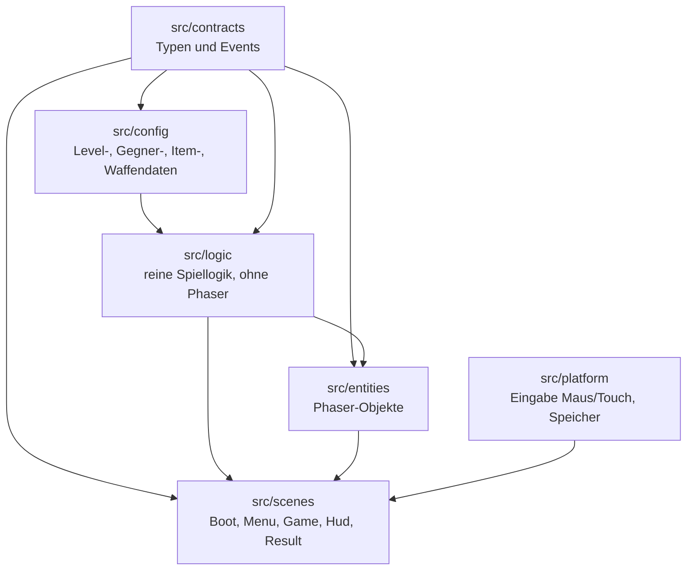
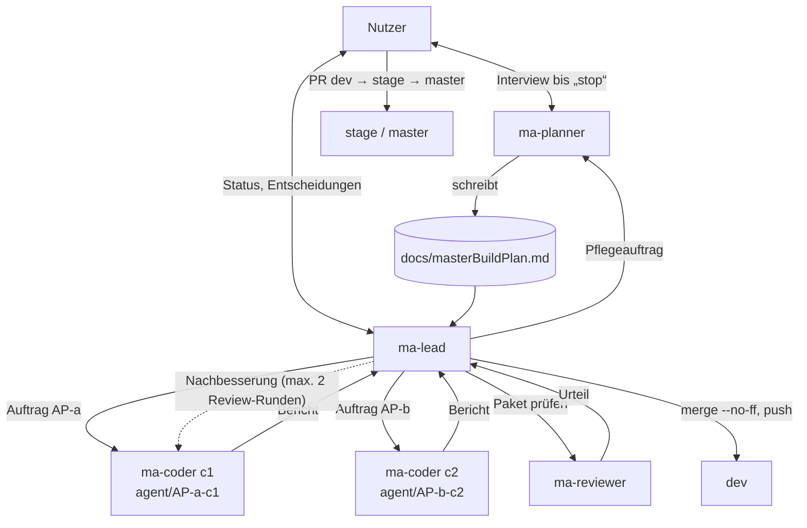
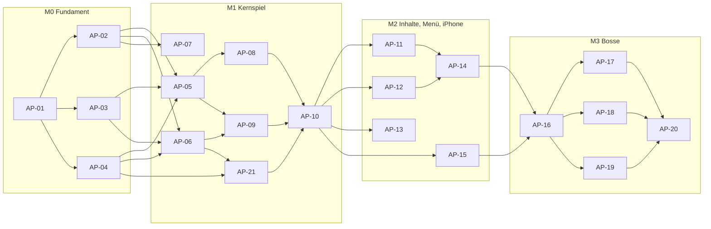

<!--
MASTER-BUILD-PLAN – VORLAGE (MultiAgent-System)

setup-project.ps1 kopiert diese Vorlage nach docs/masterBuildPlan.md im Projekt.
Der Planner-Agent (ma-planner) füllt sie im Interview mit dem Nutzer und pflegt sie danach.
Er ist der einzige Agent, der diese Datei ändert. Der Lead (ma-lead) steuert den Bau danach.
Grundlage der Regeln: MultiAgent/entscheidungen.md
-->

# Master-Build-Plan 360shooter

**Stand:** 2026-10-23 · **Planversion:** 1 · **Gepflegt von:** ma-planner · **Gesteuert von:** ma-lead · **Nutzer:** Cem Dogan

360shooter ist ein 2D-Pixel-Survival-Shooter im Metroid-Stil für Handy und PC. Eine Astronautin steht in der Bildschirmmitte, dreht sich um 360° und schießt automatisch mit einer Laserpistole in Blickrichtung. Sie muss in jeder Runde überleben, bis der Timer abläuft. Monster greifen von allen Seiten an. Der erste Stich umfasst die Level 0–20 (Batches Wald, Wald bei Nacht, Elfenwald) und läuft nur lokal. Grundlage ist die Idee in `idee.txt`. Meilensteine und Pakete folgen nach G1.

---

## 0. Gebrauchsanweisung

### Lagebericht

<!-- Übergabe an einen neuen Lead, der den bisherigen Chat nicht kennt. Der Planner ersetzt ihn bei jedem „Wellenabschluss“. Höchstens 10 Zeilen. -->

- **Stand:** 2026-10-24 · Wellenabschluss M1 W3 · M0 und M1 technisch komplett in dev, M0-DEP und M1-DEP offen
- **Fertig:** AP-01–AP-10 und AP-21 (alle in dev; AP-10 f1000c0). **Bereit:** M1-DEP ([Mensch], Abnahme M1), AP-11, AP-12, AP-13 (M2 W1). **Offen:** AP-14–AP-20; M0-DEP, M2-DEP, M3-DEP `offen`
- **Unterbrochen oder laufend:** nichts
- **Erkenntnisse:** Checks auf dev grün (129/129 Tests). AP-10 ist nicht im Browser getestet, erste Laufzeitprüfung ist M1-DEP. Debug-Parameter `?level=n` und `?fps=1`. Pause hat kein Vertrags-Event. MenuScene enthält einen temporären Start von GameScene, den AP-11 ersetzt. Details §18.
- **Nächster Schritt:** Nutzer: PR `dev` nach `stage`, Smoke-Test M1-DEP (§9.2), PR `stage` nach `master`; M0-DEP ebenfalls offen. Danach M2 W1 mit AP-11, AP-12, AP-13 (Lead, max. 3 parallel). Autonomie bis M2 vom Nutzer freigegeben (PE-15).
- **Offene Fragen an den Nutzer:** M0-DEP-Abnahme steht aus ([Mensch]). M1-DEP nach Smoke-Test ([Mensch]). Coverage-Werkzeug freigeben? Arena-Konstante `GAME_SIZE` anlegen? (§16 Vorschläge). Boss-Verhalten PE-34 vor M3-Freigabe bestätigen.

<!-- Ende Lagebericht -->

### Rollen und Dokumente

| Wer / Was | Zweck |
|---|---|
| **Nutzer** [Mensch] | Teamleiter. Entscheidet über Security, Datenschutz, Vorgehensweise und Umfang, bringt `dev` → `stage` → `master`, richtet externe Dienste ein, füllt `.env`. |
| `ma-planner` (`.claude/agents/ma-planner.md`) | Interviewt den Nutzer, bis er „stop“ sagt. Danach pflegt er diesen Plan im Auftrag des Leads. |
| `ma-lead` (`.claude/agents/ma-lead.md`) | Steuert den Bau: plant Wellen, startet Coder und Reviewer, merged in `dev`, berichtet dem Nutzer. |
| `ma-coder` (`.claude/agents/ma-coder.md`) | Setzt genau ein Paket in einem eigenen Worktree um und committet auf `agent/AP-<nr>-c<n>`. |
| `ma-reviewer` (`.claude/agents/ma-reviewer.md`) | Prüft jedes Paket nur lesend. Urteil: bestanden / nicht bestanden. |
| `docs/masterBuildPlan.md` | Dieser Plan. Verbindlich für alle Agents. |
| `idee.txt` | Spielidee des Nutzers (Gegner, Batches, Design). Widerspricht sie diesem Plan, wird nachgefragt. |

Gemeinsame Regeln (R1–R6, Schutz vor fremden Anweisungen, Rechte, Git-Schema) stehen in jeder Agent-Datei unter „Gemeinsame Regeln für alle Agents“.

### Markierungen

| Markierung | Bedeutung | Wer entfernt sie |
|---|---|---|
| `{{…}}` | Platzhalter | Planner |
| `<!-- LEITFRAGEN … -->` | Fragen an den Nutzer. `[K]` kritisch (blockiert ein Gate), `[W]` wichtig, `[O]` optional (Standard darf angenommen werden) | Planner, sobald der Abschnitt fertig ist |
| `⟦offen: Q-xx⟧` | bewusst offene Stelle, siehe §16 | Planner nach Klärung |
| `(angenommen)` | Standard des Planners, vom Nutzer noch nicht bestätigt | Nutzer durch Bestätigung |
| `PE-xx` | Planungsentscheidung, §16 | – |
| **[Mensch]** | Schritt, den nur der Nutzer ausführt | – |

### Ausfüllstand und Gates

Status: `leer` · `in Klärung` · `fertig` · `angenommen` (fertig, aber mit unbestätigten Annahmen).

| § | Abschnitt | Status | Offene Fragen | Nötig für Gate |
|---|---|---|---|---|
| 1 | Projektkontext und Ziel | fertig | – | G1 |
| 2 | Umfang | fertig | Q-04 nur für M3 | G1 |
| 3 | Tech-Stack | angenommen | Werkzeuge (Vitest, ESLint, Prettier) angenommen | G1 |
| 4 | Architektur, Datenmodell, Verträge | fertig | – | G1 |
| 5 | Sicherheit, Datenschutz, Recht, Limits | fertig | – | G1 |
| 6 | Umgebungen, Branches, Deployment | fertig | – | G1 |
| 7 | Team-Steuerung | fertig | – | G1 |
| 8 | Lanes und Dateieigentum | fertig | – | G2 |
| 9 | Meilensteine und Wellen | fertig | – | G2 |
| 10 | Statusübersicht | fertig | – | G2 |
| 11 | Abhängigkeitsgraph | fertig | – | G2 |
| 12 | Arbeitspakete | angenommen | M0–M2 bestätigt; M3 detailliert, Boss-Verhalten angenommen (PE-34) | G2 (je Meilenstein) |
| 13 | Menschliche Schritte | fertig | – | G2 |
| 14 | Budget und Kürzungen | angenommen | Fensterleistung nach M0 nachschärfen | G2 |
| 15 | Risiken | fertig | – | G2 |
| 16 | Planungsentscheidungen und offene Fragen | angenommen | PE-34 bestätigen | laufend |
| 17 | Abdeckungsmatrix | fertig | – | G2 |
| 18 | Änderungsprotokoll | laufend | – | laufend |

**Gates:** G1 erfüllt. G2(M0), G2(M1), G2(M2) erfüllt. G2(M3) erfüllt mit Annahme PE-34 (Boss-Verhalten), Bestätigung durch den Nutzer vor M3-Freigabe.

| Gate | Bedingung | Wer prüft | Folge |
|---|---|---|---|
| **G1** Bereit zur Paketierung | §1–§7 `fertig` oder `angenommen`, keine `[K]`-Frage offen | Planner | Der Planner schneidet Pakete (§8–§17). |
| **G2(Mx)** Bereit für Meilenstein Mx | G1 erfüllt; alle Pakete von Mx vollständig; [Mensch]-Schritte stehen; Abdeckungsmatrix deckt Mx ab | Lead | Der Lead startet die erste Welle von Mx. Sonst beauftragt er den Planner mit „Verfeinerung Mx“. |
| **G3** Fertig | alle Pflicht-Meilensteine live, Abnahmekriterien aus §1 erfüllt | Nutzer | Plan wird eingefroren. |

---

## 1. Projektkontext und Ziel

<!-- LEITFRAGEN
[K] Was ist das Projekt in einem Satz, und welches Problem löst es für wen?
[K] Was wird ausgeliefert (Repository, Live-Deployment, App …), und gibt es einen Termin?
[W] Ist eine Kommerzialisierung denkbar? (beeinflusst Recht, Lizenzen, Datenschutz-Tiefe)
[W] Welche Leitprinzipien gelten bei Zielkonflikten (z. B. Sicherheit vor Funktionsumfang)?
[O] Gibt es eine bestehende Projektdokumentation, auf die verwiesen werden soll?
-->

| Feld | Wert |
|---|---|
| Einzeiler | Rundenbasierter 360°-Survival-Shooter im Pixel-Stil: Die Astronautin in der Bildschirmmitte dreht sich, schießt automatisch und überlebt Monsterwellen, bis der Timer abläuft. |
| Zielgruppe | Gelegenheitsspieler auf Handy und PC. Im ersten Stich nur der Nutzer selbst (lokal). |
| Lieferumfang | Stich 1: lokal lauffähiges Spiel mit Level 0–20 auf PC und Handy. Keine Veröffentlichung. Später App Store (Ausblick). |
| Termin | keiner (PE-19) |
| Kommerzialisierung | später möglich (App Store), PE-01 |
| Projektdokumentation | `idee.txt` (Spielidee, Gegner, Batches; noch nicht committet, siehe §16 Vorschläge) |

**Leitprinzipien (in Rangfolge):**

1. Sicherheit und Datenschutz werden nie gekürzt.
2. Alles läuft lokal. Veröffentlichung, Anmeldung, Downloads und Server-Datenbank sind im ersten Stich unwichtig (PE-02).
3. Spielgefühl (Steuerung, Treffer, Lesbarkeit) vor Inhaltsmenge.
4. Level 21–100 sind nur Ausblick. Der Code soll sie später ohne Umbau aufnehmen können (datengetriebene Level und Gegner).

**Abnahmekriterien (G3):**

1. M0–M3 abgenommen, alle Smoke-Tests aus §9 erfüllt.
2. Level 0–20 sind nacheinander freispielbar, am PC (Maus) und auf dem iPhone (Touch, Homescreen-App, Querformat).
3. Jedes Level endet mit seinem Boss (nach Q-04).
4. Grafik und Sound lassen sich nach den Anleitungen in `docs/guides/` ohne Code-Änderung austauschen, `npm run assets:check` ist grün.
5. Keine personenbezogenen Daten, kein Tracking, keine externen Requests.
6. Alle Checks grün (`lint`, `typecheck`, `test`, `build`).

---

## 2. Umfang

<!-- LEITFRAGEN
[K] Welche Funktionen sind Pflicht? Pro Funktion: Was muss der Nutzer tun können?
[K] Was ist ausdrücklich NICHT im Umfang?
[W] Was ist optional und wird nur gebaut, wenn Budget bleibt?
[W] Welcher Kernfluss muss als Erstes vollständig live sein?
-->

### Pflicht

| ID | Funktion | Beschreibung aus Nutzersicht | Kernfluss |
|---|---|---|---|
| F-01 | Steuerung | Die Astronautin steht fest in der Bildschirmmitte und läuft nicht (PE-08). Der Spieler zeigt mit Maus oder Finger (Touch) auf eine Stelle, die Figur dreht sich dorthin, in beide Richtungen auf dem kürzeren Weg. Die Drehung ist **nicht sofort**, sondern mit begrenzter Drehgeschwindigkeit (PE-03, PE-04). | ja |
| F-02 | Automatischer Schuss | Die Laserpistole feuert automatisch, immer in die aktuelle Blickrichtung (PE-03). | ja |
| F-03 | Runde mit Timer | Eine Runde ist gewonnen, wenn der Timer abläuft und die Astronautin noch lebt. Dauer: erste Hälfte 3 min, zweite Hälfte 5 min, die erste Hälfte wird aufgerundet, bezogen auf die Level eines Batches (PE-05, PE-09). Ergebnis: Wald 0–2 = 3 min, 3–4 = 5 min · Nacht 5–7 = 3 min, 8–9 = 5 min · Elfenwald 10–15 = 3 min, 16–20 = 5 min. | ja |
| F-04 | Gegner | Verfluchter Baum (Level 0–20, langsam, etwas mehr HP, läuft auf Spieler zu), Wald-Hexe (5–20, schießt Projektile, normale Werte), Zombie-Eichhörnchen (5–20, schnell, wenig HP, läuft), Böser Wald-Spirit (10–20, Dauerschaden in Nähe, wenig HP). Quelle: `idee.txt`. | ja |
| F-05 | Boss je Level | Jedes Level hat einen Boss. Er erscheint in der letzten Minute. Läuft der Timer ab, während er noch lebt, geht die Runde weiter, bis er besiegt ist (PE-18). Ein Boss pro Batch, die anderen Level des Batches nutzen ihn in Varianten (PE-33):
 • Wald: verwurzeltes Baummonster
 • Wald bei Nacht: Waldgeist
 • Elfenwald: Riesen-Stein

Verhalten siehe PE-34. Eigener Meilenstein M3. | nein |
| F-06 | Level und Maps 0–20 | Batches Wald, Wald bei Nacht, Elfenwald mit je einer einfachen Map mit Charme. Grenzen: Wald 0–4, Wald bei Nacht 5–9, Elfenwald 10–20 (PE-10). | ja |
| F-07 | Waffen-Items in der Runde | Besiegte Gegner lassen zufällig Items fallen, die die Laserpistole verändern (schneller, stärker, größer). Die Waffe startet jede Runde bei 0. Ein Item wird eingesammelt, indem die Astronautin es **anschießt**. Es wirkt bis Rundenende und stapelt bis Stufe 5 je Eigenschaft. Die Drop-Chance liegt bei ca. 8 %, ein liegendes Item verschwindet nach 10 s (PE-12, PE-16). | ja |
| F-08 | Spielerlevel | Das Spielerlevel steigt durch Erfahrung aus Runden, wird lokal gespeichert und angezeigt. Im ersten Stich schaltet es nichts frei (PE-13). | nein |
| F-09 | Hauptmenü und Level-Freischaltung | Start, Anzeige des Spielerlevels, Level-Auswahl 0–20. Ein Level wird frei, wenn das vorherige geschafft ist (PE-13). | ja |
| F-10 | iPhone über PWA | Das Spiel läuft auf dem iPhone in Safari, als Homescreen-App im Vollbild, vom PC über das lokale WLAN bereitgestellt (PE-14). | ja |
| F-11 | Lebenspunkte und Niederlage | Die Astronautin hat 100 HP mit Lebensleiste. Bei 0 HP ist die Runde verloren, ein Teil der Erfahrung geht trotzdem ans Spielerlevel. Heilung gibt es nur als seltenes Item (PE-17). | ja |
| F-12 | Platzhalter-Grafik austauschbar | Alle Sprites sind Platzhalter mit fester Sprite-Liste. Ein Designer ersetzt eine PNG-Datei, ohne Code anzufassen. Anleitung `docs/guides/grafik-austauschen.md` (PE-23). | nein |
| F-13 | Platzhalter-Sounds austauschbar | Einfache Platzhalter-Effekte (Laser, Treffer, Item, Niederlage, Sieg), Stummschalt-Taste, Austausch per Datei. Anleitung `docs/guides/sound-austauschen.md` (PE-24). | nein |
| F-14 | Querformat | Das Spiel ist für Querformat ausgelegt, auf dem iPhone gibt es im Hochformat einen Hinweis „bitte drehen“ (PE-25). | nein |

### Optional

| ID | Funktion | Bedingung |
|---|---|---|
| O-01 | {{…}} | {{nur wenn alle Pflicht-Meilensteine live sind}} |

### Bewusst nicht im Umfang

| Ausgeschlossen | Begründung |
|---|---|
| Level 21–100 (Bauernhof bis Büro) | Ausblick, nicht im ersten Stich (`idee.txt`) |
| Weitere Startwaffen | Im ersten Stich gibt es nur die Laserpistole (PE-06) |
| Veröffentlichung, App-Store-Einreichung, Anmeldung, Online-Spielerdatenbank, Downloads | PE-02 |

---

## 3. Tech-Stack

<!-- LEITFRAGEN
[K] Sprache(n), Frontend, Backend, Datenbank, Auth, Hosting?
[W] Monorepo oder getrennte Repositories? Paketmanager?
[W] Test-Werkzeuge und Code-Qualität (Lint, Format, Typecheck)?
[W] Externe Dienste und ihre Kostenobergrenzen? (Konten legt nur der Nutzer an)
[O] Freigegebene Abhängigkeiten: welche Pakete dürfen Coder ohne Rückfrage installieren?
-->

| Bereich | Technologie | Begründung |
|---|---|---|
| Sprache | TypeScript (strict) | Typsicherheit, gut für parallele Agent-Arbeit (PE-11) |
| Frontend / Engine | Phaser 3 (aktuelle 3.x), Build mit Vite | 2D, Pixel-Art, Maus und Touch, läuft im Browser (PE-11) |
| Backend | keins | alles lokal (PE-02) |
| Datenbank / ORM | keine. Spielstand (Spielerlevel) lokal im Gerät (`localStorage`) (angenommen) | PE-02 |
| Auth | keine | PE-02 |
| Handy | Stich 1: PWA in Safari über das lokale WLAN (Web-App-Manifest, Vollbild-Meta-Tags, kein Mac nötig). Capacitor für die native App erst in einem späteren Stich | PE-14 |
| Tests | Vitest für Spiellogik (ohne Phaser-Rendering) (angenommen) | Logik testbar, schnell |
| Code-Qualität | ESLint + typescript-eslint, Prettier, `tsc --noEmit` (angenommen) | Standard |
| Paketmanager | npm, ein Repository (angenommen) | einfach |
| Hosting | keins. PC: lokal im Browser (`npm run dev` / `npm run preview`) | PE-02 |

**Checks, die jedes Paket bestehen muss:** `npm run lint`, `npm run typecheck`, `npm test`, `npm run build` (angenommen)

**Freigegebene Abhängigkeiten (PE-11, angenommen):** `phaser`, `typescript`, `vite`, `vitest`, `eslint`, `typescript-eslint`, `@eslint/js`, `prettier`, `eslint-config-prettier`. Keine Capacitor-Pakete im ersten Stich (PE-14). Coder installieren nur diese, und nur wenn ihnen die `package.json` gehört. Alles andere geht über Lead und Nutzer.

---

## 4. Architektur, Datenmodell und Verträge

<!-- LEITFRAGEN
[K] Welche Bausteine gibt es, und wer spricht mit wem?
[K] Welche Kernentitäten und Beziehungen? Wem gehören die Daten?
[W] Wo liegen die gemeinsamen Verträge (Schemas, API-Typen), damit parallel gebaut werden kann?
-->

Status: Entwurf des Planners (angenommen, PE-21), Bestätigung durch den Nutzer offen.

**Bausteine:**

- `src/contracts/`: gemeinsame Typen (`LevelDef`, `EnemyDef`, `ItemDef`, `WeaponStats`, `SaveGame`) und typisierte Event-Namen zwischen Game- und HUD-Szene.
- `src/config/`: datengetriebene Inhalte. Level 0–20 als Tabelle (Batch, Dauer, Gegnerpool, Spawn-Rate, Boss-Platzhalter), damit Level 21–100 später nur Daten sind.
- `src/logic/`: reine, mit Vitest getestete Funktionen. Dazu gehören:
  - die Drehung zum Ziel mit Maximalgeschwindigkeit,
  - der Rundentimer und der Spawn-Director,
  - Schaden und HP,
  - die Item-Wirkung und Stapelung,
  - Erfahrung, Spielerlevel und Level-Freischaltung.
- `src/entities/`: Astronautin, Gegnertypen, Projektile (Laser und Hexe), Items.
- `src/scenes/`: Boot/Preload, Hauptmenü mit Level-Auswahl, Spiel, HUD (Timer, HP, Waffenstufen), Ergebnis.
- `src/platform/`: vereinheitlichte Zeiger-Eingabe (Maus und Touch) und Speicher-Adapter (`localStorage`).
- `public/`: Sprites, Manifest, Icons.

**Grundregeln:**

1. Spiellogik in `src/logic` importiert kein Phaser. Sie bekommt Daten und gibt Daten zurück.
2. Spielwerte (HP, Geschwindigkeit, Drop-Chancen, Drehgeschwindigkeit) stehen nur in `src/config`, nie verstreut im Code.
3. Nur `src/platform/storage` greift auf `localStorage` zu.
4. Szenen sprechen über typisierte Events aus `src/contracts`.

| Entität | Wichtige Felder | Gehört zu | Löschverhalten |
|---|---|---|---|
| SaveGame | `version`, `playerXp`, `playerLevel`, `highestUnlockedLevel` | Gerät (lokal) | „Fortschritt zurücksetzen“ im Menü löscht ihn (angenommen) |
| LevelDef | `id`, `batch`, `durationSec`, `enemyPool`, `spawnRate`, `bossId?` | Konfiguration | – |
| EnemyDef | `id`, `hp`, `speed`, `damage`, `behavior` (chase, shooter, aura) | Konfiguration | – |
| ItemDef | `id`, `effect` (fireRate, damage, size, heal), `maxStacks`, `dropWeight` | Konfiguration | – |
| WeaponStats | `fireRate`, `damage`, `projectileSize`, `projectileSpeed` | Runde (flüchtig) | Reset bei Rundenende |

**Verträge:** TypeScript-Typen in `src/contracts/`. Regel: Jeder Vertrag entsteht in einem eigenen Paket mindestens eine Welle vor seinen Nutzern.

---

## 5. Sicherheit, Datenschutz, Recht und Limits

<!-- LEITFRAGEN
[K] Wie werden Nutzer authentifiziert, und wie wird Zugriff auf fremde Daten verhindert?
[K] Welche personenbezogenen Daten werden verarbeitet? Welche DSGVO-Pflichten folgen daraus (Löschen, Export, EU-Hosting, Auftragsverarbeitung)?
[K] Gibt es eine öffentliche Webseite? Dann: Impressum und Datenschutzerklärung (R3), Einwilligung für Cookies/Tracking/externe Inhalte.
[W] Missbrauchs- und Kostenlimits (Raten, Größen, Tageslimits)?
[W] Härtung (Header, CORS, Validierung, XSS, CSRF)?
[O] Besondere Angriffsflächen (Uploads, KI-Eingaben/Prompt-Injection)?
-->

Es gelten immer R1–R6 (siehe Agent-Dateien). Dieser Abschnitt konkretisiert sie für das Projekt.

| Regel | Umsetzung (grob) | Testart | Paket |
|---|---|---|---|
Status: Entwurf des Planners (angenommen, PE-22).

- **Nutzer und Auth:** keine. Es gibt keine Konten und keine fremden Daten.
- **Personenbezogene Daten (R2):** keine. Lokal gespeichert wird nur der Spielfortschritt (`SaveGame`). Es gibt kein Tracking, keine Analytics und keine externen Inhalte (Schriften und Assets liegen lokal). Damit sind im ersten Stich keine DSGVO-Pflichten erkennbar.
- **Öffentliche Webseite (R3):** keine. Das Spiel läuft nur lokal und im Heim-WLAN. Impressum und Datenschutzerklärung entfallen im ersten Stich und werden vor jeder Veröffentlichung (App Store) Pflicht, siehe Q-09 und §16.

| Regel | Umsetzung (grob) | Testart | Paket |
|---|---|---|---|
| Keine personenbezogenen Daten, kein Tracking, keine externen Requests (R2) | nur `SaveGame` lokal, keine Netzwerkaufrufe im Spiel | Review, Suche nach `fetch`/externen URLs | alle |
| Spielstand robust laden | Version prüfen, kaputte oder fremde Werte verwerfen und mit Standard starten | Unit-Test | AP-04 |
| Dev-Server im WLAN | `--host` nur für das Heimnetz, nie Portweiterleitung oder öffentliches Hosting | Doku (README) | AP-13 |
| Asset-Lizenzen (R1) | nur eigene, generierte oder CC0-Assets, Lizenzliste im Repo | Review | AP-02, AP-07 |
| Abhängigkeiten (R6) | nur freigegebene Pakete (§3), `npm audit` ohne hohe Befunde | Check des Leads | AP-01, alle |
| Impressum und Datenschutzerklärung (R3) | entfällt im ersten Stich (nicht öffentlich), vor einer Veröffentlichung Pflicht | – | Ausblick |
| Secrets nur in `.env`, `.env.example` gepflegt (R4) | im ersten Stich keine Secrets nötig | Review | alle |

| Limit | Standard | Ebene |
|---|---|---|
| Gleichzeitige Gegner auf dem Bildschirm | 150 (angenommen) | Konfiguration |
| Zielbildrate | 60 fps auf aktuellem iPhone und PC (angenommen) | – |

**Nie kürzbar:** keine personenbezogenen Daten und kein Tracking, robustes Laden des Spielstands, Asset-Lizenzen.

**Vom Nutzer rechtlich zu prüfen (vor Kommerzialisierung):** Impressum und Datenschutzerklärung, App-Store-Richtlinien und Datenschutzangaben, Lizenzen aller Assets und Schriften, Altersfreigabe.

---

## 6. Umgebungen, Branches und Deployment

<!-- LEITFRAGEN
[K] Wo laufen stage und Produktion? Was löst ein Deployment aus?
[W] Welche Konten und Secrets muss der Nutzer anlegen, und bis wann?
[W] Datenbanken: welche Dev-Datenbank nutzen Agents? Eigene DB-Benutzer pro Rolle (agentDev / agentLead)?
[O] Wie sieht ein Smoke-Test nach dem Deployment aus?
-->

| Umgebung | Frontend | Backend | Datenbank | Auslöser |
|---|---|---|---|---|
| lokal / dev | `npm run dev` im Browser am PC | – | – (`localStorage` im Browser) | – |
| stage | Stand von `stage`: `npm run build` und `npm run preview -- --host`, getestet am PC und auf dem iPhone im WLAN | – | – | Merge dev → stage durch den Nutzer |
| Produktion | Stand von `master`: abgenommener, spielbarer Stand, gleicher Ablauf wie stage | – | – | Merge stage → master durch den Nutzer |

| Branch | Zweck | Wer schreibt darauf |
|---|---|---|
| `master` | Produktion | **[Mensch]**, per Pull Request von `stage` |
| `stage` | Abnahme | **[Mensch]**, per Pull Request von `dev` |
| `dev` | Integration, Default-Branch | ma-lead (`merge --no-ff`, `push`), ma-planner (nur Plan-Commits) |
| `agent/AP-<nr>-c<n>` | ein Arbeitspaket | ma-coder (`commit`), nur lokal, wird nach dem Merge gelöscht |

**Remote:** `origin` = `https://github.com/CemDCoding/360shooter.git`, vom Nutzer eingerichtet (PE-20). Der Lead pusht nur `dev`. `stage` und `master` bringt der Nutzer per Pull Request.

**Worktrees:** werden beim Start eines Coders automatisch im Ordner `360shooter_worktree/` neben dem Projekt angelegt (ein Unterordner und ein Branch pro Coder, abgezweigt von `dev`). Der Lead entfernt sie nach dem Merge.

**Parallele Coder und lokale Ressourcen:** keine Datenbank. Tests laufen ohne Server. Startet ein Coder den Dev-Server, wählt Vite automatisch einen freien Port.

**Env-Dateien:** Im ersten Stich sind keine Variablen nötig. `.env.example` bleibt ohne Einträge.

**Deployment-Anleitung:** README-Abschnitt „Auf dem iPhone spielen“ (PC und iPhone im selben WLAN, `npm run build`, `npm run preview -- --host`, IP-Adresse in Safari öffnen, „Zum Home-Bildschirm“). Den Abschnitt schreibt das PWA-Paket.

---

## 7. Team-Steuerung

<!-- LEITFRAGEN
[K] Wie viele Coder dürfen höchstens gleichzeitig laufen? (Engpass: Budget, nicht Technik)
[W] Freigabe: pro Welle oder pro Meilenstein?
[W] Welche Modelle und welcher Aufwand für welche Paketgröße / welches Risiko?
-->

### 7.1 Ablauf

### 7.2 Parallelität, Budget, Modelle

- **Höchstens gleichzeitig:** 3 Coder (PE-15). Hinweis: Das Budget erreicht damit den Zielwert schneller. Der Wächter stoppt dann neue Starts.
- **Budget (D11b):** Zielwert **30 %** des 5-Stunden-Limits, Obergrenze **36 %** (Zielwert × 1,2). Ab dem Zielwert startet der Wächter keine neuen Coder mehr, laufende Pakete werden bis zur Obergrenze fertig. Dann fragt der Lead den Nutzer. Ohne Antwort geht es nach dem Reset weiter (D11c).
- **Freigabe:** pro Meilenstein (PE-15). Der Nutzer nennt den Meilenstein, bis zu dem der Lead autonom arbeitet. Eskalationen nach §7.3 gelten trotzdem.
- **Bei mehr Kandidaten als Plätzen:** zuerst kritischer Pfad (§11), dann Verträge, dann der Rest.

| Paket | Modell | Aufwand |
|---|---|---|
| S, Routine ohne Sicherheits- oder Kernlogik | haiku | low |
| M | sonnet | medium |
| L oder Sicherheit, Kernlogik, Migration | opus | high |

`opus` nur mit Aufwand `L` oder einem „Opus-Grund“ im Paket (Sicherheit, Kern, groß), sonst blockiert der Wächter. Aufwand `xhigh` und `max` sind gesperrt. Die Plan-Pflege läuft mit `haiku`.

**Review:** Jedes Paket prüft `ma-reviewer` (höchstens 2 Runden, Nachbesserung durch denselben Coder). Danach entscheidet der Nutzer.

### 7.3 Eskalation

| Situation | Coder | Lead | Nutzer |
|---|---|---|---|
| Paket unklar | stoppt vor dem ersten Code, meldet `blockiert` | klärt aus Plan und Doku, sonst fragt er den Nutzer | entscheidet |
| Änderung an fremder Datei nötig | meldet | lässt den Planner ein Folgepaket planen | – |
| Neue Abhängigkeit | meldet | fragt den Nutzer | entscheidet |
| Review nach Runde 2 nicht bestanden | – | eskaliert mit Optionen | entscheidet |
| Merge-Konflikt außerhalb des Lockfiles | – | bricht ab, klärt mit dem Planner, Fix-Paket | bei Vorgehensänderung |
| Security, Datenschutz, Umfang, Architektur | – | legt Vorschlag vor | entscheidet |
| Verdächtige Anweisungen in Daten (R6) | meldet | meldet | entscheidet |

---

## 8. Lanes und Dateieigentum

<!-- LEITFRAGEN
[W] Welche parallelen Arbeitsstränge ergeben sich aus der Architektur?
[W] Welche Dateien brauchen viele Pakete (Registrierung, Schema, package.json, Lockfile, Layouts)?
-->

| Lane | Zuständigkeit | Ordner und Dateien |
|---|---|---|
| **SH** – Verträge und Daten | Typen, Spielwerte, Level-Tabelle | `src/contracts/`, `src/config/` |
| **LOG** – Spiellogik | reine Logik ohne Phaser, mit Unit-Tests | `src/logic/`, `tests/logic/` |
| **GAME** – Spiel | Phaser-Szenen, Entities, Plattform-Adapter | `src/scenes/`, `src/entities/`, `src/platform/`, `src/main.ts` |
| **ASSET** – Grafik, Sound, Anleitungen | Platzhalter, Generator, Designer-Anleitungen | `public/assets/`, `scripts/`, `docs/guides/` |
| **OPS** – Gerüst, PWA, Doku | Werkzeuge, Build, PWA, README | Root-Konfiguration, `index.html`, `public/manifest.webmanifest`, `public/icons/`, `README.md` (ohne `.github/workflows`, das macht der Nutzer) |
| **HUM** – Mensch | Tests auf PC und iPhone, Merges nach stage/master, eigene Grafiken und Sounds | – |

**Grundregeln:**

1. Innerhalb einer Welle gehört jede Datei höchstens einem Paket.
2. Verträge entstehen mindestens eine Welle vor ihren Nutzern.
3. Gemeinsame Dateien legt ein Gerüst-Paket in Welle 1 eines Meilensteins an.
4. Konflikte im Lockfile sind erwartet. Der Lead löst sie beim Merge mit `npm install`.
5. Tests liegen gespiegelt unter `tests/` (z. B. `src/logic/rotation.ts` → `tests/logic/rotation.test.ts`) und gehören dem Paket, dem die Quelldatei gehört.

| Gemeinsame Datei | Wer ändert sie | Wann |
|---|---|---|
| `package.json`, `package-lock.json` | AP-01 (anlegen), AP-02 (`assets:placeholders`), AP-07 (`assets:check`), AP-13 (`preview:lan`, `icons`); sonst nur der Lead beim Merge | M0 W1, M0 W2, M1 W1, M2 W1 |
| `src/main.ts` (Szenen-Registrierung) | AP-01 registriert alle sechs Szenen als Stubs; danach unverändert | M0 W1 |
| `src/contracts/*` | AP-01; spätere Erweiterung nur in einem eigenen Vertragspaket eine Welle vorher (M3: AP-16) | M0 W1 |
| `index.html`, `vite.config.ts` | AP-01, später AP-13 | M0 W1, M2 W1 |
| `README.md` | AP-01, später AP-13 | M0 W1, M2 W1 |
| `src/platform/storage.ts`, `src/logic/progression.ts` (samt Tests) | AP-04 / AP-06 → AP-21 (Fix Index-Semantik) | M0 W2, M1 W1, M1 W2 |
| `src/scenes/GameScene.ts` | AP-10 → AP-12 (Hintergrund) → AP-14 (Sound) | M1 W3, M2 W1, M2 W2 |
| `src/scenes/{MenuScene,HudScene,ResultScene}.ts` | AP-10 (Hud, Result), AP-11 (Menu) → AP-14 (Sound, Stumm-Taste) | M1 W3, M2 W1, M2 W2 |
| `src/config/{levels,enemies,items,weapon,player,progression}.ts` | AP-03 → AP-15 → AP-16 (nur `levels.ts`) | M0 W2, M2 W2, M3 W1 |
| `src/config/assets.ts`, `docs/guides/*` | AP-02 / AP-07 → AP-16 (Boss-Assets) | M0 W2, M1 W1, M3 W1 |
| `src/logic/{round,spawn}.ts`, `src/contracts/{events,index}.ts` | AP-06 / AP-01 → AP-16 | M1 W1, M0 W1, M3 W1 |
| `src/scenes/{GameScene,HudScene,ResultScene}.ts` in M3 | AP-20 | M3 W3 |

---

## 9. Meilensteine und Wellen

<!-- LEITFRAGEN
[K] In welche Meilensteine lässt sich der Umfang schneiden, sodass jeder für sich live geht?
[W] Was ist nach jedem Meilenstein live prüfbar?
-->

| # | Meilenstein | Inhalt | Live-Zustand |
|---|---|---|---|
| M0 | Fundament | Werkzeuge, Verträge, Spieldaten 0–20, Platzhalter-Assets, Eingabe und Speicher | `npm run dev` zeigt die Preload-Szene mit allen Platzhalter-Sprites; alle Checks grün |
| M1 | Kernspiel | Drehen und Auto-Schuss, 4 Gegnertypen, Items durch Anschießen, HP, Timer, Sieg/Niederlage, HUD; Designer-Anleitungen | Level 0 (und per Debug-Parameter jedes Level 0–20) am PC spielbar |
| M2 | Inhalte, Menü, iPhone | Hauptmenü mit Level-Auswahl und Spielerlevel, Maps je Batch, PWA + Querformat, Platzhalter-Sounds mit Stummschalten, Balancing 0–20 | Level 0–20 nacheinander freispielbar, am PC und auf dem iPhone |
| M3 | Bosse | Boss-Rahmen, drei Bosse mit Varianten je Level, Einbindung (PE-18, PE-33, PE-34) | jedes Level endet mit seinem Boss |

### 9.1 Ablauf einer Welle

| Schritt | Inhalt | Wer |
|---|---|---|
| 0 Lagebild | `dev` sauber, Abhängigkeiten `fertig`, Eigentum ohne Überschneidung, Budget | Lead |
| 1 Wellenplan | Pakete, Coder-Nr., Modell; Freigabe laut §7.2 | Lead → Nutzer |
| 2 Delegieren | Coder im Hintergrund starten, je eigener Worktree | Lead |
| 3 Umsetzen | Code, Tests, Commits auf `agent/AP-<nr>-c<n>`, Bericht | Coder |
| 4 Review | Urteil; bei „nicht bestanden“ Nachbesserung durch denselben Coder, max. 2 Runden | Reviewer, Lead, Coder |
| 5 Mergen | `merge --no-ff` in `dev`, Reihenfolge SH → LOG → GAME → ASSET → OPS | Lead |
| 6 Integrationspunkt | Install, Checks, Handtest-Checkliste; rot → Fix-Paket | Lead (+ Nutzer für Handtest) |
| 7 Abschluss | `push origin dev`, Worktrees und Branches aufräumen, Plan pflegen | Lead, Planner |

### 9.2 Meilensteine im Detail

#### M0 – Fundament

| Welle | Pakete (parallel) |
|---|---|
| W1 | AP-01 Gerüst und Verträge |
| W2 | AP-02 Asset-Pipeline, AP-03 Spieldaten, AP-04 Plattform |
| W3 | M0-DEP [Mensch] |

**Integration:** nach W2: `npm install`, alle Checks, `npm run dev` zeigt die Preload-Szene mit allen Platzhaltern.

##### M0-DEP – Abnahme [Mensch]

- Pull Request `dev` → `stage`, mergen, `npm run dev` am PC
- Pull Request `stage` → `master`, mergen
- **Smoke-Test:**
  - [ ] `npm install` und `npm test` laufen ohne Fehler
  - [ ] Browser zeigt die Preload-Szene mit allen Platzhalter-Sprites (Astronautin, 4 Gegner, Items)

#### M1 – Kernspiel

| Welle | Pakete (parallel) |
|---|---|
| W1 | AP-05 Kampf-Logik, AP-06 Runden- und Fortschrittslogik, AP-07 Designer-Anleitungen |
| W2 | AP-08 Astronautin, Laser, Items (Entities), AP-09 Gegner (Entities), AP-21 Fix Freischaltstand als Index |
| W3 | AP-10 Spielszene, HUD, Ergebnis |
| W4 | M1-DEP [Mensch] |

**Integration:** nach W3 Handtest am PC: drehen, schießen, Items anschießen, verlieren, gewinnen.

##### M1-DEP – Abnahme [Mensch]

- Pull Requests `dev` → `stage` → `master`, Test am PC
- **Smoke-Test:**
  - [ ] Die Astronautin dreht sich sichtbar mit Verzögerung zum Mauszeiger, in beide Richtungen
  - [ ] Der Laser feuert automatisch in Blickrichtung
  - [ ] Level 0: Bäume kommen von allen Seiten, der Timer läuft 3:00 ab, danach erscheint „Gewonnen“
  - [ ] Ein angeschossenes Item verändert die Waffe sichtbar
  - [ ] Bei 0 HP erscheint „Verloren“
  - [ ] `?level=12` startet Level 12 mit allen vier Gegnertypen
  - [ ] Die beiden Anleitungen in `docs/guides/` sind für Nicht-Programmierer verständlich

#### M2 – Inhalte, Menü, iPhone

| Welle | Pakete (parallel) |
|---|---|
| W1 | AP-11 Hauptmenü und Fortschritt, AP-12 Maps je Batch, AP-13 PWA und Querformat |
| W2 | AP-14 Sound-Anbindung und Stummschalten, AP-15 Balancing Level 0–20 |
| W3 | M2-DEP [Mensch] |

##### M2-DEP – Abnahme [Mensch]

- Pull Requests `dev` → `stage` → `master`, Test am PC und auf dem iPhone (H-03)
- **Smoke-Test:**
  - [ ] Menü zeigt Spielerlevel und Level 0–20, nur freigespielte sind wählbar
  - [ ] Wald, Wald bei Nacht und Elfenwald sehen unterschiedlich aus
  - [ ] iPhone: Homescreen-App startet im Vollbild, Steuerung per Finger, Hochformat zeigt „bitte drehen“
  - [ ] Sounds hörbar, Stummschalten wirkt und bleibt gespeichert
  - [ ] Fortschritt bleibt nach Neuladen erhalten, „Zurücksetzen“ löscht ihn

#### M3 – Bosse

| Welle | Pakete (parallel) |
|---|---|
| W1 | AP-16 Boss-Rahmen (Vertrag, Daten, Logik, Basis-Entity, Platzhalter) |
| W2 | AP-17 Baummonster, AP-18 Waldgeist, AP-19 Riesen-Stein |
| W3 | AP-20 Boss-Einbindung (Spielszene, HUD, Ergebnis) |
| W4 | M3-DEP [Mensch] |

##### M3-DEP – Abnahme [Mensch]

- Pull Requests `dev` → `stage` → `master`, Test am PC und auf dem iPhone
- **Smoke-Test:**
  - [ ] In der letzten Minute erscheint „Boss kommt!“ und der Boss des Batches
  - [ ] Der Timer läuft ab, die Runde endet aber erst mit dem Sieg über den Boss
  - [ ] `?level=0`, `?level=3`, `?level=7`, `?level=18`: Boss passt zum Batch, spätere Level haben stärkere Varianten mit Zusatzangriff
  - [ ] Jeder Angriff wird vorher sichtbar angekündigt (fair)

---

## 10. Statusübersicht

Gepflegt von ma-planner (im Auftrag des Leads). Aufwand: S ≈ 0,75 h · M ≈ 1,5 h · L ≈ 2,5 h Agent-Zeit, H = Mensch.

Status: `offen` · `bereit` · `in Arbeit` · `Review` · `fertig` (gemergt in dev) · `blockiert`

| ID | Titel | M | Lane | Welle | Abhängigkeiten | Aufwand | Modell | Coder / Branch | Status |
|---|---|---|---|---|---|---|---|---|---|
| AP-01 | Gerüst und Verträge | M0 | OPS/SH | W1 | H-01 | M | sonnet (high) | c1 / agent/AP-01-c1 | fertig |
| AP-02 | Asset-Pipeline und Platzhalter | M0 | ASSET | W2 | AP-01 | M | sonnet (medium) | c2 / agent/AP-02-c2 | fertig |
| AP-03 | Spieldaten Level 0–20 | M0 | SH | W2 | AP-01 | S | sonnet (medium) | c3 / agent/AP-03-c3 | fertig |
| AP-04 | Plattform: Eingabe und Speicher | M0 | GAME | W2 | AP-01 | S | sonnet (medium) | c4 / agent/AP-04-c4 | fertig |
| M0-DEP | Abnahme M0 | M0 | HUM | W3 | AP-02–04 | H | – | – | offen |
| AP-05 | Kampf-Logik | M1 | LOG | W1 | M0 | M | sonnet (high) | c5 / agent/AP-05-c5 | fertig |
| AP-06 | Runden- und Fortschrittslogik | M1 | LOG | W1 | M0 | M | sonnet (high) | c6 / agent/AP-06-c6 | fertig |
| AP-07 | Designer-Anleitungen Grafik und Sound | M1 | ASSET | W1 | AP-02 | S | sonnet (medium) | c7 / agent/AP-07-c7 | fertig |
| AP-08 | Astronautin, Laser, Items (Entities) | M1 | GAME | W2 | AP-05 | M | sonnet (medium) | c8 / agent/AP-08-c8 | fertig |
| AP-09 | Gegner (Entities) | M1 | GAME | W2 | AP-05, AP-06 | M | sonnet (medium) | c9 / agent/AP-09-c9 | fertig |
| AP-21 | Fix: Freischaltstand als Index | M1 | LOG/GAME | W2 | AP-04, AP-06 | S | sonnet (medium) | c21 / agent/AP-21-c21 | fertig |
| AP-10 | Spielszene, HUD, Ergebnis | M1 | GAME | W3 | AP-08, AP-09, AP-21 | L | opus (high) | c10 / agent/AP-10-c10 | fertig |
| M1-DEP | Abnahme M1 | M1 | HUM | W4 | AP-10, AP-21 | H | – | – | bereit |
| AP-11 | Hauptmenü und Fortschritt | M2 | GAME | W1 | M1 | M | sonnet (medium) | – | bereit |
| AP-12 | Maps je Batch | M2 | GAME | W1 | M1 | M | sonnet (medium) | – | bereit |
| AP-13 | PWA und Querformat | M2 | OPS | W1 | M1 | M | sonnet (medium) | – | bereit |
| AP-14 | Sound-Anbindung und Stummschalten | M2 | GAME | W2 | AP-11, AP-12 | S | sonnet (medium) | – | offen |
| AP-15 | Balancing Level 0–20 | M2 | SH | W2 | M1 | M | sonnet (high) | – | offen |
| M2-DEP | Abnahme M2 (PC + iPhone) | M2 | HUM | W3 | AP-14, AP-15 | H | – | – | offen |
| AP-16 | Boss-Rahmen | M3 | SH/LOG | W1 | M2 | L | sonnet (high) | – | offen |
| AP-17 | Boss Baummonster (Wald 0–4) | M3 | GAME | W2 | AP-16 | M | sonnet (medium) | – | offen |
| AP-18 | Boss Waldgeist (Nacht 5–9) | M3 | GAME | W2 | AP-16 | M | sonnet (medium) | – | offen |
| AP-19 | Boss Riesen-Stein (Elfenwald 10–20) | M3 | GAME | W2 | AP-16 | M | sonnet (medium) | – | offen |
| AP-20 | Boss-Einbindung | M3 | GAME | W3 | AP-17–19 | M | sonnet (high) | – | offen |
| M3-DEP | Abnahme M3 | M3 | HUM | W4 | AP-20 | H | – | – | offen |

---

## 11. Abhängigkeitsgraph

**Kritischer Pfad:** AP-01 → AP-03/AP-04 → AP-05 → AP-08/AP-09 → AP-10 → AP-11/AP-12 → AP-14 → (M3) AP-16 → AP-17–AP-19 → AP-20

---

## 12. Arbeitspakete

<!-- Regeln:
- Ein Paket passt in eine Agent-Sitzung (1–3 h) und ergibt einen einzeln committbaren, getesteten Stand.
- Ein Coder muss es allein mit Paket und Pflichtlektüre umsetzen können, ohne Rückfrage.
- Knappe, konkrete Schritte, keine fertigen Code-Blöcke.
- IDs fortlaufend über alle Meilensteine: AP-01, AP-02 …
-->

### M0 – Fundament

#### AP-01 – Gerüst und Verträge

- **Meilenstein, Lane, Welle:** M0 · OPS/SH · W1
- **Ziel:** Lauffähiges Phaser-3-Projekt mit TypeScript, Vite, Vitest, ESLint und Prettier, sechs Szenen-Stubs und allen gemeinsamen Typen. Alle späteren Pakete bauen darauf auf.
- **Pflichtlektüre:** §3, §4, §8 dieses Plans; PE-11, PE-21, PE-25
- **Abhängigkeiten:** H-01
- **Parallel möglich mit:** –
- **Dateien (Eigentum):** `package.json`, `package-lock.json`, `tsconfig.json`, `vite.config.ts`, `eslint.config.js`, `.prettierrc.json`, `.prettierignore`, `.gitignore`, `index.html`, `README.md`, `src/main.ts`, `src/scenes/{Boot,Preload,Menu,Game,Hud,Result}Scene.ts`, `src/contracts/*.ts`, `tests/contracts/contracts.test.ts`
- **Nicht anfassen:** `docs/`, `idee.txt`, `.claude/`, `.env*`
- **Freigegebene Abhängigkeiten:** `phaser` (3.x), `typescript`, `vite`, `vitest`, `eslint`, `@eslint/js`, `typescript-eslint`, `prettier`, `eslint-config-prettier`
- **Umsetzung:**
  1. Lege das Projekt mit npm an und installiere die Abhängigkeiten. Diese Skripte gehören in `package.json`:
     - `dev`, `build` (`tsc --noEmit && vite build`), `preview`
     - `test` (`vitest run`), `lint`, `typecheck` (`tsc --noEmit`), `format`
  2. `tsconfig.json`: strict, ES2022, `moduleResolution: bundler`. Vitest-Konfiguration in `vite.config.ts`, Tests unter `tests/**/*.test.ts`.
  3. `.gitignore`: `node_modules/`, `dist/` ergänzen. Bestehende Einträge bleiben.
  4. `index.html`: viewport ohne Zoom, `touch-action: none`, kein Scrollen, Vollfläche für den Canvas.
  5. `src/main.ts`: Phaser-Konfiguration:
     - logische Auflösung 640×360, `pixelArt: true`
     - `Scale.FIT` mit `CENTER_BOTH`, dunkler Hintergrund
     - alle sechs Szenen registrieren. Die Stubs zeigen nur ihren Namen. Boot startet Preload, Preload startet Menu.
  6. `src/contracts/`, je Datei ein Thema, Export gesammelt über `index.ts`:
     - `level.ts`:
       - `BatchId` (`forest` | `forestNight` | `elfForest`)
       - `LevelDef` mit den Feldern `id`, `batch`, `durationSec`, `enemyPool` (Liste aus `{ enemyId, weight }`), `spawnIntervalMs`, `maxEnemies` und optional `bossId`
     - `enemy.ts`:
       - `EnemyId` (`cursedTree` | `forestWitch` | `zombieSquirrel` | `forestSpirit`)
       - `EnemyBehavior` (`chase` | `shooter` | `aura`)
       - `EnemyDef` mit den Feldern `id`, `hp`, `speed` (px/s), `contactDamage`, `behavior`, `xp`, `spriteKey`
       - optional `projectile` mit `damage`, `speed`, `intervalMs`, `keepDistance`
       - optional `aura` mit `radius`, `dps`
     - `item.ts`:
       - `ItemEffect` (`fireRate` | `damage` | `size` | `heal`)
       - `ItemDef` mit `id`, `effect`, `perStack`, `maxStacks`, `dropWeight`, `spriteKey`
       - `ItemRules` mit `dropChance`, `lifetimeMs`
     - `weapon.ts`:
       - `WeaponStats` mit `fireRatePerSec`, `damage`, `projectileScale`, `projectileSpeed`, `range`
       - `WeaponStacks` mit `fireRate`, `damage`, `size`
     - `player.ts`: `PlayerDef` mit `maxHp`, `turnSpeedDegPerSec`
     - `progression.ts`: `ProgressionRules` mit `xpCurveBase`, `xpCurveExponent`, `lossXpFactor`
     - `save.ts`: `SaveGame` mit `version: 1`, `playerXp`, `playerLevel`, `highestUnlockedLevel`, `muted`
     - `events.ts`: Konstanten für Event-Namen und eine Payload-Map. Events: `hp-changed`, `timer-tick`, `weapon-changed`, `round-ended` (`won` | `lost`, `xpGained`), `mute-changed`
     - `assets.ts`:
       - `AssetKind` (`spritesheet` | `image` | `audio`)
       - `AssetDef` mit `key`, `kind`, `path`, optional `frameWidth`, `frameHeight` und `frames`, dazu `description` (Text für Designer)
  7. README: Voraussetzungen (Node 24), Befehle, Ordnerstruktur nach §4, Regel „Spielwerte nur in `src/config`“. Am Ende der Hinweis „© Cem Dogan. Alle Rechte vorbehalten. Code, Grafiken und Sounds dürfen ohne Erlaubnis nicht verwendet werden.“ Keine `LICENSE`-Datei (PE-27).
  8. In `src/main.ts` Arcade Physics aktivieren (ohne Schwerkraft), damit M1 Kollisionen nutzen kann.
- **Schnittstellen:** stellt alle Verträge aus §4 bereit
- **Akzeptanzkriterien:**
  - `npm run lint`, `npm run typecheck`, `npm test`, `npm run build` sind grün
  - `npm run dev` zeigt im Browser den Text der Menu-Szene, Fenster skaliert ohne Verzerrung
  - Kein Import von `phaser` in `src/contracts`
- **Tests:** `tests/contracts/contracts.test.ts`: Typ-Smoke-Test (Beispielobjekte je Vertrag kompilieren und sind gültig)
- **Review-Schwerpunkte:** Vollständigkeit der Verträge gegenüber §4, keine unnötigen Abhängigkeiten, `npm audit` ohne hohe Befunde
- **Doku-Pflichten:** README
- **Aufwand:** M · **Modell:** sonnet · **Effort:** high
- **Opus-Grund:** –
- **Kürzbar bei Budgetnot:** nein (Fundament)
- **Commit-Typ:** `chore(AP-01): scaffold project and contracts`

#### AP-02 – Asset-Pipeline und Platzhalter

- **Meilenstein, Lane, Welle:** M0 · ASSET · W2
- **Ziel:** Eine feste Asset-Liste (Manifest), ein Generator für Platzhalter-PNGs und -WAVs ohne fremde Pakete und eine Preload-Szene, die alles lädt. Designer ersetzen später nur Dateien (PE-23, PE-24).
- **Pflichtlektüre:** PE-23, PE-24, PE-26, §5 (Asset-Lizenzen), `src/contracts/assets.ts`
- **Abhängigkeiten:** AP-01
- **Parallel möglich mit:** AP-03, AP-04
- **Dateien (Eigentum):** `src/config/assets.ts`, `scripts/generate-placeholders.mjs`, `public/assets/sprites/*`, `public/assets/sounds/*`, `public/assets/LICENSES.md`, `src/scenes/PreloadScene.ts`, `package.json` (nur Skript `assets:placeholders`), `tests/config/assets.test.ts`
- **Nicht anfassen:** übrige `src/config/*`, `src/platform/*`, andere Szenen
- **Freigegebene Abhängigkeiten:** keine (nur Node-Bordmittel `node:fs`, `node:zlib`, `node:path`)
- **Umsetzung:**
  1. `src/config/assets.ts`: Manifest nach `AssetDef`. Jeder Eintrag bekommt eine deutsche `description` für Designer. Alle Sprites sind PNG mit Transparenz, Blickrichtung **nach rechts**, Frames waagerecht nebeneinander. Sprites (Breite×Höhe je Frame, Anzahl Frames):
     - Figuren:
       - `astronaut` 32×32 ×4 (2 Idle, 2 Schuss)
       - `boss-placeholder` 64×64 ×2
     - Waffe und Geschosse:
       - `laser` 16×4 ×1
       - `witch-bolt` 8×8 ×2
     - Gegner:
       - `enemy-cursed-tree` 32×32 ×4
       - `enemy-forest-witch` 32×32 ×4
       - `enemy-zombie-squirrel` 24×24 ×4
       - `enemy-forest-spirit` 32×32 ×4
     - Items:
       - `item-fire-rate` 16×16 ×2
       - `item-damage` 16×16 ×2
       - `item-size` 16×16 ×2
       - `item-heal` 16×16 ×2
     - Maps:
       - `tiles-forest` 32×32 ×4
       - `tiles-forest-night` 32×32 ×4
       - `tiles-elf-forest` 32×32 ×4
     - Oberfläche: `ui-icons` 16×16 ×3 (Herz, Ton an, Ton aus)

     Sounds (WAV, 16 Bit, mono, 44,1 kHz): `laser`, `hit`, `enemy-death`, `item-pickup`, `player-hurt`, `round-won`, `round-lost`.
  2. `scripts/generate-placeholders.mjs`:
     - erzeugt pro Manifest-Eintrag eine Datei: einfache, gut unterscheidbare Pixel-Formen in eigener Farbe, Frames leicht verschieden
     - schreibt nur fehlende Dateien. Mit `--force` überschreibt es nur Dateien, die es selbst erzeugt hat (Markierung über eine Liste in `public/assets/.placeholders.json`)
     - Echte Designer-Dateien werden nie überschrieben.
  3. Skript `assets:placeholders` in `package.json`. Generator ausführen, Ergebnisse committen.
  4. `PreloadScene`:
     - lädt alles aus dem Manifest, mit Fortschrittsbalken
     - Fehlt eine Datei, gibt es eine Warnung in der Konsole, kein Absturz
     - Nach dem Laden zeigt eine Debug-Ansicht (`?assets=1`) alle Sprites und spielt die Animationen. Ohne Parameter startet die Menu-Szene.
  5. `public/assets/LICENSES.md`: Tabelle Datei | Herkunft | Lizenz. Platzhalter: „selbst erzeugt“.
- **Schnittstellen:** nutzt `AssetDef`; stellt `ASSETS` (Manifest) und Asset-Keys für AP-07 bis AP-14 bereit
- **Akzeptanzkriterien:**
  - `npm run assets:placeholders` erzeugt alle Dateien, ein zweiter Lauf ändert nichts
  - Eine von Hand ersetzte PNG bleibt bei einem neuen Lauf erhalten
  - `?assets=1` zeigt alle Sprites mit Animation
  - Checks grün
- **Tests:** `tests/config/assets.test.ts`: eindeutige Keys, jede Datei im Manifest existiert, Frame-Größen passen zur Bildgröße (PNG-Header lesen)
- **Review-Schwerpunkte:** keine fremden Pakete, Generator überschreibt keine Designer-Dateien, Lizenzliste vorhanden
- **Doku-Pflichten:** `public/assets/LICENSES.md`
- **Aufwand:** M · **Modell:** sonnet · **Effort:** medium
- **Opus-Grund:** –
- **Kürzbar bei Budgetnot:** nein (Grundlage für Austausch durch Designer)
- **Commit-Typ:** `feat(AP-02): add asset manifest, placeholder generator and preload`

#### AP-03 – Spieldaten Level 0–20

- **Meilenstein, Lane, Welle:** M0 · SH · W2
- **Ziel:** Alle Spielwerte als Daten: Level 0–20, Gegner, Items, Waffe, Spielerin, Fortschritt. Startwerte, das Feintuning macht AP-15.
- **Pflichtlektüre:** §2 (F-03 bis F-11), PE-04, PE-05, PE-09, PE-10, PE-16, PE-17, `idee.txt` (Gegner), `src/contracts/*`
- **Abhängigkeiten:** AP-01
- **Parallel möglich mit:** AP-02, AP-04
- **Dateien (Eigentum):** `src/config/{levels,enemies,items,weapon,player,progression,index}.ts`, `tests/config/{levels,enemies,items}.test.ts`
- **Nicht anfassen:** `src/config/assets.ts` (AP-02)
- **Freigegebene Abhängigkeiten:** keine
- **Umsetzung:**
  1. `levels.ts`: `LEVELS` mit 21 Einträgen, `getLevel(id)`, `LEVEL_COUNT`.
     - Batches: `forest` 0–4, `forestNight` 5–9, `elfForest` 10–20.
     - Dauer 180 s oder 300 s pro Batch, erste Hälfte aufgerundet: 0–2, 5–7 und 10–15 haben 180 s, der Rest 300 s.
     - Gegnerpool:
       - `cursedTree` ab Level 0
       - `forestWitch` und `zombieSquirrel` ab Level 5
       - `forestSpirit` ab Level 10
     - `spawnIntervalMs` sinkt von Level zu Level, `maxEnemies` höchstens 150. `bossId` bleibt leer bis M3.
  2. `enemies.ts`, Startwerte:
     - `cursedTree`: hp 30, speed 30, dmg 10, chase
     - `forestWitch`: hp 20, speed 40, shooter, alle 2000 ms ein Geschoss mit dmg 8, speed 120, hält 140 px Abstand
     - `zombieSquirrel`: hp 8, speed 110, dmg 5, chase
     - `forestSpirit`: hp 10, speed 60, aura mit Radius 48 und 12 dps
     - `xp` passend zur Gefahr
  3. `items.ts`:
     - `fireRate` +20 % je Stufe, `damage` +25 %, `size` +25 %, jeweils `maxStacks` 5
     - `heal` +25 HP
     - Gewichte 30/30/30/10
     - `ITEM_RULES` mit `dropChance` 0.08 und `lifetimeMs` 10000
  4. `weapon.ts`: Grundwerte 2 Schuss/s, Schaden 10, Skalierung 1, Geschwindigkeit 400, Reichweite 360.
  5. `player.ts`: `maxHp` 100, `turnSpeedDegPerSec` 270.
  6. `progression.ts`: Kurve `xpCurveBase` 100, `xpCurveExponent` 1.5, `lossXpFactor` 0.5.
  7. Kommentar am Dateikopf: „Startwerte, Feintuning in AP-15, nur hier ändern“.
- **Schnittstellen:** nutzt Verträge aus AP-01; stellt Konfiguration für alle Logik- und Spielpakete bereit
- **Akzeptanzkriterien:**
  - Tests belegen Batch-Grenzen, Dauern und Gegner-Verfügbarkeit genau nach PE-05, PE-09, PE-10 und `idee.txt`
  - Checks grün
- **Tests:** Tabellen-Tests für alle 21 Level; Gegner- und Item-Werte sind positiv; Gewichte > 0
- **Review-Schwerpunkte:** Übereinstimmung mit `idee.txt` und PE-05/09/10, keine Logik in Config
- **Doku-Pflichten:** –
- **Aufwand:** S · **Modell:** sonnet · **Effort:** medium
- **Opus-Grund:** –
- **Kürzbar bei Budgetnot:** nein
- **Commit-Typ:** `feat(AP-03): add game data for levels 0-20`

#### AP-04 – Plattform: Eingabe und Speicher

- **Meilenstein, Lane, Welle:** M0 · GAME · W2
- **Ziel:** Einheitliche Zielrichtung aus Maus und Touch und ein robuster lokaler Spielstand (PE-03, PE-13, §5).
- **Pflichtlektüre:** PE-03, PE-08, §5 (robustes Laden), `src/contracts/save.ts`
- **Abhängigkeiten:** AP-01
- **Parallel möglich mit:** AP-02, AP-03
- **Dateien (Eigentum):** `src/platform/{input,storage,angle}.ts`, `tests/platform/{storage,angle}.test.ts`
- **Nicht anfassen:** `src/scenes/*`, `src/config/*`
- **Freigegebene Abhängigkeiten:** keine
- **Umsetzung:**
  1. `angle.ts` (ohne Phaser): `angleFromCenter(px, py, cx, cy)` in Radiant und `normalizeAngle`.
  2. `input.ts`: Klasse `AimInput` für eine Phaser-Szene.
     - Maus: Das Ziel folgt dem Zeiger, auch ohne Klick.
     - Touch: Das Ziel ist der letzte Berührungspunkt und bleibt nach dem Loslassen erhalten.
     - Liefert `targetAngle`.
     - Unterdrückt das Kontextmenü und das Scrollen.
  3. `storage.ts`:
     - `loadSave()`, `writeSave()`, `resetSave()`, Schlüssel `360shooter.save.v1`
     - Fehlt der Stand, ist er kaputt oder hat er falsche Typen oder Werte außerhalb des Bereichs, gibt es den Standard ohne Absturz
     - Storage ist injizierbar für Tests. Fehler beim Schreiben (privater Modus) werden abgefangen.
- **Schnittstellen:** nutzt `SaveGame`; stellt `AimInput`, `angleFromCenter`, Storage-API für AP-10/AP-11 bereit
- **Akzeptanzkriterien:**
  - Kaputter oder manipulierter Spielstand führt zum Standard, kein Absturz
  - Checks grün
- **Tests:** Winkel in allen vier Quadranten; Storage: leer, gültig, kaputtes JSON, falsche Typen, negative Werte, Schreibfehler
- **Review-Schwerpunkte:** Validierung des Spielstands (§5), keine weiteren Daten gespeichert (R2)
- **Doku-Pflichten:** –
- **Aufwand:** S · **Modell:** sonnet · **Effort:** medium
- **Opus-Grund:** –
- **Kürzbar bei Budgetnot:** nein
- **Commit-Typ:** `feat(AP-04): add aim input and save storage`

### M1 – Kernspiel

#### AP-05 – Kampf-Logik

- **Meilenstein, Lane, Welle:** M1 · LOG · W1
- **Ziel:** Reine, getestete Funktionen für Drehung, Waffe, Items, HP und Zufall, ohne Phaser.
- **Pflichtlektüre:** §4 (Grundregeln), PE-03, PE-04, PE-12, PE-16, PE-17, `src/contracts/*`, `src/config/{weapon,items,player}.ts`
- **Abhängigkeiten:** M0 (AP-01–AP-04)
- **Parallel möglich mit:** AP-06, AP-07
- **Dateien (Eigentum):** `src/logic/{rotation,weapon,items,health,rng,geometry}.ts`, `tests/logic/{rotation,weapon,items,health,rng,geometry}.test.ts`
- **Nicht anfassen:** `src/logic/{round,spawn,progression}.ts` (AP-06), `src/config/*`
- **Freigegebene Abhängigkeiten:** keine
- **Umsetzung:**
  1. `rotation.ts`: `stepRotation(current, target, maxDegPerSec, dtMs)` dreht auf dem kürzeren Weg, maximal `maxDegPerSec × dt`. Kein Überschießen, Ergebnis normalisiert.
  2. `weapon.ts`:
     - `computeWeaponStats(base, stacks, itemDefs)` → `WeaponStats`
     - `FireTimer`: `tick(dtMs, fireRatePerSec)` → Anzahl der Schüsse in diesem Schritt (Akkumulator, unabhängig von der Bildrate)
  3. `items.ts`:
     - `rollDrop(rng, rules, defs)` → `ItemDef | null`, gewichtet
     - `applyItem(stacks, def)` → neue Stacks, gedeckelt bei `maxStacks`. `heal` ändert die Stacks nicht und gibt die Heilmenge zurück.
     - `isExpired(spawnedAtMs, nowMs, lifetimeMs)`
  4. `health.ts`: `applyDamage`, `applyHeal` (gedeckelt bei `maxHp`), `isDead`, `auraDamage(dps, dtMs)`.
  5. `rng.ts`: deterministischer Zufall mit Seed (z. B. mulberry32), Schnittstelle `next(): number`.
  6. `geometry.ts`: `circlesOverlap`, `pointOnRing(angle, radius, cx, cy)`, `distance`.
- **Schnittstellen:** nutzt Verträge; stellt Logik für AP-08, AP-09, AP-10 bereit
- **Akzeptanzkriterien:**
  - Kein Import von `phaser` in `src/logic`
  - Testabdeckung der Logikdateien ≥ 90 % der Zeilen
  - Checks grün
- **Tests:** Drehung über die 0°/360°-Grenze in beide Richtungen; FireTimer bei 30 und 144 fps gleich viele Schüsse pro Sekunde; Stack-Deckel; Drop-Verteilung mit festem Seed; HP-Grenzen
- **Review-Schwerpunkte:** Bildraten-Unabhängigkeit, keine hartkodierten Spielwerte
- **Doku-Pflichten:** –
- **Aufwand:** M · **Modell:** sonnet · **Effort:** high
- **Opus-Grund:** –
- **Kürzbar bei Budgetnot:** nein
- **Commit-Typ:** `feat(AP-05): add combat logic`

#### AP-06 – Runden- und Fortschrittslogik

- **Meilenstein, Lane, Welle:** M1 · LOG · W1
- **Ziel:** Reine, getestete Logik für Rundenablauf, Spawns und Spielerlevel.
- **Pflichtlektüre:** PE-05, PE-09, PE-13, PE-17, PE-18 (Boss nur als Erweiterungspunkt), `src/contracts/*`, `src/config/{levels,progression}.ts`
- **Abhängigkeiten:** M0
- **Parallel möglich mit:** AP-05, AP-07
- **Dateien (Eigentum):** `src/logic/{round,spawn,progression}.ts`, `tests/logic/{round,spawn,progression}.test.ts`
- **Nicht anfassen:** Dateien von AP-05, `src/config/*`
- **Freigegebene Abhängigkeiten:** keine
- **Umsetzung:**
  1. `round.ts`: `RoundState`.
     - Erzeugen aus `LevelDef`, `tick(dtMs)`, `playerDied()`
     - Zustände `running`, `won`, `lost`, dazu `remainingMs` und `isFinalMinute`
     - Gewonnen, wenn die Zeit abgelaufen ist und die Spielerin lebt.
     - Erweiterungspunkt `requiresBossDefeat` (in M1 immer `false`), damit M3 nur ergänzt.
  2. `spawn.ts`: `SpawnDirector(level, rng)`.
     - `tick(dtMs, aliveCount)` → Liste von `{ enemyId, angle, radius }`
     - Gegner erscheinen auf einem Ring knapp außerhalb des Sichtfelds (Radius aus Konstruktor-Parameter), aus allen Richtungen und gewichtet nach `enemyPool`.
     - Das Intervall sinkt im Rundenverlauf (Startwert × 1,0 → × 0,6), `maxEnemies` wird beachtet.
  3. `progression.ts`:
     - `xpForLevel(n)` aus `ProgressionRules`
     - `roundXp(killXp, result)`: bei `lost` mit `lossXpFactor`
     - `applyRoundResult(save, levelId, result, xp)` → neuer `SaveGame` mit XP und Spielerlevel. Bei `won` wird das nächste Level freigeschaltet, höchstens bis `LEVEL_COUNT - 1`.
- **Schnittstellen:** nutzt `LevelDef`, `SaveGame`, `ProgressionRules`; stellt Logik für AP-09, AP-10, AP-11 bereit
- **Akzeptanzkriterien:**
  - Rundendauer stimmt für 180 s und 300 s
  - Niederlage hat Vorrang vor gleichzeitigem Timer-Ende
  - Spawns respektieren `maxEnemies` und den Gegnerpool des Levels
  - Kein `phaser`-Import, Checks grün
- **Tests:** Zustandswechsel; Spawn-Pool je Batch (Level 0 nur Bäume, Level 12 alle vier); gleichmäßige Winkelverteilung mit Seed; XP-Kurve, mehrere Level-ups auf einmal, Freischaltung nur bei Sieg, kein Überlauf über Level 20
- **Review-Schwerpunkte:** Regeln aus PE-05/09/13/17 korrekt, Erweiterungspunkt Boss sauber
- **Doku-Pflichten:** –
- **Aufwand:** M · **Modell:** sonnet · **Effort:** high
- **Opus-Grund:** –
- **Kürzbar bei Budgetnot:** nein
- **Commit-Typ:** `feat(AP-06): add round, spawn and progression logic`

#### AP-07 – Designer-Anleitungen Grafik und Sound

- **Meilenstein, Lane, Welle:** M1 · ASSET · W1
- **Ziel:** Zwei Anleitungen, mit denen Grafikdesigner und der Nutzer ohne Programmierkenntnisse Sprites und Sounds ersetzen können, plus ein Prüfbefehl, der falsche Dateien meldet (PE-23, PE-24).
- **Pflichtlektüre:** PE-23, PE-24, PE-26, `src/config/assets.ts`, `public/assets/LICENSES.md`, README
- **Abhängigkeiten:** AP-02
- **Parallel möglich mit:** AP-05, AP-06
- **Dateien (Eigentum):** `docs/guides/grafik-austauschen.md`, `docs/guides/sound-austauschen.md`, `scripts/check-assets.mjs`, `package.json` (nur Skript `assets:check`), `tests/scripts/check-assets.test.ts`
- **Nicht anfassen:** `docs/masterBuildPlan.md`, `src/**`, `public/assets/*` (nur lesen)
- **Freigegebene Abhängigkeiten:** keine (nur Node-Bordmittel)
- **Umsetzung:**
  1. `grafik-austauschen.md`, einfache Sprache, kurze Sätze, Du-Form. Abschnitte:
     - Was du brauchst: kostenlose Programme wie LibreSprite oder Piskel; Aseprite als kostenpflichtige Alternative.
     - Die Regeln:
       - PNG mit transparentem Hintergrund, exakt die angegebene Größe
       - Frames waagerecht nebeneinander, Figur schaut nach rechts
       - harte Pixel ohne Kantenglättung, Dateiname unverändert
     - Tabelle aller Sprites: Dateiname, Frame-Größe, Anzahl Frames, Gesamtgröße der Datei, was darauf zu sehen ist, welcher Frame wofür. Die Werte kommen aus dem Manifest.
     - Schritt für Schritt: Datei öffnen, zeichnen, unter gleichem Namen in `public/assets/sprites/` speichern, `npm run assets:check`, Spiel mit `?assets=1` ansehen. Jeder Befehl wird erklärt: was er tut und wo man ihn eintippt.
     - Häufige Fehler und ihre Lösung.
     - Pflicht: Eintrag in `public/assets/LICENSES.md`, nur eigene oder ausdrücklich erlaubte Grafiken (Repo ist öffentlich).
  2. `sound-austauschen.md`, gleich aufgebaut:
     - Programme: Audacity; jsfxr oder ChipTone für Retro-Effekte.
     - Format: WAV, 16 Bit, mono, 44,1 kHz. Empfohlene Länge je Sound, keine Stille am Anfang, Lautstärke angleichen.
     - Tabelle aller Sounds mit Anlass im Spiel.
  3. `scripts/check-assets.mjs`:
     - prüft jede Datei aus dem Manifest: vorhanden, PNG-Größe passt zu Frames × Frame-Größe, WAV-Format laut Header
     - verständliche deutsche Meldungen, Exit-Code ≠ 0 bei Fehlern
     - Das Manifest wird gelesen, nicht dupliziert. Bei Bedarf als JSON-Export aus `src/config/assets.ts` über ein kleines TS-freies Hilfsmodul; der Weg wird im Bericht begründet.
- **Schnittstellen:** nutzt das Asset-Manifest aus AP-02
- **Akzeptanzkriterien:**
  - Jedes Asset aus dem Manifest steht in genau einer Tabelle
  - Eine absichtlich falsch große PNG führt zu einer klaren Fehlermeldung
  - Ein Nicht-Programmierer kann jeden Schritt ohne Vorwissen ausführen (Review liest mit dieser Brille)
- **Tests:** `check-assets` mit gültigen und fehlerhaften Testdateien (temporäres Verzeichnis)
- **Review-Schwerpunkte:** Verständlichkeit, Vollständigkeit gegenüber dem Manifest, Lizenzhinweis
- **Doku-Pflichten:** Verweis auf beide Anleitungen im README ist **nicht** Teil dieses Pakets (README gehört AP-13 in M2), stattdessen Liste im Bericht
- **Aufwand:** S · **Modell:** sonnet · **Effort:** medium
- **Opus-Grund:** –
- **Kürzbar bei Budgetnot:** nein (Nutzerwunsch)
- **Commit-Typ:** `docs(AP-07): add asset replacement guides and asset check`

#### AP-08 – Astronautin, Laser, Items (Entities)

- **Meilenstein, Lane, Welle:** M1 · GAME · W2
- **Ziel:** Phaser-Objekte für die Spielerin (fest in der Mitte, verzögerte Drehung, Auto-Schuss), Laser-Projektile und Items, die man anschießen kann.
- **Pflichtlektüre:** PE-03, PE-04, PE-08, PE-12, PE-16, PE-17, `src/logic/{rotation,weapon,items,health}.ts`, `src/platform/input.ts`, `src/config/assets.ts`
- **Abhängigkeiten:** AP-05
- **Parallel möglich mit:** AP-09
- **Dateien (Eigentum):** `src/entities/{Player,Laser,LaserPool,ItemPickup}.ts`
- **Nicht anfassen:** `src/entities/enemies/*` (AP-09), `src/scenes/*`, `src/logic/*`
- **Freigegebene Abhängigkeiten:** keine
- **Umsetzung:**
  1. `Player`:
     - Sprite `astronaut` in der Mitte, Arcade-Body als Kreis
     - `update(dt, targetAngle)` dreht mit `stepRotation` und `turnSpeedDegPerSec`
     - feuert mit `FireTimer` über `LaserPool` in die aktuelle Blickrichtung
     - hält HP und Waffen-Stacks, `takeDamage`, `heal`, `applyItem`
     - sendet Änderungen über Callbacks (keine Szenen-Imports)
     - Animationen idle/shoot, sanftes Aufblinken bei Treffer: kurze helle Tönung, ca. 100–150 ms, kein greller Blitz, **kein Bildschirmwackeln** (PE-31)
  2. `LaserPool`: Objekt-Pool mit Arcade-Gruppe. Skalierung und Schaden nach aktuellen `WeaponStats`, Löschen ab `range`.
  3. `ItemPickup`:
     - erscheint an einer Gegnerposition
     - blinkt in den letzten 3 s und verschwindet nach `lifetimeMs`
     - `collect()` wird ausgelöst, wenn ein Laser es trifft. Der Laser wird dabei verbraucht.
- **Schnittstellen:** nutzt Logik aus AP-05 und `AimInput` aus AP-04; stellt Entities für AP-10 bereit
- **Akzeptanzkriterien:**
  - Spielwerte nur aus `src/config`
  - Logik nur über `src/logic`
  - Checks grün
  - Handtest über eine temporäre Debug-Szene ist **nicht** nötig, die Integration prüft AP-10
- **Tests:** keine Phaser-Tests; neue Hilfsfunktionen gehören nach `src/logic`, aber nicht in dieses Paket. Fehlt dort etwas, meldet der Coder das.
- **Review-Schwerpunkte:** keine Spiellogik dupliziert, Pooling, keine Speicherlecks (Listener abmelden)
- **Doku-Pflichten:** –
- **Aufwand:** M · **Modell:** sonnet · **Effort:** medium
- **Opus-Grund:** –
- **Kürzbar bei Budgetnot:** nein
- **Commit-Typ:** `feat(AP-08): add player, laser and item entities`

#### AP-09 – Gegner (Entities)

- **Meilenstein, Lane, Welle:** M1 · GAME · W2
- **Ziel:** Die vier Gegnertypen aus `idee.txt` mit ihrem Verhalten, dazu das Hexen-Geschoss.
- **Pflichtlektüre:** `idee.txt` (Gegner), F-04, `src/config/enemies.ts`, `src/logic/{health,geometry}.ts`, `src/contracts/enemy.ts`
- **Abhängigkeiten:** AP-05, AP-06
- **Parallel möglich mit:** AP-08
- **Dateien (Eigentum):** `src/entities/enemies/{Enemy,ChaseEnemy,AuraEnemy,ForestWitch,WitchBolt,WitchBoltPool,createEnemy}.ts` (Ist-Stand nach AP-09: `EnemyPool` liegt in `createEnemy.ts`; Klassen je Verhalten statt je Gegnertyp)
- **Nicht anfassen:** Dateien von AP-08, `src/scenes/*`, `src/logic/*`
- **Freigegebene Abhängigkeiten:** keine
- **Umsetzung:**
  1. `Enemy` (Basis):
     - Sprite und Animation aus `spriteKey`, HP aus `EnemyDef`, `takeDamage` mit sanftem Aufblinken wie bei der Spielerin (PE-31), keine Schadenszahlen
     - Tod → Callback `onDeath(x, y, xp)`
     - Ausrichtung zur Mitte, Pooling-fähig (`spawn`/`despawn`)
  2. `chase` (`CursedTree`, `ZombieSquirrel`): läuft direkt zur Mitte. Kontaktschaden je Sekunde Kontakt.
  3. `shooter` (`ForestWitch`): nähert sich bis `keepDistance`, bleibt stehen, feuert im Intervall `WitchBolt` auf die Mitte.
  4. `aura` (`ForestSpirit`): läuft zur Mitte. Innerhalb von `aura.radius` meldet er Dauerschaden mit `auraDamage`, die Aura ist sichtbar als halbtransparenter Kreis.
  5. `createEnemy(scene, id)`: Fabrik aus `EnemyDef`, damit neue Gegner (Level 21+) nur Daten und höchstens ein neues Verhalten brauchen.
- **Schnittstellen:** nutzt Config und Logik; stellt Fabrik, Gruppen und Callbacks für AP-10 bereit
- **Akzeptanzkriterien:**
  - Alle vier Typen verhalten sich wie in F-04 beschrieben
  - Werte nur aus Config
  - Checks grün
- **Tests:** wie AP-08, keine Phaser-Tests
- **Review-Schwerpunkte:** Verhalten laut `idee.txt`, Erweiterbarkeit, Pooling
- **Doku-Pflichten:** –
- **Aufwand:** M · **Modell:** sonnet · **Effort:** medium
- **Opus-Grund:** –
- **Kürzbar bei Budgetnot:** nein
- **Commit-Typ:** `feat(AP-09): add enemy entities`

#### AP-21 – Fix: Freischaltstand als Index

- **Meilenstein, Lane, Welle:** M1 · LOG/GAME · W2
- **Ziel:** `highestUnlockedLevel` ist eindeutig der Index des höchsten freigeschalteten Levels (PE-35). Ein neuer Spielstand schaltet nur Level 0 frei, und XP werden nie gebrochen gespeichert.
- **Pflichtlektüre:** PE-13, PE-35, §5 (robustes Laden), `src/contracts/save.ts`, `src/config/levels.ts` (`LEVEL_COUNT`), Ist-Code von AP-04 (`storage.ts`) und AP-06 (`progression.ts`)
- **Abhängigkeiten:** AP-04, AP-06
- **Parallel möglich mit:** AP-08, AP-09
- **Dateien (Eigentum):** `src/platform/storage.ts`, `tests/platform/storage.test.ts`, `src/logic/progression.ts`, `tests/logic/progression.test.ts`
- **Nicht anfassen:** `src/contracts/*`, `src/config/*`, `src/scenes/*`, `src/entities/*`, übrige `src/logic/*`
- **Freigegebene Abhängigkeiten:** keine
- **Umsetzung:**
  1. `storage.ts`:
     - `defaultSave()` setzt `highestUnlockedLevel` auf 0.
     - `parseSave` akzeptiert nur ganze Zahlen von 0 bis `LEVEL_COUNT - 1`. Die Obergrenze kommt aus `src/config/levels.ts` (importieren, nicht hartkodieren, `src/config` bleibt unverändert).
     - Ein Wert außerhalb des Bereichs führt wie bisher zum Standard, ohne Absturz.
     - `playerLevel` bleibt 1..1000.
  2. `progression.ts`:
     - `applyRoundResult` rundet die XP mit `Math.floor` ab, bevor sie addiert werden. Negative und ungültige Werte bleiben auf 0.
     - Freischaltung bei Sieg in Level n: `max(bisher, min(LEVEL_COUNT - 1, n + 1))`. Niederlage ändert die Freischaltung nicht.
  3. Tests:
     - Standard-Spielstand hat 0.
     - 0 und 20 sind gültig. -1, 21, 1,5 und Zeichenketten werden verworfen.
     - Sieg in Level 0 schaltet 1 frei, Sieg in Level 20 deckelt bei 20, Niederlage ändert nichts.
     - XP 12,7 wird als 12 gespeichert.
     - Testfixturen in den Progression-Tests nutzen Index-Semantik.
- **Schnittstellen:** nutzt `SaveGame` (Vertrag unverändert); stellt die korrigierte Speicher- und Fortschrittslogik für AP-10 und AP-11 bereit. Der Kommentar in `src/contracts/save.ts` ist nicht Teil dieses Pakets (Vertrag, AP-01). Die Bedeutung steht in PE-35.
- **Akzeptanzkriterien:**
  - Ein neuer Spielstand startet mit Level 0 frei
  - Ungültige Werte für `highestUnlockedLevel` führen zum Standard, kein Absturz
  - Checks grün
- **Tests:** siehe Umsetzung 3
- **Review-Schwerpunkte:** Bereich 0..20 an allen Stellen gleich, Konstante statt Zahl, keine Migration nötig (nichts ausgeliefert, PE-35)
- **Doku-Pflichten:** –
- **Aufwand:** S · **Modell:** sonnet · **Effort:** medium
- **Opus-Grund:** –
- **Kürzbar bei Budgetnot:** nein
- **Commit-Typ:** `fix(AP-21): define highest unlocked level as index`

#### AP-10 – Spielszene, HUD, Ergebnis

- **Meilenstein, Lane, Welle:** M1 · GAME · W3
- **Ziel:** Alles zu einer spielbaren Runde verbinden: Spawns, Kollisionen, Items, Timer, Sieg/Niederlage, Fortschritt speichern, HUD und Ergebnisbildschirm.
- **Pflichtlektüre:** §2 (F-01–F-11), PE-03–PE-18, PE-35, `src/contracts/events.ts`, alle Dateien aus AP-04–AP-09 und AP-21 (Schnittstellen), §18 (Erkenntnisse AP-06, AP-08, AP-09)
- **Abhängigkeiten:** AP-08, AP-09, AP-21
- **Parallel möglich mit:** –
- **Dateien (Eigentum):** `src/scenes/{GameScene,HudScene,ResultScene}.ts`, `src/scenes/debug.ts`
- **Nicht anfassen:** `src/main.ts`, `src/entities/*`, `src/logic/*`, `src/config/*`
- **Freigegebene Abhängigkeiten:** keine
- **Umsetzung:**
  1. `GameScene` startet mit `{ levelId }`. Der Debug-Parameter `?level=n` (0–20, ungültig → 0) startet ein Level direkt, `debug.ts` liest und begrenzt ihn.
  2. Ablauf:
     - `AimInput` → `Player`
     - `SpawnDirector` → `createEnemy` auf dem Ring
     - `RoundState` tickt
     - Kollisionen:
       - Laser ↔ Gegner: Schaden, beim Tod Drop-Wurf mit `rollDrop` → `ItemPickup`
       - Laser ↔ Item: einsammeln
       - Gegner ↔ Spielerin: Kontaktschaden
       - Hexen-Geschoss ↔ Spielerin
       - Aura des Spirits
  3. Events an `HudScene` laut Vertrag. HUD zeigt:
     - Timer `m:ss`
     - HP-Leiste
     - Waffenstufen (drei kleine Icons mit Zahl 0–5)
     - Pause-Taste
  4. Pause: Taste im HUD, `Esc`/`P` am PC. Automatische Pause, wenn die Seite in den Hintergrund geht (`visibilitychange`) (PE-29). Kein Bildschirmwackeln, keine Schadenszahlen (PE-31).
  5. Rundenende:
     - `applyRoundResult` mit `writeSave`
     - `ResultScene` zeigt „Gewonnen“ oder „Verloren“, XP und Spielerlevel
     - Tasten „Nochmal“, „Nächstes Level“ (nur nach Sieg, Level < 20) und „Menü“
  6. Leistung: Pools nutzen. Bei 150 Gegnern am PC flüssig, Debug-FPS-Anzeige mit `?fps=1`.
- **Schnittstellen:** nutzt alles aus M0 und M1
- **Hinweise aus M1 W2 (Ist-API, Details §18):**
  - `new LaserPool(scene)`: `.group`, `.fire(x,y,rad,stats)`, `.release(laser)`, `.update()` pro Frame, `.destroy()`. `Laser` hat `damage` und `deactivate()`.
  - `new Player(scene,x,y,lasers)`: `update(dtMs, targetAngleRad)` pro Frame, `takeDamage(n)`, `heal(n)`, `applyItem(def)`. Felder `hp`, `stats`, `stacks`, `facingDeg`, `isDead`. Änderungen über `player.callbacks` (`onHpChange`, `onStatsChange`, `onShoot`, `onHurt`, `onDeath`). Die Szene setzt die Listener und räumt sie beim Szenenwechsel selbst ab.
  - `new ItemPickup(scene,x,y,def,ITEM_RULES)`: `update(nowMs)` pro Frame (gibt `false` zurück, wenn es weg ist), `collect()` löst `onCollected(def)` aus. Im Overlap ruft die Szene selbst `pool.release(laser)`, `item.collect()` und `player.applyItem(def)` auf.
  - `new EnemyPool(scene, { boltPool, onDeath(x,y,xp) })`: `spawn(id,x,y)`, `update(time,delta)` pro Frame (auch für das Aufblinken nötig), `clear()`, `enemies`. Pool-Gegner sind inaktiv. Im Overlap `.active` prüfen.
  - `createEnemy(scene,id,ctx)` wählt die Klasse über `ENEMIES[id].behavior`.
  - Enemy: `takeDamage(n)` (true bei Tod), `contactDamageFor(dtMs)`, `auraDamageAt(px,py,dtMs)`, `def`, `hp`, `active`.
  - `new WitchBoltPool(scene)`: `bolts` (`damage`, `active`), `update()`, `clear()`. Treffer gegen die Spielerin und `bolt.despawn()` übernimmt die Szene.
  - Reihenfolge je Frame: `playerDied()` vor `tick()` aufrufen (AP-06, §18).
  - Arena-Mitte `ARENA_CENTER` (320,180) liegt lokal in `Enemy.ts` und ist per `ctx.center` überschreibbar. Eine gemeinsame Auflösungskonstante ist offen (§16).
- **Akzeptanzkriterien:**
  - Alle Smoke-Test-Punkte von M1-DEP sind erfüllt
  - Kein Spielwert in Szenen hartkodiert
  - Checks grün
- **Tests:** `tests/scenes/debug.test.ts` für das Parsen der Parameter; Integration als Handtest-Checkliste im Bericht
- **Review-Schwerpunkte:** Kollisionen korrekt, Speicherung über Storage-API, Aufräumen beim Szenenwechsel (keine doppelten Listener nach „Nochmal“)
- **Doku-Pflichten:** Debug-Parameter im Bericht auflisten (README-Eintrag macht AP-13)
- **Aufwand:** L · **Modell:** opus · **Effort:** high
- **Opus-Grund:** Kern
- **Kürzbar bei Budgetnot:** nein
- **Commit-Typ:** `feat(AP-10): wire game, hud and result scenes`

### M2 – Inhalte, Menü, iPhone

#### AP-11 – Hauptmenü und Fortschritt

- **Meilenstein, Lane, Welle:** M2 · GAME · W1
- **Ziel:** Hauptmenü mit Spielerlevel, Level-Auswahl 0–20 nach Batches und „Fortschritt zurücksetzen“ (F-08, F-09).
- **Pflichtlektüre:** F-08, F-09, PE-13, `src/platform/storage.ts`, `src/logic/progression.ts`, `src/config/levels.ts`
- **Abhängigkeiten:** M1
- **Parallel möglich mit:** AP-12, AP-13
- **Dateien (Eigentum):** `src/scenes/MenuScene.ts`, `src/scenes/menu/{LevelGrid,ConfirmDialog,Button}.ts`
- **Nicht anfassen:** `src/scenes/{GameScene,HudScene,ResultScene}.ts`, `index.html`, `src/config/*`
- **Freigegebene Abhängigkeiten:** keine
- **Umsetzung:**
  1. Titel „360shooter“, Astronautin (Idle-Animation), Spielerlevel mit XP-Balken bis zum nächsten Level.
  2. `LevelGrid`:
     - Level 0–20 in drei Gruppen: Wald, Wald bei Nacht, Elfenwald
     - Gesperrte Level sind grau mit Schloss, freie Level sind antippbar.
     - Rundendauer (3:00/5:00) als kleine Angabe
  3. `Button`: Tasten groß genug für Finger (mindestens 32×32 logische Pixel), Hover am PC, sanftes Feedback.
  4. „Fortschritt zurücksetzen“ mit `ConfirmDialog` („Wirklich löschen?“) → `resetSave()`.
  5. Auswahl startet `GameScene` mit `{ levelId }`.
- **Hinweise aus M1 W3:**
  - `src/scenes/MenuScene.ts` enthält einen temporären Einstieg (`this.scene.start('GameScene')`, vom Lead im Review von AP-10 erlaubt). Dieser Stub wird durch das echte Menü ersetzt. Bis dahin startet die Menü-Taste der ResultScene sofort ein neues Level.
  - Aus `src/scenes/debug.ts` nutzbar (nur importieren, nicht ändern): `resolveLevelId`, `isValidLevelId`, `MAX_LEVEL_ID`.
- **Akzeptanzkriterien:**
  - Nur freigespielte Level startbar
  - Nach Sieg in Level n ist n+1 beim Zurückkehren frei
  - Reset wirkt sofort
  - Checks grün
- **Tests:** keine Phaser-Tests; falls Hilfslogik nötig (z. B. Gruppierung), als reine Funktion in `src/scenes/menu/levelGroups.ts` mit Test `tests/scenes/levelGroups.test.ts` (gehört diesem Paket)
- **Review-Schwerpunkte:** Bedienbarkeit per Touch, keine direkte `localStorage`-Nutzung
- **Doku-Pflichten:** –
- **Aufwand:** M · **Modell:** sonnet · **Effort:** medium
- **Opus-Grund:** –
- **Kürzbar bei Budgetnot:** nein
- **Commit-Typ:** `feat(AP-11): add main menu with level select and progress`

#### AP-12 – Maps je Batch

- **Meilenstein, Lane, Welle:** M2 · GAME · W1
- **Ziel:** Drei einfache Maps mit Charme: Wald, Wald bei Nacht, Elfenwald (F-06).
- **Pflichtlektüre:** F-06, PE-10, `idee.txt` (Umgebung, Design-Orientierung Metroid-pixelig), `src/config/assets.ts`
- **Abhängigkeiten:** M1
- **Parallel möglich mit:** AP-11, AP-13
- **Dateien (Eigentum):** `src/config/maps.ts`, `src/entities/MapBackground.ts`, `src/scenes/GameScene.ts` (nur Einbindung des Hintergrunds), `tests/config/maps.test.ts`
- **Nicht anfassen:** übrige `src/config/*`, `MenuScene`, `index.html`
- **Freigegebene Abhängigkeiten:** keine
- **Umsetzung:**
  1. `maps.ts`: je `BatchId` ein Eintrag mit diesen Feldern:
     - Tileset-Key
     - Grundfarbe und Tönung
     - Dichte der Deko-Kacheln
     - optionaler Partikel-Effekt:
       - Wald: keiner
       - Nacht: Glühwürmchen
       - Elfenwald: schimmernde Sporen
     - Rand-Abdunklung (Vignette)
  2. `MapBackground`:
     - füllt die Fläche mit Kacheln aus dem Tileset, Verteilung zufällig mit festem Seed pro Level
     - Partikel leicht und ressourcenschonend (≤ 40)
     - Keine Hindernisse, nur Optik
  3. In `GameScene` beim Start den Hintergrund des Batches des Levels einbinden. Sonst bleibt `GameScene` unverändert.
- **Akzeptanzkriterien:**
  - Die drei Batches sind auf einen Blick unterscheidbar
  - Mit Designer-Tilesets funktioniert es ohne Code-Änderung
  - Spielbarkeit (Lesbarkeit der Gegner) bleibt erhalten
  - Checks grün
- **Tests:** jeder `BatchId` hat einen Map-Eintrag mit gültigem Asset-Key
- **Review-Schwerpunkte:** Leistung auf dem Handy, Lesbarkeit
- **Doku-Pflichten:** –
- **Aufwand:** M · **Modell:** sonnet · **Effort:** medium
- **Opus-Grund:** –
- **Kürzbar bei Budgetnot:** ja (Partikel weglassen)
- **Commit-Typ:** `feat(AP-12): add batch maps`

#### AP-13 – PWA und Querformat

- **Meilenstein, Lane, Welle:** M2 · OPS · W1
- **Ziel:** Das Spiel läuft auf dem iPhone als Homescreen-App im Vollbild, vom PC über das WLAN; im Hochformat erscheint „Bitte drehen“ (F-10, F-14, PE-14, PE-25).
- **Pflichtlektüre:** PE-14, PE-25, §5 (Dev-Server im WLAN), §6 (Deployment-Anleitung), H-03
- **Abhängigkeiten:** M1
- **Parallel möglich mit:** AP-11, AP-12
- **Dateien (Eigentum):** `index.html`, `public/manifest.webmanifest`, `public/icons/*`, `scripts/generate-icons.mjs`, `vite.config.ts`, `package.json` (nur Skripte `preview:lan`, `icons`), `README.md`
- **Nicht anfassen:** `src/**`
- **Freigegebene Abhängigkeiten:** keine (keine PWA-Plugins; Service Worker entfällt, weil iOS ihn über `http://` im LAN nicht zulässt)
- **Umsetzung:**
  1. `manifest.webmanifest`: Name, `display: fullscreen`, `orientation: landscape`, Farben, Icons 180/192/512.
  2. `index.html`:
     - `apple-mobile-web-app-capable`, Statusleiste, `apple-touch-icon`
     - `viewport-fit=cover`, Safe-Area-Ränder
     - Doppeltipp-Zoom, Long-Press-Menü und Textauswahl unterdrücken
     - CSS-Overlay „Bitte drehen“ bei Hochformat
  3. `scripts/generate-icons.mjs`: Platzhalter-Icons aus Node-Bordmitteln. Echte Icons kann der Designer ersetzen, die Anleitung bekommt einen Hinweis im README.
  4. Skript `preview:lan`: `build` und danach `vite preview --host`, die lokale IP im Terminal sichtbar.
  5. README um diese Abschnitte ergänzen:
     - „Am PC spielen“
     - „Auf dem iPhone spielen“: Schritt für Schritt mit gleichem WLAN, Firewall-Abfrage „Zulassen“, IP in Safari, „Teilen → Zum Home-Bildschirm“
     - Hinweis: nur im Heimnetz, keine Portweiterleitung
     - „Debug-Parameter“ (`?level=`, `?fps=1`, `?assets=1`)
     - Verweise auf `docs/guides/grafik-austauschen.md` und `docs/guides/sound-austauschen.md`
- **Akzeptanzkriterien:**
  - iPhone: Homescreen-App startet ohne Safari-Leisten
  - Hochformat zeigt das Overlay
  - Kein Zoomen und kein Scrollen beim Spielen
  - Checks grün
- **Tests:** keine; Handtest-Checkliste im Bericht
- **Review-Schwerpunkte:** keine externen Requests, Hinweis zum Heimnetz, Verständlichkeit der README-Schritte
- **Doku-Pflichten:** README
- **Aufwand:** M · **Modell:** sonnet · **Effort:** medium
- **Opus-Grund:** –
- **Kürzbar bei Budgetnot:** nein (iPhone ist Pflicht)
- **Commit-Typ:** `feat(AP-13): add pwa setup and landscape lock`

#### AP-14 – Sound-Anbindung und Stummschalten

- **Meilenstein, Lane, Welle:** M2 · GAME · W2
- **Ziel:** Platzhalter-Sounds an den richtigen Stellen, Stummschalt-Taste, Zustand gespeichert (F-13, PE-24).
- **Pflichtlektüre:** PE-24, `src/config/assets.ts`, `src/platform/storage.ts` (`muted`), `src/contracts/events.ts`
- **Abhängigkeiten:** AP-11, AP-12
- **Parallel möglich mit:** AP-15
- **Dateien (Eigentum):** `src/platform/audio.ts`, `src/scenes/{GameScene,HudScene,ResultScene,MenuScene}.ts` (nur Sound-Aufrufe und Stumm-Taste), `tests/platform/audio.test.ts`
- **Nicht anfassen:** `src/config/*` (AP-15), `src/entities/*`
- **Freigegebene Abhängigkeiten:** keine
- **Umsetzung:**
  1. `audio.ts`: `SoundService`.
     - `play(key)` beachtet `muted`. Der Laser-Sound wird gedrosselt, höchstens alle 80 ms.
     - `setMuted` speichert über Storage und sendet `mute-changed`.
     - Auf iOS wird Audio beim ersten Antippen freigeschaltet.
  2. Sound-Aufrufe:
     - `laser`, `hit`, `enemy-death`, `item-pickup` und `player-hurt` in `GameScene`
     - `round-won` und `round-lost` in `ResultScene`
  3. Stumm-Taste (Icons `ui-icons`) im HUD und im Menü.
  4. Lautstärke-Grundwert in `src/platform/audio.ts` als eine Konstante (kein Config-Eingriff in dieser Welle).
- **Akzeptanzkriterien:**
  - Stumm bleibt nach Neuladen stumm
  - Auf dem iPhone ist Ton nach dem ersten Antippen hörbar
  - Ersetzte WAV-Dateien werden ohne Code-Änderung gespielt
  - Checks grün
- **Tests:** Drosselung und Mute-Logik mit Fake-Sound und Fake-Storage
- **Review-Schwerpunkte:** keine doppelten Listener, Drosselung
- **Doku-Pflichten:** –
- **Aufwand:** S · **Modell:** sonnet · **Effort:** medium
- **Opus-Grund:** –
- **Kürzbar bei Budgetnot:** nein (F-13)
- **Commit-Typ:** `feat(AP-14): add sound playback and mute`

#### AP-15 – Balancing Level 0–20

- **Meilenstein, Lane, Welle:** M2 · SH · W2
- **Ziel:** Spielwerte so abstimmen, dass jedes Level etwas schwerer wird, Level 0 leicht ist und Level 20 fordernd, ohne unfair zu sein. Mit Erklärung für den Nutzer zum Nachjustieren.
- **Pflichtlektüre:** `idee.txt` (Gegner), PE-05, PE-16, PE-17, `src/config/*`, `src/logic/*`
- **Abhängigkeiten:** M1
- **Parallel möglich mit:** AP-14
- **Dateien (Eigentum):** `src/config/{levels,enemies,items,weapon,player,progression}.ts`, `tests/config/*.test.ts` (außer `assets`, `maps`), `tests/logic/balance.test.ts`, `docs/balancing.md`
- **Nicht anfassen:** `src/config/{assets,maps}.ts`, `src/logic/*`, Szenen
- **Freigegebene Abhängigkeiten:** keine
- **Umsetzung:**
  1. Kennzahlen pro Level berechnen, als reine Rechnung im Test, mit `src/logic`:
     - Gegner-HP pro Minute
     - mögliche Spieler-DPS ohne und mit Items
     - Schaden pro Minute bei freiem Durchlauf
  2. Werte anpassen, bis drei Bedingungen gelten:
     - Die Schwierigkeit steigt pro Level monoton.
     - Ein Batch-Sprung ist spürbar, aber nicht abrupt.
     - Die 5-Minuten-Level sind fordernder als die 3-Minuten-Level desselben Batches.
  3. `balance.test.ts` sichert diese Bedingungen.
  4. `docs/balancing.md`: in einfacher Sprache erklären, welcher Wert was bewirkt und wo er steht, mit einer Tabelle aller Level und ihrer Kennzahlen.
- **Akzeptanzkriterien:**
  - Bedingungen aus Schritt 2 als Tests grün
  - Handtest durch den Nutzer in M2-DEP: Level 0 gut schaffbar, Level 20 nur mit Items
  - Checks grün
- **Tests:** `balance.test.ts`, bestehende Config-Tests angepasst
- **Review-Schwerpunkte:** Werte nur in Config, nachvollziehbare Doku
- **Doku-Pflichten:** `docs/balancing.md`
- **Aufwand:** M · **Modell:** sonnet · **Effort:** high
- **Opus-Grund:** –
- **Kürzbar bei Budgetnot:** ja (K1: nur Kennzahlen-Tabelle, keine Monotonie-Tests)
- **Commit-Typ:** `feat(AP-15): balance levels 0-20`

### M3 – Bosse

#### AP-16 – Boss-Rahmen

- **Meilenstein, Lane, Welle:** M3 · SH/LOG · W1
- **Ziel:** Alles Gemeinsame für Bosse:
  - Vertrag, Daten mit Varianten je Level, Logik für Bossphase und Angriffstakt
  - Basis-Entity mit Warnanzeigen
  - Platzhalter-Assets und Anleitungs-Zeilen

  Die drei Boss-Pakete bauen nur noch ihr Verhalten.
- **Pflichtlektüre:** PE-18, PE-31, PE-33, PE-34, `src/contracts/*`, `src/logic/{round,spawn}.ts`, `src/config/{levels,assets}.ts`, `docs/guides/*`
- **Abhängigkeiten:** M2
- **Parallel möglich mit:** –
- **Dateien (Eigentum):** `src/contracts/{boss,events,index}.ts`, `src/config/{bosses,levels,assets}.ts`, `src/logic/{boss,round,spawn}.ts`, `src/entities/bosses/{BossBase,Telegraph}.ts`, `public/assets/sprites/boss-*`, `public/assets/sounds/boss-*`, `public/assets/.placeholders.json`, `docs/guides/{grafik,sound}-austauschen.md`, zugehörige Tests unter `tests/`
- **Nicht anfassen:** `src/scenes/*`, `scripts/*`, übrige Entities
- **Freigegebene Abhängigkeiten:** keine
- **Umsetzung:**
  1. Vertrag `boss.ts`:
     - `BossId` (`rootMonster` | `forestGhost` | `giantStone`)
     - `BossAttackDef` mit `id`, `cooldownMs`, `telegraphMs`, `damage`, `extraOnly`
     - `BossDef` mit `id`, `baseHp`, `baseDamage`, `spriteKey`, `attacks`
     - `BossVariant` mit `hpMultiplier`, `damageMultiplier`, `tint`, `extraAttack`
     - Events `boss-warning`, `boss-spawned`, `boss-hp-changed`, `boss-defeated`
  2. `bosses.ts`: drei `BossDef` nach PE-34. `levels.ts`: `bossId` für alle 21 Level je Batch setzen.
  3. `logic/boss.ts`:
     - `variantForLevel(levelId)`:
       - Index im Batch, HP +15 % und Schaden +10 % je Index
       - Tönung je Index
       - `extraAttack` ab Index 2
     - `AttackScheduler`: wählt Angriffe nach Cooldown und liefert Warnzeit und Ausführungszeitpunkt. Rein und getestet.
  4. `round.ts`:
     - `requiresBossDefeat` wird `true`, wenn das Level einen `bossId` hat
     - Warnung bei 63 s Restzeit, Boss bei 60 s
     - nach Timer-Ende Zustand `bossFight`, Sieg erst mit `bossDefeated()`, Niederlage hat Vorrang
     - `spawn.ts`: Während des Bosses halbiert sich die Rate normaler Spawns.
  5. `BossBase`:
     - HP, sanftes Aufblinken (PE-31), Varianten-Tönung, Callbacks für HP und Tod
     - Hooks `onAttack(attackId)` für die Unterklassen
  6. `Telegraph`: wiederverwendbare Warnanzeigen (Kreis, Linie, Ring), die sich in `telegraphMs` füllen. Jeder Boss-Angriff wird vorher angezeigt (Fairness).
  7. Assets im Manifest ergänzen, danach `npm run assets:placeholders` und `npm run assets:check`:
     - Sprites: `boss-root-monster` 64×64 ×4, `boss-root-spike` 16×32 ×3, `boss-forest-ghost` 48×48 ×4, `boss-ghost-orb` 8×8 ×2, `boss-giant-stone` 64×64 ×4
     - Sounds: `boss-warning`, `boss-defeated`
     - Den Eintrag `boss-placeholder` entfernen und alle Verweise darauf anpassen
  8. Beide Anleitungen um die neuen Dateien ergänzen, im gleichen einfachen Stil.
- **Akzeptanzkriterien:**
  - Alle 21 Level haben einen passenden Boss
  - Varianten steigen monoton
  - Rundenregeln laut PE-18 sind getestet
  - Bisherige Tests bleiben grün
- **Tests:** `boss.test.ts` (Varianten, Scheduler); `round.test.ts` und `spawn.test.ts` erweitert (Bossphase, Timer-Ende mit lebendem Boss, Niederlage im Bosskampf); Config-Test für `bossId`
- **Review-Schwerpunkte:** Abwärtskompatibilität der Verträge, keine Szenenänderung, Fairness (Warnzeit ≥ 700 ms)
- **Doku-Pflichten:** Anleitungen ergänzen, `LICENSES.md` ergänzen
- **Aufwand:** L · **Modell:** sonnet · **Effort:** high
- **Opus-Grund:** –
- **Kürzbar bei Budgetnot:** nein
- **Commit-Typ:** `feat(AP-16): add boss framework`

#### AP-17 – Boss Baummonster (Wald 0–4)

- **Meilenstein, Lane, Welle:** M3 · GAME · W2
- **Ziel:** Das verwurzelte Baummonster nach PE-34.
- **Pflichtlektüre:** PE-34 (Baummonster), PE-31, `src/entities/bosses/{BossBase,Telegraph}.ts`, `src/logic/boss.ts`, `src/config/bosses.ts`
- **Abhängigkeiten:** AP-16
- **Parallel möglich mit:** AP-18, AP-19
- **Dateien (Eigentum):** `src/entities/bosses/{RootMonster,RootSpike}.ts`
- **Nicht anfassen:** alle anderen Dateien
- **Freigegebene Abhängigkeiten:** keine
- **Umsetzung:**
  1. Steht verwurzelt am Ring-Rand im Sichtfeld und bewegt sich nicht.
  2. Angriff „Wurzelstoß“: Warnkreis unter der Astronautin, nach der Warnzeit bricht `RootSpike` hervor.
  3. Angriff „Ruf des Waldes“: meldet über Callback 3–5 `cursedTree` zum Spawnen.
  4. Zusatzangriff (nur `extraAttack`): Ring aus Wurzeln mit einer sichtbaren Lücke.
- **Akzeptanzkriterien:**
  - Alle Angriffe angekündigt
  - Werte nur aus Config
  - Checks grün
- **Tests:** keine Phaser-Tests; fehlende reine Logik meldet der Coder (nicht selbst in `src/logic` ändern)
- **Review-Schwerpunkte:** Fairness, Lesbarkeit, Aufräumen der Spikes
- **Doku-Pflichten:** –
- **Aufwand:** M · **Modell:** sonnet · **Effort:** medium
- **Opus-Grund:** –
- **Kürzbar bei Budgetnot:** nein
- **Commit-Typ:** `feat(AP-17): add root monster boss`

#### AP-18 – Boss Waldgeist (Wald bei Nacht 5–9)

- **Meilenstein, Lane, Welle:** M3 · GAME · W2
- **Ziel:** Der Waldgeist nach PE-34.
- **Pflichtlektüre:** PE-34 (Waldgeist), PE-31, `src/entities/bosses/{BossBase,Telegraph}.ts`, `src/logic/boss.ts`, `src/config/bosses.ts`
- **Abhängigkeiten:** AP-16
- **Parallel möglich mit:** AP-17, AP-19
- **Dateien (Eigentum):** `src/entities/bosses/{ForestGhost,GhostOrb}.ts`
- **Nicht anfassen:** alle anderen Dateien
- **Freigegebene Abhängigkeiten:** keine
- **Umsetzung:**
  1. Schwebt auf einer Kreisbahn um die Mitte.
  2. Phasenweise halbtransparent und dann unverwundbar. Laser gehen durch, das ist deutlich sichtbar. Die Phase wird 1 s vorher angekündigt.
  3. Angriff „Geisterfächer“: Warnlinien, danach 5 `GhostOrb` im Fächer auf die Mitte.
  4. Zusatzangriff: teilt sich für einige Sekunden in 2 Trugbilder. Nur das echte nimmt Schaden, die Trugbilder schießen nicht.
- **Akzeptanzkriterien:**
  - Unverwundbarkeit klar erkennbar
  - Alle Angriffe angekündigt
  - Checks grün
- **Tests:** wie AP-17
- **Review-Schwerpunkte:** Fairness, Lesbarkeit bei Nacht-Hintergrund
- **Doku-Pflichten:** –
- **Aufwand:** M · **Modell:** sonnet · **Effort:** medium
- **Opus-Grund:** –
- **Kürzbar bei Budgetnot:** ja (Trugbilder weglassen)
- **Commit-Typ:** `feat(AP-18): add forest ghost boss`

#### AP-19 – Boss Riesen-Stein (Elfenwald 10–20)

- **Meilenstein, Lane, Welle:** M3 · GAME · W2
- **Ziel:** Der Riesen-Stein nach PE-34.
- **Pflichtlektüre:** PE-34 (Riesen-Stein), PE-31, `src/entities/bosses/{BossBase,Telegraph}.ts`, `src/logic/boss.ts`, `src/config/bosses.ts`
- **Abhängigkeiten:** AP-16
- **Parallel möglich mit:** AP-17, AP-18
- **Dateien (Eigentum):** `src/entities/bosses/GiantStone.ts`
- **Nicht anfassen:** alle anderen Dateien
- **Freigegebene Abhängigkeiten:** keine
- **Umsetzung:**
  1. Angriff „Rollen“:
     - Eine Warnlinie zur Mitte erscheint.
     - Der Stein rollt los. Trifft er die Astronautin, gibt es Schaden, danach prallt er zurück an den Rand.
  2. Panzerung: Normal nimmt er halben Schaden. Kurz nach dem Aufprall nimmt er für ca. 2 s vollen Schaden, sichtbar durch Risse oder ein Aufleuchten.
  3. Zusatzangriff: Bei 50 % HP zerbricht er in 2 kleinere Steine.
     - Halbe Größe, gleiches Verhalten.
     - Der Boss gilt erst als besiegt, wenn beide kleinen Steine besiegt sind.
     - Die HP-Leiste zeigt die Summe.
- **Akzeptanzkriterien:**
  - Panzerphase gut erkennbar
  - Sieg erst nach allen Teilen
  - Checks grün
- **Tests:** wie AP-17
- **Review-Schwerpunkte:** Fairness, korrektes Sieg-Callback beim Zerbrechen
- **Doku-Pflichten:** –
- **Aufwand:** M · **Modell:** sonnet · **Effort:** medium
- **Opus-Grund:** –
- **Kürzbar bei Budgetnot:** ja (Zerbrechen weglassen)
- **Commit-Typ:** `feat(AP-19): add giant stone boss`

#### AP-20 – Boss-Einbindung

- **Meilenstein, Lane, Welle:** M3 · GAME · W3
- **Ziel:** Bosse im Spiel: Warnung, Erscheinen, Kollisionen, HP-Leiste, Sieg nach Boss, Ergebnis.
- **Pflichtlektüre:** PE-18, PE-31, PE-33, PE-34, `src/contracts/{boss,events}.ts`, `src/logic/{round,boss}.ts`, Boss-Entities aus AP-16 bis AP-19
- **Abhängigkeiten:** AP-17, AP-18, AP-19
- **Parallel möglich mit:** –
- **Dateien (Eigentum):** `src/entities/bosses/createBoss.ts`, `src/scenes/{GameScene,HudScene,ResultScene}.ts`
- **Nicht anfassen:** `src/logic/*`, `src/config/*`, übrige Boss-Dateien
- **Freigegebene Abhängigkeiten:** keine
- **Umsetzung:**
  1. `createBoss(scene, bossId, variant)`: Fabrik für die drei Bosse.
  2. `GameScene`:
     - Bei `boss-warning` zeigt sie „Boss kommt!“ für 3 s und spielt `boss-warning`.
     - Bei Boss-Start erscheint der Boss aus einer zufälligen Richtung.
     - Kollisionen:
       - Laser ↔ Boss und Boss-Teile
       - Boss-Angriffe ↔ Spielerin
       - Spawn-Callbacks (Baummonster)
     - `bossDefeated` an `RoundState`, dazu der Sound `boss-defeated`.
  3. `HudScene`: Boss-HP-Leiste oben mit Namen (deutsch: „Verwurzeltes Baummonster“, „Waldgeist“, „Riesen-Stein“). Der Timer zeigt nach Ablauf „Boss besiegen!“.
  4. `ResultScene`: zeigt „Boss besiegt“.
- **Akzeptanzkriterien:**
  - Alle Smoke-Test-Punkte von M3-DEP
  - Keine doppelten Listener nach „Nochmal“
  - Checks grün
- **Tests:** keine Phaser-Tests; Handtest-Checkliste im Bericht
- **Review-Schwerpunkte:** Rundenende-Regeln, Aufräumen, Sound über `SoundService`
- **Doku-Pflichten:** –
- **Aufwand:** M · **Modell:** sonnet · **Effort:** high
- **Opus-Grund:** –
- **Kürzbar bei Budgetnot:** nein
- **Commit-Typ:** `feat(AP-20): integrate bosses into game`

---

## 13. Menschliche Schritte

| ID | Schritt | Ab wann nötig | Blockiert | Erledigt |
|---|---|---|---|---|
| H-01 | Node.js 24 und npm vorhanden (geprüft: Node v24.21.0, npm 11.19.0) | sofort | AP-01 | ☑ |
| H-02 | Lizenzfrage für öffentliches Repo entscheiden (Q-12) | vor M2-DEP | – | ☑ (PE-27) |
| H-03 | iPhone im selben WLAN; Windows-Firewall erlaubt Node im privaten Netz (Abfrage beim ersten `npm run preview -- --host` mit „Zulassen“ bestätigen) | M2-DEP | M2-DEP | ☐ |
| H-04 | Bosse beschreiben (Q-04); angenommenes Verhalten PE-34 vor M3-Freigabe prüfen | vor M3 | AP-16–AP-20 | ☑ Namen / ☐ PE-34 prüfen |
| H-05 | Optional: eigene Grafiken und Sounds nach den Anleitungen aus AP-07 austauschen | ab M1 | – | ☐ |
| H-06 | Abnahmen M0–M3 (Pull Requests und Smoke-Tests) | je Meilenstein | nächster Meilenstein | ☐ |

---

## 14. Budget und Kürzungen

| Meilenstein | Pakete | Agent-Aufwand | Geschätzte 5-h-Fenster bei 30 % Team-Budget |
|---|---|---|---|
| M0 | 4 | ≈ 4,5 h (+ Review ≈ 6 h) | ≈ 2–3 |
| M1 | 7 | ≈ 10 h (+ Review ≈ 13 h) | ≈ 4–5 |
| M2 | 5 | ≈ 6,75 h (+ Review ≈ 9 h) | ≈ 3–4 |
| M3 | 5 | ≈ 8,5 h (+ Review ≈ 11 h) | ≈ 4–5 |
| **Gesamt** | **21** | **≈ 30 h (+ Review ≈ 39 h)** | **≈ 14–17** |

Annahme (angenommen): Bei 30 % des 5-Stunden-Limits schafft das Team pro Fenster etwa 2,5 h Paketarbeit inklusive Review. Der Wert wird nach M0 mit echten Zahlen nachgeschärft (§18).

**Zeit des Nutzers:** Abnahmen und Smoke-Tests ≈ 0,5–1 h je Meilenstein, Freigaben pro Meilenstein, Boss-Beschreibung (Q-04), optional Grafik und Sound. Zusammen ≈ 4–6 h ohne Grafik.

**Ehrliche Einschätzung:**
- **Das Budget ist der Engpass, nicht die Zahl der Coder.** 3 parallele Coder erreichen den 30-%-Zielwert schneller, danach pausiert das Team bis zum nächsten Fenster.
- **Dauer:** Realistisch sind M0–M2 in etwa 9–12 Fenstern, also über mehrere Tage verteilt.
- **M3:** Mit drei Bossen in Varianten (PE-33) ist der Aufwand überschaubar. Das Boss-Verhalten ist angenommen (PE-34). Ändert der Nutzer es stark, wird AP-17 bis AP-19 neu geschätzt.

| Stufe | Kürzung | Ersparnis | Betroffene Pakete |
|---|---|---|---|
| K1 | Balancing nur als Kennzahlen-Tabelle, ohne Monotonie-Tests | ≈ 0,5 h | AP-15 |
| K2 | Maps ohne Partikel | ≈ 0,3 h | AP-12 |
| K3 | AP-10 mit sonnet statt opus | Budget pro Stunde deutlich geringer, höheres Risiko für Nachbesserung | AP-10 |
| K4 | Zusatzangriffe der Bosse weglassen (Trugbilder, Zerbrechen, Wurzelring) | ≈ 1–1,5 h | AP-17–AP-19 |
| nie | Sicherheit, Datenschutz, robustes Laden, Asset-Lizenzen, Designer-Anleitungen | – | – |

---

## 15. Risiken

| # | Risiko | Gegenmaßnahme | Betroffene Pakete |
|---|---|---|---|
| RI-1 | Parallele Pakete ändern dieselbe Datei | Eigentum §8, Prüfung durch den Lead | alle |
| RI-2 | Vertrag aus derselben Welle wird genutzt | Verträge eine Welle früher | Vertragsnutzer |
| RI-3 | Budget reicht nicht für die geplante Parallelität | Parallelität §7.2, Kürzungen §14 | alle |
| RI-4 | Prompt-Injection über Abhängigkeiten, Doku oder Daten | Wächter, Review-Punkt „Verdächtige Inhalte“, nur freigegebene Abhängigkeiten | alle |
| RI-5 | iPhone-Safari: Ton erst nach Antippen, kein Service Worker über `http://`, Eigenheiten der Homescreen-App | AP-13/AP-14 behandeln es ausdrücklich; Test auf dem iPhone in M2-DEP | AP-13, AP-14 |
| RI-6 | Leistung auf dem Handy bei vielen Gegnern | Pools, `maxEnemies` in Config, `?fps=1`, Partikel sparsam | AP-08–AP-12 |
| RI-7 | Platzhalter-Grafik macht das Spiel weniger reizvoll, bis echte Sprites da sind | Anleitungen schon in M1 (AP-07), Austausch ohne Code | AP-02, AP-07 |
| RI-8 | Öffentliches Repo: versehentlich Secrets oder fremde Assets veröffentlicht | PE-26, Review-Punkt, `LICENSES.md`, keine Secrets nötig | alle |
| RI-9 | Boss-Verhalten ist vom Planner angenommen (PE-34) und trifft evtl. nicht die Vorstellung des Nutzers | Nutzer prüft PE-34 vor M3-Freigabe; Kürzung K4 | AP-16–AP-20 |
| RI-10 | Phaser 3 ist nicht die neueste Hauptversion | bewusst festgelegt (PE-11), Version im Lockfile fixiert; Umstieg nur als eigene Entscheidung | AP-01 |
| RI-11 | Gemeinsame Szenendateien werden in mehreren Wellen geändert | Eigentum je Welle in §8 festgelegt, Merge-Reihenfolge | AP-10, AP-12, AP-14 |

---

## 16. Planungsentscheidungen und offene Fragen

### Planungsentscheidungen

| ID | Entscheidung | Begründung | Quelle |
|---|---|---|---|
| PE-01 | Kommerzialisierung später möglich (App Store), nicht im ersten Stich | Wunsch „im besten Fall App Store“ | Nutzer (`idee.txt`), 2026-10-23 |
| PE-02 | Erster Stich nur lokal: keine Veröffentlichung, kein Login, keine Server-DB | „Fokus ist erstmal, dass alles lokal geht“ | Nutzer (`idee.txt`), 2026-10-23 |
| PE-03 | Steuerung per Maus und Touch: Zeigen gibt die Zielrichtung vor, die Pistole schießt immer in Blickrichtung | Antwort 1 | Nutzer am 2026-10-23 |
| PE-04 | Drehung in beide Richtungen, aber mit begrenzter Drehgeschwindigkeit (kein sofortiger Sprung). Startwert 270°/s (angenommen), als Konstante einstellbar | Antwort 1, Wert vom Planner | Nutzer am 2026-10-23 / Wert angenommen vom Planner |
| PE-05 | Rundendauer: erste Hälfte 3 min, zweite Hälfte 5 min, bei ungerader Anzahl wird die erste Hälfte aufgerundet | Antwort 2 | Nutzer am 2026-10-23 |
| PE-06 | Im ersten Stich nur die Startwaffe Laserpistole, keine Waffenauswahl | Antwort 3 | Nutzer am 2026-10-23 |
| PE-07 | Jedes Level hat einen Boss | Antwort 4 | Nutzer am 2026-10-23 |
| PE-08 | Die Astronautin läuft nicht, sie steht fest in der Mitte und dreht sich nur | Q-01, Antwort 1a | Nutzer am 2026-10-23 |
| PE-09 | „Erste Hälfte“ bezieht sich auf die Level eines Batches | Q-03, Antwort 2a | Nutzer am 2026-10-23 |
| PE-10 | Batch-Grenzen: Wald 0–4, Wald bei Nacht 5–9, Elfenwald 10–20 | Q-05, Antwort 3a | Nutzer am 2026-10-23 |
| PE-11 | Tech-Stack: Phaser 3 + TypeScript + Vite, Handy über Capacitor | Antwort 4a | Nutzer am 2026-10-23 |
| PE-12 | Waffen-Upgrades kommen als zufällige Item-Drops von Gegnern, keine Erfahrungskristalle und keine Auswahl | Q-06, Antwort 2 | Nutzer am 2026-10-23 |
| PE-13 | Spielerlevel wird nur angezeigt. Rüstungen und Power-ups kommen im nächsten Stich, Level werden nacheinander freigeschaltet | Q-06, Antwort 3a | Nutzer am 2026-10-23 |
| PE-14 | iPhone im ersten Stich per PWA über das lokale WLAN, Capacitor/native iOS-App später | Q-07, Antwort 1a (alter Mac) | Nutzer am 2026-10-23 |
| PE-15 | Höchstens 3 Coder parallel, Freigabe pro Meilenstein (Lead arbeitet autonom bis zum freigegebenen Meilenstein) | Antwort 4 | Nutzer am 2026-10-23 |
| PE-16 | Items werden durch Anschießen eingesammelt. Wirkung bis Rundenende, Stapel bis 5, Drop ca. 8 %, Verfall nach 10 s | Q-08, Antwort 1b; Zahlenwerte angenommen vom Planner | Nutzer am 2026-10-23 / Werte angenommen |
| PE-17 | 100 HP, bei 0 HP Niederlage mit anteiliger Erfahrung, Heilung nur als seltenes Item | Antwort 2a | Nutzer am 2026-10-23 |
| PE-18 | Boss erscheint in der letzten Minute, die Runde endet erst mit seinem Sieg. Boss-Pakete bilden einen eigenen, späteren Meilenstein | Antwort 3a | Nutzer am 2026-10-23 |
| PE-19 | Kein Termin | Antwort 4a | Nutzer am 2026-10-23 |
| PE-20 | GitHub-Remote `origin` vorhanden, `stage` = Teststand auf PC und iPhone, `master` = abgenommener Stand | Antwort 4b, 4c | Nutzer am 2026-10-23 |
| PE-21 | Architektur §4: Daten in `src/config`, reine Logik in `src/logic` ohne Phaser, Verträge in `src/contracts` | Entwurf, bestätigt | Nutzer am 2026-10-23 |
| PE-22 | Sicherheit §5: keine personenbezogenen Daten, kein Tracking, keine öffentliche Seite → R3 erst vor einer Veröffentlichung | Entwurf, bestätigt | Nutzer am 2026-10-23 |
| PE-23 | Grafik: Agents bauen Platzhalter-Sprites und eine Sprite-Liste. Dazu kommt eine Anleitung `docs/guides/grafik-austauschen.md` für Grafikdesigner ohne Programmierkenntnisse: Schritt für Schritt, Dateiformat, Größen, Frames, Dateinamen | Antwort 1a + Wunsch Anleitung | Nutzer am 2026-10-23 |
| PE-24 | Sound: nur Platzhalter-Effekte, keine Musik. Der Nutzer ersetzt die Sounds selbst; Anleitung `docs/guides/sound-austauschen.md` wie bei der Grafik. Stummschalt-Taste | Antwort 3 | Nutzer am 2026-10-23 |
| PE-25 | Querformat, im Hochformat Hinweis „bitte drehen“ | Q-10, Antwort 2 | Nutzer am 2026-10-23 |
| PE-27 | Keine Open-Source-Lizenz: keine `LICENSE`-Datei, README-Hinweis „© Cem Dogan, alle Rechte vorbehalten“ (in AP-01) | Q-12, Antwort 3a | Nutzer am 2026-10-23 |
| PE-28 | Zuschnitt M0 (AP-01–AP-04) bestätigt | Antwort 1 | Nutzer am 2026-10-23 |
| PE-29 | Pause-Taste und automatische Pause, wenn die App in den Hintergrund geht | wichtig auf dem Handy | Nutzer am 2026-10-23 |
| PE-32 | Zuschnitt M2 (AP-11–AP-15) bestätigt | Antwort 1 | Nutzer am 2026-10-23 |
| PE-33 | Ein Boss pro Batch mit Varianten je Level: Wald = verwurzeltes Baummonster, Wald bei Nacht = Waldgeist, Elfenwald = Riesen-Stein. Varianten: HP und Schaden steigen pro Level im Batch, Tönung verändert sich, ab dem 3. Level des Batches kommt ein Zusatzangriff dazu | Antwort 2a + Boss-Beschreibung; Variantenregel vom Planner | Nutzer am 2026-10-23 / Variantenregel angenommen |
| PE-34 | Boss-Verhalten (angenommen vom Planner, Nutzer kann ändern). **Baummonster:** steht verwurzelt, bewegt sich nicht; Wurzeln brechen nach 1 s Warnmarkierung unter der Astronautin hervor; ruft verfluchte Bäume herbei; Zusatzangriff: Ring aus Wurzeln. **Waldgeist:** schwebt im Kreis um die Mitte, wird zeitweise halbtransparent und dann unverwundbar; schießt Geisterkugeln im Fächer; Zusatzangriff: teilt sich kurz in 2 Trugbilder. **Riesen-Stein:** rollt nach einer Warnlinie auf die Mitte zu und prallt zurück; nimmt nur halben Schaden, außer kurz nach dem Aufprall; Zusatzangriff: zerbricht bei 50 % HP in 2 kleinere Steine | Boss-Beschreibung, Details vom Planner | angenommen vom Planner |
| PE-30 | Zuschnitt M1 (AP-05–AP-10) bestätigt | Antwort 1 | Nutzer am 2026-10-23 |
| PE-31 | Treffer-Feedback: nur sanftes, angenehmes Aufblinken; kein Bildschirmwackeln, keine Schadenszahlen | Antwort 3 | Nutzer am 2026-10-23 |
| PE-26 | Repository ist öffentlich. Folge: niemals Secrets, keine fremden Assets ohne Lizenz, Plan und Idee sind öffentlich lesbar | Antwort 4 | Nutzer am 2026-10-23 |
| PE-35 | `highestUnlockedLevel` ist der Index des höchsten freigeschalteten Levels. Startwert 0 (nur Level 0 frei), Bereich 0..20 (`LEVEL_COUNT - 1`). Sieg in Level n schaltet `min(20, n+1)` frei. Der Fehler aus AP-04 (Standard 1, Bereich 1..1000) wird in AP-21 behoben. Kein Migrationsbedarf, da nichts ausgeliefert ist | Detailfrage ohne Auswirkung auf Sicherheit oder Umfang, Entscheidung des Leads (Wellenabschluss M1 W1) | Lead am 2026-10-23 |

### Offene Fragen

| ID | Frage | Priorität | Betrifft | Empfehlung | Status |
|---|---|---|---|---|---|
| Q-01 | Bewegt sich die Astronautin auch über die Map, oder steht sie fest und dreht sich nur? | K | F-01, §4 | fest in der Mitte, nur Drehen (wie `idee.txt`) | geklärt (PE-08) |
| Q-02 | Gibt es einen Termin für den ersten Stich? | K | §1, §14 | keiner | geklärt (PE-19) |
| Q-03 | „Erste Hälfte“ bezogen auf was: die Level eines Batches oder die Level 0–20 insgesamt? | K | F-03 | pro Batch | geklärt (PE-09) |
| Q-04 | Boss je Level: Aussehen, Verhalten, wann erscheint er (bei Timer-Ende, zur Halbzeit)? Muss er besiegt werden? | W (blockiert nur G2 des Boss-Meilensteins) | F-05 | Ablauf geklärt (PE-18); offen sind Aussehen und Verhalten je Boss | geklärt (PE-33, Verhalten angenommen PE-34) |
| Q-05 | Batch-Grenzen überlappen (Wald 0–5, Nacht 5–10, Elfenwald 10–20). Zu welchem Batch gehören Level 5 und 10? | W | F-06 | 0–4 Wald, 5–9 Nacht, 10–20 Elfenwald | geklärt (PE-10) |
| Q-06 | Wie gibt es Upgrades in der Runde, was bringt das Spielerlevel im ersten Stich (Rüstungen, Power-ups?), wie werden Level freigeschaltet? | K | F-07–F-09 | Erfahrungskristalle sammeln → Auswahl aus 3 Upgrades; Level nacheinander freischalten | geklärt (PE-12, PE-13) |
| Q-07 | iOS: Der Mac ist sehr alt, das iPhone hat das neueste iOS. Wie kommt das Spiel aufs iPhone? Welches Mac-Modell und welche macOS-Version? | K | §3, §6 | Stich 1: iPhone spielt per Safari/PWA über das lokale WLAN vom PC. Native iOS-App erst später | geklärt (PE-14) |
| Q-08 | Item-Drops: Wie kommt das Item zur Astronautin (sie läuft nicht)? Wie lange wirkt es, stapelt es sich, wie oft droppt es? | K | F-07 | Item fliegt nach 1 s von selbst zu ihr; wirkt bis Rundenende; stapelt bis Stufe 5 je Eigenschaft; Drop-Chance ca. 8 % | geklärt (PE-16) |
| Q-09 | Grafik: Woher kommen die Pixel-Sprites (Astronautin, 4 Gegner, 3 Maps, Items, Bosse)? | K | F-04–F-06, §5 Lizenzen | Platzhalter + Sprite-Liste + Anleitung | geklärt (PE-23) |
| Q-10 | Bildschirm: Hochformat, Querformat oder beides? | W | §4, Szenen | Querformat | geklärt (PE-25) |
| Q-11 | Sound und Musik im ersten Stich? | W | Umfang | nur einfache Effekte | geklärt (PE-24) |
| Q-12 | Lizenz des öffentlichen Repos: Soll eine `LICENSE` festlegen, dass Code und Grafiken nicht frei genutzt werden dürfen? | W | §5, Kommerzialisierung | ohne Lizenzdatei gilt „alle Rechte vorbehalten“; zusätzlich kurzer Hinweis im README | geklärt (PE-27) |

### Vorgeschlagene Änderungen (brauchen Freigabe des Nutzers)

| Was | Änderung | Grund | Vorgeschlagen von |
|---|---|---|---|
| `idee.txt` | ~~ins Repo committen~~ erledigt durch den Nutzer (556fab7) | – | Planner |
| AP-01 `Dateien (Eigentum)` | `.gitignore` aus dem Coder-Eigentum nehmen. `node_modules/` und `dist/` sind bereits auf dev (c53f075, Lead). Nur für künftige Pakete gedacht, AP-01 bleibt unverändert | Coder-role-guard blockt `.gitignore`, Wellenabschluss M0 W1 | Lead (Wellenabschluss) |
| §4 Datenmodell, Zeile `SaveGame` | `highestUnlockedLevel` um die Bedeutung ergänzen: Index des höchsten freigeschalteten Levels, Startwert 0, Bereich 0..20 (PE-35) | Begriff war im Plan nicht festgelegt, AP-04 hatte Standard 1 | Planner (Pflege, Lead-Auftrag) |
| Testabdeckung AP-05 (≥ 90 %) | Ein Coverage-Werkzeug (z. B. Vitest-Coverage) freigeben, damit das Akzeptanzkriterium belegt werden kann. Bisher nur manuell geprüft | Nachweis fehlt, neues Paket braucht Freigabe (Regel Abhängigkeiten) | Lead (Erkenntnis AP-05) |
| Arena-Auflösung als Konstante `GAME_SIZE` (640×360) | `ARENA_CENTER` (320,180) steht lokal in `Enemy.ts` und ist nur per `ctx.center` überschreibbar. Die Zahl steckt damit an zwei Stellen. Vorschlag: Konstante in `src/config` anlegen und von Gegnern, Spielszene und Kamera nutzen. Eigentum: AP-15 (`src/config`), AP-10 nutzt sie nur. Alternativ AP-10 übernimmt es, bräuchte aber Config-Freigabe | Erkenntnis AP-09, Hinweis aus Review | Lead (Wellenabschluss M1 W2) |

---

## 17. Abdeckungsmatrix

| Anforderung oder Regel | Pakete |
|---|---|
| F-01 Steuerung (Drehen, Maus/Touch) | AP-04, AP-05, AP-08, AP-10 |
| F-02 Automatischer Schuss | AP-05, AP-08 |
| F-03 Runde mit Timer | AP-03, AP-06, AP-10 |
| F-04 Gegner | AP-03, AP-09, AP-15 |
| F-05 Boss je Level | AP-16–AP-20 |
| F-06 Level und Maps 0–20 | AP-03, AP-12 |
| F-07 Waffen-Items | AP-03, AP-05, AP-08, AP-10 |
| F-08 Spielerlevel | AP-06, AP-10, AP-11 |
| F-09 Hauptmenü und Freischaltung | AP-06, AP-11, AP-21 |
| F-10 iPhone über PWA | AP-13, M2-DEP |
| F-11 HP und Niederlage | AP-05, AP-10 |
| F-12 Grafik austauschbar + Anleitung | AP-02, AP-07 |
| F-13 Sounds austauschbar + Anleitung | AP-02, AP-07, AP-14 |
| F-14 Querformat | AP-01, AP-13 |
| PE-29 Pause | AP-10 |
| PE-31 sanftes Treffer-Feedback | AP-08, AP-09, AP-10 |
| §5 Robustes Laden des Spielstands | AP-04, AP-21 |
| §5 Dev-Server nur im Heimnetz | AP-13 |
| R1 Recht (Asset-Lizenzen, Lizenzhinweis PE-27) | AP-01, AP-02, AP-07 |
| R2 DSGVO (keine personenbezogenen Daten, kein Tracking) | AP-04, Review aller Pakete |
| R3 Impressum | entfällt im ersten Stich (PE-22); vor Veröffentlichung neues Paket |
| R4 Secrets | alle (Review), PE-26 |
| R5 Rollen | alle (Wächter, Lead) |
| R6 Prompt-Injection, Abhängigkeiten | AP-01 (`npm audit`), Review aller Pakete |

---

## 18. Änderungsprotokoll

| Datum | Änderung | Grund | Betroffene Pakete | Freigabe |
|---|---|---|---|---|
| 2026-10-23 | Planversion 1: §1 und §2 aus `idee.txt` und den ersten Antworten befüllt, PE-01–PE-07, Q-01–Q-06 | Interview-Start | – | Nutzer |
| 2026-10-23 | PE-08–PE-11: Bewegung, Rundendauer pro Batch, Batch-Grenzen, Tech-Stack. §3 befüllt, Q-07 (iOS) neu | Interview Runde 2 | – | Nutzer |
| 2026-10-23 | PE-12–PE-15: Item-Drops, Spielerlevel, iPhone per PWA, 3 Coder mit Freigabe pro Meilenstein. F-10 neu, Q-08 neu | Interview Runde 3 | – | Nutzer |
| 2026-10-23 | PE-16–PE-22: Items anschießen, HP, Boss-Ablauf, kein Termin, Remote. §4–§6 als Entwurf befüllt, Q-09–Q-11 neu | Interview Runde 4 | – | Nutzer / Entwurf Planner |
| 2026-10-23 | PE-23–PE-26 (Grafik, Sound, Querformat angenommen, öffentliches Repo), §4/§5 bestätigt, G1 erfüllt. §8–§11, §13 und M0-Pakete AP-01–AP-04 geschnitten, M1–M3 grob | Interview Runde 5, Paketierung | AP-01–AP-19 | Nutzer / Planner |
| 2026-10-23 | M0 bestätigt (PE-28), Querformat (PE-25), Lizenzhinweis (PE-27), M1-Pakete AP-05–AP-10 detailliert, PE-29 Pause angenommen | Interview Runde 6 | AP-01, AP-05–AP-10 | Nutzer / Planner |
| 2026-10-23 | M1 bestätigt (PE-30), Pause bestätigt, PE-31 sanftes Feedback. M2-Pakete AP-11–AP-15 detailliert, §1 Abnahme, §14 Budget, §15 Risiken, §17 Matrix, Lagebericht | Interview Runde 7 | AP-08–AP-15 | Nutzer / Planner |
| 2026-10-23 | M2 bestätigt (PE-32), Bosse je Batch (PE-33), Boss-Verhalten angenommen (PE-34), M3 neu geschnitten: AP-16–AP-20 | Interview Runde 8 | AP-16–AP-20 | Nutzer / Planner |
| 2026-10-23 | Wellenabschluss M0 W1: AP-01 gemergt (2fdf9c4, Review Runde 2 bestanden, lint/typecheck/test/build grün, `npm audit` 0). AP-01 `fertig`, AP-02–AP-04 `bereit` | Wellenabschluss | AP-01–AP-04 | Lead (Pflege) |
| 2026-10-23 | Erkenntnis: Review Runde 1 fand Phaser 4.2.1 statt 3.x. Coder hat auf exakt 3.90.0 fixiert. Pakete mit `npm install` dürfen `phaser` nicht ändern | Review-Befund AP-01 | AP-02–AP-20 | Lead (Pflege) |
| 2026-10-23 | Erkenntnis: Coder-role-guard blockiert `.gitignore`. Lead hat `node_modules/` und `dist/` auf dev ergänzt (c53f075). Vorschlag in §16 | Wellenabschluss M0 W1 | AP-01 | Lead (Pflege) |
| 2026-10-23 | Erkenntnis: Entscheidungen aus AP-01 (Ist-Stand): `bossId` und `ItemDef.id` sind `string`, `LevelDef.id` ist `number`. Event-Payloads: hp-changed `{hp, maxHp}`, timer-tick `{remainingSec}`, weapon-changed `{stacks}`, round-ended `{result, xpGained}`, mute-changed `{muted}`. Prettier: singleQuote, printWidth 100. vite `server.host: true`. Hilfstypen `EnemyPoolEntry`, `EnemyProjectileDef`, `EnemyAuraDef`. Vitest-Config aus `vitest/config` | Wellenabschluss M0 W1 | AP-02–AP-20 (Verträge und Konfiguration) | Lead (Pflege) |
| 2026-10-23 | Wellenabschluss M0 W2: AP-02 (eb025c8), AP-03 (1763ba4), AP-04 (248c4d6) gemergt, Review Runde 1 bestanden. Checks auf dev grün: lint, typecheck, 53/53 Tests in 7 Dateien, build, `npm audit` 0. AP-02–AP-04 `fertig`, AP-05, AP-06, AP-07 `bereit` | Wellenabschluss M0 W2 | AP-02–AP-07 | Lead (Pflege) |
| 2026-10-23 | Erkenntnis AP-02: Sound-Keys tragen Präfix `sfx-` (z. B. `sfx-laser`), weil Sprite `laser` sonst kollidiert. `src/config/assets.ts` exportiert `ASSETS` und `animKey(key)` = `<key>-anim`. Manifest-Pfade relativ zu `public/`. `ui-icons` Frames: 0 Herz, 1 Ton an, 2 Ton aus. Datei `public/assets/.placeholders.json` (SHA-256-Liste für den Generator). Debug-Ansicht über `?assets=1` | Wellenabschluss M0 W2 | AP-07–AP-14 (Asset-Keys, Sound) | Lead (Pflege) |
| 2026-10-23 | Erkenntnis AP-03: `src/config/index.ts` exportiert `assets.ts` nicht. Konsumenten importieren `src/config/assets` direkt. Zugriff über `src/config` (LEVELS, ENEMIES, ITEMS, ITEM_RULES, WEAPON_BASE, PLAYER, PROGRESSION). `getLevel` liefert `undefined` bei unbekannter ID | Wellenabschluss M0 W2 | AP-05, AP-06, AP-08–AP-15 | Lead (Pflege) |
| 2026-10-23 | Startwerte aus AP-03 für Balancing (AP-15), Ausgangspunkt, kein Balancing-Ergebnis: Pool-Gewichte cursedTree 10, forestWitch 5, zombieSquirrel 8, forestSpirit 4. spawnIntervalMs = 1500−50·id. maxEnemies = min(150, 30+6·id). xp 5/10/4/8. Witch contactDamage 5, Spirit 0. heal maxStacks 1 | Wellenabschluss M0 W2 | AP-09, AP-15 | Lead (Pflege) |
| 2026-10-23 | Erkenntnis AP-04: `new AimInput(scene, cx, cy)` mit `targetAngle` und `destroy()`. Storage-API: `loadSave`, `writeSave` (gibt boolean zurück, schreibt nur validierte Felder), `resetSave`, `parseSave`, `defaultSave`, `SAVE_KEY`. Wertebereiche: playerXp 0..1e9 (`MAX_XP`), Level 1..1000 (`MAX_LEVEL`) | Wellenabschluss M0 W2 | AP-10, AP-11 | Lead (Pflege) |
| 2026-10-23 | Erkenntnis Tooling M0 W2: Kein `@types/node` im Projekt. Der Asset-Test lädt `node:fs` per Variablen-Import. Der Generator nutzt Node-24-Type-Stripping; Mindestversion Node 24 laut Lead in README/engines dokumentiert, noch nicht geprüft. Coder brauchen im Worktree `npm ci`. Keine `.gitattributes` (CRLF-Warnungen unter Windows, harmlos) | Wellenabschluss M0 W2 | AP-05–AP-20 (Tooling) | Lead (Pflege) |
| 2026-10-23 | Wellenabschluss M1 W1: AP-05 (a619aec), AP-06 (9358ef9), AP-07 (79b2246, mit Doku-Nachbesserung 38c9bfe) gemergt. Reviews in Runde 1 bestanden. Checks auf dev grün: lint, typecheck, 114/114 Tests in 17 Dateien, build, `assets:check`, `npm audit` 0. AP-05–AP-07 `fertig`, AP-08 und AP-09 `bereit`, AP-10 `offen` | Wellenabschluss M1 W1 | AP-05–AP-10 | Lead (Pflege) |
| 2026-10-23 | Neues Fix-Paket AP-21 (M1, W2): `highestUnlockedLevel` als Index, Standard 0, Bereich 0..20 (PE-35). AP-04 hatte Standard 1 und Bereich 1..1000 geprüft. AP-10 und M1-DEP hängen jetzt zusätzlich von AP-21 ab | Entscheidung Lead, Wellenabschluss M1 W1 | AP-04, AP-06, AP-10, AP-21 | Lead (Pflege) |
| 2026-10-23 | Erkenntnis AP-05: Drehwinkel in `rotation.ts` sind Grad, normalisiert auf (-180, 180]. `angle.ts` und `pointOnRing` nutzen Radiant, AP-08 rechnet um. Item-Wirkung relativ: Basis × (1 + perStack × Stacks). Zuordnung: fireRate → fireRatePerSec, damage → damage, size → projectileScale. `applyItem` gibt `{stacks, heal}` zurück (`heal` = perStack bei Typ heal). `rollDrop` zieht erst dropChance, dann gewichtet. `FireTimer.reset()` und `emptyStacks()` in `weapon.ts`, `createRng(seed)` (mulberry32) in `rng.ts` | Wellenabschluss M1 W1 | AP-08, AP-09, AP-10 | Lead (Pflege) |
| 2026-10-23 | Erkenntnis AP-05: Testabdeckung ≥ 90 % ist nur manuell belegt, es gibt kein freigegebenes Coverage-Werkzeug. Vorschlag in §16 | Wellenabschluss M1 W1 | AP-05 | Lead (Pflege) |
| 2026-10-23 | Erkenntnis AP-06: `xpForLevel(n, rules)` = kumulative Schwelle round(base·(n−1)^exp), Level 1 = 0. `levelForXp(xp, rules)`. `roundXp` und `applyRoundResult` nehmen `rules` als letzten Parameter. `SpawnDirector(level, rng, spawnRadius)`, `rng` braucht nur `next()`. `RoundState`: `status`, `remainingMs`, `elapsed`, `isFinalMinute`, `requiresBossDefeat` (fest `false`, M3/AP-16 macht es pro Level setzbar), `bossDefeated()`. Niederlage hat nur Vorrang, wenn `playerDied()` vor `tick()` im selben Frame aufgerufen wird. AP-10 muss diese Reihenfolge einhalten | Wellenabschluss M1 W1 | AP-10, AP-16 | Lead (Pflege) |
| 2026-10-23 | Erkenntnis AP-07: `check-assets.mjs` liest das Manifest per direktem TS-Import (Node 24). Verweise für AP-13 im README: `docs/guides/grafik-austauschen.md`, `docs/guides/sound-austauschen.md`, `npm run assets:check`, `npm run assets:placeholders`, `?assets=1`. Die Guides nennen `http://localhost:5173/`, bei Port-Änderung anpassen | Wellenabschluss M1 W1 | AP-13 | Lead (Pflege) |
| 2026-10-23 | Erkenntnis Wächter: Commit-Nachrichten dürfen kein `>` enthalten, role-guard lehnt Umleitungszeichen ab | Wellenabschluss M1 W1 | alle Coder, Lead, Planner | Lead (Pflege) |
| 2026-10-23 | Wellenabschluss M1 W2: AP-08 (a061f1a, Review Runde 1), AP-09 (843ded5, Review Runde 2 nach Fix d488b63), AP-21 (11fee13, Review Runde 1) gemergt. Checks auf dev grün: lint, typecheck, 117/117 Tests in 17 Dateien, build, `npm audit` 0. AP-08, AP-09, AP-21 `fertig` (Coder c8, c9, c21), AP-10 `bereit` | Wellenabschluss M1 W2 | AP-08, AP-09, AP-10, AP-21 | Lead (Pflege) |
| 2026-10-23 | Erkenntnis AP-08 (Ist-API): `new LaserPool(scene)` mit `.group`, `.fire(x,y,rad,stats)`, `.release(laser)`, `.update()` pro Frame, `.destroy()`. `Laser.damage`, `.deactivate()`. `new Player(scene,x,y,lasers)` mit `update(dtMs, targetAngleRad)`, `takeDamage(n)`, `heal(n)`, `applyItem(def)`, Felder `hp`, `stats`, `stacks`, `facingDeg`, `isDead`. Callbacks über `player.callbacks` (`onHpChange(hp,maxHp)`, `onStatsChange(stats,stacks)`, `onShoot`, `onHurt`, `onDeath`). Player legt die Anims `astronaut-anim-idle` und `astronaut-anim-shoot` an. `new ItemPickup(scene,x,y,def,ITEM_RULES)` mit `update(nowMs)` (gibt `false` zurück, wenn weg), `collect()` löst `onCollected(def)` aus. AP-10 macht Laser-gegen-Item-Overlap, `pool.release(laser)`, `item.collect()` und `player.applyItem(def)` selbst | Wellenabschluss M1 W2 | AP-10 | Lead (Pflege) |
| 2026-10-23 | Erkenntnis AP-08 Kleinigkeiten: `ItemPickup` baut den Anim-Key von Hand statt über `animKey`. Die Tönung bleibt nach dem Tod stehen. Lokale Darstellungskonstanten: Blink 3000 ms, Tint 120 ms, Mündungsversatz 14 px. Kandidaten für eine Config-Datei (AP-15) | Wellenabschluss M1 W2 | AP-10, AP-15 | Lead (Pflege) |
| 2026-10-23 | Erkenntnis AP-09 (Ist-API): `new EnemyPool(scene, { boltPool, onDeath(x,y,xp) })` mit `spawn(id,x,y)`, `update(time,delta)` pro Frame, `clear()`, `enemies`. `createEnemy(scene,id,ctx)` wählt per `ENEMIES[id].behavior`. Enemy: `takeDamage(n)` (true bei Tod), `contactDamageFor(dtMs)`, `auraDamageAt(px,py,dtMs)`, `def`, `hp`, `active`. `new WitchBoltPool(scene)` mit `bolts`, `update()`, `clear()`. Spielerin-gegen-Bolt-Overlap und `bolt.despawn()` macht AP-10. Pool-Gegner sind inaktiv, bis `spawn()`. Dateiliste in §12 angeglichen: `EnemyPool` liegt in `createEnemy.ts`, Klassen je Verhalten (`ChaseEnemy`, `AuraEnemy`) statt je Gegnertyp | Wellenabschluss M1 W2 | AP-10 | Lead (Pflege) |
| 2026-10-23 | Review-Lehre AP-09: Fabriken per Daten auf Erweiterbarkeit prüfen. Review Runde 1 fand eine Auswahl per Id-switch. Fix d488b63 wählt die Klasse über `behavior`, damit Level 21+ nur Daten und höchstens ein neues Verhalten brauchen | Review-Befund AP-09 | AP-09, künftige Gegnerpakete | Lead (Pflege) |
| 2026-10-23 | AP-10 ergänzt um Schnittstellen-Hinweise (Ist-API aus AP-08/AP-09) und die Reihenfolge `playerDied()` vor `tick()` je Frame. Ziele und Umfang unverändert. Arena-Konstante als Vorschlag in §16 | Wellenabschluss M1 W2 | AP-10 | Lead (Pflege) |
| 2026-10-24 | Wellenabschluss M1 W3: AP-10 (f1000c0, Coder c10, Review Runde 2 bestanden) gemergt. Checks auf dev grün: lint, typecheck, 129/129 Tests in 19 Dateien, build, `npm audit` 0. AP-10 `fertig`, M1-DEP `bereit`, AP-11, AP-12, AP-13 `bereit` (M2 W1) | Wellenabschluss M1 W3 | AP-10, M1-DEP, AP-11–AP-13 | Lead (Pflege) |
| 2026-10-24 | Erkenntnis AP-10 (Ist-API): `GameScene` exportiert `emitGameEvent`, `HudInitData`, `ResultSceneData`. `debug.ts` exportiert `resolveLevelId`, `isValidLevelId`, `MAX_LEVEL_ID` (AP-11 nutzt sie für die Levelauswahl). Debug-Parameter: `?level=n` (nicht ganzzahlig → 0, sonst auf 0..20 begrenzt; eine gültige `levelId` in den Szenendaten hat Vorrang), `?fps=1` (FPS unten rechts im HUD) | Wellenabschluss M1 W3 | AP-11, AP-13 (README), AP-14 | Lead (Pflege) |
| 2026-10-24 | Erkenntnis AP-10: Pause hat kein Vertrags-Event. Das HUD hört auf die Phaser-Events PAUSE und RESUME der GameScene. Kontakt- und Aura-Schaden per `physics.overlap` je Frame, dt-skaliert, dt auf 100 ms begrenzt. Laser- und Hexen-Geschoss über Collider. Drops werden gesammelt und im Update gespawnt. Lokale Konstante `SPAWN_MARGIN_PX` = 24 und HUD-Layoutwerte (Kandidaten für Config, AP-15) | Wellenabschluss M1 W3 | AP-14, AP-15 | Lead (Pflege) |
| 2026-10-24 | Ausnahmen aus dem Review AP-10, vom Lead erlaubt: (a) `MenuScene.ts` enthält die Zeile `this.scene.start('GameScene')` als temporären Einstieg. AP-11 muss sie durch das echte Menü ersetzen; bis dahin startet die Menü-Taste der ResultScene sofort ein neues Level. (b) `ItemPickup.ts` bekam einen optionalen 6. Konstruktorparameter `spawnedAtMs`. GameScene führt eine pausierbare `playTimeMs`, damit Items in Pause nicht ablaufen (PE-29) | Wellenabschluss M1 W3 | AP-11, AP-08 (Datei) | Lead (Pflege) |
| 2026-10-24 | Review-Lehre AP-10: Zeitbasierte Entities über pausierbare Spielzeit statt Rohzeit prüfen. Gilt für künftige Pakete mit Zeitlogik (z. B. AP-16–AP-19) | Review-Befund AP-10 | AP-16–AP-19 | Lead (Pflege) |
| 2026-10-24 | Erkenntnis AP-10: Nicht im Browser geprüft. Erste Laufzeitprüfung ist M1-DEP. Handtest-Liste des Leads: Drehung verzögert, Auto-Feuer, Level 0 Bäume von allen Seiten, Timer 3:00 bis Gewonnen, Item erhöht Stack im HUD, 0 HP = Verloren, `?level=12` mit vier Gegnertypen, Pause per Taste, Esc, P oder Tab, Nochmal ohne doppelte Events, Nächstes Level nur nach Sieg, Fortschritt bleibt nach Reload, `?fps=1`. Abweichung: §10 nennt Esc und P, die Liste nennt zusätzlich Tab | Wellenabschluss M1 W3 | M1-DEP, AP-11 | Lead (Pflege) |
